## Làm quen với Python

### Giới thiệu về Python

Python (phát âm Anh-Anh: /ˈpaɪθən/; phát âm Anh-Mỹ: /ˈpaɪθɑːn/) là một ngôn ngữ lập trình do Guido van Rossum (người Hà Lan) phát minh, hiện là ngôn ngữ lập trình phổ biến nhất và có lượng người dùng đông đảo nhất trên thế giới. Python nhấn mạnh vào tính dễ đọc của mã nguồn và sự súc tích của cú pháp. So với các ngôn ngữ có tầm ảnh hưởng sâu rộng khác như C, C++, Java, Python cho phép người dùng thể hiện ý định của mình bằng ít dòng code hơn nhiều. Dưới đây là thứ hạng của ngôn ngữ Python theo một số bảng xếp hạng ngôn ngữ lập trình uy tín, trong đó hình thứ nhất do TIOBE Index cung cấp, hình thứ ba do IEEE Spectrum cung cấp. Đáng chú ý là hình thứ hai, thể hiện mức độ phổ biến của các ngôn ngữ lập trình trên nền tảng lưu trữ mã nguồn lớn nhất thế giới GitHub, trong bốn năm gần đây Python đều giữ vững vị trí quán quân.

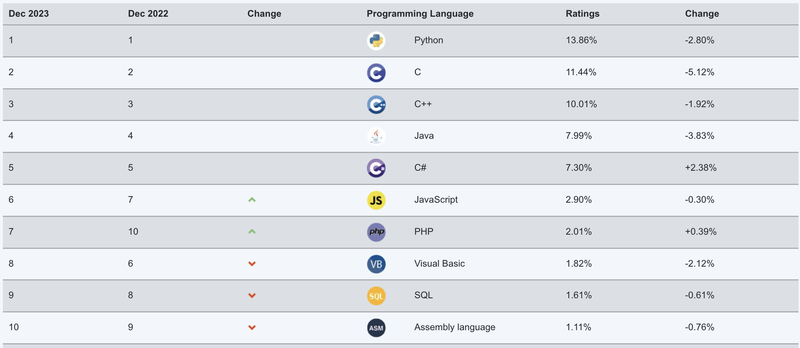

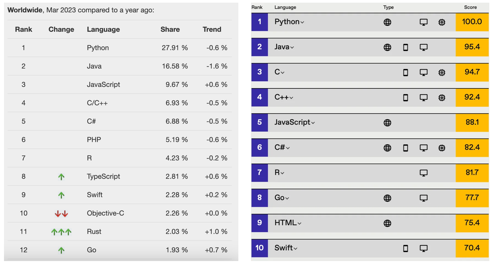

#### Biên niên sử Python

Dưới đây là một số mốc thời gian quan trọng trong quá trình phát triển của ngôn ngữ Python:

1. Tháng 12 năm 1989: Guido van Rossum quyết định phát triển một ngôn ngữ kịch bản mới cùng trình thông dịch đi kèm để giết thời gian trong dịp Giáng sinh buồn chán. Ngôn ngữ mới kế thừa ngôn ngữ ABC, chủ yếu dùng để thay thế Unix shell và ngôn ngữ C trong quản trị hệ thống. Vì bản thân Guido là một người hâm mộ trung thành của bộ phim truyền hình BBC "*Monty Python's Flying Circus*", ông đã chọn từ "Python" làm tên cho ngôn ngữ mới.
2. Tháng 02 năm 1991: Guido van Rossum phát hành mã nguồn đầu tiên của trình thông dịch Python trên nhóm tin alt.sources, đánh dấu phiên bản 0.9.0.
3. Tháng 01 năm 1994: Python 1.0 ra mắt, nơi giấc mơ bắt đầu.
4. Tháng 10 năm 2000: Python 2.0 ra mắt, toàn bộ quá trình phát triển của Python trở nên minh bạch hơn, hệ sinh thái bắt đầu dần hình thành.
5. Tháng 12 năm 2008: Python 3.0 ra mắt, mang đến nhiều tính năng mới của các ngôn ngữ lập trình hiện đại, nhưng không hoàn toàn tương thích ngược.
6. Tháng 04 năm 2011: pip lần đầu được phát hành, ngôn ngữ Python đã có công cụ quản lý package (gói) của riêng mình.
7. Tháng 07 năm 2018: Guido van Rossum tuyên bố "nghỉ phép vĩnh viễn" khỏi vị trí "Nhà độc tài nhân từ trọn đời" (BDFL - người có quyền quyết định cuối cùng khi cộng đồng dự án mã nguồn mở xảy ra tranh chấp).
8. Tháng 01 năm 2020: Sau khi Python 2 và Python 3 cùng tồn tại suốt 11 năm, ban quản trị chính thức ngừng cập nhật và bảo trì Python 2, khuyến khích người dùng nhanh chóng chuyển sang Python 3.
9. Hiện tại: Python được ứng dụng rộng rãi trong các mô hình ngôn ngữ lớn (GPT-3, GPT-4, BERT, ...), thị giác máy tính (nhận dạng hình ảnh, phát hiện vật thể, sinh ảnh, ...), gợi ý thông minh (YouTube, Netflix, ByteDance, ...), xe tự hành (Waymo, Apollo, ...), nhận dạng giọng nói, khoa học dữ liệu, giao dịch định lượng (quantitative trading), kiểm thử tự động, vận hành tự động (automation DevOps) và nhiều lĩnh vực khác. Hệ sinh thái của ngôn ngữ Python vô cùng phồn vinh.

> **Giải thích**: Số phiên bản của hầu hết các phần mềm thường được chia thành 3 phần có dạng A.B.C, trong đó A biểu thị phiên bản chính (major version), chỉ tăng khi phần mềm được viết lại nâng cấp toàn diện hoặc có thay đổi không tương thích ngược; B biểu thị cập nhật tính năng (minor version), tăng khi có tính năng mới; C biểu thị các sửa đổi nhỏ (chẳng hạn như sửa một lỗi/bug nào đó), chỉ cần có chỉnh sửa là C sẽ tăng.

#### Ưu nhược điểm của Python

Ngôn ngữ Python có rất nhiều ưu điểm, dưới đây là một vài điểm tiêu biểu dành cho các bạn:

1. **Đơn giản và thanh lịch**, so với nhiều ngôn ngữ lập trình khác, Python **dễ tiếp cận hơn rất nhiều**.
2. Dùng ít code hơn để làm được nhiều việc hơn, **nâng cao hiệu suất phát triển**.
3. Mã nguồn mở, sở hữu **cộng đồng và hệ sinh thái lớn mạnh**.
4. **Làm được rất nhiều việc**, có khả năng thích ứng cực kỳ cao.
5. **Ngôn ngữ keo nối (glue language)**, có khả năng kết dính các thành phần được phát triển bằng ngôn ngữ khác.
6. Ngôn ngữ thông dịch, dễ dàng **đa nền tảng**, có thể chạy trên nhiều hệ điều hành khác nhau.

Nhược điểm lớn nhất của Python là **hiệu năng thực thi thấp** (điểm yếu cố hữu của các ngôn ngữ thông dịch). Nếu bạn coi trọng tốc độ thực thi của code hơn, C, C++ hoặc Go có thể là sự lựa chọn tốt hơn cho bạn.

### Cài đặt môi trường Python

Muốn làm tốt việc trước hết phải mài sắc công cụ. Để bắt đầu hành trình lập trình Python của bạn, trước tiên cần phải cài đặt môi trường Python trên máy tính, nói đơn giản là cài đặt trình thông dịch Python cần thiết để chạy chương trình Python. Chúng tôi khuyên bạn nên cài đặt trình thông dịch Python 3 chính thức, được viết bằng ngôn ngữ C, chúng ta thường gọi là CPython, và đây có lẽ là lựa chọn tốt nhất của bạn lúc này. Đầu tiên, chúng ta cần tìm liên kết tải xuống từ [trang tải xuống chính thức](https://www.python.org/downloads/). Sau khi nhấp vào nút "Download" để vào trang tải xuống, bạn cần chọn trình cài đặt Python 3 phù hợp dựa trên hệ điều hành của mình, như hình dưới đây.

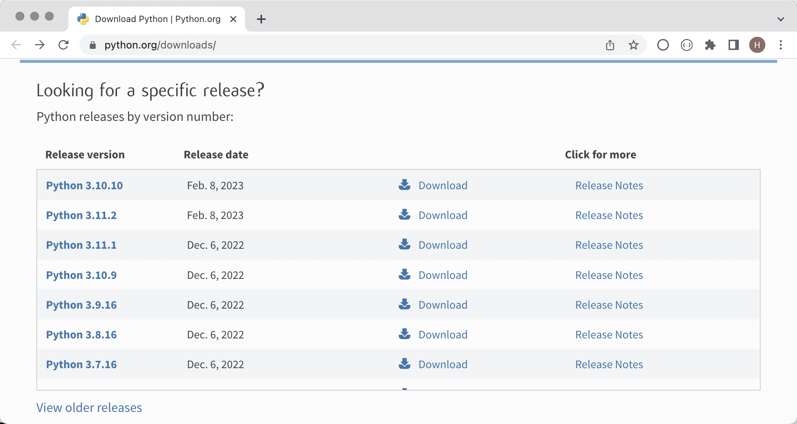

Sau khi vào trang tải xuống, một số phiên bản Python không cung cấp sẵn trình cài đặt cho hệ điều hành Windows và macOS mà chỉ cung cấp tệp nén chứa mã nguồn. Đối với các bạn đã quen thuộc với hệ điều hành Linux, chúng ta có thể biên dịch và cài đặt từ mã nguồn; còn với các bạn sử dụng Windows hoặc macOS, chúng tôi **khuyến nghị nhiệt liệt** nên sử dụng trình cài đặt có sẵn. Ví dụ, nếu muốn cài Python 3.10, chọn Python 3.10.10 hoặc Python 3.10.11 bạn sẽ tìm thấy gói cài đặt cho Windows hoặc macOS, trong khi các phiên bản khác có thể chỉ có mã nguồn, như hiển thị ở hình dưới.

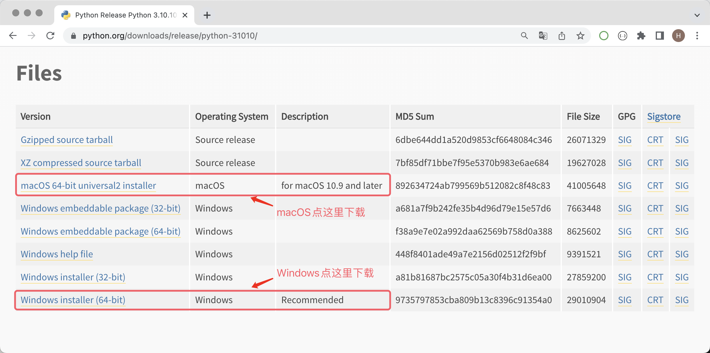

#### Môi trường Windows

Dưới đây chúng tôi lấy ví dụ trên Windows 11 để hướng dẫn cách cài đặt môi trường Python trên hệ điều hành Windows. Nhấp đúp vào tệp cài đặt tải về từ trang web chính thức, một trình hướng dẫn cài đặt sẽ mở ra như hình bên dưới.

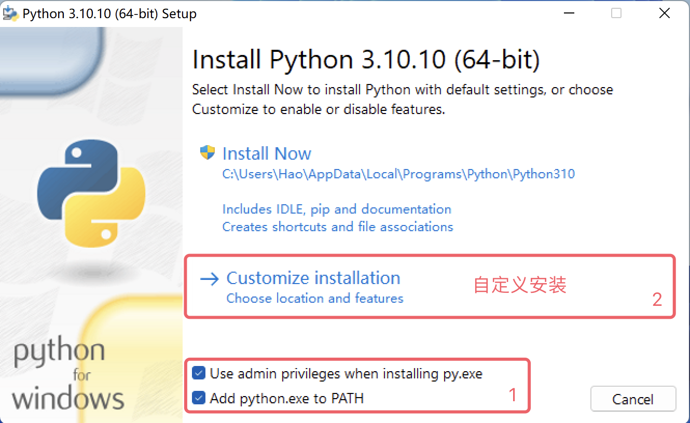

Đầu tiên, nhất định phải nhớ chọn tùy chọn "Add python.exe to PATH", nó sẽ giúp chúng ta thêm trình thông dịch Python vào biến môi trường PATH của hệ thống Windows (chưa hiểu cũng không sao, cứ tích chọn là đúng); thứ hai, "Use admin privileges when installing py.exe" dùng để nhận quyền quản trị viên (admin) trong quá trình cài đặt, khuyến nghị nên tích chọn. Sau đó, chúng ta chọn "Customize Installation" để sử dụng chế độ cài đặt tùy chỉnh. Đây là lựa chọn của dân chuyên nghiệp, và bạn (hãy giả vờ) là một chuyên gia như vậy, không nên dùng "Install Now" (cài đặt mặc định).

Tiếp theo, trình hướng dẫn cài đặt sẽ nhắc bạn chọn các "Optional Features" (tính năng tùy chọn) cần thiết, ở đây chúng ta có thể chọn tất cả. Đáng chú ý là mục thứ hai, đó là công cụ quản lý package pip của Python, giúp chúng ta cài đặt các thư viện và công cụ của bên thứ ba, vì vậy nhất định phải tích chọn nó, sau đó nhấp vào "Next" để chuyển sang bước tiếp theo.

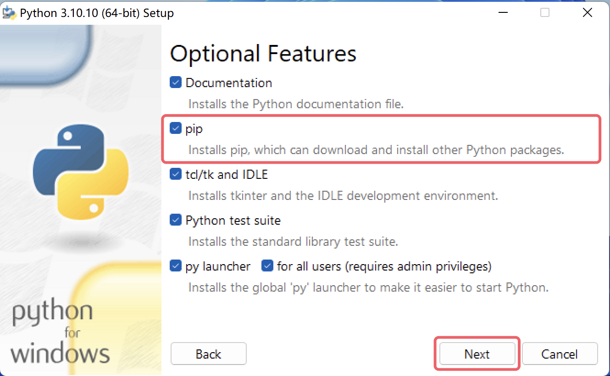

Tiếp theo là lựa chọn các "Advanced Options" (tùy chọn nâng cao), ở đây chúng tôi khuyên bạn chỉ nên tích chọn hai mục "Add Python to environment variables" và "Precompile standard library". Tùy chọn trước giúp chúng ta tự động cấu hình biến môi trường, tùy chọn sau sẽ biên dịch trước thư viện chuẩn (tạo ra tệp `.pyc`), nhờ đó khi sử dụng sẽ không cần biên dịch tạm thời. Vẫn là câu nói đó, chưa hiểu cũng không sao, cứ tích chọn là được. Mục "Customize install location" (tùy chỉnh đường dẫn cài đặt) bên dưới **rất khuyến khích** sửa thành một đường dẫn tùy chỉnh, đường dẫn này không nên chứa chữ có dấu, khoảng trắng hay ký tự đặc biệt khác. Chú ý điểm này sẽ giúp bạn tránh được rất nhiều rắc rối không đáng có sau này. Sau khi thiết lập xong, nhấp vào "Install" để bắt đầu cài đặt.

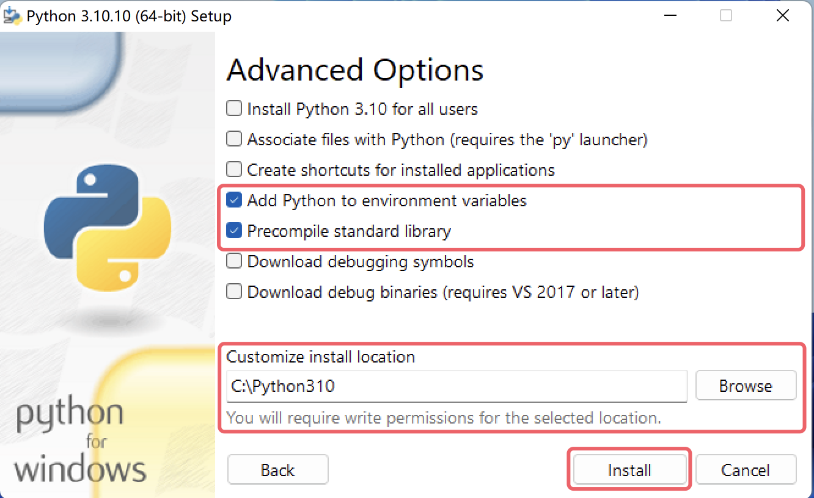

Cài đặt thành công sẽ xuất hiện giao diện như hình dưới, từ khóa cài đặt thành công là "successful", nếu cài đặt thất bại, từ ở đây sẽ đổi thành "failed".

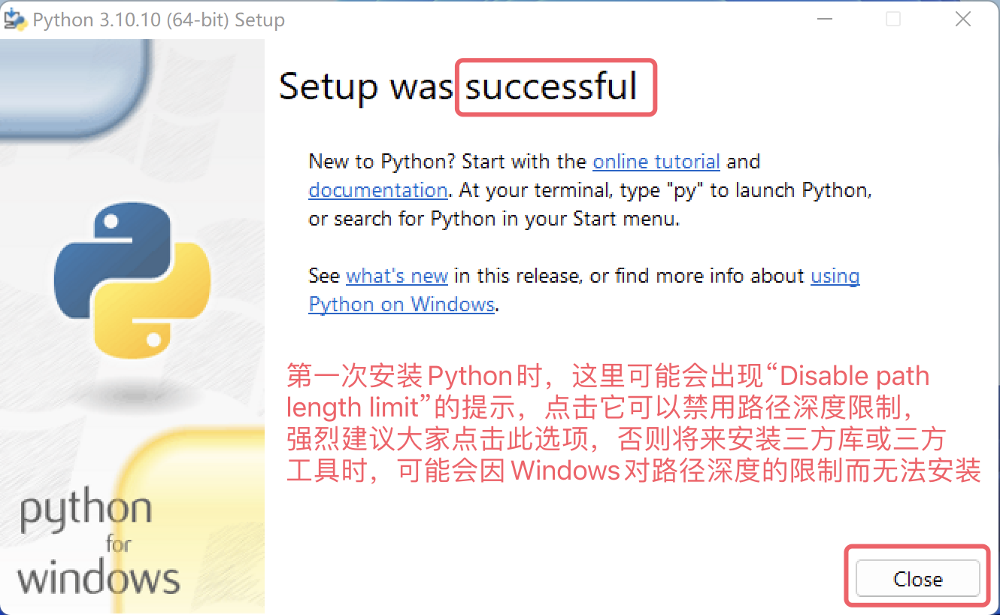

Sau khi cài đặt xong, bạn có thể mở "Command Prompt" (cmd) hoặc PowerShell của Windows, sau đó nhập `python --version` hoặc `python -V` để kiểm tra cài đặt có thành công hay không. Lệnh này dùng để xem số phiên bản của trình thông dịch Python. Nếu nhìn thấy giao diện hiển thị như bên dưới thì xin chúc mừng, môi trường Python đã được cài đặt thành công. Tại đây, chúng tôi khuyên bạn nên kiểm tra thêm xem công cụ quản lý package pip của Python có khả dụng hay không bằng lệnh tương ứng là `pip --version` hoặc `pip -V`.

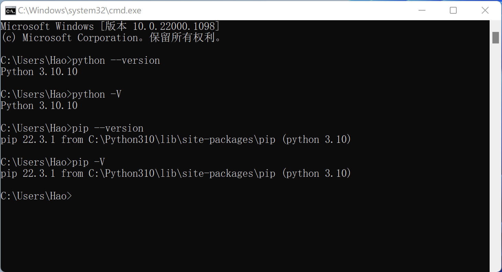

> **Giải thích**: Nếu quá trình cài đặt báo lỗi hoặc thông báo cài đặt thất bại, rất có thể hệ thống Windows của bạn đang thiếu một số tệp thư viện liên kết động (DLL) hoặc thiếu các công cụ build cần thiết. Bạn có thể tải "Visual Studio 2022 Build Tools" từ [trang web chính thức của Microsoft](https://visualstudio.microsoft.com/zh-hans/downloads/) để khắc phục, như hình dưới đây. Nếu không tiện tải từ trang web của Microsoft, bạn cũng có thể sử dụng liên kết Baidu Wangpan sau để nhận công cụ sửa lỗi, liên kết: https://pan.baidu.com/s/1iNDnU5UVdDX5sKFqsiDg5Q mã trích xuất: cjs3.
>
> 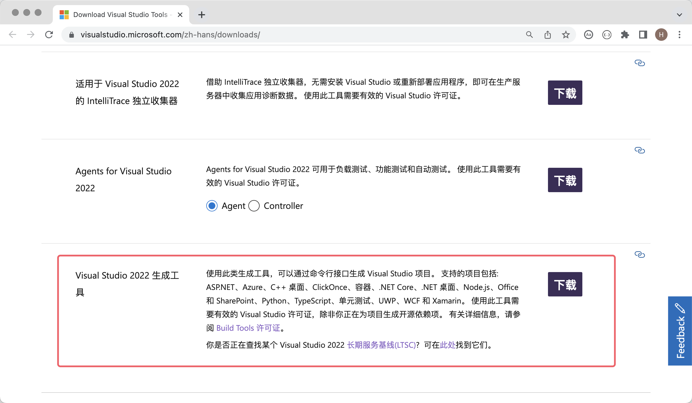
>
> "Visual Studio 2022 Build Tools" tải ở trên cần kết nối mạng để chạy. Sau khi chạy sẽ xuất hiện giao diện như hình dưới, các bạn có thể tham khảo hình để tích chọn các mục tương ứng nhằm tiến hành sửa lỗi. Quá trình khắc phục cần kết nối mạng để tải các gói phần mềm tương ứng, quá trình này có thể tốn khá nhiều thời gian. Sau khi khắc phục thành công, hệ thống có thể yêu cầu bạn khởi động lại máy tính.
>
> 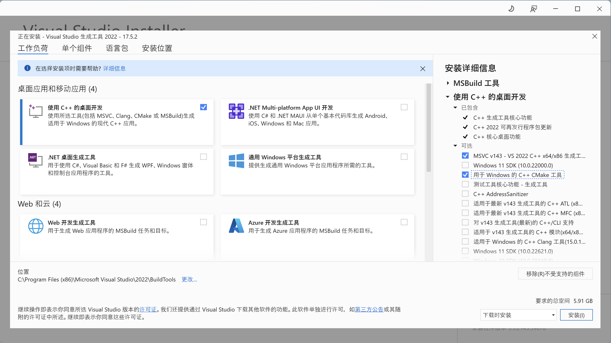

#### Môi trường macOS

Cài đặt môi trường Python trên macOS đơn giản hơn Windows rất nhiều. Gói cài đặt chúng ta tải về từ trang web chính thức là một tệp `.pkg`, sau khi nhấp đúp để chạy, bạn chỉ cần liên tục nhấp vào "Continue" (Tiếp tục) là cài đặt thành công, hầu như không cần thực hiện bất kỳ thiết lập hay tích chọn nào, như hình bên dưới.

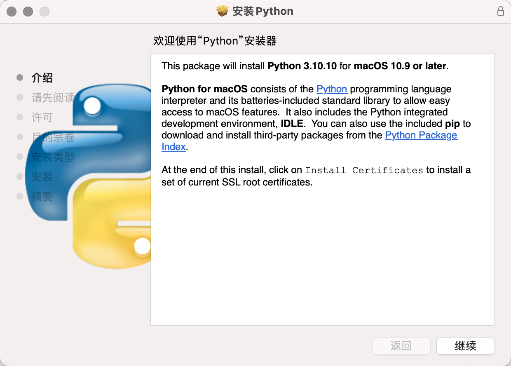

Sau khi cài đặt xong, bạn có thể nhập lệnh `python3 --version` trong công cụ "Terminal" của macOS để kiểm tra xem đã cài đặt thành công chưa. Lưu ý lệnh ở đây là `python3` chứ không phải `python`! Sau đó chúng ta kiểm tra tiếp công cụ quản lý package bằng cách nhập lệnh `pip3 --version`, như hình dưới đây.

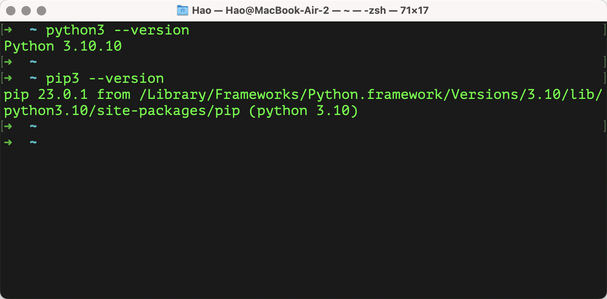

#### Các cách cài đặt khác

Một số người có thể khuyên người mới nên cài đặt trực tiếp [Anaconda](https://www.anaconda.com/download/success), vì Anaconda sẽ giúp chúng ta cài đặt trình thông dịch Python cùng một số thư viện bên thứ ba phổ biến, ngoài ra còn cung cấp một số công cụ tiện lợi, đặc biệt phù hợp cho người mới bắt đầu. Cá nhân tôi thực ra không khuyến khích người mới sử dụng trực tiếp Anaconda, vì khi cài Anaconda bạn sẽ cài một đống thư viện bên thứ ba hữu ích lẫn vô dụng một cách khó hiểu (chiếm khá nhiều dung lượng ổ cứng), sau đó terminal hoặc command prompt của bạn sẽ bị Anaconda can thiệp (tự động kích hoạt môi trường ảo mỗi lần khởi động), điều này không phù hợp với **nguyên tắc ít bất ngờ nhất** trong thiết kế phần mềm. Những phiền phức nhỏ khác của Anaconda xin không bàn thêm ở đây, nếu nhất định muốn dùng Anaconda, bạn có thể thử Miniconda, nó nằm cùng trang tải xuống với Anaconda.

Cũng có người mới học thường nghe thấy hoặc nói rằng: "Tôi muốn viết chương trình Python, chẳng phải chỉ cần cài PyCharm là được sao?". Ở đây xin giải thích ngắn gọn, PyCharm chỉ là một công cụ hỗ trợ viết mã Python, bản thân nó không có khả năng chạy mã Python. Việc chạy mã Python phải dựa vào trình thông dịch Python mà chúng ta đã cài đặt ở trên. Tất nhiên, một số phiên bản PyCharm khi tạo dự án Python nếu không phát hiện thấy môi trường Python trên máy của bạn thì cũng sẽ gợi ý bạn kết nối mạng để tải trình thông dịch Python. Cách cài đặt và sử dụng PyCharm chúng ta sẽ học trong bài tiếp theo.

### Tổng kết

Hãy cùng tổng kết lại những gì chúng ta đã học:

1. Ngôn ngữ Python rất mạnh mẽ, có thể làm được rất nhiều việc, vì vậy rất đáng để chúng ta học tập.
2. Để sử dụng ngôn ngữ Python, trước hết phải cài đặt môi trường Python, tức là trình thông dịch Python cần thiết để chạy chương trình Python.
3. Trên hệ điều hành Windows, bạn có thể nhập `python --version` trong Command Prompt hoặc PowerShell để kiểm tra xem môi trường Python đã cài đặt thành công chưa; trên hệ điều hành macOS, bạn có thể nhập `python3 --version` trong Terminal để kiểm tra.
