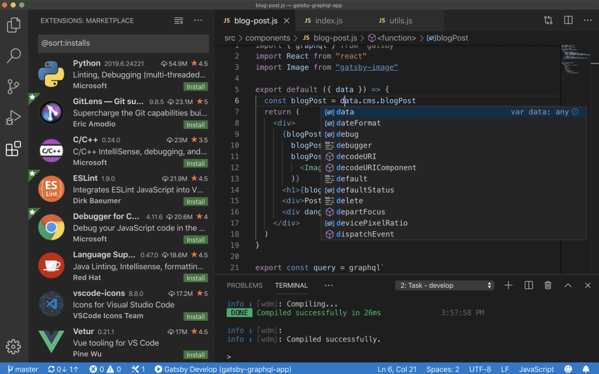
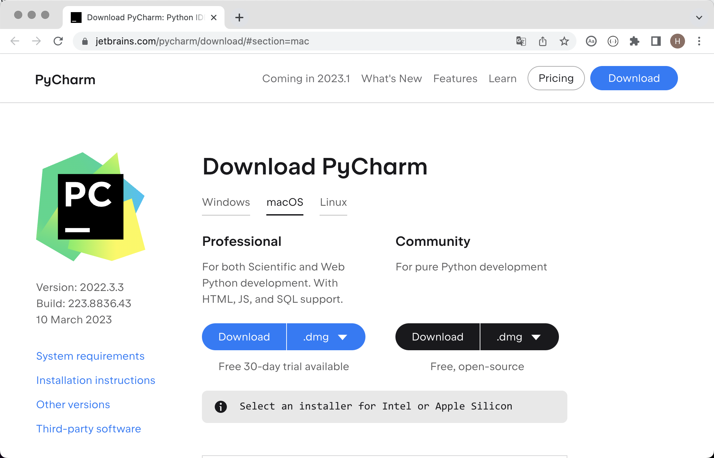
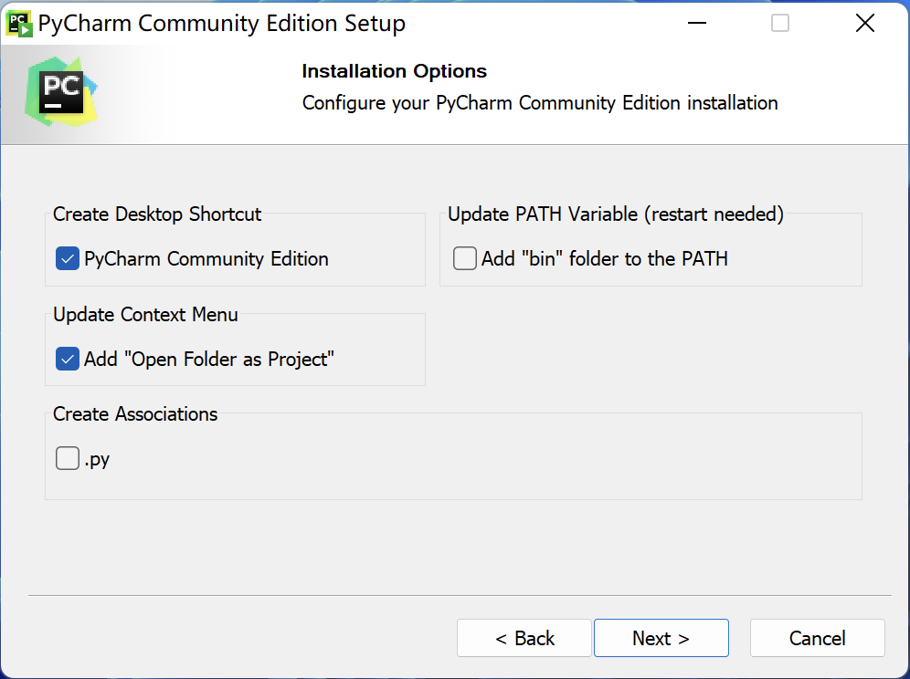
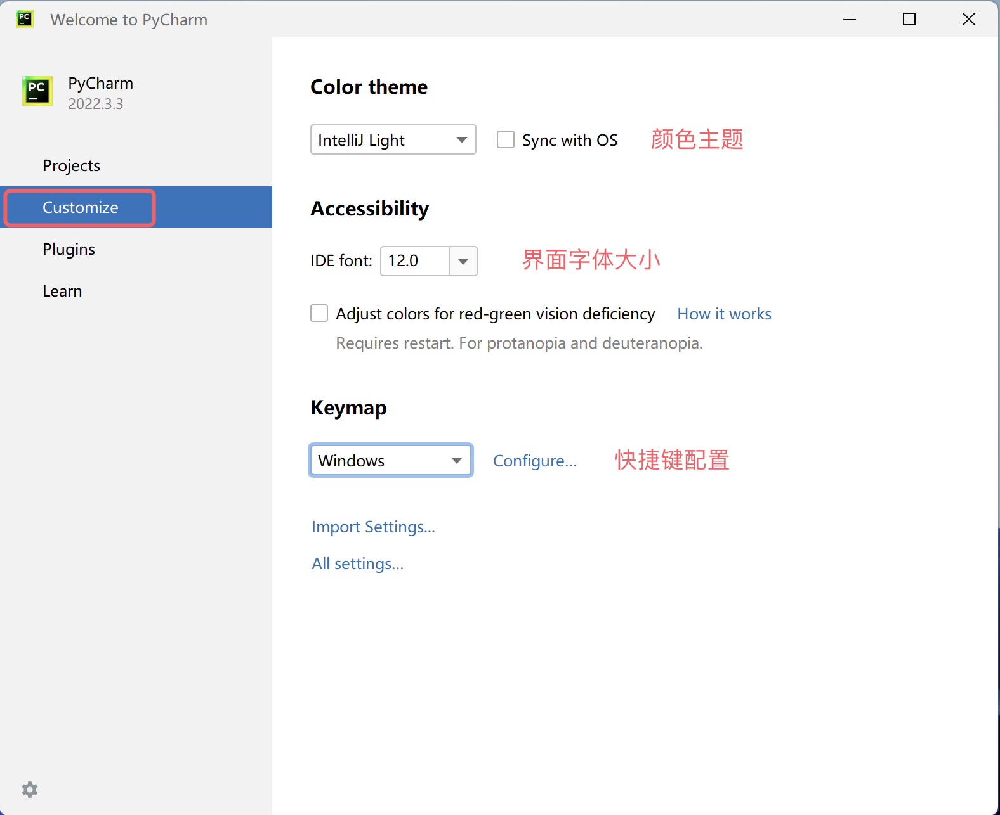
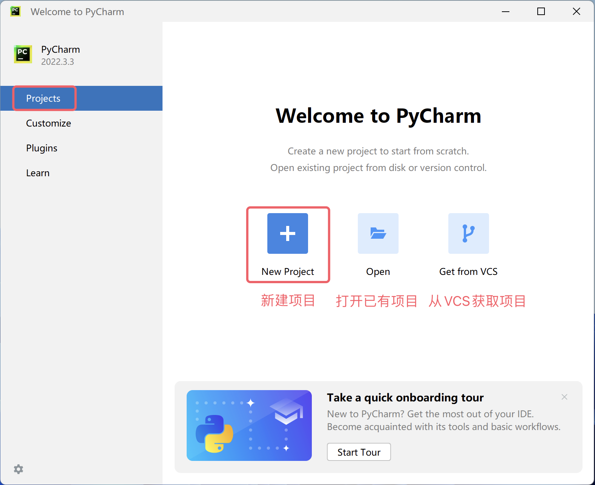
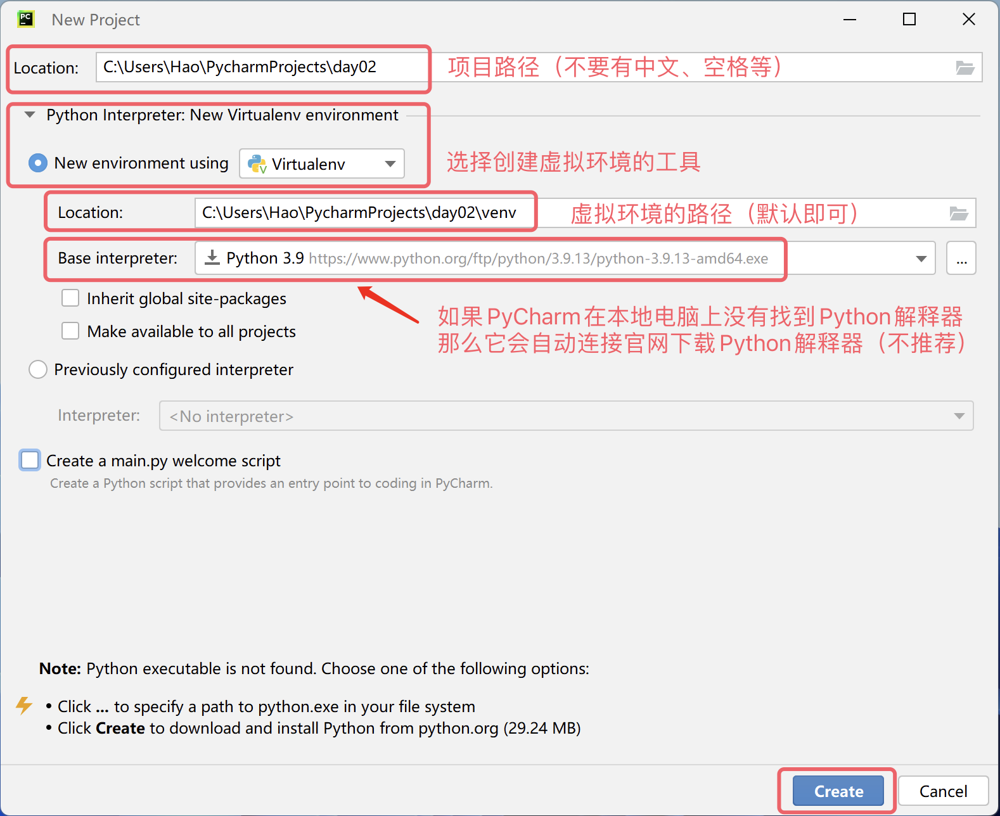
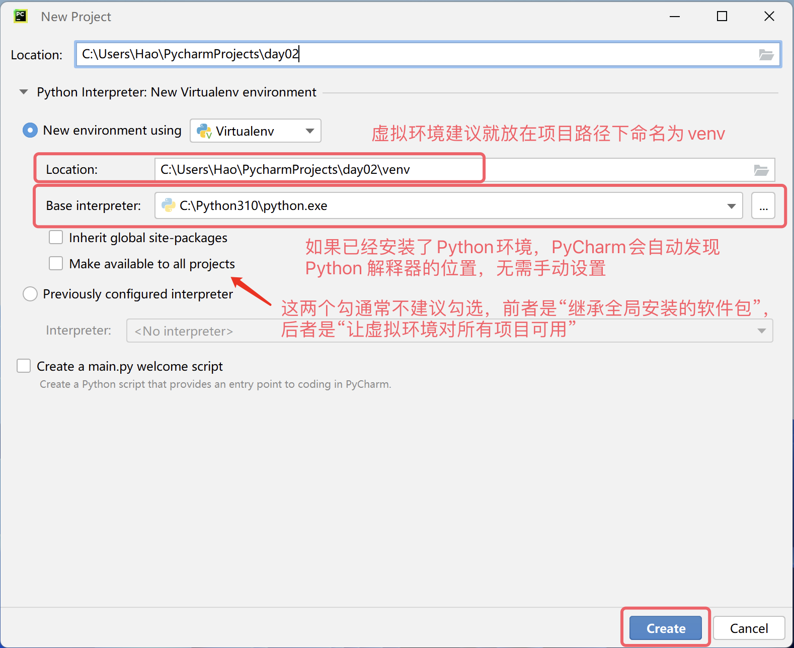
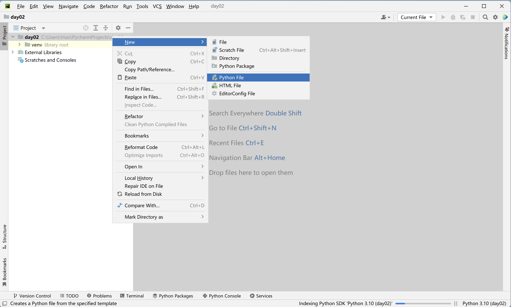
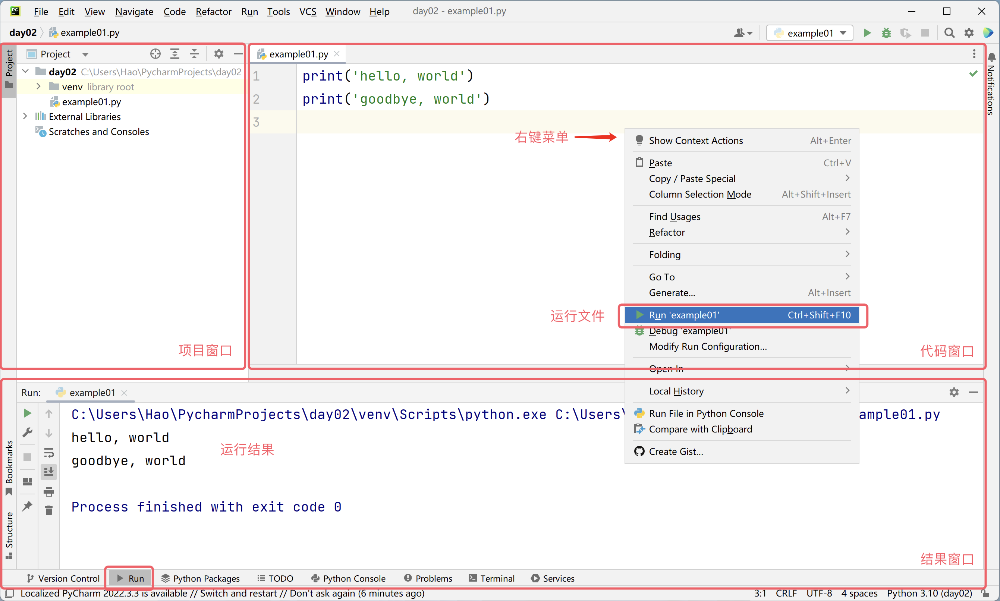
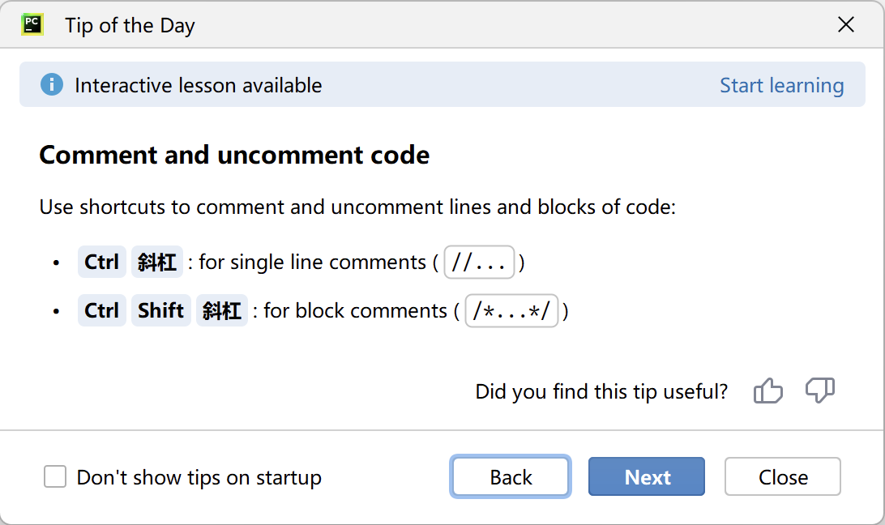

## Chương trình Python đầu tiên

Trong bài trước, chúng ta đã tìm hiểu đôi nét về quá khứ và hiện tại của ngôn ngữ Python, đồng thời chuẩn bị xong môi trường trình thông dịch cần thiết để chạy chương trình Python. Tin rằng các bạn đã rất nóng lòng muốn bắt đầu hành trình lập trình Python của mình, nhưng câu hỏi mới lại xuất hiện: chúng ta nên viết chương trình Python ở đâu và làm thế nào để chạy nó?

### Công cụ viết mã

Dưới đây chúng tôi sẽ giới thiệu cho các bạn một số công cụ có thể dùng để viết và chạy mã Python, bạn có thể chọn công cụ phù hợp theo nhu cầu của mình. Tất nhiên, đối với người mới bắt đầu, cá nhân tôi khuyên bạn nên sử dụng PyCharm vì nó không cần cấu hình quá phức tạp nhưng lại vô cùng mạnh mẽ và rất thân thiện với người mới. Nếu bạn đã từng nghe nói hoặc thích PyCharm, bạn có thể bỏ qua phần giới thiệu các công cụ khác dưới đây và chuyển thẳng đến phần hướng dẫn về PyCharm.

#### Môi trường tương tác mặc định

Chúng ta mở công cụ "Command Prompt" hoặc "PowerShell" của Windows, nhập `python` rồi nhấn phím `Enter`, lệnh này sẽ đưa chúng ta vào một môi trường tương tác (interactive shell). Môi trường tương tác nghĩa là khi chúng ta nhập một dòng lệnh và nhấn phím `Enter`, mã sẽ lập tức được thực thi; nếu mã có trả về kết quả, kết quả đó sẽ được hiển thị ngay trong cửa sổ, như hiển thị bên dưới.

```Bash
Python 3.10.10
Type "help", "copyright", "credits" or "license" for more information.
>>> 2 * 3
6
>>> 2 + 3
5
>>>
```

> **Giải thích**: Người dùng sử dụng hệ điều hành macOS cần mở công cụ "Terminal" và nhập `python3` để vào môi trường tương tác.

Nếu muốn thoát khỏi môi trường tương tác, bạn có thể nhập `quit()` trong môi trường tương tác, như sau:

```Bash
>>> quit()
```

#### Môi trường tương tác tốt hơn - IPython

Môi trường tương tác nói trên có trải nghiệm người dùng không được tốt cho lắm, chỉ cần dùng thử là bạn sẽ cảm nhận được ngay. Chúng ta có thể dùng IPython để thay thế nó, vì IPython cung cấp các tính năng chỉnh sửa và tương tác mạnh mẽ hơn nhiều. Chúng ta có thể sử dụng công cụ quản lý package `pip` của Python trong Command Prompt hoặc Terminal để cài đặt IPython như sau:

```bash
pip install ipython
```

> **Gợi ý**: Trước khi sử dụng lệnh trên để cài đặt IPython, bạn có thể đổi nguồn tải về thành mirror Douban hoặc Tsinghua (Đại học Thanh Hoa) thông qua lệnh `pip config set global.index-url https://pypi.doubanio.com/simple` hoặc `pip config set global.index-url https://pypi.tuna.tsinghua.edu.cn/simple/`, nếu không quá trình tải xuống và cài đặt có thể diễn ra rất chậm.

Tiếp theo, bạn có thể dùng lệnh dưới đây để khởi động IPython và bước vào môi trường tương tác:

```bash
ipython
```

> **Giải thích**: Còn có một phiên bản web của IPython tên là Jupyter, chúng ta sẽ giới thiệu khi có bài cần dùng đến nó.

#### Trình soạn thảo văn bản đỉnh cao - Visual Studio Code

Visual Studio Code là trình biên tập mã nguồn đỉnh cao do Microsoft phát triển, có thể chạy trên các hệ điều hành như Windows, Linux và macOS. Nó hỗ trợ hàng loạt tính năng tiện lợi như làm nổi bật cú pháp (syntax highlighting), tự động hoàn thành mã (autocomplete), chỉnh sửa nhiều vị trí cùng lúc (multi-cursor), chạy và gỡ lỗi (debugging), đồng thời hỗ trợ rất nhiều ngôn ngữ lập trình. Nếu các bạn muốn chọn một công cụ soạn thảo văn bản nâng cao, tôi rất khuyến khích dùng Visual Studio Code. Về cách [tải xuống](https://code.visualstudio.com/), cài đặt và sử dụng, độc giả quan tâm có thể tự tìm hiểu thêm.



#### Môi trường phát triển tích hợp - PyCharm

Nếu dùng ngôn ngữ Python để phát triển các dự án thương mại, chúng tôi khuyên bạn nên sử dụng công cụ chuyên nghiệp hơn là PyCharm. PyCharm là môi trường phát triển tích hợp (IDE) dành riêng cho ngôn ngữ Python do một công ty của Séc tên là [JetBrains](https://www.jetbrains.com/) cung cấp. Môi trường phát triển tích hợp thường là công cụ phát triển cung cấp chuỗi tính năng mạnh mẽ và thao tác tiện lợi như viết mã, chạy mã, gỡ lỗi mã, phân tích mã, kiểm soát phiên bản (VCS), vì vậy đặc biệt phù hợp cho phát triển dự án thương mại. Chúng ta có thể tìm thấy [liên kết tải xuống PyCharm](https://www.jetbrains.com/pycharm/download) trên trang web chính thức của JetBrains, như hình dưới đây.



Hãng cung cấp hai phiên bản PyCharm: một là bản Community Edition (bản cộng đồng) miễn phí, tính năng tương đối cơ bản nhưng hoàn toàn đủ dùng cho người mới bắt đầu; hai là bản Professional Edition (bản chuyên nghiệp) trả phí, tính năng cực kỳ mạnh mẽ nhưng cần trả phí theo năm hoặc theo tháng, người dùng mới có thể dùng thử miễn phí trong 30 ngày. Việc cài đặt PyCharm không hề khó khăn, bạn chỉ cần chạy trình cài đặt tải về và hầu như chọn các thiết lập mặc định để cài đặt là xong. Đối với các bạn dùng hệ điều hành Windows, có một bước bạn có thể tích chọn tạo phím tắt trên màn hình desktop và thêm tùy chọn "Open Folder as Project" vào menu chuột phải như hình bên dưới.



Lần đầu chạy PyCharm, tại giao diện nhắc nhập thiết lập PyCharm, bạn hãy chọn thẳng "Do not import settings", sau đó chúng ta sẽ thấy giao diện chào mừng như hình dưới đây. Tại đây, trước tiên chúng ta có thể nhấp vào mục "Customize" để cá nhân hóa một số thiết lập cho PyCharm.



Tiếp theo, chúng ta có thể nhấp vào "New Project" trong mục "Projects" để tạo một dự án mới, tại đây bạn cũng có thể "Mở dự án đã có" hoặc "Lấy dự án từ máy chủ kiểm soát phiên bản (VCS)", như hình dưới đây.



Khi tạo dự án cần chỉ định đường dẫn của dự án và tạo "môi trường ảo" (virtual environment). Chúng tôi khuyên mỗi dự án Python nên chạy trong môi trường ảo chuyên biệt của riêng nó. Nếu hệ thống của bạn chưa có môi trường Python, PyCharm sẽ cung cấp liên kết tải xuống chính thức, khi bạn nhấp vào nút "Create" để tạo dự án, nó sẽ kết nối mạng để tải trình thông dịch Python, như hình dưới đây.



Tất nhiên chúng tôi không khuyến khích làm vậy, vì chúng ta đã cài đặt môi trường Python ở bài trước rồi. Khi hệ thống đã có sẵn môi trường Python, PyCharm thường sẽ tự động phát hiện vị trí của trình thông dịch Python và dựa vào đó để tạo môi trường ảo, do đó giao diện bạn nhìn thấy sẽ như hình dưới đây.



> **Giải thích**: Ảnh chụp màn hình ở trên lấy từ hệ điều hành Windows, nếu sử dụng hệ điều hành macOS, đường dẫn dự án và đường dẫn trình thông dịch Python bạn nhìn thấy sẽ khác với hình trên.

Sau khi tạo xong dự án sẽ xuất hiện giao diện như hình dưới. Chúng ta có thể nhấp chuột phải vào thư mục dự án, chọn "Python File" trong menu "New" để tạo một tệp Python. Khi đặt tên cho tệp, bạn nên sử dụng kết hợp chữ cái tiếng Anh và dấu gạch dưới. Tệp Python sau khi tạo xong sẽ tự động mở ra ở trạng thái có thể chỉnh sửa.



Tiếp theo, chúng ta có thể viết mã Python trong cửa sổ soạn thảo code. Sau khi viết xong mã, bạn có thể nhấp chuột phải trong cửa sổ soạn thảo và chọn mục menu "Run" để chạy mã, cửa sổ "Run" bên dưới sẽ hiển thị kết quả thực thi của mã, như hình dưới đây.



Đến đây, chương trình Python đầu tiên của chúng ta đã vận hành rồi, thật tuyệt vời phải không! À đúng rồi, PyCharm có một cửa sổ bật lên gọi là "Mẹo hay mỗi ngày" (Tip of the Day), hướng dẫn cho bạn một số thủ thuật khi sử dụng PyCharm như hình dưới. Nếu không cần, bạn chỉ cần đóng nó lại; nếu không muốn nó xuất hiện lại, trước khi đóng bạn có thể tích chọn "Don't show tips on startup".



### Hello World

Theo thông lệ trong ngành lập trình, chương trình đầu tiên mà chúng ta viết khi học bất kỳ ngôn ngữ lập trình nào cũng là in ra `hello, world`. Bởi vì đoạn mã này là đoạn mã đầu tiên mà Dennis Ritchie vĩ đại (cha đẻ của ngôn ngữ C, cùng Ken Thompson phát triển hệ điều hành Unix) và Brian Kernighan (tác giả của ngôn ngữ awk) viết trong tác phẩm bất hủ của họ là "*The C Programming Language*". Dưới đây là phiên bản tương ứng bằng ngôn ngữ Python:

```python
print('hello, world')
```

> **Lưu ý**: Dấu ngoặc đơn và dấu nháy đơn trong đoạn mã trên đều được nhập ở chế độ gõ ký tự tiếng Anh/nửa độ rộng (half-width). Nếu bạn vô tình gõ nhầm thành dấu ngoặc đơn hoặc dấu nháy kép kiểu toàn giác (full-width) như của tiếng Trung, khi chạy mã sẽ xuất hiện thông báo lỗi như `SyntaxError: invalid character '（' (U+FF08)` hoặc `SyntaxError: invalid character '‘' (U+2018)`.

Đoạn mã trên chỉ có một câu lệnh duy nhất. Trong câu lệnh này, chúng ta sử dụng một hàm có tên là `print`, nó giúp chúng ta xuất ra nội dung được chỉ định; `'hello, world'` bên trong dấu ngoặc đơn của hàm `print` là một chuỗi (string), đại diện cho một đoạn văn bản; trong ngôn ngữ Python, chúng ta có thể dùng dấu nháy đơn hoặc dấu nháy kép để biểu thị một chuỗi. Khác với các ngôn ngữ lập trình như C, C++ hoặc Java, câu lệnh trong mã Python không cần dùng dấu chấm phẩy để kết thúc, nghĩa là nếu chúng ta muốn viết thêm một câu lệnh nữa thì chỉ cần nhấn Enter xuống dòng là được, như đoạn mã dưới đây. Ngoài ra, mã Python cũng không cần viết hàm khởi đầu mang tên `main` để chạy. Cung cấp hàm khởi đầu là điều bắt buộc khi viết mã thực thi bằng C, C++ hoặc Java, điều mà nhiều lập trình viên không còn xa lạ, nhưng trong ngôn ngữ Python thì điều đó là không cần thiết.

```python
print('hello, world')
print('goodbye, world')
```

Nếu không sử dụng môi trường phát triển tích hợp như PyCharm, chúng ta cũng có thể gọi trực tiếp trình thông dịch Python để chạy chương trình Python. Chúng ta có thể lưu đoạn mã trên thành một tệp có tên `example01.py`. Với hệ điều hành Windows, giả sử tệp này nằm trong thư mục `C:\code`, chúng ta mở "Command Prompt" hoặc "PowerShell" và nhập lệnh sau là có thể chạy được:

```powershell
python C:\code\example01.py
```

Với hệ điều hành macOS, giả sử tệp của chúng ta nằm trong thư mục `/Users/Hao`, bạn có thể nhập lệnh dưới đây trong Terminal để chạy chương trình:

```Bash
python3 /Users/Hao/example01.py
```

> **Gợi ý**: Nếu đường dẫn tương đối dài và bạn không muốn gõ tay, chúng ta có thể kéo và thả trực tiếp tệp vào "Command Prompt" hoặc "Terminal", đường dẫn đầy đủ của tệp sẽ tự động được nhập vào.

Các bạn có thể thử chỉnh sửa đoạn mã trên, chẳng hạn như thay `hello, world` bên trong dấu nháy đơn thành nội dung khác hoặc viết thêm vài câu lệnh như vậy để xem kết quả chạy ra sao. Cần nhắc nhở các bạn rằng khi viết mã Python, tốt nhất mỗi dòng chỉ nên viết một câu lệnh duy nhất. Mặc dù chúng ta có thể dùng dấu `;` để phân tách nhiều câu lệnh trên cùng một dòng, nhưng làm như vậy sẽ khiến mã nguồn trở nên rất xấu và mất đi tính dễ đọc vốn có.

### Chú thích mã nguồn của bạn

Chú thích (comment) là một phần quan trọng của ngôn ngữ lập trình, dùng để giải thích tác dụng của mã nguồn ngay trong code, từ đó đạt được mục tiêu nâng cao tính dễ đọc của mã. Tất nhiên, chúng ta cũng có thể tạm thời vô hiệu hóa những đoạn mã chưa cần chạy bằng cách thêm chú thích vào; khi cần dùng lại những đoạn mã đó, chỉ cần xóa bỏ ký hiệu chú thích đi là xong. Nói một cách đơn giản, **chú thích giúp mã dễ hiểu hơn nhưng không ảnh hưởng đến kết quả thực thi của mã**.

Trong Python có hai hình thức chú thích:

1. Chú thích một dòng: Bắt đầu bằng dấu `#` và dấu cách, có thể chú thích toàn bộ phần nội dung phía sau kể từ dấu `#` trên dòng đó.
2. Chú thích nhiều dòng: Bắt đầu bằng ba dấu nháy (thường dùng nháy kép) và kết thúc bằng ba dấu nháy, thường dùng để thêm nội dung giải thích gồm nhiều dòng.

```python
"""
Chương trình Python đầu tiên - hello, world

Version: 1.0
Author: jackfrued
"""
# print('hello, world')
print("Xin chào thế giới!")
```

### Tổng kết

Đến đây, chúng ta đã chạy được chương trình Python đầu tiên rồi, có cảm giác thành tựu lắm phải không?! Chỉ cần bạn kiên trì học tiếp, thêm một thời gian nữa chúng ta có thể dùng ngôn ngữ Python để làm được nhiều điều thú vị và tuyệt vời hơn. Ngày nay, lập trình cũng giống như tiếng Anh, đối với rất nhiều người đã trở thành một kỹ năng bắt buộc phải nắm vững.
