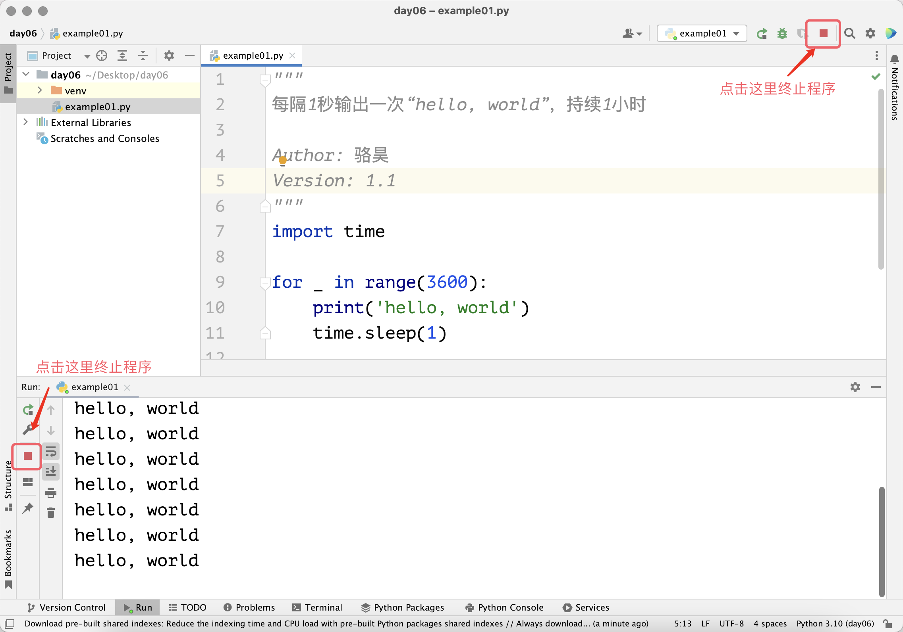

## Cấu trúc vòng lặp

Khi viết chương trình, chúng ta rất có thể sẽ gặp những trường hợp cần thực hiện lặp đi lặp lại một hoặc một số câu lệnh, chẳng hạn như chúng ta cần cứ sau mỗi 1 giây lại in ra màn hình "hello, world" và in liên tục như vậy trong 1 giờ đồng hồ. Đoạn mã dưới đây có thể thực hiện thao tác đó một lần, nếu muốn in liên tục trong một giờ, chúng ta sẽ phải viết đoạn mã này 3600 lần, liệu bạn có sẵn sàng làm như vậy không?

```python
import time

print('hello, world')
time.sleep(1)
```

> **Giải thích**: Hàm `sleep` trong module tích hợp sẵn `time` của Python có thể tạm dừng (ngủ) chương trình, tham số `1` biểu thị số giây tạm dừng, có thể dùng kiểu `int` hoặc `float`, ví dụ `0.05` biểu thị `50` mili-giây. Về kiến thức hàm và module, chúng tôi sẽ hướng dẫn các bạn trong các bài học sau.

Để giải quyết vấn đề trong tình huống nêu trên, chúng ta có thể sử dụng cấu trúc vòng lặp trong chương trình Python. Cấu trúc vòng lặp chính là cấu trúc điều khiển một hoặc một nhóm câu lệnh lặp đi lặp lại trong chương trình. Với cấu trúc này, đoạn mã trên không cần phải viết 3600 lần nữa, mà chỉ cần viết một lần rồi đưa vào cấu trúc vòng lặp để lặp lại 3600 lần. Trong ngôn ngữ Python, có hai cách để xây dựng cấu trúc vòng lặp: một là vòng lặp `for-in`, hai là vòng lặp `while`.

### Vòng lặp for-in

Nếu biết trước chính xác số lần vòng lặp cần thực hiện, chúng tôi khuyên bạn nên sử dụng vòng lặp `for-in`. Ví dụ với trường hợp lặp lại 3600 lần ở trên, chúng ta có thể dùng đoạn mã dưới đây để thực hiện. Lưu ý rằng khối mã được điều khiển bởi vòng lặp `for-in` cũng được xây dựng bằng cách thụt lề, điều này hoàn toàn giống với cách tạo khối mã trong cấu trúc rẽ nhánh. Khối mã chịu sự kiểm soát của vòng lặp `for-in` được gọi là thân vòng lặp, thông thường các câu lệnh trong thân vòng lặp sẽ được thực thi lặp lại theo thiết lập của vòng lặp.

```python
"""
Cứ sau mỗi 1 giây xuất ra "hello, world", liên tục trong 1 giờ

Author: jackfrued
Version: 1.0
"""
import time

for i in range(3600):
    print('hello, world')
    time.sleep(1)
```

Cần giải thích thêm rằng, `range(3600)` trong đoạn mã trên có thể tạo ra một phạm vi từ `0` đến `3599`. Khi chúng ta đặt phạm vi này vào trong vòng lặp `for-in`, biến vòng lặp `i` ở phía trước sẽ lần lượt lấy từng số nguyên từ `0` đến `3599`, điều này làm cho các câu lệnh trong khối `for-in` lặp lại 3600 lần. Tất nhiên, cách dùng của `range` rất linh hoạt, danh sách dưới đây cung cấp một số ví dụ sử dụng hàm `range`:

- `range(101)`: Dùng để sinh các số nguyên trong phạm vi từ `0` đến `100`, cần lưu ý là không lấy đến `101`.
- `range(1, 101)`: Dùng để sinh các số nguyên trong phạm vi từ `1` đến `100`, tương đương với nửa đóng nửa mở `[1, 101)`.
- `range(1, 101, 2)`: Dùng để sinh các số lẻ từ `1` đến `100`, trong đó `2` là bước nhảy (step), tức là giá trị tăng thêm mỗi lần, không lấy đến `101`.
- `range(100, 0, -2)`: Dùng để sinh các số chẵn từ `100` đến `1`, trong đó `-2` là bước nhảy (step), tức là giá trị giảm đi mỗi lần, không lấy đến `0`.

Có thể các bạn đã nhận thấy rằng thao tác in ra và tạm dừng ở đoạn mã trên đều không dùng tới biến vòng lặp `i`. Đối với cấu trúc vòng lặp `for-in` không cần dùng tới biến vòng lặp, theo quy ước lập trình của Python, chúng ta thường đặt tên biến vòng lặp là `_`, đoạn mã sau khi sửa đổi sẽ như sau. Mặc dù kết quả không có gì thay đổi, nhưng viết như vậy trông bạn sẽ chuyên nghiệp và đẳng cấp hơn hẳn.

```python
"""
Cứ sau mỗi 1 giây xuất ra "hello, world", liên tục trong 1 giờ

Author: jackfrued
Version: 1.1
"""
import time

for _ in range(3600):
    print('hello, world')
    time.sleep(1)
```

Đoạn mã trên cần chạy trong một giờ, nếu muốn kết thúc chương trình sớm, trong PyCharm bạn có thể nhấp vào nút Stop màu đỏ trên cửa sổ chạy, như hình dưới đây. Nếu chạy mã trong Command Prompt hoặc Terminal, bạn có thể dùng tổ hợp phím `Ctrl + C` để ngắt chương trình.



Dưới đây, chúng ta dùng vòng lặp `for-in` để tính tổng các số nguyên từ 1 đến 100, tức là $\small{\sum_{n=1}^{100}{n}}$.

```python
"""
Tính tổng các số nguyên từ 1 đến 100

Version: 1.0
Author: jackfrued
"""
total = 0
for i in range(1, 101):
    total += i
print(total)
```

Trong đoạn mã trên, tác dụng của biến `total` là lưu trữ kết quả tích lũy. Trong quá trình lặp, giá trị của biến vòng lặp `i` sẽ nhận lần lượt từ 1 cho đến 100. Với mỗi giá trị của biến `i`, chúng ta đều thực thi câu lệnh `total += i`, tương đương với `total = total + i`, câu lệnh này thực hiện phép cộng dồn tích lũy. Vì vậy, khi vòng lặp kết thúc, chúng ta in giá trị của biến `total`, giá trị của nó chính là kết quả cộng dồn từ 1 đến 100, tức 5050. Lưu ý rằng câu lệnh `print(total)` phía trước không có thụt lề, nó không chịu sự điều khiển của vòng lặp `for-in` nên sẽ không bị lặp lại.

Chúng ta hãy viết thêm đoạn mã tính tổng các số chẵn từ 1 đến 100 như sau:

```python
"""
Tính tổng các số chẵn từ 1 đến 100

Version: 1.0
Author: jackfrued
"""
total = 0
for i in range(1, 101):
    if i % 2 == 0:
        total += i
print(total)
```

> **Giải thích**: Trong vòng lặp `for-in` ở trên, chúng ta đã dùng cấu trúc rẽ nhánh để kiểm tra xem biến vòng lặp `i` có phải là số chẵn hay không.

Chúng ta cũng có thể sửa đổi tham số của hàm `range`, đổi giá trị bắt đầu và bước nhảy thành `2`, dùng đoạn mã đơn giản hơn để tính tổng các số chẵn từ 1 đến 100:

```python
"""
Tính tổng các số chẵn từ 1 đến 100

Version: 1.1
Author: jackfrued
"""
total = 0
for i in range(2, 101, 2):
    total += i
print(total)
```

Tất nhiên, cách đơn giản hơn nữa là sử dụng hàm `sum` tích hợp sẵn của Python để tính tổng, làm như vậy chúng ta thậm chí không cần đến cấu trúc vòng lặp:

```python
"""
Tính tổng các số chẵn từ 1 đến 100

Version: 1.2
Author: jackfrued
"""
print(sum(range(2, 101, 2)))
```

### Vòng lặp while

Nếu muốn xây dựng cấu trúc vòng lặp nhưng lại không thể xác định trước số lần lặp lại, chúng tôi khuyên bạn nên sử dụng vòng lặp `while`. Vòng lặp `while` kiểm soát quá trình lặp thông qua giá trị boolean hoặc một biểu thức sinh ra giá trị boolean. Khi giá trị boolean hoặc biểu thức có giá trị `True`, các câu lệnh trong thân vòng lặp (khối mã giữ cùng độ thụt lề bên dưới câu lệnh `while`) sẽ được lặp lại; khi giá trị biểu thức là `False`, vòng lặp sẽ kết thúc.

Dưới đây chúng ta dùng vòng lặp `while` để tính tổng các số nguyên từ 1 đến 100, mã nguồn như sau:

```python
"""
Tính tổng các số nguyên từ 1 đến 100

Version: 1.1
Author: jackfrued
"""
total = 0
i = 1
while i <= 100:
    total += i
    i += 1
print(total)
```

So với vòng lặp `for-in`, trong đoạn mã trên chúng ta thêm vào biến `i` trước khi vòng lặp bắt đầu và dùng biến này để điều khiển vòng lặp, vì vậy phía sau `while` có điều kiện `i <= 100`. Trong thân vòng lặp của `while`, ngoài việc cộng dồn tích lũy, chúng ta còn cần làm cho giá trị của biến `i` tăng dần, do đó chúng ta đã thêm câu lệnh `i += 1`. Nhờ vậy, giá trị của `i` sẽ lần lượt là 1, 2, 3, ..., cho đến 101. Khi `i` đạt đến 101, điều kiện của vòng lặp `while` không còn thỏa mãn nữa, mã sẽ thoát khỏi vòng lặp `while`, lúc này chúng ta in giá trị của biến `total`, đó chính là kết quả tổng từ 1 đến 100, tức 5050.

Nếu muốn tính tổng các số chẵn từ 1 đến 100, chúng ta có thể sửa đổi đoạn mã trên một chút:

```python
"""
Tính tổng các số chẵn từ 1 đến 100

Version: 1.3
Author: jackfrued
"""
total = 0
i = 2
while i <= 100:
    total += i
    i += 2
print(total)
```

### break và continue

Nếu đặt điều kiện của vòng lặp `while` thành `True`, tức là làm cho điều kiện luôn luôn đúng thì sẽ thế nào? Chúng ta hãy xem đoạn mã dưới đây, vẫn dùng `while` để xây dựng cấu trúc vòng lặp tính tổng các số chẵn từ 1 đến 100:

```python
"""
Tính tổng các số chẵn từ 1 đến 100

Version: 1.4
Author: jackfrued
"""
total = 0
i = 2
while True:
    total += i
    i += 2
    if i > 100:
        break
print(total) 
```

Đoạn mã trên sử dụng `while True` để tạo ra một vòng lặp có điều kiện luôn đúng, điều này có nghĩa là nếu không có xử lý đặc biệt, vòng lặp sẽ không bao giờ kết thúc, đó chính là "vòng lặp vô tận" mà chúng ta thường nói. Để dừng vòng lặp sau khi giá trị của `i` vượt quá 100, chúng ta đã dùng từ khóa `break`, tác dụng của nó là chấm dứt việc thực thi của cấu trúc vòng lặp. Cần lưu ý rằng, `break` chỉ có thể kết thúc vòng lặp trực tiếp chứa nó, điểm này cần hết sức chú ý khi sử dụng cấu trúc vòng lặp lồng nhau, phần sau chúng ta sẽ nói về cấu trúc vòng lặp lồng nhau là gì. Ngoài `break`, còn có một từ khóa khác có thể dùng trong cấu trúc vòng lặp là `continue`. Nó dùng để bỏ qua các câu lệnh còn lại của lần lặp hiện tại và chuyển thẳng sang lần lặp tiếp theo, như đoạn mã dưới đây:

```python
"""
Tính tổng các số chẵn từ 1 đến 100

Version: 1.5
Author: jackfrued
"""
total = 0
for i in range(1, 101):
    if i % 2 != 0:
        continue
    total += i
print(total)
```

> **Giải thích**: Đoạn mã trên dùng từ khóa `continue` để bỏ qua trường hợp `i` là số lẻ, chỉ với điều kiện `i` là số chẵn thì câu lệnh `total += i` mới được thực thi.

### Cấu trúc vòng lặp lồng nhau

Cũng giống như cấu trúc rẽ nhánh, cấu trúc vòng lặp cũng có thể lồng nhau, nghĩa là bên trong một cấu trúc vòng lặp còn có thể chứa thêm cấu trúc vòng lặp khác. Ví dụ dưới đây minh họa cách dùng các vòng lặp lồng nhau để in ra bảng cửu chương:

```python
"""
In bảng cửu chương

Version: 1.0
Author: jackfrued
"""
for i in range(1, 10):
    for j in range(1, i + 1):
        print(f'{i}×{j}={i * j}', end='\t')
    print()
```

Trong đoạn mã trên, bên trong thân vòng lặp của `for-in` lại dùng một vòng lặp `for-in` khác. Vòng lặp bên ngoài dùng để điều khiển in ra `i` dòng, còn vòng lặp bên trong dùng để điều khiển in ra `j` cột trên mỗi dòng. Rõ ràng, nội dung xuất ra của vòng lặp `for-in` bên trong chính là một dòng hoàn chỉnh trong bảng cửu chương. Vì vậy khi vòng lặp bên trong kết thúc, chúng ta dùng một lệnh `print()` để tạo hiệu ứng xuống dòng, giúp phần xuất tiếp theo bắt đầu ở một dòng mới. Kết quả xuất ra cuối cùng như sau:

```
1×1=1	
2×1=2	2×2=4	
3×1=3	3×2=6	3×3=9	
4×1=4	4×2=8	4×3=12	4×4=16	
5×1=5	5×2=10	5×3=15	5×4=20	5×5=25	
6×1=6	6×2=12	6×3=18	6×4=24	6×5=30	6×6=36	
7×1=7	7×2=14	7×3=21	7×4=28	7×5=35	7×6=42	7×7=49	
8×1=8	8×2=16	8×3=24	8×4=32	8×5=40	8×6=48	8×7=56	8×8=64	
9×1=9	9×2=18	9×3=27	9×4=36	9×5=45	9×6=54	9×7=63	9×8=72	9×9=81
```

### Ứng dụng cấu trúc vòng lặp

#### Ví dụ 1: Kiểm tra số nguyên tố

Yêu cầu: Nhập vào một số nguyên dương lớn hơn 1, kiểm tra xem nó có phải là số nguyên tố hay không.

> **Gợi ý**: Số nguyên tố là số nguyên lớn hơn 1 chỉ chia hết cho 1 và chính nó. Chẳng hạn với số nguyên dương $\small{n}$, chúng ta có thể kiểm tra xem nó có phải số nguyên tố hay không bằng cách tìm xem có ước số nào của $\small{n}$ trong khoảng từ 2 đến $\small{n - 1}$ hay không. Tất nhiên, vòng lặp không cần chạy từ 2 đến $\small{n - 1}$, vì đối với số nguyên dương lớn hơn 1, các ước số luôn xuất hiện theo cặp, do đó vòng lặp chỉ cần chạy đến $\small{\sqrt{n}}$ là đủ.

```python
"""
Nhập một số nguyên dương lớn hơn 1 và kiểm tra xem nó có phải số nguyên tố không

Version: 1.0
Author: jackfrued
"""
num = int(input('Vui lòng nhập một số nguyên dương: '))
end = int(num ** 0.5)
is_prime = True
for i in range(2, end + 1):
    if num % i == 0:
        is_prime = False
        break
if is_prime:
    print(f'{num} là số nguyên tố')
else:
    print(f'{num} không phải là số nguyên tố')
```

> **Giải thích**: Trong đoạn mã trên, chúng ta sử dụng biến boolean `is_prime`. Ban đầu gán cho nó giá trị `True`, giả định rằng `num` là số nguyên tố; tiếp theo, chúng ta tìm ước số của `num` trong khoảng từ 2 đến `num ** 0.5`, nếu tìm thấy một ước số của `num`, nó chắc chắn không phải số nguyên tố, lúc này chúng ta gán `is_prime` thành `False` đồng thời dùng từ khóa `break` để kết thúc cấu trúc vòng lặp; cuối cùng, chúng ta dựa vào giá trị của `is_prime` là `True` hay `False` để đưa ra các thông báo tương ứng.

#### Ví dụ 2: Ước số chung lớn nhất

Yêu cầu: Nhập vào hai số nguyên dương lớn hơn 0, tìm ước số chung lớn nhất của hai số đó.

> **Gợi ý**: Ước số chung lớn nhất của hai số là số lớn nhất trong các ước số chung của hai số đó.

```python
"""
Nhập hai số nguyên dương và tìm ước số chung lớn nhất của chúng

Version: 1.0
Author: jackfrued
"""
x = int(input('x = '))
y = int(input('y = '))
for i in range(x, 0, -1):
    if x % i == 0 and y % i == 0:
        print(f'Ước số chung lớn nhất: {i}')
        break
```

> **Giải thích**: Trong đoạn mã trên, giá trị của biến vòng lặp trong `for-in` chạy từ lớn đến nhỏ, nhờ vậy ước số `i` đầu tiên tìm được mà cùng lúc chia hết cho cả `x` và `y` chính là ước số chung lớn nhất của `x` và `y`, lúc này chúng ta dùng `break` để dừng vòng lặp. Nếu `x` và `y` nguyên tố cùng nhau, vòng lặp sẽ chạy đến khi `i` bằng 1 vì 1 là ước số của mọi số nguyên dương, khi đó ước số chung lớn nhất của `x` và `y` là 1.

Cách tìm ước số chung lớn nhất ở đoạn mã trên có vấn đề về mặt hiệu năng thực thi. Giả sử giá trị của `x` là `999999999998`, giá trị của `y` là `999999999999`, rõ ràng hai số này nguyên tố cùng nhau và ước số chung lớn nhất là 1. Tuy nhiên nếu dùng đoạn mã trên, vòng lặp sẽ lặp lại `999999999998` lần, điều này thường rất khó chấp nhận. Chúng ta có thể dùng thuật toán Euclid để tìm ước số chung lớn nhất, nó giúp chúng ta có được kết quả mong muốn nhanh hơn nhiều, đoạn mã như sau:

```python
"""
Nhập hai số nguyên dương và tìm ước số chung lớn nhất của chúng

Version: 1.1
Author: jackfrued
"""
x = int(input('x = '))
y = int(input('y = '))
while y % x != 0:
    x, y = y % x, x
print(f'Ước số chung lớn nhất: {x}')
```

> **Giải thích**: Phương pháp và các bước giải quyết vấn đề có thể gọi là thuật toán. Đối với cùng một bài toán, chúng ta có thể thiết kế các thuật toán khác nhau, các thuật toán khác nhau sẽ có sự chênh lệch về dung lượng bộ nhớ sử dụng và hiệu năng thực thi, và những chênh lệch này thể hiện tính ưu việt của thuật toán. Các bạn có thể so sánh hai đoạn mã trên để cảm nhận tại sao chúng tôi lại nói thuật toán Euclid là lựa chọn tốt hơn. Trong đoạn mã trên, câu lệnh `x, y = y % x, x` biểu thị việc gán giá trị của `y % x` cho `x`, và gán giá trị ban đầu của `x` cho `y`.

#### Ví dụ 3: Trò chơi đoán số

Yêu cầu: Máy tính tạo ra một số ngẫu nhiên trong khoảng từ 1 đến 100, người chơi nhập số mình đoán, máy tính đưa ra các gợi ý tương ứng như "Lớn hơn một chút", "Nhỏ hơn một chút" hoặc "Đoán đúng rồi". Nếu người chơi đoán trúng số, máy tính thông báo người dùng đã đoán tổng cộng bao nhiêu lần và trò chơi kết thúc, ngược lại trò chơi tiếp tục.

```python
"""
Trò chơi đoán số

Version: 1.0
Author: jackfrued
"""
import random

answer = random.randrange(1, 101)
counter = 0
while True:
    counter += 1
    num = int(input('Vui lòng nhập: '))
    if num < answer:
        print('Lớn hơn một chút.')
    elif num > answer:
        print('Nhỏ hơn một chút.')
    else:
        print('Đoán đúng rồi.')
        break
print(f'Bạn đã đoán tổng cộng {counter} lần.')
```

> **Giải thích**: Đoạn mã trên sử dụng `import random` để nhập module `random` trong thư viện chuẩn của Python, hàm `randrange` của module này giúp chúng ta tạo ra một số ngẫu nhiên trong khoảng từ 1 đến 100. Biến `counter` dùng để ghi lại số lần vòng lặp thực thi, tức là người dùng đã đoán tổng cộng mấy lần, sau mỗi lần lặp giá trị của `counter` lại được tăng thêm 1.

### Tổng kết

Khi đã học được cấu trúc rẽ nhánh và cấu trúc vòng lặp trong Python, chúng ta có thể giải quyết được rất nhiều bài toán thực tế. Qua bài học này, chắc hẳn các bạn đã biết cách sử dụng từ khóa `for` và `while` để xây dựng cấu trúc vòng lặp. **Nếu biết trước số lần lặp lại của cấu trúc vòng lặp, chúng ta thường dùng vòng lặp** `for`**; nếu số lần lặp lại chưa thể xác định trước, có thể dùng vòng lặp** `while`. Ngoài ra, chúng ta có thể **sử dụng** `break` **để chấm dứt vòng lặp**, **hoặc dùng từ khóa** `continue` **để cho vòng lặp chuyển thẳng sang lần lặp tiếp theo**.
