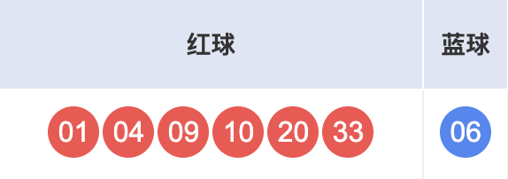
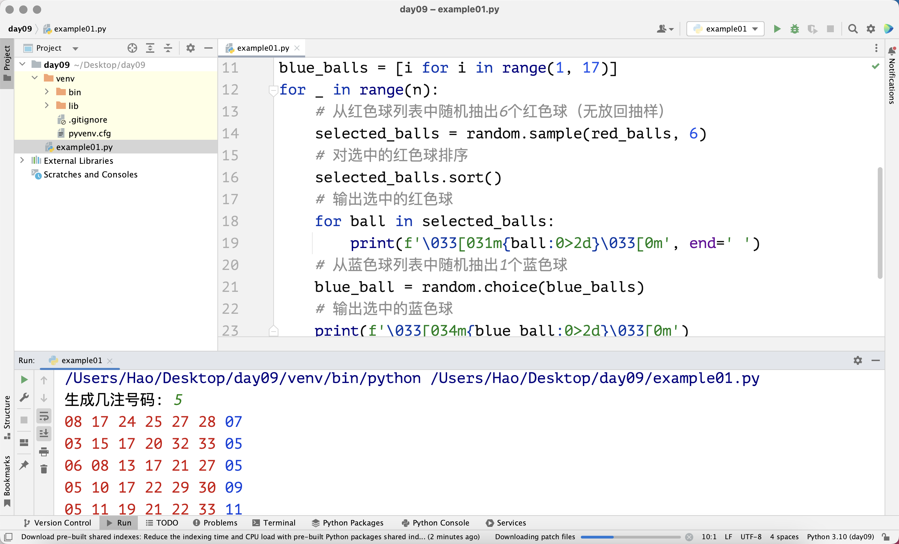
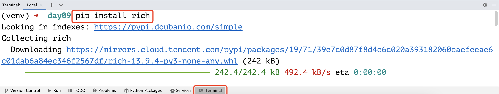
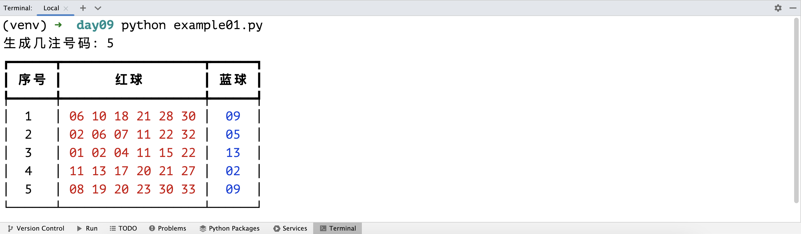

## Cấu trúc dữ liệu thông dụng: Danh sách (list) - 2

### Các phương thức của danh sách

Biến kiểu danh sách sở hữu rất nhiều phương thức giúp chúng ta thao tác với danh sách. Giả sử chúng ta có danh sách tên là `foos`, và danh sách có phương thức tên là `bar`, thì cú pháp sử dụng phương thức của danh sách là: `foos.bar()`. Đây là cú pháp gọi phương thức của đối tượng thông qua tham chiếu đối tượng. Sau này khi học về lập trình hướng đối tượng, chúng ta sẽ tìm hiểu chi tiết hơn về cú pháp này, cú pháp này còn được gọi là "gửi thông điệp cho đối tượng".

#### Thêm và xóa phần tử

Danh sách là một container có thể thay đổi (mutable container). Container có thể thay đổi nghĩa là chúng ta có thể thêm phần tử vào container, xóa phần tử khỏi container, cũng như sửa đổi các phần tử hiện có trong container. Chúng ta có thể sử dụng phương thức `append` của danh sách để thêm phần tử vào cuối danh sách, và sử dụng phương thức `insert` để chèn phần tử vào vị trí chỉ định. "Thêm vào cuối" (append) nghĩa là đưa phần tử vào cuối danh sách, còn "chèn" (insert) là thêm phần tử mới vào vị trí chỉ mục được chỉ định. Mời các bạn theo dõi đoạn mã dưới đây.

```python
languages = ['Python', 'Java', 'C++']
languages.append('JavaScript')
print(languages)  # ['Python', 'Java', 'C++', 'JavaScript']
languages.insert(1, 'SQL')
print(languages)  # ['Python', 'SQL', 'Java', 'C++', 'JavaScript']
```

Chúng ta có thể dùng phương thức `remove` của danh sách để xóa phần tử chỉ định khỏi danh sách. Cần lưu ý rằng, nếu phần tử muốn xóa không tồn tại trong danh sách, Python sẽ phát sinh lỗi `ValueError` làm chương trình bị dừng đột ngột (crash). Vì vậy, khuyên các bạn trước khi xóa phần tử nên dùng toán tử thành viên đã học ở bài trước để kiểm tra trước. Chúng ta cũng có thể sử dụng phương thức `pop` để xóa phần tử khỏi danh sách. Mặc định `pop` sẽ xóa phần tử cuối cùng của danh sách, tất nhiên bạn cũng có thể truyền vào một vị trí chỉ mục để xóa phần tử tại vị trí đó. Khi sử dụng phương thức `pop` để xóa phần tử, nếu giá trị chỉ mục vượt quá phạm vi, sẽ phát sinh ngoại lệ `IndexError` khiến chương trình gặp sự cố. Ngoài ra, danh sách còn có phương thức `clear` để làm rỗng (xóa sạch) tất cả các phần tử trong danh sách, đoạn mã minh họa như sau.

```python
languages = ['Python', 'SQL', 'Java', 'C++', 'JavaScript']
if 'Java' in languages:
    languages.remove('Java')
if 'Swift' in languages:
    languages.remove('Swift')
print(languages)  # ['Python', 'SQL', 'C++', 'JavaScript']
languages.pop()
temp = languages.pop(1)
print(temp)       # SQL
languages.append(temp)
print(languages)  # ['Python', 'C++', 'SQL']
languages.clear()
print(languages)  # []
```

> **Giải thích**: Khi phương thức `pop` xóa một phần tử, nó sẽ trả về chính phần tử vừa bị xóa đó. Trong đoạn mã trên, chúng ta đã gán phần tử bị xóa bởi phương thức `pop` cho biến có tên là `temp`. Tất nhiên nếu muốn, bạn có thể đưa phần tử này trở lại danh sách, đúng như đoạn mã `languages.append(temp)` ở trên đã làm.

Ở đây có một câu hỏi nhỏ: giả sử trong danh sách `languages` có nhiều phần tử `'Python'`, thì khi chúng ta gọi `languages.remove('Python')`, nó sẽ xóa tất cả các phần tử `'Python'` hay chỉ xóa phần tử `'Python'` đầu tiên? Các bạn hãy thử đoán xem, sau đó tự tay viết mã để thử nghiệm nhé.

Để xóa phần tử khỏi danh sách, thực ra còn có một cách khác là sử dụng từ khóa `del` trong Python theo sau là phần tử cần xóa. Cách làm này về bản chất không khác biệt gì so với việc sử dụng phương thức `pop` kèm chỉ mục chỉ định, nhưng `pop` sẽ trả về phần tử bị xóa, còn `del` thì có hiệu năng nhỉnh hơn một chút. Lý do là vì lệnh bytecode tương ứng bên dưới của `del` là `DELETE_SUBSCR`, trong khi của `pop` là các lệnh `CALL_METHOD` và `POP_TOP`. Nếu chưa hiểu điều này thì bạn cũng không cần quá bận tâm.

```python
items = ['Python', 'Java', 'C++']
del items[1]
print(items)  # ['Python', 'C++']
```

#### Vị trí và tần suất xuất hiện của phần tử

Phương thức `index` của danh sách có thể tìm kiếm vị trí chỉ mục của một phần tử trong danh sách. Nếu không tìm thấy phần tử chỉ định, phương thức `index` sẽ phát sinh lỗi `ValueError`. Phương thức `count` của danh sách có thể đếm số lần xuất hiện của một phần tử trong danh sách, đoạn mã như sau.

```python
items = ['Python', 'Java', 'Java', 'C++', 'Kotlin', 'Python']
print(items.index('Python'))     # 0
# Tìm kiếm 'Python' bắt đầu từ vị trí chỉ mục 1
print(items.index('Python', 1))  # 5
print(items.count('Python'))     # 2
print(items.count('Kotlin'))     # 1
print(items.count('Swfit'))      # 0
# Tìm kiếm 'Java' bắt đầu từ vị trí chỉ mục 3
print(items.index('Java', 3))    # ValueError: 'Java' is not in list
```

#### Sắp xếp và đảo ngược phần tử

Thao tác `sort` của danh sách có thể thực hiện sắp xếp các phần tử trong danh sách, còn thao tác `reverse` có thể thực hiện đảo ngược thứ tự các phần tử, đoạn mã như sau.

```python
items = ['Python', 'Java', 'C++', 'Kotlin', 'Swift']
items.sort()
print(items)  # ['C++', 'Java', 'Kotlin', 'Python', 'Swift']
items.reverse()
print(items)  # ['Swift', 'Python', 'Kotlin', 'Java', 'C++']
```

### Biểu thức tạo danh sách

Trong Python, danh sách còn có thể được tạo thông qua một cú pháp tường minh (literal syntax) đặc biệt, cú pháp này được gọi là biểu thức tạo danh sách (list comprehension). Dưới đây, chúng ta hãy cùng xem qua các ví dụ để hiểu rõ lợi ích của việc sử dụng biểu thức tạo danh sách khi tạo danh sách.

Tình huống 1: Tạo một danh sách chứa các số trong khoảng từ `1` đến `99` và chia hết cho `3` hoặc `5`.

```python
items = []
for i in range(1, 100):
    if i % 3 == 0 or i % 5 == 0:
        items.append(i)
print(items)
```

Sử dụng biểu thức tạo danh sách để thực hiện cùng công việc, đoạn mã như sau.

```python
items = [i for i in range(1, 100) if i % 3 == 0 or i % 5 == 0]
print(items)
```

Tình huống 2: Có một danh sách số nguyên `nums1`, tạo một danh sách mới `nums2` có các phần tử là bình phương của các phần tử tương ứng trong `nums1`.

```python
nums1 = [35, 12, 97, 64, 55]
nums2 = []
for num in nums1:
    nums2.append(num ** 2)
print(nums2)
```

Sử dụng biểu thức tạo danh sách để thực hiện cùng công việc, đoạn mã như sau.

```python
nums1 = [35, 12, 97, 64, 55]
nums2 = [num ** 2 for num in nums1]
print(nums2)
```

Tình huống 3: Có một danh sách số nguyên `nums1`, tạo một danh sách mới `nums2` chứa các phần tử lớn hơn `50` trong `nums1`.

```python
nums1 = [35, 12, 97, 64, 55]
nums2 = []
for num in nums1:
    if num > 50:
        nums2.append(num)
print(nums2)
```

Sử dụng biểu thức tạo danh sách để thực hiện cùng công việc, đoạn mã như sau.

```python
nums1 = [35, 12, 97, 64, 55]
nums2 = [num for num in nums1 if num > 50]
print(nums2)
```

Sử dụng biểu thức tạo danh sách để tạo danh sách không chỉ giúp mã nguồn ngắn gọn, thanh thoát hơn mà hiệu năng cũng vượt trội hơn so với việc sử dụng vòng lặp `for-in` kết hợp phương thức `append` để thêm phần tử vào danh sách rỗng. Vì sao biểu thức tạo lại có hiệu năng tốt hơn? Đó là bởi vì trong tập lệnh bytecode của trình thông dịch Python có sẵn các chỉ lệnh chuyên biệt cho biểu thức tạo (chỉ lệnh `LIST_APPEND`); trong khi vòng lặp `for` phải thêm phần tử vào danh sách thông qua việc gọi phương thức (chỉ lệnh `LOAD_METHOD` và `CALL_METHOD`), mà bản thân việc gọi phương thức là một thao tác tương đối tốn kém thời gian. Nếu chưa hiểu rõ điểm này thì cũng không sao cả, bạn chỉ cần nhớ kết luận: "**Khuyến khích mạnh mẽ sử dụng cú pháp biểu thức tạo để tạo danh sách**".

### Danh sách lồng nhau

Ngôn ngữ Python không bắt buộc các phần tử trong danh sách phải cùng kiểu dữ liệu. Điều đó có nghĩa là các phần tử trong danh sách có thể thuộc bất kỳ kiểu dữ liệu nào, và dĩ nhiên bao gồm cả chính danh sách. Nếu các phần tử trong một danh sách lại là các danh sách khác, chúng ta gọi đó là danh sách lồng nhau (nested list). Danh sách lồng nhau có thể dùng để biểu diễn bảng dữ liệu hoặc ma trận trong toán học. Ví dụ: chúng ta muốn lưu điểm số 3 môn học của 5 học sinh, có thể dùng danh sách như sau.

```python
scores = [[95, 83, 92], [80, 75, 82], [92, 97, 90], [80, 78, 69], [65, 66, 89]]
print(scores[0])
print(scores[0][1])
```

Đối với danh sách lồng nhau ở trên, mỗi phần tử tương ứng với điểm 3 môn của một học sinh, chẳng hạn `[95, 83, 92]`, và số `83` trong danh sách này đại diện cho điểm một môn nào đó của học sinh này. Nếu muốn truy cập giá trị này, chúng ta có thể sử dụng hai lần toán tử chỉ mục `scores[0][1]`, trong đó `scores[0]` trả về danh sách `[95, 83, 92]`, và toán tử chỉ mục `[1]` tiếp theo sẽ lấy ra phần tử thứ hai trong danh sách đó.

Nếu muốn nhập điểm của 5 học sinh cho 3 môn học từ bàn phím và lưu vào danh sách, chúng ta có thể sử dụng đoạn mã dưới đây.

```python
scores = []
for _ in range(5):
    temp = []
    for _ in range(3):
        score = int(input('Nhập điểm: '))
        temp.append(score)
    scores.append(temp)
print(scores)
```

Nếu muốn tạo điểm số của 5 học sinh cho 3 môn học bằng cách sinh số ngẫu nhiên và lưu vào danh sách, chúng ta có thể sử dụng biểu thức tạo danh sách như sau.

```python
import random

scores = [[random.randrange(60, 101) for _ in range(3)] for _ in range(5)]
print(scores)
```

> **Giải thích**: Đoạn mã `[random.randrange(60, 101) for _ in range(3)]` ở trên tạo ra một danh sách gồm 3 số nguyên ngẫu nhiên. Chúng ta lại đặt đoạn mã này vào bên trong một biểu thức tạo danh sách khác để làm phần tử, tạo ra tổng cộng 5 phần tử như vậy, cuối cùng thu được một danh sách lồng nhau.

### Ứng dụng của danh sách

Dưới đây, chúng ta sẽ cùng tìm hiểu ứng dụng của danh sách qua ví dụ về chương trình chọn số ngẫu nhiên cho xổ số hai màu (Song Sắc Cầu). Xổ số hai màu là loại vé số lotto do Trung tâm Quản lý Phát hành Xổ số Phúc lợi Trung Quốc phát hành. Mỗi vé dự thưởng bao gồm `6` quả bóng đỏ và `1` quả bóng xanh. Các số của bóng đỏ được chọn từ `1` đến `33`, còn bóng xanh được chọn từ `1` đến `16`. Mỗi vé cần chọn `6` số bóng đỏ và `1` số bóng xanh, như minh họa dưới đây.



> **Gợi ý**: Trên Zhihu có một đoạn luận điểm rất sâu sắc về bản chất của các loại hình xổ số: "**Hư cấu ra một người không làm mà hưởng, để lừa dối một đám người muốn không làm mà hưởng, cuối cùng nuôi sống một nhóm người thực sự không làm mà hưởng**". Rất nhiều người không có khái niệm về xác suất thậm chí còn cho rằng xác suất trúng và không trúng xổ số đều là 50%; lại có người nghĩ rằng nếu xác suất trúng thưởng là 1% thì mua 100 lần chắc chắn sẽ trúng, đó đều là những suy nghĩ hết sức ấu trĩ. Vì vậy, **hãy trân trọng cuộc sống và tránh xa cờ bạc, nhất là khi bạn không hiểu gì về xác suất**!

Dưới đây, chúng ta sẽ dùng chương trình Python để tạo ra một bộ số ngẫu nhiên.

```python
"""
Chương trình chọn số ngẫu nhiên cho xổ số hai màu

Author: jackfrued
Version: 1.0
"""
import random

red_balls = list(range(1, 34))
selected_balls = []
# Thêm 6 quả bóng đỏ vào danh sách đã chọn
for _ in range(6):
    # Sinh số nguyên ngẫu nhiên đại diện cho vị trí chỉ mục của bóng đỏ được chọn
    index = random.randrange(len(red_balls))
    # Xóa quả bóng được chọn khỏi danh sách bóng đỏ và thêm vào danh sách đã chọn
    selected_balls.append(red_balls.pop(index))
# Sắp xếp các quả bóng đỏ đã chọn
selected_balls.sort()
# Xuất các quả bóng đỏ đã chọn
for ball in selected_balls:
    print(f'\033[031m{ball:0>2d}\033[0m', end=' ')
# Chọn ngẫu nhiên 1 quả bóng xanh
blue_ball = random.randrange(1, 17)
# Xuất quả bóng xanh đã chọn
print(f'\033[034m{blue_ball:0>2d}\033[0m')
```

> **Giải thích**: Trong đoạn mã trên, `print(f'\033[0m...\033[0m')` dùng để điều khiển màu sắc của nội dung in ra: bóng đỏ hiển thị màu đỏ, bóng xanh hiển thị màu xanh lam. Dấu ba chấm đại diện cho nội dung cần in, `\033[0m` là mã điều khiển nhằm đóng mọi thuộc tính, nghĩa là các mã điều khiển trước đó sẽ mất hiệu lực; bạn cũng có thể hiểu đơn giản đây là một ký tự phân cách. Chữ số `0` trước chữ `m` chỉ cách hiển thị của terminal là mặc định (có thể bỏ qua số `0`), số `1` biểu thị độ sáng cao, số `5` biểu thị nhấp nháy, số `7` biểu thị đảo màu, v.v. Giữa số `0` và chữ `m`, chúng ta có thể ghi các con số đại diện cho màu sắc, ví dụ `30` là màu đen, `31` là màu đỏ, `32` là màu xanh lá cây, `33` là màu vàng, `34` là màu xanh lam, v.v.

Chúng ta còn có thể sử dụng các hàm `sample` và `choice` do module `random` cung cấp để đơn giản hóa đoạn mã trên: hàm thứ nhất giúp lấy mẫu ngẫu nhiên không hoàn lại, hàm thứ hai giúp rút ngẫu nhiên một phần tử. Đoạn mã sau khi chỉnh sửa như sau.

```python
"""
Chương trình chọn số ngẫu nhiên cho xổ số hai màu

Author: jackfrued
Version: 1.1
"""
import random

red_balls = [i for i in range(1, 34)]
blue_balls = [i for i in range(1, 17)]
# Rút ngẫu nhiên 6 quả bóng đỏ từ danh sách bóng đỏ (lấy mẫu không hoàn lại)
selected_balls = random.sample(red_balls, 6)
# Sắp xếp các quả bóng đỏ đã chọn
selected_balls.sort()
# Xuất các quả bóng đỏ đã chọn
for ball in selected_balls:
    print(f'\033[031m{ball:0>2d}\033[0m', end=' ')
# Rút ngẫu nhiên 1 quả bóng xanh từ danh sách bóng xanh
blue_ball = random.choice(blue_balls)
# Xuất quả bóng xanh đã chọn
print(f'\033[034m{blue_ball:0>2d}\033[0m')
```

Nếu muốn tạo ngẫu nhiên `N` bộ số dự thưởng, chúng ta chỉ cần đặt đoạn mã trên vào một vòng lặp `N` lần như dưới đây.

```python
"""
Chương trình chọn số ngẫu nhiên cho xổ số hai màu

Author: jackfrued
Version: 1.2
"""
import random

n = int(input('Tạo bao nhiêu bộ số: '))
red_balls = [i for i in range(1, 34)]
blue_balls = [i for i in range(1, 17)]
for _ in range(n):
    # Rút ngẫu nhiên 6 quả bóng đỏ từ danh sách bóng đỏ (lấy mẫu không hoàn lại)
    selected_balls = random.sample(red_balls, 6)
    # Sắp xếp các quả bóng đỏ đã chọn
    selected_balls.sort()
    # Xuất các quả bóng đỏ đã chọn
    for ball in selected_balls:
        print(f'\033[031m{ball:0>2d}\033[0m', end=' ')
    # Rút ngẫu nhiên 1 quả bóng xanh từ danh sách bóng xanh
    blue_ball = random.choice(blue_balls)
    # Xuất quả bóng xanh đã chọn
    print(f'\033[034m{blue_ball:0>2d}\033[0m')
```

Khi chạy đoạn mã trên trong PyCharm và nhập vào `5`, kết quả chạy sẽ hiển thị như hình dưới đây.



Nhân tiện, tôi xin giới thiệu với các bạn một thư viện bên thứ ba của Python có tên là rich. Nó giúp chúng ta tạo ra kết quả xuất đẹp mắt nhất bằng cách đơn giản nhất. Bạn có thể cài đặt thư viện này trên terminal bằng công cụ quản lý gói pip của Python. Đối với người dùng PyCharm, dĩ nhiên bạn nên dùng lệnh pip trong cửa sổ Terminal của PyCharm để cài đặt rich vào môi trường ảo của dự án, câu lệnh như sau.

```bash
pip install rich
```



Như hình trên, sau khi cài đặt rich thành công, chúng ta có thể sử dụng đoạn mã dưới đây để điều khiển kết quả xuất.

```python
"""
Chương trình chọn số ngẫu nhiên cho xổ số hai màu

Author: jackfrued
Version: 1.3
"""
import random

from rich.console import Console
from rich.table import Table

# Tạo console
console = Console()

n = int(input('Tạo bao nhiêu bộ số: '))
red_balls = [i for i in range(1, 34)]
blue_balls = [i for i in range(1, 17)]

# Tạo bảng và thêm tiêu đề cột
table = Table(show_header=True)
for col_name in ('STT', 'Bóng đỏ', 'Bóng xanh'):
    table.add_column(col_name, justify='center')

for i in range(n):
    selected_balls = random.sample(red_balls, 6)
    selected_balls.sort()
    blue_ball = random.choice(blue_balls)
    # Thêm hàng vào bảng (STT, bóng đỏ, bóng xanh)
    table.add_row(
        str(i + 1),
        f'[red]{" ".join([f"{ball:0>2d}" for ball in selected_balls])}[/red]',
        f'[blue]{blue_ball:0>2d}[/blue]'
    )

# Xuất bảng ra console
console.print(table)
```

> **Giải thích**: Dòng thứ 31 trong đoạn mã trên sử dụng cú pháp biểu thức tạo danh sách để chuyển các số bóng đỏ thành chuỗi và lưu vào một danh sách. `" ".join([...])` dùng để nối nhiều chuỗi trong danh sách thành một chuỗi hoàn chỉnh bằng dấu cách; nếu chưa hiểu bạn có thể tạm gác lại. Phần `[red]...[/red]` trong chuỗi dùng để thiết lập màu xuất ra là màu đỏ, và `[blue]...[/blue]` ở dòng 32 dùng để thiết lập màu xuất ra là màu xanh lam. Để biết thêm kiến thức về thư viện rich, bạn có thể tham khảo [tài liệu chính thức](https://github.com/textualize/rich/blob/master/README.cn.md).

Kết quả xuất cuối cùng hiển thị như hình bên dưới. Nhìn vào kết quả in ra thế này, tâm trạng có phải trở nên vui vẻ hơn rất nhiều không?



### Tổng kết

Bên dưới tầng sâu của danh sách trong Python là một mảng có thể mở rộng kích thước động, các phần tử của danh sách được lưu trữ liên tục trong bộ nhớ máy tính, do đó có thể thực hiện truy cập ngẫu nhiên (lấy phần tử tương ứng thông qua một chỉ mục hợp lệ với thời gian thao tác không phụ thuộc vào số lượng phần tử của danh sách). Chúng ta tạm thời chưa cần đi sâu vào các chi tiết lưu trữ tầng thấp này, và cũng không cần bạn phải hiểu ngay độ phức tạp thời gian tiệm cận của từng phương thức trong danh sách (mối quan hệ giữa thời gian thực thi phương thức và số lượng phần tử của danh sách). Điều quan trọng hơn trước mắt là các bạn học được cách dùng danh sách để giải quyết các bài toán trong công việc thực tế.