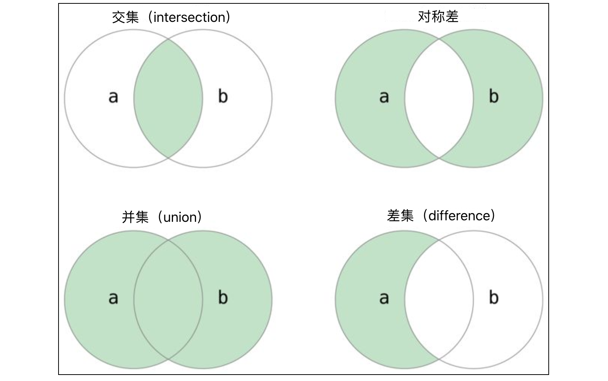

## Cấu trúc dữ liệu thông dụng: Tập hợp (set)

Sau khi đã học về danh sách và tuple, chúng ta tiếp tục tìm hiểu thêm một kiểu dữ liệu dạng container nữa, mang tên là tập hợp (set). Nhắc đến từ "tập hợp" chắc hẳn các bạn không hề xa lạ, vì khái niệm này đã xuất hiện trong sách giáo khoa toán học. Nếu chúng ta **xem các đối tượng xác định, phân biệt trong một phạm vi nhất định như một thể thống nhất**, thì thể thống nhất đó chính là một tập hợp, và các đối tượng bên trong được gọi là **phần tử** của tập hợp. Thông thường, một tập hợp cần thỏa mãn các yêu cầu sau:

1. **Tính không có thứ tự (Vô thứ tự)**: Trong một tập hợp, vị thế của mỗi phần tử đều như nhau, giữa các phần tử không có thứ tự trước sau.
2. **Tính phân biệt (Không trùng lặp)**: Trong một tập hợp, bất kỳ hai phần tử nào cũng đều khác nhau, nghĩa là mỗi phần tử chỉ có thể xuất hiện duy nhất một lần.
3. **Tính xác định**: Cho một tập hợp và một phần tử bất kỳ, phần tử đó hoặc thuộc về tập hợp này, hoặc không thuộc về tập hợp này, bắt buộc phải là một trong hai, tuyệt đối không có trường hợp mập mờ, không rõ ràng.

Tập hợp trong chương trình Python về bản chất không khác biệt gì so với tập hợp trong toán học, nhưng cần nhấn mạnh hai tính chất: tính không có thứ tự và tính phân biệt nêu trên. Tính không có thứ tự cho thấy các phần tử trong tập hợp không hề có một trình tự nhất định như các phần tử trong danh sách để chúng ta có thể truy cập bất kỳ phần tử nào thông qua phép toán chỉ mục; **tập hợp không hỗ trợ phép toán chỉ mục**. Ngoài ra, tính phân biệt quyết định rằng **trong tập hợp không thể có phần tử trùng lặp**, đây cũng là điểm phân biệt giữa tập hợp và danh sách, chúng ta không thể thêm phần tử trùng lặp vào một tập hợp. Kiểu tập hợp tất nhiên hỗ trợ các phép toán thành viên `in` và `not in`, nhờ đó ta có thể xác định xem một phần tử có thuộc tập hợp hay không, chính là tính xác định của tập hợp như đã nêu ở trên. **Phép toán thành viên trên tập hợp có hiệu năng vượt trội hơn so với phép toán thành viên trên danh sách**, điều này được quyết định bởi đặc tính lưu trữ ở tầng dưới của tập hợp, tạm thời ở đây chúng ta chưa bàn sâu, các bạn chỉ cần ghi nhớ kết luận này là được.

> **Giải thích**: Bên dưới tầng sâu của tập hợp sử dụng cách lưu trữ băm (hash storage). Bạn đọc chưa hiểu về lưu trữ băm có thể tham khảo phần giải thích về [bảng băm (Hash table)](https://www.hello-algo.com/chapter_hashing/) trên trang web "Hello Thuật toán", xin cảm ơn tinh thần mã nguồn mở của tác giả.

### Tạo tập hợp

Trong Python, để tạo tập hợp chúng ta có thể dùng cú pháp tường minh `{}`. Trong `{}` bắt buộc phải có ít nhất một phần tử, bởi vì `{}` không có phần tử nào thì không phải là tập hợp rỗng mà là một từ điển rỗng (kiểu từ điển chúng ta sẽ học ở bài tiếp theo). Dĩ nhiên, bạn cũng có thể dùng hàm tích hợp `set` của Python để tạo tập hợp; nói chính xác hơn thì `set` không phải là một hàm, mà là một constructor để tạo đối tượng tập hợp, điểm kiến thức này sẽ được giới thiệu sau khi học về lập trình hướng đối tượng. Chúng ta có thể dùng `set()` để tạo một tập hợp rỗng, hoặc dùng nó để chuyển đổi các chuỗi tuần tự khác thành tập hợp. Ví dụ: `set('hello')` sẽ thu được một tập hợp chứa `4` ký tự (ký tự `l` bị lặp lại sẽ chỉ xuất hiện một lần trong tập hợp). Ngoài hai cách này, bạn còn có thể dùng cú pháp biểu thức tạo để tạo tập hợp, tương tự như cách chúng ta đã dùng biểu thức tạo để tạo danh sách trước đây.

```python
set1 = {1, 2, 3, 3, 3, 2}
print(set1)

set2 = {'banana', 'pitaya', 'apple', 'apple', 'banana', 'grape'}
print(set2)

set3 = set('hello')
print(set3)

set4 = set([1, 2, 2, 3, 3, 3, 2, 1])
print(set4)

set5 = {num for num in range(1, 20) if num % 3 == 0 or num % 7 == 0}
print(set5)
```

Cần nhắc các bạn rằng, các phần tử trong tập hợp bắt buộc phải thuộc kiểu `hashable`. Kiểu `hashable` dùng để chỉ những kiểu dữ liệu có thể tính toán ra mã băm (hash code). Thông thường các kiểu bất biến đều là kiểu `hashable`, chẳng hạn như số nguyên (`int`), số thực dấu phẩy động (`float`), giá trị boolean (`bool`), chuỗi ký tự (`str`), tuple (`tuple`), v.v. Các kiểu dữ liệu khả biến đều không phải là kiểu `hashable`, vì kiểu khả biến không thể tính ra mã băm cố định xác định, do đó chúng không thể đưa vào trong tập hợp. Ví dụ: chúng ta không thể đưa danh sách vào làm phần tử của tập hợp; tương tự, do bản thân tập hợp cũng là kiểu khả biến, nên tập hợp cũng không thể làm phần tử của một tập hợp khác. Chúng ta có thể tạo ra danh sách lồng nhau (phần tử của danh sách lại là danh sách), nhưng chúng ta không thể tạo ra tập hợp lồng nhau, điểm này nhất định phải lưu ý khi sử dụng tập hợp.

> **Gợi ý**: Nếu chưa hiểu các khái niệm như mã băm, lưu trữ băm được đề cập ở trên, bạn có thể tạm gác lại, vì nó không ảnh hưởng đến việc tiếp tục học và sử dụng ngôn ngữ Python của bạn. Dĩ nhiên, với các bạn chuyên ngành khoa học máy tính, việc không hiểu lưu trữ băm là điều khó chấp nhận, hãy nhanh chóng học bổ sung nhé.

### Duyệt qua các phần tử

Chúng ta có thể dùng hàm `len` để biết trong tập hợp có bao nhiêu phần tử, nhưng chúng ta không thể dùng phép toán chỉ mục để duyệt qua các phần tử trong tập hợp, vì phần tử của tập hợp không có thứ tự cụ thể. Tuy nhiên, để duyệt qua các phần tử của tập hợp, chúng ta vẫn có thể sử dụng vòng lặp `for-in`, đoạn mã như sau.

```python
set1 = {'Python', 'C++', 'Java', 'Kotlin', 'Swift'}
for elem in set1:
    print(elem)
```

> **Gợi ý**: Các bạn hãy quan sát kết quả chạy của đoạn mã trên, thông qua thứ tự xuất ra của các từ để cảm nhận tính không có thứ tự của tập hợp nhé.

### Các phép toán trên tập hợp

Python cung cấp hệ thống phép toán vô cùng phong phú cho kiểu tập hợp, chủ yếu bao gồm: phép toán thành viên, phép giao, phép hợp, phép hiệu, phép so sánh (bằng nhau, tập con, tập cha), v.v.

#### Phép toán thành viên

Có thể thông qua toán tử thành viên `in` và `not in` để kiểm tra xem một phần tử có nằm trong tập hợp hay không, đoạn mã như sau.

```python
set1 = {11, 12, 13, 14, 15}
print(10 in set1)      # False 
print(15 in set1)      # True
set2 = {'Python', 'Java', 'C++', 'Swift'}
print('Ruby' in set2)  # False
print('Java' in set2)  # True
```

#### Phép toán hai ngôi

Phép toán hai ngôi của tập hợp chủ yếu nói đến các phép giao (intersection), phép hợp (union), phép hiệu (difference), phép hiệu đối xứng (symmetric difference), v.v. Các phép toán này có thể thực hiện thông qua toán tử, hoặc thông qua các phương thức của kiểu tập hợp, đoạn mã như sau.



```python
set1 = {1, 2, 3, 4, 5, 6, 7}
set2 = {2, 4, 6, 8, 10}

# Giao
print(set1 & set2)                      # {2, 4, 6}
print(set1.intersection(set2))          # {2, 4, 6}

# Hợp
print(set1 | set2)                      # {1, 2, 3, 4, 5, 6, 7, 8, 10}
print(set1.union(set2))                 # {1, 2, 3, 4, 5, 6, 7, 8, 10}

# Hiệu
print(set1 - set2)                      # {1, 3, 5, 7}
print(set1.difference(set2))            # {1, 3, 5, 7}

# Hiệu đối xứng
print(set1 ^ set2)                      # {1, 3, 5, 7, 8, 10}
print(set1.symmetric_difference(set2))  # {1, 3, 5, 7, 8, 10}
```

Qua đoạn mã trên có thể thấy, khi tìm giao của hai tập hợp, toán tử `&` và phương thức `intersection` có tác dụng hoàn toàn như nhau; việc dùng toán tử rõ ràng trực quan hơn và mã nguồn cũng ngắn gọn hơn. Cần nói thêm rằng, các phép toán hai ngôi của tập hợp còn có thể kết hợp với phép gán để tạo thành các phép gán phức hợp, ví dụ: `set1 |= set2` tương đương với `set1 = set1 | set2`, phương thức có tác dụng tương đương với `|=` là `update`; `set1 &= set2` tương đương với `set1 = set1 & set2`, phương thức có tác dụng tương đương với `&=` là `intersection_update`, đoạn mã như sau.

```python
set1 = {1, 3, 5, 7}
set2 = {2, 4, 6}
set1 |= set2
# set1.update(set2)
print(set1)  # {1, 2, 3, 4, 5, 6, 7}
set3 = {3, 6, 9}
set1 &= set3
# set1.intersection_update(set3)
print(set1)  # {3, 6}
set2 -= set1
# set2.difference_update(set1)
print(set2)  # {2, 4}
```

#### Phép toán so sánh

Hai tập hợp có thể dùng `==` và `!=` để kiểm tra tính bằng nhau. Nếu các phần tử trong hai tập hợp hoàn toàn giống nhau, thì phép so sánh `==` sẽ trả về `True`, ngược lại trả về `False`. Nếu mọi phần tử của tập hợp `A` đều là phần tử của tập hợp `B`, thì tập hợp `A` được gọi là tập con của tập hợp `B`, tức là với $\small{\forall{a} \in {A}}$, đều có $\small{{a} \in {B}}$, thì $\small{{A} \subseteq {B}}$, `A` là tập con của `B`, ngược lại cũng có thể gọi `B` là tập cha (siêu tập - superset) của `A`. Nếu `A` là tập con của `B` và `A` không bằng `B`, thì `A` là tập con thực sự (tập con đích thực) của `B`. Python cung cấp cho kiểu tập hợp các toán tử để kiểm tra tập con và tập cha, thực chất chính là các toán tử rất quen thuộc với chúng ta: `<`, `<=`, `>`, `>=`. Dĩ nhiên, chúng ta cũng có thể thông qua các phương thức `issubset` và `issuperset` của kiểu tập hợp để kiểm tra mối quan hệ giữa các tập hợp, đoạn mã như sau.

```python
set1 = {1, 3, 5}
set2 = {1, 2, 3, 4, 5}
set3 = {5, 4, 3, 2, 1}

print(set1 < set2)   # True
print(set1 <= set2)  # True
print(set2 < set3)   # False
print(set2 <= set3)  # True
print(set2 > set1)   # True
print(set2 == set3)  # True

print(set1.issubset(set2))    # True
print(set2.issuperset(set1))  # True
```

> **Giải thích**: Trong đoạn mã trên, `set1 < set2` kiểm tra xem `set1` có phải là tập con thực sự của `set2` hay không, `set1 <= set2` kiểm tra xem `set1` có phải là tập con của `set2` hay không, `set2 > set1` kiểm tra xem `set2` có phải là tập cha của `set1` hay không. Dĩ nhiên, chúng ta cũng có thể dùng `set1.issubset(set2)` để kiểm tra `set1` có phải là tập con của `set2` hay không; dùng `set2.issuperset(set1)` để kiểm tra `set2` có phải là tập cha của `set1` hay không.

### Các phương thức của tập hợp

Như vừa nói ở trên, tập hợp trong Python là kiểu dữ liệu khả biến, chúng ta có thể thông qua các phương thức của tập hợp để thêm phần tử vào tập hợp hoặc xóa phần tử khỏi tập hợp.

```python
set1 = {1, 10, 100}

# Thêm phần tử
set1.add(1000)
set1.add(10000)
print(set1)  # {1, 100, 1000, 10, 10000}

# Xóa phần tử
set1.discard(10)
if 100 in set1:
    set1.remove(100)
print(set1)  # {1, 1000, 10000}

# Làm rỗng tập hợp
set1.clear()
print(set1)  # set()
```

> **Giải thích**: Phương thức xóa phần tử `remove` khi phần tử không tồn tại sẽ phát sinh lỗi `KeyError`, do đó trong đoạn mã trên chúng ta dùng phép toán thành viên để kiểm tra trước xem phần tử có nằm trong tập hợp hay không. Kiểu tập hợp còn có phương thức `pop` để xóa ngẫu nhiên một phần tử khỏi tập hợp; phương thức này khi xóa phần tử đồng thời sẽ trả về (lấy được) phần tử vừa bị xóa, trong khi hai phương thức `remove` và `discard` chỉ đơn thuần xóa phần tử mà không trả về phần tử bị xóa.

Kiểu tập hợp còn có một phương thức mang tên `isdisjoint` dùng để kiểm tra xem hai tập hợp có phần tử chung hay không. Nếu không có phần tử chung nào, phương thức này trả về `True`, ngược lại trả về `False`, đoạn mã như sau.

```python
set1 = {'Java', 'Python', 'C++', 'Kotlin'}
set2 = {'Kotlin', 'Swift', 'Java', 'Dart'}
set3 = {'HTML', 'CSS', 'JavaScript'}
print(set1.isdisjoint(set2))  # False
print(set1.isdisjoint(set3))  # True
```

### Tập hợp bất biến

Trong Python còn có một kiểu tập hợp bất biến, mang tên là `frozenset`. Sự khác biệt giữa `set` và `frozenset` cũng giống như sự khác biệt giữa `list` và `tuple`. Do `frozenset` là kiểu bất biến, có thể tính toán được mã băm, nên nó có thể được dùng làm phần tử bên trong `set`. Ngoại trừ việc không thể thêm và xóa phần tử, `frozenset` ở các phương diện khác hoàn toàn giống với `set`, đoạn mã dưới đây minh họa cách sử dụng đơn giản của `frozenset`.

```python
fset1 = frozenset({1, 3, 5, 7})
fset2 = frozenset(range(1, 6))
print(fset1)          # frozenset({1, 3, 5, 7})
print(fset2)          # frozenset({1, 2, 3, 4, 5})
print(fset1 & fset2)  # frozenset({1, 3, 5})
print(fset1 | fset2)  # frozenset({1, 2, 3, 4, 5, 7})
print(fset1 - fset2)  # frozenset({7})
print(fset1 < fset2)  # False
```

### Tổng kết

Trong Python, **kiểu tập hợp là một container không có thứ tự**, **không cho phép có phần tử trùng lặp**. Do bên dưới sử dụng cách lưu trữ băm, các phần tử trong tập hợp bắt buộc phải thuộc kiểu `hashable`. Điểm khác biệt lớn nhất giữa tập hợp và danh sách là **các phần tử trong tập hợp không có thứ tự**, do đó **không thể truy cập phần tử thông qua phép toán chỉ mục**, nhưng tập hợp có thể thực hiện các phép toán hai ngôi như giao, hợp, hiệu, cũng như có thể thông qua các toán tử quan hệ để kiểm tra mối quan hệ tập cha, tập con giữa hai tập hợp.
