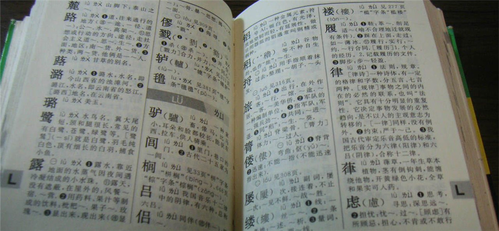

## Cấu trúc dữ liệu thông dụng: Từ điển (dict)

Cho đến nay, chúng ta đã được giới thiệu về ba kiểu dữ liệu dạng container trong Python (danh sách, tuple, tập hợp), nhưng những kiểu dữ liệu này vẫn chưa đủ để giúp chúng ta giải quyết mọi bài toán. Ví dụ, chúng ta cần một biến để lưu trữ nhiều thông tin của một người, bao gồm: họ tên, tuổi, chiều cao, cân nặng, địa chỉ nhà, số điện thoại cá nhân, số điện thoại liên hệ khẩn cấp. Lúc này bạn sẽ thấy các kiểu danh sách, tuple và tập hợp đã học trước đó đều không thực sự thuận tiện.

```python
person1 = ['Vương Đại Chùy', 55, 168, 60, 'Số 62 Khoa Hoa Bắc, quận Vũ Hầu, Thành Đô', '13122334455', '13800998877']
person2 = ('Vương Đại Chùy', 55, 168, 60, 'Số 62 Khoa Hoa Bắc, quận Vũ Hầu, Thành Đô', '13122334455', '13800998877')
person3 = {'Vương Đại Chùy', 55, 168, 60, 'Số 62 Khoa Hoa Bắc, quận Vũ Hầu, Thành Đô', '13122334455', '13800998877'}
```

Tập hợp chắc chắn là lựa chọn không phù hợp nhất, bởi vì tập hợp không thể chứa các phần tử trùng lặp; nếu tuổi và cân nặng của một người tình cờ bằng nhau, thì tập hợp sẽ bị thiếu mất một mục thông tin; tương tự, nếu số điện thoại của người này và số liên hệ khẩn cấp trùng nhau, tập hợp lại thiếu tiếp một mục thông tin nữa. Mặt khác, mặc dù danh sách và tuple có thể lưu trữ toàn bộ thông tin của một người, nhưng khi bạn muốn lấy số điện thoại hoặc địa chỉ nhà của người đó, bạn phải biết trước số điện thoại nằm ở vị trí phần tử thứ mấy trong danh sách hoặc tuple. Tóm lại, khi gặp tình huống như trên, danh sách, tuple hay tập hợp đều không phải là giải pháp tối ưu. Lúc này chúng ta cần đến kiểu từ điển (dictionary). Kiểu dữ liệu này thích hợp nhất để nhóm các thông tin có mối liên hệ lại với nhau, giúp chúng ta giải quyết bài toán mô hình hóa các thực thể trong đời thực bằng chương trình Python.

Nhắc đến từ "từ điển", chắc hẳn các bạn không còn xa lạ. Hồi tiểu học, hầu như ai cũng có một cuốn từ điển trong tay, chẳng hạn như cuốn Từ điển Tân Hoa (Xinhua) như hình dưới đây.



Từ điển trong chương trình Python rất giống với từ điển ngoài đời thực: nó tổ chức dữ liệu lại với nhau dưới dạng các cặp khóa - giá trị (key-value pair), và chúng ta có thể tìm giá trị tương ứng thông qua khóa để thao tác. Giống như trong từ điển, mỗi chữ (khóa) đều có phần giải nghĩa tương ứng (giá trị), mỗi chữ kèm phần giải nghĩa hợp lại thành một mục từ trong từ điển, và cuốn từ điển thường bao gồm rất nhiều mục từ như vậy.

### Tạo và sử dụng từ điển

Trong Python, để tạo từ điển chúng ta có thể dùng cú pháp tường minh `{}`, điểm này tương tự như kiểu tập hợp đã học ở bài trước. Tuy nhiên các phần tử trong `{}` của từ điển tồn tại dưới dạng các cặp khóa - giá trị, mỗi phần tử gồm hai giá trị phân tách nhau bởi dấu `:`, phía trước `:` là khóa (key), phía sau `:` là giá trị (value), đoạn mã như sau.

```python
xinhua = {
    '麓': '山脚下',
    '路': '道，往来通行的地方；方面，地区：南～货，外～货；种类：他俩是一～人',
    '蕗': '甘草的别名',
    '潞': '潞水，水名，即今山西省的浊漳河；潞江，水名，即云南省的怒江'
}
print(xinhua)
person = {
    'name': 'Vương Đại Chùy',
    'age': 55,
    'height': 168,
    'weight': 60,
    'addr': 'Số 62 Khoa Hoa Bắc, quận Vũ Hầu, Thành Đô', 
    'tel': '13122334455',
    'emergence contact': '13800998877'
}
print(person)
```

Qua đoạn mã trên, tin rằng các bạn đã nhận ra: dùng từ điển để lưu thông tin của một người ưu việt hơn nhiều so với việc dùng danh sách hay tuple, vì chúng ta có thể dùng khóa đứng trước `:` để biểu thị ý nghĩa của mục thông tin, còn sau `:` chính là giá trị tương ứng của mục đó.

Dĩ nhiên nếu muốn, chúng ta cũng có thể sử dụng hàm tích hợp `dict` hoặc cú pháp biểu thức tạo từ điển (dict comprehension) để tạo từ điển, đoạn mã như sau.

```python
# Mỗi tham số truyền vào hàm dict (constructor) tương ứng với một cặp khóa - giá trị trong từ điển
person = dict(name='Vương Đại Chùy', age=55, height=168, weight=60, addr='Số 62 Khoa Hoa Bắc, quận Vũ Hầu, Thành Đô')
print(person)  # {'name': 'Vương Đại Chùy', 'age': 55, 'height': 168, 'weight': 60, 'addr': 'Số 62 Khoa Hoa Bắc, quận Vũ Hầu, Thành Đô'}

# Có thể nén hai chuỗi tuần tự bằng hàm zip tích hợp của Python để tạo từ điển
items1 = dict(zip('ABCDE', '12345'))
print(items1)  # {'A': '1', 'B': '2', 'C': '3', 'D': '4', 'E': '5'}
items2 = dict(zip('ABCDE', range(1, 10)))
print(items2)  # {'A': 1, 'B': 2, 'C': 3, 'D': 4, 'E': 5}

# Tạo từ điển bằng cú pháp biểu thức tạo từ điển
items3 = {x: x ** 3 for x in range(1, 6)}
print(items3)  # {1: 1, 2: 8, 3: 27, 4: 64, 5: 125}
```

Muốn biết trong từ điển có tổng cộng bao nhiêu cặp khóa - giá trị, chúng ta vẫn dùng hàm `len`. Nếu muốn duyệt qua từ điển, ta có thể dùng vòng lặp `for`, nhưng cần lưu ý rằng vòng lặp `for` chỉ duyệt qua các khóa của từ điển; tuy nhiên không sao cả, sau khi học phép toán chỉ mục trên từ điển, chúng ta hoàn toàn có thể truy cập giá trị tương ứng thông qua khóa của từ điển.

```python
person = {
    'name': 'Vương Đại Chùy',
    'age': 55,
    'height': 168,
    'weight': 60,
    'addr': 'Số 62 Khoa Hoa Bắc, quận Vũ Hầu, Thành Đô'
}
print(len(person))  # 5
for key in person:
    print(key)
```

### Các phép toán trên từ điển

Đối với kiểu từ điển, phép toán thành viên và phép toán chỉ mục chắc chắn là vô cùng quan trọng: phép thứ nhất có thể xác định xem một khóa chỉ định có nằm trong từ điển hay không, phép thứ hai có thể thông qua khóa để truy cập giá trị tương ứng hoặc thêm cặp khóa - giá trị mới vào từ điển. Đáng chú ý là chỉ mục của từ điển khác với chỉ mục của danh sách: các phần tử trong danh sách có số thứ tự riêng nên chỉ mục danh sách là một số nguyên; còn trong từ điển vì lưu trữ các cặp khóa - giá trị nên từ điển cần dùng chính khóa để đánh chỉ mục truy cập giá trị tương ứng. Cần **đặc biệt lưu ý** rằng, **khóa trong từ điển bắt buộc phải là kiểu bất biến**, chẳng hạn như số nguyên (`int`), số thực (`float`), chuỗi ký tự (`str`), tuple (`tuple`), v.v., điểm này hoàn toàn giống với yêu cầu đối với phần tử của kiểu tập hợp. Rõ ràng là danh sách (`list`) và tập hợp (`set`) đã học trước đây không thể làm khóa trong từ điển, bản thân kiểu từ điển cũng không thể làm khóa trong từ điển vì từ điển là kiểu khả biến; tuy nhiên danh sách, tập hợp, từ điển đều có thể làm giá trị trong từ điển, ví dụ:

```python
person = {
    'name': 'Vương Đại Chùy',
    'age': 55,
    'height': 168,
    'weight': 60,
    'addr': ['Số 62 Khoa Hoa Bắc, quận Vũ Hầu, Thành Đô', '北京市西城区百万庄大街1号'],
    'car': {
        'brand': 'BMW X7',
        'maxSpeed': '250',
        'length': 5170,
        'width': 2000,
        'height': 1835,
        'displacement': 3.0
    }
}
print(person)
```

Mời các bạn theo dõi đoạn mã dưới đây để hiểu rõ hơn về phép toán thành viên và phép toán chỉ mục của từ điển.

```python
person = {'name': 'Vương Đại Chùy', 'age': 55, 'height': 168, 'weight': 60, 'addr': 'Số 62 Khoa Hoa Bắc, quận Vũ Hầu, Thành Đô'}

# Phép toán thành viên
print('name' in person)  # True
print('tel' in person)   # False

# Phép toán chỉ mục
print(person['name'])
print(person['addr'])
person['age'] = 25
person['height'] = 178
person['tel'] = '13122334455'
person['signature'] = 'Bạn trai của bạn là một tên vô lại, hắn sẽ cưỡi mây ngũ sắc đến rước cô bạn thân của bạn'
print(person)

# Vòng lặp duyệt
for key in person:
    print(f'{key}:\t{person[key]}')
```

Cần lưu ý, khi truy cập giá trị trong từ điển thông qua phép toán chỉ mục, nếu khóa chỉ định không tồn tại trong từ điển, sẽ phát sinh ngoại lệ `KeyError`.

### Các phương thức của từ điển

Các phương thức của kiểu từ điển hầu hết đều liên quan đến các thao tác trên các cặp khóa - giá trị, trong đó phương thức `get` có thể thông qua khóa để lấy giá trị tương ứng. Khác với phép toán chỉ mục, phương thức `get` khi khóa chỉ định không tồn tại trong từ điển sẽ không phát sinh ngoại lệ mà trả về `None` hoặc giá trị mặc định được chỉ định, đoạn mã như sau.

```python
person = {'name': 'Vương Đại Chùy', 'age': 25, 'height': 178, 'addr': 'Số 62 Khoa Hoa Bắc, quận Vũ Hầu, Thành Đô'}
print(person.get('name'))       # Vương Đại Chùy
print(person.get('sex'))        # None
print(person.get('sex', True))  # True
```

Nếu cần lấy tất cả các khóa trong từ điển, bạn có thể dùng phương thức `keys`; nếu cần lấy tất cả các giá trị trong từ điển, bạn có thể dùng phương thức `values`. Từ điển còn có phương thức mang tên `items`, nó sẽ đóng gói các khóa và giá trị thành các bộ 2 phần tử (2-tuple); duyệt qua các phần tử của từ điển thông qua phương thức này cũng vô cùng thuận tiện.

```python
person = {'name': 'Vương Đại Chùy', 'age': 25, 'height': 178}
print(person.keys())    # dict_keys(['name', 'age', 'height'])
print(person.values())  # dict_values(['Vương Đại Chùy', 25, 178])
print(person.items())   # dict_items([('name', 'Vương Đại Chùy'), ('age', 25), ('height', 178)])
for key, value in person.items():
    print(f'{key}:\t{value}')
```

Phương thức `update` của từ điển thực hiện thao tác hợp nhất hai từ điển. Ví dụ có hai từ điển `x` và `y`, khi thực hiện thao tác `x.update(y)`, những khóa giống nhau giữa `x` và `y` sẽ được cập nhật giá trị theo giá trị trong `y`, còn những cặp khóa - giá trị có trong `y` mà chưa có trong `x` sẽ được thêm trực tiếp vào `x`, đoạn mã như sau.

```python
person1 = {'name': 'Vương Đại Chùy', 'age': 55, 'height': 178}
person2 = {'age': 25, 'addr': 'Số 62 Khoa Hoa Bắc, quận Vũ Hầu, Thành Đô'}
person1.update(person2)
print(person1)  # {'name': 'Vương Đại Chùy', 'age': 25, 'height': 178, 'addr': 'Số 62 Khoa Hoa Bắc, quận Vũ Hầu, Thành Đô'}
```

Nếu sử dụng Python 3.9 trở lên, chúng ta cũng có thể dùng toán tử `|` để thực hiện thao tác tương tự, đoạn mã như sau.

```python
person1 = {'name': 'Vương Đại Chùy', 'age': 55, 'height': 178}
person2 = {'age': 25, 'addr': 'Số 62 Khoa Hoa Bắc, quận Vũ Hầu, Thành Đô'}
person1 |= person2
print(person1)  # {'name': 'Vương Đại Chùy', 'age': 25, 'height': 178, 'addr': 'Số 62 Khoa Hoa Bắc, quận Vũ Hầu, Thành Đô'}
```

Có thể thông qua phương thức `pop` hoặc `popitem` để xóa phần tử khỏi từ điển: phương thức trước sẽ trả về (lấy được) giá trị tương ứng với khóa, nhưng nếu khóa chỉ định không tồn tại trong từ điển sẽ phát sinh lỗi `KeyError`; phương thức sau khi xóa phần tử sẽ trả về (lấy được) bộ 2 phần tử gồm khóa và giá trị. Phương thức `clear` của từ điển sẽ làm rỗng tất cả các cặp khóa - giá trị trong từ điển, đoạn mã như sau.

```python
person = {'name': 'Vương Đại Chùy', 'age': 25, 'height': 178, 'addr': 'Số 62 Khoa Hoa Bắc, quận Vũ Hầu, Thành Đô'}
print(person.pop('age'))  # 25
print(person)             # {'name': 'Vương Đại Chùy', 'height': 178, 'addr': 'Số 62 Khoa Hoa Bắc, quận Vũ Hầu, Thành Đô'}
print(person.popitem())   # ('addr', 'Số 62 Khoa Hoa Bắc, quận Vũ Hầu, Thành Đô')
print(person)             # {'name': 'Vương Đại Chùy', 'height': 178}
person.clear()
print(person)             # {}
```

Tương tự như danh sách, để xóa phần tử khỏi từ điển chúng ta cũng có thể dùng từ khóa `del`. Khi xóa phần tử, nếu khóa chỉ định không tồn tại thì cũng sẽ phát sinh lỗi `KeyError`, cách làm cụ thể như sau.

```python
person = {'name': 'Vương Đại Chùy', 'age': 25, 'height': 178, 'addr': 'Số 62 Khoa Hoa Bắc, quận Vũ Hầu, Thành Đô'}
del person['age']
del person['addr']
print(person)  # {'name': 'Vương Đại Chùy', 'height': 178}
```

### Ứng dụng của từ điển

Chúng ta cùng theo dõi vài ví dụ đơn giản dưới đây để xem cách dùng kiểu từ điển giải quyết một số vấn đề thực tế.

**Ví dụ 1**: Nhập vào một đoạn văn bản, đếm số lần xuất hiện của mỗi chữ cái tiếng Anh, và in ra theo thứ tự số lần xuất hiện từ cao đến thấp.

```python
sentence = input('Nhập một đoạn văn: ')
counter = {}
for ch in sentence:
    if 'A' <= ch <= 'Z' or 'a' <= ch <= 'z':
        counter[ch] = counter.get(ch, 0) + 1
sorted_keys = sorted(counter, key=counter.get, reverse=True)
for key in sorted_keys:
    print(f'{key} xuất hiện {counter[key]} lần.')
```

Nhập:

```
Man is distinguished, not only by his reason, but by this singular passion from other animals, which is a lust of the mind, that by a perseverance of delight in the continued and indefatigable generation of knowledge, exceeds the short vehemence of any carnal pleasure.
```

Kết quả xuất:

```
e xuất hiện 27 lần.
n xuất hiện 21 lần.
a xuất hiện 18 lần.
i xuất hiện 18 lần.
s xuất hiện 16 lần.
t xuất hiện 16 lần.
o xuất hiện 14 lần.
h xuất hiện 13 lần.
r xuất hiện 10 lần.
d xuất hiện 9 lần.
l xuất hiện 9 lần.
g xuất hiện 6 lần.
u xuất hiện 6 lần.
f xuất hiện 6 lần.
c xuất hiện 6 lần.
y xuất hiện 5 lần.
b xuất hiện 5 lần.
m xuất hiện 4 lần.
p xuất hiện 3 lần.
w xuất hiện 2 lần.
v xuất hiện 2 lần.
M xuất hiện 1 lần.
k xuất hiện 1 lần.
x xuất hiện 1 lần.
```

**Ví dụ 2**: Trong một từ điển lưu mã cổ phiếu và giá cổ phiếu, tìm các cổ phiếu có giá lớn hơn 100 và tạo một từ điển mới.

> **Giải thích**: Có thể dùng cú pháp biểu thức tạo từ điển để tạo từ điển mới này.

```python
stocks = {
    'AAPL': 191.88,
    'GOOG': 1186.96,
    'IBM': 149.24,
    'ORCL': 48.44,
    'ACN': 166.89,
    'FB': 208.09,
    'SYMC': 21.29
}
stocks2 = {key: value for key, value in stocks.items() if value > 100}
print(stocks2)
```

Kết quả xuất:

```
{'AAPL': 191.88, 'GOOG': 1186.96, 'IBM': 149.24, 'ACN': 166.89, 'FB': 208.09}
```

### Tổng kết

Từ điển trong chương trình Python rất giống từ điển trong đời sống thực tế, cho phép chúng ta **lưu trữ dữ liệu dưới dạng các cặp khóa - giá trị**, rồi **thông qua khóa để truy cập giá trị tương ứng**. Từ điển là kiểu dữ liệu vô cùng **thuận tiện cho việc tra cứu dữ liệu**, tuy nhiên cần nhắc lại một lần nữa với các bạn rằng, **khóa trong từ điển bắt buộc phải là kiểu bất biến**; các kiểu dữ liệu như danh sách, tập hợp, từ điển đều không thể dùng làm khóa trong từ điển.
