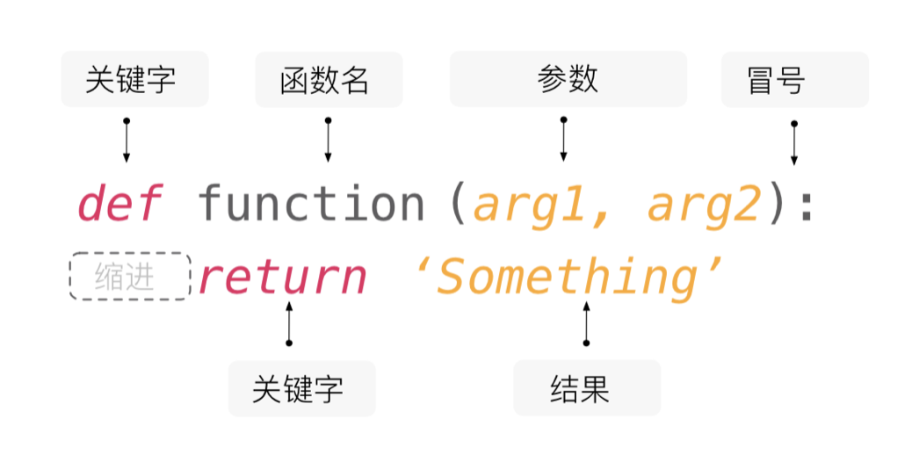

## Hàm và module

Trước khi bước vào nội dung bài học hôm nay, chúng ta hãy cùng nghiên cứu một bài toán nhỏ: Hãy cho biết phương trình dưới đây có bao nhiêu bộ nghiệm nguyên dương?

$$
x_{1} + x_{2} + x_{3} + x_{4} = 8
$$

Có thể bạn đã nghĩ ra, bài toán này thực chất tương đương với việc chia 8 quả táo thành 4 nhóm sao cho mỗi nhóm có ít nhất 1 quả táo; cũng tương đương với việc đặt 3 vách ngăn vào 7 khoảng trống giữa 8 quả táo để chia chúng thành 4 phần. Do đó, đáp án là $\small{C_{7}^{3} = 35}$, trong đó $\small{C_{7}^{3}}$ đại diện cho số tổ hợp chập 3 của 7, công thức tính như sau:

$$
C_m^n = \frac {m!} {n!(m-n)!}
$$

Dựa vào kiến thức đã học ở các bài trước, chúng ta có thể dùng vòng lặp nhân dồn để lần lượt tính ra $\small{m!}$, $\small{n!}$ và $\small{(m-n)!}$, sau đó thực hiện phép chia để thu được số tổ hợp $\small{C_{m}^{n}}$, đoạn mã như sau.

```python
"""
Nhập m và n, tính giá trị của tổ hợp C(m, n)

Version: 1.0
Author: jackfrued
"""

m = int(input('m = '))
n = int(input('n = '))
# Tính giai thừa của m
fm = 1
for num in range(1, m + 1):
    fm *= num
# Tính giai thừa của n
fn = 1
for num in range(1, n + 1):
    fn *= num
# Tính giai thừa của m - n
fk = 1
for num in range(1, m - n + 1):
    fk *= num
# Tính giá trị của C(m, n)
print(fm // fn // fk)
```

Nhập:

```
m = 7
n = 3
```

Kết quả:

```
35
```

Không biết các bạn có nhận thấy hay không: trong đoạn mã trên chúng ta đã thực hiện ba lần thao tác tính giai thừa. Dù giá trị của $\small{m}$, $\small{n}$, $\small{m - n}$ khác nhau, nhưng ba đoạn mã đó về bản chất không có gì khác biệt, thuộc loại mã trùng lặp. Bậc thầy lập trình tầm cỡ thế giới *Martin Fowler* từng nói: "**Mã nguồn có nhiều thứ mùi hôi (code smell), nhưng lặp mã (duplicate code) là thứ tồi tệ nhất!**". Để viết được mã nguồn chất lượng cao, trước hết phải giải quyết vấn đề trùng lặp mã. Đối với đoạn mã trên, chúng ta có thể đóng gói chức năng tính giai thừa vào một khối mã gọi là "hàm" (function). Tại những nơi cần tính giai thừa, chúng ta chỉ việc "gọi hàm" là có thể tái sử dụng chức năng tính giai thừa đó.

### Định nghĩa hàm

Hàm số trong toán học thường có dạng $\small{y = f(x)}$ hoặc $\small{z = g(x, y)}$. Trong $\small{y = f(x)}$, $\small{f}$ là tên hàm, $\small{x}$ là biến độc lập (đối số) của hàm, $\small{y}$ là biến phụ thuộc (hàm số); còn trong $\small{z = g(x, y)}$, $\small{g}$ là tên hàm, $\small{x}$ và $\small{y}$ là các biến độc lập, $\small{z}$ là biến phụ thuộc. Hàm trong Python cũng có cấu trúc tương tự: mỗi hàm đều có tên riêng, các biến độc lập và biến phụ thuộc của nó. Chúng ta thường gọi biến độc lập của hàm Python là tham số (parameter) của hàm, còn biến phụ thuộc là giá trị trả về (return value) của hàm.

Trong Python, bạn có thể sử dụng từ khóa `def` để định nghĩa hàm. Giống như biến, mỗi hàm cũng nên có một cái tên thật đẹp, quy tắc đặt tên hàm hoàn toàn giống với quy tắc đặt tên biến (các bạn hãy nhớ lại quy tắc đặt tên biến đã học trước đây nhé). Trong dấu ngoặc đơn phía sau tên hàm, chúng ta có thể khai báo các tham số của hàm, chính là các biến độc lập mà chúng ta vừa nhắc tới; khi hàm thực thi xong, chúng ta sẽ dùng từ khóa `return` để trả về kết quả thực thi của hàm, chính là biến phụ thuộc. Nếu trong hàm không có câu lệnh `return`, hàm sẽ mặc định trả về giá trị đại diện cho sự rỗng là `None`. Ngoài ra, hàm cũng có thể không có tham số nào, nhưng dấu ngoặc đơn phía sau tên hàm là bắt buộc phải có. Những việc hàm cần làm (đoạn mã cần thực thi) sẽ được thụt lề vào sau dòng định nghĩa hàm, tương tự như các khối mã trong cấu trúc rẽ nhánh và vòng lặp trước đây, như hình dưới đây.



Dưới đây, chúng ta sẽ đưa thao tác tính giai thừa ở đoạn mã trước vào một hàm, thông qua cách này để tái cấu trúc (refactor) đoạn mã trên. **Tái cấu trúc nghĩa là điều chỉnh lại cấu trúc của mã nguồn mà không làm thay đổi kết quả thực thi của nó**. Đoạn mã sau khi tái cấu trúc như sau.

```python
"""
Nhập m và n, tính giá trị của tổ hợp C(m, n)

Version: 1.1
Author: jackfrued
"""


# Định nghĩa hàm tính giai thừa bằng từ khóa def
# Tham số num là một số nguyên không âm
# Giá trị trả về là giai thừa của num
def fac(num):
    result = 1
    for n in range(2, num + 1):
        result *= n
    return result


m = int(input('m = '))
n = int(input('n = '))
# Khi tính giai thừa không cần viết lại mã trùng lặp mà gọi trực tiếp hàm
# Cú pháp gọi hàm là đặt dấu ngoặc đơn sau tên hàm và truyền đối số vào
print(fac(m) // fac(n) // fac(m - n))
```

Các bạn có thể cảm nhận thấy đoạn mã trên ngắn gọn và thanh thoát hơn nhiều so với phiên bản trước. Quan trọng hơn nữa, hàm tính giai thừa `fac` mà chúng ta định nghĩa còn có thể tái sử dụng ở bất kỳ đoạn mã nào khác cần tính giai thừa. Vì vậy, **việc sử dụng hàm giúp chúng ta đóng gói các đoạn mã có tính năng tương đối độc lập và được sử dụng lặp lại**, khi cần những đoạn mã này, chúng ta không phải viết lại từ đầu mà **thông qua việc gọi hàm để tái sử dụng mã nguồn đã có**. Trên thực tế, trong module `math` của thư viện chuẩn Python đã có sẵn một hàm tên là `factorial` thực hiện việc tính giai thừa, chúng ta có thể dùng `import math` để nạp module `math`, sau đó dùng `math.factorial` để gọi hàm tính giai thừa; hoặc cũng có thể thông qua `from math import factorial` để nhập trực tiếp hàm `factorial` vào sử dụng, đoạn mã như sau.

```python
"""
Nhập m và n, tính giá trị của tổ hợp C(m, n)

Version: 1.2
Author: jackfrued
"""
from math import factorial

m = int(input('m = '))
n = int(input('n = '))
print(factorial(m) // factorial(n) // factorial(m - n))
```

Các hàm mà sau này chúng ta sử dụng, hoặc là hàm do chúng ta tự định nghĩa, hoặc là hàm do thư viện chuẩn của Python hay thư viện bên thứ ba cung cấp. Nếu đã có sẵn hàm phục vụ đúng nhu cầu, chúng ta không việc gì phải tự đi định nghĩa lại, việc "**phát minh lại bánh xe**" là một điều hết sức tối kỵ. Trong đoạn mã trên, nếu bạn thấy cái tên `factorial` quá dài, gõ code không tiện lắm, thì khi import hàm chúng ta có thể dùng từ khóa `as` để đặt bí danh (alias) cho nó. Khi gọi hàm, chúng ta có thể dùng bí danh đó thay cho tên gốc, đoạn mã như sau.

```python
"""
Nhập m và n, tính giá trị của tổ hợp C(m, n)

Version: 1.3
Author: jackfrued
"""
from math import factorial as f

m = int(input('m = '))
n = int(input('n = '))
print(f(m) // f(n) // f(m - n))
```

### Tham số của hàm

#### Tham số vị trí và tham số từ khóa

Chúng ta hãy cùng viết thêm một hàm khác: nhận vào độ dài ba cạnh và kiểm tra xem chúng có thể tạo thành một hình tam giác hay không; nếu có thể tạo thành tam giác thì trả về `True`, ngược lại trả về `False`, đoạn mã như sau.

```python
def make_judgement(a, b, c):
    """Kiểm tra độ dài ba cạnh có thể tạo thành tam giác hay không"""
    return a + b > c and b + c > a and a + c > b
```

Hàm `make_judgement` ở trên có 3 tham số, loại tham số này được gọi là tham số vị trí (positional arguments). Khi gọi hàm, thông thường các đối số được truyền vào lần lượt theo thứ tự từ trái sang phải, và số lượng đối số truyền vào phải khớp chính xác với số lượng tham số lúc định nghĩa hàm, như dưới đây.

```python
print(make_judgement(1, 2, 3))  # False
print(make_judgement(4, 5, 6))  # True
```

Nếu không muốn truyền giá trị cho ba tham số `a`, `b`, `c` theo thứ tự từ trái sang phải, bạn cũng có thể sử dụng tham số từ khóa (keyword arguments) dưới dạng "tên_tham_số=giá_trị" để truyền đối số cho hàm, như dưới đây.

```python
print(make_judgement(b=2, c=3, a=1))  # False
print(make_judgement(c=6, b=4, a=5))  # True
```

Khi định nghĩa hàm, chúng ta có thể dùng ký tự `/` trong danh sách tham số để quy định **tham số chỉ vị trí** (*positional-only arguments*), và dùng `*` để quy định **tham số chỉ từ khóa** (*keyword-only arguments*). Tham số chỉ vị trí nghĩa là khi gọi hàm bắt buộc phải truyền đối số theo vị trí; còn tham số chỉ từ khóa thì bắt buộc phải truyền theo kiểu "tên_tham_số=giá_trị", mời các bạn xem ví dụ dưới đây.

```python
# Các tham số đứng trước / là tham số chỉ vị trí
def make_judgement(a, b, c, /):
    """Kiểm tra độ dài ba cạnh có thể tạo thành tam giác hay không"""
    return a + b > c and b + c > a and a + c > b


# Đoạn mã dưới đây sẽ sinh lỗi TypeError với thông báo "tham số chỉ vị trí không được phép truyền tên tham số"
# TypeError: make_judgement() got some positional-only arguments passed as keyword arguments
# print(make_judgement(b=2, c=3, a=1))
```

> **Giải thích**: Tham số chỉ vị trí là tính năng mới được giới thiệu từ Python 3.8, cần lưu ý khi làm việc trên các phiên bản Python cũ hơn.

```python
# Các tham số đứng sau * là tham số chỉ từ khóa
def make_judgement(*, a, b, c):
    """Kiểm tra độ dài ba cạnh có thể tạo thành tam giác hay không"""
    return a + b > c and b + c > a and a + c > b


# Đoạn mã dưới đây sẽ sinh lỗi TypeError với thông báo "hàm không nhận tham số vị trí nào nhưng lại nhận 3 tham số vị trí"
# TypeError: make_judgement() takes 0 positional arguments but 3 were given
# print(make_judgement(1, 2, 3))
```

#### Giá trị mặc định của tham số

Python cho phép tham số của hàm có giá trị mặc định. Chúng ta có thể lấy ví dụ "Trò chơi cá cược CRAPS" (trong bài《Bài 07: Ứng dụng cấu trúc rẽ nhánh và vòng lặp》) và đóng gói chức năng lắc xúc xắc lấy điểm số vào một hàm như sau.

```python
from random import randrange


# Định nghĩa hàm lắc xúc xắc
# Tham số n biểu thị số lượng xúc xắc, giá trị mặc định là 2
# Giá trị trả về biểu thị tổng số điểm nhận được khi lắc n con xúc xắc
def roll_dice(n=2):
    total = 0
    for _ in range(n):
        total += randrange(1, 7)
    return total


# Nếu không truyền tham số, n sẽ dùng giá trị mặc định là 2, nghĩa là lắc 2 con xúc xắc
print(roll_dice())
# Truyền tham số 3, biến n được gán giá trị 3, biểu thị tính điểm khi lắc 3 con xúc xắc
print(roll_dice(3))
```

Chúng ta xem tiếp một ví dụ đơn giản hơn nữa.

```python
def add(a=0, b=0, c=0):
    """Tính tổng của ba số"""
    return a + b + c


# Gọi hàm add, không truyền đối số nào, a, b, c đều nhận giá trị mặc định là 0
print(add())         # 0
# Gọi hàm add, truyền vào một đối số, đối số này được gán cho a, còn b và c dùng giá trị mặc định 0
print(add(1))        # 1
# Gọi hàm add, truyền vào hai đối số, lần lượt gán cho a và b, còn c dùng giá trị mặc định 0
print(add(1, 2))     # 3
# Gọi hàm add, truyền vào ba đối số, lần lượt gán cho cả ba biến a, b, c
print(add(1, 2, 3))  # 6
```

Cần lưu ý rằng, **các tham số có giá trị mặc định bắt buộc phải đặt sau các tham số không có giá trị mặc định**, nếu không sẽ phát sinh lỗi `SyntaxError` với thông báo: `non-default argument follows default argument` (tham số không mặc định nằm sau tham số có mặc định).

#### Tham số biến đổi

Trong ngôn ngữ Python, chúng ta có thể dùng cú pháp dấu sao để giúp hàm hỗ trợ tham số biến đổi (variable arguments). Cái gọi là tham số biến đổi nghĩa là khi gọi hàm, chúng ta có thể truyền vào `0` hoặc nhiều đối số tùy ý. Sau này khi làm việc nhóm phát triển các dự án thực tế, rất có thể bạn sẽ phải thiết kế hàm cho người khác sử dụng, nhưng nhiều khi chúng ta không biết trước người gọi hàm sẽ truyền vào bao nhiêu đối số, lúc này tham số biến đổi sẽ phát huy tác dụng.

Đoạn mã dưới đây minh họa cách dùng tham số vị trí biến đổi để xây dựng hàm `add` tính tổng cho số lượng phần tử bất kỳ. Khi gọi hàm, các đối số truyền vào sẽ được gom lại thành một tuple, thông qua việc duyệt tuple này chúng ta có thể lấy được toàn bộ đối số truyền vào hàm.

```python
# Dùng biểu thức dấu sao để biểu thị args có thể nhận 0 hoặc nhiều đối số tùy ý
# Khi gọi hàm, n đối số truyền vào sẽ được gom thành một bộ n phần tử (n-tuple) gán cho args
# Nếu không truyền đối số nào, args sẽ là một tuple rỗng
def add(*args):
    total = 0
    # Duyệt qua tuple lưu trữ các tham số biến đổi
    for val in args:
        # Kiểm tra kiểu của tham số (chỉ cộng các giá trị kiểu số)
        if type(val) in (int, float):
            total += val
    return total


# Khi gọi hàm add có thể truyền vào 0 hoặc nhiều đối số tùy ý
print(add())         # 0
print(add(1))        # 1
print(add(1, 2, 3))  # 6
print(add(1, 2, 'hello', 3.45, 6))  # 12.45
```

Nếu muốn truyền vào một số lượng đối số không cố định dưới dạng "tên_tham_số=giá_trị", chúng ta có thể thêm tham số từ khóa biến đổi vào hàm, các đối số từ khóa truyền vào sẽ được tập hợp vào một từ điển, đoạn mã như sau.

```python
# **kwargs trong danh sách tham số có thể nhận 0 hoặc nhiều đối số từ khóa tùy ý
# Khi gọi hàm, các đối số từ khóa truyền vào sẽ được gom vào một từ điển (tên tham số là khóa, giá trị đối số là giá trị)
# Nếu không truyền đối số từ khóa nào, kwargs sẽ là một từ điển rỗng
def foo(*args, **kwargs):
    print(args)
    print(kwargs)


foo(3, 2.1, True, name='jackfrued', age=43, gpa=4.95)
```

Kết quả:

```
(3, 2.1, True)
{'name': 'jackfrued', 'age': 43, 'gpa': 4.95}
```

### Quản lý hàm bằng module

Dù dùng bất kỳ ngôn ngữ lập trình nào để viết mã, việc đặt tên cho biến và hàm luôn là một vấn đề đau đầu, bởi chúng ta rất dễ gặp phải tình huống khó xử mang tên **xung đột tên gọi** (naming conflict). Trường hợp đơn giản nhất là trong cùng một tệp `.py` định nghĩa hai hàm trùng tên, như dưới đây.

```python
def foo():
    print('hello, world!')


def foo():
    print('goodbye, world!')

    
foo()  # Bạn đoán xem khi gọi foo() sẽ xuất ra kết quả gì
```

Tất nhiên tình huống trên chúng ta rất dễ tránh được. Nhưng nếu dự án có nhiều người cùng phát triển, trong nhóm có thể có nhiều lập trình viên cùng định nghĩa hàm có tên là `foo`. Trong trường hợp này, làm thế nào để giải quyết xung đột tên? Câu trả lời thực ra rất đơn giản: trong Python mỗi tệp mã nguồn đại diện cho một module. Chúng ta có thể có các hàm trùng tên trong các module khác nhau; khi sử dụng hàm, chúng ta dùng từ khóa `import` để nạp module chỉ định rồi gọi hàm theo **tên định danh đầy đủ** (fully qualified name dạng `tên_module.tên_hàm`), nhờ đó có thể phân biệt chính xác hàm `foo` của module nào đang được sử dụng, đoạn mã như sau.

`module1.py`

```python
def foo():
    print('hello, world!')
```

`module2.py`

```python
def foo():
    print('goodbye, world!')
```

`test.py`

```python
import module1
import module2

# Gọi hàm theo cách "tên_module.tên_hàm" (tên định danh đầy đủ)
module1.foo()  # hello, world!
module2.foo()  # goodbye, world!
```

Khi import module, chúng ta còn có thể dùng từ khóa `as` để đặt bí danh cho module, giúp việc viết tên định danh đầy đủ trở nên ngắn gọn hơn.

`test.py`

```python
import module1 as m1
import module2 as m2

m1.foo()  # hello, world!
m2.foo()  # goodbye, world!
```

Trong hai đoạn mã trên, chúng ta import module chứa định nghĩa hàm. Chúng ta cũng có thể sử dụng cú pháp `from...import...` để import trực tiếp hàm cần dùng từ module, đoạn mã như sau.

`test.py`

```python
from module1 import foo

foo()  # hello, world!

from module2 import foo

foo()  # goodbye, world!
```

Tuy nhiên, nếu chúng ta import các hàm trùng tên từ hai module khác nhau, hàm được import sau sẽ ghi đè lên hàm được import trước. Giống như trong đoạn mã dưới đây, gọi `foo` sẽ xuất ra `goodbye, world!`, vì chúng ta import `foo` của `module1` trước, rồi sau đó mới import `foo` của `module2`. Nếu đảo ngược thứ tự hai câu lệnh `from...import...`, kết quả sẽ hoàn toàn ngược lại.

`test.py`

```python
from module1 import foo
from module2 import foo

foo()  # goodbye, world!
```

Nếu muốn sử dụng đồng thời cả hai hàm `foo` đến từ hai module trong đoạn mã trên, vẫn có cách giải quyết. Có thể bạn đã đoán ra, đó là dùng từ khóa `as` để đặt bí danh cho các hàm được import, đoạn mã như sau.

`test.py`

```python
from module1 import foo as f1
from module2 import foo as f2

f1()  # hello, world!
f2()  # goodbye, world!
```

### Các module và hàm trong thư viện chuẩn

Thư viện chuẩn của Python cung cấp một lượng lớn các module và hàm để đơn giản hóa công việc phát triển của chúng ta. Module `random` mà chúng ta đã dùng trước đây cung cấp các hàm sinh số ngẫu nhiên và lấy mẫu ngẫu nhiên; module `time` cung cấp các hàm liên quan đến thao tác thời gian; còn module `math` chứa hàng loạt hàm toán học như tính sin, cos, hàm mũ, logarit, v.v. Càng đi sâu vào việc học Python, chúng ta sẽ càng sử dụng nhiều module và hàm hơn nữa.

Trong thư viện chuẩn của Python còn có một nhóm hàm có thể sử dụng trực tiếp mà không cần `import`, chúng ta gọi chúng là **hàm tích hợp sẵn (built-in functions)**. Các hàm tích hợp sẵn này không những vô cùng hữu ích mà còn rất hay được dùng. Bảng dưới đây liệt kê một số hàm tích hợp sẵn tiêu biểu:

| Hàm | Giải thích |
| ------- | ------------------------------------------------------------ |
| `abs`   | Trả về giá trị tuyệt đối của một số, ví dụ: `abs(-1.3)` trả về `1.3`. |
| `bin`   | Chuyển đổi một số nguyên thành chuỗi nhị phân có tiền tố `'0b'`, ví dụ: `bin(123)` trả về `'0b1111011'`. |
| `chr`   | Chuyển đổi mã Unicode thành ký tự tương ứng, ví dụ: `chr(8364)` trả về `'€'`. |
| `hex`   | Chuyển đổi một số nguyên thành chuỗi thập lục phân có tiền tố `'0x'`, ví dụ: `hex(123)` trả về `'0x7b'`. |
| `input` | Đọc một dòng từ đầu vào chuẩn, trả về chuỗi đọc được. |
| `len`   | Lấy độ dài của chuỗi, danh sách, v.v. |
| `max`   | Trả về giá trị lớn nhất trong nhiều đối số hoặc trong một iterable, ví dụ: `max(12, 95, 37)` trả về `95`. |
| `min`   | Trả về giá trị nhỏ nhất trong nhiều đối số hoặc trong một iterable, ví dụ: `min(12, 95, 37)` trả về `12`. |
| `oct`   | Chuyển đổi một số nguyên thành chuỗi bát phân có tiền tố `'0o'`, ví dụ: `oct(123)` trả về `'0o173'`. |
| `open`  | Mở một tệp tin và trả về đối tượng tệp. |
| `ord`   | Chuyển đổi ký tự thành mã Unicode tương ứng, ví dụ: `ord('€')` trả về `8364`. |
| `pow`   | Phép tính lũy thừa, ví dụ: `pow(2, 3)` trả về `8`; `pow(2, 0.5)` trả về `1.4142135623730951`. |
| `print` | In dữ liệu ra màn hình. |
| `range` | Tạo một chuỗi phạm vi, ví dụ: `range(100)` tạo chuỗi số nguyên từ `0` đến `99`. |
| `round` | Làm tròn số theo độ chính xác chỉ định, ví dụ: `round(1.23456, 4)` trả về `1.2346`. |
| `sum`   | Tính tổng các phần tử trong một chuỗi từ trái qua phải, ví dụ: `sum(range(1, 101))` trả về `5050`. |
| `type`  | Trả về kiểu của đối tượng, ví dụ: `type(10)` trả về `int`; còn `type('hello')` trả về `str`. |

### Tổng kết

**Hàm là sự đóng gói của những đoạn mã có tính năng tương đối độc lập và được sử dụng lặp lại**. Học cách định nghĩa và sử dụng hàm giúp bạn viết được mã nguồn chất lượng cao hơn. Dĩ nhiên, thư viện chuẩn của Python đã cung cấp cho chúng ta rất nhiều module và hàm thông dụng, tận dụng tốt các module và hàm này sẽ giúp bạn làm được nhiều việc hơn với ít dòng code hơn; nếu các module và hàm có sẵn không đáp ứng đủ yêu cầu, lúc đó chúng ta sẽ tự định nghĩa hàm, rồi thông qua khái niệm module để quản lý các hàm tự tạo này.