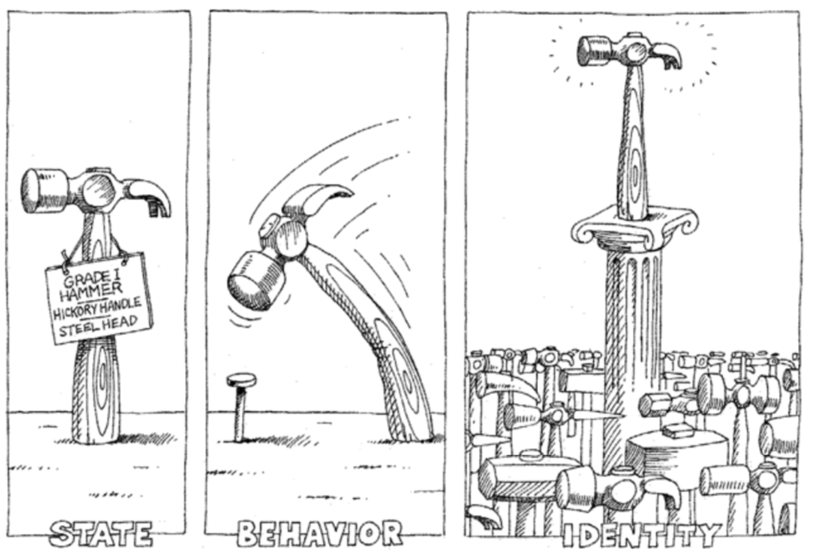
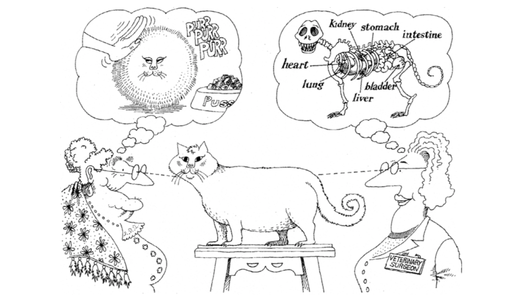

## Nhập môn lập trình hướng đối tượng

Lập trình hướng đối tượng là một **mô hình lập trình** (programming paradigm) rất phổ biến. Cái gọi là mô hình lập trình chính là **phương pháp luận trong thiết kế chương trình**, nói một cách đơn giản là nhận thức và hiểu biết của lập trình viên về chương trình cũng như cách họ viết code.

Trong các bài học trước, chúng ta đã nói rằng "**chương trình là tập hợp các lệnh**". Khi chạy chương trình, các câu lệnh trong mã nguồn sẽ chuyển thành một hoặc nhiều chỉ thị để CPU (bộ xử lý trung tâm) thực thi. Để đơn giản hóa thiết kế chương trình, chúng ta đã học về hàm: **đặt các đoạn mã tương đối độc lập và thường xuyên lặp lại vào trong các hàm**, khi cần sử dụng đoạn mã đó thì chỉ việc gọi hàm. Nếu chức năng của một hàm quá phức tạp và cồng kềnh, chúng ta lại có thể **chia nhỏ hàm thành nhiều hàm con** để giảm độ phức tạp của hệ thống.

Không biết bạn có nhận thấy rằng việc lập trình thực chất là người viết chương trình điều khiển máy tính hoàn thành nhiệm vụ theo phương thức làm việc của máy tính. Tuy nhiên, cách làm việc của máy tính khác với tư duy thông thường của con người. Nếu lập trình cứ bắt buộc phải từ bỏ lối tư duy tự nhiên của con người để chiều theo máy tính thì niềm vui lập trình sẽ giảm đi rất nhiều. Ở đây, điều tôi muốn nói không phải là chúng ta không thể viết mã theo cách hoạt động của máy tính, mà là khi cần phát triển một hệ thống phức tạp, cách tiếp cận này sẽ khiến mã nguồn trở nên quá phức tạp, dẫn đến công việc phát triển và bảo trì đều trở nên vô cùng gian nan.

Cùng với sự gia tăng độ phức tạp của phần mềm, việc viết mã nguồn chính xác và đáng tin cậy đã trở thành một nhiệm vụ hết sức nặng nề. Đây cũng là lý do nhiều người tin rằng "phát triển phần mềm là hoạt động phức tạp nhất trong mọi hoạt động cải tạo thế giới của loài người". Làm thế nào để dùng chương trình miêu tả các hệ thống phức tạp và giải quyết các bài toán phức tạp đã trở thành câu hỏi mà mọi lập trình viên đều phải suy ngẫm và đối mặt. Ngôn ngữ Smalltalk ra đời vào những năm 1970 đã mang lại hy vọng cho các nhà phát triển phần mềm, bởi nó giới thiệu một mô hình lập trình mới gọi là lập trình hướng đối tượng. Trong thế giới của lập trình hướng đối tượng, **dữ liệu và các hàm thao tác trên dữ liệu trong chương trình là một thể thống nhất về mặt logic**, chúng ta gọi đó là **đối tượng** (object). **Đối tượng có thể tiếp nhận thông điệp**, và phương pháp giải quyết vấn đề chính là **tạo ra các đối tượng và gửi các thông điệp khác nhau đến chúng**; thông qua việc truyền thông điệp, nhiều đối tượng trong chương trình có thể phối hợp làm việc với nhau, từ đó xây dựng nên các hệ thống phức tạp và giải quyết các bài toán trong đời thực. Tất nhiên, mầm mống sơ khai của lập trình hướng đối tượng còn có thể truy nguyên xa hơn về ngôn ngữ Simula trước đó, nhưng đó không phải là trọng tâm thảo luận của chúng ta.

> **Giải thích:** Ngày nay rất nhiều ngôn ngữ lập trình bậc cao mà chúng ta sử dụng đều hỗ trợ lập trình hướng đối tượng, nhưng lập trình hướng đối tượng cũng không phải là "viên đạn bạc" giải quyết mọi vấn đề trong phát triển phần mềm, hay nói đúng hơn là trong ngành phát triển phần mềm hiện nay vẫn chưa hề có cái gọi là "viên đạn bạc". Về vấn đề này, các bạn có thể tham khảo bài báo *Không có viên đạn bạc: Bản chất và sự cố trong công nghệ phần mềm* (No Silver Bullet - Essence and Accidents of Software Engineering) của Frederick Brooks - cha đẻ của hệ thống IBM 360, hoặc cuốn sách kinh điển về công nghệ phần mềm *The Mythical Man-Month* (Tháng người thần thoại).

### Lớp và đối tượng

Nếu phải dùng một câu để tóm tắt lập trình hướng đối tượng, tôi cho rằng phát biểu dưới đây là vô cùng súc tích và chuẩn xác:

> **Lập trình hướng đối tượng**: Gom một nhóm dữ liệu và các phương thức xử lý dữ liệu thành **đối tượng**, quy nạp các đối tượng có hành vi giống nhau thành **lớp**, thông qua **đóng gói** để ẩn đi các chi tiết nội bộ của đối tượng, thông qua **kế thừa** để hiện thực hóa việc chuyên biệt hóa và khái quát hóa của lớp, và thông qua **đa hình** để thực hiện phân phối động (dynamic dispatch) dựa trên kiểu của đối tượng.

Câu nói này đối với người mới bắt đầu có thể không dễ hiểu lắm, nhưng tôi có thể khoanh vùng trước cho các bạn vài từ khóa quan trọng: **đối tượng** (object), **lớp** (class), **đóng gói** (encapsulation), **kế thừa** (inheritance), **đa hình** (polymorphism).

Trước tiên chúng ta hãy nói về hai từ lớp và đối tượng. Trong lập trình hướng đối tượng, **lớp là một khái niệm trừu tượng, đối tượng là một thực thể cụ thể**. Chúng ta trích xuất những đặc trưng chung của cùng một loại đối tượng để tạo thành một lớp. Ví dụ chúng ta thường nói đến "loài người", đây là một khái niệm trừu tượng; còn mỗi cá nhân chúng ta là một sự tồn tại thực tế cụ thể dưới khái niệm trừu tượng loài người đó, tức là một đối tượng. Nói một cách đơn giản, **lớp là bản thiết kế và khuôn mẫu của đối tượng, đối tượng là thể hiện (instance) của lớp, là thực thể có thể tiếp nhận thông điệp**.

Trong thế giới lập trình hướng đối tượng, **mọi thứ đều là đối tượng**, **đối tượng đều có thuộc tính và hành vi**, **mỗi đối tượng đều là duy nhất**, và **đối tượng nhất định phải thuộc về một lớp nào đó**. Thuộc tính của đối tượng là đặc trưng tĩnh, còn hành vi của đối tượng là đặc trưng động. Theo cách nói ở trên, nếu chúng ta trích xuất thuộc tính và hành vi của những đối tượng có chung đặc trưng, chúng ta có thể định nghĩa ra một lớp.



### Định nghĩa lớp

Trong ngôn ngữ Python, chúng ta có thể sử dụng từ khóa `class` cùng với tên lớp để định nghĩa lớp. Thông qua thụt lề, chúng ta xác định khối mã của lớp, giống hệt như khi định nghĩa hàm. Trong khối mã của lớp, chúng ta cần viết một số hàm. Như đã nói, lớp là một khái niệm trừu tượng, nên các hàm này chính là sự trích xuất các đặc trưng động chung của một nhóm đối tượng. Các hàm được viết bên trong lớp thường được gọi là **phương thức** (method). Phương thức chính là hành vi của đối tượng, tức là thông điệp mà đối tượng có thể nhận. Tham số đầu tiên của phương thức thường luôn là `self`, nó đại diện cho chính đối tượng tiếp nhận thông điệp đó.

```python
class Student:

    def study(self, course_name):
        print(f'Học sinh đang học {course_name}.')

    def play(self):
        print(f'Học sinh đang chơi game.')
```

### Tạo và sử dụng đối tượng

Sau khi định nghĩa xong một lớp, chúng ta có thể sử dụng cú pháp hàm tạo (constructor) để tạo đối tượng, code như sau:

```python
stu1 = Student()
stu2 = Student()
print(stu1)    # <__main__.Student object at 0x10ad5ac50>
print(stu2)    # <__main__.Student object at 0x10ad5acd0> 
print(hex(id(stu1)), hex(id(stu2)))    # 0x10ad5ac50 0x10ad5acd0
```

Viết cặp dấu ngoặc đơn sau tên lớp chính là cú pháp constructor. Đoạn code trên tạo ra hai đối tượng học sinh, một gán cho biến `stu1`, một gán cho biến `stu2`. Khi chúng ta dùng hàm `print` để in hai biến `stu1` và `stu2`, chúng ta thấy nó in ra địa chỉ trong bộ nhớ của đối tượng (dưới dạng thập lục phân), giống hệt với giá trị nhận được khi dùng hàm `id` để xem định danh đối tượng. Giờ đây chúng ta có thể khẳng định rằng biến mà chúng ta định nghĩa thực chất lưu giữ địa chỉ logic (vị trí) của một đối tượng trong bộ nhớ, thông qua địa chỉ logic này chúng ta có thể tìm thấy đối tượng trong bộ nhớ. Do đó, câu lệnh gán như `stu3 = stu2` không hề tạo ra đối tượng mới, mà chỉ dùng một biến mới để lưu địa chỉ của đối tượng đã có.

Tiếp theo, chúng ta thử gửi thông điệp cho đối tượng, tức là gọi phương thức của đối tượng. Trong lớp `Student` vừa rồi, chúng ta đã định nghĩa hai phương thức `study` và `play`. Tham số đầu tiên `self` của hai phương thức đại diện cho đối tượng học sinh tiếp nhận thông điệp, tham số thứ hai của phương thức `study` là tên môn học cần học. Trong Python, có hai cách để gửi thông điệp cho đối tượng, mời các bạn xem đoạn code dưới đây:

```python
# Gọi phương thức thông qua "Lớp.phương_thức"
# Tham số đầu tiên là đối tượng tiếp nhận thông điệp
# Tham số thứ hai là tên môn học
Student.study(stu1, 'Lập trình Python')    # Học sinh đang học Lập trình Python.
# Gọi phương thức thông qua "đối_tượng.phương_thức"
# Đối tượng trước dấu chấm chính là đối tượng nhận thông điệp
# Chỉ cần truyền tham số thứ hai là tên môn học
stu1.study('Lập trình Python')             # Học sinh đang học Lập trình Python.

Student.play(stu2)                        # Học sinh đang chơi game.
stu2.play()                               # Học sinh đang chơi game. 
```

### Phương thức khởi tạo

Các bạn có thể đã nhận thấy đối tượng học sinh chúng ta vừa tạo chỉ có hành vi mà chưa có thuộc tính. Nếu muốn định nghĩa thuộc tính cho đối tượng học sinh, chúng ta có thể chỉnh sửa lớp `Student`, thêm vào một phương thức tên là `__init__`. Khi chúng ta gọi constructor của lớp `Student` để tạo đối tượng, trước hết hệ thống sẽ xin cấp phát vùng nhớ cần thiết để lưu trữ đối tượng học sinh, sau đó tự động thực thi phương thức `__init__` để hoàn tất thao tác khởi tạo bộ nhớ, tức là đưa dữ liệu vào vùng nhớ đó. Vì vậy, chúng ta có thể chỉ định thuộc tính cho đối tượng học sinh bằng cách thêm phương thức `__init__` vào lớp `Student`, đồng thời gán giá trị ban đầu cho các thuộc tính. Chính vì lý do đó, phương thức `__init__` thường được gọi là phương thức khởi tạo (initializer).

Chúng ta sửa đổi lớp `Student` ở trên một chút, thêm hai thuộc tính `name` (họ tên) và `age` (tuổi) cho đối tượng học sinh:

```python
class Student:
    """Học sinh"""

    def __init__(self, name, age):
        """Phương thức khởi tạo"""
        self.name = name
        self.age = age

    def study(self, course_name):
        """Học tập"""
        print(f'{self.name} đang học {course_name}.')

    def play(self):
        """Vui chơi"""
        print(f'{self.name} đang chơi game.')
```

Sửa lại đoạn code tạo đối tượng và gửi thông điệp cho đối tượng lúc nãy, chạy lại một lần nữa xem kết quả thực thi chương trình thay đổi như thế nào:

```python
# Gọi constructor của lớp Student để tạo đối tượng và truyền vào tham số khởi tạo
stu1 = Student('jackfrued', 44)
stu2 = Student('Vương Đại Chùy', 25)
stu1.study('Lập trình Python')    # jackfrued đang học Lập trình Python.
stu2.play()                      # Vương Đại Chùy đang chơi game.
```


### Trụ cột của hướng đối tượng

Lập trình hướng đối tượng có ba trụ cột lớn, chính là ba từ mà chúng ta đã khoanh vùng trọng tâm trước đó: **đóng gói**, **kế thừa** và **đa hình**. Hai khái niệm sau sẽ được giải thích chi tiết trong bài học tiếp theo, ở đây chúng ta hãy nói về việc đóng gói là gì trước. Cách hiểu của cá nhân tôi về đóng gói là: **ẩn đi tất cả các chi tiết triển khai có thể ẩn, chỉ để lộ giao diện gọi đơn giản ra thế giới bên ngoài**. Các phương thức của đối tượng mà chúng ta định nghĩa trong lớp thực chất chính là một dạng đóng gói. Sự đóng gói này cho phép chúng ta sau khi tạo đối tượng chỉ cần gửi một thông điệp đến đối tượng là có thể thực thi đoạn code trong phương thức. Nói cách khác, chúng ta chỉ cần biết tên và tham số của phương thức (khung nhìn bên ngoài của phương thức) mà không cần biết chi tiết triển khai bên trong (khung nhìn bên trong của phương thức) là đã có thể sử dụng phương thức đó rồi.

Lấy một ví dụ: giả sử muốn điều khiển một robot rót giúp tôi một cốc nước, nếu không sử dụng lập trình hướng đối tượng và không đóng gói gì cả, thì chúng ta phải gửi một loạt chỉ thị chi tiết cho robot này như: đứng dậy, quay trái, đi thẳng 5 bước, cầm lấy cốc nước trước mặt, quay sau, đi thẳng 10 bước, cúi người, đặt cốc nước xuống, nhấn nút rót nước, đợi 10 giây, nhả nút rót nước, cầm cốc nước lên, quay phải, đi thẳng 5 bước, đặt cốc nước xuống,... mới có thể hoàn thành thao tác đơn giản này, nghĩ thôi đã thấy phiền phức. Theo tư tưởng của lập trình hướng đối tượng, chúng ta có thể đóng gói toàn bộ thao tác rót nước vào một phương thức của robot. Khi cần robot rót nước giúp, chúng ta chỉ việc gửi thông điệp rót nước đến đối tượng robot là xong, làm như vậy chẳng phải tốt hơn nhiều sao?

Trong rất nhiều trường hợp, lập trình hướng đối tượng thực chất là một quy trình gồm ba bước: Bước 1 định nghĩa lớp, bước 2 tạo đối tượng, bước 3 gửi thông điệp cho đối tượng. Tất nhiên, đôi khi chúng ta không cần bước 1, vì lớp mà chúng ta muốn dùng có thể đã tồn tại sẵn. Như chúng ta đã nói trước đây, các kiểu tích hợp sẵn trong Python như `list`, `set`, `dict` thực chất đều là các lớp. Nếu muốn tạo đối tượng danh sách, tập hợp, từ điển thì chúng ta không cần phải tự định nghĩa lớp nữa. Tất nhiên, có những lớp không được cung cấp trực tiếp trong thư viện chuẩn của Python, mà có thể đến từ mã nguồn của bên thứ ba; cách cài đặt và sử dụng thư viện bên thứ ba sẽ được thảo luận trong các bài học sau. Trong một số ngữ cảnh đặc biệt, chúng ta sẽ bắt gặp các đối tượng được gọi là "đối tượng tích hợp sẵn" (built-in object). Cái gọi là "đối tượng tích hợp sẵn" có nghĩa là cả bước 1 và bước 2 trong quy trình ba bước trên đều không cần nữa, vì lớp đã có sẵn và đối tượng cũng đã được tạo sẵn từ trước rồi, chúng ta chỉ việc gửi thông điệp trực tiếp cho đối tượng, đây chính là điều chúng ta hay gọi là "dùng được ngay" (out-of-the-box).

### Các ví dụ về hướng đối tượng

#### Ví dụ 1: Đồng hồ số

> **Yêu cầu**: Định nghĩa một lớp miêu tả đồng hồ số, cung cấp tính năng chạy thời gian và hiển thị thời gian.

```python
import time


# Định nghĩa lớp đồng hồ
class Clock:
    """Đồng hồ số"""

    def __init__(self, hour=0, minute=0, second=0):
        """Phương thức khởi tạo
        :param hour: Giờ
        :param minute: Phút
        :param second: Giây
        """
        self.hour = hour
        self.min = minute
        self.sec = second

    def run(self):
        """Chạy thời gian"""
        self.sec += 1
        if self.sec == 60:
            self.sec = 0
            self.min += 1
            if self.min == 60:
                self.min = 0
                self.hour += 1
                if self.hour == 24:
                    self.hour = 0

    def show(self):
        """Hiển thị thời gian"""
        return f'{self.hour:0>2d}:{self.min:0>2d}:{self.sec:0>2d}'


# Tạo đối tượng đồng hồ
clock = Clock(23, 59, 58)
while True:
    # Gửi thông điệp đến đối tượng đồng hồ để đọc thời gian
    print(clock.show())
    # Tạm dừng 1 giây
    time.sleep(1)
    # Gửi thông điệp đến đối tượng đồng hồ để chạy thời gian
    clock.run()
```

#### Ví dụ 2: Điểm trên mặt phẳng

> **Yêu cầu**: Định nghĩa một lớp miêu tả một điểm trên mặt phẳng, cung cấp phương thức tính khoảng cách đến một điểm khác.

```python
class Point:
    """Điểm trên mặt phẳng"""

    def __init__(self, x=0, y=0):
        """Phương thức khởi tạo
        :param x: Hoành độ
        :param y: Tung độ
        """
        self.x, self.y = x, y

    def distance_to(self, other):
        """Tính khoảng cách đến một điểm khác
        :param other: Điểm khác
        """
        dx = self.x - other.x
        dy = self.y - other.y
        return (dx * dx + dy * dy) ** 0.5

    def __str__(self):
        return f'({self.x}, {self.y})'


p1 = Point(3, 5)
p2 = Point(6, 9)
print(p1)  # Gọi phương thức đặc biệt __str__ của đối tượng
print(p2)
print(p1.distance_to(p2))
```

### Tổng kết

Lập trình hướng đối tượng là một mô hình lập trình vô cùng phổ biến, ngoài ra còn có các mô hình lập trình như **lập trình mệnh lệnh** (imperative programming), **lập trình hàm** (functional programming),... Vì thế giới thực được cấu thành từ các đối tượng, và đối tượng là thực thể có thể tiếp nhận thông điệp, do đó **lập trình hướng đối tượng phù hợp hơn với thói quen tư duy thông thường của con người**. Lớp là trừu tượng, đối tượng là cụ thể. Có lớp thì có thể tạo ra đối tượng, có đối tượng thì có thể tiếp nhận thông điệp, đây chính là nền tảng của lập trình hướng đối tượng. Quá trình định nghĩa lớp là một quá trình trừu tượng hóa: tìm ra các thuộc tính chung của đối tượng thuộc về trừu tượng hóa dữ liệu, tìm ra các phương thức chung của đối tượng thuộc về trừu tượng hóa hành vi. Quá trình trừu tượng hóa là một quá trình mang tính chủ quan ("mỗi người một ý"), việc trừu tượng hóa cùng một nhóm đối tượng có thể cho ra những kết quả khác nhau, như minh họa ở hình dưới đây:



> **Giải thích:** Hình minh họa trong bài học này được trích từ cuốn sách *Object-Oriented Analysis and Design* (Phân tích và thiết kế hướng đối tượng) của Grady Booch và các tác giả khác. Đây là tác phẩm kinh điển giảng giải về lập trình hướng đối tượng, bạn đọc quan tâm có thể tìm đọc cuốn sách này để hiểu thêm các kiến thức liên quan đến hướng đối tượng.
