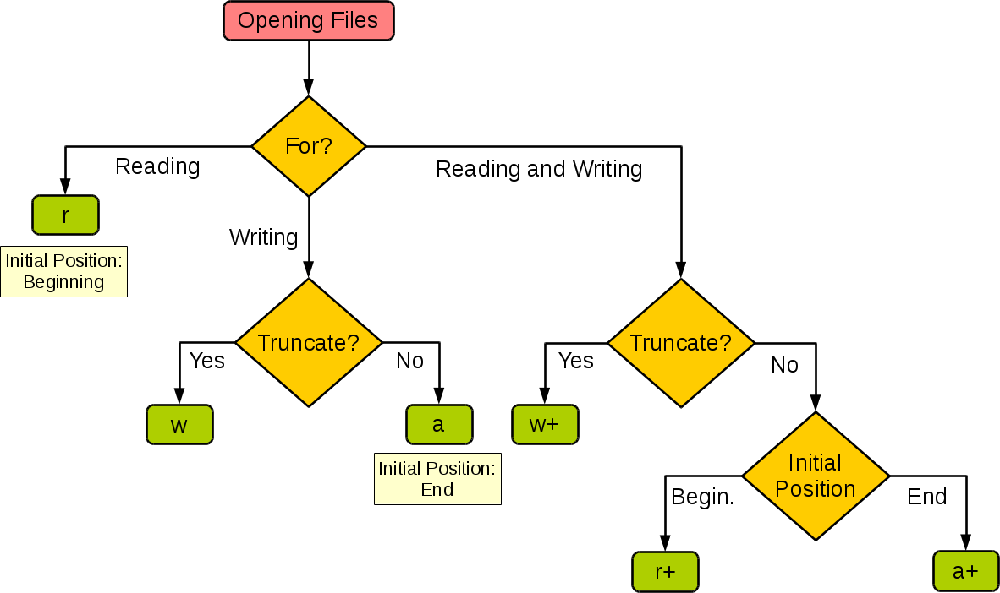

## Đọc ghi file và xử lý ngoại lệ

Trong quá trình phát triển thực tế, chúng ta thường gặp phải các tình huống cần lưu trữ bền vững (persistence) dữ liệu. Cái gọi là lưu trữ bền vững đề cập đến việc chuyển dữ liệu từ phương tiện lưu trữ không thể giữ dữ liệu lâu dài (thường là bộ nhớ RAM) sang phương tiện lưu trữ có thể giữ dữ liệu lâu dài (thường là ổ cứng). Cách trực tiếp và đơn giản nhất để thực hiện lưu trữ bền vững dữ liệu là thông qua **hệ thống tệp (file system)** để lưu dữ liệu vào các **tệp tin (file)**.

**Hệ thống tệp** của máy tính là một phương pháp lưu trữ và tổ chức dữ liệu máy tính, giúp cho việc truy cập và tìm kiếm dữ liệu trở nên dễ dàng. Hệ thống tệp sử dụng các khái niệm logic trừu tượng là **tệp** và **thư mục dạng cây** để thay thế cho khái niệm khối dữ liệu vật lý trên các thiết bị như ổ cứng, đĩa quang, bộ nhớ flash,... Khi người dùng sử dụng hệ thống tệp để lưu dữ liệu, họ không cần quan tâm dữ liệu thực tế được lưu trên khối nào của ổ cứng, mà chỉ cần nhớ đường dẫn và tên của tệp đó. Trước khi ghi dữ liệu mới, người dùng cũng không cần quan tâm khối dữ liệu nào trên ổ cứng chưa được sử dụng; việc quản lý không gian lưu trữ (phân bổ và giải phóng) trên ổ cứng được hệ thống tệp tự động hoàn thành, người dùng chỉ cần nhớ dữ liệu được ghi vào tệp nào.

### Mở và đóng tệp

Nhờ có hệ thống tệp, chúng ta có thể đọc và ghi dữ liệu qua các tệp một cách rất thuận tiện. Thao tác với tệp trong Python vô cùng đơn giản. Chúng ta có thể sử dụng hàm `open` tích hợp sẵn của Python để mở tệp. Khi sử dụng hàm `open`, chúng ta có thể chỉ định **tên tệp**, **chế độ thao tác** và **mã hóa ký tự (encoding)** thông qua các tham số của hàm, sau đó có thể tiến hành đọc và ghi tệp. Chế độ thao tác ở đây đề cập đến việc muốn mở loại tệp nào (tệp văn bản hay tệp nhị phân) và thực hiện hành động gì (đọc, ghi hoặc thêm vào cuối), cụ thể như bảng dưới đây:

| Chế độ thao tác | Ý nghĩa cụ thể |
| --- | --- |
| `'r'` | Đọc (mặc định) |
| `'w'` | Ghi (sẽ cắt bớt/xóa nội dung cũ trước) |
| `'x'` | Ghi độc quyền, nếu tệp đã tồn tại sẽ sinh ra ngoại lệ |
| `'a'` | Ghi tiếp (append), ghi thêm nội dung vào cuối tệp đã có |
| `'b'` | Chế độ nhị phân (binary) |
| `'t'` | Chế độ văn bản (text, mặc định) |
| `'+'` | Cập nhật (vừa đọc vừa ghi) |

Hình dưới đây minh họa cách thiết lập chế độ thao tác của hàm `open` theo nhu cầu của chương trình:



Khi sử dụng hàm `open`, nếu tệp được mở là tệp ký tự (tệp văn bản), bạn có thể chỉ định mã hóa ký tự dùng để đọc ghi tệp thông qua tham số `encoding`. Nếu bạn chưa hiểu rõ về bảng mã và mã hóa ký tự, có thể tìm đọc thêm về tập ký tự và mã hóa ký tự (chẳng hạn UTF-8, ASCII,...).

Sau khi mở tệp thành công bằng hàm `open`, nó sẽ trả về một đối tượng tệp (file object). Thông qua đối tượng này, chúng ta có thể thực hiện các thao tác đọc và ghi tệp; nếu mở tệp thất bại, hàm `open` sẽ kích hoạt ngoại lệ, điều này sẽ được giải thích sau. Nếu muốn đóng tệp đã mở, bạn có thể sử dụng phương thức `close` của đối tượng tệp, giúp giải phóng tệp khi kết thúc thao tác.

### Đọc ghi tệp văn bản

Khi mở tệp văn bản bằng hàm `open`, cần chỉ định tên tệp và đặt chế độ thao tác thành `'r'`. Nếu không chỉ định, giá trị mặc định cũng là `'r'`. Nếu cần chỉ định mã hóa ký tự, có thể truyền tham số `encoding`; nếu không chỉ định, giá trị mặc định là `None`, khi đó tệp sẽ được đọc bằng bảng mã mặc định của hệ điều hành. Cần nhắc các bạn rằng, nếu không đảm bảo kiểu mã hóa khi lưu tệp khớp với kiểu mã hóa được chỉ định bởi tham số `encoding`, việc đọc tệp có thể thất bại do không thể giải mã ký tự.

Ví dụ dưới đây minh họa cách đọc một tệp văn bản thuần (plain text - thường chỉ các tệp chỉ gồm mã gốc của các ký tự, so với văn bản đa dạng thức (rich text), văn bản thuần không chứa các phần tử điều khiển định dạng kiểu dáng ký tự và có thể được đọc trực tiếp bằng trình soạn thảo văn bản đơn giản nhất).

```python
file = open('致橡树.txt', 'r', encoding='utf-8')
print(file.read())
file.close()
```

> **Giải thích**: *Gửi cây sồi* (致橡树) là bài thơ tình do nhà thơ Thư Đình (舒婷) sáng tác vào tháng 3 năm 1977, và cũng là một trong những bài thơ hiện đại mà tôi yêu thích nhất. Nội dung như sau:
>
> Nếu em yêu anh
> Quyết không như hoa lăng tiêu leo bám,
> Mượn cành cao của anh để khoe khoang bản thân;
> Nếu em yêu anh
> Quyết không học loài chim si tình,
> Lặp lại điệp khúc đơn điệu vì bóng râm;
> Cũng chẳng dừng lại như suối nguồn,
> Quanh năm mang lại niềm an ủi mát lành;
> Cũng chẳng dừng lại như đỉnh núi hiểm trở,
> Tăng thêm chiều cao cho anh, tôn lên vẻ uy nghi của anh.
> Thậm chí cả ánh mặt trời,
> Thậm chí cả cơn mưa xuân.
>
> Không, những điều đó vẫn chưa đủ!
> Em phải là một cây hoa gạo bên cạnh anh,
> Cùng đứng bên anh với tư thế của một cái cây.
> Rễ, bám chặt dưới lòng đất;
> Lá, chạm nhau giữa tầng mây.
> Mỗi cơn gió thoảng qua,
> Chúng ta đều chào nhau,
> Nhưng không một ai,
> Hiểu được tiếng nói của chúng ta.
> Anh có thân cành đồng cốt sắt,
> Như đao, như kiếm, lại như kích;
> Em có những chùm hoa đỏ rực rỡ,
> Như tiếng thở dài trĩu nặng,
> Lại như ngọn đuốc kiên cường.
>
> Chúng ta cùng sẻ chia sóng lạnh, gió sấm, sét gầm;
> Chúng ta cùng chung hưởng sương mờ, mây trôi, cầu vồng.
> Dường như chia cách mãi mãi,
> Nhưng lại nương tựa nhau trọn đời.
> Đó mới là tình yêu vĩ đại,
> Lòng thủy chung chính là nơi đây:
> Yêu
> Không chỉ yêu vóc dáng vạm vỡ của anh,
> Mà yêu cả vị trí anh kiên định đứng vững,
> Mảnh đất dưới chân anh.

Ngoài việc sử dụng phương thức `read` của đối tượng tệp để đọc toàn bộ tệp, bạn cũng có thể sử dụng vòng lặp `for-in` để đọc từng dòng, hoặc sử dụng phương thức `readlines` để đọc các dòng của tệp vào một danh sách, code như sau:

```python
file = open('致橡树.txt', 'r', encoding='utf-8')
for line in file:
    print(line, end='')
file.close()

file = open('致橡树.txt', 'r', encoding='utf-8')
lines = file.readlines()
for line in lines:
    print(line, end='')
file.close()
```

Nếu muốn ghi nội dung vào tệp, bạn có thể sử dụng `w` hoặc `a` làm chế độ thao tác khi mở tệp. Chế độ trước sẽ xóa nội dung văn bản cũ để ghi nội dung mới, còn chế độ sau sẽ nối tiếp nội dung mới vào cuối nội dung ban đầu.

```python
file = open('致橡树.txt', 'a', encoding='utf-8')
file.write('\nTiêu đề: 《Gửi cây sồi》')
file.write('\nTác giả: Thư Đình')
file.write('\nThời gian: Tháng 3 năm 1977')
file.close()
```

### Cơ chế xử lý ngoại lệ

Xin hãy lưu ý đoạn code trên: nếu tệp được chỉ định trong hàm `open` không tồn tại hoặc không thể mở được, một ngoại lệ sẽ xảy ra khiến chương trình bị sập. Để mã nguồn có tính bền vững (robustness) và khả năng chịu lỗi tốt, chúng ta có thể **sử dụng cơ chế ngoại lệ của Python để xử lý thích hợp các tình huống có thể xảy ra trong lúc chạy**. Trong Python có 5 từ khóa liên quan đến ngoại lệ là `try`, `except`, `else`, `finally` và `raise`. Trước tiên chúng ta hãy xem đoạn code dưới đây, sau đó sẽ giải thích cách sử dụng của các từ khóa này:

```python
file = None
try:
    file = open('致橡树.txt', 'r', encoding='utf-8')
    print(file.read())
except FileNotFoundError:
    print('Không thể mở tệp đã chỉ định!')
except LookupError:
    print('Chỉ định mã hóa chưa biết!')
except UnicodeDecodeError:
    print('Lỗi giải mã khi đọc tệp!')
finally:
    if file:
        file.close()
```

Trong Python, chúng ta có thể đặt đoạn mã có thể xảy ra sự cố trong thời gian chạy vào trong khối `try`. Sau `try`, có thể có một hoặc nhiều khối `except` để bắt ngoại lệ và xử lý tương ứng. Ví dụ trong đoạn code trên: không tìm thấy tệp sẽ kích hoạt `FileNotFoundError`, chỉ định mã hóa không xác định sẽ kích hoạt `LookupError`, còn nếu không thể giải mã tệp theo chuẩn mã hóa đã chỉ định khi đọc tệp sẽ kích hoạt `UnicodeDecodeError`. Vì vậy, chúng ta đã thêm ba khối `except` phía sau `try` để xử lý ba tình huống ngoại lệ khác nhau này. Phía sau `except`, chúng ta cũng có thể thêm khối mã `else`, đây là đoạn mã sẽ được thực thi khi mã trong `try` không xảy ra ngoại lệ; hơn nữa mã trong `else` sẽ không bị bắt ngoại lệ tiếp, nghĩa là nếu gặp ngoại lệ, chương trình sẽ dừng lại do ngoại lệ và báo lỗi. Cuối cùng, chúng ta sử dụng khối `finally` để đóng tệp đã mở và giải phóng tài nguyên bên ngoài mà chương trình đã chiếm giữ. Do đoạn mã trong khối `finally` luôn được thực thi bất kể chương trình bình thường hay có ngoại lệ, thậm chí ngay cả khi gọi hàm `exit` của module `sys` để dừng chương trình Python thì mã trong khối `finally` vẫn sẽ được thực thi (bởi vì bản chất của hàm `exit` là kích hoạt ngoại lệ `SystemExit`), vì thế chúng ta gọi khối mã `finally` là "khối mã luôn luôn thực thi", nó thích hợp nhất để làm các thao tác giải phóng tài nguyên bên ngoài.

Python tích hợp sẵn rất nhiều kiểu ngoại lệ. Ngoài các kiểu ngoại lệ được sử dụng trong đoạn mã trên và các kiểu ngoại lệ đã gặp trong các bài học trước, còn có rất nhiều kiểu ngoại lệ khác với cấu trúc phân cấp kế thừa như sau:

```
BaseException
 +-- SystemExit
 +-- KeyboardInterrupt
 +-- GeneratorExit
 +-- Exception
      +-- StopIteration
      +-- StopAsyncIteration
      +-- ArithmeticError
      |    +-- FloatingPointError
      |    +-- OverflowError
      |    +-- ZeroDivisionError
      +-- AssertionError
      +-- AttributeError
      +-- BufferError
      +-- EOFError
      +-- ImportError
      |    +-- ModuleNotFoundError
      +-- LookupError
      |    +-- IndexError
      |    +-- KeyError
      +-- MemoryError
      +-- NameError
      |    +-- UnboundLocalError
      +-- OSError
      |    +-- BlockingIOError
      |    +-- ChildProcessError
      |    +-- ConnectionError
      |    |    +-- BrokenPipeError
      |    |    +-- ConnectionAbortedError
      |    |    +-- ConnectionRefusedError
      |    |    +-- ConnectionResetError
      |    +-- FileExistsError
      |    +-- FileNotFoundError
      |    +-- InterruptedError
      |    +-- IsADirectoryError
      |    +-- NotADirectoryError
      |    +-- PermissionError
      |    +-- ProcessLookupError
      |    +-- TimeoutError
      +-- ReferenceError
      +-- RuntimeError
      |    +-- NotImplementedError
      |    +-- RecursionError
      +-- SyntaxError
      |    +-- IndentationError
      |         +-- TabError
      +-- SystemError
      +-- TypeError
      +-- ValueError
      |    +-- UnicodeError
      |         +-- UnicodeDecodeError
      |         +-- UnicodeEncodeError
      |         +-- UnicodeTranslateError
      +-- Warning
           +-- DeprecationWarning
           +-- PendingDeprecationWarning
           +-- RuntimeWarning
           +-- SyntaxWarning
           +-- UserWarning
           +-- FutureWarning
           +-- ImportWarning
           +-- UnicodeWarning
           +-- BytesWarning
           +-- ResourceWarning
```

Từ cấu trúc kế thừa ở trên có thể thấy, mọi ngoại lệ trong Python đều là kiểu con của `BaseException`. Nó có 4 lớp con trực tiếp gồm: `SystemExit`, `KeyboardInterrupt`, `GeneratorExit` và `Exception`. Trong đó, `SystemExit` thể hiện yêu cầu thoát của trình thông dịch, `KeyboardInterrupt` là người dùng ngắt thực thi chương trình (nhấn `Ctrl+C`), `GeneratorExit` biểu thị generator kích hoạt thông báo thoát khi gặp ngoại lệ; tạm thời chưa hiểu các ngoại lệ này cũng không sao, cứ tiếp tục học là được. Đáng chú ý nhất là lớp `Exception`, đây là kiểu cha của các kiểu ngoại lệ thông thường, rất nhiều ngoại lệ đều trực tiếp hoặc gián tiếp kế thừa từ lớp `Exception`. Nếu các kiểu ngoại lệ tích hợp sẵn của Python không đáp ứng được nhu cầu của ứng dụng, chúng ta có thể tự định nghĩa kiểu ngoại lệ tùy biến, và kiểu ngoại lệ tùy biến cũng nên trực tiếp hoặc gián tiếp kế thừa từ lớp `Exception`, đồng thời có thể ghi đè hoặc thêm phương thức khi cần.

Trong Python, bạn có thể sử dụng từ khóa `raise` để kích hoạt ngoại lệ (ném ra đối tượng ngoại lệ), và bên gọi có thể thông qua cấu trúc `try...except...` để bắt và xử lý ngoại lệ. Ví dụ trong một hàm, khi điều kiện thực thi của hàm không thỏa mãn, ta có thể dùng cách ném ngoại lệ để thông báo cho bên gọi biết vấn đề nằm ở đâu, còn bên gọi có thể bắt và xử lý ngoại lệ để giúp mã nguồn hồi phục sau sự cố. Đoạn mã định nghĩa ngoại lệ và ném ngoại lệ như sau:

```python
class InputError(ValueError):
    """Kiểu ngoại lệ tự định nghĩa"""
    pass


def fac(num):
    """Tính giai thừa"""
    if num < 0:
        raise InputError('Chỉ có thể tính giai thừa của số nguyên không âm')
    if num in (0, 1):
        return 1
    return num * fac(num - 1)
```

Gọi hàm tính giai thừa `fac`, bắt ngoại lệ lỗi nhập liệu thông qua cấu trúc `try...except...` và in ra đối tượng ngoại lệ (hiển thị thông tin ngoại lệ). Nếu nhập đúng thì tính giai thừa và kết thúc chương trình:

```python
flag = True
while flag:
    num = int(input('n = '))
    try:
        print(f'{num}! = {fac(num)}')
        flag = False
    except InputError as err:
        print(err)
```

### Cú pháp Context Manager

Đối với đối tượng tệp do hàm `open` trả về, bạn cũng có thể sử dụng cú pháp context manager với từ khóa `with` để tự động thực thi phương thức `close` của đối tượng tệp sau khi thao tác với tệp hoàn tất. Điều này giúp mã nguồn trở nên đơn giản và thanh lịch hơn nhiều vì không cần phải viết khối mã `finally` để đóng tệp và giải phóng tài nguyên nữa. Cần nhắc các bạn rằng không phải mọi đối tượng đều có thể đặt vào cú pháp ngữ cảnh `with`, chỉ những đối tượng tuân thủ **giao thức context manager** (có các phương thức đặc biệt `__enter__` và `__exit__`) mới có thể sử dụng cú pháp này. Module `contextlib` trong thư viện chuẩn của Python cũng cung cấp hỗ trợ cho cú pháp ngữ cảnh `with`, chúng ta sẽ giải thích thêm khi dùng đến ở phần sau.

Đoạn mã được viết lại bằng cú pháp ngữ cảnh `with` như sau:

```python
try:
    with open('致橡树.txt', 'r', encoding='utf-8') as file:
        print(file.read())
except FileNotFoundError:
    print('Không thể mở tệp đã chỉ định!')
except LookupError:
    print('Chỉ định mã hóa chưa biết!')
except UnicodeDecodeError:
    print('Lỗi giải mã khi đọc tệp!')
```

### Đọc ghi tệp nhị phân

Việc đọc và ghi tệp nhị phân tương tự như đọc và ghi tệp văn bản, nhưng cần lưu ý rằng khi sử dụng hàm `open` để mở tệp, nếu muốn đọc thì chế độ thao tác là `'rb'`, nếu muốn ghi thì chế độ thao tác là `'wb'`. Thêm một điểm nữa: khi đọc ghi tệp văn bản, giá trị trả về của phương thức `read` cũng như tham số của phương thức `write` là đối tượng `str` (chuỗi ký tự); còn khi đọc ghi tệp nhị phân, giá trị trả về của phương thức `read` và tham số của phương thức `write` là đối tượng dạng `bytes` (chuỗi byte). Đoạn code dưới đây thực hiện thao tác sao chép tệp ảnh có tên `guido.jpg` ở đường dẫn hiện tại sang tệp `吉多.jpg`:

```python
try:
    with open('guido.jpg', 'rb') as file1:
        data = file1.read()
    with open('吉多.jpg', 'wb') as file2:
        file2.write(data)
except FileNotFoundError:
    print('Tệp đã chỉ định không thể mở.')
except IOError:
    print('Xảy ra lỗi khi đọc ghi tệp.')
print('Chương trình thực thi kết thúc.')
```

Nếu tệp ảnh cần sao chép rất lớn, việc đọc toàn bộ nội dung tệp vào bộ nhớ một lần có thể gây ra tiêu tốn bộ nhớ rất lớn. Để giảm dung lượng bộ nhớ sử dụng, bạn có thể truyền tham số `size` vào phương thức `read` để chỉ định số byte đọc mỗi lần, sau đó hoàn thành thao tác trên bằng cách đọc và ghi theo vòng lặp, code như sau:

```python
try:
    with open('guido.jpg', 'rb') as file1, open('吉多.jpg', 'wb') as file2:
        data = file1.read(512)
        while data:
            file2.write(data)
            data = file1.read()
except FileNotFoundError:
    print('Tệp đã chỉ định không thể mở.')
except IOError:
    print('Xảy ra lỗi khi đọc ghi tệp.')
print('Chương trình thực thi kết thúc.')
```

### Tổng kết

Thông qua thao tác đọc ghi tệp, chúng ta có thể thực hiện lưu trữ bền vững dữ liệu. Trong Python, ta có thể lấy đối tượng tệp thông qua hàm `open`, và có thể đọc ghi tệp qua các phương thức `read` và `write` của đối tượng tệp. Chương trình trong khi chạy có thể gặp phải những tình huống ngoại lệ không lường trước được, khi đó ta có thể dùng cơ chế ngoại lệ của Python để xử lý. Cơ chế ngoại lệ của Python chủ yếu bao gồm năm từ khóa cốt lõi: `try`, `except`, `else`, `finally` và `raise`. Câu lệnh `except` sau `try` không phải là bắt buộc, câu lệnh `finally` cũng không bắt buộc, nhưng bắt buộc phải có ít nhất một trong hai câu lệnh này; câu lệnh `except` có thể có một hoặc nhiều, nhiều câu lệnh `except` sẽ lần lượt so khớp với ngoại lệ được chỉ định theo thứ tự viết, nếu ngoại lệ đã được xử lý thì sẽ không đi vào các câu lệnh `except` tiếp theo; trong câu lệnh `except` cũng có thể chỉ định đồng thời nhiều kiểu ngoại lệ thông qua một tuple để bắt; nếu không chỉ định kiểu ngoại lệ sau `except` thì mặc định sẽ bắt tất cả ngoại lệ; sau khi bắt ngoại lệ có thể dùng `raise` để ném lại lần nữa, nhưng không khuyến khích bắt rồi ném lại cùng một ngoại lệ; không nên bắt tất cả ngoại lệ khi chưa hiểu rõ logic, vì điều này có thể che giấu những lỗi nghiêm trọng trong chương trình. Cuối cùng cần nhấn mạnh một điều: **không sử dụng cơ chế ngoại lệ để xử lý logic nghiệp vụ thông thường hoặc điều khiển luồng chương trình**, nói một cách đơn giản là không lạm dụng cơ chế ngoại lệ - đây là lỗi mà người mới bắt đầu rất hay mắc phải.
