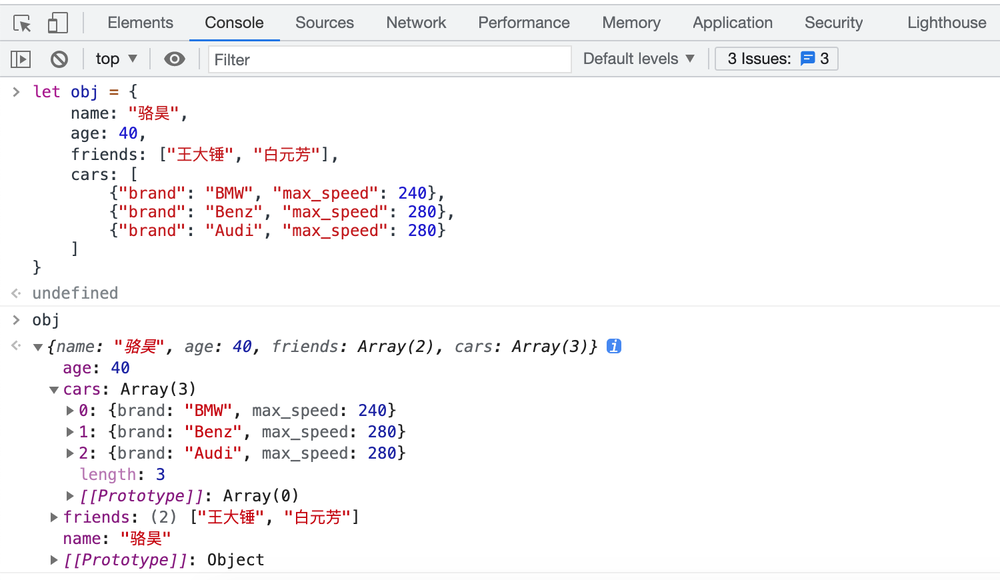
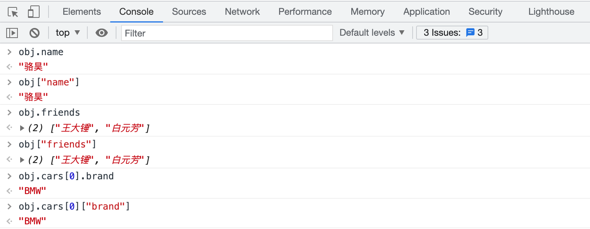
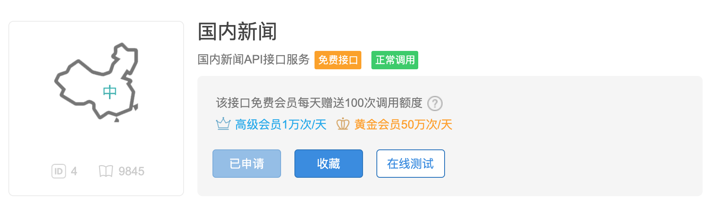
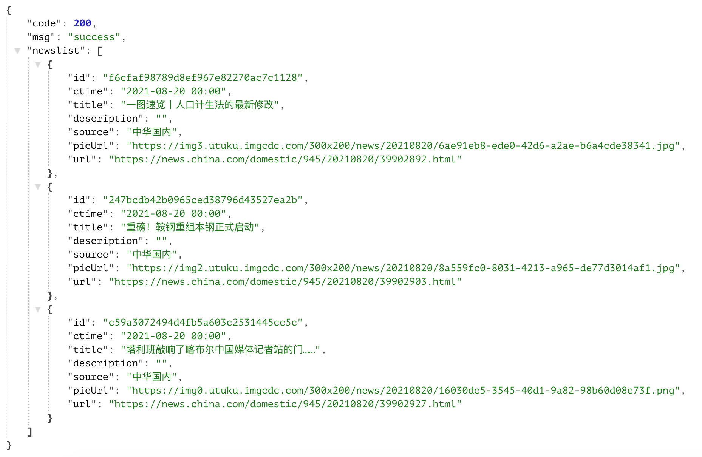

## Tuần tự hóa và giải tuần tự hóa đối tượng

### Tổng quan về JSON

Qua phần giải thích ở bài trước, chúng ta đã biết cách lưu dữ liệu văn bản và dữ liệu nhị phân vào tệp. Ở đây còn một câu hỏi: nếu muốn lưu dữ liệu trong một danh sách hoặc một từ điển vào tệp thì nên làm thế nào? Trong Python, chúng ta có thể lưu dữ liệu trong chương trình dưới định dạng JSON. JSON là viết tắt của "JavaScript Object Notation", ban đầu nó là một cú pháp khởi tạo đối tượng bằng literal trong ngôn ngữ JavaScript, nay đã được ứng dụng rộng rãi để trao đổi dữ liệu xuyên ngôn ngữ và xuyên nền tảng. Lý do sử dụng JSON rất đơn giản: vì cấu trúc của nó nhỏ gọn và là văn bản thuần túy (plain text), bất kỳ hệ điều hành và ngôn ngữ lập trình nào cũng có thể xử lý văn bản thuần - đây chính là điều kiện tiên quyết để **thực hiện trao đổi dữ liệu đa ngôn ngữ và đa nền tảng**. Hiện nay, JSON về cơ bản đã thay thế XML (Ngôn ngữ đánh dấu mở rộng) để trở thành **tiêu chuẩn thực tế cho việc trao đổi dữ liệu giữa các hệ thống không đồng nhất**. Bạn có thể tìm hiểu thêm về JSON trên [trang web chính thức của JSON](https://www.json.org/json-zh.html), trang web này cũng cung cấp các công cụ hoặc thư viện của bên thứ ba có thể dùng để xử lý định dạng dữ liệu JSON cho từng ngôn ngữ.

```JavaScript
{
    name: "jackfrued",
    age: 40,
    friends: ["Vương Đại Chùy", "Bạch Nguyên Phương"],
    cars: [
        {"brand": "BMW", "max_speed": 240},
        {"brand": "Benz", "max_speed": 280},
        {"brand": "Audi", "max_speed": 280}
    ]
}
```

Ở trên là một ví dụ đơn giản về JSON. Các bạn có thể nhận thấy nó rất giống với từ điển trong Python và hỗ trợ cấu trúc lồng nhau, giống như giá trị trong từ điển Python có thể là một từ điển khác. Chúng ta có thể thử nhập đoạn mã sau vào Console của trình duyệt (với trình duyệt Chrome, có thể vào menu "Công cụ khác" -> "Công cụ dành cho nhà phát triển" để mở Console của trình duyệt). Console của trình duyệt cung cấp một môi trường tương tác để chạy mã JavaScript (tương tự như môi trường tương tác của Python). Đoạn mã dưới đây sẽ giúp chúng ta tạo ra một đối tượng JavaScript và gán nó cho biến có tên là `obj`.

```JavaScript
let obj = {
    name: "jackfrued",
    age: 40,
    friends: ["Vương Đại Chùy", "Bạch Nguyên Phương"],
    cars: [
        {"brand": "BMW", "max_speed": 240},
        {"brand": "Benz", "max_speed": 280},
        {"brand": "Audi", "max_speed": 280}
    ]
}
```



`obj` ở trên là một đối tượng trong JavaScript. Chúng ta có thể lấy giá trị tương ứng của `name` bằng hai cách: `obj.name` hoặc `obj["name"]`, như hình dưới đây. Có thể nhận thấy cách lấy dữ liệu `obj["name"]` hoàn toàn tương tự thao tác chỉ mục để lấy giá trị qua khóa của từ điển trong Python. Python cũng cung cấp hỗ trợ chuyển đổi hai chiều giữa từ điển và JSON thông qua module có tên là `json`.



Các kiểu dữ liệu chúng ta sử dụng trong JSON (kiểu dữ liệu JavaScript) và kiểu dữ liệu trong Python cũng rất dễ tìm thấy mối quan hệ tương ứng. Các bạn có thể xem hai bảng dưới đây:

Bảng 1: Kiểu dữ liệu (giá trị) JavaScript tương ứng với kiểu dữ liệu (giá trị) Python

| JSON | Python |
| --- | --- |
| `object` | `dict` |
| `array` | `list` |
| `string` | `str` |
| `number` | `int` / `float` |
| `number` (real) | `float` |
| `boolean` (`true` / `false`) | `bool` (`True` / `False`) |
| `null` | `None` |

Bảng 2: Kiểu dữ liệu (giá trị) Python tương ứng với kiểu dữ liệu (giá trị) JavaScript

| Python | JSON |
| --- | --- |
| `dict` | `object` |
| `list` / `tuple` | `array` |
| `str` | `string` |
| `int` / `float` | `number` |
| `bool` (`True` / `False`) | `boolean` (`true` / `false`) |
| `None` | `null` |

### Đọc ghi dữ liệu định dạng JSON

Trong Python, nếu muốn chuyển đổi từ điển thành định dạng JSON (dưới dạng chuỗi ký tự), bạn có thể sử dụng hàm `dumps` của module `json`, code như sau:

```python
import json

my_dict = {
    'name': 'jackfrued',
    'age': 40,
    'friends': ['Vương Đại Chùy', 'Bạch Nguyên Phương'],
    'cars': [
        {'brand': 'BMW', 'max_speed': 240},
        {'brand': 'Audi', 'max_speed': 280},
        {'brand': 'Benz', 'max_speed': 280}
    ]
}
print(json.dumps(my_dict))
```

Chạy đoạn code trên, kết quả đầu ra như sau. Có thể thấy các ký tự tiếng Trung/chữ tượng hình đều được hiển thị bằng mã hóa Unicode escape:

```JSON
{"name": "\u9a86\u660a", "age": 40, "friends": ["\u738b\u5927\u9524", "\u767d\u5143\u82b3"], "cars": [{"brand": "BMW", "max_speed": 240}, {"brand": "Audi", "max_speed": 280}, {"brand": "Benz", "max_speed": 280}]}
```

Nếu muốn xử lý từ điển thành định dạng JSON và ghi vào tệp văn bản, bạn chỉ cần thay hàm `dumps` bằng hàm `dump` và truyền vào đối tượng tệp, code như sau:

```python
import json

my_dict = {
    'name': 'jackfrued',
    'age': 40,
    'friends': ['Vương Đại Chùy', 'Bạch Nguyên Phương'],
    'cars': [
        {'brand': 'BMW', 'max_speed': 240},
        {'brand': 'Audi', 'max_speed': 280},
        {'brand': 'Benz', 'max_speed': 280}
    ]
}
with open('data.json', 'w') as file:
    json.dump(my_dict, file)
```

Thực thi đoạn mã trên sẽ tạo ra tệp `data.json`, nội dung tệp giống với kết quả in ra của đoạn mã trên.

Module `json` có 4 hàm tương đối quan trọng:

- `dump` - Tuần tự hóa đối tượng Python theo định dạng JSON vào tệp
- `dumps` - Xử lý đối tượng Python thành chuỗi ký tự định dạng JSON
- `load` - Giải tuần tự hóa dữ liệu JSON trong tệp thành đối tượng Python
- `loads` - Giải tuần tự hóa nội dung của chuỗi ký tự JSON thành đối tượng Python

Ở đây xuất hiện hai khái niệm: một là tuần tự hóa (serialization) và một là giải tuần tự hóa (deserialization). [Wikipedia](https://vi.wikipedia.org/) giải thích rằng: "Tuần tự hóa (serialization) trong xử lý dữ liệu của khoa học máy tính là quá trình chuyển đổi một cấu trúc dữ liệu hoặc trạng thái đối tượng sang một dạng có thể lưu trữ hoặc truyền đi được, sao cho khi cần có thể khôi phục lại trạng thái ban đầu; và thông qua việc đọc lại các byte từ dữ liệu đã tuần tự hóa, ta có thể tạo ra bản sao của đối tượng gốc. Hành động ngược lại với quá trình này, tức là trích xuất cấu trúc dữ liệu từ một chuỗi byte, chính là giải tuần tự hóa (deserialization)".

Chúng ta có thể thông qua đoạn code dưới đây để đọc tệp `data.json` vừa tạo ở trên, khôi phục dữ liệu định dạng JSON về từ điển trong Python:

```python
import json

with open('data.json', 'r') as file:
    my_dict = json.load(file)
    print(type(my_dict))
    print(my_dict)
```

### Công cụ quản lý package pip

Module `json` trong thư viện chuẩn của Python có hiệu năng chưa thực sự lý tưởng khi tuần tự hóa và giải tuần tự hóa dữ liệu. Để giải quyết vấn đề này, bạn có thể sử dụng thư viện bên thứ ba `ujson` để thay thế `json`. Cái gọi là thư viện bên thứ ba dùng để chỉ các module Python không phải do nội bộ công ty phát triển và cũng không đến từ thư viện chuẩn chính thức, mà thường do các công ty, tổ chức hoặc cá nhân khác phát triển. Mặc dù thư viện chuẩn của Python đã cung cấp rất nhiều module thuận tiện cho việc phát triển, nhưng đối với một ngôn ngữ mạnh mẽ thì hệ sinh thái xung quanh nó chắc chắn cũng rất phồn vinh.

Khi cài đặt trình thông dịch Python trước đây, mặc định tùy chọn cài đặt pip đã được chọn. Bạn có thể kiểm tra xem mình đã có pip hay chưa bằng cách gõ lệnh `pip --version` trong command prompt hoặc terminal. Pip là công cụ quản lý package của Python, qua pip bạn có thể tìm kiếm, cài đặt, gỡ cài đặt, cập nhật các thư viện hoặc công cụ bên thứ ba của Python. Ví dụ để cài đặt `ujson` thay thế cho module `json`, có thể sử dụng lệnh sau:

```Bash
pip install ujson
```

Theo mặc định, pip sẽ truy cập `https://pypi.org/simple/` để lấy dữ liệu liên quan đến các thư viện bên thứ ba. Ở một số khu vực mạng bị chậm, người dùng có thể dùng mirror (ví dụ Douban hoặc Đại học Thanh Hoa tại Trung Quốc) để thay thế nguồn tải mặc định này trước khi cài đặt thư viện bên thứ ba, lệnh như sau:

```Bash
pip config set global.index-url https://pypi.doubanio.com/simple
pip install ujson
```

Bạn có thể tìm kiếm thư viện bên thứ ba theo tên bằng lệnh `pip search`, và xem các thư viện bên thứ ba đã cài đặt bằng lệnh `pip list`. Nếu muốn cập nhật một thư viện nào đó, bạn có thể dùng `pip install -U` hoặc `pip install --upgrade`; nếu muốn xóa một thư viện bên thứ ba, có thể dùng lệnh `pip uninstall`.

Tìm kiếm thư viện bên thứ ba `ujson`:

```Bash
pip search ujson

micropython-cpython-ujson (0.2)  - MicroPython module ujson ported to CPython
pycopy-cpython-ujson (0.2)       - Pycopy module ujson ported to CPython
ujson (3.0.0)                    - Ultra fast JSON encoder and decoder for Python
ujson-bedframe (1.33.0)          - Ultra fast JSON encoder and decoder for Python
ujson-segfault (2.1.57)          - Ultra fast JSON encoder and decoder for Python. Continuing 
                                   development.
ujson-ia (2.1.1)                 - Ultra fast JSON encoder and decoder for Python (Internet 
                                   Archive fork)
ujson-x (1.37)                   - Ultra fast JSON encoder and decoder for Python
ujson-x-legacy (1.35.1)          - Ultra fast JSON encoder and decoder for Python
drf_ujson (1.2)                  - Django Rest Framework UJSON Renderer
drf-ujson2 (1.6.1)               - Django Rest Framework UJSON Renderer
ujsonDB (0.1.0)                  - A lightweight and simple database using ujson.
fast-json (0.3.2)                - Combines best parts of json and ujson for fast serialization
decimal-monkeypatch (0.4.3)      - Python 2 performance patches: decimal to cdecimal, json to 
                                   ujson for psycopg2
```

Xem các thư viện bên thứ ba đã cài đặt:

```Bash
pip list

Package                       Version
----------------------------- ----------
aiohttp                       3.5.4
alipay                        0.7.4
altgraph                      0.16.1
amqp                          2.4.2
...							  ...
```

Cập nhật thư viện `ujson`:

```Bash
pip install -U ujson
```

Gỡ cài đặt thư viện `ujson`:

```Bash
pip uninstall -y ujson
```

> **Gợi ý**: Nếu muốn cập nhật bản thân công cụ `pip`, đối với hệ điều hành macOS có thể sử dụng lệnh `pip install -U pip`. Trên Windows, bạn có thể thay thế bằng lệnh `python -m pip install -U --user pip`.

### Sử dụng Web API để lấy dữ liệu

Nếu muốn hiển thị thông tin thời tiết, tình trạng giao thông, chuyến bay,... trong chương trình của mình, chúng ta không có năng lực tự cung cấp những thông tin này, vì vậy bắt buộc phải sử dụng các dịch vụ dữ liệu mạng. Hiện nay đại đa số các dịch vụ dữ liệu mạng (hoặc gọi là Web API) đều cung cấp dữ liệu định dạng JSON dựa trên [HTTP](https://vi.wikipedia.org/wiki/HTTP) hoặc HTTPS. Chúng ta có thể gửi yêu cầu HTTP đến URL (Bộ định vị tài nguyên thống nhất) chỉ định thông qua chương trình Python, URL này chính là Web API. Nếu yêu cầu thành công, nó sẽ trả về phản hồi HTTP (HTTP Response), và trong phần thân (body) của phản hồi HTTP sẽ chứa dữ liệu định dạng JSON mà chúng ta cần.

Có rất nhiều trang web cung cấp các giao diện Web API, ví dụ như Juhe Data, Baidu AI Cloud,... ở Trung Quốc, hay trang [{API}Search](http://apis.io/) ở quốc tế cũng cung cấp các tính năng tương tự, bạn đọc quan tâm có thể tự tìm hiểu. Ví dụ dưới đây minh họa cách sử dụng thư viện [`requests`](http://docs.python-requests.org/zh_CN/latest/) (thư viện bên thứ ba dùng để truy cập tài nguyên mạng dựa trên HTTP) để truy cập Web API nhằm lấy tin tức và hiển thị tiêu đề cùng liên kết tin tức. Trong ví dụ này, chúng tôi sử dụng giao diện dữ liệu tin tức do trang web [TianAPI](https://www.tianapi.com/) cung cấp, trong đó mã định danh (API Key) cần được đăng ký trên trang web. Sau khi đăng ký tài khoản trên trang web TianAPI, một API Key sẽ được tự động cấp phát, nhưng để truy cập giao diện lấy dữ liệu bạn cần xác thực email hoặc số điện thoại, sau đó đăng ký sử dụng giao diện cần dùng như hình dưới đây:



Để Python kết nối với mạng thông qua URL, chúng tôi khuyến khích các bạn sử dụng thư viện bên thứ ba `requests`, nó đơn giản và mạnh mẽ, nhưng cần tự cài đặt:

```Bash
pip install requests
```

Lấy tin tức và hiển thị tiêu đề cùng liên kết:

```python
import requests

resp = requests.get('http://api.tianapi.com/guonei/?key=APIKey&num=10')
if resp.status_code == 200:
    data_model = resp.json()
    for news in data_model['newslist']:
        print(news['title'])
        print(news['url'])
        print('-' * 60)
```

Đoạn code trên sử dụng hàm `get` của module `requests` để gửi một yêu cầu đến giao diện tin tức của TianAPI. Nếu quá trình gửi yêu cầu không gặp sự cố, hàm `get` sẽ trả về một đối tượng `Response`. Thuộc tính `status_code` của đối tượng này đại diện cho mã trạng thái phản hồi HTTP; nếu bạn chưa hiểu cũng không sao, chỉ cần chú ý giá trị của nó: nếu bằng `200` hoặc các giá trị đầu `2`, thì yêu cầu của chúng ta đã thành công. Thông qua phương thức `json()` của đối tượng `Response`, dữ liệu định dạng JSON trả về có thể được xử lý trực tiếp thành từ điển Python, vô cùng tiện lợi. Dữ liệu định dạng JSON (một phần) do giao diện tin tức TianAPI trả về như hình dưới đây:



> **Gợi ý**: `APIKey` trong đoạn code trên cần được thay bằng API Key bạn tự đăng ký trên trang web TianAPI. Trang web này còn cung cấp rất nhiều API thú vị khác, các bạn có thể tham khảo đoạn code trên để gọi các giao diện này. Mỗi giao diện đều có tài liệu hướng dẫn tương ứng giải thích chi tiết cách sử dụng.

### Tổng kết

Để thực hiện tuần tự hóa và giải tuần tự hóa trong Python, ngoài việc sử dụng module `json`, bạn còn có thể sử dụng các module `pickle` và `shelve`. Tuy nhiên hai module này sử dụng giao thức tuần tự hóa đặc thù riêng để tuần tự hóa dữ liệu, do đó dữ liệu sau khi tuần tự hóa chỉ có thể được Python nhận diện. Về kiến thức liên quan đến hai module này, độc giả quan tâm có thể tự tra cứu tài liệu trên mạng. Xử lý dữ liệu định dạng JSON rõ ràng là một kỹ năng bắt buộc mà mọi lập trình viên đều phải nắm vững, bởi vì dù là truy cập Web API hay cung cấp Web API cho người khác sử dụng, bạn đều cần có kiến thức xử lý dữ liệu định dạng JSON.
