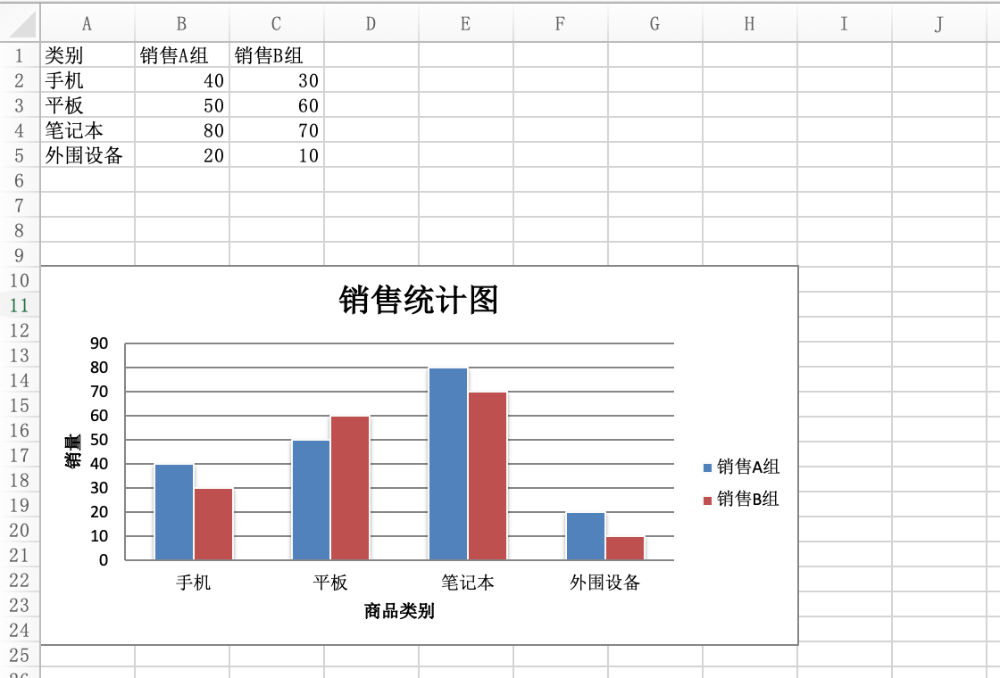

## Đọc ghi file Excel với Python - Phần 2

### Giới thiệu về Excel

Excel là phần mềm bảng tính do Microsoft phát triển dành cho các hệ điều hành Windows và macOS. Nhờ giao diện trực quan, tính năng tính toán xuất sắc và các công cụ biểu đồ mạnh mẽ, kết hợp với chiến lược tiếp thị thành công, Excel luôn là phần mềm xử lý dữ liệu trên máy tính cá nhân phổ biến nhất. Đương nhiên, Excel cũng có nhiều đối thủ cạnh tranh như Google Sheets, LibreOffice Calc, Numbers,... Những sản phẩm này về cơ bản cũng tương thích với Excel, ít nhất là có thể đọc ghi các phiên bản tệp Excel tương đối mới, nhưng đây không phải là trọng tâm thảo luận của chúng ta. Nắm vững kỹ năng dùng chương trình Python để thao tác với tệp Excel sẽ giúp công việc tự động hóa văn phòng hàng ngày trở nên nhẹ nhàng và thú vị hơn rất nhiều; hơn nữa trong nhiều dự án thương mại, việc nhập (import) và xuất (export) tệp Excel là tính năng cực kỳ phổ biến.

Trong chương này, chúng ta tiếp tục tìm hiểu cách thao tác với tệp Excel dựa trên một thư viện bên thứ ba khác là `openpyxl`. Trước tiên bạn cần cài đặt thư viện này:

```Bash
pip install openpyxl
```

Ưu điểm của `openpyxl` là khi mở một tệp Excel, chúng ta vừa có thể đọc vừa có thể ghi vào tệp đó, và về tính tiện lợi trong thao tác thì vượt trội hơn so với `xlwt` và `xlrd`. Ngoài ra, nếu muốn chỉnh sửa định dạng và tính toán công thức, việc sử dụng `openpyxl` cũng đơn giản hơn rất nhiều so với cách đã học ở chương trước. Hơn thế nữa, `openpyxl` còn hỗ trợ tạo pivot table (bảng tổng hợp dữ liệu) và chèn biểu đồ, chức năng vô cùng mạnh mẽ. Cần nhấn mạnh lại một điểm: `openpyxl` không hỗ trợ thao tác với các tệp Excel phiên bản trước Office 2007 (định dạng `.xls`).

### Đọc file Excel

Ví dụ trong thư mục hiện tại có một tệp Excel tên là "阿里巴巴2020年股票数据.xlsx" (Dữ liệu cổ phiếu Alibaba năm 2020), nếu muốn đọc và hiển thị nội dung của tệp này, bạn có thể thực hiện thông qua đoạn code dưới đây:

```python
import datetime

import openpyxl

# Tải một workbook ---> Workbook
wb = openpyxl.load_workbook('阿里巴巴2020年股票数据.xlsx')
# Lấy tên các worksheet
print(wb.sheetnames)
# Lấy worksheet ---> Worksheet
sheet = wb.worksheets[0]
# Lấy phạm vi của các ô
print(sheet.dimensions)
# Lấy số hàng và số cột
print(sheet.max_row, sheet.max_column)

# Lấy giá trị của ô chỉ định
print(sheet.cell(3, 3).value)
print(sheet['C3'].value)
print(sheet['G255'].value)

# Lấy nhiều ô cùng lúc (tuple lồng nhau)
print(sheet['A2:C5'])

# Đọc dữ liệu của tất cả các ô
for row_ch in range(2, sheet.max_row + 1):
    for col_ch in 'ABCDEFG':
        value = sheet[f'{col_ch}{row_ch}'].value
        if type(value) == datetime.datetime:
            print(value.strftime('%Y年%m月%d日'), end='\t')
        elif type(value) == int:
            print(f'{value:<10d}', end='\t')
        elif type(value) == float:
            print(f'{value:.4f}', end='\t')
        else:
            print(value, end='\t')
    print()
```

> **Gợi ý**: Tệp Excel "阿里巴巴2020年股票数据.xlsx" sử dụng trong đoạn code trên có thể tải về từ liên kết Baidu Netdisk sau: Liên kết: https://pan.baidu.com/s/1rQujl5RQn9R7PadB2Z5g_g Mã trích xuất: `e7b4`.

Cần nhắc các bạn một điều: `openpyxl` có hai cách để lấy ô chỉ định. Một cách là thông qua phương thức `cell`; cần lưu ý chỉ mục hàng và chỉ mục cột của phương thức này đều bắt đầu từ `1`, điều này nhằm phục vụ thói quen của những người quen dùng Excel. Cách khác là thông qua phép toán chỉ mục (indexing): chỉ định tọa độ của ô như `C3`, `G255` cũng có thể lấy được ô tương ứng, sau đó thông qua thuộc tính `value` của đối tượng ô là có thể lấy được giá trị của ô đó. Qua đoạn code trên, chắc hẳn các bạn cũng nhận thấy có thể lấy nhiều ô cùng lúc thông qua thao tác cắt lát (slicing) như `sheet['A2:C5']` hoặc `sheet['A2':'C5']`. Thao tác này sẽ trả về một tuple lồng nhau, tương đương với việc lấy được nhiều hàng và nhiều cột.

### Ghi file Excel

Dưới đây chúng ta sử dụng `openpyxl` để thực hiện thao tác ghi file Excel:

```python
import random

import openpyxl

# Bước 1: Tạo workbook (Workbook)
wb = openpyxl.Workbook()

# Bước 2: Thêm worksheet (Worksheet)
sheet = wb.active
sheet.title = '期末成绩'  # Điểm thi cuối kỳ

titles = ('姓名', '语文', '数学', '英语')  # Họ tên, Ngữ văn, Toán, Tiếng Anh
for col_index, title in enumerate(titles):
    sheet.cell(1, col_index + 1, title)

names = ('关羽', '张飞', '赵云', '马超', '黄忠')  # Quan Vũ, Trương Phi, Triệu Vân, Mã Siêu, Hoàng Trung
for row_index, name in enumerate(names):
    sheet.cell(row_index + 2, 1, name)
    for col_index in range(2, 5):
        sheet.cell(row_index + 2, col_index, random.randrange(50, 101))

# Bước 4: Lưu workbook
wb.save('考试成绩表.xlsx')
```

### Điều chỉnh định dạng và tính toán công thức

Khi sử dụng `openpyxl` để thao tác với Excel, nếu muốn điều chỉnh định dạng của ô, bạn có thể thao tác trực tiếp thông qua các thuộc tính của đối tượng ô (đối tượng `Cell`). Các thuộc tính của đối tượng ô bao gồm phông chữ (`font`), căn lề (`alignment`), viền (`border`),... Cụ thể có thể tham khảo [tài liệu chính thức](https://openpyxl.readthedocs.io/en/stable/index.html) của `openpyxl`. Khi sử dụng `openpyxl`, nếu cần tính toán công thức, bạn có thể thực hiện hoàn toàn theo cách thao tác trong Excel, code cụ thể như sau:

```python
import openpyxl
from openpyxl.styles import Font, Alignment, Border, Side

# Căn lề
alignment = Alignment(horizontal='center', vertical='center')
# Đường viền
side = Side(color='ff7f50', style='mediumDashed')

wb = openpyxl.load_workbook('考试成绩表.xlsx')
sheet = wb.worksheets[0]

# Điều chỉnh chiều cao hàng và độ rộng cột
sheet.row_dimensions[1].height = 30
sheet.column_dimensions['E'].width = 120

sheet['E1'] = '平均分'  # Điểm trung bình
# Thiết lập phông chữ
sheet.cell(1, 5).font = Font(size=18, bold=True, color='ff1493', name='华文楷体')
# Thiết lập căn lề
sheet.cell(1, 5).alignment = alignment
# Thiết lập viền ô
sheet.cell(1, 5).border = Border(left=side, top=side, right=side, bottom=side)
for i in range(2, 7):
    # Tính điểm trung bình của mỗi học sinh bằng công thức
    sheet[f'E{i}'] = f'=average(B{i}:D{i})'
    sheet.cell(i, 5).font = Font(size=12, color='4169e1', italic=True)
    sheet.cell(i, 5).alignment = alignment

wb.save('考试成绩表.xlsx')
```

### Tạo biểu đồ thống kê

Thông qua thư viện `openpyxl`, bạn có thể chèn trực tiếp biểu đồ thống kê vào Excel, cách làm cụ thể đại thể giống như khi chèn biểu đồ trong Excel. Chúng ta có thể tạo đối tượng biểu đồ thuộc loại chỉ định, sau đó thiết lập biểu đồ thông qua các thuộc tính của đối tượng này. Đương nhiên, điều quan trọng nhất là liên kết dữ liệu cho biểu đồ: trục hoành đại diện cho cái gì, trục tung đại diện cho cái gì, các giá trị số cụ thể là bao nhiêu. Cuối cùng, có thể thêm đối tượng biểu đồ vào sheet, code cụ thể như sau:

```python
from openpyxl import Workbook
from openpyxl.chart import BarChart, Reference

wb = Workbook(write_only=True)
sheet = wb.create_sheet()

# Dữ liệu minh họa: Loại sản phẩm, Nhóm bán hàng A, Nhóm bán hàng B
rows = [
    ('类别', '销售A组', '销售B组'),
    ('手机', 40, 30),
    ('平板', 50, 60),
    ('笔记本', 80, 70),
    ('外围设备', 20, 10),
]

# Thêm hàng vào sheet
for row in rows:
    sheet.append(row)

# Tạo đối tượng biểu đồ
chart = BarChart()
chart.type = 'col'
chart.style = 10
# Đặt tiêu đề cho biểu đồ
chart.title = '销售统计图'
# Đặt tiêu đề cho trục tung của biểu đồ
chart.y_axis.title = '销量'
# Đặt tiêu đề cho trục hoành của biểu đồ
chart.x_axis.title = '商品类别'
# Thiết lập phạm vi dữ liệu
data = Reference(sheet, min_col=2, min_row=1, max_row=5, max_col=3)
# Thiết lập phạm vi phân loại (danh mục)
cats = Reference(sheet, min_col=1, min_row=2, max_row=5)
# Thêm dữ liệu vào biểu đồ
chart.add_data(data, titles_from_data=True)
# Thiết lập phân loại cho biểu đồ
chart.set_categories(cats)
chart.shape = 4
# Thêm biểu đồ vào ô chỉ định của sheet
sheet.add_chart(chart, 'A10')

wb.save('demo.xlsx')
```

Chạy đoạn code trên và mở tệp Excel được tạo ra, hiệu quả như hình dưới đây:



### Tổng kết

Nắm vững phương pháp dùng chương trình Python để thao tác với Excel có thể giải quyết rất nhiều công việc xử lý bảng tính Excel tẻ nhạt trong văn phòng hàng ngày, phổ biến nhất là việc gộp nhiều tệp Excel có cùng định dạng dữ liệu vào một tệp, cũng như trích xuất dữ liệu chỉ định từ nhiều tệp Excel hoặc nhiều sheet. Nếu khối lượng dữ liệu lớn hoặc phương thức xử lý dữ liệu phức tạp hơn, chúng tôi khuyến khích các bạn sử dụng thư viện pandas - một trong những công cụ phân tích dữ liệu hàng đầu của Python.
