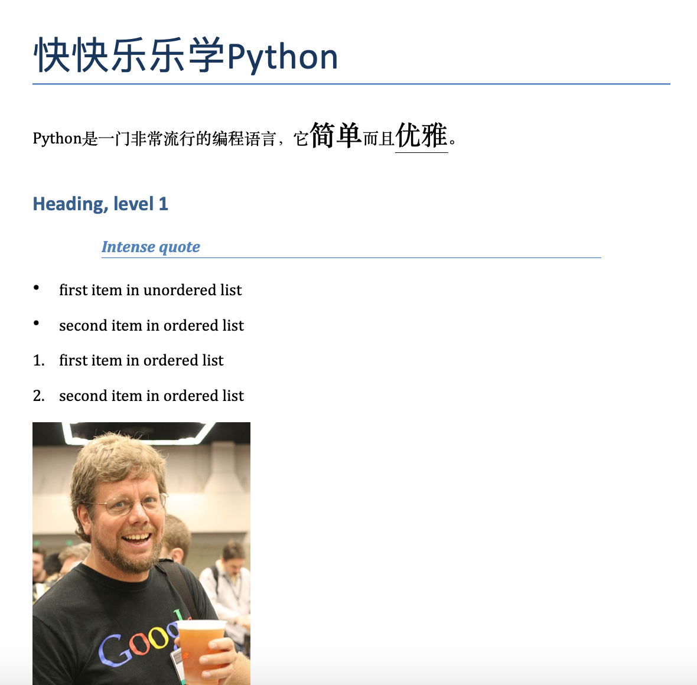
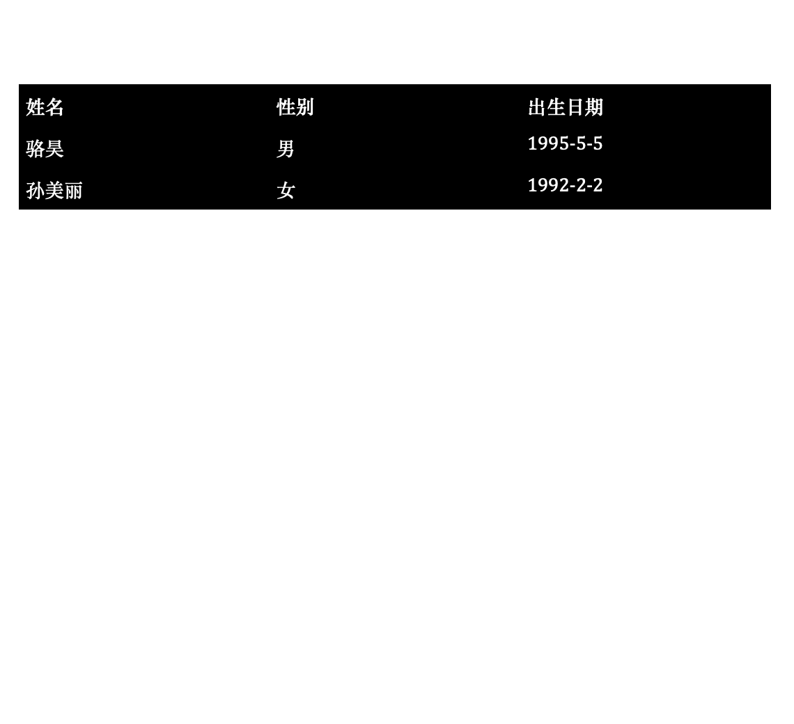
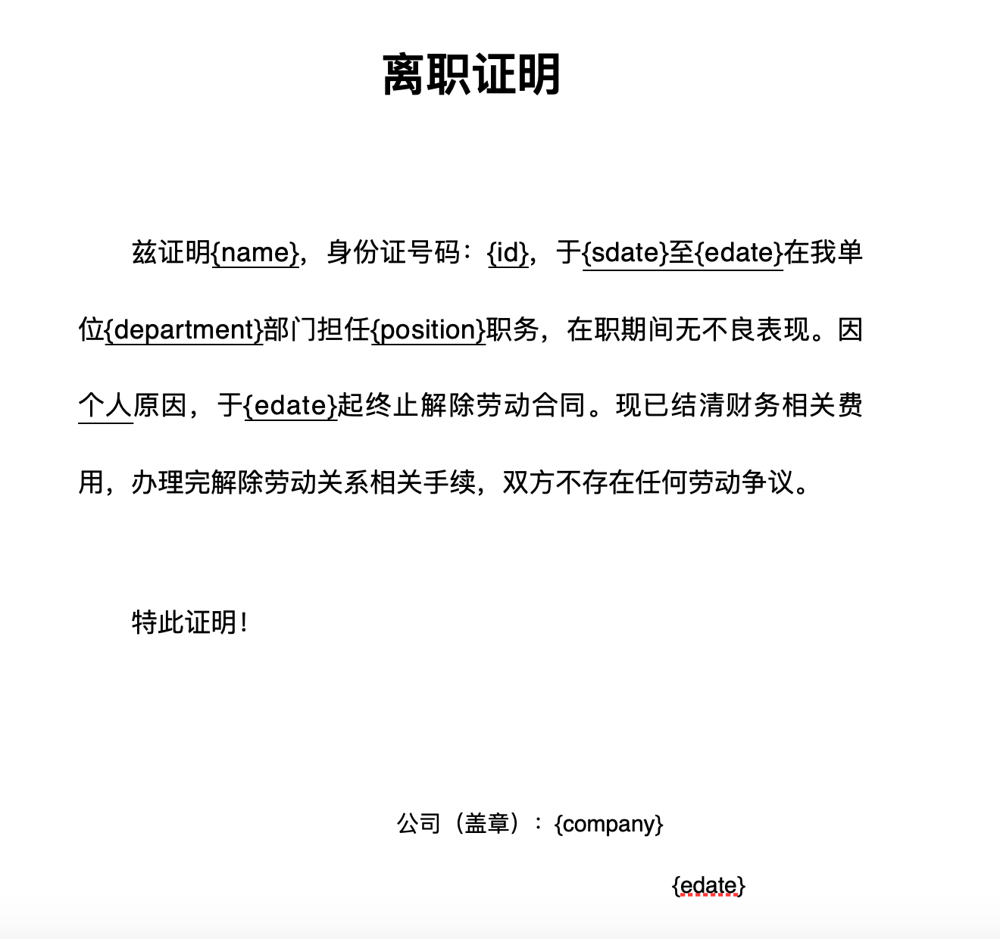
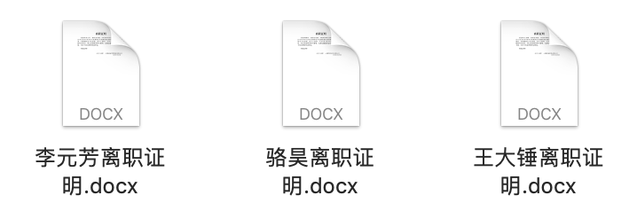
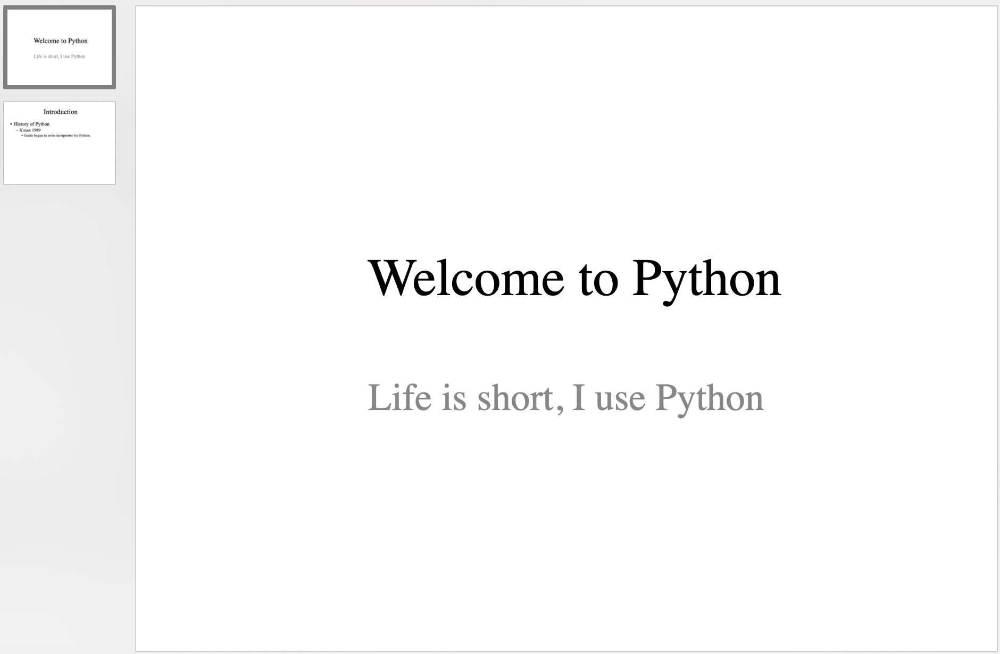

## Thao tác với file Word và PowerPoint bằng Python

Trong công việc hàng ngày, có rất nhiều công việc lặp đi lặp lại đơn giản mà chúng ta hoàn toàn có thể giao cho chương trình Python xử lý, ví dụ như tạo hàng loạt file Word hoặc PowerPoint từ một file mẫu (template). Word là chương trình xử lý văn bản do Microsoft phát triển, chắc hẳn không còn xa lạ với mọi người; trong công việc văn phòng hàng ngày, rất nhiều tài liệu chính thức được soạn thảo và chỉnh sửa bằng Word, phần mở rộng của file Word hiện nay thường là `.docx`. PowerPoint là chương trình trình chiếu do Microsoft phát triển, là một thành viên trong bộ phần mềm Microsoft Office, được giới kinh doanh, giáo viên, học sinh, sinh viên sử dụng rộng rãi, thường còn được gọi là "slide". Trong Python, chúng ta có thể sử dụng thư viện bên thứ ba `python-docx` để thao tác với Word, và thư viện bên thứ ba `python-pptx` để tạo PowerPoint.

### Thao tác với tài liệu Word

Trước tiên, chúng ta có thể cài đặt thư viện bên thứ ba `python-docx` bằng lệnh sau.

```bash
pip install python-docx
```

Theo phần giới thiệu trong [tài liệu chính thức](https://python-docx.readthedocs.io/en/latest/), chúng ta có thể sử dụng đoạn mã dưới đây để tạo một tài liệu Word đơn giản.

```python
from docx import Document
from docx.shared import Cm, Pt

from docx.document import Document as Doc

# Tạo đối tượng Doc đại diện cho tài liệu Word
document = Document()  # type: Doc
# Thêm tiêu đề lớn
document.add_heading('Học Python thật vui', 0)
# Thêm đoạn văn
p = document.add_paragraph('Python là một ngôn ngữ lập trình rất phổ biến, nó ')
run = p.add_run('đơn giản')
run.bold = True
run.font.size = Pt(18)
p.add_run(' và ')
run = p.add_run('tao nhã')
run.font.size = Pt(18)
run.underline = True
p.add_run('.')

# Thêm tiêu đề cấp 1
document.add_heading('Heading, level 1', level=1)
# Thêm đoạn văn có định dạng trích dẫn nổi bật
document.add_paragraph('Intense quote', style='Intense Quote')
# Thêm danh sách không có thứ tự
document.add_paragraph(
    'first item in unordered list', style='List Bullet'
)
document.add_paragraph(
    'second item in ordered list', style='List Bullet'
)
# Thêm danh sách có thứ tự
document.add_paragraph(
    'first item in ordered list', style='List Number'
)
document.add_paragraph(
    'second item in ordered list', style='List Number'
)

# Thêm hình ảnh (chú ý đường dẫn và hình ảnh bắt buộc phải tồn tại)
document.add_picture('resources/guido.jpg', width=Cm(5.2))

# Thêm dấu ngắt phần (section break)
document.add_section()

records = (
    ('jackfrued', 'Nam', '1995-5-5'),
    ('Tôn Mỹ Lệ', 'Nữ', '1992-2-2')
)
# Thêm bảng
table = document.add_table(rows=1, cols=3)
table.style = 'Dark List'
hdr_cells = table.rows[0].cells
hdr_cells[0].text = 'Họ và tên'
hdr_cells[1].text = 'Giới tính'
hdr_cells[2].text = 'Ngày sinh'
# Thêm các hàng cho bảng
for name, sex, birthday in records:
    row_cells = table.add_row().cells
    row_cells[0].text = name
    row_cells[1].text = sex
    row_cells[2].text = birthday

# Thêm dấu ngắt trang
document.add_page_break()

# Lưu tài liệu
document.save('demo.docx')
```

> **Gợi ý**: Chú thích `# type: Doc` ở dòng 7 trong đoạn mã trên là để nhận được gợi ý tự động hoàn thành mã (code completion) trong PyCharm, vì nếu không biết rõ kiểu dữ liệu cụ thể của đối tượng, PyCharm sẽ không thể đưa ra gợi ý hoàn thành mã cho đối tượng `Doc` ở phần mã tiếp theo.

Thực thi đoạn mã trên rồi mở tài liệu Word vừa tạo, kết quả hiển thị như hình dưới đây.

&nbsp;&nbsp;

Đối với một file Word đã có sẵn, chúng ta có thể duyệt qua tất cả các đoạn văn của nó và lấy nội dung tương ứng bằng đoạn mã dưới đây.

```python
from docx import Document
from docx.document import Document as Doc

doc = Document('resources/离职证明.docx')  # type: Doc
for no, p in enumerate(doc.paragraphs):
    print(no, p.text)
```

> **Gợi ý**: Nếu cần file Word dùng trong đoạn mã trên, bạn có thể lấy qua địa chỉ Baidu Wangpan sau. Liên kết: https://pan.baidu.com/s/1rQujl5RQn9R7PadB2Z5g_g Mã trích xuất: e7b4.

Nội dung đọc được hiển thị như sau.

```
0 
1 离 职 证 明
2 
3 兹证明 Vương Đại Chùy ，身份证号码： 100200199512120001 ，于 2018 年 8 月 7 日至 2020 年 6 月 28 日在我单位  开发部 部门担任 Java开发工程师 职务，在职期间无不良表现。因 个人 原因，于 2020 年 6 月 28 日起终止解除劳动合同。现已结清财务相关费用，办理完解除劳动关系相关手续，双方不存在任何劳动争议。
4 
5 特此证明！
6 
7 
8 公司名称（盖章）:成都风车车科技有限公司
9    			2020 年 6 月 28 日
```

Đến đây, chắc hẳn nhiều bạn đọc đã nghĩ ra rằng chúng ta có thể biến giấy xác nhận thôi việc ở trên thành một file mẫu, thay thế các thông tin như họ tên, số CMND/CCCD, ngày vào làm và ngày thôi việc bằng các ký tự giữ chỗ (placeholder); sau đó thông qua việc thay thế các ký tự giữ chỗ này, chúng ta có thể ghi vào các thông tin tương ứng tùy theo nhu cầu thực tế, từ đó tạo hàng loạt tài liệu Word.

Theo hướng đi trên, trước tiên chúng ta chỉnh sửa một file mẫu giấy xác nhận thôi việc như hình dưới đây.



Tiếp theo, chúng ta đọc file đó và thay thế các ký tự giữ chỗ bằng thông tin thực tế để tạo ra tài liệu Word mới, như sau:

```python
from docx import Document
from docx.document import Document as Doc

# Lưu thông tin thực tế vào danh sách dưới dạng các từ điển
employees = [
    {
        'name': 'jackfrued',
        'id': '100200198011280001',
        'sdate': '2008年3月1日',
        'edate': '2012年2月29日',
        'department': '产品研发',
        'position': '架构师',
        'company': '成都华为技术有限公司'
    },
    {
        'name': 'Vương Đại Chùy',
        'id': '510210199012125566',
        'sdate': '2019年1月1日',
        'edate': '2021年4月30日',
        'department': '产品研发',
        'position': 'Python开发工程师',
        'company': '成都谷道科技有限公司'
    },
    {
        'name': 'Lý Nguyên Phương',
        'id': '2102101995103221599',
        'sdate': '2020年5月10日',
        'edate': '2021年3月5日',
        'department': '产品研发',
        'position': 'Java开发工程师',
        'company': '同城企业管理集团有限公司'
    },
]
# Duyệt qua danh sách bằng vòng lặp để tạo hàng loạt tài liệu Word
for emp_dict in employees:
    # Đọc file mẫu giấy xác nhận thôi việc
    doc = Document('resources/离职证明模板.docx')  # type: Doc
    # Lặp qua tất cả các đoạn văn để tìm ký tự giữ chỗ
    for p in doc.paragraphs:
        if '{' not in p.text:
            continue
        # Không thể sửa trực tiếp nội dung đoạn văn, nếu không sẽ bị mất định dạng
        # Do đó cần duyệt qua các phần tử trong đoạn văn rồi tiến hành tìm kiếm và thay thế
        for run in p.runs:
            if '{' not in run.text:
                continue
            # Thay thế ký tự giữ chỗ bằng nội dung thực tế
            start, end = run.text.find('{'), run.text.find('}')
            key, place_holder = run.text[start + 1:end], run.text[start:end + 1]
            run.text = run.text.replace(place_holder, emp_dict[key])
    # Lưu tài liệu Word tương ứng cho từng người
    doc.save(f'{emp_dict["name"]}离职证明.docx')
```

Thực thi đoạn mã trên, trong thư mục hiện tại sẽ tạo ra ba tài liệu Word như hình bên dưới.



### Tạo PowerPoint

Đầu tiên, chúng ta cần cài đặt thư viện bên thứ ba `python-pptx` bằng lệnh sau:

```Bash
pip install python-pptx
```

Vì các tình huống ứng dụng thực tế của việc dùng Python thao tác với PowerPoint không quá nhiều, tôi sẽ không đi sâu vào chi tiết ở đây. Bạn đọc có hứng thú có thể tự tham khảo [tài liệu chính thức](https://python-pptx.readthedocs.io/en/latest/) của `python-pptx`. Dưới đây chỉ minh họa một đoạn mã trích từ tài liệu chính thức.

```python
from pptx import Presentation

# Tạo đối tượng bài thuyết trình
pres = Presentation()

# Chọn bố cục mẫu để thêm một trang slide
title_slide_layout = pres.slide_layouts[0]
slide = pres.slides.add_slide(title_slide_layout)
# Lấy khung tiêu đề chính và khung tiêu đề phụ
title = slide.shapes.title
subtitle = slide.placeholders[1]
# Chỉnh sửa tiêu đề chính và tiêu đề phụ
title.text = "Welcome to Python"
subtitle.text = "Life is short, I use Python"

# Chọn bố cục mẫu để thêm một trang slide
bullet_slide_layout = pres.slide_layouts[1]
slide = pres.slides.add_slide(bullet_slide_layout)
# Lấy tất cả các hình khối trên trang slide
shapes = slide.shapes
# Lấy tiêu đề và phần thân
title_shape = shapes.title
body_shape = shapes.placeholders[1]
# Chỉnh sửa tiêu đề
title_shape.text = 'Introduction'
# Chỉnh sửa nội dung phần thân
tf = body_shape.text_frame
tf.text = 'History of Python'
# Thêm một đoạn văn cấp 1
p = tf.add_paragraph()
p.text = 'X\'max 1989'
p.level = 1
# Thêm một đoạn văn cấp 2
p = tf.add_paragraph()
p.text = 'Guido began to write interpreter for Python.'
p.level = 2

# Lưu bài thuyết trình
pres.save('test.pptx')
```

Chạy đoạn mã trên, file PowerPoint được tạo ra sẽ hiển thị như hình dưới đây.



### Tổng kết

Dùng chương trình Python để giải quyết bài toán tự động hóa văn phòng thực sự rất tuyệt vời, nó giúp giải phóng chúng ta khỏi những công việc tẻ nhạt, vụn vặt. Viết những đoạn mã như thế này chính là làm một việc mang lại lợi ích lâu dài; ngay cả khi quá trình viết code không mấy thú vị thì việc sử dụng những đoạn code này chắc chắn sẽ rất vui vẻ.
