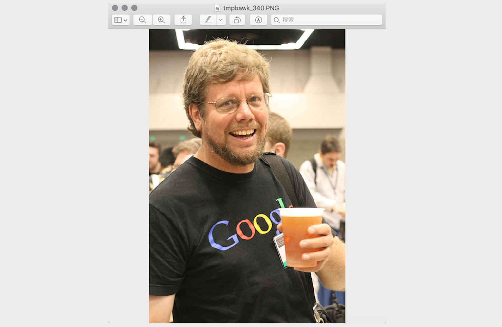
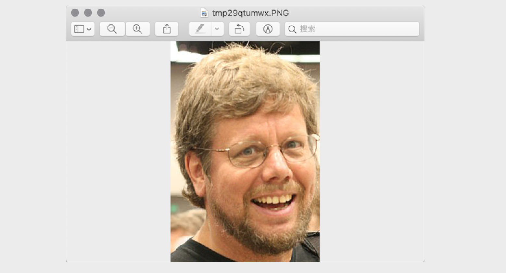
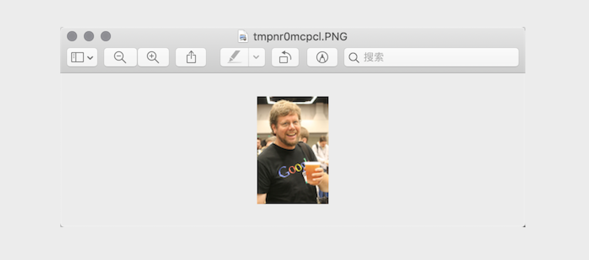
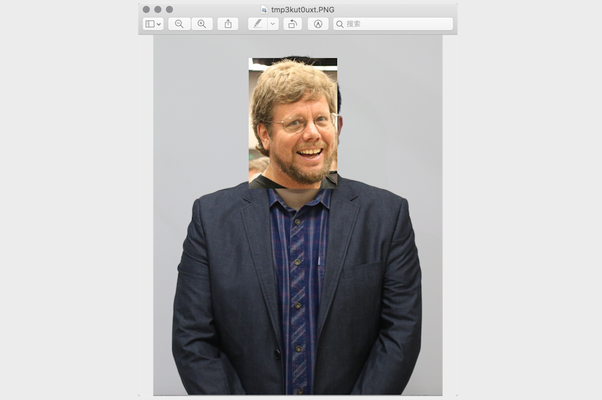
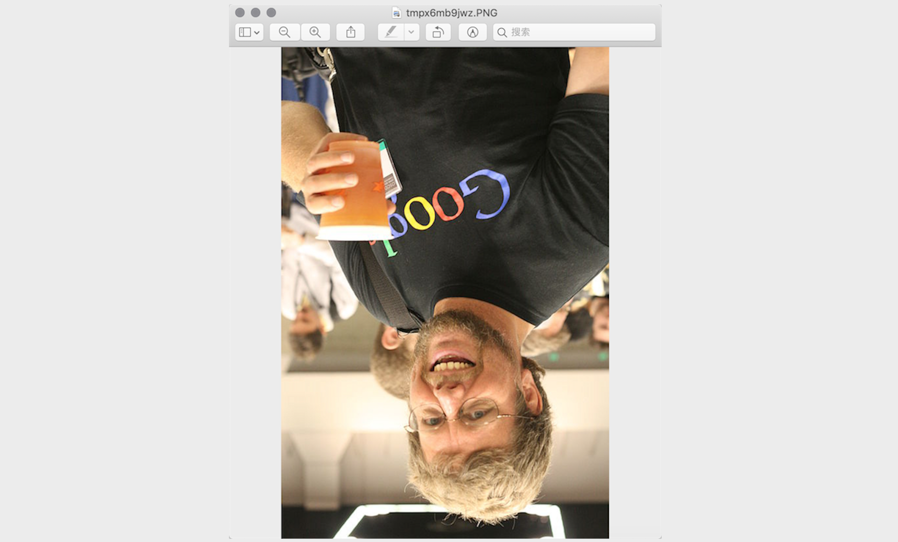
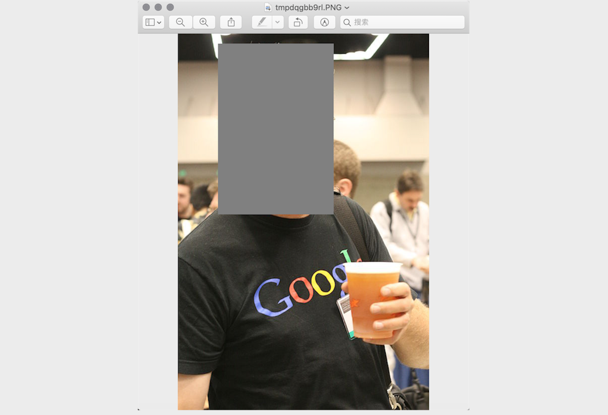
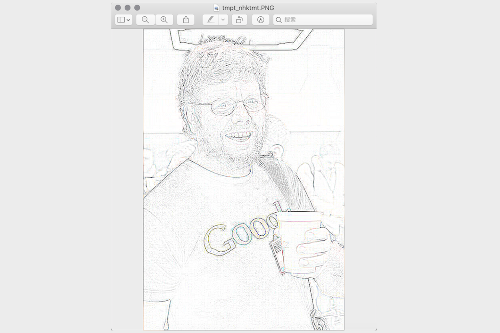
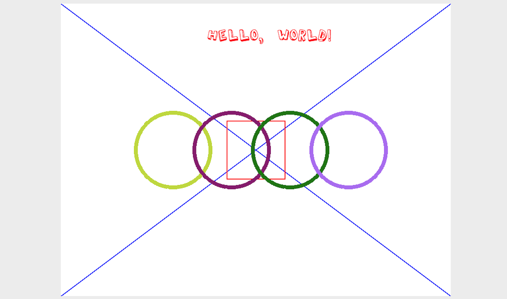

## Xử lý hình ảnh với Python

### Kiến thức nhập môn

1. Màu sắc. Nếu bạn từng có trải nghiệm vẽ tranh bằng màu vẽ, chắc chắn bạn sẽ biết rằng việc trộn ba màu đỏ, vàng, lam có thể tạo ra các màu sắc khác; trên thực tế, ba màu này chính là ba màu cơ bản trong hội họa, chúng là những màu cơ bản không thể phân tách thêm được nữa. Trong máy tính, chúng ta có thể phối hợp ba chùm ánh sáng đỏ, lục, lam theo các tỷ lệ khác nhau để tạo thành các màu sắc khác, vì vậy ba màu này là ba màu ánh sáng cơ bản (hệ màu cộng). Trong hệ thống máy tính, chúng ta thường biểu diễn một màu sắc dưới dạng giá trị RGB hoặc giá trị RGBA (trong đó A biểu thị kênh Alpha, nó quyết định độ mờ đục hay độ trong suốt của các điểm ảnh trong hình ảnh).

   | Tên tiếng Anh | Giá trị RGB | Tên tiếng Anh | Giá trị RGB |
   | :---------: | :-------------: | :----------: | :-----------: |
   | White (Trắng) | (255, 255, 255) | Red (Đỏ) | (255, 0, 0) |
   | Green (Lục) | (0, 255, 0) | Blue (Lam) | (0, 0, 255) |
   | Gray (Xám) | (128, 128, 128) | Yellow (Vàng) | (255, 255, 0) |
   | Black (Đen) | (0, 0, 0) | Purple (Tím) | (128, 0, 128) |

2. Điểm ảnh (Pixel). Đối với một hình ảnh được biểu diễn bằng một chuỗi số, đơn vị nhỏ nhất chính là một ô vuông nhỏ mang một màu đơn nhất trên hình ảnh. Những ô vuông nhỏ này đều có một vị trí xác định và một giá trị màu sắc được gán cho nó; màu sắc và vị trí của các ô vuông nhỏ này sẽ quyết định diện mạo cuối cùng của hình ảnh đó. Chúng là đơn vị không thể chia cắt, chúng ta thường gọi chúng là điểm ảnh (pixel). Mỗi hình ảnh đều chứa một số lượng pixel nhất định, các pixel này quyết định kích thước hiển thị của hình ảnh trên màn hình. Nếu bạn yêu thích chụp ảnh hay selfie thì chắc chắn không còn xa lạ gì với từ "pixel" này.

### Xử lý hình ảnh với Pillow

Pillow là một nhánh phát triển từ thư viện xử lý hình ảnh nổi tiếng PIL của Python. Thông qua Pillow, bạn có thể thực hiện nhiều thao tác khác nhau như nén ảnh và xử lý hình ảnh. Bạn có thể sử dụng lệnh sau để cài đặt Pillow:

```Shell
pip install pillow
```

Lớp quan trọng nhất trong Pillow là `Image`. Bạn có thể sử dụng hàm `open` của module `Image` để đọc hình ảnh và nhận về một đối tượng kiểu `Image`.

1. Đọc và hiển thị hình ảnh

   ```python
   from PIL import Image
   
   # Đọc hình ảnh để nhận đối tượng Image
   image = Image.open('guido.jpg')
   # Lấy định dạng ảnh qua thuộc tính format của đối tượng Image
   print(image.format) # JPEG
   # Lấy kích thước ảnh qua thuộc tính size của đối tượng Image
   print(image.size)   # (500, 750)
   # Lấy chế độ ảnh (mode) qua thuộc tính mode của đối tượng Image
   print(image.mode)   # RGB
   # Hiển thị hình ảnh bằng phương thức show của đối tượng Image
   image.show()
   ```

   

2. Cắt xén hình ảnh

   ```python
   # Cắt xén hình ảnh bằng phương thức crop của đối tượng Image với vùng chỉ định
   image.crop((80, 20, 310, 360)).show()
   ```

   

3. Tạo ảnh thu nhỏ (thumbnail)

   ```python
   # Tạo ảnh thu nhỏ theo kích thước chỉ định bằng phương thức thumbnail của đối tượng Image
   image.thumbnail((128, 128))
   image.show()
   ```

   

4. Co giãn và dán hình ảnh

   ```python
   # Đọc ảnh của jackfrued để nhận đối tượng Image
   luohao_image = Image.open('luohao.png')
   # Đọc ảnh của Guido để nhận đối tượng Image
   guido_image = Image.open('guido.jpg')
   # Cắt lấy phần đầu của Guido từ ảnh của Guido
   guido_head = guido_image.crop((80, 20, 310, 360))
   width, height = guido_head.size
   # Dùng phương thức resize của đối tượng Image để thay đổi kích thước ảnh
   # Dùng phương thức paste của đối tượng Image để dán phần đầu của Guido vào ảnh của jackfrued
   luohao_image.paste(guido_head.resize((int(width / 1.5), int(height / 1.5))), (172, 40))
   luohao_image.show()
   ```

   

5. Xoay và lật ảnh

   ```python
   image = Image.open('guido.jpg')
   # Dùng phương thức rotate của đối tượng Image để xoay ảnh
   image.rotate(45).show()
   # Dùng phương thức transpose của đối tượng Image để lật ảnh
   # Image.FLIP_LEFT_RIGHT - Lật ngang
   # Image.FLIP_TOP_BOTTOM - Lật dọc
   image.transpose(Image.FLIP_TOP_BOTTOM).show()
   ```

   

6. Thao tác trên từng pixel

   ```python
   for x in range(80, 310):
       for y in range(20, 360):
           # Dùng phương thức putpixel của đối tượng Image để thay đổi điểm ảnh chỉ định
           image.putpixel((x, y), (128, 128, 128))
   image.show()
   ```

   

7. Hiệu ứng bộ lọc (filter)

   ```python
   from PIL import ImageFilter
   
   # Dùng phương thức filter của đối tượng Image để áp dụng bộ lọc lên hình ảnh
   # Module ImageFilter chứa nhiều bộ lọc dựng sẵn hoặc bạn cũng có thể tự tùy chỉnh bộ lọc
   image.filter(ImageFilter.CONTOUR).show()
   ```

   

### Vẽ hình với Pillow

Trong Pillow có một module tên là `ImageDraw`. Hàm `Draw` của module này sẽ trả về một đối tượng `ImageDraw`. Thông qua các phương thức của đối tượng `ImageDraw` như `arc`, `line`, `rectangle`, `ellipse`, `polygon`, v.v., chúng ta có thể vẽ các hình dạng như cung tròn, đường thẳng, hình chữ nhật, hình elip, đa giác lên hình ảnh, đồng thời cũng có thể thêm chữ vào ảnh bằng phương thức `text` của đối tượng này.



Để vẽ hình ảnh như trong hình trên, mã nguồn hoàn chỉnh như sau:

```python
import random

from PIL import Image, ImageDraw, ImageFont


def random_color():
    """Tạo màu ngẫu nhiên"""
    red = random.randint(0, 255)
    green = random.randint(0, 255)
    blue = random.randint(0, 255)
    return red, green, blue


width, height = 800, 600
# Tạo một hình ảnh 800*600 với màu nền trắng
image = Image.new(mode='RGB', size=(width, height), color=(255, 255, 255))
# Tạo một đối tượng ImageDraw
drawer = ImageDraw.Draw(image)
# Nhận đối tượng ImageFont bằng cách chỉ định phông chữ và kích thước
font = ImageFont.truetype('Kongxin.ttf', 32)
# Dùng phương thức text của đối tượng ImageDraw để vẽ chữ
drawer.text((300, 50), 'Hello, world!', fill=(255, 0, 0), font=font)
# Dùng phương thức line của đối tượng ImageDraw để vẽ hai đường chéo
drawer.line((0, 0, width, height), fill=(0, 0, 255), width=2)
drawer.line((width, 0, 0, height), fill=(0, 0, 255), width=2)
xy = width // 2 - 60, height // 2 - 60, width // 2 + 60, height // 2 + 60
# Dùng phương thức rectangle của đối tượng ImageDraw để vẽ hình chữ nhật
drawer.rectangle(xy, outline=(255, 0, 0), width=2)
# Dùng phương thức ellipse của đối tượng ImageDraw để vẽ hình elip
for i in range(4):
    left, top, right, bottom = 150 + i * 120, 220, 310 + i * 120, 380
    drawer.ellipse((left, top, right, bottom), outline=random_color(), width=8)
# Hiển thị hình ảnh
image.show()
# Lưu hình ảnh
image.save('result.png')
```

> **Lưu ý**: File phông chữ được sử dụng trong đoạn mã trên bạn cần tự chuẩn bị; bạn có thể chọn file phông chữ mình yêu thích và đặt vào cùng thư mục với mã nguồn.

### Tổng kết

Khi phát triển bằng ngôn ngữ Python, ngoài việc sử dụng Pillow để xử lý hình ảnh, bạn còn có thể sử dụng thư viện OpenCV mạnh mẽ hơn để hoàn thành việc xử lý đồ họa và hình ảnh. OpenCV (**Open** Source **C**omputer **V**ision Library) là một thư viện thị giác máy tính đa nền tảng, có thể dùng để phát triển các chương trình xử lý hình ảnh theo thời gian thực, thị giác máy tính và nhận dạng mẫu. Trong công việc hàng ngày, có rất nhiều tác vụ tẻ nhạt thực sự có thể được xử lý bằng chương trình Python; mục đích của lập trình chính là để máy tính giúp chúng ta giải quyết vấn đề, giảm bớt những công việc lặp đi lặp lại nhàm chán. Qua bài học này, tin rằng các bạn đã cảm nhận được niềm vui khi dùng chương trình Python để vẽ và chỉnh sửa hình ảnh; thực ra những điều Python có thể làm còn nhiều hơn thế nữa, hãy tiếp tục việc học tập của bạn nhé!
