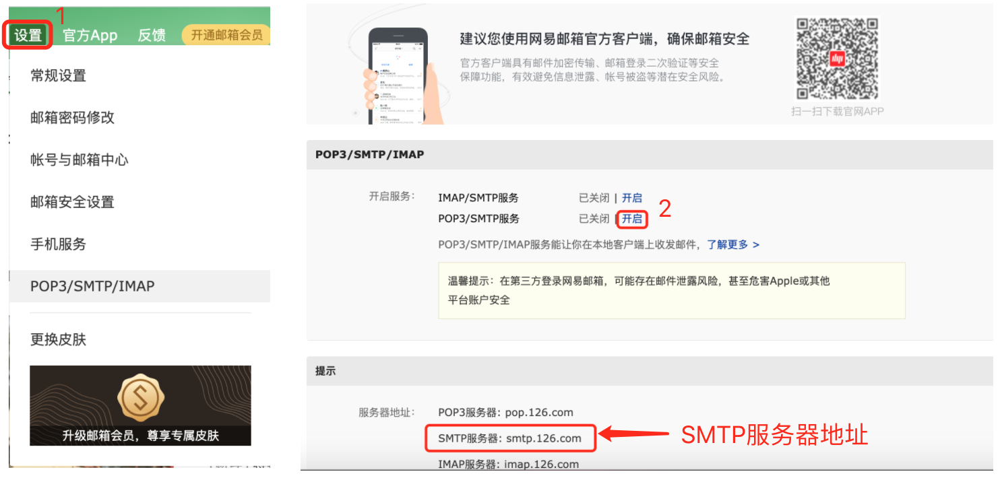
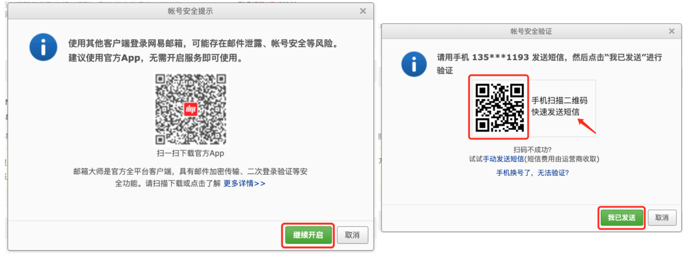
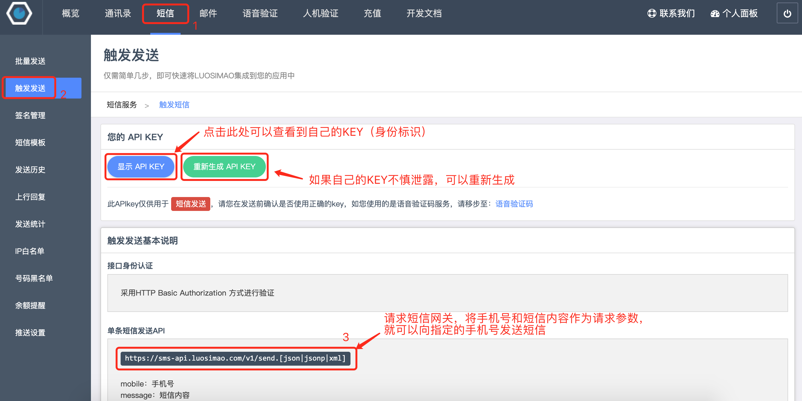
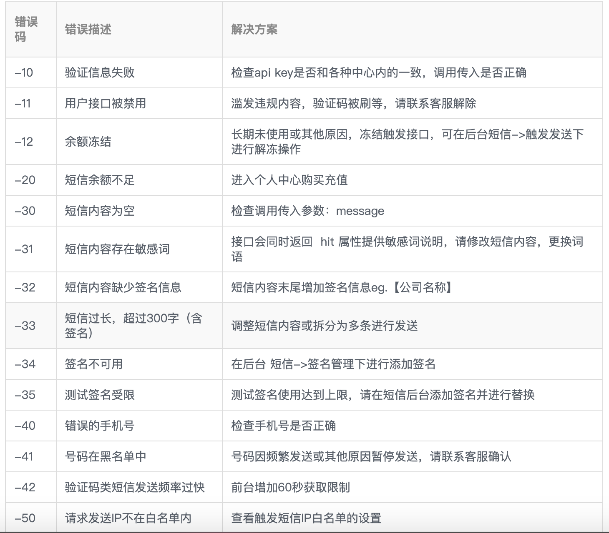
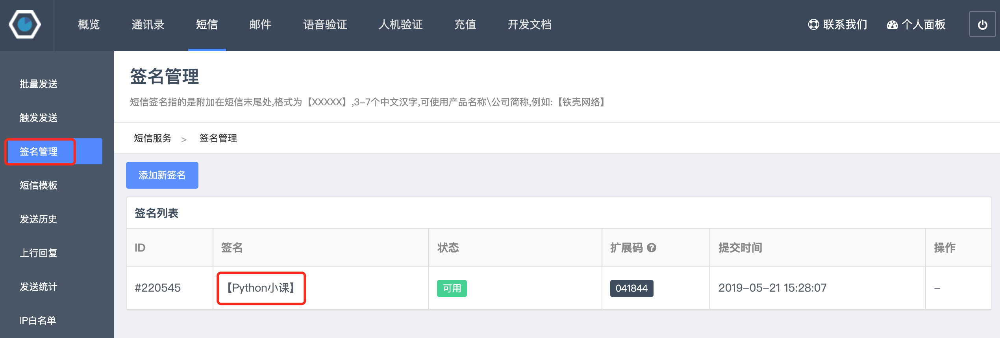

## Gửi email và tin nhắn SMS với Python

Trong các bài học trước, chúng ta đã hướng dẫn các bạn cách dùng chương trình Python để tự động tạo các tài liệu Excel, Word, PDF. Tiếp theo, chúng ta có thể tiến thêm một bước nữa, đó là gửi các tài liệu đã tạo cho những người nhận chỉ định thông qua email, rồi dùng tin nhắn SMS để thông báo cho đối phương biết rằng chúng ta đã gửi thư. Những việc này hoàn toàn có thể được giải quyết một cách nhẹ nhàng và thú vị bằng chương trình Python.

### Gửi thư điện tử (Email)

Ngay cả khi các phần mềm nhắn tin tức thời phát triển mạnh mẽ như ngày nay, thư điện tử vẫn là một trong những ứng dụng được sử dụng rộng rãi nhất trên Internet. Các công ty gửi thông báo trúng tuyển cho ứng viên, website gửi liên kết kích hoạt tài khoản cho người dùng, ngân hàng quảng bá sản phẩm tài chính đến khách hàng, v.v., hầu như đều được thực hiện qua email, và những tác vụ này thông thường đều do chương trình tự động hoàn thành.

Chúng ta có thể sử dụng HTTP (Hypertext Transfer Protocol) để truy cập tài nguyên website. HTTP là giao thức tầng ứng dụng, nó được xây dựng trên nền tảng TCP (Transmission Control Protocol), và TCP cung cấp dịch vụ truyền dữ liệu đáng tin cậy cho rất nhiều giao thức tầng ứng dụng. Nếu muốn gửi thư điện tử, chúng ta cần sử dụng SMTP (Simple Mail Transfer Protocol). Đây cũng là một giao thức tầng ứng dụng được xây dựng trên nền tảng TCP, quy định chi tiết cách thức người gửi thư giao tiếp với máy chủ thư điện tử (mail server). Python đơn giản hóa các thao tác này thông qua module `smtplib` với đối tượng `SMTP_SSL`. Bằng các phương thức `login` và `sendmail` của đối tượng này, chúng ta có thể hoàn thành thao tác gửi email.

Trước tiên, chúng ta hãy thử gửi một bức thư điện tử cực kỳ đơn giản, không chứa tệp đính kèm, hình ảnh hay nội dung siêu văn bản nào khác. Để gửi email, trước hết bạn cần kết nối với máy chủ thư điện tử. Chúng ta có thể tự dựng máy chủ thư điện tử, nhưng việc này không mấy thân thiện với người mới bắt đầu; thay vào đó, chúng ta có thể chọn sử dụng dịch vụ thư điện tử do bên thứ ba cung cấp. Ví dụ: tôi đã đăng ký một tài khoản tại <www.126.com>, sau khi đăng nhập thành công, tôi có thể bật dịch vụ SMTP trong phần cài đặt, như vậy tương đương với việc đã có được một máy chủ thư điện tử. Các thao tác cụ thể như sau:





Dùng điện thoại quét mã QR ở trên có thể lấy mã ủy quyền (authorization code / app password) bằng cách gửi tin nhắn SMS. Sau khi tin nhắn được gửi thành công, nhấp vào "Tôi đã gửi" để nhận mã ủy quyền. Mã ủy quyền cần được bảo quản cẩn thận, vì một khi bị rò rỉ, người khác có thể mạo danh bạn để gửi email. Tiếp theo, chúng ta có thể viết mã nguồn để gửi email như sau:

```python
import smtplib
from email.header import Header
from email.mime.multipart import MIMEMultipart
from email.mime.text import MIMEText

# Tạo đối tượng thân thư điện tử
email = MIMEMultipart()
# Thiết lập người gửi, người nhận và tiêu đề
email['From'] = 'xxxxxxxxx@126.com'
email['To'] = 'yyyyyy@qq.com;zzzzzz@1000phone.com'
email['Subject'] = Header('Báo cáo tình hình công việc nửa đầu năm', 'utf-8')
# Thêm nội dung văn bản thư
content = """Theo truyền thông Đức đưa tin, ngày 9 giờ địa phương, các thành viên công đoàn lái tàu Đức đã bỏ phiếu,
quyết định tổ chức đình công trên toàn quốc từ ngày 10 giờ địa phương, cuộc đình công trong vận tải hàng hóa đã bắt đầu từ 19 giờ ngày 10.
Sau đó, từ 2 giờ sáng ngày 11 đến 2 giờ sáng ngày 13, vận tải hành khách và cơ sở hạ tầng đường sắt trên toàn nước Đức sẽ diễn ra cuộc đình công kéo dài 48 giờ."""
email.attach(MIMEText(content, 'plain', 'utf-8'))

# Tạo đối tượng SMTP_SSL (kết nối tới máy chủ thư điện tử)
smtp_obj = smtplib.SMTP_SSL('smtp.126.com', 465)
# Đăng nhập bằng tên người dùng và mã ủy quyền
smtp_obj.login('xxxxxxxxx@126.com', 'Mã ủy quyền của máy chủ thư')
# Gửi thư (người gửi, người nhận, nội dung thư (dạng chuỗi))
smtp_obj.sendmail(
    'xxxxxxxxx@126.com',
    ['yyyyyy@qq.com', 'zzzzzz@1000phone.com'],
    email.as_string()
)
```

Nếu muốn gửi email có tệp đính kèm, bạn chỉ cần xử lý nội dung tệp đính kèm thành mã hóa BASE64, khi đó nó hầu như không có gì khác biệt so với nội dung văn bản thông thường. BASE64 là một phương pháp biểu diễn dữ liệu nhị phân dựa trên 64 ký tự in được, thường được sử dụng trong các tình huống cần biểu diễn, truyền tải và lưu trữ dữ liệu nhị phân, và thư điện tử là một trong số đó. Bạn nào chưa hiểu rõ về phương thức mã hóa này có thể đọc thêm bài viết [《Base64笔记》](http://www.ruanyifeng.com/blog/2008/06/base64.html). Trong các nội dung trước, chúng ta cũng đã đề cập rằng module `base64` trong thư viện chuẩn của Python cung cấp hỗ trợ mã hóa và giải mã BASE64.

Đoạn mã dưới đây minh họa cách gửi email có tệp đính kèm:

```python
import smtplib
from email.header import Header
from email.mime.multipart import MIMEMultipart
from email.mime.text import MIMEText
from urllib.parse import quote

# Tạo đối tượng thân thư điện tử
email = MIMEMultipart()
# Thiết lập người gửi, người nhận và tiêu đề
email['From'] = 'xxxxxxxxx@126.com'
email['To'] = 'zzzzzzzz@1000phone.com'
email['Subject'] = Header('Vui lòng kiểm tra file giấy xác nhận thôi việc', 'utf-8')
# Thêm nội dung văn bản thư (nội dung có định dạng thẻ HTML)
content = """<p>Chào đồng nghiệp cũ thân mến:</p>
<p>Giấy xác nhận thôi việc bạn cần nằm trong tệp đính kèm, vui lòng kiểm tra!</p>
<br>
<p>Chúc bạn mọi điều tốt lành!</p>
<hr>
<p>Tôn Mỹ Lệ kính thư</p>"""
email.attach(MIMEText(content, 'html', 'utf-8'))
# Đọc file làm tệp đính kèm
with open(f'resources/Vương Đại Chùy离职证明.docx', 'rb') as file:
    attachment = MIMEText(file.read(), 'base64', 'utf-8')
    # Chỉ định loại nội dung
    attachment['content-type'] = 'application/octet-stream'
    # Xử lý tên file tiếng Trung thành mã hóa phần trăm (percent-encoding)
    filename = quote('Vương Đại Chùy离职证明.docx')
    # Chỉ định cách xử lý nội dung
    attachment['content-disposition'] = f'attachment; filename="{filename}"'

# Tạo đối tượng SMTP_SSL (kết nối tới máy chủ thư điện tử)
smtp_obj = smtplib.SMTP_SSL('smtp.126.com', 465)
# Đăng nhập bằng tên người dùng và mã ủy quyền
smtp_obj.login('xxxxxxxxx@126.com', 'Mã ủy quyền của máy chủ thư')
# Gửi thư (người gửi, người nhận, nội dung thư (dạng chuỗi))
smtp_obj.sendmail(
    'xxxxxxxxx@126.com',
    'zzzzzzzz@1000phone.com',
    email.as_string()
)
```

Để thuận tiện cho mọi người thực hiện gửi email bằng Python, tôi đã đóng gói đoạn mã trên thành một hàm. Khi sử dụng, bạn chỉ cần điều chỉnh tên miền máy chủ thư điện tử, cổng, tên người dùng và mã ủy quyền là được.

```python
import smtplib
from email.header import Header
from email.mime.multipart import MIMEMultipart
from email.mime.text import MIMEText
from urllib.parse import quote

# Tên miền máy chủ email (tự chỉnh sửa)
EMAIL_HOST = 'smtp.126.com'
# Cổng dịch vụ email (thường là 465)
EMAIL_PORT = 465
# Tài khoản đăng nhập máy chủ email (tự chỉnh sửa)
EMAIL_USER = 'xxxxxxxxx@126.com'
# Mã ủy quyền khi kích hoạt dịch vụ SMTP (tự chỉnh sửa)
EMAIL_AUTH = 'Mã ủy quyền của máy chủ thư'


def send_email(*, from_user, to_users, subject='', content='', filenames=[]):
    """Gửi email
    
    :param from_user: Người gửi
    :param to_users: Người nhận, nhiều người nhận ngăn cách bằng dấu chấm phẩy
    :param subject: Tiêu đề thư
    :param content: Nội dung văn bản thư
    :param filenames: Danh sách đường dẫn file tệp đính kèm cần gửi
    """
    email = MIMEMultipart()
    email['From'] = from_user
    email['To'] = to_users
    email['Subject'] = subject

    message = MIMEText(content, 'plain', 'utf-8')
    email.attach(message)
    for filename in filenames:
        with open(filename, 'rb') as file:
            pos = filename.rfind('/')
            display_filename = filename[pos + 1:] if pos >= 0 else filename
            display_filename = quote(display_filename)
            attachment = MIMEText(file.read(), 'base64', 'utf-8')
            attachment['content-type'] = 'application/octet-stream'
            attachment['content-disposition'] = f'attachment; filename="{display_filename}"'
            email.attach(attachment)

    smtp = smtplib.SMTP_SSL(EMAIL_HOST, EMAIL_PORT)
    smtp.login(EMAIL_USER, EMAIL_AUTH)
    smtp.sendmail(from_user, to_users.split(';'), email.as_string())
```

### Gửi tin nhắn SMS

Gửi tin nhắn SMS cũng là một tính năng phổ biến trong các dự án: mã đăng ký website, mã xác minh, thông tin tiếp thị về cơ bản đều được gửi tới người dùng thông qua tin nhắn SMS. Gửi tin nhắn SMS cần sự hỗ trợ của nền tảng bên thứ ba. Dưới đây chúng ta lấy [nền tảng Luosimao (螺丝帽)](https://luosimao.com/) làm ví dụ để giới thiệu cách gửi tin nhắn SMS bằng chương trình Python. Chi tiết về việc đăng ký tài khoản và mua dịch vụ SMS chúng tôi sẽ không nhắc lại ở đây, bạn có thể tham khảo bộ phận chăm sóc khách hàng của nền tảng.



Tiếp theo, chúng ta có thể gửi một yêu cầu HTTP đến cổng SMS (SMS gateway) do nền tảng cung cấp thông qua thư viện `requests`, truyền vào các tham số gồm số điện thoại nhận tin nhắn và nội dung tin nhắn là có thể gửi được SMS. Đoạn mã như sau:

```python
import random

import requests


def send_message_by_luosimao(tel, message):
    """Gửi tin nhắn SMS (gọi cổng SMS Luosimao)"""
    resp = requests.post(
        url='http://sms-api.luosimao.com/v1/send.json',
        auth=('api', 'key-KEY được cấp sau khi đăng ký nền tảng thành công'),
        data={
            'mobile': tel,
            'message': message
        },
        timeout=10,
        verify=False
    )
    return resp.json()


def gen_mobile_code(length=6):
    """Tạo mã xác thực điện thoại với độ dài chỉ định"""
    return ''.join(random.choices('0123456789', k=length))


def main():
    code = gen_mobile_code()
    message = f'Mã xác thực SMS của bạn là {code}, tuyệt đối không được tiết lộ cho người khác nhé! 【Khóa học Python nhỏ】'
    print(send_message_by_luosimao('13500112233', message))


if __name__ == '__main__':
    main()
```

Yêu cầu gửi đến cổng SMS Luosimao `http://sms-api.luosimao.com/v1/send.json` ở trên sẽ trả về dữ liệu định dạng JSON. Nếu trả về `{'error': 0, 'msg': 'OK'}` thì có nghĩa là tin nhắn đã được gửi thành công; nếu giá trị của `error` khác `0`, bạn có thể kiểm tra [tài liệu phát triển](https://luosimao.com/docs/api/) chính thức để biết lỗi xảy ra ở bước nào. Các loại lỗi thường gặp trên nền tảng Luosimao như hình dưới đây:



Hiện tại, hầu hết các nền tảng SMS đều yêu cầu nội dung tin nhắn phải đính kèm chữ ký. Hình dưới đây là chữ ký tin nhắn "【Khóa học Python nhỏ】" mà tôi đã cấu hình trên nền tảng Luosimao. Một số tin nhắn liên quan đến nội dung nhạy cảm còn yêu cầu cấu hình trước mẫu tin nhắn, bạn đọc quan tâm có thể tự tìm hiểu thêm. Thông thường, để phòng ngừa việc tin nhắn bị sử dụng trái phép, nền tảng cũng yêu cầu thiết lập "Danh sách trắng IP" (IP Whitelist); nếu chưa rõ cách cấu hình, bạn có thể liên hệ bộ phận hỗ trợ của nền tảng.



Tất nhiên có rất nhiều nền tảng SMS khác nhau, bạn đọc có thể lựa chọn tùy theo nhu cầu của mình (thường cân nhắc các chỉ số như ngân sách chi phí, tỷ lệ gửi thành công, độ dễ sử dụng, v.v.). Nếu cần sử dụng dịch vụ SMS trong các dự án thương mại, bạn nên mua các gói dịch vụ do nhà cung cấp nền tảng SMS đưa ra.

### Tổng kết

Thực ra, việc gửi email cũng giống như gửi SMS, đều có thể hoàn thành bằng cách gọi các dịch vụ của bên thứ ba. Trong các dự án thương mại thực tế, bạn nên tự dựng máy chủ thư điện tử riêng hoặc mua dịch vụ của bên thứ ba để gửi email, đó mới là lựa chọn đáng tin cậy hơn cả.
