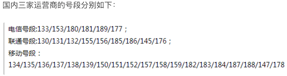

## Ứng dụng biểu thức chính quy

### Kiến thức liên quan đến biểu thức chính quy

Khi viết các chương trình xử lý chuỗi ký tự, chúng ta thường gặp phải nhu cầu tìm kiếm các chuỗi con phù hợp với một số quy tắc nhất định trong một đoạn văn bản. Biểu thức chính quy (regular expression, viết tắt là regex) chính là công cụ dùng để mô tả những quy tắc đó. Nói cách khác, chúng ta có thể sử dụng biểu thức chính quy để định nghĩa mẫu khớp (matching pattern) của chuỗi, tức là làm thế nào để kiểm tra xem một chuỗi có phần nào khớp với một mẫu nhất định hay không, hoặc trích xuất, thay thế các phần khớp với mẫu đó từ trong chuỗi.

Lấy một ví dụ đơn giản: nếu bạn từng sử dụng tính năng tìm kiếm tệp tin trong hệ điều hành Windows và từng dùng các ký tự đại diện (wildcard `*` và `?`) khi chỉ định tên tệp, thì biểu thức chính quy cũng là một công cụ so khớp văn bản tương tự như vậy. Có điều, so với ký tự đại diện, biểu thức chính quy mạnh mẽ hơn nhiều; nó có thể mô tả nhu cầu của bạn một cách chính xác hơn. Tất nhiên cái giá phải trả là việc viết một biểu thức chính quy phức tạp hơn nhiều so với việc dùng ký tự đại diện, bởi vì bất cứ thứ gì mang lại lợi ích cho bạn đều đòi hỏi bạn phải bỏ ra cái giá tương ứng.

Lấy thêm một ví dụ nữa: chúng ta nhận được một chuỗi văn bản từ một nơi nào đó (có thể là một tệp văn bản hoặc một bản tin trên mạng), và muốn tìm ra số điện thoại di động cùng số điện thoại cố định trong chuỗi đó. Đương nhiên chúng ta có thể quy định số di động là dãy 11 chữ số (chú ý không phải 11 chữ số ngẫu nhiên bất kỳ, vì bạn chưa từng thấy số di động nào kiểu "25012345678"), còn số cố định là mẫu có dạng "mã vùng - số thuê bao". Nếu không sử dụng biểu thức chính quy, việc hoàn thành tác vụ này sẽ khá phiền phức. Ban đầu máy tính ra đời là để làm các phép tính toán học, thông tin xử lý về cơ bản đều là các giá trị số; còn ngày nay, phần lớn thông tin chúng ta xử lý trong công việc hàng ngày lại là dữ liệu văn bản. Chúng ta mong muốn máy tính có thể nhận diện và xử lý các văn bản phù hợp với những mẫu nhất định, vì vậy biểu thức chính quy trở nên vô cùng quan trọng. Ngày nay hầu như tất cả các ngôn ngữ lập trình đều hỗ trợ các thao tác với biểu thức chính quy; Python hỗ trợ các thao tác với biểu thức chính quy thông qua module `re` trong thư viện chuẩn.

Về các kiến thức liên quan đến biểu thức chính quy, các bạn có thể đọc một bài blog rất nổi tiếng mang tên [《正则表达式30分钟入门教程》](https://deerchao.net/tutorials/regex/regex.htm) (Hướng dẫn nhập môn biểu thức chính quy trong 30 phút). Sau khi đọc xong bài viết này, bạn sẽ hiểu được bảng dưới đây, đây là bản tóm tắt ngắn gọn của chúng tôi về một số ký hiệu cơ bản trong biểu thức chính quy.

| Ký hiệu | Giải thích | Ví dụ | Minh họa |
| -------------- | -------------------------------- | ------------------ | ------------------------------------------------------------ |
| `.` | Khớp với ký tự bất kỳ | `b.t` | Có thể khớp với bat / but / b#t / b1t, v.v. |
| `\w` | Khớp với chữ cái / chữ số / dấu gạch dưới | `b\wt` | Có thể khớp với bat / b1t / b_t, v.v.<br>nhưng không khớp với b#t |
| `\s` | Khớp với ký tự khoảng trắng (bao gồm \r, \n, \t, v.v.) | `love\syou` | Có thể khớp với love you |
| `\d` | Khớp với chữ số | `\d\d` | Có thể khớp với 01 / 23 / 99, v.v. |
| `\b` | Khớp với ranh giới từ (word boundary) | `\bThe\b` | |
| `^` | Khớp với vị trí bắt đầu của chuỗi | `^The` | Có thể khớp với chuỗi bắt đầu bằng The |
| `$` | Khớp với vị trí kết thúc của chuỗi | `.exe$` | Có thể khớp với chuỗi kết thúc bằng .exe |
| `\W` | Khớp với ký tự không phải chữ cái / chữ số / dấu gạch dưới | `b\Wt` | Có thể khớp với b#t / b@t, v.v.<br>nhưng không khớp với but / b1t / b_t, v.v. |
| `\S` | Khớp với ký tự không phải khoảng trắng | `love\Syou` | Có thể khớp với love#you, v.v.<br>nhưng không khớp với love you |
| `\D` | Khớp với ký tự không phải chữ số | `\d\D` | Có thể khớp với 9a / 3# / 0F, v.v. |
| `\B` | Khớp với vị trí không phải ranh giới từ | `\Bio\B` | |
| `[]` | Khớp với một ký tự đơn bất kỳ thuộc tập ký tự | `[aeiou]` | Có thể khớp với bất kỳ nguyên âm nào |
| `[^]` | Khớp với một ký tự đơn bất kỳ không thuộc tập ký tự | `[^aeiou]` | Có thể khớp với bất kỳ ký tự nào không phải nguyên âm |
| `*` | Khớp 0 hoặc nhiều lần | `\w*` | |
| `+` | Khớp 1 hoặc nhiều lần | `\w+` | |
| `?` | Khớp 0 hoặc 1 lần | `\w?` | |
| `{N}` | Khớp đúng N lần | `\w{3}` | |
| `{M,}` | Khớp ít nhất M lần | `\w{3,}` | |
| `{M,N}` | Khớp ít nhất M lần và nhiều nhất N lần | `\w{3,6}` | |
| `\|` | Phân nhánh (hoặc) | `foo\|bar` | Có thể khớp với foo hoặc bar |
| `(?#)` | Chú thích | | |
| `(exp)` | Khớp với exp và bắt giữ vào nhóm được đặt tên tự động | | |
| `(?<name>exp)` | Khớp với exp và bắt giữ vào nhóm có tên là name | | |
| `(?:exp)` | Khớp với exp nhưng không bắt giữ văn bản khớp | | |
| `(?=exp)` | Khớp với vị trí đứng trước exp (positive lookahead) | `\b\w+(?=ing)` | Có thể khớp với danc trong I'm dancing |
| `(?<=exp)` | Khớp với vị trí đứng sau exp (positive lookbehind) | `(?<=\bdanc)\w+\b` | Có thể khớp với chữ ing đầu tiên trong I love dancing and reading |
| `(?!exp)` | Khớp với vị trí mà phía sau không phải exp (negative lookahead) | | |
| `(?<!exp)` | Khớp với vị trí mà phía trước không phải exp (negative lookbehind) | | |
| `*?` | Lặp lại tùy ý, nhưng lặp ít nhất có thể (lazy/non-greedy) | `a.*b`<br>`a.*?b` | Áp dụng biểu thức chính quy cho chuỗi aabab, cái trước sẽ khớp toàn bộ chuỗi aabab, cái sau sẽ khớp hai chuỗi aab và ab |
| `+?` | Lặp lại 1 hoặc nhiều lần, nhưng lặp ít nhất có thể | | |
| `??` | Lặp lại 0 hoặc 1 lần, nhưng lặp ít nhất có thể | | |
| `{M,N}?` | Lặp lại M đến N lần, nhưng lặp ít nhất có thể | | |
| `{M,}?` | Lặp lại từ M lần trở lên, nhưng lặp ít nhất có thể | | |

> **Giải thích:** Nếu ký tự cần khớp là ký tự đặc biệt trong biểu thức chính quy thì có thể dùng `\` để thoát chuỗi (escape). Ví dụ muốn khớp với dấu chấm thập phân thì viết `\.` là được, bởi vì viết trực tiếp `.` sẽ khớp với ký tự bất kỳ; tương tự, muốn khớp với dấu ngoặc tròn thì phải viết `\(` và `\)`, nếu không dấu ngoặc tròn sẽ được coi là nhóm (group) trong biểu thức chính quy.

### Hỗ trợ biểu thức chính quy trong Python

Python cung cấp module `re` để hỗ trợ các thao tác liên quan đến biểu thức chính quy. Dưới đây là các hàm cốt lõi trong module `re`:

| Hàm | Giải thích |
| ---------------------------------------------- | ------------------------------------------------------------ |
| `compile(pattern, flags=0)` | Biên dịch biểu thức chính quy và trả về đối tượng biểu thức chính quy |
| `match(pattern, string, flags=0)` | Dùng biểu thức chính quy so khớp chuỗi, thành công trả về đối tượng match, ngược lại trả về `None` |
| `search(pattern, string, flags=0)` | Tìm kiếm vị trí đầu tiên xuất hiện mẫu regex trong chuỗi, thành công trả về đối tượng match, ngược lại trả về `None` |
| `split(pattern, string, maxsplit=0, flags=0)` | Tách chuỗi theo dấu phân cách được chỉ định bởi mẫu regex, trả về danh sách (list) |
| `sub(pattern, repl, string, count=0, flags=0)` | Dùng chuỗi chỉ định để thay thế các phần khớp với regex trong chuỗi gốc; có thể dùng `count` để chỉ định số lần thay thế |
| `fullmatch(pattern, string, flags=0)` | Phiên bản khớp hoàn toàn (từ đầu đến cuối chuỗi) của hàm `match` |
| `findall(pattern, string, flags=0)` | Tìm tất cả các mẫu khớp với regex trong chuỗi, trả về danh sách các chuỗi |
| `finditer(pattern, string, flags=0)` | Tìm tất cả các mẫu khớp với regex trong chuỗi, trả về một iterator |
| `purge()` | Xóa bộ nhớ đệm (cache) của các biểu thức chính quy được biên dịch ngầm định |
| `re.I` / `re.IGNORECASE` | Cờ so khớp bỏ qua phân biệt chữ hoa chữ thường |
| `re.M` / `re.MULTILINE` | Cờ so khớp nhiều dòng |
| | |

> **Giải thích:** Đối với các hàm trong module `re` đã nêu ở trên, trong phát triển thực tế bạn cũng có thể dùng các phương thức của đối tượng biểu thức chính quy (đối tượng `Pattern`) để thay thế. Nếu một biểu thức chính quy cần được sử dụng lặp đi lặp lại nhiều lần, thì việc biên dịch biểu thức chính quy trước bằng hàm `compile` để tạo ra đối tượng biểu thức chính quy chắc chắn là một lựa chọn sáng suốt hơn.

Dưới đây chúng ta sẽ cùng tìm hiểu cách sử dụng biểu thức chính quy trong Python qua một loạt các ví dụ.

#### Ví dụ 1: Xác thực xem tên người dùng và số QQ nhập vào có hợp lệ hay không và đưa ra thông báo tương ứng.

```python
"""
Yêu cầu: Tên người dùng phải bao gồm chữ cái, chữ số hoặc dấu gạch dưới và có độ dài từ 6 đến 20 ký tự;
số QQ là dãy 5 đến 12 chữ số và chữ số đầu tiên không được là 0.
"""
import re

username = input('Vui lòng nhập tên người dùng: ')
qq = input('Vui lòng nhập số QQ: ')
# Tham số thứ nhất của hàm match là chuỗi regex hoặc đối tượng regex
# Tham số thứ hai của hàm match là đối tượng chuỗi cần so khớp với regex
m1 = re.match(r'^[0-9a-zA-Z_]{6,20}$', username)
if not m1:
    print('Vui lòng nhập tên người dùng hợp lệ.')
# Hàm fullmatch yêu cầu chuỗi và regex phải khớp hoàn toàn
# Do đó biểu thức chính quy không cần viết ký tự bắt đầu và kết thúc
m2 = re.fullmatch(r'[1-9]\d{4,11}', qq)
if not m2:
    print('Vui lòng nhập số QQ hợp lệ.')
if m1 and m2:
    print('Thông tin bạn nhập là hợp lệ!')
```

> **Gợi ý:** Khi viết biểu thức chính quy ở trên, chúng ta đã sử dụng cách viết "raw string" (thêm `r` ở phía trước chuỗi). Cái gọi là "raw string" có nghĩa là mỗi ký tự trong chuỗi đều giữ nguyên ý nghĩa ban đầu của nó; nói một cách trực tiếp hơn là trong chuỗi không có các ký tự thoát chuỗi (escape character). Vì trong biểu thức chính quy có rất nhiều siêu ký tự và những chỗ cần thoát chuỗi, nếu không dùng raw string thì bạn phải viết dấu gạch chéo ngược thành `\\`, ví dụ để biểu thị chữ số `\d` thì phải viết thành `\\d`, như vậy không những viết bất tiện mà khi đọc cũng rất mệt mỏi.

#### Ví dụ 2: Trích xuất số điện thoại di động nội địa từ một đoạn văn bản.

Bức ảnh dưới đây thống kê các đầu số điện thoại di động do ba nhà mạng lớn tại Trung Quốc triển khai tính đến cuối năm 2017:



```python
import re

# Tạo đối tượng regex, sử dụng lookahead và lookbehind để đảm bảo trước và sau số điện thoại không xuất hiện thêm chữ số nào khác
pattern = re.compile(r'(?<=\D)1[34578]\d{9}(?=\D)')
sentence = '''重要的事情说8130123456789遍，我的手机号是13512346789这个靓号，
不是15600998765，也不是110或119，Vương Đại Chùy的手机号才是15600998765。'''
# Cách 1: Tìm tất cả các kết quả khớp và lưu vào một danh sách
tels_list = re.findall(pattern, sentence)
for tel in tels_list:
    print(tel)
print('--------Đường phân cách đẹp mắt--------')

# Cách 2: Lấy đối tượng match qua iterator và lấy ra nội dung khớp
for temp in pattern.finditer(sentence):
    print(temp.group())
print('--------Đường phân cách đẹp mắt--------')

# Cách 3: Chỉ định vị trí tìm kiếm qua hàm search để tìm ra tất cả các kết quả khớp
m = pattern.search(sentence)
while m:
    print(m.group())
    m = pattern.search(sentence, m.end())
```

> **Giải thích:** Biểu thức chính quy so khớp số điện thoại di động nội địa Trung Quốc ở trên vẫn chưa đủ hoàn thiện, vì ví dụ như các số đầu 14 chỉ có 145 hoặc 147, mà biểu thức chính quy ở trên chưa tính đến trường hợp này. Để khớp số di động nội địa chính xác hơn, cách viết biểu thức chính quy tốt hơn là: `(?<=\D)(1[38]\d{9}|14[57]\d{8}|15[0-35-9]\d{8}|17[678]\d{8})(?=\D)`. Tại Trung Quốc hình như cũng đã có các đầu số di động 19 và 16, nhưng những số này tạm thời chưa nằm trong phạm vi xem xét của chúng ta.

#### Ví dụ 3: Thay thế nội dung không lành mạnh trong chuỗi

```python
import re

sentence = 'Oh, shit! 你是傻逼吗? Fuck you.'
purified = re.sub('fuck|shit|[傻煞沙][比笔逼叉缺吊碉雕]',
                  '*', sentence, flags=re.IGNORECASE)
print(purified)  # Oh, *! 你是*吗? * you.
```

> **Giải thích:** Trong các hàm liên quan đến biểu thức chính quy của module `re` đều có một tham số `flags`, đại diện cho cờ so khớp của regex. Thông qua cờ này, bạn có thể chỉ định xem khi so khớp có bỏ qua chữ hoa chữ thường hay không, có so khớp nhiều dòng hay không, có hiển thị thông tin gỡ lỗi hay không, v.v. Nếu cần chỉ định nhiều giá trị cho tham số `flags`, bạn có thể dùng [toán tử bitwise OR](http://www.runoob.com/python/python-operators.html#ysf5) để kết hợp lại, ví dụ `flags=re.I | re.M`.

#### Ví dụ 4: Tách chuỗi dài

```python
import re

poem = '窗前明月光，疑是地上霜。举头望明月，低头思故乡。'
sentences_list = re.split(r'[，。]', poem)
sentences_list = [sentence for sentence in sentences_list if sentence]
for sentence in sentences_list:
    print(sentence)
```

### Tổng kết

Biểu thức chính quy thực sự vô cùng mạnh mẽ trong việc xử lý và so khớp chuỗi. Qua các ví dụ trên, tin rằng các bạn đã cảm nhận được sức hút của biểu thức chính quy. Tất nhiên đối với người mới bắt đầu, việc viết một biểu thức chính quy không hề dễ dàng, nhưng mọi thứ đều "trăm hay không bằng tay quen", chỉ cần mạnh dạn thử nghiệm là được. Có một [công cụ kiểm tra biểu thức chính quy trực tuyến](https://c.runoob.com/front-end/854) tin rằng sẽ giúp ích được cho các bạn ở một mức độ nhất định.
