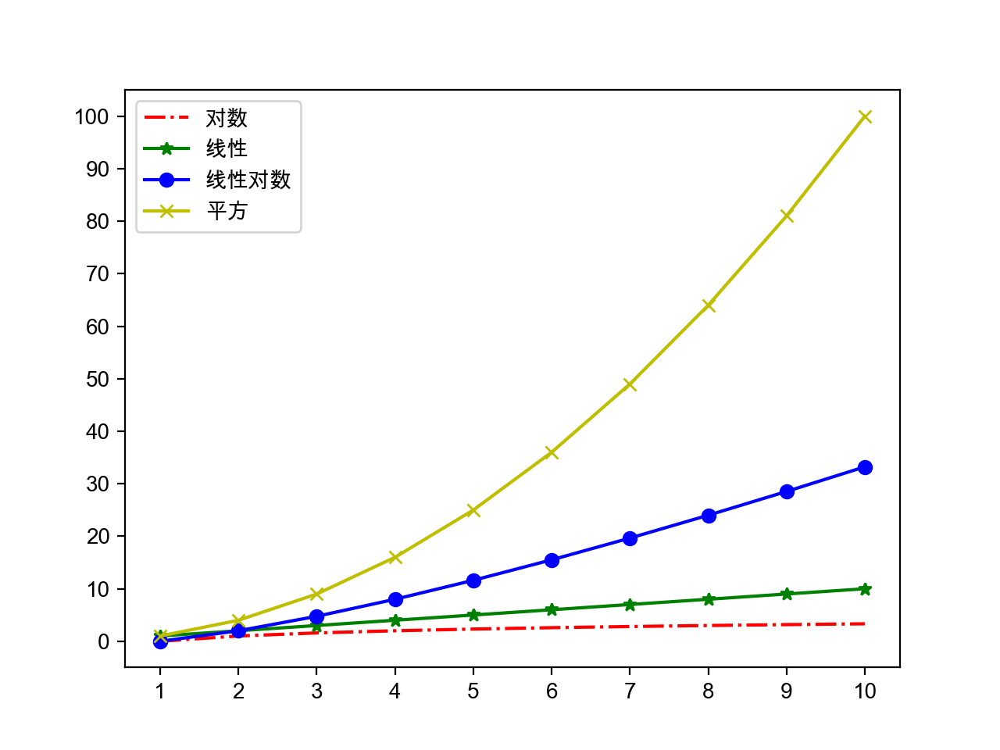
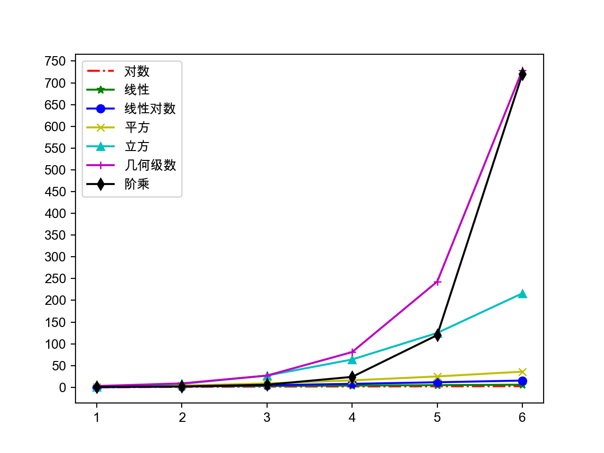

## Nâng cao ngôn ngữ Python

### Các điểm kiến thức quan trọng

- Cách sử dụng biểu thức tạo (comprehension)

  ```Python
  prices = {
      'AAPL': 191.88,
      'GOOG': 1186.96,
      'IBM': 149.24,
      'ORCL': 48.44,
      'ACN': 166.89,
      'FB': 208.09,
      'SYMC': 21.29
  }
  # Dùng các cổ phiếu có giá lớn hơn 100 để tạo một từ điển mới
  prices2 = {key: value for key, value in prices.items() if value > 100}
  print(prices2)
  ```

  > Giải thích: Biểu thức tạo (comprehension) có thể dùng để tạo danh sách (list), tập hợp (set) và từ điển (dict).

- Cạm bẫy với danh sách lồng nhau

  ```Python
  names = ['关羽', '张飞', '赵云', '马超', '黄忠']
  courses = ['Ngữ văn', 'Toán học', 'Tiếng Anh']
  # Nhập điểm 3 môn học của 5 học sinh
  # Sai - tham khảo http://pythontutor.com/visualize.html#mode=edit
  # scores = [[None] * len(courses)] * len(names)
  scores = [[None] * len(courses) for _ in range(len(names))]
  for row, name in enumerate(names):
      for col, course in enumerate(courses):
          scores[row][col] = float(input(f'Vui lòng nhập điểm môn {course} của {name}: '))
          print(scores)
  ```

  [Python Tutor](http://pythontutor.com/) - VISUALIZE CODE AND GET LIVE HELP

- Module `heapq` (sắp xếp vun đống - heapsort)

  ```Python
  """
  Tìm N phần tử lớn nhất hoặc nhỏ nhất từ danh sách
  Cấu trúc đống (max heap / min heap)
  """
  import heapq
  
  list1 = [34, 25, 12, 99, 87, 63, 58, 78, 88, 92]
  list2 = [
      {'name': 'IBM', 'shares': 100, 'price': 91.1},
      {'name': 'AAPL', 'shares': 50, 'price': 543.22},
      {'name': 'FB', 'shares': 200, 'price': 21.09},
      {'name': 'HPQ', 'shares': 35, 'price': 31.75},
      {'name': 'YHOO', 'shares': 45, 'price': 16.35},
      {'name': 'ACME', 'shares': 75, 'price': 115.65}
  ]
  print(heapq.nlargest(3, list1))
  print(heapq.nsmallest(3, list1))
  print(heapq.nlargest(2, list2, key=lambda x: x['price']))
  print(heapq.nlargest(2, list2, key=lambda x: x['shares']))
  ```

- Module `itertools`

  ```Python
  """
  Module công cụ lặp (iteration tools)
  """
  import itertools
  
  # Tạo tất cả các hoán vị của ABCD
  itertools.permutations('ABCD')
  # Tạo tổ hợp chập 3 từ 5 phần tử ABCDE
  itertools.combinations('ABCDE', 3)
  # Tạo tích Descartes của ABCD và 123
  itertools.product('ABCD', '123')
  # Tạo chuỗi lặp vô hạn của ABC
  itertools.cycle(('A', 'B', 'C'))
  ```

- Module `collections`

  Các lớp công cụ thường dùng:

  - `namedtuple`: tuple có tên, là một factory tạo lớp, nhận tên kiểu và danh sách thuộc tính để tạo một lớp.
  - `deque`: hàng đợi hai đầu (double-ended queue), là cách triển khai thay thế cho danh sách. Danh sách trong Python bên dưới được triển khai dựa trên mảng, trong khi `deque` bên dưới là danh sách liên kết đôi (doubly linked list). Do đó khi bạn cần thêm và xóa phần tử ở hai đầu, `deque` sẽ thể hiện hiệu năng tốt hơn với độ phức tạp thời gian tiệm cận là $O(1)$.
  - `Counter`: lớp con của `dict`, khóa là phần tử, giá trị là số lần đếm của phần tử; phương thức `most_common()` của nó có thể giúp chúng ta lấy ra các phần tử xuất hiện với tần suất cao nhất. Mối quan hệ kế thừa giữa `Counter` và `dict` theo tôi là đáng bàn thảo, theo nguyên tắc CARP thì mối quan hệ giữa `Counter` và `dict` nên thiết kế thành quan hệ kết hợp (association) sẽ hợp lý hơn.
  - `OrderedDict`: lớp con của `dict`, ghi nhớ thứ tự chèn của các cặp khóa-giá trị, trông vừa có hành vi của từ điển vừa có hành vi của danh sách liên kết.
  - `defaultdict`: tương tự như kiểu từ điển, nhưng có thể thông qua hàm factory mặc định để lấy giá trị mặc định tương ứng với khóa; so với phương thức `setdefault()` trong từ điển, cách làm này hiệu quả hơn.

  ```Python
  """
  Tìm phần tử xuất hiện nhiều lần nhất trong chuỗi/danh sách
  """
  from collections import Counter
  
  words = [
      'look', 'into', 'my', 'eyes', 'look', 'into', 'my', 'eyes',
      'the', 'eyes', 'the', 'eyes', 'the', 'eyes', 'not', 'around',
      'the', 'eyes', "don't", 'look', 'around', 'the', 'eyes',
      'look', 'into', 'my', 'eyes', "you're", 'under'
  ]
  counter = Counter(words)
  print(counter.most_common(3))
  ```

### Cấu trúc dữ liệu và giải thuật

- Giải thuật: phương pháp và các bước để giải quyết vấn đề.

- Đánh giá chất lượng của giải thuật: độ phức tạp thời gian tiệm cận và độ phức tạp không gian tiệm cận.

- Ký hiệu Big O của độ phức tạp thời gian tiệm cận:
  -  - Độ phức tạp thời gian hằng số - Bloom Filter / Lưu trữ băm (hash storage)
  -  - Độ phức tạp thời gian logarit - Tìm kiếm nhị phân (chặt nhị phân)
  -  - Độ phức tạp thời gian tuyến tính - Tìm kiếm tuần tự / Sắp xếp đếm (counting sort)
  -  - Độ phức tạp thời gian tuyến tính-logarit - Các thuật toán sắp xếp nâng cao (sắp xếp trộn, sắp xếp nhanh)
  -  - Độ phức tạp thời gian bậc hai - Các thuật toán sắp xếp đơn giản (sắp xếp chọn, sắp xếp chèn, sắp xếp nổi bọt)
  -  - Độ phức tạp thời gian bậc ba - Thuật toán Floyd / Phép nhân ma trận
  -  - Độ phức tạp thời gian hàm mũ - Tháp Hà Nội
  -  - Độ phức tạp thời gian giai thừa - Bài toán người bán hàng (Traveling Salesperson Problem) - NPC

  

  

- Thuật toán sắp xếp (chọn, nổi bọt và trộn) cùng thuật toán tìm kiếm (tuần tự và nhị phân)

  ```Python
  def select_sort(items, comp=lambda x, y: x < y):
      """Sắp xếp chọn đơn giản (Selection Sort)"""
      items = items[:]
      for i in range(len(items) - 1):
          min_index = i
          for j in range(i + 1, len(items)):
              if comp(items[j], items[min_index]):
                  min_index = j
          items[i], items[min_index] = items[min_index], items[i]
      return items
  ```

  ```Python
  def bubble_sort(items, comp=lambda x, y: x > y):
      """Sắp xếp nổi bọt (Bubble Sort)"""
      items = items[:]
      for i in range(len(items) - 1):
          swapped = False
          for j in range(len(items) - 1 - i):
              if comp(items[j], items[j + 1]):
                  items[j], items[j + 1] = items[j + 1], items[j]
                  swapped = True
          if not swapped:
              break
      return items
  ```

  ```Python
  def bubble_sort(items, comp=lambda x, y: x > y):
      """Sắp xếp đảo bọt (Cocktail Shaker Sort - phiên bản nâng cấp của sắp xếp nổi bọt)"""
      items = items[:]
      for i in range(len(items) - 1):
          swapped = False
          for j in range(len(items) - 1 - i):
              if comp(items[j], items[j + 1]):
                  items[j], items[j + 1] = items[j + 1], items[j]
                  swapped = True
          if swapped:
              swapped = False
              for j in range(len(items) - 2 - i, i, -1):
                  if comp(items[j - 1], items[j]):
                      items[j], items[j - 1] = items[j - 1], items[j]
                      swapped = True
          if not swapped:
              break
      return items
  ```

  ```Python
  def merge(items1, items2, comp=lambda x, y: x < y):
      """Trộn (hợp nhất hai danh sách đã sắp xếp thành một danh sách đã sắp xếp)"""
      items = []
      index1, index2 = 0, 0
      while index1 < len(items1) and index2 < len(items2):
          if comp(items1[index1], items2[index2]):
              items.append(items1[index1])
              index1 += 1
          else:
              items.append(items2[index2])
              index2 += 1
      items += items1[index1:]
      items += items2[index2:]
      return items


  def merge_sort(items, comp=lambda x, y: x < y):
      return _merge_sort(list(items), comp)


  def _merge_sort(items, comp):
      """Sắp xếp trộn (Merge Sort)"""
      if len(items) < 2:
          return items
      mid = len(items) // 2
      left = _merge_sort(items[:mid], comp)
      right = _merge_sort(items[mid:], comp)
      return merge(left, right, comp)
  ```

  ```Python
  def seq_search(items, key):
      """Tìm kiếm tuần tự (Sequential Search)"""
      for index, item in enumerate(items):
          if item == key:
              return index
      return -1
  ```

  ```Python
  def bin_search(items, key):
      """Tìm kiếm nhị phân (Binary Search)"""
      start, end = 0, len(items) - 1
      while start <= end:
          mid = (start + end) // 2
          if key > items[mid]:
              start = mid + 1
          elif key < items[mid]:
              end = mid - 1
          else:
              return mid
      return -1
  ```

- Các chiến lược giải thuật phổ biến:

  - Phương pháp vét cạn (Exhaustive Search) - Còn gọi là phương pháp duyệt toàn bộ (brute force), kiểm tra tất cả các khả năng cho đến khi tìm thấy đáp án đúng.
  - Phương pháp tham lam (Greedy Algorithm) - Khi giải quyết bài toán, luôn đưa ra lựa chọn tốt nhất ở thời điểm hiện tại, không theo đuổi nghiệm tối ưu toàn cục mà nhanh chóng tìm ra một nghiệm chấp nhận được.
  - Phương pháp chia để trị (Divide and Conquer) - Chia một bài toán phức tạp thành hai hoặc nhiều bài toán con giống nhau hoặc tương tự, rồi chia tiếp bài toán con thành các bài toán nhỏ hơn cho đến khi có thể giải trực tiếp được, cuối cùng hợp nhất nghiệm của các bài toán con để thu được nghiệm của bài toán ban đầu.
  - Phương pháp quay lui (Backtracking) - Còn gọi là phương pháp thử sai, tìm kiếm theo các điều kiện tối ưu tiến về phía trước; khi tìm kiếm đến một bước nào đó nhận thấy lựa chọn ban đầu không tối ưu hoặc không đạt được mục tiêu thì lùi lại một bước để lựa chọn lại.
  - Quy hoạch động (Dynamic Programming) - Tư tưởng cơ bản cũng là phân rã bài toán cần giải thành nhiều bài toán con, giải trước và lưu lại nghiệm của các bài toán con này để tránh phải thực hiện số lượng lớn các phép tính lặp lại.

  Ví dụ về phương pháp vét cạn: Bài toán trăm đồng mua trăm con gà và năm người chia cá.

  ```Python
  # Gà trống 5 đồng một con, gà mái 3 đồng một con, gà con 1 đồng ba con
  # Dùng 100 đồng mua 100 con gà, hỏi có bao nhiêu gà trống/gà mái/gà con?
  for x in range(20):
      for y in range(33):
          z = 100 - x - y
          if 5 * x + 3 * y + z // 3 == 100 and z % 3 == 0:
              print(x, y, z)

  # Năm người A, B, C, D, E vào một đêm nọ cùng nhau đi bắt cá, cuối cùng kiệt sức ai nấy đều đi ngủ
  # Ngày hôm sau A thức dậy đầu tiên, anh ta chia số cá thành 5 phần, vứt đi 1 con cá thừa và lấy đi phần của mình
  # B thức dậy thứ hai, cũng chia số cá còn lại thành 5 phần, vứt đi 1 con cá thừa và lấy đi phần của mình
  # Sau đó C, D, E lần lượt thức dậy cũng chia cá theo cách tương tự, hỏi họ đã bắt được ít nhất bao nhiêu con cá?
  fish = 6
  while True:
      total = fish
      enough = True
      for _ in range(5):
          if (total - 1) % 5 == 0:
              total = (total - 1) // 5 * 4
          else:
              enough = False
              break
      if enough:
          print(fish)
          break
      fish += 5
  ```

  Ví dụ về phương pháp tham lam: Giả sử một tên trộm có một chiếc ba lô có thể chứa tối đa 20 kg đồ đạc. Hắn đột nhập vào một ngôi nhà và phát hiện các đồ vật như trong bảng dưới đây. Rõ ràng, hắn không thể nhét tất cả đồ vật vào ba lô, vì vậy phải xác định lấy món nào và bỏ lại món nào.

  | Tên đồ vật | Giá (USD) | Khối lượng (kg) |
  | :----: | :----------: | :--------: |
  | Máy tính | 200 | 20 |
  | Radio | 20 | 4 |
  | Đồng hồ | 175 | 10 |
  | Bình hoa | 50 | 2 |
  | Sách | 10 | 1 |
  | Tranh sơn dầu | 90 | 9 |

  ```Python
  """
  Phương pháp tham lam: Khi giải quyết bài toán, luôn đưa ra lựa chọn tốt nhất ở thời điểm hiện tại,
  không theo đuổi nghiệm tối ưu toàn cục, nhanh chóng tìm ra nghiệm thỏa mãn.
  Đầu vào:
  20 6
  Máy tính 200 20
  Radio 20 4
  Đồng hồ 175 10
  Bình hoa 50 2
  Sách 10 1
  Tranh sơn dầu 90 9
  """
  class Thing(object):
      """Đồ vật"""

      def __init__(self, name, price, weight):
          self.name = name
          self.price = price
          self.weight = weight

      @property
      def value(self):
          """Tỷ lệ giá trị trên khối lượng"""
          return self.price / self.weight


  def input_thing():
      """Nhập thông tin đồ vật"""
      name_str, price_str, weight_str = input().split()
      return name_str, int(price_str), int(weight_str)


  def main():
      """Hàm chính"""
      max_weight, num_of_things = map(int, input().split())
      all_things = []
      for _ in range(num_of_things):
          all_things.append(Thing(*input_thing()))
      all_things.sort(key=lambda x: x.value, reverse=True)
      total_weight = 0
      total_price = 0
      for thing in all_things:
          if total_weight + thing.weight <= max_weight:
              print(f'Tên trộm lấy đi {thing.name}')
              total_weight += thing.weight
              total_price += thing.price
      print(f'Tổng giá trị: {total_price} USD')


  if __name__ == '__main__':
      main()
  ```

  Ví dụ về chia để trị: [Sắp xếp nhanh (Quicksort)](https://zh.wikipedia.org/zh/%E5%BF%AB%E9%80%9F%E6%8E%92%E5%BA%8F).

  ```Python
  """
  Sắp xếp nhanh - Chọn phần tử chốt (pivot) để phân hoạch các phần tử,
  bên trái đều nhỏ hơn chốt, bên phải đều lớn hơn chốt
  """
  def quick_sort(items, comp=lambda x, y: x <= y):
      items = list(items)[:]
      _quick_sort(items, 0, len(items) - 1, comp)
      return items


  def _quick_sort(items, start, end, comp):
      if start < end:
          pos = _partition(items, start, end, comp)
          _quick_sort(items, start, pos - 1, comp)
          _quick_sort(items, pos + 1, end, comp)


  def _partition(items, start, end, comp):
      pivot = items[end]
      i = start - 1
      for j in range(start, end):
          if comp(items[j], pivot):
              i += 1
              items[i], items[j] = items[j], items[i]
      items[i + 1], items[end] = items[end], items[i + 1]
      return i + 1
  ```

  Ví dụ về phương pháp quay lui: [Mã đi tuần (Knight's Tour)](https://zh.wikipedia.org/zh/%E9%AA%91%E5%A3%AB%E5%B7%A1%E9%80%BB).

  ```Python
  """
  Phương pháp đệ quy quay lui: Còn gọi là phương pháp thử sai, tìm kiếm theo điều kiện tối ưu tiến lên phía trước;
  khi tìm đến một bước nào đó phát hiện lựa chọn ban đầu không tối ưu hoặc không đạt mục tiêu thì lùi lại một bước chọn lại;
  các bài toán kinh điển bao gồm Mã đi tuần, Tám quân hậu, Tìm đường trong mê cung, v.v.
  """
  import sys
  import time

  SIZE = 5
  total = 0


  def print_board(board):
      for row in board:
          for col in row:
              print(str(col).center(4), end='')
          print()


  def patrol(board, row, col, step=1):
      if row >= 0 and row < SIZE and \
          col >= 0 and col < SIZE and \
          board[row][col] == 0:
          board[row][col] = step
          if step == SIZE * SIZE:
              global total
              total += 1
              print(f'Cách đi thứ {total}: ')
              print_board(board)
          patrol(board, row - 2, col - 1, step + 1)
          patrol(board, row - 1, col - 2, step + 1)
          patrol(board, row + 1, col - 2, step + 1)
          patrol(board, row + 2, col - 1, step + 1)
          patrol(board, row + 2, col + 1, step + 1)
          patrol(board, row + 1, col + 2, step + 1)
          patrol(board, row - 1, col + 2, step + 1)
          patrol(board, row - 2, col + 1, step + 1)
          board[row][col] = 0


  def main():
      board = [[0] * SIZE for _ in range(SIZE)]
      patrol(board, SIZE - 1, SIZE - 1)


  if __name__ == '__main__':
      main()
  ```

  Ví dụ về quy hoạch động: Giá trị lớn nhất của tổng các phần tử trong danh sách con.

  > Giải thích: Danh sách con ở đây là danh sách được cấu thành từ các phần tử có chỉ mục (chỉ số) liên tiếp nhau trong danh sách ban đầu; các phần tử trong danh sách thuộc kiểu `int`, có thể chứa số nguyên dương, 0, số nguyên âm; chương trình nhận vào các phần tử của danh sách và xuất ra giá trị lớn nhất của tổng các phần tử trong danh sách con, ví dụ:
  >
  > Đầu vào: 1 -2 3 5 -3 2
  >
  > Đầu ra: 8
  >
  > Đầu vào: 0 -2 3 5 -1 2
  >
  > Đầu ra: 9
  >
  > Đầu vào: -9 -2 -3 -5 -3
  >
  > Đầu ra: -2

  ```Python
  def main():
      items = list(map(int, input().split()))
      overall = partial = items[0]
      for i in range(1, len(items)):
          partial = max(items[i], partial + items[i])
          overall = max(partial, overall)
      print(overall)


  if __name__ == '__main__':
      main()
  ```

  > **Giải thích**: Cách giải dễ nghĩ ra nhất cho bài toán này là sử dụng 2 vòng lặp lồng nhau, nhưng hiệu năng thời gian của đoạn mã sẽ rất tệ. Sử dụng tư tưởng quy hoạch động, chỉ cần dùng thêm 2 biến là đã chuyển một bài toán có độ phức tạp ban đầu là $O(N^2)$ thành $O(N)$.

### Cách sử dụng hàm

- Coi hàm là "công dân hạng nhất" (first-class citizen)

  - Hàm có thể gán cho biến
  - Hàm có thể làm đối số truyền vào hàm khác
  - Hàm có thể làm giá trị trả về của hàm khác

- Cách dùng hàm bậc cao (`filter`, `map` và các giải pháp thay thế)

  ```Python
  items1 = list(map(lambda x: x ** 2, filter(lambda x: x % 2, range(1, 10))))
  items2 = [x ** 2 for x in range(1, 10) if x % 2]
  ```

- Tham số vị trí (positional argument), tham số biến đổi (variable argument), tham số từ khóa (keyword argument), tham số từ khóa chỉ định (keyword-only argument)

- Siêu thông tin của tham số (vấn đề tính dễ đọc của mã nguồn)

- Cách sử dụng hàm ẩn danh và hàm nội tuyến (hàm `lambda`)

- Closure và phạm vi biến (scope)

  - Thứ tự tìm kiếm biến LEGB trong Python (Local >>> Enclosing >>> Global >>> Built-in)

  - Tác dụng của từ khóa `global` và `nonlocal`

    `global`: khai báo hoặc định nghĩa biến toàn cục (hoặc trực tiếp dùng biến có sẵn ở phạm vi toàn cục, hoặc định nghĩa một biến đưa vào phạm vi toàn cục).

    `nonlocal`: khai báo sử dụng biến ở phạm vi bao ngoài (enclosing scope) lồng nhau (phạm vi bao ngoài phải tồn tại biến đó, nếu không sẽ báo lỗi).

- Hàm decorator (sử dụng decorator và hủy bỏ decorator)

  Ví dụ: Decorator xuất ra thời gian thực thi của hàm.

  ```Python
  def record_time(func):
      """Decorator tùy chỉnh trang trí cho hàm"""
      
      @wraps(func)
      def wrapper(*args, **kwargs):
          start = time()
          result = func(*args, **kwargs)
          print(f'{func.__name__}: {time() - start} giây')
          return result
          
      return wrapper
  ```

  Nếu không muốn decorator bị phụ thuộc chặt vào hàm `print`, bạn có thể viết một decorator có thể tham số hóa (nhận tham số).

  ```Python
  from functools import wraps
  from time import time


  def record(output):
      """Decorator có thể tham số hóa"""
  	
  	def decorate(func):
  		
  		@wraps(func)
  		def wrapper(*args, **kwargs):
  			start = time()
  			result = func(*args, **kwargs)
  			output(func.__name__, time() - start)
  			return result
              
  		return wrapper
  	
  	return decorate
  ```

  ```Python
  from functools import wraps
  from time import time


  class Record():
      """Định nghĩa decorator thông qua việc định nghĩa lớp"""

      def __init__(self, output):
          self.output = output

      def __call__(self, func):

          @wraps(func)
          def wrapper(*args, **kwargs):
              start = time()
              result = func(*args, **kwargs)
              self.output(func.__name__, time() - start)
              return result

          return wrapper
  ```

  > **Giải thích**: Do đã thêm decorator `@wraps` vào hàm trang trí, bạn có thể thông qua `func.__wrapped__` để lấy lại hàm hoặc lớp ban đầu trước khi bị trang trí nhằm hủy bỏ tác dụng của decorator.

  Ví dụ: Dùng decorator để triển khai mẫu Singleton.

  ```Python
  from functools import wraps


  def singleton(cls):
      """Decorator trang trí cho lớp"""
      instances = {}

      @wraps(cls)
      def wrapper(*args, **kwargs):
          if cls not in instances:
              instances[cls] = cls(*args, **kwargs)
          return instances[cls]

      return wrapper


  @singleton
  class President:
      """Tổng thống (lớp Singleton)"""
      pass
  ```

  > **Gợi ý**: Đoạn mã trên đã sử dụng closure, không biết bạn đã nhận ra chưa. Vẫn còn một vấn đề nhỏ là đoạn mã trên chưa thực hiện Singleton an toàn đa luồng (thread-safe); nếu muốn thực hiện Singleton an toàn đa luồng thì nên làm thế nào?

  Decorator Singleton an toàn đa luồng:

  ```Python
  from functools import wraps
  from threading import RLock


  def singleton(cls):
      """Decorator Singleton an toàn đa luồng"""
      instances = {}
      locker = RLock()

      @wraps(cls)
      def wrapper(*args, **kwargs):
          if cls not in instances:
              with locker:
                  if cls not in instances:
                      instances[cls] = cls(*args, **kwargs)
          return instances[cls]

      return wrapper
  ```

  > **Gợi ý**: Đoạn mã trên đã sử dụng cú pháp ngữ cảnh `with` để thực hiện thao tác khóa, vì bản thân đối tượng khóa đã là một đối tượng context manager (hỗ trợ các phương thức đặc biệt `__enter__` và `__exit__`). Trong hàm `wrapper`, trước tiên chúng ta kiểm tra một lần không khóa, sau đó mới kiểm tra có khóa (Double-Checked Locking); làm như vậy sẽ có hiệu năng tốt hơn nhiều so với việc kiểm tra có khóa trực tiếp; nếu đối tượng đã được tạo thì không cần phải đi khóa nữa mà trực tiếp trả về đối tượng đó luôn.

### Kiến thức liên quan đến hướng đối tượng

- Ba trụ cột lớn: đóng gói, kế thừa, đa hình

  Ví dụ: Hệ thống quyết toán tiền lương.

  ```Python
  """
  Hệ thống quyết toán lương tháng - Quản lý phòng ban 15000/tháng, Lập trình viên 200/giờ, Nhân viên bán hàng lương cứng 1800 cộng 5% hoa hồng doanh số
  """
  from abc import ABCMeta, abstractmethod


  class Employee(metaclass=ABCMeta):
      """Nhân viên (lớp trừu tượng)"""

      def __init__(self, name):
          self.name = name

      @abstractmethod
      def get_salary(self):
          """Quyết toán lương tháng (phương thức trừu tượng)"""
          pass


  class Manager(Employee):
      """Quản lý phòng ban"""

      def get_salary(self):
          return 15000.0


  class Programmer(Employee):
      """Lập trình viên"""

      def __init__(self, name, working_hour=0):
          self.working_hour = working_hour
          super().__init__(name)

      def get_salary(self):
          return 200.0 * self.working_hour


  class Salesman(Employee):
      """Nhân viên bán hàng"""

      def __init__(self, name, sales=0.0):
          self.sales = sales
          super().__init__(name)

      def get_salary(self):
          return 1800.0 + self.sales * 0.05


  class EmployeeFactory:
      """Factory tạo nhân viên (Factory Pattern - thông qua factory giúp tách rời sự phụ thuộc giữa bên sử dụng đối tượng và đối tượng)"""

      @staticmethod
      def create(emp_type, *args, **kwargs):
          """Tạo nhân viên"""
          all_emp_types = {'M': Manager, 'P': Programmer, 'S': Salesman}
          cls = all_emp_types[emp_type.upper()]
          return cls(*args, **kwargs) if cls else None


  def main():
      """Hàm chính"""
      emps = [
          EmployeeFactory.create('M', 'Tào Tháo'), 
          EmployeeFactory.create('P', 'Tuân Úc', 120),
          EmployeeFactory.create('P', 'Quách Gia', 85), 
          EmployeeFactory.create('S', 'Điển Vi', 123000),
      ]
      for emp in emps:
          print(f'{emp.name}: {emp.get_salary():.2f} đồng')


  if __name__ == '__main__':
      main()
  ```

- Mối quan hệ giữa các lớp

  - Quan hệ is-a: kế thừa
  - Quan hệ has-a: liên kết (association) / tập hợp (aggregation) / hợp thành (composition)
  - Quan hệ use-a: phụ thuộc (dependency)

  Ví dụ: Trò chơi bài Poker.

  ```Python
  """
  Kinh nghiệm: Hằng số biểu tượng luôn tốt hơn hằng số nguyên văn (literal), kiểu liệt kê (enum) là lựa chọn tốt nhất để định nghĩa hằng số biểu tượng
  """
  from enum import Enum, unique

  import random


  @unique
  class Suite(Enum):
      """Chất (nước bài)"""

      SPADE, HEART, CLUB, DIAMOND = range(4)

      def __lt__(self, other):
          return self.value < other.value


  class Card:
      """Quân bài"""

      def __init__(self, suite, face):
          """Phương thức khởi tạo"""
          self.suite = suite
          self.face = face

      def show(self):
          """Hiển thị mặt quân bài"""
          suites = ['♠︎', '♥︎', '♣︎', '♦︎']
          faces = ['', 'A', '2', '3', '4', '5', '6', '7', '8', '9', '10', 'J', 'Q', 'K']
          return f'{suites[self.suite.value]}{faces[self.face]}'

      def __repr__(self):
          return self.show()


  class Poker:
      """Bộ bài Poker"""

      def __init__(self):
          self.index = 0
          self.cards = [Card(suite, face)
                        for suite in Suite
                        for face in range(1, 14)]

      def shuffle(self):
          """Xáo bài (ngẫu nhiên)"""
          random.shuffle(self.cards)
          self.index = 0

      def deal(self):
          """Chia bài"""
          card = self.cards[self.index]
          self.index += 1
          return card

      @property
      def has_more(self):
          return self.index < len(self.cards)


  class Player:
      """Người chơi"""

      def __init__(self, name):
          self.name = name
          self.cards = []

      def get_one(self, card):
          """Rút một lá bài"""
          self.cards.append(card)

      def sort(self, comp=lambda card: (card.suite, card.face)):
          """Xếp các lá bài trên tay"""
          self.cards.sort(key=comp)


  def main():
      """Hàm chính"""
      poker = Poker()
      poker.shuffle()
      players = [Player('Đông Tà'), Player('Tây Độc'), Player('Nam Đế'), Player('Bắc Cái')]
      while poker.has_more:
          for player in players:
                  player.get_one(poker.deal())
      for player in players:
          player.sort()
          print(player.name, end=': ')
          print(player.cards)


  if __name__ == '__main__':
      main()
  ```

  > **Giải thích**: Trong đoạn mã trên đã sử dụng các ký tự Emoji để biểu thị bốn chất của lá bài, trên một số hệ điều hành không hỗ trợ ký tự Emoji có thể sẽ không hiển thị được.

- Sao chép đối tượng (sao chép sâu / deep copy / deep clone và sao chép nông / shallow copy / shallow clone)

- Thu gom rác (garbage collection), tham chiếu vòng (circular reference) và tham chiếu yếu (weak reference)

  Python sử dụng cơ chế quản lý bộ nhớ tự động; cơ chế quản lý này lấy **đếm tham chiếu (reference counting)** làm nền tảng, đồng thời đưa vào chiến lược phụ trợ gồm hai cơ chế là **đánh dấu - quét sạch (mark-sweep)** và **thu gom theo thế hệ (generational collection)**.

  ```C
  typedef struct _object {
      /* Đếm tham chiếu */
      int ob_refcnt;
      /* Con trỏ đối tượng */
      struct _typeobject *ob_type;
  } PyObject;
  ```

  ```C
  /* Định nghĩa macro tăng đếm tham chiếu */
  #define Py_INCREF(op)   ((op)->ob_refcnt++)
  /* Định nghĩa macro giảm đếm tham chiếu */
  #define Py_DECREF(op) \ //giảm đếm
      if (--(op)->ob_refcnt != 0) \
          ; \
      else \
          __Py_Dealloc((PyObject *)(op))
  ```

  Các trường hợp dẫn đến đếm tham chiếu +1:

  - Đối tượng được tạo ra, ví dụ `a = 23`
  - Đối tượng được gán tham chiếu, ví dụ `b = a`
  - Đối tượng được truyền vào một hàm dưới dạng tham số, ví dụ `f(a)`
  - Đối tượng được lưu trữ trong vùng chứa (container) dưới dạng một phần tử, ví dụ `list1 = [a, a]`

  Các trường hợp dẫn đến đếm tham chiếu -1:

  - Định danh của đối tượng bị hủy một cách tường minh, ví dụ `del a`
  - Định danh của đối tượng được gán cho một đối tượng mới, ví dụ `a = 24`
  - Một đối tượng rời khỏi phạm vi hoạt động của nó, ví dụ khi hàm f thực thi xong thì các biến cục bộ trong hàm f sẽ giảm đếm (biến toàn cục thì không)
  - Vùng chứa nơi đối tượng lưu trú bị hủy, hoặc xóa đối tượng ra khỏi vùng chứa

  Đếm tham chiếu có thể dẫn đến vấn đề tham chiếu vòng, mà tham chiếu vòng sẽ dẫn đến rò rỉ bộ nhớ, như đoạn mã dưới đây. Để giải quyết vấn đề này, Python đã đưa vào cơ chế "đánh dấu - quét sạch" và "thu gom theo thế hệ". Khi tạo một đối tượng, nó được đưa vào thế hệ 1 (thế hệ 0 trong thuật ngữ chuẩn của CPython); nếu đối tượng vẫn còn sống sót sau lần kiểm tra rác của thế hệ 1 thì nó sẽ được chuyển sang thế hệ 2; tương tự, nếu sống sót qua đợt kiểm tra ở thế hệ 2 thì sẽ được chuyển sang thế hệ 3.

  ```Python
  # Tham chiếu vòng sẽ dẫn đến rò rỉ bộ nhớ - Python ngoài đếm tham chiếu còn đưa vào đánh dấu - quét sạch và thu gom theo thế hệ
  # Trước Python 3.6, nếu ghi đè phương thức đặc biệt __del__ thì việc xử lý tham chiếu vòng sẽ bị vô hiệu hóa
  # Nếu không muốn tạo ra tham chiếu vòng, bạn có thể dùng tham chiếu yếu (weak reference)
  list1 = []
  list2 = [] 
  list1.append(list2)
  list2.append(list1)
  ```

  Các tình huống sau đây sẽ kích hoạt thu gom rác:

  - Gọi `gc.collect()`
  - Bộ đếm của module `gc` đạt đến ngưỡng (threshold)
  - Chương trình thoát

  Nếu trong một tham chiếu vòng mà cả hai đối tượng đều định nghĩa phương thức `__del__`, module `gc` sẽ không tiêu hủy các đối tượng không thể tiếp cận này, vì module gc không biết nên gọi phương thức `__del__` của đối tượng nào trước; vấn đề này đã được giải quyết từ Python 3.6 trở đi.

  Bạn cũng có thể thông qua module `weakref` để tạo tham chiếu yếu nhằm giải quyết vấn đề tham chiếu vòng.

- Thuộc tính và phương thức đặc biệt / magic method (xin vui lòng tham khảo cuốn "Hướng dẫn các phương thức đặc biệt trong Python")

  Có một vài câu hỏi nhỏ xin mời các bạn suy ngẫm:

  - Đối tượng tự định nghĩa có thể dùng các toán tử để làm phép tính không?
  - Đối tượng tự định nghĩa có thể đưa vào `set` không? Có loại bỏ trùng lặp được không?
  - Đối tượng tự định nghĩa có thể làm khóa trong `dict` không?
  - Đối tượng tự định nghĩa có thể dùng cú pháp ngữ cảnh (`with`) không?

- Mixin

  Ví dụ: Từ điển tự định nghĩa giới hạn chỉ khi khóa chỉ định chưa tồn tại thì mới được thiết lập cặp khóa-giá trị trong từ điển.

  ```Python
  class SetOnceMappingMixin:
      """Lớp Mixin tự định nghĩa"""
      __slots__ = ()

      def __setitem__(self, key, value):
          if key in self:
              raise KeyError(str(key) + ' already set')
          return super().__setitem__(key, value)


  class SetOnceDict(SetOnceMappingMixin, dict):
      """Từ điển tự định nghĩa"""
      pass


  my_dict= SetOnceDict()
  try:
      my_dict['username'] = 'jackfrued'
      my_dict['username'] = 'hellokitty'
  except KeyError:
      pass
  print(my_dict)
  ```

- Metaprogramming (Siêu lập trình) và Metaclass (Siêu lớp)

  Đối tượng được tạo thông qua lớp, lớp được tạo thông qua siêu lớp (metaclass); siêu lớp cung cấp siêu thông tin để tạo lớp. Tất cả các lớp đều kế thừa trực tiếp hoặc gián tiếp từ `object`, tất cả các siêu lớp đều kế thừa trực tiếp hoặc gián tiếp từ `type`.

  Ví dụ: Dùng siêu lớp để triển khai mẫu Singleton.

  ```Python
  import threading


  class SingletonMeta(type):
      """Siêu lớp tự định nghĩa"""

      def __init__(cls, *args, **kwargs):
          cls.__instance = None
          cls.__lock = threading.RLock()
          super().__init__(*args, **kwargs)

      def __call__(cls, *args, **kwargs):
          if cls.__instance is None:
              with cls.__lock:
                  if cls.__instance is None:
                      cls.__instance = super().__call__(*args, **kwargs)
          return cls.__instance


  class President(metaclass=SingletonMeta):
      """Tổng thống (lớp Singleton)"""
      
      pass
  ```

- Nguyên tắc thiết kế hướng đối tượng

  - Nguyên tắc đơn trách nhiệm (**S**RP) - Một lớp chỉ làm những việc nên làm (thiết kế lớp phải có tính gắn kết cao - high cohesion)
  - Nguyên tắc đóng mở (**O**CP) - Các thực thể phần mềm nên mở cho việc mở rộng nhưng đóng cho việc sửa đổi
  - Nguyên tắc đảo ngược phụ thuộc (DIP) - Lập trình hướng trừu tượng (đã bị mờ nhạt đi phần nào trong các ngôn ngữ định kiểu động)
  - Nguyên tắc thay thế Liskov (**L**SP) - Bất kỳ lúc nào cũng có thể dùng đối tượng lớp con để thay thế cho đối tượng lớp cha
  - Nguyên tắc phân tách giao diện (**I**SP) - Giao diện cần nhỏ và chuyên biệt, không nên lớn và ôm đồm (Python không có khái niệm giao diện tường minh)
  - Nguyên tắc ưu tiên kết hợp hơn kế thừa (CARP) - Ưu tiên sử dụng mối quan hệ kết hợp chặt chẽ thay vì quan hệ kế thừa để tái sử dụng mã
  - Nguyên tắc tri thức tối thiểu (Định luật Demeter, Lo**D**) - Đừng gửi thông điệp tới những đối tượng không có liên hệ tất yếu

  > **Giải thích**: Các chữ cái in đậm ở trên ghép lại với nhau được gọi là các nguyên tắc **SOLID** trong hướng đối tượng.

- Mẫu thiết kế GoF (GoF Design Patterns)

  - Mẫu kiến tạo (Creational): Singleton, Factory, Builder, Prototype
  - Mẫu cấu trúc (Structural): Adapter, Facade, Proxy
  - Mẫu hành vi (Behavioral): Iterator, Observer, State, Strategy

  Ví dụ: Thuật toán băm có thể cắm ghép (Strategy Pattern).

  ```Python
  class StreamHasher:
      """Bộ tạo giá trị băm (hash digest)"""

      def __init__(self, alg='md5', size=4096):
          self.size = size
          alg = alg.lower()
          self.hasher = getattr(__import__('hashlib'), alg.lower())()

      def __call__(self, stream):
          return self.to_digest(stream)

      def to_digest(self, stream):
          """Tạo chuỗi băm dưới dạng thập lục phân (hex)"""
          for buf in iter(lambda: stream.read(self.size), b''):
              self.hasher.update(buf)
          return self.hasher.hexdigest()

  def main():
      """Hàm chính"""
      hasher1 = StreamHasher()
      with open('Python-3.7.6.tgz', 'rb') as stream:
          print(hasher1.to_digest(stream))
      hasher2 = StreamHasher('sha1')
      with open('Python-3.7.6.tgz', 'rb') as stream:
          print(hasher2(stream))


  if __name__ == '__main__':
      main()
  ```

### Iterator và Generator

- Iterator là đối tượng triển khai giao thức iterator (iterator protocol).

  - Trong Python không có từ khóa định nghĩa giao thức như `protocol` hay `interface`.
  - Trong Python sử dụng các phương thức đặc biệt (magic methods) để biểu thị giao thức.
  - Các phương thức đặc biệt `__iter__` và `__next__` chính là giao thức iterator.

  ```Python
  class Fib(object):
      """Iterator"""
      
      def __init__(self, num):
          self.num = num
          self.a, self.b = 0, 1
          self.idx = 0
     
      def __iter__(self):
          return self

      def __next__(self):
          if self.idx < self.num:
              self.a, self.b = self.b, self.a + self.b
              self.idx += 1
              return self.a
          raise StopIteration()
  ```

- Generator là phiên bản cú pháp đơn giản hóa của iterator.

  ```Python
  def fib(num):
      """Generator"""
      a, b = 0, 1
      for _ in range(num):
          a, b = b, a + b
          yield a
  ```

- Generator tiến hóa thành coroutine.

  Đối tượng generator có thể sử dụng phương thức `send()` để gửi dữ liệu; dữ liệu được gửi sẽ trở thành giá trị nhận được thông qua biểu thức `yield` trong hàm generator. Bằng cách này, generator có thể được sử dụng như một coroutine; coroutine nói một cách đơn giản chính là các chương trình con có thể cộng tác tương hỗ với nhau.

  ```Python
  def calc_avg():
      """Tính giá trị trung bình dạng luồng dữ liệu (streaming)"""
      total, counter = 0, 0
      avg_value = None
      while True:
          value = yield avg_value
          total, counter = total + value, counter + 1
          avg_value = total / counter


  gen = calc_avg()
  next(gen)
  print(gen.send(10))
  print(gen.send(20))
  print(gen.send(30))
  ```

### Lập trình đồng thời (Concurrent Programming)

Ba giải pháp triển khai lập trình đồng thời trong Python: đa luồng (multithreading), đa tiến trình (multiprocessing) và I/O bất đồng bộ (asynchronous I/O). Ưu điểm của lập trình đồng thời là có thể nâng cao hiệu suất thực thi của chương trình và cải thiện trải nghiệm người dùng; nhược điểm là các chương trình đồng thời không dễ phát triển và gỡ lỗi, đồng thời nó cũng không mấy thân thiện với các chương trình khác trong hệ thống.

- Đa luồng: Python cung cấp lớp `Thread` cùng các lớp hỗ trợ như `Lock`, `Condition`, `Event`, `Semaphore` và `Barrier`. Trong Python có GIL (Global Interpreter Lock) để ngăn nhiều luồng thực thi bytecode cục bộ cùng một lúc; khóa này là bắt buộc đối với CPython vì cơ chế quản lý bộ nhớ của CPython không an toàn đa luồng. Do sự tồn tại của GIL, đa luồng không thể phát huy hết đặc tính đa nhân của CPU.

  ```Python
  """
  Câu hỏi phỏng vấn: Sự khác biệt và mối liên hệ giữa tiến trình và luồng?
  Tiến trình - Đơn vị cơ bản mà hệ điều hành phân bổ bộ nhớ - Một tiến trình có thể chứa một hoặc nhiều luồng
  Luồng - Đơn vị cơ bản mà hệ điều hành phân bổ CPU
  Lập trình đồng thời (concurrent programming)
  1. Nâng cao hiệu năng thực thi - Cho phép những phần không có quan hệ nhân quả trong chương trình được thực thi đồng thời
  2. Cải thiện trải nghiệm người dùng - Giúp các thao tác tốn thời gian không làm chương trình bị treo (đơ giao diện)
  """
  import glob
  import os
  import threading

  from PIL import Image

  PREFIX = 'thumbnails'


  def generate_thumbnail(infile, size, format='PNG'):
      """Tạo ảnh thu nhỏ cho file ảnh chỉ định"""
  	file, ext = os.path.splitext(infile)
  	file = file[file.rfind('/') + 1:]
  	outfile = f'{PREFIX}/{file}_{size[0]}_{size[1]}.{ext}'
  	img = Image.open(infile)
  	img.thumbnail(size, Image.ANTIALIAS)
  	img.save(outfile, format)


  def main():
      """Hàm chính"""
  	if not os.path.exists(PREFIX):
  		os.mkdir(PREFIX)
  	for infile in glob.glob('images/*.png'):
  		for size in (32, 64, 128):
              # Tạo và khởi chạy luồng
  			threading.Thread(
  				target=generate_thumbnail, 
  				args=(infile, (size, size))
  			).start()
  			

  if __name__ == '__main__':
  	main()
  ```

  Tình huống nhiều luồng tranh chấp tài nguyên:

  ```Python
  """
  Chương trình đa luồng nếu không tranh chấp tài nguyên thì xử lý thường khá đơn giản
  Khi nhiều luồng cùng tranh chấp tài nguyên găng (critical section / resource) mà thiếu biện pháp bảo vệ cần thiết sẽ dẫn đến dữ liệu bị sai lệch
  Giải thích: Tài nguyên găng chính là tài nguyên bị nhiều luồng tranh chấp
  """
  import time
  import threading

  from concurrent.futures import ThreadPoolExecutor


  class Account(object):
      """Tài khoản ngân hàng"""

      def __init__(self):
          self.balance = 0.0
          self.lock = threading.Lock()

      def deposit(self, money):
          # Bảo vệ tài nguyên găng thông qua khóa
          with self.lock:
              new_balance = self.balance + money
              time.sleep(0.001)
              self.balance = new_balance


  def main():
      """Hàm chính"""
      account = Account()
      # Tạo pool luồng (thread pool)
      pool = ThreadPoolExecutor(max_workers=10)
      futures = []
      for _ in range(100):
          future = pool.submit(account.deposit, 1)
          futures.append(future)
      # Đóng pool luồng
      pool.shutdown()
      for future in futures:
          future.result()
      print(account.balance)


  if __name__ == '__main__':
      main()
  ```
  
  Sửa đổi chương trình trên: khởi chạy 5 luồng để gửi tiền vào tài khoản, 5 luồng để rút tiền từ tài khoản; khi rút tiền nếu số dư không đủ thì tạm dừng luồng để chờ đợi. Để đạt được mục tiêu này, cần điều phối các luồng gửi tiền và rút tiền: khi số dư không đủ, luồng rút tiền tạm dừng và giải phóng khóa; còn luồng gửi tiền sau khi nạp tiền vào thì phải thông báo cho luồng rút tiền để đánh thức nó dậy từ trạng thái tạm dừng. Bạn có thể sử dụng `Condition` của module `threading` để thực hiện điều phối luồng; đối tượng này cũng được tạo dựa trên khóa. Đoạn mã như sau:
  
  ```Python
  """
  Nhiều luồng tranh chấp một tài nguyên - Bảo vệ tài nguyên găng - Khóa (Lock/RLock)
  Nhiều luồng tranh chấp nhiều tài nguyên (số luồng > số tài nguyên) - Semaphore
  Điều phối nhiều luồng - Tạm dừng thực thi luồng / Đánh thức luồng đang chờ - Condition
  """
  from concurrent.futures import ThreadPoolExecutor
  from random import randint
  from time import sleep

  import threading


  class Account:
      """Tài khoản ngân hàng"""

      def __init__(self, balance=0):
          self.balance = balance
          lock = threading.RLock()
          self.condition = threading.Condition(lock)

      def withdraw(self, money):
          """Rút tiền"""
          with self.condition:
              while money > self.balance:
                  self.condition.wait()
              new_balance = self.balance - money
              sleep(0.001)
              self.balance = new_balance

      def deposit(self, money):
          """Gửi tiền"""
          with self.condition:
              new_balance = self.balance + money
              sleep(0.001)
              self.balance = new_balance
              self.condition.notify_all()


  def add_money(account):
      while True:
          money = randint(5, 10)
          account.deposit(money)
          print(threading.current_thread().name, 
                ':', money, '====>', account.balance)
          sleep(0.5)


  def sub_money(account):
      while True:
          money = randint(10, 30)
          account.withdraw(money)
          print(threading.current_thread().name, 
                ':', money, '<====', account.balance)
          sleep(1)


  def main():
      account = Account()
      with ThreadPoolExecutor(max_workers=15) as pool:
          for _ in range(5):
              pool.submit(add_money, account)
          for _ in range(10):
              pool.submit(sub_money, account)


  if __name__ == '__main__':
      main()
  ```
  
- Đa tiến trình: Đa tiến trình có thể giải quyết hiệu quả vấn đề của GIL. Lớp chính để triển khai đa tiến trình là `Process`, các lớp hỗ trợ khác tương tự như trong module `threading`. Việc chia sẻ dữ liệu giữa các tiến trình có thể sử dụng pipe, socket, v.v. Trong module `multiprocessing` có một lớp `Queue`, nó dựa trên cơ chế pipe và khóa để cung cấp hàng đợi chia sẻ cho nhiều tiến trình. Dưới đây là một ví dụ về đa tiến trình và process pool trích từ tài liệu chính thức:

  ```Python
  """
  Sử dụng đa tiến trình và process pool
  Đa luồng do sự tồn tại của GIL nên không thể phát huy đặc tính đa nhân của CPU
  Đối với các tác vụ thâm dụng tính toán (CPU-bound) nên cân nhắc sử dụng đa tiến trình
  time python3 example22.py
  real    0m11.512s
  user    0m39.319s
  sys     0m0.169s
  Sau khi dùng đa tiến trình, thời gian thực thi thực tế là 11.512 giây, trong khi thời gian người dùng (user time) là 39.319 giây, gấp khoảng 4 lần thời gian thực tế
  Điều này chứng minh chương trình của chúng ta thông qua đa tiến trình đã tận dụng được đặc tính đa nhân của CPU, và chiếc máy tính này được trang bị CPU 4 nhân
  """
  import concurrent.futures
  import math

  PRIMES = [
      1116281,
      1297337,
      104395303,
      472882027,
      533000389,
      817504243,
      982451653,
      112272535095293,
      112582705942171,
      112272535095293,
      115280095190773,
      115797848077099,
      1099726899285419
  ] * 5


  def is_prime(n):
      """Kiểm tra số nguyên tố"""
      if n % 2 == 0:
          return False

      sqrt_n = int(math.floor(math.sqrt(n)))
      for i in range(3, sqrt_n + 1, 2):
          if n % i == 0:
              return False
      return True


  def main():
      """Hàm chính"""
      with concurrent.futures.ProcessPoolExecutor() as executor:
          for number, prime in zip(PRIMES, executor.map(is_prime, PRIMES)):
              print('%d is prime: %s' % (number, prime))


  if __name__ == '__main__':
      main()
  ```

  > **Trọng tâm**: **So sánh giữa đa luồng và đa tiến trình**.
  >
  > Các trường hợp sau cần sử dụng đa luồng:
  >
  > 1. Chương trình cần duy trì nhiều trạng thái chia sẻ (đặc biệt là trạng thái khả biến - mutable). Các kiểu dữ liệu list, dict, set trong Python đều an toàn đa luồng, vì vậy việc dùng luồng thay vì tiến trình để duy trì trạng thái chia sẻ có chi phí tương đối nhỏ.
  > 2. Chương trình dành phần lớn thời gian cho các thao tác I/O, không có quá nhiều nhu cầu tính toán song song và không cần chiếm dụng quá nhiều bộ nhớ.
  >
  > Các trường hợp sau cần sử dụng đa tiến trình:
  >
  > 1. Chương trình thực thi các tác vụ thâm dụng tính toán (như: thao tác bytecode, xử lý dữ liệu, tính toán khoa học).
  > 2. Đầu vào của chương trình có thể chia thành từng khối song song và có thể hợp nhất kết quả tính toán lại.
  > 3. Chương trình không có bất kỳ giới hạn nào về mặt sử dụng bộ nhớ và không phụ thuộc nhiều vào các thao tác I/O (như: đọc ghi tệp, socket, v.v.).

- Xử lý bất đồng bộ: Chọn các tác vụ từ hàng đợi tác vụ của bộ lập lịch (scheduler), bộ lập lịch này sẽ thực thi các tác vụ đó theo hình thức xen kẽ (interleaved). Chúng ta không thể đảm bảo các tác vụ sẽ được thực thi theo một thứ tự nhất định nào đó, vì thứ tự thực thi phụ thuộc vào việc một tác vụ trong hàng đợi có sẵn sàng nhường thời gian xử lý CPU cho tác vụ khác hay không. Tác vụ bất đồng bộ thường được triển khai thông qua phương thức cộng tác đa nhiệm (cooperative multitasking). Do thời gian và thứ tự thực thi không xác định, chúng ta cần thông qua lập trình hướng callback hoặc đối tượng `future` để nhận kết quả thực thi của tác vụ. Python 3 hỗ trợ xử lý bất đồng bộ thông qua module `asyncio` cùng các từ khóa `await` và `async` (chính thức trở thành từ khóa trong Python 3.7).

  ```Python
  """
  I/O bất đồng bộ - async / await
  """
  import asyncio


  def num_generator(m, n):
      """Bộ tạo số trong phạm vi chỉ định"""
      yield from range(m, n + 1)


  async def prime_filter(m, n):
      """Bộ lọc số nguyên tố"""
      primes = []
      for i in num_generator(m, n):
          flag = True
          for j in range(2, int(i ** 0.5 + 1)):
              if i % j == 0:
                  flag = False
                  break
          if flag:
              print('Prime =>', i)
              primes.append(i)

          await asyncio.sleep(0.001)
      return tuple(primes)


  async def square_mapper(m, n):
      """Bộ ánh xạ bình phương"""
      squares = []
      for i in num_generator(m, n):
          print('Square =>', i * i)
          squares.append(i * i)

          await asyncio.sleep(0.001)
      return squares


  def main():
      """Hàm chính"""
      loop = asyncio.get_event_loop()
      future = asyncio.gather(prime_filter(2, 100), square_mapper(1, 100))
      future.add_done_callback(lambda x: print(x.result()))
      loop.run_until_complete(future)
      loop.close()


  if __name__ == '__main__':
      main()
  ```

  > **Giải thích**: Đoạn mã trên sử dụng hàm `get_event_loop` để lấy vòng lặp sự kiện mặc định của hệ thống; thông qua hàm `gather` có thể nhận được một đối tượng `future`; phương thức `add_done_callback` của đối tượng `future` có thể thêm hàm gọi lại (callback) khi thực thi xong; phương thức `run_until_complete` của đối tượng `loop` có thể chờ để nhận kết quả thực thi coroutine thông qua đối tượng `future`.

  Trong Python có một thư viện bên thứ ba mang tên `aiohttp`, nó cung cấp HTTP client và server bất đồng bộ. Thư viện này có thể phối hợp làm việc cùng module `asyncio` và cung cấp hỗ trợ cho đối tượng `Future`. Python 3.6 đưa vào `async` và `await` để định nghĩa các hàm thực thi bất đồng bộ cũng như tạo ngữ cảnh bất đồng bộ, sang Python 3.7 chúng chính thức trở thành từ khóa. Đoạn mã dưới đây lấy các trang từ 5 URL một cách bất đồng bộ và trích xuất tiêu đề website thông qua nhóm bắt giữ có tên trong biểu thức chính quy:

  ```Python
  import asyncio
  import re

  import aiohttp

  PATTERN = re.compile(r'\<title\>(?P<title>.*)\<\/title\>')


  async def fetch_page(session, url):
      async with session.get(url, ssl=False) as resp:
          return await resp.text()


  async def show_title(url):
      async with aiohttp.ClientSession() as session:
          html = await fetch_page(session, url)
          print(PATTERN.search(html).group('title'))


  def main():
      urls = ('https://www.python.org/',
              'https://git-scm.com/',
              'https://www.jd.com/',
              'https://www.taobao.com/',
              'https://www.douban.com/')
      loop = asyncio.get_event_loop()
      cos = [show_title(url) for url in urls]
      loop.run_until_complete(asyncio.wait(cos))
      loop.close()


  if __name__ == '__main__':
      main()
  ```

  > **Trọng tâm**: **So sánh giữa I/O bất đồng bộ và đa tiến trình**.
  >
  > Khi chương trình không cần đến tính đồng thời hoặc tính song song thực sự, mà phụ thuộc nhiều hơn vào xử lý bất đồng bộ và callback, thì `asyncio` là một lựa chọn rất tốt. Nếu trong chương trình có số lượng lớn các thao tác chờ đợi và tạm dừng (sleep), bạn cũng nên cân nhắc `asyncio`, nó rất thích hợp để viết các web application server không có nhu cầu xử lý dữ liệu thời gian thực.

  Python còn có rất nhiều thư viện bên thứ ba dùng để xử lý các tác vụ song song, ví dụ: `joblib`, `PyMP`, v.v. Trong quá trình phát triển thực tế, để nâng cao khả năng mở rộng (scalability) và tính đồng thời của hệ thống, người ta thường có hai cách tiếp cận: mở rộng theo chiều dọc (vertical scaling - tăng cường năng lực xử lý của một nút đơn lẻ) và mở rộng theo chiều ngang (horizontal scaling - biến một nút đơn lẻ thành nhiều nút). Chúng ta có thể thông qua hàng đợi thông điệp (message queue) để thực hiện tách rời (decoupling) các ứng dụng; hàng đợi thông điệp tương đương với phiên bản mở rộng của hàng đợi đồng bộ đa luồng, các ứng dụng trên các máy khác nhau đóng vai trò tương tự như các luồng, còn hàng đợi thông điệp phân tán được chia sẻ chính là Queue trong chương trình gốc ban đầu. Cách triển khai phổ biến và chuẩn hóa nhất của hàng đợi thông điệp (middleware hướng thông điệp) là AMQP (Advanced Message Queuing Protocol). AMQP bắt nguồn từ ngành tài chính, cung cấp các tính năng xếp hàng, định tuyến, truyền tải đáng tin cậy, bảo mật, v.v., các sản phẩm triển khai nổi tiếng nhất bao gồm: ActiveMQ của Apache, RabbitMQ, v.v.

  Để thực hiện bất đồng bộ hóa các tác vụ, bạn có thể sử dụng thư viện bên thứ ba mang tên `Celery`. `Celery` là một hàng đợi tác vụ phân tán được viết bằng Python, nó hoạt động dựa trên các thông điệp phân tán và có thể sử dụng RabbitMQ hoặc Redis làm message broker ở phía sau.