## Tổng quan về Web Front-end

> **Giải thích**: Một số hình ảnh minh họa sử dụng trong bài viết này được trích từ cuốn sách *[HTML and CSS: Design and Build Websites](https://www.amazon.cn/dp/1118008189/ref=sr_1_5?__mk_zh_CN=%E4%BA%9A%E9%A9%AC%E9%80%8A%E7%BD%91%E7%AB%99&keywords=html+%26+css&qid=1554609325&s=gateway&sr=8-5)* của tác giả *Jon Duckett*. Đây là một cuốn sách nhập môn front-end rất tuyệt vời, bạn đọc quan tâm có thể tìm liên kết mua sách trên Amazon hoặc các trang web khác.

HTML là ngôn ngữ dùng để mô tả trang web, viết tắt của Hyper-Text Markup Language, tức Ngôn ngữ đánh dấu siêu văn bản. Các thành phần như văn bản, nút bấm, hình ảnh, video mà chúng ta nhìn thấy khi duyệt web đều được viết bằng HTML và hiển thị thông qua trình duyệt.

### Sơ lược lịch sử HTML

1. Tháng 10 năm 1991: Một tài liệu không chính thức của CERN ([Tổ chức Nghiên cứu Hạt nhân Châu Âu](https://zh.wikipedia.org/wiki/%E6%AD%90%E6%B4%B2%E6%A0%B8%E5%AD%90%E7%A0%94%E7%A9%B6%E7%B5%84%E7%B9%94)) lần đầu tiên công bố 18 thẻ HTML. Tác giả của tài liệu này là nhà vật lý học [Tim Berners-Lee](https://zh.wikipedia.org/wiki/%E8%92%82%E5%A7%86%C2%B7%E4%BC%AF%E7%BA%B3%E6%96%AF-%E6%9D%8E), ông chính là người phát minh ra [World Wide Web](https://zh.wikipedia.org/wiki/%E4%B8%87%E7%BB%B4%E7%BD%91) (Mạng toàn cầu) và cũng là Chủ tịch của [Hiệp hội World Wide Web](https://zh.wikipedia.org/wiki/%E4%B8%87%E7%BB%B4%E7%BD%91%E8%81%94%E7%9B%9F) (W3C).
2. Tháng 11 năm 1995: Tiêu chuẩn HTML 2.0 được phát hành (RFC 1866).
3. Tháng 1 năm 1997: HTML 3.2 được phát hành dưới dạng Khuyến nghị của [W3C](https://zh.wikipedia.org/wiki/W3C).
4. Tháng 12 năm 1997: HTML 4.0 được phát hành dưới dạng Khuyến nghị của W3C.
5. Tháng 12 năm 1999: HTML 4.01 được phát hành dưới dạng Khuyến nghị của W3C.
6. Tháng 1 năm 2008: HTML5 được W3C phát hành dưới dạng Bản thảo làm việc (Working Draft).
7. Tháng 5 năm 2011: W3C đưa HTML5 tiến vào giai đoạn "Kêu gọi ý kiến cuối cùng" (Last Call).
8. Tháng 12 năm 2012: W3C chỉ định HTML5 bước vào giai đoạn "Khuyến nghị ứng viên" (Candidate Recommendation).
9. Tháng 10 năm 2014: HTML5 được phát hành dưới dạng Khuyến nghị ổn định của W3C, đánh dấu việc tiêu chuẩn hóa HTML5 đã hoàn tất.

#### Các tính năng mới của HTML5

1. Đưa vào hỗ trợ đa phương tiện gốc (thẻ audio và video)
2. Đưa vào nội dung có thể lập trình đồ họa (thẻ canvas)
3. Đưa vào Web ngữ nghĩa (các thẻ article, aside, details, figure, footer, header, nav, section, summary, v.v.)
4. Đưa vào các điều khiển biểu mẫu mới (lịch, email, tìm kiếm, thanh trượt, v.v.)
5. Đưa vào khả năng hỗ trợ lưu trữ ngoại tuyến tốt hơn (localStorage và sessionStorage)
6. Đưa vào hỗ trợ định vị (geolocation), kéo thả, WebSocket, tác vụ nền, v.v.

### Sử dụng thẻ để chứa nội dung


#### Cấu trúc

- html
  - head
    - title
    - meta
  - body

#### Văn bản

- Tiêu đề (heading) và đoạn văn (paragraph)
  - h1 ~ h6
  - p
- Chỉ số trên (superscript) và chỉ số dưới (subscript)
  - sup
  - sub
- Khoảng trắng (gộp khoảng trắng)
- Ngắt dòng (break) và đường kẻ ngang (horizontal ruler)
  - br
  - hr
- Thẻ ngữ nghĩa
  - In đậm và nhấn mạnh - strong
  - Trích dẫn - blockquote
  - Từ viết tắt và từ viết tắt chữ đầu - abbr / acronym
  - Trích dẫn tác phẩm - cite
  - Thông tin liên hệ của chủ sở hữu - address
  - Chỉnh sửa nội dung - ins / del

#### Danh sách (list)

 - Danh sách có thứ tự (ordered list) - ol / li
 - Danh sách không có thứ tự (unordered list) - ul / li
 - Danh sách định nghĩa (definition list) - dl / dt / dd

#### Liên kết (anchor)

- Liên kết trang
- Liên kết neo
- Liên kết chức năng

#### Hình ảnh (image)

- Vị trí lưu trữ hình ảnh

  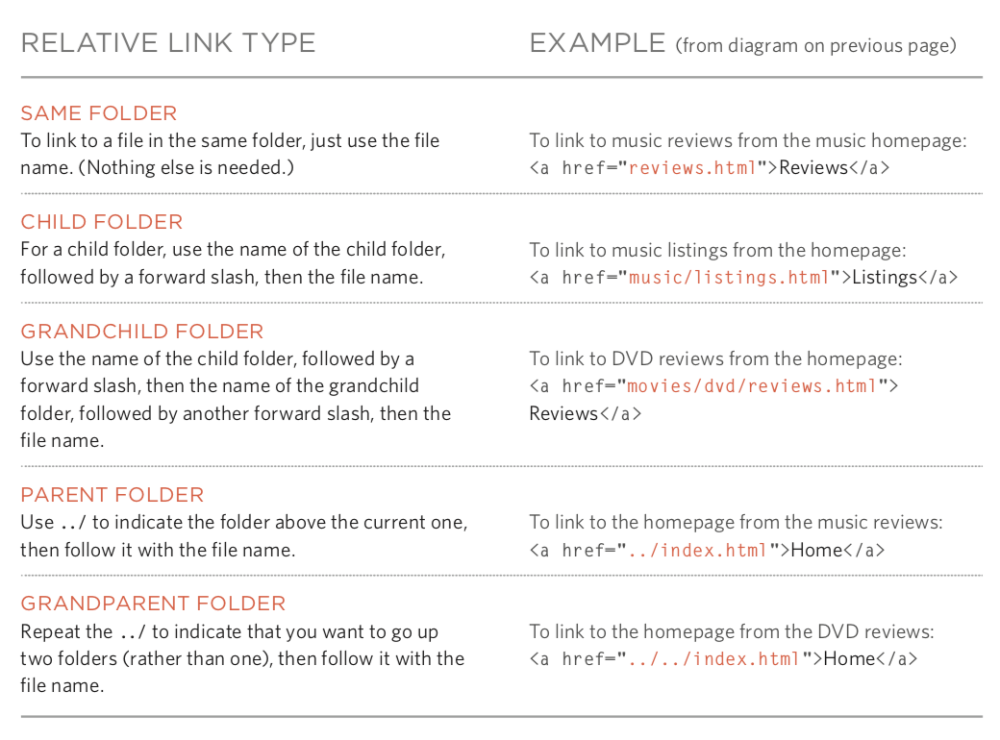

- Hình ảnh cùng chiều rộng và chiều cao

- Chọn đúng định dạng hình ảnh
  - JPEG
  - GIF
  - PNG

- Ảnh vector

- Thẻ ngữ nghĩa - figure / figcaption

#### Bảng (table)

- Cấu trúc bảng cơ bản - table / tr / td / th
- Tiêu đề bảng - caption
- Gộp hàng và gộp cột - thuộc tính rowspan / thuộc tính colspan
- Bảng dài - thead / tbody / tfoot

#### Biểu mẫu (form)

- Các thuộc tính quan trọng - action / method / enctype
- Điều khiển biểu mẫu (input) - thuộc tính type
  - Hộp văn bản - `text` / Hộp mật khẩu - `password` / Hộp số - `number`
  - Email - `email` / Số điện thoại - `tel` / Ngày tháng - `date` / Thanh trượt - `range` / URL - `url` / Tìm kiếm - `search`
  - Nút chọn một - `radio` / Hộp kiểm - `checkbox`
  - Tải lên tệp - `file` / Trường ẩn - `hidden`
  - Nút gửi - `submit` / Nút hình ảnh - `image` / Nút đặt lại - `reset`
- Danh sách thả xuống - select / option
- Vùng văn bản (văn bản nhiều dòng) - textarea
- Nhóm các phần tử biểu mẫu - fieldset / legend

#### Âm thanh và video (audio / video)

- Định dạng video và trình phát
- Dịch vụ lưu trữ video
- Công tác chuẩn bị khi thêm video
- Thẻ video và thuộc tính - autoplay / controls / loop / muted / preload / src
- Thẻ audio và thuộc tính - autoplay / controls / loop / muted / preload / src / width / height / poster

#### Khung (frame)

- Tập hợp khung (đã lỗi thời, không khuyến nghị sử dụng) - frameset / frame

- Khung nội tuyến - iframe

#### Khác

- Kiểu tài liệu

  ```HTML
  <!doctype html>
  ```

  ```HTML
  <!DOCTYPE HTML PUBLIC "-//W3C//DTD HTML 4.01//EN" "http://www.w3.org/TR/html4/strict.dtd">
  ```

  ```HTML
  <!DOCTYPE HTML PUBLIC "-//W3C//DTD HTML 4.01 Transitional//EN" "http://www.w3.org/TR/html4/loose.dtd">
  ```

- Chú thích

  ```HTML
  <!-- Đây là một đoạn chú thích, chú thích không thể lồng nhau -->
  ```

- Thuộc tính
  - id: Định danh duy nhất
  - class: Lớp của phần tử, dùng để phân biệt các phần tử khác nhau
  - title: Thông tin bổ sung của phần tử (hiển thị chú giải công cụ khi rê chuột)
  - tabindex: Thứ tự chuyển đổi khi nhấn phím Tab
  - contenteditable: Phần tử có thể chỉnh sửa hay không
  - draggable: Phần tử có thể kéo thả hay không

- Phần tử cấp khối / Phần tử nội tuyến

- Ký tự thực thể (thực thể thay thế)

  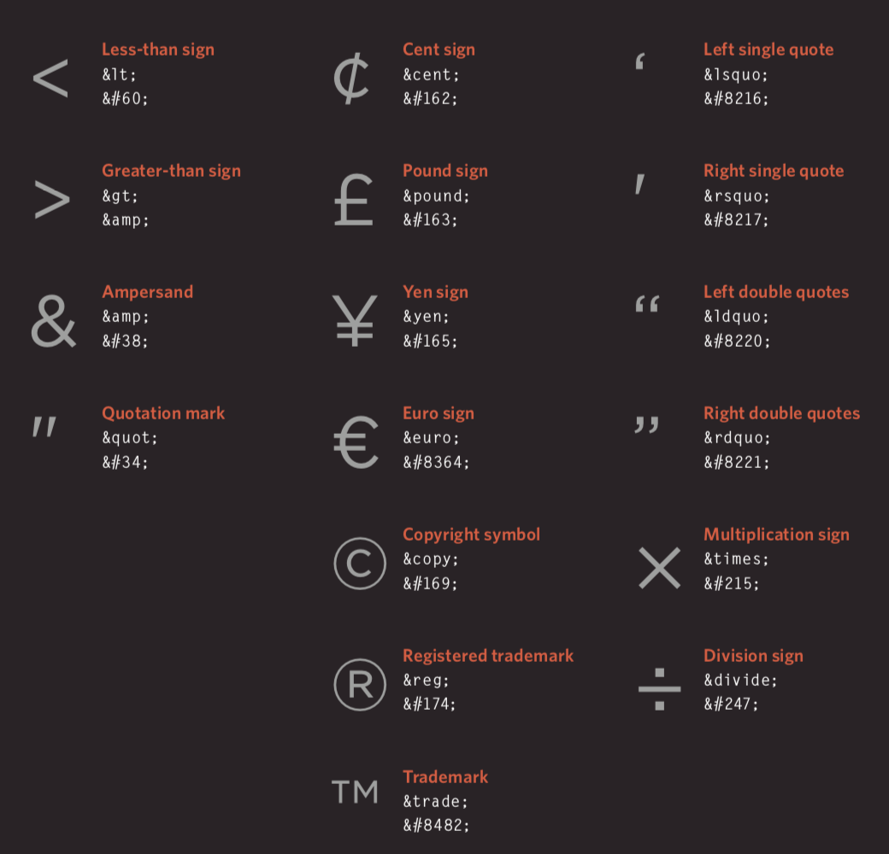

### Sử dụng CSS để định kiểu trang web

#### Giới thiệu

- Tác dụng của CSS

- Nguyên lý hoạt động của CSS

- Quy tắc, thuộc tính và giá trị

  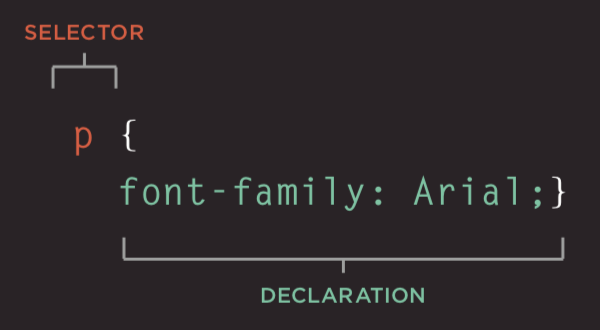

- Các bộ chọn phổ biến

  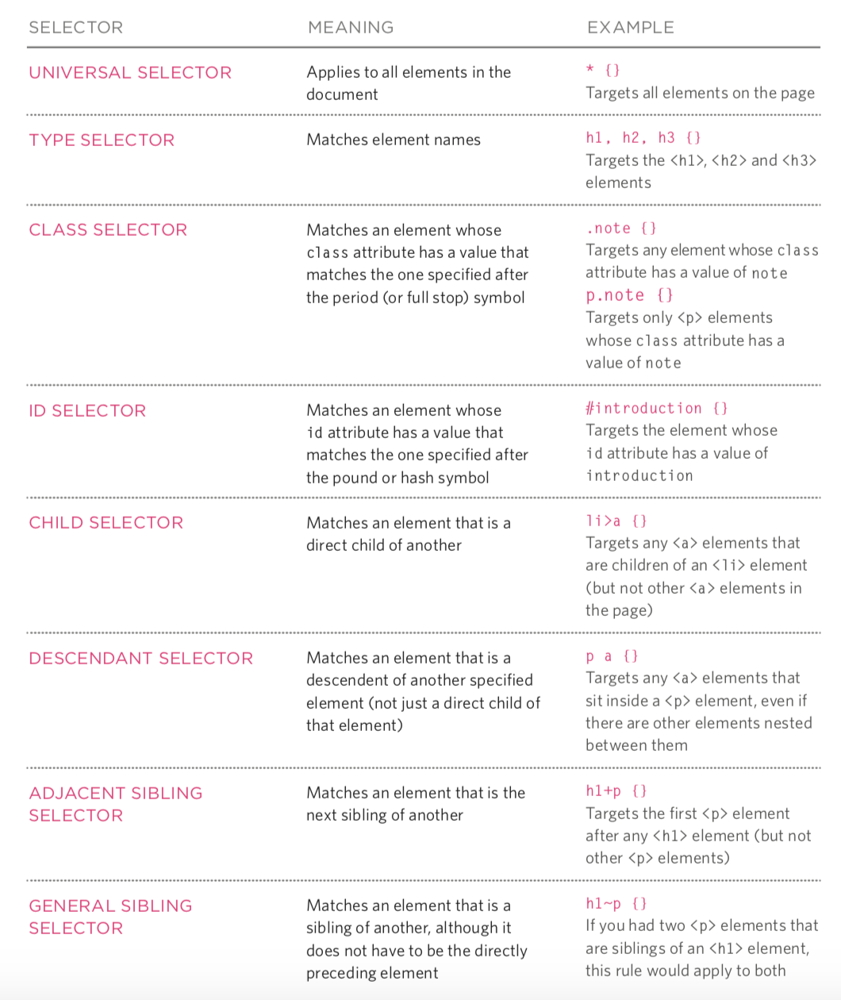

#### Màu sắc (color)

- Cách chỉ định màu sắc
- Thuật ngữ màu sắc và độ tương phản màu sắc
- Màu nền

#### Văn bản (text / font)

- Kích thước văn bản và họ phông chữ (font-size / font-family)

  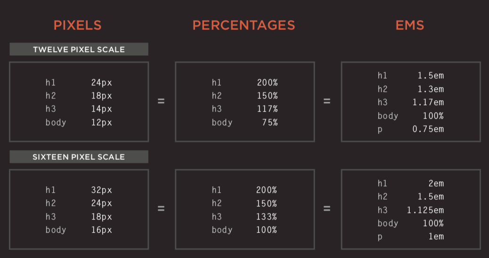

  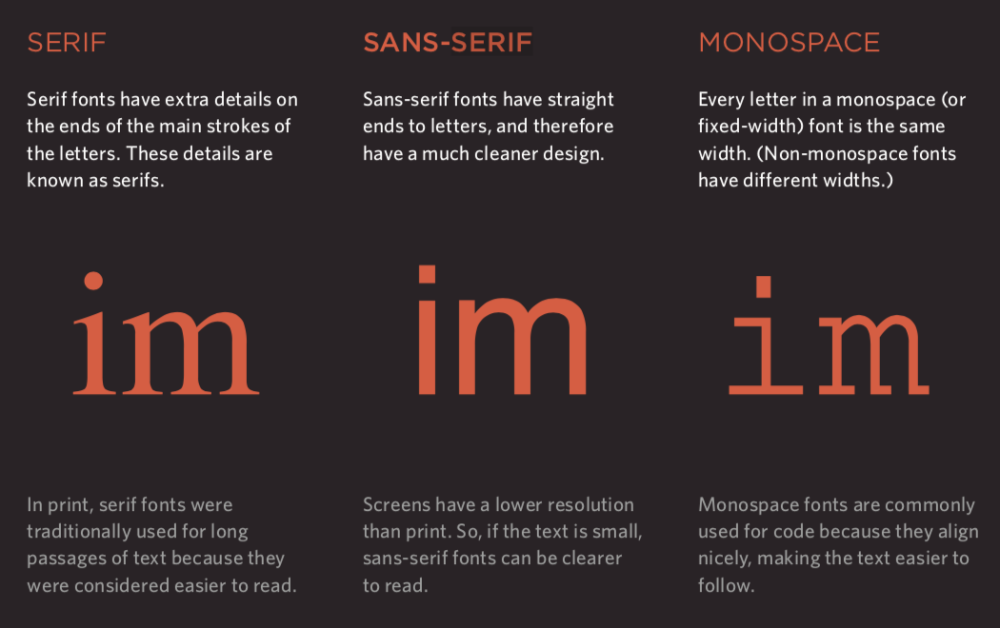

- Độ đậm, kiểu dáng, độ giãn và trang trí (font-weight / font-style / font-stretch / text-decoration)

  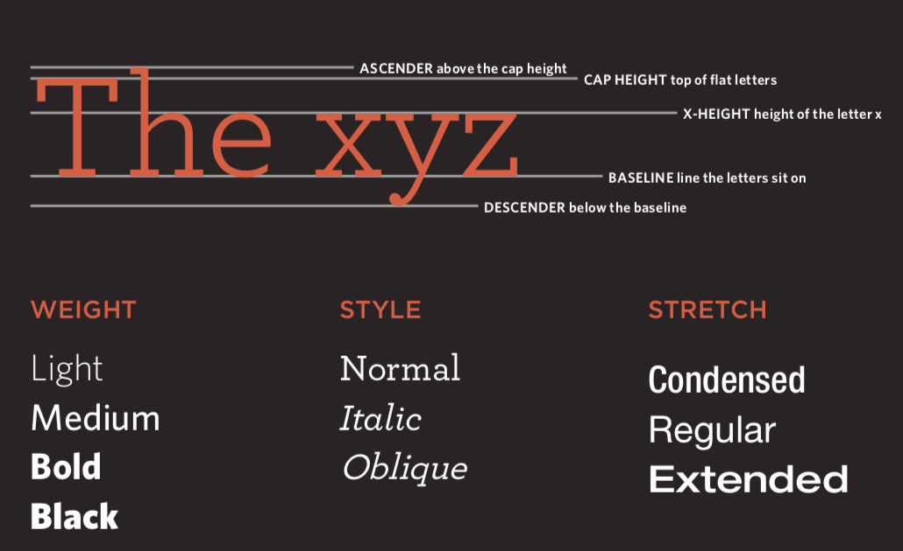

- Khoảng cách dòng (line-height), khoảng cách ký tự (letter-spacing) và khoảng cách từ (word-spacing)

- Căn lề (text-align) và thụt lề (text-indent)

- Kiểu dáng liên kết (:link / :visited / :active / :hover)

- Các thuộc tính mới của CSS3
  - Hiệu ứng đổ bóng - text-shadow
  - Ký tự đầu tiên và dòng văn bản đầu tiên (:first-letter / :first-line)
  - Phản hồi người dùng

#### Mô hình hộp (box model)

- Kiểm soát kích thước hộp (width / height)

  

- Đường viền, lề ngoài và lề trong của hộp (border / margin / padding)

  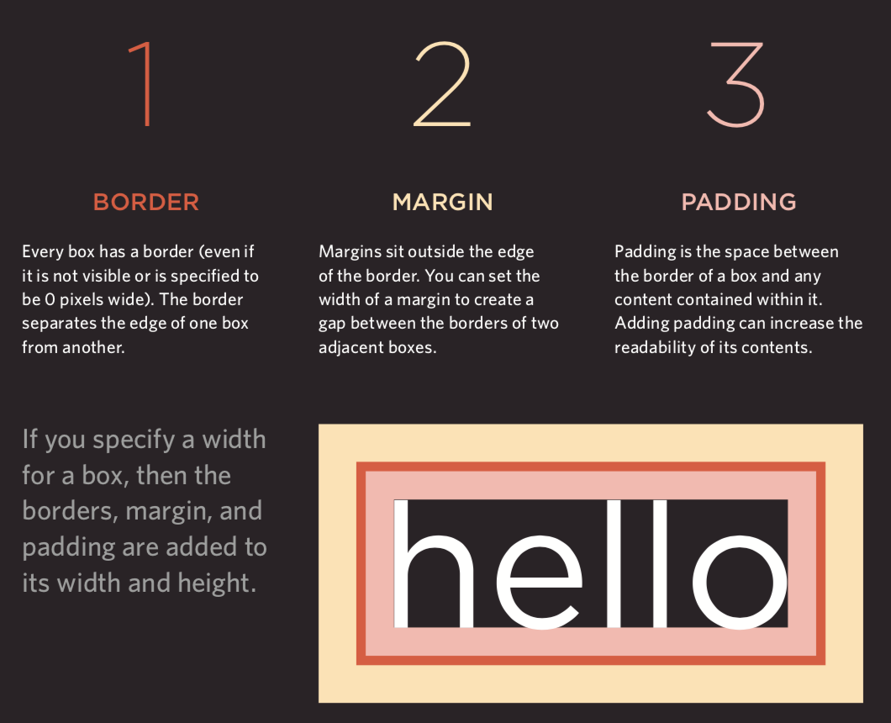

- Hiển thị và ẩn hộp (display / visibility)

- Các thuộc tính mới của CSS3
  - Hình ảnh đường viền (border-image)
  - Đổ bóng (box-shadow)
  - Bo góc (border-radius)

#### Danh sách, bảng và biểu mẫu

- Ký hiệu đầu dòng của danh sách (list-style)
- Đường viền và nền của bảng (border-collapse)
- Giao diện của điều khiển biểu mẫu
- Căn lề điều khiển biểu mẫu
- Công cụ dành cho nhà phát triển của trình duyệt

#### Hình ảnh

- Kiểm soát kích thước hình ảnh (display: inline-block)
- Căn lề hình ảnh
- Hình ảnh nền (background / background-image / background-repeat / background-position)

#### Bố cục

- Kiểm soát vị trí phần tử (position / z-index)
  - Luồng thông thường (normal flow)
  - Định vị tương đối
  - Định vị tuyệt đối
  - Định vị cố định
  - Phần tử nổi (float / clear)
- Bố cục trang web

  - Bố cục HTML5

    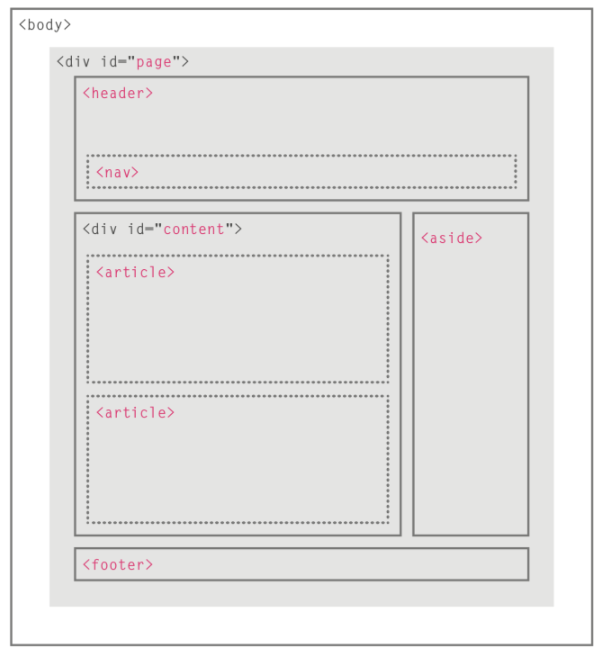
- Thích ứng với kích thước màn hình
  - Bố cục chiều rộng cố định
  - Bố cục chất lỏng (fluid layout)
  - Lưới bố cục

### Sử dụng JavaScript để kiểm soát hành vi

#### Cú pháp cơ bản của JavaScript

- Câu lệnh và chú thích
- Biến và kiểu dữ liệu
  - Khai báo và gán giá trị
  - Kiểu dữ liệu đơn giản và kiểu dữ liệu phức tạp
  - Quy tắc đặt tên biến
- Biểu thức và toán tử
  - Toán tử gán
  - Toán tử số học
  - Toán tử so sánh
  - Toán tử logic: `&&`, `||`, `!`
- Cấu trúc rẽ nhánh
  - `if...else...`
  - `switch...case...default...`
- Cấu trúc vòng lặp
  - Vòng lặp `for`
  - Vòng lặp `while`
  - Vòng lặp `do...while`
- Mảng
  - Tạo mảng
  - Thao tác với các phần tử trong mảng
- Hàm
  - Khai báo hàm
  - Gọi hàm
  - Tham số và giá trị trả về
  - Hàm ẩn danh
  - Hàm gọi ngay (IIFE)

#### Lập trình hướng đối tượng

 - Khái niệm đối tượng
 - Cú pháp literal tạo đối tượng
 - Toán tử truy cập thành viên
 - Cú pháp hàm khởi tạo để tạo đối tượng
    - Từ khóa `this`
 - Thêm và xóa thuộc tính
    - Từ khóa `delete`
 - Đối tượng chuẩn
    - `Number` / `String` / `Boolean` / `Symbol` / `Array` / `Function` 
    - `Date` / `Error` / `Math` / `RegExp` / `Object` / `Map` / `Set`
    - `JSON` / `Promise` / `Generator` / `Reflect` / `Proxy`

#### BOM

 - Các thuộc tính và phương thức của đối tượng `window`
 - Đối tượng `history`
    - `forward()` / `back()` / `go()`
 - Đối tượng `location`
 - Đối tượng `navigator`
 - Đối tượng `screen`

#### DOM

 - Cây DOM
 - Truy cập phần tử
    - `getElementById()` / `querySelector()`
    - `getElementsByClassName()` / `getElementsByTagName()` / `querySelectorAll()`
    - `parentNode` / `previousSibling` / `nextSibling` / `children` / `firstChild` / `lastChild`
- Thao tác phần tử
  - `nodeValue`
  - `innerHTML` / `textContent` / `createElement()` / `createTextNode()` / `appendChild()` / `insertBefore()` / `removeChild()`
  - `className` / `id` / `hasAttribute()` / `getAttribute()` / `setAttribute()` / `removeAttribute()`
- Xử lý sự kiện
  - Các loại sự kiện
    - Sự kiện UI: `load` / `unload` / `error` / `resize` / `scroll`
    - Sự kiện bàn phím: `keydown` / `keyup` / `keypress`
    - Sự kiện chuột: `click` / `dblclick` / `mousedown` / `mouseup` / `mousemove` / `mouseover` / `mouseout`
    - Sự kiện tiêu điểm: `focus` / `blur`
    - Sự kiện biểu mẫu: `input` / `change` / `submit` / `reset` / `cut` / `copy` / `paste` / `select`
  - Gắn sự kiện
    - Trình xử lý sự kiện trong HTML (không khuyến nghị sử dụng, vì cần tách biệt giữa thẻ và mã lệnh)
    - Trình xử lý sự kiện DOM truyền thống (chỉ có thể gắn một hàm callback)
    - Bộ lắng nghe sự kiện (không được hỗ trợ trong các trình duyệt cũ)
  - Luồng sự kiện: Bắt sự kiện (capturing) / Nổi bọt sự kiện (bubbling)
  - Đối tượng sự kiện (window.event trong các phiên bản IE cũ)
    - `target` (một số trình duyệt sử dụng srcElement)
    - `type`
    - `cancelable`
    - `preventDefault()`
    - `stopPropagation()` (cancelBubble trong các phiên bản IE cũ)
  - Sự kiện chuột - Vị trí xảy ra sự kiện
    - Vị trí màn hình: `screenX` và `screenY`
    - Vị trí trang: `pageX` và `pageY`
    - Vị trí client: `clientX` và `clientY`
  - Sự kiện bàn phím - Phím nào đã được nhấn
    - Thuộc tính `keyCode` (một số trình duyệt sử dụng `which`)
    - `String.fromCharCode(event.keyCode)`
  - Sự kiện HTML5
    - `DOMContentLoaded`
    - `hashchange`
    - `beforeunload`

#### JavaScript API

- Lưu trữ phía client - `localStorage` và `sessionStorage`

  ```JavaScript
  localStorage.colorSetting = '#a4509b';
  localStorage['colorSetting'] = '#a4509b';
  localStorage.setItem('colorSetting', '#a4509b');
  ```

- Lấy thông tin vị trí - `geolocation`

  ```JavaScript
  navigator.geolocation.getCurrentPosition(function(pos) { 		  
      console.log(pos.coords.latitude)
      console.log(pos.coords.longitude)
  })
  ```

- Lấy dữ liệu từ máy chủ - Fetch API
- Vẽ đồ họa - API của `<canvas>`
- Âm thanh và video - API của `<audio>` và `<video>`

### Framework Front-end

#### Framework lũy tiến - [Vue.js](https://cn.vuejs.org/)

Framework bắt buộc phải chọn khi phát triển tách biệt front-end và back-end (kết xuất phía front-end).

##### Bắt đầu nhanh

1. Nhúng tệp JavaScript của Vue, chúng tôi vẫn khuyến nghị tải nó từ máy chủ CDN.

   ```HTML
   <script src="https://cdn.jsdelivr.net/npm/vue"></script>
   ```

2. Ràng buộc dữ liệu (kết xuất mang tính khai báo).

   ```HTML
   <div id="app">
   	<h1>Thông tin tồn kho {{ product }}</h1>
   </div>
   
   <script src="https://cdn.jsdelivr.net/npm/vue"></script>
   <script>
   	const app = new Vue({
   		el: '#app',
   		data: {
   			product: 'iPhone X'
   		}
   	});
   </script>
   ```

3. Điều kiện và vòng lặp.

   ```HTML
   <div id="app">
   	<h1>Thông tin tồn kho</h1>
       <hr>
   	<ul>
   		<li v-for="product in products">
   			{{ product.name }} - {{ product.quantity }}
   			<span v-if="product.quantity === 0">
   				Đã bán hết
   			</span>
   		</li>
   	</ul>
   </div>
   
   <script src="https://cdn.jsdelivr.net/npm/vue"></script>
   <script>
   	const app = new Vue({
   		el: '#app',
   		data: {
   			products: [
   				{"id": 1, "name": "iPhone X", "quantity": 20},
   				{"id": 2, "name": "Huawei Mate20", "quantity": 0},
   				{"id": 3, "name": "Xiaomi Mix3", "quantity": 50}
   			]
   		}
   	});
   </script>
   ```

4. Thuộc tính tính toán.

   ```HTML
   <div id="app">
   	<h1>Thông tin tồn kho</h1>
   	<hr>
   	<ul>
   		<li v-for="product in products">
   			{{ product.name }} - {{ product.quantity }}
   			<span v-if="product.quantity === 0">
   				Đã bán hết
   			</span>
   		</li>
   	</ul>
   	<h2>Tổng số lượng tồn kho: {{ totalQuantity }} chiếc</h2>
   </div>
   
   <script src="https://cdn.jsdelivr.net/npm/vue"></script>
   <script>
   	const app = new Vue({
   		el: '#app',
   		data: {
   			products: [
   				{"id": 1, "name": "iPhone X", "quantity": 20},
   				{"id": 2, "name": "Huawei Mate20", "quantity": 0},
   				{"id": 3, "name": "Xiaomi Mix3", "quantity": 50}
   			]
   		},
   		computed: {
   			totalQuantity() {
   				return this.products.reduce((sum, product) => {
   					return sum + product.quantity
   				}, 0);
   			}
   		}
   	});
   </script>
   ```

5. Xử lý sự kiện.

   ```HTML
   <div id="app">
   	<h1>Thông tin tồn kho</h1>
   	<hr>
   	<ul>
   		<li v-for="product in products">
   			{{ product.name }} - {{ product.quantity }}
   			<span v-if="product.quantity === 0">
   				Đã bán hết
   			</span>
   			<button @click="product.quantity += 1">
   				Tăng tồn kho
   			</button>
   		</li>
   	</ul>
   	<h2>Tổng số lượng tồn kho: {{ totalQuantity }} chiếc</h2>
   </div>
   
   <script src="https://cdn.jsdelivr.net/npm/vue"></script>
   <script>
   	const app = new Vue({
   		el: '#app',
   		data: {
   			products: [
   				{"id": 1, "name": "iPhone X", "quantity": 20},
   				{"id": 2, "name": "Huawei Mate20", "quantity": 0},
   				{"id": 3, "name": "Xiaomi Mix3", "quantity": 50}
   			]
   		},
   		computed: {
   			totalQuantity() {
   				return this.products.reduce((sum, product) => {
   					return sum + product.quantity
   				}, 0);
   			}
   		}
   	});
   </script>
   ```

6. Nhập liệu của người dùng.

   ```HTML
   <div id="app">
   	<h1>Thông tin tồn kho</h1>
   	<hr>
   	<ul>
   		<li v-for="product in products">
   			{{ product.name }} - 
   			<input type="number" v-model.number="product.quantity" min="0">
   			<span v-if="product.quantity === 0">
   				Đã bán hết
   			</span>
   			<button @click="product.quantity += 1">
   				Tăng tồn kho
   			</button>
   		</li>
   	</ul>
   	<h2>Tổng số lượng tồn kho: {{ totalQuantity }} chiếc</h2>
   </div>
   
   <script src="https://cdn.jsdelivr.net/npm/vue"></script>
   <script>
   	const app = new Vue({
   		el: '#app',
   		data: {
   			products: [
   				{"id": 1, "name": "iPhone X", "quantity": 20},
   				{"id": 2, "name": "Huawei Mate20", "quantity": 0},
   				{"id": 3, "name": "Xiaomi Mix3", "quantity": 50}
   			]
   		},
   		computed: {
   			totalQuantity() {
   				return this.products.reduce((sum, product) => {
   					return sum + product.quantity
   				}, 0);
   			}
   		}
   	});
   </script>
   ```

7. Tải dữ liệu JSON qua mạng.

   ```HTML
   <div id="app">
   	<h2>Thông tin tồn kho</h2>
   	<ul>
   		<li v-for="product in products">
   			{{ product.name }} - {{ product.quantity }}
   			<span v-if="product.quantity === 0">
   				Đã bán hết
   			</span>
   		</li>
   	</ul>
   </div>
   
   <script src="https://cdn.jsdelivr.net/npm/vue"></script>
   <script>
   	const app = new Vue({
   		el: '#app',
   		data: {
   			products: []
   		},
   		created() {
   			fetch('https://jackfrued.top/api/products')
   				.then(response => response.json())
   				.then(json => {
   					this.products = json
   				});
   		}
   	});
   </script>
   ```

##### Sử dụng công cụ khung dự án - vue-cli

Vue cung cấp công cụ tạo khung dự án (scaffolding) vô cùng tiện lợi cho phát triển dự án thương mại là vue-cli. Thông qua công cụ này, bạn có thể bỏ qua các bước cấu hình thủ công môi trường phát triển, môi trường kiểm thử và môi trường chạy thực tế, giúp các nhà phát triển chỉ cần tập trung vào vấn đề cốt lõi cần giải quyết.

1. Cài đặt scaffolding.
2. Tạo dự án.
3. Cài đặt các gói phụ thuộc.
4. Chạy dự án.


#### Framework UI - [Element](http://element-cn.eleme.io/#/zh-CN)

Bộ thư viện thành phần giao diện trên máy tính để bàn (desktop) dựa trên Vue 2.0, dùng để xây dựng giao diện người dùng và hỗ trợ bố cục responsive.

1. Nhúng tệp CSS và JavaScript của Element.

   ```HTML
   <!-- Nhúng kiểu dáng CSS -->
   <link rel="stylesheet" href="https://unpkg.com/element-ui/lib/theme-chalk/index.css">
   <!-- Nhúng thư viện thành phần -->
   <script src="https://unpkg.com/element-ui/lib/index.js"></script>
   ```

2. Một ví dụ đơn giản.

   ```HTML
   <!DOCTYPE html>
   <html>
   	<head>
   		<meta charset="UTF-8">
   		<link rel="stylesheet" href="https://unpkg.com/element-ui/lib/theme-chalk/index.css">
   	</head>
   	<body>
   		<div id="app">
   			<el-button @click="visible = true">Nhấn vào tôi</el-button>
   			<el-dialog :visible.sync="visible" title="Hello world">
   				<p>Hãy bắt đầu sử dụng Element nào</p>
   			</el-dialog>
               </div>
   	</body>
   	<script src="https://unpkg.com/vue/dist/vue.js"></script>
   	<script src="https://unpkg.com/element-ui/lib/index.js"></script>
   	<script>
   		new Vue({
   			el: '#app',
   			data: {
   				visible: false,
   			}
   		})
   	</script>
   </html>
   ```

3. Sử dụng thành phần.

   ```HTML
   <!DOCTYPE html>
   <html>
   	<head>
   		<meta charset="UTF-8">
   		<link rel="stylesheet" href="https://unpkg.com/element-ui/lib/theme-chalk/index.css">
   	</head>
   	<body>
   		<div id="app">
   			<el-table :data="tableData" stripe style="width: 100%">
   				<el-table-column prop="date" label="Ngày" width="180">
   				</el-table-column>
   				<el-table-column prop="name" label="Họ tên" width="180">
   				</el-table-column>
   				<el-table-column prop="address" label="Địa chỉ">
   				</el-table-column>
   			</el-table>
   		</div>
   	</body>
   	<script src="https://unpkg.com/vue/dist/vue.js"></script>
   	<script src="https://unpkg.com/element-ui/lib/index.js"></script>
   	<script>
   		new Vue({
   			el: '#app',
   			data: {
   				tableData:  [
   					{
   						date: '2016-05-02',
   						name: 'Vương Nhất Bá',
   						address: 'Số 1518 ngõ Kim Sa Giang, quận Phổ Đà, Thượng Hải'
   					}, 
   					{
   						date: '2016-05-04',
   						name: 'Lưu Nhị Cẩu',
   						address: 'Số 1517 ngõ Kim Sa Giang, quận Phổ Đà, Thượng Hải'
   					}, 
   					{
   						date: '2016-05-01',
   						name: 'Dương Tam Manh',
   						address: 'Số 1519 ngõ Kim Sa Giang, quận Phổ Đà, Thượng Hải'
   					}, 
   					{
   						date: '2016-05-03',
   						name: 'Trần Tứ Xuy',
   						address: 'Số 1516 ngõ Kim Sa Giang, quận Phổ Đà, Thượng Hải'
   					}
   				]
   			}
   		})
   	</script>
   </html>
   ```


#### Framework báo cáo - [ECharts](https://echarts.baidu.com)

Thư viện trực quan hóa dữ liệu mã nguồn mở do Baidu phát triển, thường dùng để tạo các loại biểu đồ và báo cáo.

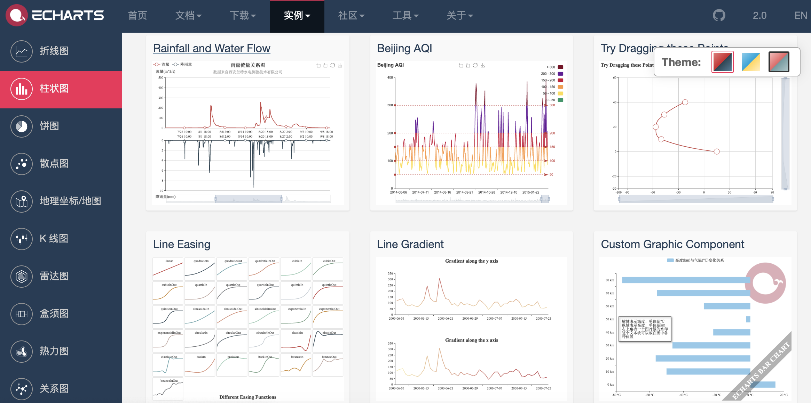

#### Framework CSS dựa trên Flexbox - [Bulma](https://bulma.io/)

Bulma là một framework CSS hiện đại dựa trên Flexbox, với mục tiêu ban đầu là ưu tiên di động (Mobile First), thiết kế mô-đun hóa, có thể dễ dàng sử dụng để thực hiện các bố cục nội dung đơn giản hoặc phức tạp. Ngay cả những nhà phát triển không hiểu sâu về CSS cũng có thể sử dụng nó để tùy biến các trang web đẹp mắt.

```HTML
<!DOCTYPE html>
<html lang="en">
<head>
	<meta charset="UTF-8">
	<title>Bulma</title>
	<link href="https://cdn.bootcss.com/bulma/0.7.4/css/bulma.min.css" rel="stylesheet">
	<style type="text/css">
		div { margin-top: 10px; }
		.column { color: #fff; background-color: #063; margin: 10px 10px; text-align: center; }
	</style>
</head>
<body>
	<div class="columns">
		<div class="column">1</div>
		<div class="column">2</div>
		<div class="column">3</div>
		<div class="column">4</div>
	</div>
	<div>
		<a class="button is-primary">Primary</a>
		<a class="button is-link">Link</a>
		<a class="button is-info">Info</a>
		<a class="button is-success">Success</a>
		<a class="button is-warning">Warning</a>
		<a class="button is-danger">Danger</a>
	</div>
	<div>
		<progress class="progress is-danger is-medium" max="100">60%</progress>
	</div>
	<div>
		<table class="table is-hoverable">
			<tr>
				<th>One</th>
				<th>Two</th>
			</tr>
			<tr>
				<td>Three</td>
				<td>Four</td>
			</tr>
			<tr>
				<td>Five</td>
				<td>Six</td>
			</tr>
			<tr>
				<td>Seven</td>
				<td>Eight</td>
			</tr>
			<tr>
				<td>Nine</td>
				<td>Ten</td>
			</tr>
			<tr>
				<td>Eleven</td>
				<td>Twelve</td>
			</tr>
		</table>
	</div>
</body>
</html>
```

#### Framework bố cục thích ứng - [Bootstrap](http://www.bootcss.com/)

Framework front-end dùng để phát triển nhanh các ứng dụng Web, hỗ trợ bố cục thích ứng (responsive).

1. Đặc điểm
   - Hỗ trợ các trình duyệt và thiết bị di động phổ biến
   - Dễ tiếp cận
   - Thiết kế thích ứng (responsive)

2. Nội dung
   - Hệ thống lưới (Grid system)
   - CSS đóng gói sẵn
   - Các thành phần dựng sẵn
   - Plugin JavaScript

3. Trực quan hóa

   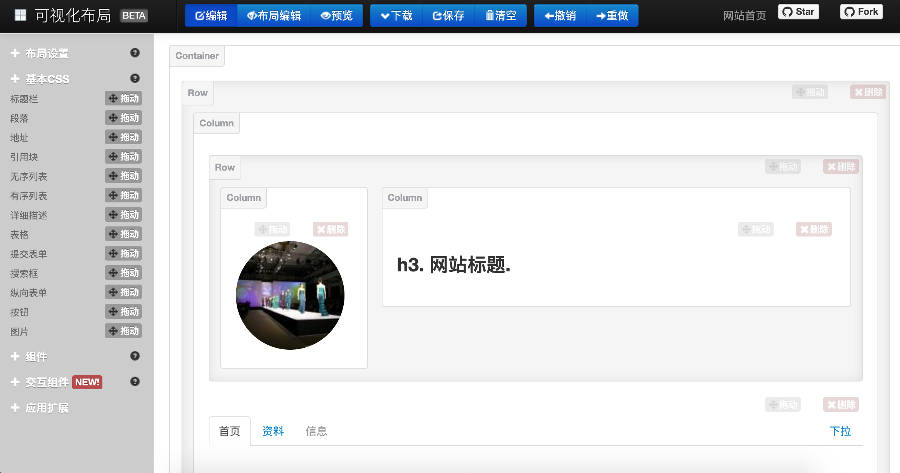    