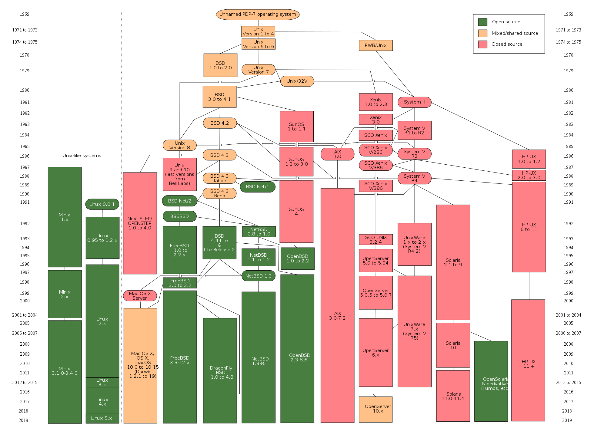
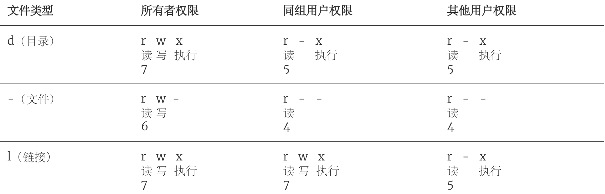
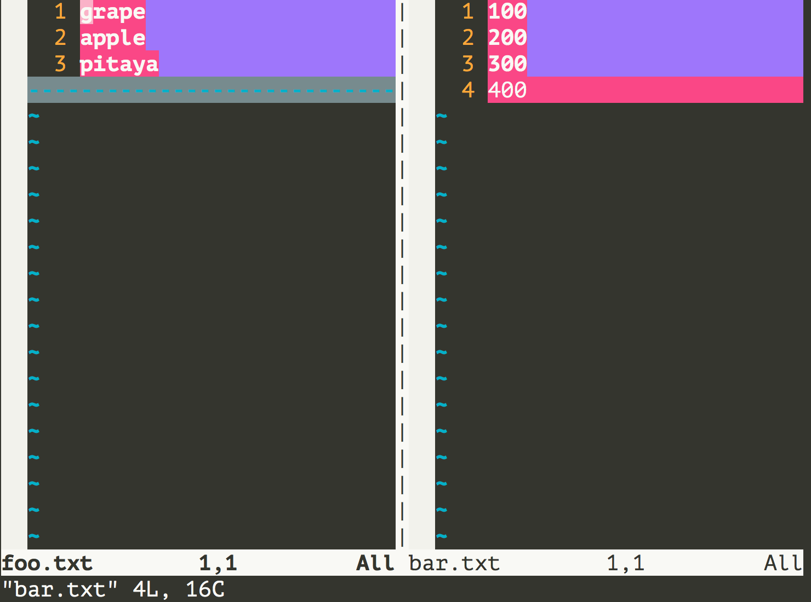
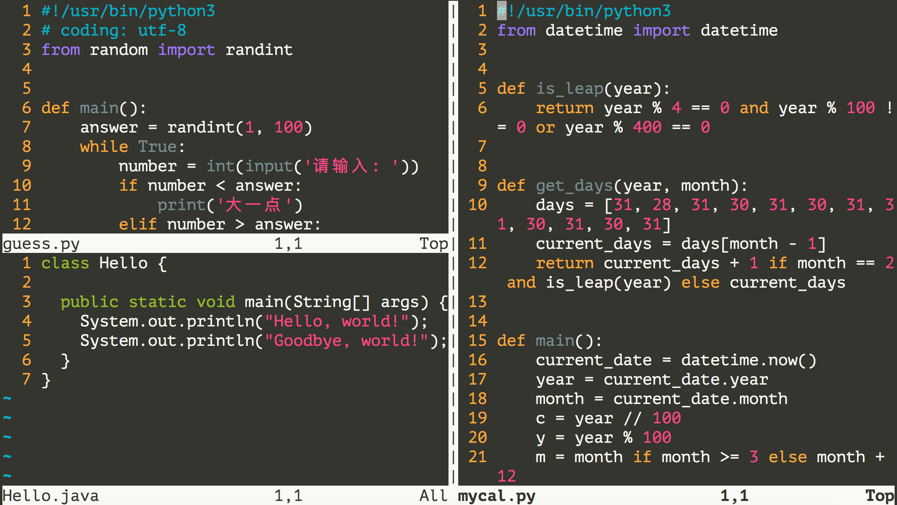
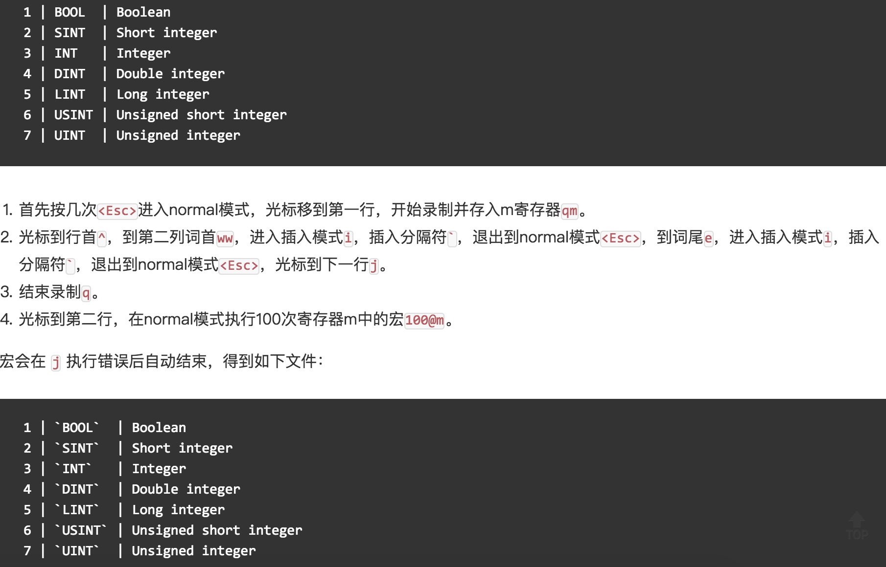

Làm chủ hệ điều hành Linux

> **Giải thích**: Các nội dung giải thích về lệnh Linux trong bài viết này đều dựa trên bản phân phối Linux mang tên CentOS. Bản thân tôi sử dụng máy chủ đám mây Alibaba Cloud, phiên bản hệ điều hành là CentOS Linux release 7.6.1810. Các bản phân phối Linux khác nhau có thể có một số khác biệt nhỏ về lệnh Shell và các chương trình công cụ, nhưng những khác biệt này là rất nhỏ.

### Lịch sử phát triển của hệ điều hành

Một hệ thống máy tính chỉ có phần cứng mà không có phần mềm được gọi là "máy trần" (bare metal). Chúng ta rất khó sử dụng "máy trần" để hoàn thành các công việc thường nhật của máy tính (như lưu trữ và tính toán), do đó bắt buộc phải dùng phần mềm chuyên dụng để điều khiển hoạt động của phần cứng. Phần mềm nằm gần phần cứng máy tính nhất là phần mềm hệ thống, trong đó quan trọng nhất chính là "hệ điều hành". "Hệ điều hành" là tập hợp các chương trình có nhiệm vụ điều khiển và quản lý toàn bộ tài nguyên phần cứng và phần mềm của máy tính, thực hiện phân bổ tài nguyên và điều phối tác vụ, đồng thời cung cấp giao diện và môi trường hoạt động cho người dùng hệ thống cũng như các phần mềm khác.

#### Không có hệ điều hành (thao tác thủ công)

Vào thời kỳ đầu khi máy tính mới ra đời và chưa có hệ điều hành, con người phải lắp các cuộn băng đục lỗ (hoặc thẻ đục lỗ) chứa chương trình lên máy tính trước, sau đó khởi động máy đọc để đưa chương trình vào máy tính, tiếp theo bật các công tắc trên bảng điều khiển để khởi chạy chương trình. Khi chương trình thực thi xong, máy in sẽ in kết quả tính toán ra giấy, người dùng tháo gỡ và mang băng đục lỗ (hoặc thẻ) đi. Người dùng thứ hai lên máy và lặp lại các bước tương tự. Trong toàn bộ quá trình này, mỗi người dùng độc chiếm một cỗ máy, CPU phải chờ đợi các thao tác thủ công của con người, hiệu suất sử dụng tài nguyên vô cùng thấp.

#### Hệ thống xử lý theo lô (Batch Processing)

Đầu tiên, một chương trình giám sát được khởi chạy trên máy tính. Dưới sự kiểm soát của chương trình giám sát, máy tính có thể tự động xử lý hàng loạt công việc của một hoặc nhiều người dùng. Sau khi hoàn thành một lô công việc, chương trình giám sát lại đọc tiếp các công việc từ thiết bị đầu vào và ghi vào ổ băng từ, rồi lặp lại các bước xử lý trên. Chương trình giám sát liên tục xử lý từng công việc, hiện thực hóa việc tự động chuyển giao tác vụ, giảm bớt thời gian thiết lập và thao tác thủ công, nâng cao hiệu suất sử dụng tài nguyên máy tính. Hệ thống xử lý theo lô có thể chia thành: hệ thống xử lý theo lô đơn chương, hệ thống xử lý theo lô đa chương, hệ thống xử lý theo lô trực tuyến và hệ thống xử lý theo lô ngoại tuyến.

#### Hệ thống phân chia thời gian và hệ thống thời gian thực

Hệ thống phân chia thời gian (Time-sharing System) chia thời gian chạy của bộ xử lý thành các lát thời gian rất ngắn (time slices), lần lượt phân bổ bộ xử lý cho từng tác vụ trực tuyến sử dụng theo từng lát thời gian. Nếu một tác vụ không thể hoàn thành tính toán trong lát thời gian được phân bổ, tác vụ đó sẽ tạm thời bị ngắt để nhường bộ xử lý cho tác vụ khác, và chờ đến lượt điều phối tiếp theo mới chạy tiếp. Do tốc độ máy tính rất nhanh và các tác vụ luân chuyển liên tục, mỗi người dùng đều có cảm giác như mình đang độc chiếm toàn bộ máy tính. Mỗi người dùng có thể gửi các lệnh điều khiển thao tác tới hệ thống thông qua terminal của riêng mình, hoàn thành việc chạy tác vụ dưới sự tương tác người - máy đầy đủ. Để giải quyết trường hợp hệ thống phân chia thời gian không thể phản hồi kịp thời các lệnh của người dùng trong những tình huống đặc biệt, người ta lại phát triển hệ thống thời gian thực (Real-time System) với khả năng hoàn thành xử lý sự kiện trong một phạm vi thời gian nghiêm ngặt và phản hồi kịp thời các sự kiện ngẫu nhiên bên ngoài.

#### Hệ điều hành đa năng

1. Thập niên 1960: Dòng máy System/360 của IBM có hệ điều hành thống nhất là OS/360.

2. Năm 1965: Phòng thí nghiệm Bell của AT&T tham gia kế hoạch hợp tác của GE và MIT để bắt đầu phát triển MULTICS.

3. Năm 1969: Dự án MULTICS thất bại, Ken Thompson lúc rảnh rỗi ở nhà, để chơi trò chơi "Space Travel" đã dùng hợp ngữ (assembly) trên chiếc máy PDP-7 vốn đã bị đào thải thời bấy giờ để phát triển Unics.

   > Chú thích: Thật khó tưởng tượng rằng Unix - một hệ điều hành vĩ đại đến vậy, lại được phát triển bởi một lập trình viên đang nhàn rỗi ở nhà (điều mấu chốt là vợ đã dắt con về nhà ngoại) trên một cỗ máy đã bị thanh lý chỉ để chơi game.

4. Năm 1970 ~ 1971: Ken Thompson và Dennis Ritchie đã dùng ngôn ngữ B viết lại Unics trên máy PDP-11, và theo gợi ý của Brian Kernighan đã đổi tên nó thành Unix.

   

5. Năm 1972 ~ 1973: Dennis Ritchie phát minh ra ngôn ngữ C để thay thế ngôn ngữ B có tính khả chuyển kém hơn, đồng thời bắt đầu công việc viết lại Unix bằng ngôn ngữ C.

6. Năm 1974: Unix cho ra mắt phiên bản thứ 5 mang tính bước ngoặt, được hiện thực gần như hoàn toàn bằng ngôn ngữ C.

7. Năm 1979: Bắt đầu từ phiên bản Unix thứ 7, AT&T ban hành các điều khoản sử dụng mới, chính thức tư nhân hóa Unix.

8. Năm 1987: Giáo sư Andrew S. Tanenbaum, nhằm mục đích giảng giải chi tiết về cơ chế vận hành của hệ điều hành cho sinh viên trên lớp, đã quyết định tự mình phát triển một hệ điều hành tương thích với Unix mà không sử dụng bất kỳ mã nguồn nào của AT&T để tránh tranh chấp bản quyền; hệ thống này được đặt tên là Minix.

   

9. Năm 1991: Trong thời gian theo học tại Đại học Helsinki (Phần Lan), Linus Torvalds đã thử nghiệm phát triển một số công việc trên Minix. Nhưng vì Minix chỉ là hệ điều hành phục vụ mục đích giảng dạy nên chức năng không đủ mạnh. Để thuận tiện cho việc đọc, ghi và tải tệp trong nhóm tin (newsgroup) và hệ thống thư điện tử của trường, Linus đã viết trình điều khiển đĩa và hệ thống tệp. Những thành phần này đã đặt nền móng phôi thai cho nhân (kernel) của hệ điều hành Linux.

   

Dưới đây là sơ đồ phả hệ của gia đình hệ điều hành Unix.



### Tổng quan về Linux

Linux là một hệ điều hành đa năng. Một hệ điều hành chịu trách nhiệm điều phối tác vụ, phân bổ bộ nhớ, xử lý I/O của thiết bị ngoại vi, v.v. Hệ điều hành thường bao gồm hai phần: nhân (kernel - chương trình cốt lõi chạy các chương trình khác, quản lý các thiết bị phần cứng như đĩa, máy in) và các chương trình hệ thống (trình điều khiển thiết bị, thư viện tầng dưới, shell, chương trình dịch vụ, v.v.).

Nhân Linux được phát triển bởi Linus Torvalds người Phần Lan và được phát hành vào tháng 9 năm 1991. Là sản phẩm của thời đại Internet, hệ điều hành Linux được hợp tác phát triển bởi rất nhiều lập trình viên trên toàn thế giới, và là một hệ điều hành tự do (lưu ý tự do và miễn phí không phải là cùng một khái niệm, nếu muốn tìm hiểu sự khác biệt giữa hai khái niệm này, bạn có thể [nhấn vào đây](https://www.debian.org/intro/free)).

### Ưu điểm của hệ thống Linux

1. Hệ điều hành đa năng, không bị ràng buộc với phần cứng cụ thể nào.
2. Được viết bằng ngôn ngữ C, tính khả chuyển mạnh mẽ, có giao diện lập trình nhân.
3. Hỗ trợ đa người dùng và đa nhiệm, hỗ trợ hệ thống tệp phân tầng bảo mật.
4. Số lượng lớn các chương trình tiện ích, chức năng mạng hoàn thiện cùng tài liệu hỗ trợ mạnh mẽ.
5. Độ an toàn đáng tin cậy và độ ổn định cao, thân thiện hơn với các nhà phát triển.

### Các bản phân phối của hệ thống Linux

1. [Redhat](https://www.redhat.com/en)
2. [Ubuntu](https://www.ubuntu.com/)
3. [CentOS](https://www.centos.org/)
4. [Fedora](https://getfedora.org/)
5. [Debian](https://www.debian.org/)
6. [openSUSE](https://www.opensuse.org/)

### Các lệnh cơ bản

Các lệnh trong hệ thống Linux thường có định dạng như sau:

```Shell
tên_lệnh [tham_số] [đối_tượng]
```

1. Lấy thông tin đăng nhập - **w** / **who** / **last** / **lastb**.

   ```Shell
   [root ~]# w
    23:31:16 up 12:16,  2 users,  load average: 0.00, 0.01, 0.05
   USER     TTY      FROM             LOGIN@   IDLE   JCPU   PCPU WHAT
   root     pts/0    182.139.66.250   23:03    4.00s  0.02s  0.00s w
   jackfrue pts/1    182.139.66.250   23:26    3:56   0.00s  0.00s -bash
   [root ~]# who
   root     pts/0        2018-04-12 23:03 (182.139.66.250)
   jackfrued pts/1        2018-04-12 23:26 (182.139.66.250)
   [root ~]# who am i
   root     pts/0        2018-04-12 23:03 (182.139.66.250)
   [root ~]# who mom likes
   root     pts/0        2018-04-12 23:03 (182.139.66.250)
   [root ~]# last
   root     pts/0        117.136.63.184   Sun May 26 18:57   still logged in   
   reboot   system boot  3.10.0-957.10.1. Mon May 27 02:52 - 19:10  (-7:-42)   
   root     pts/4        117.136.63.184   Sun May 26 18:51 - crash  (08:01)    
   root     pts/4        117.136.63.184   Sun May 26 18:49 - 18:49  (00:00)    
   root     pts/3        117.136.63.183   Sun May 26 18:35 - crash  (08:17)    
   root     pts/2        117.136.63.183   Sun May 26 18:34 - crash  (08:17)    
   root     pts/0        117.136.63.183   Sun May 26 18:10 - crash  (08:42)    
   ```

2. Xem Shell đang sử dụng - **ps**.

   Shell còn được gọi là "vỏ" hay "chương trình vỏ", nó là người phiên dịch giao tiếp giữa người dùng và nhân hệ điều hành, nói một cách đơn giản thì đó chính là bề mặt và giao diện tương tác giữa con người và máy tính. Hiện nay, Shell mặc định của nhiều hệ thống Linux là bash (<u>B</u>ourne <u>A</u>gain <u>SH</u>ell), vì nó có thể sử dụng phím Tab để tự động hoàn thành lệnh và đường dẫn, lưu lịch sử lệnh, thuận tiện trong việc cấu hình biến môi trường cũng như thực thi các thao tác hàng loạt.

   ```Shell
   [root ~]# ps
     PID TTY          TIME CMD
    3531 pts/0    00:00:00 bash
    3553 pts/0    00:00:00 ps
   ```

3. Xem giải thích và vị trí của lệnh - **whatis** / **which** / **whereis**.

   ```Shell
   [root ~]# whatis ps
   ps (1)        - report a snapshot of the current processes.
   [root ~]# whatis python
   python (1)    - an interpreted, interactive, object-oriented programming language
   [root ~]# whereis ps
   ps: /usr/bin/ps /usr/share/man/man1/ps.1.gz
   [root ~]# whereis python
   python: /usr/bin/python /usr/bin/python2.7 /usr/lib/python2.7 /usr/lib64/python2.7 /etc/python /usr/include/python2.7 /usr/share/man/man1/python.1.gz
   [root ~]# which ps
   /usr/bin/ps
   [root ~]# which python
   /usr/bin/python
   ```

4. Xóa nội dung hiển thị trên màn hình - **clear**.

5. Xem tài liệu trợ giúp - **man** / **info** / **--help** / **apropos**.
   ```Shell
   [root@izwz97tbgo9lkabnat2lo8z ~]# ps --help
   Usage:
    ps [options]
    Try 'ps --help <simple|list|output|threads|misc|all>'
     or 'ps --help <s|l|o|t|m|a>'
    for additional help text.
   For more details see ps(1).
   [root@izwz97tbgo9lkabnat2lo8z ~]# man ps
   PS(1)                                User Commands                                PS(1)
   NAME
          ps - report a snapshot of the current processes.
   SYNOPSIS
          ps [options]
   DESCRIPTION
   ...
   ```

6. Xem thông tin hệ thống và tên máy chủ - **uname** / **hostname**.

   ```Shell
   [root@izwz97tbgo9lkabnat2lo8z ~]# uname
   Linux
   [root@izwz97tbgo9lkabnat2lo8z ~]# hostname
   izwz97tbgo9lkabnat2lo8z
   [root@iZwz97tbgo9lkabnat2lo8Z ~]# cat /etc/centos-release
   CentOS Linux release 7.6.1810 (Core)
   ```

   > Giải thích: `cat` là lệnh nối nội dung tệp và in ra đầu ra chuẩn (stdout), lệnh này sẽ được giải thích ở phần sau; `/etc` là một thư mục vô cùng quan trọng trên hệ thống Linux, nó lưu trữ rất nhiều tệp cấu hình; `centos-release` là một tệp trong thư mục đó, vì bản thân tôi sử dụng bản phân phối Linux CentOS 7.6 nên ở đây sẽ có tệp như vậy.

7. Thời gian và ngày tháng - **date** / **cal**.

   ```Shell
   [root@iZwz97tbgo9lkabnat2lo8Z ~]# date
   Wed Jun 20 12:53:19 CST 2018
   [root@iZwz97tbgo9lkabnat2lo8Z ~]# cal
         June 2018
   Su Mo Tu We Th Fr Sa
                   1  2
    3  4  5  6  7  8  9
   10 11 12 13 14 15 16
   17 18 19 20 21 22 23
   24 25 26 27 28 29 30
   [root@iZwz97tbgo9lkabnat2lo8Z ~]# cal 5 2017
         May 2017
   Su Mo Tu We Th Fr Sa
       1  2  3  4  5  6
    7  8  9 10 11 12 13
   14 15 16 17 18 19 20
   21 22 23 24 25 26 27
   28 29 30 31
   ```

8. Khởi động lại và tắt máy - **reboot** / **shutdown**.

   ```Shell
   [root ~]# shutdown -h +5
   Shutdown scheduled for Sun 2019-05-26 19:34:27 CST, use 'shutdown -c' to cancel.
   [root ~]# 
   Broadcast message from root (Sun 2019-05-26 19:29:27 CST):
   
   The system is going down for power-off at Sun 2019-05-26 19:34:27 CST!
   [root ~]# shutdown -c
   
   Broadcast message from root (Sun 2019-05-26 19:30:22 CST):
   
   The system shutdown has been cancelled at Sun 2019-05-26 19:31:22 CST!
   [root ~]# shutdown -r 23:58
   Shutdown scheduled for Sun 2019-05-26 23:58:00 CST, use 'shutdown -c' to cancel.
   [root ~]# shutdown -c
   
   Broadcast message from root (Sun 2019-05-26 19:31:06 CST):
   
   The system shutdown has been cancelled at Sun 2019-05-26 19:32:06 CST!
   ```

   > Giải thích: Khi thực thi lệnh `shutdown`, hệ thống sẽ gửi cảnh báo đến các người dùng đang đăng nhập, bạn có thể thêm thông báo cảnh báo phía sau lệnh để thay thế thông báo mặc định, hoặc dùng `now` sau tham số `-h` để tắt máy ngay lập tức.

9. Đăng xuất - **exit** / **logout**.

10. Xem lịch sử lệnh - **history**.

  ```Shell
  [root@iZwz97tbgo9lkabnat2lo8Z ~]# history
  ...
  452  ls
  453  cd Python-3.6.5/
  454  clear
  455  history
  [root@iZwz97tbgo9lkabnat2lo8Z ~]# !454
  ```

  > **Giải thích**: Sau khi xem lịch sử lệnh, bạn có thể dùng `!mã_số_lệnh` để thực thi lại lệnh đó; dùng `history -c` có thể xóa sạch lịch sử lệnh.

### Tiện ích thực tế

#### Thao tác với tệp và thư mục

1. Tạo/xóa thư mục rỗng - **mkdir** / **rmdir**.

   ```Shell
   [root ~]# mkdir abc
   [root ~]# mkdir -p xyz/abc
   [root ~]# rmdir abc
   ```

2. Tạo/xóa tệp - **touch** / **rm**.

   ```Shell
   [root ~]# touch readme.txt
   [root ~]# touch error.txt
   [root ~]# rm error.txt
   rm: remove regular empty file ‘error.txt’? y
   [root ~]# rm -rf xyz
   ```

   - Lệnh `touch` dùng để tạo tệp rỗng hoặc sửa đổi mốc thời gian của tệp. Trong hệ thống Linux, một tệp có ba mốc thời gian:
     - Thời gian thay đổi nội dung - mtime.
     - Thời gian thay đổi thuộc tính/quyền - ctime.
     - Thời gian truy cập lần cuối - atime.
   - Một số tham số quan trọng của `rm`:
     - `-i`: Xóa có tương tác, sẽ hỏi xác nhận đối với mỗi mục cần xóa.
     - `-r`: Xóa thư mục và xóa đệ quy các tệp cùng thư mục bên trong.
     - `-f`: Xóa cưỡng chế (force), bỏ qua các tệp không tồn tại, không có bất kỳ thông báo nhắc nhở nào.

3. Chuyển đổi và xem thư mục làm việc hiện tại - **cd** / **pwd**.

   > Giải thích: Phía sau lệnh `cd` có thể là đường dẫn tương đối (lấy đường dẫn hiện tại làm mốc) hoặc đường dẫn tuyệt đối (bắt đầu bằng `/`) để chuyển đến thư mục chỉ định, cũng có thể dùng `cd ..` để quay về thư mục cha. Xin các bạn hãy nghĩ xem, nếu muốn quay về thư mục cha của thư mục cha thì nên thêm tham số như thế nào vào lệnh `cd`?

4. Xem nội dung thư mục - **ls**.

   - `-l`: Xem tệp và thư mục ở định dạng danh sách chi tiết (long format).
   - `-a`: Hiển thị các tệp và thư mục bắt đầu bằng dấu chấm (tệp ẩn).
   - `-R`: Đệ quy mở rộng khi gặp thư mục (tiếp tục liệt kê các tệp và thư mục bên trong thư mục đó).
   - `-d`: Chỉ liệt kê bản thân thư mục, không liệt kê nội dung bên trong.
   - `-S` / `-t`: Sắp xếp theo kích thước / thời gian.

5. Xem nội dung tệp - **cat** / **tac** / **head** / **tail** / **more** / **less** / **rev** / **od**.

   ```Shell
   [root ~]# wget http://www.sohu.com/ -O sohu.html
   --2018-06-20 18:42:34--  http://www.sohu.com/
   Resolving www.sohu.com (www.sohu.com)... 14.18.240.6
   Connecting to www.sohu.com (www.sohu.com)|14.18.240.6|:80... connected.
   HTTP request sent, awaiting response... 200 OK
   Length: 212527 (208K) [text/html]
   Saving to: ‘sohu.html’
   100%[==================================================>] 212,527     --.-K/s   in 0.03s
   2018-06-20 18:42:34 (7.48 MB/s) - ‘sohu.html’ saved [212527/212527]
   [root ~]# cat sohu.html
   ...
   [root ~]# head -10 sohu.html
   <!DOCTYPE html>
   <html>
   <head>
   <title>搜狐</title>
   <meta name="Keywords" content="搜狐,门户网站,新媒体,网络媒体,新闻,财经,体育,娱乐,时尚,汽车,房产,科技,图片,论坛,微博,博客,视频,电影,电视剧"/>
   <meta name="Description" content="搜狐网为用户提供24小时不间断的最新资讯，及搜索、邮件等网络服务。内容包括全球热点事件、突发新闻、时事评论、热播影视剧、体育赛事、行业动态、生活服务信息，以及论坛、博客、微博、我的搜狐等互动空间。" />
   <meta name="shenma-site-verification" content="1237e4d02a3d8d73e96cbd97b699e9c3_1504254750">
   <meta charset="utf-8"/>
   <meta http-equiv="X-UA-Compatible" content="IE=Edge,chrome=1"/>
   [root ~]# tail -2 sohu.html
   </body>
   </html>
   [root ~]# less sohu.html
   ...
   [root ~]# cat -n sohu.html | more
   ...
   ```

   > **Giải thích**: Ở trên đã sử dụng lệnh `wget`, đây là một chương trình tải xuống qua mạng, có thể tải tài nguyên từ một URL chỉ định.

6. Sao chép/di chuyển tệp - **cp** / **mv**.

   ```Shell
   [root ~]# mkdir backup
   [root ~]# cp sohu.html backup/
   [root ~]# cd backup
   [root backup]# ls
   sohu.html
   [root backup]# mv sohu.html sohu_index.html
   [root backup]# ls
   sohu_index.html
   ```

7. Đổi tên tệp - **rename**.

  ```Shell
  [root@iZwz97tbgo9lkabnat2lo8Z ~]# rename .htm .html *.htm
  ```

8. Tìm kiếm tệp và tìm kiếm nội dung - **find** / **grep**.

   ```Shell
   [root@iZwz97tbgo9lkabnat2lo8Z ~]# find / -name "*.html"
   /root/sohu.html
   /root/backup/sohu_index.html
   [root@izwz97tbgo9lkabnat2lo8z ~]# find . -atime 7 -type f -print
   [root@izwz97tbgo9lkabnat2lo8z ~]# find . -type f -size +2k
   [root@izwz97tbgo9lkabnat2lo8z ~]# find . -type f -name "*.swp" -delete
   [root@iZwz97tbgo9lkabnat2lo8Z ~]# grep "<script>" sohu.html -n
   20:<script>
   [root@iZwz97tbgo9lkabnat2lo8Z ~]# grep -E \<\/?script.*\> sohu.html -n
   20:<script>
   22:</script>
   24:<script src="//statics.itc.cn/web/v3/static/js/es5-shim-08e41cfc3e.min.js"></script>
   25:<script src="//statics.itc.cn/web/v3/static/js/es5-sham-1d5fa1124b.min.js"></script>
   26:<script src="//statics.itc.cn/web/v3/static/js/html5shiv-21fc8c2ba6.js"></script>
   29:<script type="text/javascript">
   52:</script>
   ...
   ```
   > **Giải thích**: Khi tìm kiếm chuỗi, `grep` có thể sử dụng biểu thức chính quy. Nếu cần sử dụng biểu thức chính quy, bạn có thể dùng `grep -E` hoặc trực tiếp dùng `egrep`.

9. Tạo liên kết và xem liên kết - **ln** / **readlink**.

   ```Shell
   [root@iZwz97tbgo9lkabnat2lo8Z ~]# ls -l sohu.html
   -rw-r--r-- 1 root root 212131 Jun 20 19:15 sohu.html
   [root@iZwz97tbgo9lkabnat2lo8Z ~]# ln /root/sohu.html /root/backup/sohu_backup
   [root@iZwz97tbgo9lkabnat2lo8Z ~]# ls -l sohu.html
   -rw-r--r-- 2 root root 212131 Jun 20 19:15 sohu.html
   [root@iZwz97tbgo9lkabnat2lo8Z ~]# ln /root/sohu.html /root/backup/sohu_backup2
   [root@iZwz97tbgo9lkabnat2lo8Z ~]# ls -l sohu.html
   -rw-r--r-- 3 root root 212131 Jun 20 19:15 sohu.html
   [root@iZwz97tbgo9lkabnat2lo8Z ~]# ln -s /etc/centos-release sysinfo
   [root@iZwz97tbgo9lkabnat2lo8Z ~]# ls -l sysinfo
   lrwxrwxrwx 1 root root 19 Jun 20 19:21 sysinfo -> /etc/centos-release
   [root@iZwz97tbgo9lkabnat2lo8Z ~]# cat sysinfo
   CentOS Linux release 7.4.1708 (Core)
   [root@iZwz97tbgo9lkabnat2lo8Z ~]# cat /etc/centos-release
   CentOS Linux release 7.4.1708 (Core)
   ```

   > **Giải thích**: Liên kết có thể chia thành liên kết cứng (hard link) và liên kết mềm (soft link hay symbolic link). Có thể xem liên kết cứng như một con trỏ trỏ đến dữ liệu của tệp, giống như số lượng tham chiếu của đối tượng trong Python; mỗi lần thêm một liên kết cứng, số lượng liên kết tương ứng của tệp sẽ tăng lên 1, và chỉ khi số lượng liên kết của tệp bằng 0 thì không gian lưu trữ tương ứng của tệp mới có khả năng bị tệp khác ghi đè. Khi chúng ta xóa tệp bình thường, thực chất không phải xóa dữ liệu trên đĩa cứng mà chúng ta chỉ xóa đi một con trỏ, hay nói cách khác là xóa một bản ghi sử dụng dữ liệu. Do đó, các phần mềm kiểu như "công cụ hủy tệp" khi "hủy" tệp ngoài việc xóa con trỏ tệp còn điền thêm dữ liệu rác vào vùng lưu trữ tương ứng để đảm bảo tệp không thể khôi phục lại được nữa. Liên kết mềm tương tự như phím tắt (shortcut) trên hệ điều hành Windows, khi tệp mà liên kết mềm trỏ tới bị xóa thì liên kết mềm cũng sẽ mất hiệu lực.

10. Nén/giải nén và đóng gói/giải nén gói - **gzip** / **gunzip** / **xz**.

  ```Shell
  [root@iZwz97tbgo9lkabnat2lo8Z ~]# wget http://download.redis.io/releases/redis-4.0.10.tar.gz
  --2018-06-20 19:29:59--  http://download.redis.io/releases/redis-4.0.10.tar.gz
  Resolving download.redis.io (download.redis.io)... 109.74.203.151
  Connecting to download.redis.io (download.redis.io)|109.74.203.151|:80... connected.
  HTTP request sent, awaiting response... 200 OK
  Length: 1738465 (1.7M) [application/x-gzip]
  Saving to: ‘redis-4.0.10.tar.gz’
  100%[==================================================>] 1,738,465   70.1KB/s   in 74s
  2018-06-20 19:31:14 (22.9 KB/s) - ‘redis-4.0.10.tar.gz’ saved [1738465/1738465]
  [root@iZwz97tbgo9lkabnat2lo8Z ~]# ls redis*
  redis-4.0.10.tar.gz
  [root@iZwz97tbgo9lkabnat2lo8Z ~]# gunzip redis-4.0.10.tar.gz
  [root@iZwz97tbgo9lkabnat2lo8Z ~]# ls redis*
  redis-4.0.10.tar
  ```

11. Đóng gói và giải nén gói - **tar**.

   ```Shell
   [root@iZwz97tbgo9lkabnat2lo8Z ~]# tar -xvf redis-4.0.10.tar
   redis-4.0.10/
   redis-4.0.10/.gitignore
   redis-4.0.10/00-RELEASENOTES
   redis-4.0.10/BUGS
   redis-4.0.10/CONTRIBUTING
   redis-4.0.10/COPYING
   redis-4.0.10/INSTALL
   redis-4.0.10/MANIFESTO
   redis-4.0.10/Makefile
   redis-4.0.10/README.md
   redis-4.0.10/deps/
   redis-4.0.10/deps/Makefile
   redis-4.0.10/deps/README.md
   ...
   ```

   > Giải thích: Cả việc tạo gói lưu trữ và giải nén gói lưu trữ đều sử dụng lệnh `tar`. Thông thường, việc tạo gói lưu trữ cần ba tham số `-cvf`, trong đó `c` biểu thị tạo mới (create), `v` biểu thị hiển thị chi tiết quá trình đóng gói (verbose), `f` biểu thị chỉ định tệp lưu trữ (file); việc giải nén gói cần thêm tham số `-xvf`, trong đó `x` biểu thị trích xuất (extract), hai tham số còn lại giống như khi tạo gói.

12. Chuyển đầu vào chuẩn thành tham số dòng lệnh - **xargs**.

   Lệnh dưới đây sẽ tìm các tệp html trong đường dẫn hiện tại, sau đó thông qua `xargs` truyền các tệp này làm tham số cho lệnh `rm`, thực hiện thao tác tìm và xóa tệp.

   ```Shell
   [root@iZwz97tbgo9lkabnat2lo8Z ~]# find . -type f -name "*.html" | xargs rm -f
   ```

   Lệnh dưới đây chuyển nội dung nhiều dòng trong tệp a.txt thành một dòng duy nhất và xuất ra tệp b.txt, trong đó `<` biểu thị đọc đầu vào từ a.txt, `>` biểu thị xuất kết quả thực thi lệnh ra b.txt.

   ```Shell
   [root@iZwz97tbgo9lkabnat2lo8Z ~]# xargs < a.txt > b.txt
   ```

   > **Giải thích**: Lệnh này thường được sử dụng trong các thao tác đường ống (cơ chế truyền thông tin giữa các tiến trình) và chuyển hướng (chỉ định lại vị trí đầu vào và đầu ra) giống như minh họa ở trên. Các phần nội dung tiếp theo sẽ nói rõ hơn về thao tác đường ống và chuyển hướng đầu vào/đầu ra.

13. Hiển thị tên tệp hoặc thư mục - **basename** / **dirname**.

14. Các công cụ liên quan khác. 

   - **sort** - Sắp xếp nội dung
   - **uniq** - Loại bỏ các dòng trùng lặp liền kề
   - **tr** - Thay thế ký tự chỉ định bằng ký tự mới
   - **cut** / **paste** - Cắt/dán nội dung theo cột
   - **split** - Chia nhỏ tệp
   - **file** - Xác định loại tệp
   - **wc** - Thống kê số dòng, số từ, số byte của tệp
   - **iconv** - Chuyển đổi bảng mã ký tự

   ```Shell
   [root ~]# cat foo.txt
   grape
   apple
   pitaya
   [root ~]# cat bar.txt
   100
   200
   300
   400
   [root ~]# paste foo.txt bar.txt
   grape   100
   apple   200
   pitaya  300
           400
   [root ~]# paste foo.txt bar.txt > hello.txt
   [root ~]# cut -b 4-8 hello.txt
   pe      10
   le      20
   aya     3
   0
   [root ~]# cat hello.txt | tr '\t' ','
   grape,100
   apple,200
   pitaya,300
   ,400
   [root ~]# split -l 100 sohu.html hello
   [root ~]# wget https://www.baidu.com/img/bd_logo1.png
   [root ~]# file bd_logo1.png
   bd_logo1.png: PNG image data, 540 x 258, 8-bit colormap, non-interlaced
   [root ~]# wc sohu.html
     2979   6355 212527 sohu.html
   [root ~]# wc -l sohu.html
   2979 sohu.html
   [root ~]# wget http://www.qq.com -O qq.html
   [root ~]# iconv -f gb2312 -t utf-8 qq.html
   ```

#### Đường ống và chuyển hướng

1. Sử dụng đường ống - **\|**.

   Ví dụ: Tìm số lượng tệp trong thư mục hiện tại.

   ```Shell
   [root ~]# find ./ | wc -l
   6152
   ```

   Ví dụ: Liệt kê các tệp và thư mục trong đường dẫn hiện tại, thêm số thứ tự cho mỗi mục.

   ```Shell
   [root ~]# ls | cat -n
        1  dump.rdb
        2  mongodb-3.6.5
        3  Python-3.6.5
        4  redis-3.2.11
        5  redis.conf
   ```

   Ví dụ: Tìm tổng số dòng trong record.log có chứa AAA nhưng không chứa BBB.

   ```Shell
   [root ~]# cat record.log | grep AAA | grep -v BBB | wc -l
   ```

2. Chuyển hướng đầu ra và chuyển hướng lỗi - **\>** / **>>** / **2\>**.

   ```Shell
   [root ~]# cat readme.txt
   banana
   apple
   grape
   apple
   grape
   watermelon
   pear
   pitaya
   [root ~]# cat readme.txt | sort | uniq > result.txt
   [root ~]# cat result.txt
   apple
   banana
   grape
   pear
   pitaya
   watermelon
   ```

3. Chuyển hướng đầu vào - **\<**.

   ```Shell
   [root ~]# echo 'hello, world!' > hello.txt
   [root ~]# wall < hello.txt
   [root ~]#
   Broadcast message from root (Wed Jun 20 19:43:05 2018):
   hello, world!
   [root ~]# echo 'I will show you some code.' >> hello.txt
   [root ~]# wall < hello.txt
   [root ~]#
   Broadcast message from root (Wed Jun 20 19:43:55 2018):
   hello, world!
   I will show you some code.
   ```

4. Chuyển hướng đa luồng - **tee**.

   Lệnh dưới đây ngoài việc hiển thị kết quả của lệnh `ls` trên terminal, còn ghi nối tiếp đầu ra vào tệp `ls.txt`.

   ```Shell
   [root ~]# ls | tee -a ls.txt
   ```

#### Bí danh

1. **alias**

   ```Shell
   [root ~]# alias ll='ls -l'
   [root ~]# alias frm='rm -rf'
   [root ~]# ll
   ...
   drwxr-xr-x  2 root       root   4096 Jun 20 12:52 abc
   ...
   [root ~]# frm abc
   ```

2. **unalias**

   ```Shell
   [root ~]# unalias frm
   [root ~]# frm sohu.html
   -bash: frm: command not found
   ```

#### Xử lý văn bản

1. Trình biên tập dòng luồng ký tự - **sed**.

   sed là công cụ dùng để thao tác, lọc và biến đổi nội dung văn bản. Giả sử có một tệp mang tên fruit.txt với nội dung như dưới đây:

   ```Shell
   [root ~]# cat -n fruit.txt 
        1  banana
        2  grape
        3  apple
        4  watermelon
        5  orange
   ```

   Tiếp theo, chúng ta thêm một dòng pitaya vào sau dòng 2.

   ```Shell
   [root ~]# sed '2a pitaya' fruit.txt 
   banana
   grape
   pitaya
   apple
   watermelon
   orange
   ```

   > Lưu ý: Lệnh vừa rồi cũng giống như nhiều lệnh chúng ta đã học trước đó, không hề làm thay đổi tệp fruit.txt, mà chỉ xuất nội dung đã thêm dòng mới ra terminal. Nếu muốn lưu vào tệp fruit.txt, bạn có thể sử dụng thao tác chuyển hướng đầu ra.

   Chèn waxberry vào trước dòng 2.

   ```Shell
   [root ~]# sed '2i waxberry' fruit.txt
   banana
   waxberry
   grape
   apple
   watermelon
   orange
   ```

   Xóa dòng 3.

   ```Shell
   [root ~]# sed '3d' fruit.txt
   banana
   grape
   watermelon
   orange
   ```

   Xóa từ dòng 2 đến dòng 4.

   ```Shell
   [root ~]# sed '2,4d' fruit.txt
   banana
   orange
   ```

   Thay thế ký tự a trong văn bản thành @.

   ```Shell
   [root ~]# sed 's#a#@#' fruit.txt 
   b@nana
   gr@pe
   @pple
   w@termelon
   or@nge
   ```

   Thay thế ký tự a trong văn bản thành @, sử dụng chế độ toàn cục (global).

   ```Shell
   [root ~]# sed 's#a#@#g' fruit.txt 
   b@n@n@
   gr@pe
   @pple
   w@termelon
   or@nge
   ```

2. Ngôn ngữ xử lý và khớp mẫu - **awk**.

   awk là một ngôn ngữ lập trình, đồng thời cũng là công cụ xử lý văn bản mạnh mẽ nhất trong hệ thống Linux. Một trong những tác giả và là người bảo trì hiện tại của nó chính là Brian Kernighan đã được nhắc đến ở phần trước (người bạn đồng hành thân cận nhất của Ken và DMR). Thông qua lệnh này, bạn có thể trích xuất các cột chỉ định từ văn bản, dùng biểu thức chính quy để trích xuất nội dung mong muốn, hiển thị các dòng chỉ định cũng như thực hiện thống kê và tính toán; tóm lại nó cực kỳ mạnh mẽ.

   Giả sử có một tệp mang tên fruit2.txt với nội dung như dưới đây:

   ```Shell
   [root ~]# cat fruit2.txt 
   1       banana      120
   2       grape       500
   3       apple       1230
   4       watermelon  80
   5       orange      400
   ```

   Hiển thị dòng 3 của tệp.

   ```Shell
   [root ~]# awk 'NR==3' fruit2.txt 
   3       apple       1230
   ```

   Hiển thị cột 2 của tệp.

   ```Shell
   [root ~]# awk '{print $2}' fruit2.txt 
   banana
   grape
   apple
   watermelon
   orange
   ```

   Hiển thị cột cuối cùng của tệp.

   ```Shell
   [root ~]# awk '{print $NF}' fruit2.txt 
   120
   500
   1230
   80
   400
   ```

   Xuất các dòng có con số ở cuối lớn hơn hoặc bằng 300.

   ```Shell
   [root ~]# awk '{if($3 >= 300) {print $0}}' fruit2.txt 
   2       grape       500
   3       apple       1230
   5       orange      400
   ```

   Những gì thể hiện ở trên chỉ là phần nổi của tảng băng chìm của lệnh awk, nhiều nội dung hơn xin để bạn đọc tự mình khám phá trong thực hành.

### Quản lý người dùng

1. Tạo và xóa người dùng - **useradd** / **userdel**.

   ```Shell
   [root home]# useradd hellokitty
   [root home]# userdel hellokitty
   ```

   - `-d` - Chỉ định thư mục chính (home) của người dùng khi tạo người dùng
   - `-g` - Chỉ định nhóm người dùng mà người dùng thuộc về khi tạo người dùng

2. Tạo và xóa nhóm người dùng - **groupadd** / **groupdel**.

   > Giải thích: Nhóm người dùng chủ yếu nhằm thuận tiện cho việc quản lý tất cả người dùng trong một nhóm.

3. Thay đổi mật khẩu - **passwd**.

   ```Shell
   [root ~]# passwd hellokitty
   New password: 
   Retype new password: 
   passwd: all authentication tokens updated successfully.
   ```

   > Giải thích: Khi nhập mật khẩu và xác nhận mật khẩu, màn hình sẽ không hiển thị bất kỳ ký tự nào và phải nhập liền một mạch (không được dùng phím Backspace), mật khẩu và xác nhận mật khẩu phải trùng khớp với nhau. Nếu dùng lệnh `passwd` mà không chỉ định đối tượng của lệnh, điều đó có nghĩa là bạn muốn đổi mật khẩu cho người dùng hiện tại. Nếu muốn đổi mật khẩu hàng loạt cho nhiều người dùng, bạn có thể dùng lệnh `chpasswd`.

   - `-l` / `-u` - Khóa/mở khóa người dùng.
   - `-d` - Xóa mật khẩu người dùng.
   - `-e` - Đặt mật khẩu hết hạn ngay lập tức, người dùng sẽ bị bắt buộc phải đổi mật khẩu khi đăng nhập.
   - `-i` - Đặt vô hiệu hóa người dùng sau khi mật khẩu hết hạn bao nhiêu ngày.

4. Xem và thay đổi thời hạn của mật khẩu - **chage**.

   Thiết lập người dùng hellokitty phải đổi mật khẩu sau 100 ngày, thông báo cho người dùng trước khi hết hạn 15 ngày, vô hiệu hóa người dùng sau khi hết hạn 7 ngày.

   ```Shell
   chage -M 100 -W 15 -I 7 hellokitty
   ```

5. Chuyển đổi người dùng - **su**.

   ```Shell
   [root ~]# su hellokitty
   [hellokitty root]$
   ```

6. Thực thi lệnh với tư cách quản trị viên - **sudo**.

   ```Shell
   [hellokitty ~]$ ls /root
   ls: cannot open directory /root: Permission denied
   [hellokitty ~]$ sudo ls /root
   [sudo] password for hellokitty:
   ```

   > **Giải thích**: Nếu muốn người dùng có thể thực thi lệnh với tư cách quản trị viên, người dùng đó bắt buộc phải xuất hiện trong danh sách sudoers. Tệp sudoers nằm trong thư mục `/etc`, nếu muốn chỉnh sửa trực tiếp tệp này cũng có thể dùng lệnh dưới đây.

7. Chỉnh sửa tệp sudoers - **visudo**.

   Trình soạn thảo được sử dụng ở đây là vi, kiến thức về vi sẽ được giải thích ở phần sau. Một phần nội dung của tệp này như sau:

   ```
   ## Allow root to run any commands anywhere 
   root    ALL=(ALL)   ALL
   
   ## Allows members of the 'sys' group to run networking, software, 
   ## service management apps and more.
   # %sys ALL = NETWORKING, SOFTWARE, SERVICES, STORAGE, DELEGATING, PROCESSES, LOCATE, DRIVERS
   ## Allows people in group wheel to run all commands
   %wheel  ALL=(ALL)   ALL
   
   ## Same thing without a password
   # %wheel    ALL=(ALL)   NOPASSWD: ALL
   
   ## Allows members of the users group to mount and unmount the
   ## cdrom as root
   # %users  ALL=/sbin/mount /mnt/cdrom, /sbin/umount /mnt/cdrom
   
   ## Allows members of the users group to shutdown this system
   # %users  localhost=/sbin/shutdown -h now
   ```

8. Hiển thị thông tin người dùng và nhóm người dùng - **id**.

9. Gửi tin nhắn cho người dùng khác - **write** / **wall**.

   Bên gửi:

   ```Shell
   [root ~]# write hellokitty
   Dinner is on me.
   Call me at 6pm.
   ```

   Bên nhận:

   ```Shell
   [hellokitty ~]$ 
   Message from root on pts/0 at 17:41 ...
   Dinner is on me.
   Call me at 6pm.
   EOF
   ```

10. Xem/thiết lập quyền nhận tin nhắn từ người dùng khác - **mesg**.

   ```Shell
   [hellokitty ~]$ mesg
   is y
   [hellokitty ~]$ mesg n
   [hellokitty ~]$ mesg
   is n
   ```

### Hệ thống tệp

#### Tệp và đường dẫn

1. Quy tắc đặt tên: Độ dài tối đa của tên tệp phụ thuộc vào loại hệ thống tệp. Thông thường, tên tệp không nên vượt quá 255 ký tự. Mặc dù đại đa số các ký tự đều có thể dùng cho tên tệp, nhưng tốt nhất nên dùng các ký tự chữ cái tiếng Anh in hoa và in thường, chữ số, dấu gạch dưới và dấu chấm. Mặc dù khoảng trắng có thể được dùng trong tên tệp, nhưng nên hạn chế tối đa việc sử dụng khoảng trắng; nếu có, khi nhập tên tệp cần đặt trong dấu ngoặc kép hoặc dùng ký tự thoát `\` trước khoảng trắng.
2. Phần mở rộng: Trong hệ thống Linux, phần mở rộng của tệp là tùy chọn, nhưng sử dụng phần mở rộng sẽ giúp hiểu rõ hơn về nội dung tệp. Một số ứng dụng cần thông qua phần mở rộng để nhận diện tệp, nhưng phần lớn ứng dụng không phụ thuộc vào phần mở rộng của tệp, giống như lệnh `file` khi nhận diện tệp không dựa vào phần mở rộng để xác định loại tệp.
3. Tệp ẩn: Tệp bắt đầu bằng dấu chấm trong hệ thống Linux là tệp ẩn (không nhìn thấy theo mặc định).

#### Cấu trúc thư mục

1. /bin - Các tệp nhị phân của các lệnh cơ bản.
2. /boot - Các tệp tĩnh của bộ nạp khởi động (boot loader).
3. /dev - Các tệp thiết bị.
4. **/etc** - Các tệp cấu hình.
5. /home - Thư mục cha chứa thư mục chính của người dùng thông thường.
6. /lib - Các tệp thư viện dùng chung.
7. /lib64 - Các tệp thư viện dùng chung 64-bit.
8. /lost+found - Nơi lưu trữ các tệp bị mất liên kết.
9. /media - Thư mục gắn kết cho các thiết bị tự động nhận diện.
10. /mnt - Điểm gắn kết tạm thời cho các hệ thống tệp.
11. /opt - Vị trí cài đặt các gói phần mềm bổ sung tùy chọn.
12. /proc - Thông tin về nhân và các tiến trình.
13. **/root** - Thư mục chính của người dùng quản trị tối cao (root).
14. /run - Nơi chứa dữ liệu cần thiết khi hệ thống đang chạy.
15. /sbin - Các tệp nhị phân dành riêng cho siêu người dùng (root).
16. /sys - Hệ thống tệp giả lập của các thiết bị.
17. /tmp - Thư mục chứa các tệp tạm thời.
18. **/usr** - Thư mục chứa ứng dụng của người dùng.
19. /var - Thư mục dữ liệu biến đổi (log, spool, cache,...).

#### Quyền truy cập

1. **chmod** - Thay đổi bit chế độ của tệp.

   ```Shell
   [root ~]# ls -l
   ...
   -rw-r--r--  1 root       root 211878 Jun 19 16:06 sohu.html
   ...
   [root ~]# chmod g+w,o+w sohu.html
   [root ~]# ls -l
   ...
   -rw-rw-rw-  1 root       root 211878 Jun 19 16:06 sohu.html
   ...
   [root ~]# chmod 644 sohu.html
   [root ~]# ls -l
   ...
   -rw-r--r--  1 root       root 211878 Jun 19 16:06 sohu.html
   ...
   ```
   > Giải thích: Qua ví dụ trên có thể thấy, có hai cách để dùng `chmod` thay đổi bit chế độ tệp: một là phương pháp thiết lập bằng ký tự, hai là phương pháp thiết lập bằng chữ số. Ngoài `chmod`, có thể thông qua `umask` để thiết lập những quyền nào sẽ bị loại bỏ khỏi quyền mặc định của một tệp mới tạo.

   Kết quả hiển thị khi xem thư mục hoặc tệp ở định dạng dài cùng giá trị quyền hạn tương ứng được nêu trong bảng dưới đây:

   

2. **chown** - Thay đổi chủ sở hữu của tệp.

    ```Shell
    [root ~]# ls -l
    ...
    -rw-r--r--  1 root root     54 Jun 20 10:06 readme.txt
    ...
    [root ~]# chown hellokitty readme.txt
    [root ~]# ls -l
    ...
    -rw-r--r--  1 hellokitty root     54 Jun 20 10:06 readme.txt
    ...
    ```

3. **chgrp** - Thay đổi nhóm người dùng sở hữu tệp.

#### Quản lý đĩa

1. Liệt kê tình trạng sử dụng đĩa của hệ thống tệp - **df**.

   ```Shell
   [root ~]# df -h
   Filesystem      Size  Used Avail Use% Mounted on
   /dev/vda1        40G  5.0G   33G  14% /
   devtmpfs        486M     0  486M   0% /dev
   tmpfs           497M     0  497M   0% /dev/shm
   tmpfs           497M  356K  496M   1% /run
   tmpfs           497M     0  497M   0% /sys/fs/cgroup
   tmpfs           100M     0  100M   0% /run/user/0
   ```

2. Thao tác trên bảng phân vùng đĩa - **fdisk**.

   ```Shell
   [root ~]# fdisk -l
   Disk /dev/vda: 42.9 GB, 42949672960 bytes, 83886080 sectors
   Units = sectors of 1 * 512 = 512 bytes
   Sector size (logical/physical): 512 bytes / 512 bytes
   I/O size (minimum/optimal): 512 bytes / 512 bytes
   Disk label type: dos
   Disk identifier: 0x000a42f4
      Device Boot      Start         End      Blocks   Id  System
   /dev/vda1   *        2048    83884031    41940992   83  Linux
   Disk /dev/vdb: 21.5 GB, 21474836480 bytes, 41943040 sectors
   Units = sectors of 1 * 512 = 512 bytes
   Sector size (logical/physical): 512 bytes / 512 bytes
   I/O size (minimum/optimal): 512 bytes / 512 bytes
   ```

3. Công cụ phân vùng đĩa - **parted**.

4. Định dạng hệ thống tệp - **mkfs**.

   ```Shell
   [root ~]# mkfs -t ext4 -v /dev/sdb
   ```

   - `-t` - Chỉ định loại hệ thống tệp.
   - `-c` - Kiểm tra khối hỏng của đĩa khi tạo hệ thống tệp.
   - `-v` - Hiển thị thông tin chi tiết.

5. Kiểm tra hệ thống tệp - **fsck**.

6. Chuyển đổi hoặc sao chép tệp - **dd**.

7. Gắn kết/ngắt gắn kết - **mount** / **umount**.

8. Tạo/kích hoạt/tắt phân vùng hoán đổi - **mkswap** / **swapon** / **swapoff**.

> **Giải thích**: Việc thực thi các lệnh trên luôn tiềm ẩn rủi ro nhất định. Nếu bạn chưa nắm rõ cách dùng các lệnh này, tốt nhất không nên sử dụng tùy tiện. Trong quá trình sử dụng, nên đối chiếu kỹ với tài liệu tham khảo và xác nhận cẩn thận trước khi thực hiện thao tác.

### Trình soạn thảo - vim

1. Khởi động vim: Có thể khởi động vim bằng lệnh `vi` hoặc `vim`. Khi khởi động, bạn có thể chỉ định tên tệp để mở một tệp, nếu không chỉ định tên tệp thì cũng có thể đặt tên tệp lúc lưu.

   ```Shell
   [root ~]# vim guess.py
   ```

2. Chế độ lệnh, chế độ chỉnh sửa và chế độ dòng lệnh cuối: Khi khởi động, vim sẽ vào chế độ lệnh (còn gọi là chế độ Normal). Trong chế độ lệnh, gõ chữ cái `i` sẽ vào chế độ chỉnh sửa (chế độ Insert), phía dưới màn hình sẽ xuất hiện thông báo `-- INSERT --`; trong chế độ chỉnh sửa, nhấn `Esc` sẽ quay về chế độ lệnh. Lúc này nếu gõ dấu `:` sẽ vào chế độ dòng lệnh cuối (Last line mode); trong chế độ dòng lệnh cuối, gõ `q!` có thể thoát khỏi vim ngay lập tức mà không lưu lại công việc hiện tại. Trong chế độ lệnh, gõ `v` sẽ vào chế độ trực quan (Visual mode), có thể dùng con trỏ để chọn một vùng rồi thực hiện thao tác tương ứng.

3. Lưu và thoát khỏi vim: Trong chế độ lệnh, gõ `:` để vào chế độ dòng lệnh cuối, gõ `wq` để lưu và thoát; nếu muốn hủy bỏ nội dung đã chỉnh sửa, gõ `q!` để thoát cưỡng chế như đã nói ở trên; trong chế độ lệnh cũng có thể gõ trực tiếp `ZZ` để lưu và thoát. Nếu chỉ muốn lưu tệp mà không thoát, bạn có thể gõ `w` trong chế độ dòng lệnh cuối; có thể gõ dấu cách sau `w` rồi chỉ định tên tệp muốn lưu.

4. Thao tác với con trỏ:

   - Trong chế độ lệnh, có thể dùng `h`, `j`, `k`, `l` để điều khiển con trỏ di chuyển sang trái, xuống dưới, lên trên, sang phải. Có thể gõ số trước chữ cái để biểu thị khoảng cách di chuyển, ví dụ: `10h` biểu thị di chuyển sang trái 10 ký tự.
   - Trong chế độ lệnh, có thể dùng `Ctrl+y` và `Ctrl+e` để cuộn lên hoặc cuộn xuống một dòng văn bản; có thể dùng `Ctrl+f` và `Ctrl+b` để lật trang về phía trước và phía sau.
   - Trong chế độ lệnh, gõ chữ cái `G` để di chuyển con trỏ xuống cuối tệp, gõ `gg` để di chuyển con trỏ về đầu tệp; cũng có thể nhập một con số trước `G` để di chuyển con trỏ đến dòng chỉ định.

5. Thao tác văn bản:

   - Xóa: Trong chế độ lệnh, có thể dùng `dd` để xóa toàn bộ một dòng; có thể thêm số trước `dd` để chỉ định số dòng cần xóa; có thể dùng `d$` để xóa từ vị trí con trỏ đến cuối dòng; có thể dùng `d0` để xóa từ vị trí con trỏ về đầu dòng; nếu muốn xóa một từ, có thể dùng `dw`; nếu muốn xóa toàn bộ nội dung tệp, có thể nhập `:%d` (trong đó `:` dùng để chuyển từ chế độ lệnh sang chế độ dòng lệnh cuối).
   - Sao chép và dán: Trong chế độ lệnh, có thể dùng `yy` để sao chép cả dòng; có thể thêm số trước `yy` để chỉ định số dòng cần sao chép; dùng `p` để dán nội dung đã sao chép vào vị trí con trỏ.
   - Hoàn tác và làm lại: Trong chế độ lệnh, nhấn `u` để hoàn tác (undo) thao tác trước đó; nhấn `Ctrl+r` để phục hồi lại (redo) thao tác đã bị hoàn tác.
   - Sắp xếp nội dung: Trong chế độ lệnh, nhập `%!sort`.

6. Tìm kiếm và thay thế:

   - Thao tác tìm kiếm yêu cầu nhập `/` để vào chế độ dòng lệnh cuối và cung cấp biểu thức chính quy để khớp với nội dung tương ứng, ví dụ: `/doc.*\.`, nhấn `n` để tìm tiếp về phía trước, hoặc nhấn `N` để tìm ngược về phía sau.
   - Thao tác thay thế yêu cầu nhập `:` để vào chế độ dòng lệnh cuối và chỉ định phạm vi tìm kiếm, biểu thức chính quy, nội dung thay thế cùng các tùy chọn khớp, ví dụ: `:1,$s/doc.*/hello/gice`, trong đó:
     - `g` - global: Khớp toàn cục.
     - `i` - ignore case: Bỏ qua phân biệt chữ hoa, chữ thường.
     - `c` - confirm: Cần xác nhận khi thay thế.
     - `e` - error: Bỏ qua lỗi.

7. Thiết lập thông số: Sau khi nhập `:` vào chế độ dòng lệnh cuối, bạn có thể thiết lập các tùy chọn cho vim:

   - Đặt số khoảng trắng cho phím Tab: `set ts=4`

   - Bật/tắt hiển thị số dòng: `set nu` / `set nonu`

   - Bật/tắt tô màu cú pháp: `syntax on` / `syntax off`

   - Bật hiển thị thước đo (dòng và cột của con trỏ): `set ruler`

   - Bật/tắt tô sáng kết quả tìm kiếm: `set hls` / `set nohls`

     > Giải thích: Nếu muốn các thiết lập trên tự động có hiệu lực mỗi khi khởi động vim, bạn cần ghi các thiết lập này vào tệp `.vimrc` trong thư mục chính của người dùng.

8. Kỹ thuật nâng cao:

   - So sánh nhiều tệp:

     ```Shell
     [root ~]# vim -d foo.txt bar.txt
     ```
     

   - Mở nhiều tệp:

     ```Shell
     [root ~]# vim foo.txt bar.txt hello.txt
     ```

     Sau khi khởi động vim, chỉ có một cửa sổ hiển thị foo.txt. Bạn có thể nhập `ls` trong chế độ dòng lệnh cuối để xem danh sách ba tệp đã mở, và có thể nhập `b <số>` trong chế độ dòng lệnh cuối để hiển thị một tệp khác; ví dụ có thể dùng `:b 2` để hiển thị bar.txt, dùng `:b 3` để hiển thị hello.txt.

   - Chia và chuyển đổi cửa sổ:

     Bạn có thể nhập `sp` hoặc `vs` trong chế độ dòng lệnh cuối để chia cửa sổ theo chiều ngang hoặc chiều dọc. Nhờ đó chúng ta có thể mở cùng lúc nhiều cửa sổ chỉnh sửa, nhấn hai lần tổ hợp phím `Ctrl+w` để chuyển đổi giữa các cửa sổ chỉnh sửa; việc thực thi thao tác thoát trong một cửa sổ sẽ chỉ đóng cửa sổ tương ứng, các cửa sổ khác vẫn được giữ nguyên.

     

   - Ánh xạ phím tắt: Trong vim, bạn có thể ánh xạ một số thao tác thường dùng thành phím tắt để nâng cao hiệu suất làm việc.
     - Ví dụ 1: Trong chế độ lệnh, nhấn `F4` để thực hiện xóa 10000 dòng mã tính từ dòng đầu tiên.

       `:map <F4> gg10000dd`

       Ví dụ 2: Trong chế độ chỉnh sửa, gõ `__main` sẽ tự động hoàn thành thành `if __name__ == '__main__':`.

       `:inoremap __main if __name__ == '__main__':`

     > Giải thích: Trong ví dụ 2 ở trên, chữ `i` trong `inoremap` biểu thị phím được ánh xạ sẽ hoạt động trong chế độ chỉnh sửa (Insert), `nore` biểu thị không đệ quy (non-recursive), điều này vô cùng quan trọng vì nếu trong nội dung của phím được ánh xạ lại xuất hiện chính phím đó thì sẽ gây ra đệ quy (tương đương với việc rơi vào vòng lặp vô tận). Nếu muốn các phím tắt đã ánh xạ có hiệu lực mỗi khi khởi động vim, bạn cần ghi ánh xạ đó vào tệp `.vimrc` trong thư mục chính của người dùng.

   - Ghi macro:

     - Trong chế độ lệnh, nhập `qa` để bắt đầu ghi macro (trong đó `a` là tên thanh ghi, cũng có thể là chữ cái tiếng Anh khác hoặc các chữ số từ 0-9).

     - Thực hiện các thao tác của bạn (di chuyển con trỏ, thao tác chỉnh sửa, v.v.), tất cả các thao tác này đều sẽ được ghi lại.

     - Khi các thao tác cần ghi đã hoàn tất, nhấn `q` để kết thúc ghi macro.

     - Phát lại macro bằng `@a` (`a` là tên thanh ghi vừa sử dụng); nếu muốn thực thi macro nhiều lần có thể thêm số ở phía trước, ví dụ `100@a` biểu thị phát lại macro 100 lần.

     - Bạn có thể thử ví dụ dưới đây để trải nghiệm thao tác ghi macro; ví dụ này trích từ [trang web Harttle Land](https://harttle.land/tags.html#Vim) - trang web này cung cấp rất nhiều mẹo sử dụng vim, bạn nào quan tâm có thể tìm hiểu thêm.

       

### Cài đặt và cấu hình phần mềm

#### Sử dụng công cụ quản lý gói

1. **yum** - Yellowdog Updater Modified.
   - `yum search`: Tìm kiếm gói phần mềm, ví dụ `yum search nginx`.
   - `yum list installed`: Liệt kê các gói phần mềm đã cài đặt, ví dụ `yum list installed | grep zlib`.
   - `yum install`: Cài đặt gói phần mềm, ví dụ `yum install nginx`.
   - `yum remove`: Gỡ bỏ gói phần mềm, ví dụ `yum remove nginx`.
   - `yum update`: Cập nhật gói phần mềm, ví dụ `yum update` có thể cập nhật tất cả các gói phần mềm, còn `yum update tar` sẽ chỉ cập nhật tar.
   - `yum check-update`: Kiểm tra xem có những gói phần mềm nào có thể cập nhật được.
   - `yum info`: Hiển thị thông tin liên quan của gói phần mềm, ví dụ `yum info nginx`.
2. **rpm** - Redhat Package Manager.
   - Cài đặt gói phần mềm: `rpm -ivh <packagename>.rpm`.
   - Gỡ bỏ gói phần mềm: `rpm -e <packagename>`.
   - Truy vấn gói phần mềm: `rpm -qa`, ví dụ có thể dùng `rpm -qa | grep mysql` để kiểm tra xem đã cài đặt các gói phần mềm liên quan đến MySQL hay chưa.

Dưới đây lấy Nginx làm ví dụ để minh họa cách sử dụng yum để cài đặt phần mềm.

```Shell
[root ~]# yum -y install nginx
...
Installed:
  nginx.x86_64 1:1.12.2-2.el7
Dependency Installed:
  nginx-all-modules.noarch 1:1.12.2-2.el7
  nginx-mod-http-geoip.x86_64 1:1.12.2-2.el7
  nginx-mod-http-image-filter.x86_64 1:1.12.2-2.el7
  nginx-mod-http-perl.x86_64 1:1.12.2-2.el7
  nginx-mod-http-xslt-filter.x86_64 1:1.12.2-2.el7
  nginx-mod-mail.x86_64 1:1.12.2-2.el7
  nginx-mod-stream.x86_64 1:1.12.2-2.el7
Complete!
[root ~]# yum info nginx
Loaded plugins: fastestmirror
Loading mirror speeds from cached hostfile
Installed Packages
Name        : nginx
Arch        : x86_64
Epoch       : 1
Version     : 1.12.2
Release     : 2.el7
Size        : 1.5 M
Repo        : installed
From repo   : epel
Summary     : A high performance web server and reverse proxy server
URL         : http://nginx.org/
License     : BSD
Description : Nginx is a web server and a reverse proxy server for HTTP, SMTP, POP3 and
            : IMAP protocols, with a strong focus on high concurrency, performance and low
            : memory usage.
[root ~]# nginx -v
nginx version: nginx/1.12.2
```

Gỡ bỏ Nginx:

```Shell
[root ~]# yum -y remove nginx
```

Dưới đây lấy MySQL làm ví dụ để minh họa cách sử dụng rpm để cài đặt phần mềm. Để cài đặt MySQL, trước tiên bạn cần truy cập [trang web chính thức của MySQL](https://www.mysql.com/) để tải về các [tệp RPM](https://dev.mysql.com/downloads/mysql/) tương ứng; dĩ nhiên cần chọn phiên bản tương ứng với hệ thống Linux mà bạn đang sử dụng. MySQL hiện nay là sản phẩm thuộc sở hữu của Tập đoàn Oracle; sau khi MySQL bị mua lại, tác giả của MySQL đã tạo ra một nhánh phát triển mới của MySQL mang tên MariaDB, có thể cài đặt thông qua yum.

```Shell
[root mysql]# ls
mysql-community-client-5.7.22-1.el7.x86_64.rpm
mysql-community-common-5.7.22-1.el7.x86_64.rpm
mysql-community-libs-5.7.22-1.el7.x86_64.rpm
mysql-community-server-5.7.22-1.el7.x86_64.rpm
[root mysql]# yum -y remove mariadb-libs
[root mysql]# yum -y install libaio
[root mysql]#rpm -ivh mysql-community-common-5.7.26-1.el7.x86_64.rpm
...
[root mysql]#rpm -ivh mysql-community-libs-5.7.26-1.el7.x86_64.rpm
...
[root mysql]#rpm -ivh mysql-community-client-5.7.26-1.el7.x86_64.rpm
...
[root mysql]#rpm -ivh mysql-community-server-5.7.26-1.el7.x86_64.rpm
...
```

> Giải thích: Do các thư viện phụ thuộc tầng dưới của MySQL và [MariaDB](https://mariadb.org/) bị xung đột, nên ở trên trước tiên chúng ta đã dùng `yum` để gỡ bỏ thư viện phụ thuộc mang tên mariadb-libs và cài đặt thư viện phụ thuộc libaio hỗ trợ các thao tác I/O bất đồng bộ. Về mối quan hệ giữa MySQL và MariaDB, bạn có thể đọc phần giới thiệu về MariaDB trên [Wikipedia](https://zh.wikipedia.org/wiki/MariaDB).

Gỡ bỏ MySQL đã cài đặt:

```Shell
[root ~]# rpm -qa | grep mysql | xargs rpm -e
```

#### Tải về, giải nén và cấu hình biến môi trường

Dưới đây lấy việc cài đặt MongoDB làm ví dụ để minh họa cách cài đặt loại phần mềm này.

```Shell
[root ~]# wget https://fastdl.mongodb.org/linux/mongodb-linux-x86_64-rhel70-3.6.5.tgz
--2018-06-21 18:32:53--  https://fastdl.mongodb.org/linux/mongodb-linux-x86_64-rhel70-3.6.5.tgz
Resolving fastdl.mongodb.org (fastdl.mongodb.org)... 52.85.83.16, 52.85.83.228, 52.85.83.186, ...
Connecting to fastdl.mongodb.org (fastdl.mongodb.org)|52.85.83.16|:443... connected.
HTTP request sent, awaiting response... 200 OK
Length: 100564462 (96M) [application/x-gzip]
Saving to: ‘mongodb-linux-x86_64-rhel70-3.6.5.tgz’
100%[==================================================>] 100,564,462  630KB/s   in 2m 9s
2018-06-21 18:35:04 (760 KB/s) - ‘mongodb-linux-x86_64-rhel70-3.6.5.tgz’ saved [100564462/100564462]
[root ~]# gunzip mongodb-linux-x86_64-rhel70-3.6.5.tgz
[root ~]# tar -xvf mongodb-linux-x86_64-rhel70-3.6.5.tar
mongodb-linux-x86_64-rhel70-3.6.5/README
mongodb-linux-x86_64-rhel70-3.6.5/THIRD-PARTY-NOTICES
mongodb-linux-x86_64-rhel70-3.6.5/MPL-2
mongodb-linux-x86_64-rhel70-3.6.5/GNU-AGPL-3.0
mongodb-linux-x86_64-rhel70-3.6.5/bin/mongodump
mongodb-linux-x86_64-rhel70-3.6.5/bin/mongorestore
mongodb-linux-x86_64-rhel70-3.6.5/bin/mongoexport
mongodb-linux-x86_64-rhel70-3.6.5/bin/mongoimport
mongodb-linux-x86_64-rhel70-3.6.5/bin/mongostat
mongodb-linux-x86_64-rhel70-3.6.5/bin/mongotop
mongodb-linux-x86_64-rhel70-3.6.5/bin/bsondump
mongodb-linux-x86_64-rhel70-3.6.5/bin/mongofiles
mongodb-linux-x86_64-rhel70-3.6.5/bin/mongoreplay
mongodb-linux-x86_64-rhel70-3.6.5/bin/mongoperf
mongodb-linux-x86_64-rhel70-3.6.5/bin/mongod
mongodb-linux-x86_64-rhel70-3.6.5/bin/mongos
mongodb-linux-x86_64-rhel70-3.6.5/bin/mongo
mongodb-linux-x86_64-rhel70-3.6.5/bin/install_compass
[root ~]# vim .bash_profile
...
PATH=$PATH:$HOME/bin:$HOME/mongodb-linux-x86_64-rhel70-3.6.5/bin
export PATH
...
[root ~]# source .bash_profile
[root ~]# mongod --version
db version v3.6.5
git version: a20ecd3e3a174162052ff99913bc2ca9a839d618
OpenSSL version: OpenSSL 1.0.1e-fips 11 Feb 2013
allocator: tcmalloc
modules: none
build environment:
    distmod: rhel70
    distarch: x86_64
    target_arch: x86_64
[root ~]# mongo --version
MongoDB shell version v3.6.5
git version: a20ecd3e3a174162052ff99913bc2ca9a839d618
OpenSSL version: OpenSSL 1.0.1e-fips 11 Feb 2013
allocator: tcmalloc
modules: none
build environment:
    distmod: rhel70
    distarch: x86_64
    target_arch: x86_64
```

> Giải thích: Dĩ nhiên bạn cũng có thể cài đặt MongoDB thông qua yum, hướng dẫn chi tiết có thể tham khảo trên [trang web chính thức](https://docs.mongodb.com/master/administration/install-on-linux/).

#### Xây dựng và cài đặt từ mã nguồn

1. Cài đặt Python 3.6.

   ```Shell
   [root ~]# yum install gcc
   [root ~]# wget https://www.python.org/ftp/python/3.6.5/Python-3.6.5.tgz
   [root ~]# gunzip Python-3.6.5.tgz
   [root ~]# tar -xvf Python-3.6.5.tar
   [root ~]# cd Python-3.6.5
   [root ~]# ./configure --prefix=/usr/local/python36 --enable-optimizations
   [root ~]# yum -y install zlib-devel bzip2-devel openssl-devel ncurses-devel sqlite-devel readline-devel tk-devel gdbm-devel db4-devel libpcap-devel xz-devel
   [root ~]# make && make install
   ...
   [root ~]# ln -s /usr/local/python36/bin/python3.6 /usr/bin/python3
   [root ~]# python3 --version
   Python 3.6.5
   [root ~]# python3 -m pip install -U pip
   [root ~]# pip3 --version
   ```

   > Giải thích: Ở trên sau khi cài đặt Python xong, bạn còn cần đăng ký biến môi trường PATH, đăng ký đường dẫn tuyệt đối của thư mục bin trong đường dẫn cài đặt Python vào biến môi trường PATH. Để đăng ký biến môi trường, bạn có thể chỉnh sửa tệp `.bash_profile` trong thư mục chính của người dùng hoặc tệp `profile` trong thư mục `/etc`; sự khác biệt giữa hai tệp này là tệp trước tương đương với biến môi trường của người dùng, còn tệp sau tương đương với biến môi trường của hệ thống.

2. Cài đặt Redis-3.2.12.

   ```Shell
   [root ~]# wget http://download.redis.io/releases/redis-3.2.12.tar.gz
   [root ~]# gunzip redis-3.2.12.tar.gz
   [root ~]# tar -xvf redis-3.2.12.tar
   [root ~]# cd redis-3.2.12
   [root ~]# make && make install
   [root ~]# redis-server --version
   Redis server v=3.2.12 sha=00000000:0 malloc=jemalloc-4.0.3 bits=64 build=5bc5cd3c03d6ceb6
   [root ~]# redis-cli --version
   redis-cli 3.2.12
   ```

### Cấu hình dịch vụ

Chúng ta có thể cài đặt và cấu hình nhiều loại dịch vụ khác nhau trên hệ thống Linux, nói cách khác chúng ta có thể biến hệ thống Linux thành máy chủ cơ sở dữ liệu, máy chủ Web, máy chủ bộ nhớ đệm (cache), máy chủ tệp tin, máy chủ hàng đợi tin nhắn, v.v. Phần lớn các dịch vụ trên Linux đều được thiết lập dưới dạng tiến trình chạy nền hay tiến trình dịch vụ (daemon - thường trú chạy ngầm trong hệ thống, nhưng không làm cho Linux không thể tắt được chỉ vì dịch vụ vẫn đang chạy), do đó các dịch vụ chúng ta cài đặt thường có chữ cái `d` ở cuối tên, viết tắt của từ tiếng Anh `daemon`; ví dụ: dịch vụ tường lửa có tên là firewalld, dịch vụ MySQL đã cài trước đó tên là mysqld, máy chủ Apache tên là httpd,... Sau khi cài đặt xong dịch vụ, bạn có thể dùng lệnh `systemctl` hoặc `service` để thực hiện các thao tác khởi động, dừng dịch vụ, v.v., thao tác cụ thể như dưới đây.

1. Khởi động dịch vụ tường lửa:

   ```Shell
   [root ~]# systemctl start firewalld
   ```

2. Dừng dịch vụ tường lửa:

   ```Shell
   [root ~]# systemctl stop firewalld
   ```

3. Khởi động lại dịch vụ tường lửa:

   ```Shell
   [root ~]# systemctl restart firewalld
   ```

4. Xem trạng thái dịch vụ tường lửa:

    ```Shell
    [root ~]# systemctl status firewalld
    ```

5. Bật/tắt tự động khởi động cùng hệ thống cho dịch vụ tường lửa:

   ```Shell
   [root ~]# systemctl enable firewalld
   Created symlink from /etc/systemd/system/dbus-org.fedoraproject.FirewallD1.service to /usr/lib/systemd/system/firewalld.service.
   Created symlink from /etc/systemd/system/multi-user.target.wants/firewalld.service to /usr/lib/systemd/system/firewalld.service.
   [root ~]# systemctl disable firewalld
   Removed symlink /etc/systemd/system/multi-user.target.wants/firewalld.service.
   Removed symlink /etc/systemd/system/dbus-org.fedoraproject.FirewallD1.service.
   ```

### Tác vụ định kỳ

1. Thực thi lệnh tại thời điểm chỉ định:

   - **at** - Xếp hàng tác vụ để thực thi vào thời điểm chỉ định.
   - **atq** - Xem hàng đợi các tác vụ đang chờ thực thi.
   - **atrm** - Xóa tác vụ đang chờ thực thi khỏi hàng đợi.

   Chỉ định tác vụ cần thực thi vào lúc 5 giờ chiều sau 3 ngày nữa:

   ```Shell
   [root ~]# at 5pm+3days
   at> rm -f /root/*.html
   at> <EOT>
   job 9 at Wed Jun  5 17:00:00 2019
   ```

   Xem hàng đợi các tác vụ đang chờ thực thi:

   ```Shell
   [root ~]# atq
   9       Wed Jun  5 17:00:00 2019 a root
   ```

   Xóa tác vụ chỉ định khỏi hàng đợi:

   ```Shell
   [root ~]$ atrm 9
   ```

2. Bảng tác vụ định kỳ - **crontab**.

   ```Shell
   [root ~]# crontab -e
   * * * * * echo "hello, world!" >> /root/hello.txt
   59 23 * * * rm -f /root/*.log
   ```
   > Giải thích: Nhập lệnh `crontab -e` sẽ mở vim để chỉnh sửa biểu thức Cron và chỉ định tác vụ được kích hoạt. Ở trên chúng ta đã thiết lập hai tác vụ định kỳ: một là mỗi phút sẽ ghi thêm chuỗi `hello, world!` vào tệp hello.txt trong thư mục /root; hai là mỗi ngày vào lúc 23 giờ 59 phút sẽ thực thi xóa các tệp có đuôi log trong thư mục /root. Nếu chưa biết cách viết biểu thức Cron, bạn có thể tham khảo gợi ý trong tệp /etc/crontab (sẽ đề cập bên dưới) hoặc dùng công cụ tìm kiếm tìm "trình tạo biểu thức Cron trực tuyến" để tạo biểu thức Cron.

   Các tệp liên quan đến crontab nằm trong thư mục `/etc`, việc chỉnh sửa tệp crontab trong thư mục `/etc` cũng có thể tùy chỉnh các tác vụ định kỳ.

   ```Shell
   [root ~]# cd /etc
   [root etc]# ls -l | grep cron
   -rw-------.  1 root root      541 Aug  3  2017 anacrontab
   drwxr-xr-x.  2 root root     4096 Mar 27 11:56 cron.d
   drwxr-xr-x.  2 root root     4096 Mar 27 11:51 cron.daily
   -rw-------.  1 root root        0 Aug  3  2017 cron.deny
   drwxr-xr-x.  2 root root     4096 Mar 27 11:50 cron.hourly
   drwxr-xr-x.  2 root root     4096 Jun 10  2014 cron.monthly
   -rw-r--r--   1 root root      493 Jun 23 15:09 crontab
   drwxr-xr-x.  2 root root     4096 Jun 10  2014 cron.weekly
   [root etc]# vim crontab
     1 SHELL=/bin/bash
     2 PATH=/sbin:/bin:/usr/sbin:/usr/bin
     3 MAILTO=root
     4
     5 # For details see man 4 crontabs
     6
     7 # Example of job definition:
     8 # .---------------- minute (0 - 59)
     9 # |  .------------- hour (0 - 23)
    10 # |  |  .---------- day of month (1 - 31)
    11 # |  |  |  .------- month (1 - 12) OR jan,feb,mar,apr ...
    12 # |  |  |  |  .---- day of week (0 - 6) (Sunday=0 or 7) OR sun,mon,tue,wed,thu,fri,sat
    13 # |  |  |  |  |
    14 # *  *  *  *  * user-name  command to be executed
   ```


### Truy cập và quản lý mạng

1. Kết nối từ xa an toàn - **ssh**.

    ```Shell
    [root ~]$ ssh root@120.77.222.217
    The authenticity of host '120.77.222.217 (120.77.222.217)' can't be established.
    ECDSA key fingerprint is SHA256:BhUhykv+FvnIL03I9cLRpWpaCxI91m9n7zBWrcXRa8w.
    ECDSA key fingerprint is MD5:cc:85:e9:f0:d7:07:1a:26:41:92:77:6b:7f:a0:92:65.
    Are you sure you want to continue connecting (yes/no)? yes
    Warning: Permanently added '120.77.222.217' (ECDSA) to the list of known hosts.
    root@120.77.222.217's password: 
    ```

2. Tải tài nguyên qua mạng - **wget**.

   - -b Chế độ tải ngầm dưới nền
   - -O Tải về thư mục chỉ định
   - -r Tải về đệ quy

3. Gửi và nhận thư điện tử - **mail**.

4. Công cụ cấu hình mạng (cũ) - **ifconfig**.

   ```Shell
   [root ~]# ifconfig eth0
   eth0: flags=4163<UP,BROADCAST,RUNNING,MULTICAST>  mtu 1500
           inet 172.18.61.250  netmask 255.255.240.0  broadcast 172.18.63.255
           ether 00:16:3e:02:b6:46  txqueuelen 1000  (Ethernet)
           RX packets 1067841  bytes 1296732947 (1.2 GiB)
           RX errors 0  dropped 0  overruns 0  frame 0
           TX packets 409912  bytes 43569163 (41.5 MiB)
           TX errors 0  dropped 0 overruns 0  carrier 0  collisions 
   ```

5. Công cụ cấu hình mạng (mới) - **ip**.

   ```Shell
   [root ~]# ip address
   1: lo: <LOOPBACK,UP,LOWER_UP> mtu 65536 qdisc noqueue state UNKNOWN qlen 1
       link/loopback 00:00:00:00:00:00 brd 00:00:00:00:00:00
       inet 127.0.0.1/8 scope host lo
          valid_lft forever preferred_lft forever
   2: eth0: <BROADCAST,MULTICAST,UP,LOWER_UP> mtu 1500 qdisc pfifo_fast state UP qlen 1000
       link/ether 00:16:3e:02:b6:46 brd ff:ff:ff:ff:ff:ff
       inet 172.18.61.250/20 brd 172.18.63.255 scope global eth0
          valid_lft forever preferred_lft forever
   ```

6. Kiểm tra khả năng kết nối mạng - **ping**.

   ```Shell
   [root ~]# ping www.baidu.com -c 3
   PING www.a.shifen.com (220.181.111.188) 56(84) bytes of data.
   64 bytes from 220.181.111.188 (220.181.111.188): icmp_seq=1 ttl=51 time=36.3 ms
   64 bytes from 220.181.111.188 (220.181.111.188): icmp_seq=2 ttl=51 time=36.4 ms
   64 bytes from 220.181.111.188 (220.181.111.188): icmp_seq=3 ttl=51 time=36.4 ms
   --- www.a.shifen.com ping statistics ---
   3 packets transmitted, 3 received, 0% packet loss, time 2002ms
   rtt min/avg/max/mdev = 36.392/36.406/36.427/0.156 ms
   ```

7. Hiển thị hoặc quản lý bảng định tuyến - **route**.

8. Xem các dịch vụ và cổng mạng - **netstat** / **ss**.

   ```Shell
   [root ~]# netstat -nap | grep nginx
   ```

9. Giám sát mạng và bắt gói tin - **tcpdump**.

10. Sao chép tệp an toàn từ xa - **scp**.

  ```Shell
  [root ~]# scp root@1.2.3.4:/root/guido.jpg hellokitty@4.3.2.1:/home/hellokitty/pic.jpg
  ```

11. Công cụ đồng bộ hóa tệp - **rsync**.

    > Giải thích: Sử dụng `rsync` có thể thực hiện đồng bộ tệp tự động, điều này cực kỳ quan trọng đối với các máy chủ tệp. Cách sử dụng lệnh này sẽ được giải thích chi tiết khi chúng ta học về triển khai dự án ở các phần sau.

12. Truyền tệp an toàn - **sftp**.

    ```Shell
    [root ~]# sftp root@1.2.3.4
    root@1.2.3.4's password:
    Connected to 1.2.3.4.
    sftp>
    ```

    - `help`: Hiển thị thông tin trợ giúp.

    - `ls`/`lls`: Hiển thị danh sách thư mục từ xa/cục bộ.

    - `cd`/`lcd`: Chuyển đổi đường dẫn từ xa/cục bộ.

    - `mkdir`/`lmkdir`: Tạo thư mục từ xa/cục bộ.

    - `pwd`/`lpwd`: Hiển thị thư mục làm việc hiện tại từ xa/cục bộ.

    - `get`: Tải tệp xuống.

    - `put`: Tải tệp lên.

    - `rm`: Xóa tệp từ xa.

    - `bye`/`exit`/`quit`: Thoát khỏi sftp.

### Quản lý tiến trình

1. Xem tiến trình - **ps**.

   ```Shell
   [root ~]# ps -ef
   UID        PID  PPID  C STIME TTY          TIME CMD
   root         1     0  0 Jun23 ?        00:00:05 /usr/lib/systemd/systemd --switched-root --system --deserialize 21
   root         2     0  0 Jun23 ?        00:00:00 [kthreadd]
   ...
   [root ~]# ps -ef | grep mysqld
   root      4943  4581  0 22:45 pts/0    00:00:00 grep --color=auto mysqld
   mysql    25257     1  0 Jun25 ?        00:00:39 /usr/sbin/mysqld --daemonize --pid-file=/var/run/mysqld/mysqld.pid
   ```

2. Hiển thị cây trạng thái tiến trình - **pstree**.

    ```Shell
    [root ~]# pstree
    systemd─┬─AliYunDun───18*[{AliYunDun}]
            ├─AliYunDunUpdate───3*[{AliYunDunUpdate}]
            ├─2*[agetty]
            ├─aliyun-service───2*[{aliyun-service}]
            ├─atd
            ├─auditd───{auditd}
            ├─dbus-daemon
            ├─dhclient
            ├─irqbalance
            ├─lvmetad
            ├─mysqld───28*[{mysqld}]
            ├─nginx───2*[nginx]
            ├─ntpd
            ├─polkitd───6*[{polkitd}]
            ├─rsyslogd───2*[{rsyslogd}]
            ├─sshd───sshd───bash───pstree
            ├─systemd-journal
            ├─systemd-logind
            ├─systemd-udevd
            └─tuned───4*[{tuned}]
    ```

3. Tìm kiếm tiến trình khớp với điều kiện chỉ định - **pgrep**.

   ```Shell
   [root ~]$ pgrep mysqld
   3584
   ```

4. Chấm dứt tiến trình theo mã PID - **kill**.

   ```Shell
   [root ~]$ kill -l
    1) SIGHUP       2) SIGINT       3) SIGQUIT      4) SIGILL       5) SIGTRAP
    6) SIGABRT      7) SIGBUS       8) SIGFPE       9) SIGKILL     10) SIGUSR1
   11) SIGSEGV     12) SIGUSR2     13) SIGPIPE     14) SIGALRM     15) SIGTERM
   16) SIGSTKFLT   17) SIGCHLD     18) SIGCONT     19) SIGSTOP     20) SIGTSTP
   21) SIGTTIN     22) SIGTTOU     23) SIGURG      24) SIGXCPU     25) SIGXFSZ
   26) SIGVTALRM   27) SIGPROF     28) SIGWINCH    29) SIGIO       30) SIGPWR
   31) SIGSYS      34) SIGRTMIN    35) SIGRTMIN+1  36) SIGRTMIN+2  37) SIGRTMIN+3
   38) SIGRTMIN+4  39) SIGRTMIN+5  40) SIGRTMIN+6  41) SIGRTMIN+7  42) SIGRTMIN+8
   43) SIGRTMIN+9  44) SIGRTMIN+10 45) SIGRTMIN+11 46) SIGRTMIN+12 47) SIGRTMIN+13
   48) SIGRTMIN+14 49) SIGRTMIN+15 50) SIGRTMAX-14 51) SIGRTMAX-13 52) SIGRTMAX-12
   53) SIGRTMAX-11 54) SIGRTMAX-10 55) SIGRTMAX-9  56) SIGRTMAX-8  57) SIGRTMAX-7
   58) SIGRTMAX-6  59) SIGRTMAX-5  60) SIGRTMAX-4  61) SIGRTMAX-3  62) SIGRTMAX-2
   63) SIGRTMAX-1  64) SIGRTMAX
   [root ~]# kill 1234
   [root ~]# kill -9 1234
   ```

5. Chấm dứt tiến trình theo tên tiến trình - **killall** / **pkill**.

    Kết thúc tiến trình mang tên mysqld:

    ```Shell
    [root ~]# pkill mysqld
    ```

    Kết thúc tất cả tiến trình của người dùng hellokitty:

    ```Shell
    [root ~]# pkill -u hellokitty
    ```

    > Giải thích: Thao tác như vậy sẽ làm ngắt kết nối giữa người dùng hellokitty và máy chủ.

6. Đưa tiến trình chạy ngầm dưới nền:

   - `Ctrl+Z` - Phím tắt, dùng để tạm dừng tiến trình và đưa về chạy ngầm dưới nền.
   - `&` - Đưa tiến trình chạy ngầm dưới nền ngay khi khởi chạy.

   ```Shell
   [root ~]# mongod &
   [root ~]# redis-server
   ...
   ^Z
   [4]+  Stopped                 redis-server
   ```

7. Truy vấn các tiến trình chạy ngầm - **jobs**.

   ```Shell
   [root ~]# jobs
   [2]   Running                 mongod &
   [3]-  Stopped                 cat
   [4]+  Stopped                 redis-server
   ```

8. Cho phép tiến trình tiếp tục chạy dưới nền - **bg**.

   ```Shell
   [root ~]# bg %4
   [4]+ redis-server &
   [root ~]# jobs
   [2]   Running                 mongod &
   [3]+  Stopped                 cat
   [4]-  Running                 redis-server &
   ```

9. Đưa tiến trình chạy ngầm lên tiền cảnh - **fg**.

    ```Shell
    [root ~]# fg %4
    redis-server
    ```

    > Giải thích: Tiến trình được đưa lên tiền cảnh có thể bị chấm dứt bằng tổ hợp phím `Ctrl+C`.

10. Điều chỉnh mức độ ưu tiên thực thi của chương trình/tiến trình - **nice** / **renice**.

11. Tiến trình tiếp tục chạy sau khi người dùng đăng xuất - **nohup**.

     ```Shell
     [root ~]# nohup ping www.baidu.com > result.txt &
     ```

12. Theo dõi các lệnh gọi hệ thống của tiến trình - **strace**.

     ```Shell
     [root ~]# pgrep mysqld
     8803
     [root ~]# strace -c -p 8803
     strace: Process 8803 attached
     ^Cstrace: Process 8803 detached
     % time     seconds  usecs/call     calls    errors syscall
     ------ ----------- ----------- --------- --------- ----------------
      99.18    0.005719        5719         1           restart_syscall
       0.49    0.000028          28         1           mprotect
       0.24    0.000014          14         1           clone
       0.05    0.000003           3         1           mmap
       0.03    0.000002           2         1           accept
     ------ ----------- ----------- --------- --------- ----------------
     100.00    0.005766                     5           total
     ```

     > Giải thích: Cách sử dụng và tham số của lệnh này tương đối phức tạp, khuyến nghị bạn đọc nên tìm hiểu dựa trên nhu cầu thực tế khi thực sự cần dùng đến lệnh này.

13. Xem cấp độ chạy hiện tại (runlevel) - **runlevel**.

     ```Shell
     [root ~]# runlevel
     N 3
     ```

14. Giám sát thời gian thực tài nguyên bị chiếm dụng bởi các tiến trình - **top**.

     ```Shell
     [root ~]# top
     top - 23:04:23 up 3 days, 14:10,  1 user,  load average: 0.00, 0.01, 0.05
     Tasks:  65 total,   1 running,  64 sleeping,   0 stopped,   0 zombie
     %Cpu(s):  0.3 us,  0.3 sy,  0.0 ni, 99.3 id,  0.0 wa,  0.0 hi,  0.0 si,  0.0 st
     KiB Mem :  1016168 total,   191060 free,   324700 used,   500408 buff/cache
     KiB Swap:        0 total,        0 free,        0 used.   530944 avail Mem
     ...
     ```

     - `-c` - Hiển thị toàn bộ đường dẫn của tiến trình.
     - `-d` - Chỉ định khoảng thời gian làm mới giữa hai lần hiển thị màn hình (tính bằng giây).
     - `-i` - Không hiển thị các tiến trình nhàn rỗi hoặc tiến trình thây ma (zombie).
     - `-p` - Hiển thị thông tin của tiến trình được chỉ định.

### Chẩn đoán hệ thống

1. Chẩn đoán sự cố khởi động hệ thống - **dmesg**.

2. Xem thông tin hoạt động của hệ thống - **sar**.

   ```Shell
   [root ~]# sar -u -r 5 10
   Linux 3.10.0-957.10.1.el7.x86_64 (izwz97tbgo9lkabnat2lo8z)      06/02/2019      _x86_64_        (2 CPU)
   
   06:48:30 PM     CPU     %user     %nice   %system   %iowait    %steal     %idle
   06:48:35 PM     all      0.10      0.00      0.10      0.00      0.00     99.80
   
   06:48:30 PM kbmemfree kbmemused  %memused kbbuffers  kbcached  kbcommit   %commit  kbactive   kbinact   kbdirty
   06:48:35 PM   1772012   2108392     54.33    102816   1634528    784940     20.23    793328   1164704         0
   ```

   - `-A` - Hiển thị tình trạng hoạt động của tất cả các thiết bị (CPU, bộ nhớ, đĩa).
   - `-u` - Hiển thị tình trạng tải của tất cả CPU.
   - `-d` - Hiển thị tình trạng sử dụng của tất cả các đĩa.
   - `-r` - Hiển thị tình trạng sử dụng bộ nhớ.
   - `-n` - Hiển thị trạng thái hoạt động của mạng.

3. Xem tình trạng sử dụng bộ nhớ - **free**.

   ```Shell
   [root ~]# free
                 total        used        free      shared  buff/cache   available
   Mem:        1016168      323924      190452         356      501792      531800
   Swap:             0           0           0
   ```

4. Thống kê bộ nhớ ảo - **vmstat**.

   ```Shell
   [root ~]# vmstat
   procs -----------memory---------- ---swap-- -----io---- -system-- ------cpu-----
    r  b   swpd   free   buff  cache   si   so    bi    bo   in   cs us sy id wa st
    2  0      0 204020  79036 667532    0    0     5    18  101   58  1  0 99  0  0
   ```

5. Thống kê thông tin CPU - **mpstat**.

   ```Shell
   [root ~]# mpstat
   Linux 3.10.0-957.5.1.el7.x86_64 (iZ8vba0s66jjlfmo601w4xZ)       05/30/2019      _x86_64_        (1 CPU)
   
   01:51:54 AM  CPU    %usr   %nice    %sys %iowait    %irq   %soft  %steal  %guest  %gnice   %idle
   01:51:54 AM  all    0.71    0.00    0.17    0.04    0.00    0.00    0.00    0.00    0.00   99.07
   ```

6. Xem tình trạng sử dụng bộ nhớ của tiến trình - **pmap**.

   ```Shell
   [root ~]# ps
     PID TTY          TIME CMD
    4581 pts/0    00:00:00 bash
    5664 pts/0    00:00:00 ps
   [root ~]# pmap 4581
   4581:   -bash
   0000000000400000    884K r-x-- bash
   00000000006dc000      4K r---- bash
   00000000006dd000     36K rw--- bash
   00000000006e6000     24K rw---   [ anon ]
   0000000001de0000    400K rw---   [ anon ]
   00007f82fe805000     48K r-x-- libnss_files-2.17.so
   00007f82fe811000   2044K ----- libnss_files-2.17.so
   ...
   ```

7. Báo cáo thống kê CPU và I/O của thiết bị - **iostat**.

   ```Shell
   [root ~]# iostat
   Linux 3.10.0-693.11.1.el7.x86_64 (iZwz97tbgo9lkabnat2lo8Z)      06/26/2018      _x86_64_       (1 CPU)
   avg-cpu:  %user   %nice %system %iowait  %steal   %idle
              0.79    0.00    0.20    0.04    0.00   98.97
   Device:            tps    kB_read/s    kB_wrtn/s    kB_read    kB_wrtn
   vda               0.85         6.78        21.32    2106565    6623024
   vdb               0.00         0.01         0.00       2088          0
   ```

8. Hiển thị tất cả các thiết bị PCI - **lspci**.

   ```Shell
   [root ~]# lspci
   00:00.0 Host bridge: Intel Corporation 440FX - 82441FX PMC [Natoma] (rev 02)
   00:01.0 ISA bridge: Intel Corporation 82371SB PIIX3 ISA [Natoma/Triton II]
   00:01.1 IDE interface: Intel Corporation 82371SB PIIX3 IDE [Natoma/Triton II]
   00:01.2 USB controller: Intel Corporation 82371SB PIIX3 USB [Natoma/Triton II] (rev 01)
   00:01.3 Bridge: Intel Corporation 82371AB/EB/MB PIIX4 ACPI (rev 03)
   00:02.0 VGA compatible controller: Cirrus Logic GD 5446
   00:03.0 Ethernet controller: Red Hat, Inc. Virtio network device
   00:04.0 Communication controller: Red Hat, Inc. Virtio console
   00:05.0 SCSI storage controller: Red Hat, Inc. Virtio block device
   00:06.0 SCSI storage controller: Red Hat, Inc. Virtio block device
   00:07.0 Unclassified device [00ff]: Red Hat, Inc. Virtio memory balloon
   ```

9. Hiển thị trạng thái các phương tiện giao tiếp liên tiến trình (IPC) - **ipcs**.

   ```Shell
   [root ~]# ipcs
   
   ------ Message Queues --------
   key        msqid      owner      perms      used-bytes   messages    
   
   ------ Shared Memory Segments --------
   key        shmid      owner      perms      bytes      nattch     status      
   
   ------ Semaphore Arrays --------
   key        semid      owner      perms      nsems
   ```

### Lập trình Shell

Như đã đề cập trước đó, Shell là một ứng dụng kết nối người dùng và hệ điều hành, nó cung cấp giao diện tương tác người - máy, qua đó người dùng có thể truy cập các dịch vụ của nhân hệ điều hành. Kịch bản Shell (Shell script) là một chương trình kịch bản được viết cho Shell. Chúng ta có thể dùng tập lệnh Shell để quản lý hệ thống, đồng thời cũng có thể dùng nó để thao tác với tệp tin. Tóm lại, viết tập lệnh Shell đối với những người sử dụng hệ thống Linux nên là một kỹ năng cơ bản tiêu chuẩn.

Trên Internet có một lượng lớn kiến thức về tập lệnh Shell, tôi không có ý định giảng giải một cách toàn diện và có hệ thống về tập lệnh Shell ở đây, chúng ta hãy làm quen với tập lệnh Shell một cách trực quan thông qua các đoạn mã dưới đây là đủ.

Ví dụ 1: Nhập vào hai số nguyên m và n, tính tổng các số nguyên từ m đến n.

```Shell
#!/usr/bin/bash
printf 'm = '
read m
printf 'n = '
read n
a=$m
sum=0
while [ $a -le $n ]
do
    sum=$[ sum + a ]
    a=$[ a + 1 ]
done
echo 'Kết quả: '$sum
```

Ví dụ 2: Tự động tạo thư mục và số lượng tệp được chỉ định.

```Shell
#!/usr/bin/bash
printf 'Nhập tên thư mục: '
read dir
printf 'Nhập tên tệp: '
read file
printf 'Nhập số lượng tệp (<1000): '
read num
if [ $num -ge 1000 ]
then
    echo 'Số lượng tệp không được vượt quá 1000'
else
    if [ -e $dir -a -d $dir ]
    then
        rm -rf $dir
    else
        if [ -e $dir -a -f $dir ]
        then
            rm -f $dir
        fi
    fi
    mkdir -p $dir
    index=1
    while [ $index -le $num ]
    do
        if [ $index -lt 10 ]
        then
            pre='00'
        elif [ $index -lt 100 ]
        then
            pre='0'
        else
            pre=''
        fi
        touch $dir'/'$file'_'$pre$index
        index=$[ index + 1 ]
    done
fi
```

Ví dụ 3: Tự động cài đặt phiên bản Redis chỉ định.

```Shell
#!/usr/bin/bash
install_redis() {
    if ! which redis-server > /dev/null
    then
        cd /root
        wget $1$2'.tar.gz' >> install.log
        gunzip /root/$2'.tar.gz'
        tar -xf /root/$2'.tar'
        cd /root/$2
        make >> install.log
        make install >> install.log
        echo 'Cài đặt hoàn tất'
    else
        echo 'Đã từng cài đặt Redis'
    fi
}

install_redis 'http://download.redis.io/releases/' $1
```

### Tài nguyên liên quan

1. Các phím tắt thường dùng trên dòng lệnh Linux

   | Phím tắt | Giải thích chức năng |
   | ---------- | -------------------------------------------- |
   | tab | Tự động hoàn thành lệnh hoặc đường dẫn |
   | Ctrl+a | Di chuyển con trỏ về đầu dòng lệnh |
   | Ctrl+e | Di chuyển con trỏ về cuối dòng lệnh |
   | Ctrl+f | Di chuyển con trỏ sang phải một ký tự |
   | Ctrl+b | Di chuyển con trỏ sang trái một ký tự |
   | Ctrl+k | Cắt các ký tự từ con trỏ đến cuối dòng |
   | Ctrl+u | Cắt các ký tự từ con trỏ về đầu dòng |
   | Ctrl+w | Cắt một từ đứng trước con trỏ |
   | Ctrl+y | Dán nội dung vừa cắt |
   | Ctrl+c | Ngắt tác vụ đang thực thi |
   | Ctrl+h | Xóa một ký tự đứng trước con trỏ |
   | Ctrl+d | Thoát khỏi dòng lệnh hiện tại |
   | Ctrl+r | Tìm kiếm trong lịch sử lệnh |
   | Ctrl+g | Thoát khỏi chế độ tìm kiếm lịch sử lệnh |
   | Ctrl+l | Xóa toàn bộ nội dung trên màn hình và mở một dòng mới ở trên cùng màn hình |
   | Ctrl+s | Khóa terminal khiến tạm thời không thể nhập nội dung |
   | Ctrl+q | Thoát khỏi trạng thái khóa terminal |
   | Ctrl+z | Tạm dừng tác vụ đang thực thi trên terminal và chuyển xuống chạy ngầm |
   | !! | Thực thi lệnh vừa chạy trước đó |
   | !số | Thực thi lệnh lịch sử tương ứng với số đó |
   | !chữ_cái | Thực thi lệnh gần nhất bắt đầu bằng chữ cái đó |
   | !$ / Esc+. | Lấy tham số cuối cùng của lệnh trước đó |
   | Esc+b | Di chuyển về đầu từ hiện tại |
   | Esc+f | Di chuyển về cuối từ hiện tại |

2. Giải thích nội dung các mục trong sổ tay lệnh man

   | Tiêu đề trong sổ tay | Giải thích chức năng |
   | ------------ | -------------------------------------------- |
   | NAME | Giải thích và giới thiệu về lệnh |
   | SYNOPSIS | Cú pháp cơ bản khi sử dụng lệnh |
   | DESCRIPTION | Mô tả chi tiết về cách dùng lệnh, tác dụng của từng tham số; đôi khi thông tin này xuất hiện trong OPTIONS |
   | OPTIONS | Giải thích về các tùy chọn tham số liên quan của lệnh |
   | EXAMPLES | Các ví dụ tham khảo khi sử dụng lệnh |
   | EXIT STATUS | Mã trạng thái thoát khi lệnh kết thúc, thường 0 biểu thị thực thi thành công |
   | SEE ALSO | Các lệnh hoặc thông tin khác liên quan đến lệnh |
   | BUGS | Mô tả về các lỗi đã biết liên quan đến lệnh |
   | AUTHOR | Giới thiệu về tác giả của lệnh |
