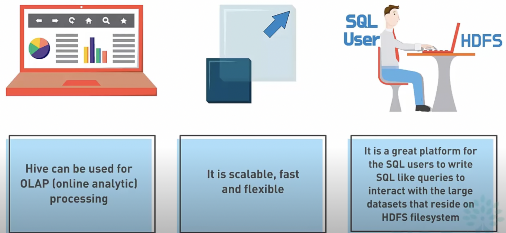
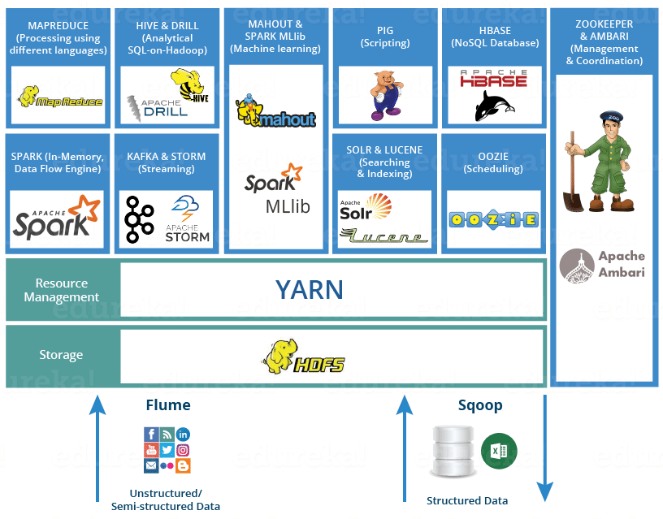
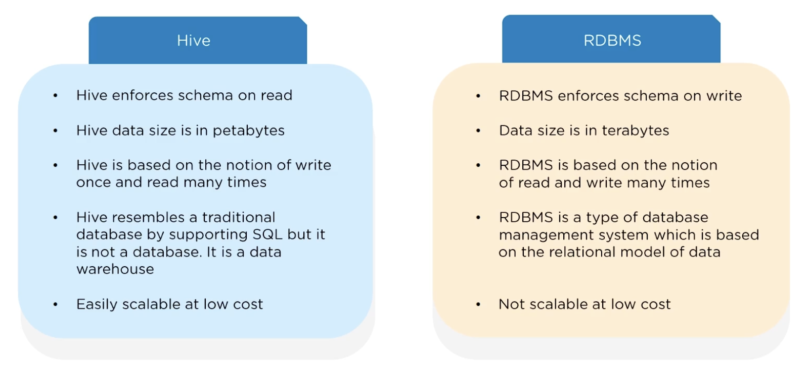

## Thực hành Hive

### Tổng quan về Hive

[Hive](https://hive.apache.org/) là một công cụ kho dữ liệu (data warehouse) dựa trên Hadoop do Facebook mã nguồn mở, hiện được duy trì bởi Apache Software Foundation. Đây là một trong những giải pháp dữ liệu lớn (Big Data) được ứng dụng rộng rãi nhất. Nói một cách đơn giản, Hive có thể chuyển đổi các truy vấn SQL thành các tác vụ MapReduce hoặc Spark, cung cấp sự hỗ trợ hoàn hảo cho SQL, giúp thực hiện thống kê dữ liệu lớn vô cùng thuận tiện, để những người không biết Java hay Scala cũng có thể làm chủ nền tảng dữ liệu lớn và hệ thống tệp phân tán, thực hiện việc lưu trữ và xử lý dữ liệu.





Các tác dụng chính của Hive bao gồm:

1. Ánh xạ các tệp dữ liệu có cấu trúc thành một bảng.
2. Cung cấp ngôn ngữ truy vấn giống SQL là HiveQL để thao tác với dữ liệu quy mô lớn.
3. Tầng dưới dựa vào lưu trữ HDFS của Hadoop và các engine MapReduce / Spark / Tez để thực thi tác vụ.

Các đặc điểm của Hive như sau:

1. Cú pháp giống SQL: Hỗ trợ truy vấn SQL, hạ thấp ngưỡng tiếp cận học dữ liệu lớn.
2. Khả năng mở rộng: Có thể hỗ trợ dữ liệu cấp độ PB một cách tương đối dễ dàng.
3. Lưu trữ linh hoạt: Hỗ trợ nhiều định dạng lưu trữ (Text, ORC, Parquet, Avro, v.v.).
4. Lựa chọn engine tính toán linh hoạt: Tầng thực thi bên dưới có MapReduce, Tez, Spark.
5. Độ trễ tương đối cao: Thích hợp cho phân tích ngoại tuyến (offline analysis), không phù hợp cho truy vấn OLTP độ trễ thấp.

So sánh giữa Hive và cơ sở dữ liệu quan hệ truyền thống:



### Xây dựng môi trường

#### Công việc chuẩn bị

> **Giải thích**: Các thao tác dưới đây lấy hệ điều hành Ubuntu làm ví dụ.

1. Đồng bộ múi giờ

   ```bash
   sudo timedatectl set-timezone Asia/Shanghai
   ```

2. Sửa đổi nguồn tải về

   ```bash
   sudo mv /etc/apt/sources.list /etc/apt/sources.list.bak
   sudo vi /etc/apt/sources.list
   ```

   ```shell
   # 24.04 /etc/apt/sources.list
   deb https://mirrors.tuna.tsinghua.edu.cn/ubuntu/ focal main restricted universe multiverse
   deb https://mirrors.tuna.tsinghua.edu.cn/ubuntu/ focal-updates main restricted universe multiverse
   deb https://mirrors.tuna.tsinghua.edu.cn/ubuntu/ focal-backports main restricted universe multiverse
   deb https://mirrors.tuna.tsinghua.edu.cn/ubuntu/ focal-security main restricted universe multiverse
   ```

   ```shell
   # 18.04 /etc/apt/sources.list
   deb https://mirrors.tuna.tsinghua.edu.cn/ubuntu/ bionic main restricted universe multiverse
   deb-src https://mirrors.tuna.tsinghua.edu.cn/ubuntu/ bionic main restricted universe multiverse
   deb https://mirrors.tuna.tsinghua.edu.cn/ubuntu/ bionic-updates main restricted universe multiverse
   deb-src https://mirrors.tuna.tsinghua.edu.cn/ubuntu/ bionic-updates main restricted universe multiverse
   deb https://mirrors.tuna.tsinghua.edu.cn/ubuntu/ bionic-backports main restricted universe multiverse
   deb-src https://mirrors.tuna.tsinghua.edu.cn/ubuntu/ bionic-backports main restricted universe multiverse
   deb https://mirrors.tuna.tsinghua.edu.cn/ubuntu/ bionic-security main restricted universe multiverse
   deb-src https://mirrors.tuna.tsinghua.edu.cn/ubuntu/ bionic-security main restricted universe multiverse
   deb https://mirrors.tuna.tsinghua.edu.cn/ubuntu/ bionic-proposed main restricted universe multiverse
   deb-src https://mirrors.tuna.tsinghua.edu.cn/ubuntu/ bionic-proposed main restricted universe multiverse
   ```

3. Cài đặt các công cụ phần mềm

   ```bash
   sudo apt update
   sudo apt upgrade
   sudo apt install -y vim wget net-tools openssh-server
   ```

4. Khởi động SSH

   ```bash
   sudo systemctl start ssh
   sudo systemctl enable ssh
   sudo systemctl status ssh
   ```

5. Cấu hình tường lửa

   ```bash
   sudo ufw enable
   sudo ufw allow ssh
   sudo ufw status
   
   sudo ufw disable
   ```

6. Chuẩn bị Hadoop

   ```bash
   wget https://archive.apache.org/dist/hadoop/common/stable2/hadoop-2.10.2.tar.gz
   sudo tar -zxvf hadoop-2.10.2.tar.gz -C /opt
   ```

7. Chuẩn bị Hive

   ```bash
   wget https://archive.apache.org/dist/hive/stable-2/apache-hive-2.3.9-bin.tar.gz
   sudo tar -zxvf apache-hive-2.3.9-bin.tar.gz -C /opt
   ```

#### Môi trường Java

1. Kiểm tra

   ```bash
   java -version
   ```

2. Tìm kiếm

   ```bash
   sudo apt search openjdk
   ```

3. Cài đặt

   ```
   sudo apt install -y openjdk-8-jdk
   ```

#### Môi trường MySQL

1. Cài đặt

   ```bash
   sudo apt install mysql-server
   ```

2. Cấu hình

   ```bash
   mysql_secure_installation
   ```

3. Khởi động

   ```bash
   sudo systemctl enable mysql
   sudo systemctl start mysql
   sudo systemctl status mysql
   ```

#### Cấu hình Hadoop

> **Gợi ý**: Xem chi tiết trong tài liệu PDF.

#### Cấu hình Hive

> **Gợi ý**: Xem chi tiết trong tài liệu PDF.

#### Khởi động môi trường

1. Khởi động HDFS

   ```bash
   start-dfs.sh
   start-yarn.sh
   ```

2. Khởi động Hive

   ```bash
   hive --service metastore &
   hive --service hiveserver2 > hiveserver2.log 2> hiveerrors.log &
   ```

3. Kiểm tra cổng

   ```bash
   ss -ntl
   netstat -ntlp

### Lệnh thường dùng

| Lệnh | Mô tả công dụng |
| -------------------------------------------------- | --------------------------------------------------- |
| `hadoop fs -ls <path>`                             | Liệt kê nội dung thư mục, tương tự `ls` trong Linux |
| `hadoop fs -ls -R <path>`                          | Liệt kê đệ quy tất cả các tệp trong thư mục         |
| `hadoop fs -du <path>`                             | Hiển thị kích thước tệp hoặc thư mục (không đệ quy) |
| `hadoop fs -du -s <path>`                          | Tổng hợp và hiển thị tổng dung lượng thư mục        |
| `hadoop fs -du -h <path>`                          | Hiển thị kích thước tệp ở định dạng dễ đọc (KB/MB/GB) |
| `hadoop fs -COUNT <path>`                          | Thống kê số lượng tệp, số thư mục và tổng số byte trong thư mục |
| `hadoop fs -mkdir <path>`                          | Tạo thư mục                                         |
| `hadoop fs -mkdir -p <path>`                       | Tạo thư mục nhiều cấp theo kiểu đệ quy              |
| `hadoop fs -rm <path>`                             | Xóa tệp                                             |
| `hadoop fs -rm -r <path>`                          | Xóa thư mục theo kiểu đệ quy                        |
| `hadoop fs -copyFromLocal <local> <hdfs>`          | Sao chép tệp từ máy cục bộ sang HDFS                |
| `hadoop fs -moveFromLocal <local> <hdfs>`          | Di chuyển tệp từ máy cục bộ sang HDFS (xóa tệp cục bộ sau khi sao chép) |
| `hadoop fs -copyToLocal <hdfs> <local>`            | Sao chép tệp từ HDFS về máy cục bộ                  |
| `hadoop fs -moveToLocal <hdfs> <local>`            | Di chuyển tệp từ HDFS về máy cục bộ (xóa tệp trên HDFS sau khi sao chép) |
| `hadoop fs -put <local> <hdfs>`                    | Tương đương với `-copyFromLocal`, tải tệp lên       |
| `hadoop fs -get <hdfs> <local>`                    | Tương đương với `-copyToLocal`, tải tệp về          |
| `hadoop fs -getmerge <hdfs_dir> <local_file>`      | Gộp các tệp trong thư mục HDFS và lưu thành một tệp duy nhất ở máy cục bộ |
| `hadoop fs -cat <path>`                            | Xuất nội dung tệp ra đầu ra tiêu chuẩn (thích hợp để xem tệp nhỏ) |
| `hadoop fs -tail <path>`                           | Hiển thị phần nội dung ở cuối tệp                   |
| `hadoop fs -text <path>`                           | Xem nội dung tệp nén (như Gzip, SequenceFile) dưới dạng văn bản |
| `hadoop fs -appENDToFile <local_file> <hdfs_file>` | Nối thêm nội dung tệp cục bộ vào cuối tệp trên HDFS |
| `hadoop fs -cp <src> <dst>`                        | Sao chép tệp hoặc thư mục bên trong HDFS            |
| `hadoop fs -mv <src> <dst>`                        | Di chuyển/đổi tên tệp hoặc thư mục bên trong HDFS   |
| `hadoop fs -chown <user:group> <path>`             | Sửa đổi chủ sở hữu và nhóm người dùng của tệp hoặc thư mục |
| `hadoop fs -chgrp <group> <path>`                  | Sửa đổi nhóm người dùng của tệp hoặc thư mục        |
| `hadoop fs -chmod <mode> <path>`                   | Sửa đổi quyền của tệp hoặc thư mục, tương tự `chmod` trong Linux |
| `hadoop fs -stat <format> <path>`                  | Hiển thị thông tin trạng thái của tệp hoặc thư mục (như kích thước, thời gian sửa đổi) |
| `hadoop fs -expunge`                               | Làm trống thùng rác HDFS (Trash)                    |
| `hadoop fs -checkSUM <path>`                       | Tính toán mã checksum của tệp                       |

### Cú pháp cơ bản

1. Xóa cơ sở dữ liệu.

    ```hive
    DROP DATABASE IF EXISTS eshop CASCADE;
    ```

2. Tạo cơ sở dữ liệu.

    ```hive
    CREATE DATABASE IF NOT EXISTS eshop;
    ```

3. Chuyển ngữ cảnh (context).

    ```hive
    USE eshop;
    ```

4. Tạo bảng ngoài (external table).

    ```hive
    CREATE EXTERNAL TABLE IF NOT EXISTS dim_user_info 
    (
    user_id           STRING,
    user_name         STRING, 
    sex               STRING,
    age               INT,
    city              STRING,
    first_active_time STRING,
    level             INT,
    extra1            STRING,
    extra2            MAP<STRING, STRING>
    )
    ROW FORMAT DELIMITED 
    FIELDS TERMINATED BY '\t'
    COLLECTION ITEMS TERMINATED BY ','
    MAP KEYS TERMINATED BY ':'
    LINES TERMINATED BY '\n'
    STORED AS TEXTFILE;

5. Nạp dữ liệu.

   ```hive
   LOAD DATA LOCAL INPATH '/home/hadoop/data/user_info/user_info.txt' OVERWRITE INTO TABLE dim_user_info;
   ```

   ```hive
   LOAD DATA INPATH '/user/data/user_info.txt' OVERWRITE INTO TABLE dim_user_info;
   ```

6. Tạo bảng phân vùng.

   ```hive
   CREATE TABLE IF NOT EXISTS fact_user_trade 
   (
   user_name      STRING,
   piece          INT,
   price          DOUBLE,
   pay_amount     DOUBLE,
   goods_category STRING,
   pay_time       BIGINT
   )  
   PARTITIONED BY (dt STRING)
   ROW FORMAT DELIMITED
   FIELDS TERMINATED BY '\t'
   LINES TERMINATED BY '\n'
   STORED AS TEXTFILE;
   ```

7. Thiết lập phân vùng động.

   ```hive
   -- Bật sử dụng phân vùng động
   SET hive.exec.dynamic.partition=true;
   -- Đặt phân vùng động thành chế độ nonstrict (chế độ strict yêu cầu chỉ định ít nhất một cột phân vùng tĩnh)
   SET hive.exec.dynamic.partition.mode=nonstrict;
   -- Số phân vùng động tối đa có thể tạo trong một thao tác SQL (trên toàn bộ các node)
   SET hive.exec.max.dynamic.partitions=1000;
   -- Số phân vùng động tối đa có thể tạo trên mỗi node
   SET hive.exec.max.dynamic.partitions.pernode=10000;
   ```

8. Sửa chữa phân vùng.

   ```hive
   MSCK REPAIR TABLE fact_user_trade;
   ```

9. Trích xuất dữ liệu.

   ```hive
   -- Bật tính năng tự động phán đoán chế độ cục bộ
   SET hive.exec.mode.local.auto=true;
   -- Thiết lập số lượng tệp MAPREDUCE
   SET hive.exec.mode.local.auto.input.files.max=128;
   -- Thiết lập kích thước tệp MAPREDUCE
   SET hive.exec.mode.local.auto.input.bytes.max=134217728;
   -- Thiết lập số lượng tác vụ Reduce là 1
   SET mapreduce.job.reduces=1;
   
   -- Truy vấn tên của 10 người dùng nữ ở Bắc Kinh đầu tiên
   SELECT user_name 
     FROM dim_user_info
    WHERE city='beijing'
          AND sex='female'
    LIMIT 10;
   
   -- Truy vấn tên người dùng, số lượng mua và số tiền thanh toán của các giao dịch mua mặt hàng thuộc loại 'food' vào ngày 24-03-2019 (không tổng hợp)
   SELECT user_name
        , piece
        , pay_amount
     FROM fact_user_trade
    WHERE dt='2019-03-24'
          AND goods_category='food';
   
   -- Thống kê tổng số tiền thanh toán của người dùng ELLA trong năm 2018 và khoảng cách số ngày giữa hai lần tiêu dùng gần nhất và xa nhất
   SELECT SUM(pay_amount) AS total
        , DATEDIFF(
              MAX(FROM_UNIXTIME(pay_time, 'yyyy-MM-dd')),
              MIN(FROM_UNIXTIME(pay_time, 'yyyy-MM-dd'))
          ) AS gap_days
     FROM fact_user_trade
    WHERE YEAR(dt)='2018'
          AND user_name='ELLA';
   ```

10. Nhóm và tổng hợp.

    ```hive
    -- Truy vấn từ tháng 1 đến tháng 4 năm 2019, mỗi danh mục có bao nhiêu người mua và tổng số tiền tích lũy là bao nhiêu
    SELECT goods_category
         , COUNT(DISTINCT user_name) AS total_user
         , SUM(pay_amount) AS total_pay
      FROM fact_user_trade
     WHERE dt BETWEEN '2019-01-01' AND '2019-04-30'
     GROUP BY goods_category;
    
    -- Truy vấn những người dùng có số tiền thanh toán vượt quá 50.000 trong tháng 4 năm 2019
    SELECT user_name
         , SUM(pay_amount) AS total
      FROM fact_user_trade
     WHERE dt BETWEEN '2019-04-01' AND '2019-04-30'
     GROUP BY user_name
    HAVING SUM(pay_amount) > 50000;
    
    -- Truy vấn số lượng người dùng đã mua từ 2 danh mục hàng hóa trở lên trong năm 2018
    SELECT COUNT(t.user_name)
      FROM (SELECT user_name
                 , COUNT(DISTINCT goods_category) AS total
              FROM fact_user_trade
             WHERE YEAR(dt)='2018'
             GROUP BY user_name
            HAVING COUNT(DISTINCT goods_category)>2) AS t;
            
    -- Truy vấn top 5 người dùng có số tiền thanh toán nhiều nhất trong tháng 4 năm 2019
    SELECT user_name
         , SUM(pay_amount) AS total
      FROM fact_user_trade
     WHERE dt BETWEEN '2019-04-01' AND '2019-04-30'
     GROUP BY user_name
     ORDER BY total DESC
     LIMIT 5;
            
    -- Thống kê số lượng người dùng theo từng nhóm tuổi
    SELECT CASE WHEN age < 20 THEN 'Dưới 20 tuổi' 
                WHEN age < 30 THEN 'Dưới 30 tuổi' 
                WHEN age < 40 THEN 'Dưới 40 tuổi' 
                ELSE 'Từ 40 tuổi trở lên' 
            END AS age_seg, 
           COUNT(DISTINCT user_id) AS total 
      FROM dim_user_info 
     GROUP BY CASE WHEN age < 20 THEN 'Dưới 20 tuổi' 
                   WHEN age < 30 THEN 'Dưới 30 tuổi' 
                   WHEN age < 40 THEN 'Dưới 40 tuổi' 
                   ELSE 'Từ 40 tuổi trở lên' 
               END;
    
    -- Thống kê tình trạng hôn nhân của người dùng kích hoạt trong năm 2018 và thuộc nhóm tuổi 20-30 tuổi, 30-40 tuổi
    SELECT age_seg,
           IF(marriage_status = 1, 'Đã kết hôn', 'Chưa kết hôn') AS marriage_status,
           COUNT(*) AS total
      FROM (SELECT CASE WHEN age < 20 THEN 'Dưới 20 tuổi' 
                        WHEN age < 30 THEN '20-30 tuổi' 
                        WHEN age < 40 THEN '30-40 tuổi' 
                        ELSE 'Từ 40 tuổi trở lên' 
                    END AS age_seg, 
                   extra2['marriage_status'] AS marriage_status
              FROM dim_user_info
             WHERE TO_DATE(first_active_time) BETWEEN '2018-01-01' AND '2018-12-31'
           ) AS t
     WHERE age_seg in ('20-30 tuổi', '30-40 tuổi')
     GROUP BY age_seg, IF(marriage_status = 1, 'Đã kết hôn', 'Chưa kết hôn');
    
    -- Thống kê mỗi người dùng đã từng mua những danh mục hàng hóa nào
    SELECT user_name,
           COLLECT_SET(goods_category) AS categories
      FROM fact_user_trade
     GROUP BY user_name;
     
    -- Nối mảng thành chuỗi
    SELECT user_name
         , CONCAT_WS(', ', COLLECT_SET(goods_category)) AS categories
      FROM fact_user_trade
     GROUP BY user_name;
    
    -- Tổng hợp dữ liệu thành kiểu ánh xạ (map)
    SELECT user_name
         , STR_TO_MAP(CONCAT_WS(',', COLLECT_LIST(CONCAT(goods_category, ':', cnt)))) AS category_cnt_map
      FROM (SELECT user_name
                 , goods_category
                 , COUNT(*) AS cnt
              FROM fact_user_trade
             GROUP BY user_name, goods_category) AS t
     GROUP BY user_name;
    ```
    
11. Lấy mẫu dữ liệu.

     ~~~hive
     -- Lấy mẫu dữ liệu
     SELECT *
       FROM fact_user_trade
      WHERE RAND() < 0.1;
     
     SELECT * 
       FROM fact_user_trade 
            TABLESAMPLE(BUCKET 1 OUT OF 10 ON user_name);
     
     -- Hỗ trợ lưu trữ nhị phân (như ORC)
     -- SELECT *
     --   FROM fact_user_trade
     --        TABLESAMPLE(BYTE 100M);
     ~~~
    
12. Mở rộng theo chiều ngang (lateral view).

     ```hive
     -- Tạo view
     CREATE OR REPLACE VIEW v_user_categories
     AS
     SELECT user_name
          , COLLECT_SET(goods_category) AS categories
       FROM fact_user_trade
      WHERE dt BETWEEN '2019-04-01' and '2019-04-30' 
      GROUP BY user_name;
     
     CREATE OR REPLACE VIEW v_user_categories_map
     AS
     SELECT user_name
          , STR_TO_MAP(CONCAT_WS(',', COLLECT_LIST(CONCAT(goods_category, ':', cnt)))) AS category_cnt_map
       FROM (SELECT user_name
                  , goods_category
                  , COUNT(*) AS cnt
               FROM fact_user_trade
              WHERE dt BETWEEN '2019-04-01' AND '2019-04-30' 
              GROUP BY user_name, goods_category) AS t
      GROUP BY user_name;
     
     -- Mở rộng mảng (array) theo chiều ngang
      SELECT user_name
           , category
        FROM v_user_categories
     LATERAL VIEW EXPLODE(categories) t AS category;
     
     -- Mở rộng ánh xạ (map) theo chiều ngang
      SELECT user_name
           , category
           , cnt
        FROM v_user_categories_map
     LATERAL VIEW EXPLODE(category_cnt_map) t AS category, cnt;
     ```

### Thao tác tạo bảng

#### Kiểu dữ liệu

Các kiểu dữ liệu trong Hive nhìn chung được chia thành ba loại: kiểu nguyên thủy, kiểu phức hợp, kiểu lồng nhau.

| Kiểu dữ liệu  | Mô tả kiểu                                            | Tình huống sử dụng |
| ------------- | -----------------------------------------------------| ------------- |
| TINYINT       | Số nguyên có dấu 1 byte, phạm vi giá trị -128 ~ 127. |  |
| SMALLINT      | Số nguyên có dấu 2 byte, phạm vi giá trị -32768 ~ 32767. |  |
| INT           | Số nguyên có dấu 4 byte, phạm vi giá trị -2147483648 ~ 2147483647. |  |
| BIGINT        | Số nguyên có dấu 8 byte, phạm vi giá trị -9223372036854775808 ~ 9223372036854775807. | Đếm, ID |
| BOOLEAN       | Giá trị boolean, TRUE hoặc FALSE.                    |  |
| FLOAT         | Số thực dấu phẩy động độ chính xác đơn (4 byte).     |  |
| DOUBLE        | Số thực dấu phẩy động độ chính xác kép (8 byte).     |  |
| DECIMAL(P, S) | Số thập phân độ chính xác cao, P=tổng số chữ số, S=số chữ số thập phân. | Số tiền đơn hàng |
| STRING        | Chuỗi độ dài thay đổi                                | Văn bản, JSON |
| CHAR          | Chuỗi độ dài cố định                                 |  |
| VARCHAR       | Chuỗi giới hạn độ dài tối đa                         |  |
| BINARY        | Dữ liệu nhị phân                                     |  |
| TIMESTAMP     | Dấu thời gian (timestamp)                            | Chính xác đến mili giây |
| DATE          | Ngày                                                 |  |
| INTERVAL      | Kiểu khoảng thời gian                                |  |
| STRUCT | Tương tự struct trong ngôn ngữ C, `STRUCT<first_name:STRING, lASt_name:STRING>` | Hành vi người chơi |
| MAP    | Tập hợp các phần tử gồm các cặp key-value, `MAP<STRING, INT>` | Thuộc tính sản phẩm |
| ARRAY    | Bộ chứa các biến có cùng kiểu dữ liệu, `ARRAY<STRING>` | Danh sách trang bị |

Cách sử dụng kiểu phức hợp và kiểu lồng nhau như sau:

```hive
CREATE TABLE complex
(
  c1 ARRAY<INT>,
  c2 MAP<STRING, INT>,
  c3 STRUCT<a:STRING, b:INT, c:DOUBLE>,
  c4 STRUCT<name:STRING, addrs:ARRAY<STRUCT<city:STRING, zipcode:STRING>>>
);

SELECT c1[0]
     , c2['key']
     , c3.b
     , c4.addrs[0].city
  FROM complex;
```

Kiểu dữ liệu trong Hive hỗ trợ hai loại chuyển đổi:

1. Chuyển đổi ngầm định: TINYINT → INT → BIGINT → DOUBLE → STRING, FLOAT → DOUBLE.

2. Chuyển đổi tường minh:

   ```hive
   SELECT CAST('123' AS INT);
   SELECT CAST(3.14159 AS DECIMAL(5,2));
   ```

#### Các loại bảng

Các loại bảng trong Hive như sau:

| Loại bảng | Định nghĩa / Cách tạo | Vị trí lưu trữ | Vòng đời | Đặc điểm | Tình huống ứng dụng |
| ------------------------------ | ------------------------------------------------------------ | ------------------------------------------------------- | -------------------------------------------- | ------------------------------------------- | --------------------------------- |
| **Bảng nội bộ (Managed Table)** | `CREATE TABLE t1 (id INT, name STRING); ` | Dữ liệu lưu trong thư mục kho Hive (`/user/hive/warehouse/...`) | **Khi xóa bảng dữ liệu cũng bị xóa** | Hive toàn quyền quản lý metadata và dữ liệu | Dữ liệu tạm thời, dữ liệu thử nghiệm |
| **Bảng ngoài (External Table)** | `CREATE EXTERNAL TABLE t2 (id INT, name STRING) LOCATION '/data/t2'; ` | Dữ liệu lưu trong thư mục do người dùng chỉ định | **Khi xóa bảng dữ liệu được giữ lại**, chỉ xóa metadata | Tách biệt metadata và dữ liệu, thuận tiện chia sẻ | Chia sẻ dữ liệu, tránh xóa nhầm, kịch bản Data Lake |
| **Bảng phân vùng (Partitioned Table)** | `CREATE TABLE sales (id INT, amount INT) PARTITIONED BY (dt STRING, region STRING); ` | Mỗi phân vùng tương ứng với một thư mục con | Trường phân vùng không lưu trong tệp dữ liệu bảng mà đóng vai trò là thư mục đường dẫn | Nâng cao hiệu quả truy vấn (cắt tỉa dữ liệu theo phân vùng) | Chuỗi thời gian, phân chia địa lý, dữ liệu nhật ký |
| **Bảng phân bucket (Bucketed Table)** | `CREATE TABLE users (id INT, name STRING) CLUSTERED BY (id) INTO 8 BUCKETS; ` | Mỗi bucket tương ứng với một tệp | Số lượng bucket cố định | Dữ liệu được phân phối vào các tệp bucket theo mã băm, thuận tiện lấy mẫu, tối ưu hóa Join | Join đẳng trị, lấy mẫu bảng lớn, phân phối dữ liệu đồng đều |
| **Bảng tạm thời (Temporary Table)** | `CREATE TEMPORARY TABLE tmp (id INT); ` | Chỉ tồn tại trong bộ nhớ phiên hiện tại | Tự động hủy sau khi phiên kết thúc | Không ghi xuống đĩa, không cập nhật metadata Hive | Tính toán tạm thời, kết quả trung gian cấp phiên |
| **View (Khung nhìn)** | `CREATE VIEW v1 AS SELECT ...; ` | Không lưu trữ dữ liệu, chỉ lưu định nghĩa metadata | Gắn kết với bảng tầng dưới | Tương tự bảng ảo | Bảo mật dữ liệu, tái sử dụng SQL, đóng gói truy vấn phức tạp |

#### Bổ từ

Các bổ từ có thể sử dụng khi tạo bảng như sau:

| Từ khóa | Tác dụng | Hiệu ứng khi có khai báo | **Giá trị mặc định khi không khai báo** |
| ----------------------------------- | ------------------ | ------------------------------------------------------------ | ------------------------------------------------------------ |
| **EXTERNAL**                        | Chỉ định bảng ngoài | `CREATE EXTERNAL TABLE ... LOCATION ...` → Tách biệt bảng và dữ liệu, xóa bảng không xóa dữ liệu | **Bảng nội bộ (Managed Table)**, khi xóa bảng thư mục dữ liệu cũng bị xóa cùng |
| **PARTITIONED BY**                  | Định nghĩa trường phân vùng | `PARTITIONED BY (dt STRING, city STRING)` → Dữ liệu ghi vào thư mục con `/table/dt=2025-08-26/city=Beijing/` | **Bảng không phân vùng**, tất cả dữ liệu đặt trong cùng một thư mục |
| **CLUSTERED BY ... INTO N BUCKETS** | Phân bucket | `CLUSTERED BY (user_id) INTO 8 BUCKETS` → Dữ liệu phân phối theo mã băm vào 8 bucket tệp | **Không phân bucket**, dữ liệu chỉ là tệp thông thường |
| **STORED AS**                       | Định dạng lưu trữ tệp | Thường dùng: `TEXTFILE`, `SEQUENCEFILE`, `ORC`, `PARQUET` | **TEXTFILE** (tệp văn bản) |
| **ROW FORMAT**                      | Chỉ định định dạng dòng và SerDe | Ví dụ: `ROW FORMAT DELIMITED FIELDS TERMINATED BY ','` hoặc `ROW FORMAT SERDE 'org.apache.hadoop.hive.serde2.JsonSerDe'` | **LazySimpleSerDe** (ký tự phân cách mặc định `\001`, tức ký tự ẩn Ctrl+A) |
| **LOCATION**                        | Chỉ định đường dẫn HDFS | `LOCATION '/user/hive/custom_path'` → Dữ liệu bảng lưu vào đường dẫn tùy chỉnh | Mặc định đặt vào **thư mục kho**: `/user/hive/warehouse/<db>.db/<table>/` |
| **TBLPROPERTIES/DBPROPERTIES**      | Lưu một số thuộc tính metadata | `TBLPROPERTIES ('creator'='Hao')` | **Trống**, trừ khi thêm thủ công |
| **COMMENT**                         | Ghi chú bảng/trường | `COMMENT 'Bảng fact giao dịch người dùng'` | **Trống** |

#### ROW FORMAT

| Cách viết | Giải thích | Tình huống thường gặp |
| ------------------------------------------------------------ | ----------------- | ------------------- |
| `ROW FORMAT DELIMITED FIELDS TERMINATED BY ','`              | Phân tích theo ký tự phân cách | CSV/TSV/văn bản |
| `ROW FORMAT DEFAULT`                                         | Định dạng mặc định, giống bên dưới | CSV/TSV/văn bản |
| `ROW FORMAT SERDE 'org.apache.hadoop.hive.serde2.LazySimpleSerDe'` | SerDe mặc định, giống bên trên | Bảng văn bản (phân cách bằng \001) |
| `ROW FORMAT SERDE 'org.apache.hadoop.hive.serde2.OpenCSVSerde'` | Phân tích CSV thông minh hơn | CSV có dấu ngoặc kép/ký tự thoát |
| `ROW FORMAT SERDE 'org.apache.hadoop.hive.serde2.RegexSerDe'` | Dùng regex để khớp dòng | Dữ liệu dạng nhật ký (log) |
| `ROW FORMAT SERDE 'org.apache.hadoop.hive.serde2.JsonSerDe'` | Phân tích định dạng JSON | Tệp JSON |
| `ROW FORMAT SERDE 'org.apache.hadoop.hive.serde2.AvroSerDe'` | Định dạng Avro | JSON + nén nhị phân |
| `ROW FORMAT SERDE 'org.apache.hadoop.hive.serde2.ParquetHiveSerDe'` | Định dạng Parquet | Dữ liệu Parquet |
| `ROW FORMAT SERDE 'org.apache.hadoop.hive.serde2.OrcSerde'`  | Định dạng ORC | Dữ liệu ORC |

> **Giải thích**: Chỉ khi sử dụng **định dạng không mặc định (CSV/JSON/Regex)** mới cần chỉ định SERDE một cách tường minh.

### Ghi dữ liệu

| Phương thức ghi | Cú pháp ví dụ | Đặc điểm | Tình huống áp dụng |
| ------------------------------------- | ------------------------------------------------------------ | ----------------------------------------------------- | --------------------------------------- |
| **INSERT INTO**                       | `INSERT INTO TABLE sales PARTITION (dt='2025-08-26') SELECT * FROM tmp_sales; ` | **Nối thêm dữ liệu** vào bảng/phân vùng, không ghi đè nội dung cũ | Ghi dữ liệu nối thêm hàng ngày (nhật ký, dòng tiền giao dịch) |
| **INSERT OVERWRITE**                  | `INSERT OVERWRITE TABLE sales PARTITION (dt='2025-08-26') SELECT * FROM tmp_sales; ` | Ghi đè dữ liệu bảng/phân vùng đích (xóa trước ghi sau) | Làm mới toàn bộ dữ liệu định kỳ (như báo cáo ngày T+1, báo cáo tháng) |
| **LOAD DATA**                         | `LOAD DATA INPATH '/user/hadoop/data.txt' INTO TABLE sales; ` | **Di chuyển tệp** vào thư mục bảng Hive (không phân tích cú pháp), tốc độ nhanh | Nhập trực tiếp tệp HDFS sẵn có vào Hive |
| **LOAD DATA LOCAL**                   | `LOAD DATA LOCAL INPATH '/home/user/data.txt' INTO TABLE sales; ` | Sao chép dữ liệu từ **hệ thống tệp cục bộ** vào bảng Hive | Nhập nhanh dữ liệu tạm thời từ máy cục bộ |
| **CREATE TABLE AS SELECT (CTAS)**     | `CREATE TABLE new_sales AS SELECT * FROM sales WHERE dt='2025-08-26'; ` | Tạo bảng mới và ghi kết quả truy vấn, một bước xong ngay | Tạo bảng trung gian/bảng phái sinh, khám phá dữ liệu |
| **INSERT + Directory (Ghi ra HDFS)**  | `INSERT OVERWRITE DIRECTORY '/tmp/export/' ROW FORMAT DELIMITED FIELDS TERMINATED BY ',' SELECT * FROM sales; ` | Ghi kết quả truy vấn vào **thư mục HDFS**, có thể chỉ định ký tự phân cách/định dạng | Xuất dữ liệu, tương tác với các hệ thống khác |
| **INSERT + LOCAL Directory (Ghi ra cục bộ)** | `INSERT OVERWRITE LOCAL DIRECTORY '/home/user/export/' ROW FORMAT DELIMITED FIELDS TERMINATED BY ',' SELECT * FROM sales; ` | Ghi kết quả vào **thư mục cục bộ** | Xuất kết quả quy mô nhỏ, phân tích cục bộ |
| **Ghi vào bảng ngoài (External Table)** | `CREATE EXTERNAL TABLE ext_sales (...) LOCATION '/data/sales'; ` | Bảng ngoài chỉ quản lý metadata, việc ghi thực tế phụ thuộc vào `LOAD DATA`/`INSERT` | Chia sẻ thư mục dữ liệu, tránh xóa nhầm |
| **Ghi phân vùng động**                | `SET hive.exec.dynamic.partition=true;` `SET hive.exec.dynamic.partition.mode=nonstrict;` `INSERT OVERWRITE TABLE sales PARTITION (dt) SELECT id, amount, dt FROM tmp; ` | Tự động tạo thư mục phân vùng dựa theo giá trị trường | Tải dữ liệu vào bảng phân vùng quy mô lớn |

### Hàm thường dùng

#### Hàm toán học (Math Functions)

| Hàm | Giải thích | Ví dụ |
| -------------------------- | ------------------------ | -------------------------- |
| `abs(x)`                   | Giá trị tuyệt đối | `abs(-10) = 10`            |
| `round(x[, d])`            | Làm tròn, d là số chữ số thập phân giữ lại | `round(3.14159, 2) = 3.14` |
| `floor(x)`                 | Làm tròn xuống | `floor(3.9) = 3`           |
| `ceil(x)`                  | Làm tròn lên | `ceil(3.1) = 4`            |
| `rand()`                   | Tạo số ngẫu nhiên [0,1) | `rand()`                   |
| `pow(x, y)` / `power(x,y)` | Phép tính lũy thừa | `pow(2,3) = 8`             |
| `sqrt(x)`                  | Căn bậc hai | `sqrt(16) = 4`             |
| `exp(x)`                   | e^x | `exp(1) ≈ 2.718`           |
| `ln(x)`                    | Logarit tự nhiên | `ln(e) = 1`                |
| `log10(x)`                 | Logarit cơ số 10 | `log10(100) = 2`           |

#### Hàm chuỗi (String Functions)

| Hàm | Giải thích | Ví dụ |
| ----------------------------------- | ---------------- | ----------------------------------------------- |
| `length(str)`                       | Độ dài chuỗi | `length('hive') = 4`                            |
| `upper(str)`                        | Chuyển thành chữ hoa | `upper('hive') = HIVE`                          |
| `lower(str)`                        | Chuyển thành chữ thường | `lower('HIVE') = hive`                          |
| `concat(str1,str2,…)`               | Nối chuỗi | `concat('hive','sql') = hivesql`                |
| `concat_ws(sep,str1,str2,…)`        | Nối bằng ký tự phân cách | `concat_ws('-', 'a','b','c') = a-b-c`           |
| `substr(str, start, len)`           | Cắt chuỗi con | `substr('hive',2,2) = iv`                       |
| `instr(str, substr)`                | Trả về vị trí của chuỗi con | `instr('hive','iv') = 2`                        |
| `split(str, regex)`                 | Tách chuỗi thành mảng | `split('a,b,c',',') = ['a','b','c']`            |
| `regexp_extract(str, pattern, idx)` | Trích xuất bằng regex | `regexp_extract('abc123','([0-9]+)',1) = 123`   |
| `regexp_replace(str, pattern, rep)` | Thay thế bằng regex | `regexp_replace('abc123','[0-9]','X') = abcXXX` |
| `trim(str)`                         | Xóa khoảng trắng ở đầu và cuối | `trim('  hi  ') = hi`                           |
| `lpad(str,n,pad)`                   | Đệm bên trái đến độ dài n | `lpad('hi',5,'*') = ***hi`                      |
| `rpad(str,n,pad)`                   | Đệm bên phải đến độ dài n | `rpad('hi',5,'*') = hi***`                      |

#### Hàm ngày giờ (Date & Time Functions)

| Hàm | Giải thích | Ví dụ |
| ---------------------------- | ---------------- | ----------------------------------------------------- |
| `current_date`               | Ngày hiện tại | `2025-09-15`                                          |
| `current_timestamp`          | Dấu thời gian hiện tại | `2025-09-15 22:00:00`                                 |
| `unix_timestamp()`           | Dấu thời gian hiện tại (giây) | `1694784000`                                          |
| `from_unixtime(ts, fmt)`     | Chuyển dấu thời gian thành chuỗi | `from_unixtime(1694784000,'yyyy-MM-dd') = 2025-09-15` |
| `to_date(str)`               | Chuyển chuỗi thành ngày | `to_date('2025-09-15 22:00:00') = 2025-09-15`         |
| `year(dt)`                   | Trích xuất năm | `year('2025-09-15') = 2025`                           |
| `month(dt)`                  | Trích xuất tháng | `month('2025-09-15') = 9`                             |
| `day(dt)` / `dayofmonth(dt)` | Trích xuất ngày | `day('2025-09-15') = 15`                              |
| `hour(ts)`                   | Trích xuất giờ | `hour('2025-09-15 22:30:00') = 22`                    |
| `minute(ts)`                 | Trích xuất phút | `minute('2025-09-15 22:30:00') = 30`                  |
| `second(ts)`                 | Trích xuất giây | `second('2025-09-15 22:30:00') = 0`                   |
| `datediff(dt1,dt2)`          | Số ngày chênh lệch giữa hai ngày | `datediff('2025-09-15','2025-09-10') = 5`             |
| `add_months(dt,n)`           | Ngày cộng thêm n tháng | `add_months('2025-09-15',2) = 2025-11-15`             |
| `date_add(dt,n)`             | Ngày cộng thêm n ngày | `date_add('2025-09-15',10) = 2025-09-25`              |
| `date_sub(dt,n)`             | Ngày trừ đi n ngày | `date_sub('2025-09-15',10) = 2025-09-05`              |

#### Hàm điều kiện (Conditional Functions)

| Hàm | Giải thích | Ví dụ |
| ------------------------------------- | ---------------------- | ------------------------------------------------ |
| `if(cond, t, f)`                      | Đánh giá điều kiện | `if(1=1,'yes','no') = yes`                       |
| `case when ... then ... else ... end` | Đánh giá nhiều điều kiện | `case when age>18 then 'adult' else 'child' end` |
| `coalesce(x1,x2,...)`                 | Trả về giá trị phi NULL đầu tiên | `coalesce(null,'hive','sql') = hive`             |
| `nvl(x, y)`                           | Nếu x là NULL, trả về y | `nvl(null,0) = 0`                                |

#### Hàm tổng hợp (Aggregate Functions)

| Hàm | Giải thích | Ví dụ |
| ----------------- | -------------- | --------------- |
| `count(*)`        | Đếm số lượng | `count(*)`      |
| `sum(x)`          | Tính tổng | `sum(price)`    |
| `avg(x)`          | Giá trị trung bình | `avg(score)`    |
| `max(x)`          | Giá trị lớn nhất | `max(age)`      |
| `min(x)`          | Giá trị nhỏ nhất | `min(age)`      |
| `collect_set(x)`  | Tập hợp loại bỏ trùng lặp | `['a','b','c']` |
| `collect_list(x)` | Tập hợp cho phép trùng lặp | `['a','b','a']` |

#### Hàm chuyển đổi kiểu (Type Conversion Functions)

| Hàm | Giải thích | Ví dụ |
| ----------------- | ------------ | -------------------------- |
| `cast(x AS type)` | Chuyển đổi kiểu | `cast('123' as int) = 123` |
| `typeof(x)`       | Trả về kiểu dữ liệu của trường | `typeof(123) = int`        |

#### Hàm kiểu phức hợp (Complex Types)

| Hàm | Giải thích | Ví dụ |
| ---------------------------- | -------------- | ------------------------------------------- |
| `size(array/map)`            | Lấy kích thước | `size(array('a','b')) = 2`                  |
| `map_keys(map)`              | Trả về tất cả các key | `map_keys(map('a',1,'b',2)) = ['a','b']`    |
| `map_values(map)`            | Trả về tất cả các value | `map_values(map('a',1,'b',2)) = [1,2]`      |
| `sort_array(array)`          | Sắp xếp mảng | `sort_array(array(3,1,2)) = [1,2,3]`        |
| `array_contains(array, val)` | Kiểm tra xem có chứa phần tử không | `array_contains(array('a','b'),'a') = true` |

#### Hàm cửa sổ (Window Functions)

Thường dùng cho **xếp hạng, tính toán lũy kế, tính toán trong nhóm**.

| Hàm | Giải thích | Ví dụ |
| --------------------- | ------------------------ | ----------------------------------------------------------- |
| `row_number()`        | Số thứ tự dòng trong nhóm | `row_number() over(partition by dept order by salary desc)` |
| `rank()`              | Xếp hạng (có đồng hạng, nhảy thứ hạng) | `rank() over(order by score desc)`                          |
| `dense_rank()`        | Xếp hạng (có đồng hạng, không nhảy thứ hạng) | `dense_rank() over(order by score desc)`                    |
| `lag(col,n,default)`  | Lấy giá trị của dòng thứ n phía trước | `lag(salary,1,0) over(order by id)`                         |
| `lead(col,n,default)` | Lấy giá trị của dòng thứ n phía sau | `lead(salary,1,0) over(order by id)`                        |
| `first_value(col)`    | Giá trị đầu tiên trong nhóm | `first_value(salary) over(order by id)`                     |
| `last_value(col)`     | Giá trị cuối cùng trong nhóm | `last_value(salary) over(order by id)`                      |
| `sum(col) over(...)`  | Tổng tích lũy trong cửa sổ | `sum(sales) over(partition by region order by month)`       |

#### Ví dụ ứng dụng

1. `FROM_UNIXTIME`: Chuyển đổi timestamp thành ngày

   ```hive
   SELECT FROM_UNIXTIME(pay_time, 'yyyy-MM-dd hh:mm:ss')
     FROM fact_user_trade LIMIT 10;
   ```

3. `DATEDIFF`: Tính khoảng cách thời gian giữa hai ngày

   ```Hive
   -- Khoảng cách giữa thời gian kích hoạt đầu tiên của người dùng và thời gian tham chiếu đã đặt
   SELECT user_name, DATEDIFF('2019-4-1', to_date(firstactivetime))
     FROM dim_user_info LIMIT 10;
   ```

4. `IF`: Trả về các giá trị khác nhau tùy theo điều kiện

   ```Hive
   -- Số lượng người dùng cấp cao theo từng giới tính
   SELECT sex
        , IF(level > 5, 'Cao', 'Thấp') AS level_type
        , COUNT(DISTINCT user_id) AS total
     FROM dim_user_info
    GROUP BY sex, IF(level > 5, 'Cao', 'Thấp');
   ```
   
4. `SUBSTR`: Lấy chuỗi con từ chuỗi

   ```Hive
   -- Thống kê số lượng người dùng mới được kích hoạt theo từng tháng
   SELECT SUBSTR(first_active_time, 1, 7) AS month
        , COUNT(DISTINCT user_id) AS total
     FROM dim_user_info
    GROUP BY substr(first_active_time, 1, 7);
   ```

6. `GET_JSON_OBJECT`: Lấy `value` tương ứng với `key` chỉ định từ chuỗi JSON, ví dụ: `GET_JSON_OBJECT(info, '$.first_name')`.

   ```Hive
   -- Thống kê số lượng người dùng theo từng thương hiệu điện thoại
   SELECT GET_JSON_OBJECT(extra1, '$.phonebrand') AS phone
        , COUNT(DISTINCT user_id) AS total
     FROM user_info
    GROUP BY GET_JSON_OBJECT(extra1, '$.phonebrand');
   ```
   
   > **Giải thích**: Hàm tương ứng trong MySQL có tên là `JSON_EXTRACT`.

### Phân nhóm và tổng hợp

| Thao tác | Cú pháp ví dụ | Mô tả chức năng | Đặc điểm kết quả | Kịch bản ứng dụng điển hình |
| ----------------- | ------------------------------------------------------------ | ---------------------- | ------------------------------------------- | ------------------------ |
| **GROUP BY**      | `SELECT region, product, SUM(amount) FROM sales GROUP BY region, product; ` | Nhóm theo các cột chỉ định | Chỉ xuất kết quả tổng hợp của **một tổ hợp chiều** | Tổng hợp theo chiều đơn hoặc tổ hợp cố định |
| **GROUPING SETS** | `SELECT region, product, SUM(amount) FROM sales GROUP BY GROUPING SETS ((region, product), (region), (product), ()); ` | Chỉ định đồng thời nhiều tổ hợp nhóm | Xuất kết quả của **nhiều tổ hợp chiều chỉ định**, có thể bao gồm tổng cộng | Thống kê báo cáo khi chỉ quan tâm đến một số tổ hợp nhất định |
| **CUBE**          | `SELECT region, product, SUM(amount) FROM sales GROUP BY CUBE(region, product); ` | Tự động tạo tổ hợp của tất cả các chiều | Xuất **tất cả các tổ hợp chiều** (2^n loại) | Phân tích đa chiều toàn diện trong OLAP |

### Thao tác lấy mẫu

| Phương thức lấy mẫu | Cú pháp ví dụ | Ngữ nghĩa cốt lõi | Có ngẫu nhiên không | Khả năng lặp lại | Độ chính xác / Sai lệch | Tiền đề phụ thuộc | Hiệu năng và lưu ý | Công dụng điển hình |
| ------------------------------------ | ------------------------------------------------------------ | ------------------------------------------------- | -------------- | --------------------------- | ------------------------- | -------------------------------------------- | ------------------------------------------ | ---------------------------- |
| **Lấy mẫu BUCKET (bucket vật lý)** | `SELECT * FROM t TABLESAMPLE(BUCKET 2 OUT OF 8);` | Chọn **bucket vật lý thứ 2** của bảng phân bucket (tổng cộng 8 bucket) | Không | Ổn định (quyết định bởi quá trình ghi bucket) | Nhất quán với phân phối bucket khi tạo bảng | Bảng phải là **CLUSTERED BY ... INTO 8 BUCKETS** | Chỉ đọc các tệp trúng đích, nhanh; nhưng chỉ dùng được trên **bảng phân bucket** | Lấy mẫu theo tỷ lệ trên bảng lớn / Kiểm tra tính nhất quán |
| **Lấy mẫu BUCKET (bucket logic)** | `SELECT * FROM t TABLESAMPLE(BUCKET 1 OUT OF 4 ON user_id);` | Ánh xạ dữ liệu vào 4 bucket logic theo `hash(user_id)`, lấy bucket thứ 1 | Giả ngẫu nhiên (băm) | Ổn định (cùng key cho kết quả giống nhau) | Xấp xỉ 1/4, bị ảnh hưởng bởi độ lệch key | Không cần bảng phân bucket | Chỉ quét các dòng trúng đích; phân phối chịu ảnh hưởng bởi độ lệch key | Chia tập huấn luyện/đánh giá nhất quán, phân luồng A/B |
| **Lấy mẫu xác suất (Bernoulli)** | `SELECT * FROM t WHERE RAND() < 0.1;` | Trích xuất độc lập từng dòng theo xác suất 10% | Có | Có thể dùng `RAND(42)` để cố định seed | Kỳ vọng 10%, mẫu nhỏ có độ dao động lớn | Không | Quét toàn bộ bảng; dễ bị ảnh hưởng bởi dung lượng dữ liệu | Downsample nhanh, phân tích khám phá |
| **Số mẫu cố định theo nhóm** | `SELECT * FROM (SELECT *, ROW_NUMBER() OVER(PARTITION BY gid ORDER BY RAND()) rn FROM t) x WHERE rn ≤ 100;` | Lấy ngẫu nhiên **cố định N bản ghi** cho mỗi nhóm (`gid`) | Có | Có thể dùng `RAND(42)` | Cỡ mẫu của các nhóm bằng nhau tuyệt đối | Cần hỗ trợ hàm cửa sổ | Quét 2 lần + sắp xếp, chi phí trung bình | Lấy mẫu cân bằng lớp, lấy mẫu theo tỉnh/ngành hàng |
| **Lấy mẫu theo tỷ lệ mỗi nhóm** | `WHERE RAND() < CASE WHEN gid='A' THEN 0.2 ELSE 0.05 END` | Thiết lập tỷ lệ lấy mẫu khác nhau cho từng nhóm | Có | Có thể cố định seed | Tỷ lệ kỳ vọng, có dao động trong nội bộ nhóm | Không | Quét toàn bộ bảng | Lấy mẫu theo tuyến nghiệp vụ/trọng số khác nhau |
| **Cắt bằng LIMIT (không ngẫu nhiên)** | `SELECT * FROM t LIMIT 1000;` | Lấy N dòng đầu tiên (không ngẫu nhiên) | Không | Ổn định (chịu ảnh hưởng bởi thứ tự tệp/phân mảnh) | Bị lệch (không ngẫu nhiên) | Không | Nhanh nhất; chỉ dùng để gỡ lỗi và xem trước | Phát triển, gỡ lỗi, kiểm tra trường dữ liệu |
| **Lấy Top-N theo từng bucket / Reducer (không ngẫu nhiên)** | `... DISTRIBUTE BY k SORT BY k LIMIT 100;` (hoặc `ROW_NUMBER` mỗi nhóm) | Lấy top N cho mỗi phân mảnh/nhóm | Không | Ổn định | Bị lệch (theo quy tắc sắp xếp) | Cần phân phối/sắp xếp | Phù hợp với Top-N song song, không phải lấy mẫu ngẫu nhiên | Top-N theo từng nhóm, trích xuất theo phân mảnh |

### Thao tác sắp xếp

| Kiểu sắp xếp | Cú pháp ví dụ | Ngữ nghĩa cốt lõi | Số Reducer | Có thứ tự toàn cục không | Hành vi Shuffle/Sắp xếp | Hiệu năng và lưu ý | Công dụng điển hình |
| --------------------------- | --------------------------------------------------------- | ----------------------------------------------- | ---------------------- | --------------------------- | ------------------------------------------ | -------------------------------------------------------- | -------------------------- |
| **ORDER BY**                | `SELECT * FROM t ORDER BY ts DESC;`                       | **Sắp xếp toàn cục** | **1** (đơn reducer) | Có | Tất cả dữ liệu được đưa vào 1 reducer để sắp xếp tổng thể | Chậm nhất; nghẽn cổ chai đơn điểm; kết quả lớn dễ bị OOM; thích hợp cho tập kết quả nhỏ hoặc kết hợp với `LIMIT` | Xuất kết quả nhỏ, hiển thị kết quả cuối cùng |
| **ORDER BY … LIMIT**        | `SELECT * FROM t ORDER BY score DESC LIMIT 1000;`         | Top-N toàn cục | 1 | Có | Vẫn là đơn reducer, nhưng `LIMIT` có thể cắt tỉa sớm | Chấp nhận được; cách viết thường dùng cho Top-N | Top-N toàn cục |
| **SORT BY**                 | `SELECT * FROM t SORT BY ts DESC;`                        | **Sắp xếp nội bộ trong từng reducer** (thứ tự cục bộ) | Nhiều | Không | Đầu ra Map được phân vùng theo key tới nhiều reducer; từng cái tự sắp xếp | Nhanh hơn ORDER BY; toàn bộ kết quả **không có thứ tự toàn cục** | Sắp xếp phân mảnh trên bảng lớn, xuất song song |
| **DISTRIBUTE BY**           | `SELECT * FROM t DISTRIBUTE BY key;`                      | Kiểm soát việc **phân phối theo key** tới reducer | Nhiều | Không | Cùng key sẽ tới cùng một reducer; không sắp xếp | Thường dùng kết hợp với SORT BY | Phân vùng cho việc tổng hợp/sắp xếp tiếp theo |
| **DISTRIBUTE BY + SORT BY** | `SELECT * FROM t DISTRIBUTE BY key SORT BY key, ts DESC;` | **Cùng key cùng phân mảnh + sắp xếp trong phân mảnh** | Nhiều | Không (nhưng **có thứ tự trong từng key**) | Các bản ghi có cùng key sẽ có thứ tự theo quy tắc trong cùng một reducer | Thường dùng; thuận lợi cho xử lý merge/sort-based ở hạ nguồn | Sắp xếp theo chuỗi thời gian của người dùng/sản phẩm |
| **CLUSTER BY**              | `SELECT * FROM t CLUSTER BY key;`                         | `DISTRIBUTE BY key` **+ `SORT BY key` (tăng dần)** | Nhiều | Không | Cú pháp rút gọn, **không thể chỉ định ASC/DESC** | Ngắn gọn, nhưng không kiểm soát được chiều sắp xếp | Ghi bucket / Sắp xếp trước cho phép Join đẳng trị |
| **Sắp xếp trong phân vùng** | `... WHERE dt='2025-08-26' SORT BY ts;`                   | Chỉ xử lý dữ liệu của một phân vùng nhất định | Tùy cấu hình | Có thứ tự cục bộ trong phân vùng | Giống SORT BY | Thu hẹp lượng dữ liệu giúp tăng tốc đáng kể | Xuất dữ liệu phân vùng, chuẩn bị trước cho hàm cửa sổ |

### Mở rộng theo chiều ngang

`LATERAL VIEW` là một cú pháp rất quan trọng trong Hive, chủ yếu dùng kết hợp với các hàm tạo bảng UDTF (như: `EXPLODE`) để tách một dòng dữ liệu thành nhiều dòng. Kịch bản ứng dụng phổ biến nhất là xử lý các trường kiểu ARRAY, MAP, JSON, v.v., đồng thời cũng có thể hiện thực hóa việc chuyển đổi từ bảng rộng (wide table) sang bảng hẹp (narrow table).

| Cách dùng | Cú pháp ví dụ | Mô tả chức năng | Kịch bản ứng dụng điển hình |
| ------------------------------------ | ------------------------------------------------------------ | ------------------------------- | ---------------------- |
| **LATERAL VIEW explode(array)**      | `SELECT order_id, item FROM orders LATERAL VIEW explode(items) t AS item; ` | Tách mảng thành nhiều dòng, mỗi phần tử một dòng | Chi tiết đơn hàng, gắn thẻ sự kiện (event tracking) |
| **LATERAL VIEW posexplode(array)**   | `SELECT order_id, pos, item FROM orders LATERAL VIEW explode(items) t AS pos, item; ` | Tách mảng thành nhiều dòng, đồng thời xuất chỉ mục của phần tử | Phân tích clickstream giữ nguyên thứ tự |
| **LATERAL VIEW explode(map)**        | `SELECT user_id, k, v FROM user_tags LATERAL VIEW explode(tags) t AS k, v; ` | Tách Map thành nhiều dòng, thu được (key, value) | Thẻ người dùng (user tags), cặp thuộc tính key-value |
| **LATERAL VIEW json_tuple(json, …)** | `SELECT log_id, ip, device FROM event_log LATERAL VIEW json_tuple(log_json,'ip','device') t AS ip, device; ` | Trích xuất các trường từ JSON và tạo thành các cột | Phân tích nhật ký, dữ liệu bán cấu trúc |
| **LATERAL VIEW inline(array)**       | `SELECT order_id, col1, col2 FROM orders LATERAL VIEW inline(item_structs) t AS col1,col2; ` | Trải mảng struct thành nhiều dòng và nhiều cột | Tách khi một dòng lưu trữ các thuộc tính đa chiều |
| **LATERAL VIEW stack(n, …)**         | `SELECT user_id, subject, score FROM user_score LATERAL VIEW stack(3,'math',math,'eng',english,'phy',physics) t AS subject, score; ` | Chuyển nhiều cột thành nhiều dòng (cột sang dòng) | Bảng rộng sang bảng dài, UNPIVOT |

### HiveSQL vs. MySQL

| **Đặc tính** | **Hive SQL** | **MySQL SQL** | **Giải thích khác biệt** |
| --------------------- | ------------------------------------------------------------ | ------------------------------------------------------------ | ------------------------------------------------------------ |
| **Phân vùng bảng** | `PARTITIONED BY` (phân vùng): Khi tạo bảng, sử dụng phân vùng để chia nhỏ dữ liệu theo một trường nhất định, giúp tăng tốc lọc dữ liệu khi truy vấn. | Không hỗ trợ phân vùng (theo cách tương tự của Hive). | Hive có thể lưu trữ dữ liệu riêng biệt thông qua phân vùng, phù hợp với các kịch bản dữ liệu lớn. MySQL không có cơ chế phân vùng đường dẫn tệp tương tự. |
| **Phân bucket bảng** | `CLUSTERED BY` (phân bucket): Phân chia dữ liệu bảng thành các bucket dựa trên một trường nhất định, thích hợp để tối ưu hóa kết nối (join) các bảng lớn. | Không hỗ trợ phân bucket. | Hive hỗ trợ tối ưu hóa thao tác kết nối thông qua phân bucket, còn MySQL không hỗ trợ tính năng này. |
| **Định dạng lưu trữ** | `STORED AS`: Hỗ trợ các định dạng lưu trữ dạng cột như ORC, Parquet, v.v. | Sử dụng lưu trữ dạng dòng, chẳng hạn như InnoDB. | Hive hỗ trợ định dạng lưu trữ dạng cột giúp tối ưu hóa truy vấn và nén, trong khi MySQL chủ yếu sử dụng lưu trữ dạng dòng. |
| **Engine truy vấn** | Hỗ trợ nhiều engine thực thi như MapReduce, Tez, Spark, v.v. | Chủ yếu dựa vào engine lưu trữ như InnoDB để thực thi. | Truy vấn của Hive có thể tối ưu hóa hiệu quả thực thi thông qua các engine khác nhau (như Tez hoặc Spark), trong khi MySQL chỉ sử dụng engine của chính nó. |
| **Hỗ trợ truy vấn phức tạp** | Hỗ trợ xử lý các cấu trúc dữ liệu phức tạp như LATERAL VIEW, MAP, ARRAY, v.v. | Không hỗ trợ LATERAL VIEW và các kiểu dữ liệu cũng như xử lý phức tạp tương tự. | Hive hỗ trợ các truy vấn lồng nhau phức tạp hơn và các kiểu dữ liệu phức tạp, còn MySQL không hỗ trợ các tính năng tương đương. |
| **Các loại JOIN** | Hỗ trợ MapJoin (Map-side Join): Tải bảng nhỏ vào bộ nhớ để thực hiện kết nối trong giai đoạn Map, tránh được Shuffle. | Hỗ trợ các phép JOIN tiêu chuẩn như INNER JOIN, LEFT JOIN, RIGHT JOIN, OUTER JOIN, v.v. | Tối ưu hóa MapJoin của Hive có thể tăng tốc kết nối giữa bảng nhỏ và bảng lớn, trong khi MySQL không có chiến lược tối ưu hóa MapJoin này. |
| **Hàm do người dùng định nghĩa (UDF)** | Hỗ trợ hàm do người dùng định nghĩa (UDF) và hàm tạo bảng do người dùng định nghĩa (UDTF). | Hỗ trợ hàm do người dùng định nghĩa (UDF) và trigger. | Hive chú trọng hơn vào tính linh hoạt của các hàm tùy chỉnh, trong khi MySQL chú trọng hơn vào các hàm liên quan đến thao tác bảng. |
| **Tối ưu hóa truy vấn** | Hỗ trợ các tối ưu hóa như cắt tỉa phân vùng (Partition Pruning), cắt tỉa cột (Column Pruning), chèn phân vùng động, v.v. | Tối ưu hóa dựa trên chỉ mục, nhưng không hỗ trợ cắt tỉa cột và cắt tỉa phân vùng tương tự như Hive. | Hive sở hữu nhiều cơ chế tối ưu hóa truy vấn dành riêng cho dữ liệu lớn hơn, trong khi MySQL chủ yếu dựa vào chỉ mục và bộ nhớ đệm truy vấn, v.v. |
| **Chỉ mục** | Hỗ trợ `CREATE INDEX`: Nhưng thông thường không khuyến khích sử dụng chỉ mục trong Hive vì chi phí hiệu năng khá lớn. | Hỗ trợ `CREATE INDEX`, chỉ mục là một trong những yếu tố then chốt cho hiệu năng truy vấn của MySQL. | Việc sử dụng chỉ mục trong Hive tương đối ít và tiêu tốn nhiều tài nguyên, trong khi MySQL nâng cao hiệu năng truy vấn đáng kể nhờ chỉ mục. |
| **Kiểu dữ liệu** | Hỗ trợ các kiểu dữ liệu phức hợp như `ARRAY`, `MAP`, `STRUCT`, v.v. | Chủ yếu chỉ hỗ trợ các kiểu dữ liệu cơ bản như `INT`, `VARCHAR`, v.v. | Hive hỗ trợ các kiểu dữ liệu phong phú hơn, đặc biệt khi xử lý dữ liệu bán cấu trúc/phức hợp, còn MySQL tương đối đơn giản. |
| **Xử lý giá trị NULL** | Hỗ trợ `IS NULL`, `IS NOT NULL`, nhưng đôi khi cách xử lý giá trị NULL có thể khác với MySQL, hành vi cụ thể có thể bị ảnh hưởng bởi engine thực thi. | Hỗ trợ `IS NULL`, `IS NOT NULL`, xử lý giá trị NULL tương đối nhất quán. | Cả Hive và MySQL đều hỗ trợ phán đoán giá trị NULL, nhưng khi truy vấn lượng dữ liệu lớn, việc xử lý NULL của Hive có thể có một số điểm khác biệt so với MySQL. |
| **Hàm tổng hợp** | Hỗ trợ các hàm tổng hợp phổ biến (như `SUM()`, `COUNT()`, `AVG()`, v.v.), và mở rộng hỗ trợ các hàm tổng hợp xấp xỉ như `APPROX_COUNT_DISTINCT()`. | Hỗ trợ các hàm tổng hợp phổ biến (như `SUM()`, `COUNT()`, `AVG()`, v.v.). | Hive cung cấp các hàm tổng hợp xấp xỉ hiệu quả cao như `APPROX_COUNT_DISTINCT()`, phù hợp hơn để xử lý lượng dữ liệu khổng lồ, trong khi các hàm tổng hợp của MySQL thường là tính toán chính xác. |
| **Hỗ trợ truy vấn con** | Hỗ trợ truy vấn con, nhưng với tập dữ liệu lớn thì truy vấn con có thể không hiệu quả bằng MySQL, thường cần tối ưu hóa (như `MAPJOIN`) để tăng tốc. | Hỗ trợ truy vấn con, MySQL tối ưu hóa truy vấn con khá tốt, đặc biệt biểu hiện xuất sắc khi truy vấn dữ liệu nhỏ. | Truy vấn con của Hive khi xử lý lượng dữ liệu lớn có thể có hiệu năng không bằng MySQL, bộ tối ưu truy vấn con của MySQL hoàn thiện hơn. |
| **Cú pháp tạo bảng** | Khi tạo bảng trong Hive cần chỉ định định dạng lưu trữ, phân vùng, định dạng tệp, v.v., ví dụ như sau: | Khi tạo bảng trong MySQL, chủ yếu quan tâm đến kiểu trường dữ liệu, chỉ mục, v.v., ví dụ như sau: | Việc tạo bảng trong Hive phức tạp hơn, liên quan đến định dạng lưu trữ và phân vùng, phù hợp với kịch bản dữ liệu lớn; trong khi việc tạo bảng trong MySQL ngắn gọn hơn. |
| **View cụ thể hóa** | Hive hỗ trợ tạo **view cụ thể hóa** (Materialized View), trong một số trường hợp có thể cải thiện hiệu năng truy vấn. | MySQL không hỗ trợ trực tiếp view cụ thể hóa, thường phải dùng bảng tạm hoặc bộ nhớ đệm tầng ứng dụng để đạt chức năng tương tự. | Hive cung cấp view cụ thể hóa, cho phép tính toán trước và lưu trữ kết quả truy vấn, nhờ đó nâng cao hiệu quả truy vấn. MySQL không có hỗ trợ native cho view cụ thể hóa. |
| **Bộ nhớ đệm truy vấn** | Hive không hỗ trợ bộ nhớ đệm truy vấn, thường thực hiện tối ưu hóa hiệu năng thông qua MapJoin, chỉ mục, v.v. | MySQL hỗ trợ bộ nhớ đệm truy vấn, có thể cache kết quả của các truy vấn thường gặp để nâng cao hiệu quả truy vấn. | MySQL có cơ chế cache truy vấn (trong MySQL 5.x), trong khi Hive thường phụ thuộc vào các chiến lược tối ưu hóa khác để cải thiện hiệu năng. |
| **Hàm chuỗi** | Hive hỗ trợ các hàm chuỗi như `CONCAT()`, `LENGTH()`, `SUBSTRING()`, v.v. | MySQL cũng hỗ trợ các hàm chuỗi, và mức độ hỗ trợ hàm khá toàn diện. | Hive và MySQL hỗ trợ các thao tác chuỗi tương tự nhau, nhưng việc xử lý chuỗi của Hive thường phù hợp hơn cho các ứng dụng phân tích dữ liệu lớn. |
| **Giá trị mặc định NULL** | Các trường trong Hive thường không hỗ trợ chỉ định giá trị mặc định khi là NULL, khi chèn dữ liệu thường dùng câu lệnh `INSERT INTO`. | MySQL cho phép chỉ định NULL hoặc giá trị mặc định cho trường khi tạo bảng. | Hive không hỗ trợ trực tiếp giá trị mặc định cho trường, trong khi MySQL cho phép đặt giá trị mặc định (bao gồm cả NULL). |

### Tối ưu hóa hiệu năng

Có rất nhiều phương pháp tối ưu hóa hiệu năng truy vấn Hive SQL, từ thiết kế cấu trúc bảng, tối ưu hóa truy vấn đến điều chỉnh engine thực thi đều có các cách thức tối ưu khác nhau.

| **Phương pháp tối ưu** | **Mô tả** | **Kịch bản áp dụng** |
| ---------------------------------- | ------------------------------------------------------------ | ------------------------------------------------------------ |
| **Phân vùng** (Partitioning) | Phân vùng bảng theo một trường nào đó (như ngày tháng). Thông qua cắt tỉa phân vùng, chỉ quét các phân vùng thỏa mãn điều kiện, giảm lượng dữ liệu phải quét. | Sử dụng khi lượng dữ liệu lớn và truy vấn thường xuyên lọc theo một trường nhất định (như thời gian, khu vực, v.v.). |
| **Phân bucket** (Bucketing) | Chia dữ liệu thành một số lượng bucket cố định dựa trên giá trị băm của một trường. Dùng để tối ưu hóa thao tác kết nối giữa bảng lớn và bảng nhỏ, đặc biệt là khi thực hiện tổng hợp. | Khi cần các thao tác kết nối và tổng hợp hiệu quả cao, đặc biệt là khi thao tác nhiều lần trên một cột nhất định. |
| **Cắt tỉa cột** (Column Pruning) | Khi truy vấn chỉ chọn các cột cần thiết, giảm quét cột không cần thiết. | Khi truy vấn chỉ cần một phần các cột của bảng. |
| **Cắt tỉa phân vùng** (Partition Pruning) | Khi truy vấn, loại bỏ các phân vùng không thỏa mãn điều kiện, chỉ quét các phân vùng đáp ứng điều kiện. | Khi bảng có phân vùng và truy vấn chứa điều kiện lọc trên trường phân vùng. |
| **Định dạng lưu trữ nén** (ORC, Parquet) | Sử dụng định dạng lưu trữ dạng cột (như ORC, Parquet) mang lại hiệu quả cao hơn định dạng lưu trữ dạng dòng (như TextFile), đặc biệt là khi đọc lượng dữ liệu lớn. | Khi lượng dữ liệu của bảng lớn, đặc biệt là khi cần quét nhanh. |
| **MapJoin** (Map-side Join) | Khi kết nối bảng nhỏ với bảng lớn, tải bảng nhỏ vào bộ nhớ và hoàn thành kết nối ngay trong giai đoạn Map, tránh được chi phí của giai đoạn Shuffle và Reduce. | Khi bảng nhỏ đủ nhỏ để tải vào bộ nhớ khi thực hiện kết nối giữa bảng nhỏ và bảng lớn. |
| **Loại Join thích hợp** | Sử dụng loại Join phù hợp (như Sort Merge Join hoặc Bucketed Join) có thể tối ưu hóa hiệu quả của thao tác kết nối. | Khi cả hai bảng đều được phân bucket hoặc sắp xếp theo cùng một cột. |
| **Sử dụng hợp lý engine thực thi Hive** | Lựa chọn engine thực thi phù hợp (MapReduce, Tez, Spark) có thể nâng cao hiệu quả truy vấn. Ví dụ, Tez hoặc Spark thường hiệu quả hơn MapReduce. | Chọn các engine thực thi khác nhau tùy theo lượng dữ liệu và loại truy vấn. |
| **Sử dụng định dạng tệp thích hợp** | Lựa chọn định dạng tệp phù hợp (như ORC, Parquet) có thể nâng cao hiệu quả lưu trữ và đọc, đặc biệt đối với các thao tác dữ liệu quy mô lớn. | Khi cần lưu trữ và đọc hiệu quả cao. |
| **Bật chèn phân vùng động** | Bằng cách đặt `hive.exec.dynamic.partition=true`, có thể thực hiện chèn phân vùng động, tránh phải chỉ định thủ công từng phân vùng. | Khi dữ liệu cần được chèn động theo phân vùng, tránh chỉ định phân vùng thủ công. |
| **Giảm quét dữ liệu** (trì hoãn tính toán) | Sử dụng mệnh đề `WHERE` để tránh quét dữ liệu không cần thiết khi thực thi truy vấn, cố gắng lọc dữ liệu ở giai đoạn sớm nhất có thể. | Khi truy vấn liên quan đến lượng dữ liệu lớn, cố gắng giảm lượng dữ liệu quét ở giai đoạn đầu của truy vấn. |
| **Thực thi theo đợt** | Sử dụng `LIMIT` trên kết quả truy vấn để phân trang, hoặc sử dụng lấy mẫu dữ liệu (`TABLESAMPLE`) để giảm lượng dữ liệu truy vấn. | Khi lượng dữ liệu quá lớn và yêu cầu về tính toàn vẹn của dữ liệu không cao. |
| **Sử dụng chỉ mục hợp lý** | Tạo chỉ mục để tăng tốc truy vấn, đặc biệt là tạo chỉ mục cho các cột thường dùng làm điều kiện truy vấn. | Khi một số cột thường xuyên được dùng làm điều kiện truy vấn. |
| **Bộ nhớ đệm truy vấn** | Bật bộ nhớ đệm truy vấn của Hive để cache tập kết quả, nâng cao hiệu quả của các truy vấn giống nhau. | Khi các truy vấn giống nhau được thực thi thường xuyên. |
| **Giảm số lượng tác vụ MapReduce** | Bằng cách điều chỉnh các tham số như `mapreduce.map.memory.mb` và `mapreduce.reduce.memory.mb`, giảm số lượng tác vụ MapReduce, nâng cao hiệu quả tính toán. | Khi truy vấn liên quan đến nhiều tác vụ MapReduce phức tạp. |
| **Lựa chọn hợp lý định dạng lưu trữ của bảng** | Chọn định dạng lưu trữ thích hợp cho bảng để tránh các vấn đề về hiệu năng do định dạng không phù hợp. Ví dụ, định dạng ORC và Parquet có hiệu quả cao trong các truy vấn dữ liệu lớn. | Khi lượng dữ liệu truy vấn rất lớn, đặc biệt là khi đọc và tổng hợp. |
| **View cụ thể hóa** (Materialized View) | Tạo view cụ thể hóa, tính toán trước và lưu trữ kết quả truy vấn, giảm chi phí tính toán lặp lại. | Khi một số kết quả truy vấn được sử dụng thường xuyên, dùng view cụ thể hóa để nâng cao hiệu quả truy vấn. |
| **Thực thi song song** (Parallel Execution) | Sử dụng tính năng thực thi song song, thiết lập `hive.exec.parallel=true`, có thể thực thi song song nhiều tác vụ truy vấn, giảm thời gian thực thi. | Khi cần thực thi nhiều truy vấn và các truy vấn đó có thể chạy song song. |
