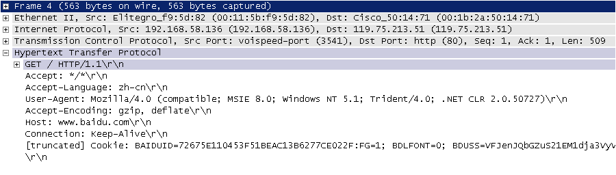
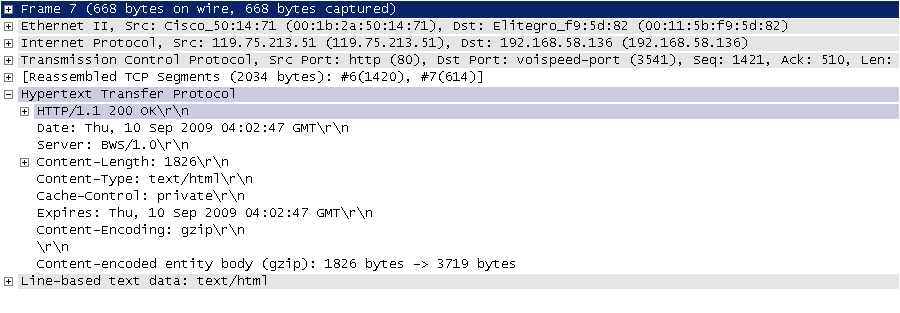
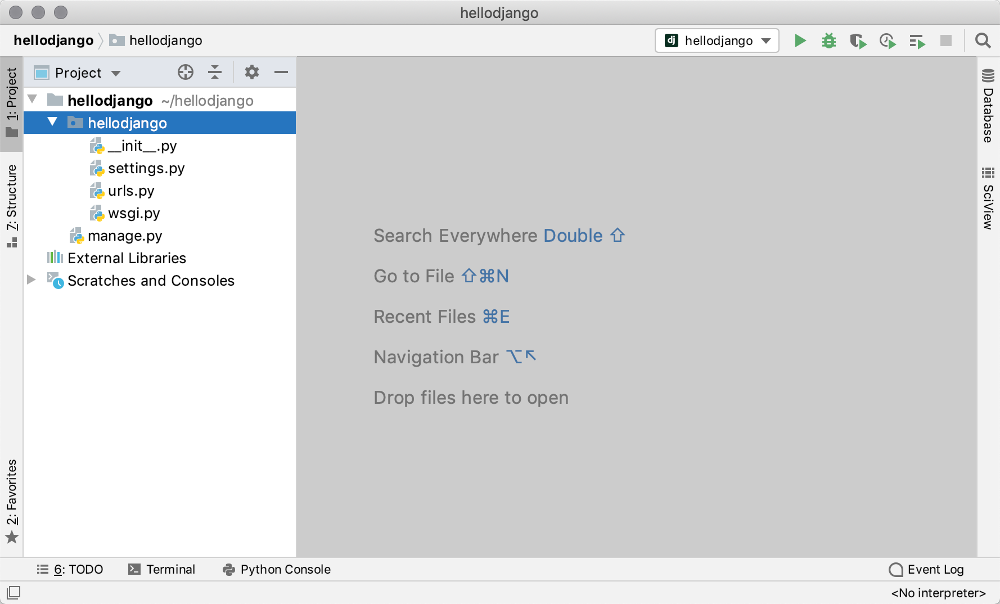
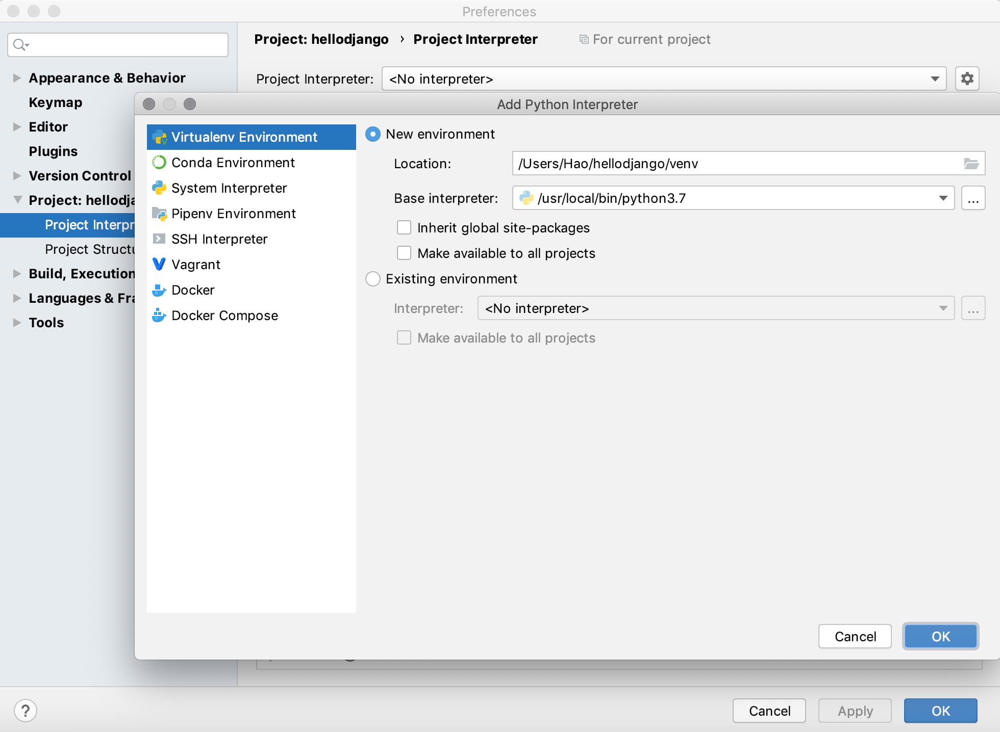
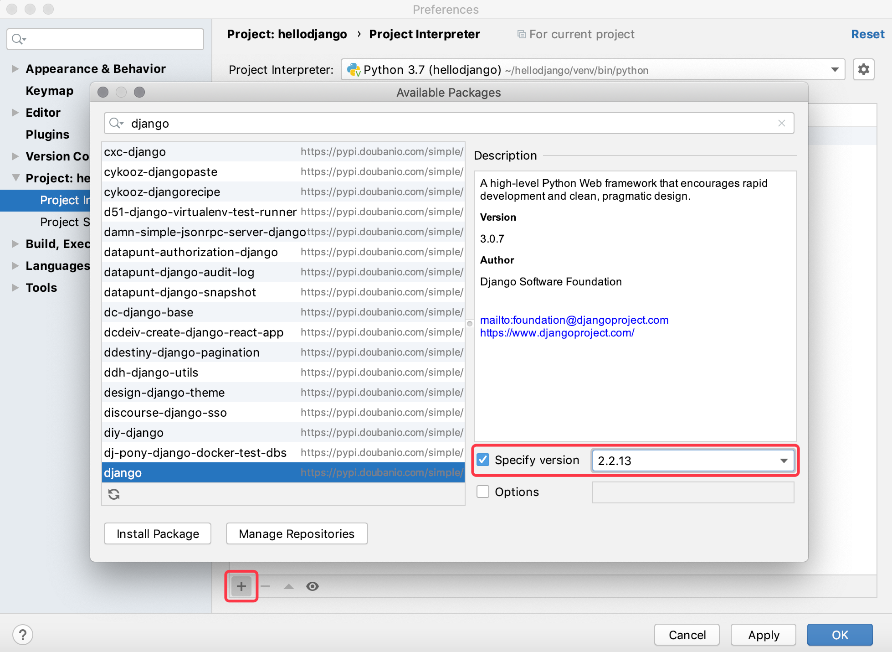
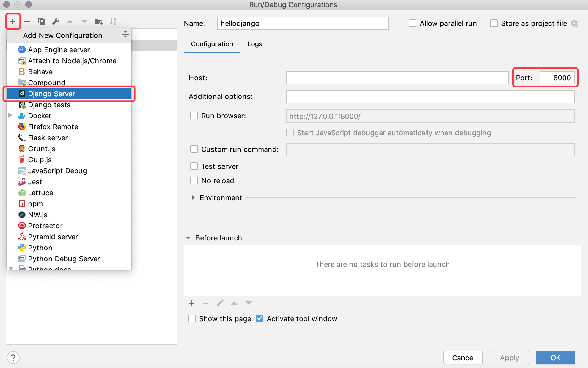
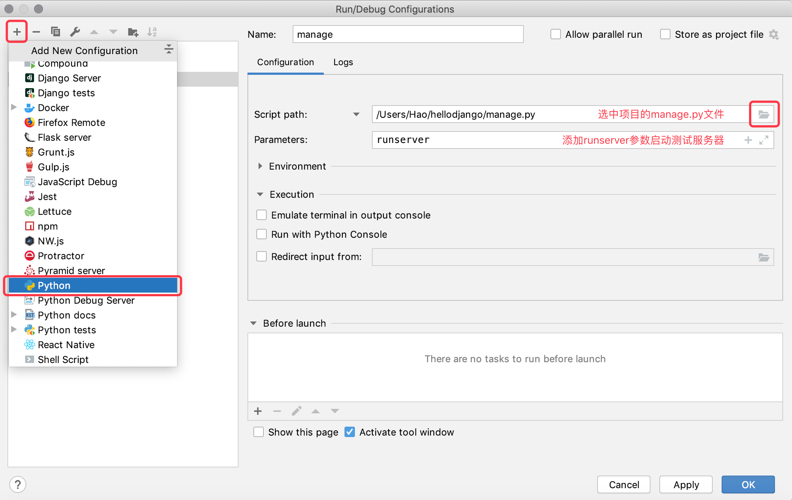
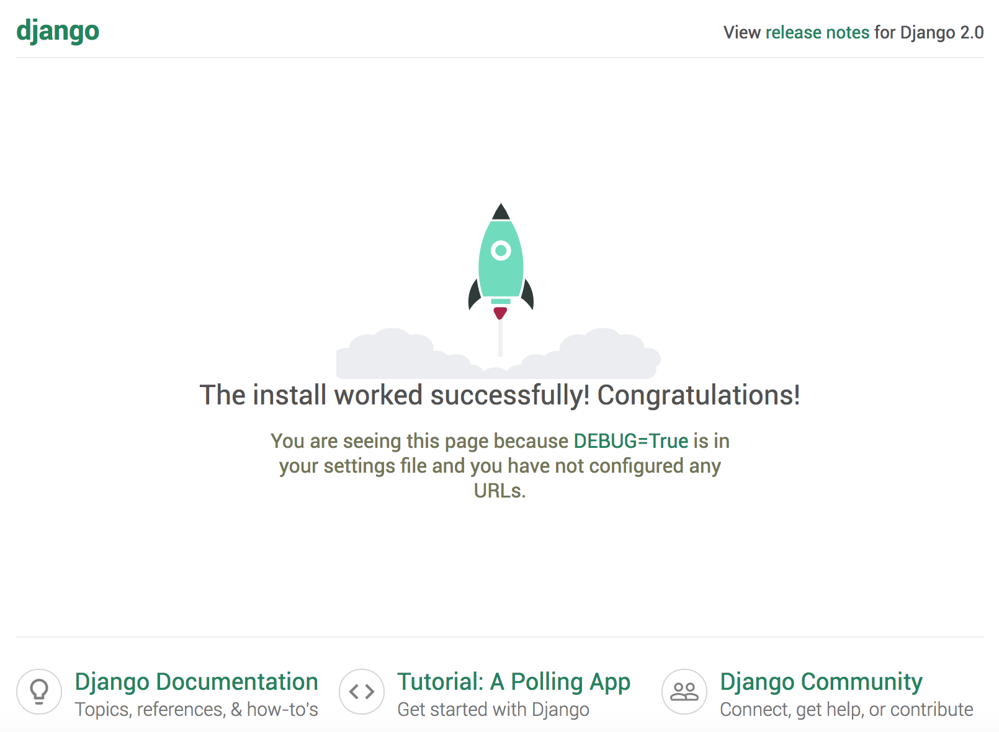
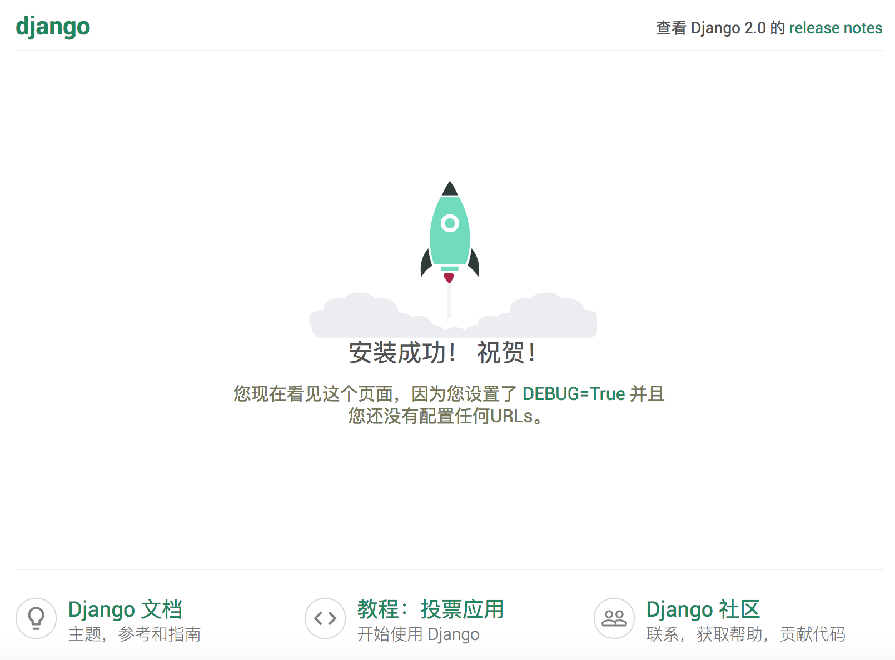
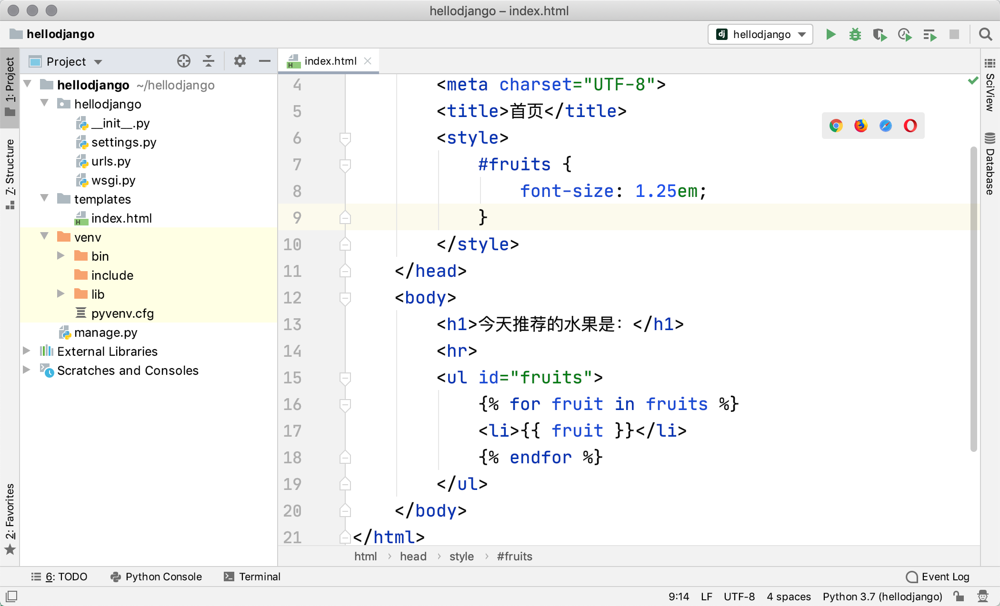

## Bắt đầu nhanh với Django

Ở giai đoạn đầu của phát triển web, các lập trình viên phải viết thủ công từng trang một. Ví dụ như một trang web cổng thông tin tin tức, ngày nào cũng phải sửa đổi trang HTML của nó; cùng với sự gia tăng về quy mô và dung lượng của trang web, cách làm này chắc chắn vô cùng tồi tệ. Để giải quyết vấn đề này, các nhà phát triển đã nghĩ ra việc dùng chương trình để tạo nội dung động cho máy chủ web, tức là nội dung động trong trang web không còn được viết thủ công nữa mà được chương trình tự động tạo ra. Thời kỳ đầu, kỹ thuật này được gọi là CGI (Common Gateway Interface - Giao diện cổng chung). Đương nhiên theo thời gian, CGI bộc lộ ngày càng nhiều vấn đề, chẳng hạn như số lượng lớn mã bản mẫu (boilerplate code) lặp đi lặp lại, hiệu năng tổng thể tương đối thấp. Trong bối cảnh thời thế vẫy gọi những anh hùng mới, các kỹ thuật phát triển ứng dụng web như PHP, ASP, JSP đã mọc lên như nấm sau mưa vào giữa và cuối những năm 1990. Thông thường, ứng dụng web mà chúng ta nhắc đến là các chương trình ứng dụng truy cập tài nguyên mạng thông qua trình duyệt. Nhờ tính phổ biến và dễ sử dụng của trình duyệt, ứng dụng web sử dụng rất tiện lợi và đơn giản, loại bỏ rắc rối khi phải cài đặt và cập nhật ứng dụng; đứng ở góc độ lập trình viên, cũng không cần bận tâm người dùng đang sử dụng hệ điều hành nào, thậm chí không cần phân biệt là thiết bị máy tính (PC) hay thiết bị di động.

### Cơ chế và thuật ngữ ứng dụng Web

Hình dưới đây cho chúng ta thấy quy trình làm việc của ứng dụng web, các thuật ngữ liên quan được nêu trong bảng sau.


> **Giải thích**: Tin rằng các độc giả có kinh nghiệm sẽ nhận ra rằng trong hình này thực ra còn thiếu rất nhiều thứ, ví dụ như máy chủ reverse proxy, máy chủ cơ sở dữ liệu, tường lửa, v.v., và mỗi nút (node) trong hình khi triển khai dự án thực tế có thể là một cụm (cluster) gồm nhiều nút hợp thành. Đương nhiên, nếu bạn chưa có khái niệm gì về những điều này thì cũng không sao, cứ tiếp tục là được, phần sau sẽ giải thích chi tiết cho bạn.

| Thuật ngữ | Giải thích |
| ------------- | ------------------------------------------------------------ |
| **URL/URI**   | Bộ định vị tài nguyên thống nhất / Bộ nhận dạng tài nguyên thống nhất, định danh duy nhất của tài nguyên mạng |
| **Tên miền**  | Chuỗi ký tự dễ nhớ tương ứng với địa chỉ của máy chủ Web |
| **DNS**       | Dịch vụ phân giải tên miền, có thể chuyển đổi tên miền thành địa chỉ IP tương ứng |
| **Địa chỉ IP** | Định danh của máy chủ trên mạng, thông qua địa chỉ IP có thể phân biệt các máy chủ khác nhau |
| **HTTP**      | Giao thức truyền tải siêu văn bản, giao thức tầng ứng dụng xây dựng trên TCP, nền tảng của truyền thông dữ liệu World Wide Web |
| **Reverse proxy** | Đại diện cho máy khách gửi yêu cầu đến máy chủ, sau đó trả tài nguyên mà máy chủ trả về lại cho máy khách |
| **Máy chủ Web** | Tiếp nhận yêu cầu HTTP, sau đó trả về tệp HTML, tệp văn bản thuần, hình ảnh và các tài nguyên khác cho bên yêu cầu |
| **Nginx**     | Máy chủ Web hiệu năng cao, cũng có thể dùng làm [reverse proxy](https://zh.wikipedia.org/wiki/%E5%8F%8D%E5%90%91%E4%BB%A3%E7%90%86), [cân bằng tải](https://zh.wikipedia.org/wiki/%E8%B4%9F%E8%BD%BD%E5%9D%87%E8%A1%A1) và [bộ nhớ đệm HTTP](https://zh.wikipedia.org/wiki/HTTP%E7%BC%93%E5%AD%98) |

#### Giao thức HTTP

Ở đây trước hết chúng ta dành một chút thời gian để nói về giao thức HTTP. HTTP (Giao thức truyền tải siêu văn bản) là giao thức tầng ứng dụng được xây dựng trên TCP (Giao thức điều khiển truyền vận), nó tận dụng dịch vụ truyền tải đáng tin cậy do TCP cung cấp để thực hiện việc trao đổi dữ liệu trong ứng dụng web. Theo giới thiệu trên Wikipedia, mục đích ban đầu khi thiết kế HTTP là cung cấp một phương pháp phát hành và tiếp nhận trang [HTML](https://zh.wikipedia.org/wiki/HTML), nói cách khác giao thức này là phương tiện mang dữ liệu được truyền giữa trình duyệt và máy chủ web. Về thông tin chi tiết cũng như tình hình phát triển hiện tại của giao thức này, các bạn có thể đọc các bài viết [《Nhập môn giao thức HTTP》](http://www.ruanyifeng.com/blog/2016/08/http.html), loạt bài [《Nhập môn giao thức Internet》](http://www.ruanyifeng.com/blog/2012/05/internet_protocol_suite_part_i.html) cũng như [《Minh họa giao thức HTTPS bằng hình ảnh》](http://www.ruanyifeng.com/blog/2014/09/illustration-ssl.html) để tìm hiểu. Hình ảnh dưới đây là gói tin yêu cầu và phản hồi HTTP khi truy cập trang chủ Baidu được tôi bắt lại bằng công cụ phân tích giao thức mã nguồn mở Ethereal (tiền thân của công cụ bắt gói tin WireShark) trong thời gian học tập và làm việc tại Phòng thí nghiệm Trọng điểm Công nghệ Truyền thông Mạng tỉnh Tứ Xuyên. Do Ethereal bắt dữ liệu đi qua card mạng, nên có thể nhìn thấy rõ ràng dữ liệu giao thức từ tầng liên kết vật lý đến tầng ứng dụng.

HTTP request (Dòng yêu cầu + Header yêu cầu + Dòng trống + [Body thông điệp]):



HTTP response (Dòng phản hồi + Header phản hồi + Dòng trống + Body thông điệp):



>  **Giải thích**: Hai bức hình này được chụp vào rạng sáng ngày 10 tháng 9 năm 2009, mong rằng hai ảnh chụp màn hình tựa như những tấm ảnh ố vàng này có thể giúp bạn hiểu được HTTP thực sự trông như thế nào. Đương nhiên, nếu không có công cụ bắt gói tin chuyên nghiệp, bạn cũng có thể xem định dạng dữ liệu của yêu cầu và phản hồi HTTP thông qua "Công cụ dành cho nhà phát triển" do trình duyệt cung cấp.

### Tổng quan về Django

Python có hàng trăm web framework, nhiều hơn cả số từ khóa của nó. Cái gọi là web framework chính là cơ sở hạ tầng dùng để phát triển ứng dụng phía máy chủ web, nói một cách dễ hiểu thì đó là một tập hợp các module và công cụ được đóng gói sẵn. Trên thực tế, ngay cả khi không có web framework, chúng ta vẫn có thể dùng socket hoặc [CGI](https://zh.wikipedia.org/wiki/%E9%80%9A%E7%94%A8%E7%BD%91%E5%85%B3%E6%8E%A5%E5%8F%A3) để phát triển ứng dụng phía máy chủ web, nhưng chi phí và cái giá phải trả khi làm như vậy trong các dự án thương mại thường là không thể chấp nhận được. Thông qua web framework, chúng ta có thể biến phức tạp thành đơn giản, giảm khối lượng công việc khi tạo mới, cập nhật và mở rộng ứng dụng. Vừa rồi chúng ta đã nói Python có hàng trăm web framework, các framework này bao gồm Django, Flask, Tornado, Sanic, Pyramid, Bottle, Web2py, web.py, v.v.

Trong số các web framework Python kể trên, Django chắc chắn là cái tên hạng nặng tiêu biểu nhất. Các nhà phát triển có thể dựa vào Django để phát triển nhanh chóng các ứng dụng web đáng tin cậy, bởi vì nó giảm thiểu các chi phí phát sinh không cần thiết trong phát triển web, đóng gói các mẫu thiết kế và phát triển thường dùng, đồng thời hỗ trợ kiến trúc MVC (trong Django gọi là kiến trúc MTV). MVC là một kiến trúc phổ quát trong lĩnh vực phát triển hệ thống phần mềm, nó chia các thành phần trong hệ thống thành ba phần: Model (Mô hình), View (Khung nhìn) và Controller (Bộ điều khiển), nhờ đó thực hiện việc tách rời liên kết giữa model (dữ liệu) và view (hiển thị). Do model và view đã được phân tách, nên cần một người trung gian để kết nối model và view đã tách rời lại với nhau, và bên đóng vai trò này chính là controller. Các hệ thống phần mềm có quy mô nhất định đều sẽ sử dụng kiến trúc MVC (hoặc các kiến trúc tiến hóa từ MVC). Trong dự án Django chúng ta gọi là MTV; chữ M trong MTV không khác gì chữ M trong MVC, đều là model đại diện cho dữ liệu; T đại diện cho Template (khuôn mẫu trang web, hiển thị dữ liệu); còn V đại diện cho View function (hàm khung nhìn), trong framework Django, hàm view cùng với bản thân framework Django đóng vai trò là C trong MVC.


Framework Django ra đời vào năm 2003, là một dự án lớn lên từ các ứng dụng thực tế, do đội ngũ nghiên cứu và phát triển hệ thống quản trị nội dung (CMS) của trang web tin tức trực tuyến thuộc Tập đoàn Xuất bản Lawrence (chủ yếu là Adrian Holovaty và Simon Willison) phát triển, và được đặt tên theo nghệ sĩ guitar jazz Gypsy người Bỉ Django Reinhardt. Framework Django được phát hành dưới dạng mã nguồn mở vào mùa hè năm 2005. Sử dụng framework Django có thể xây dựng một trang web đầy đủ tính năng trong thời gian rất ngắn, bởi vì nó đã thay lập trình viên hoàn thành những công việc lặp đi lặp lại nhàm chán đó, để lại các nghiệp vụ cốt lõi thực sự có ý nghĩa cho lập trình viên phát triển, đây chính là sự thực hành tốt nhất cho triết lý DRY (Don't Repeat Yourself). Rất nhiều trang web và ứng dụng thành công được phát triển dựa trên ngôn ngữ Python, các trang web tiêu biểu tại Trung Quốc có thể kể đến: Zhihu, Douban, Guokr, Sohu Mail, 101 Weiqi, Haibao, Beishuba, Duitang, Sohu Mobile, Codoon, Aifuwo, Guoku, v.v., trong đó không ít sản phẩm đã sử dụng framework Django.

### Bắt đầu nhanh

#### Dự án Django đầu tiên

1. Kiểm tra môi trường Python: Django 1.11 yêu cầu Python 2.7 hoặc Python 3.4 trở lên; Django 2.0 yêu cầu Python 3.4 trở lên; Django 2.1 và 2.2 yêu cầu Python 3.5 trở lên; Django 3.0 yêu cầu Python 3.6 trở lên.

   > **Giải thích**: Môi trường trình thông dịch Python tương ứng với các phiên bản khác nhau của framework Django có thể tìm thấy trong mục [FAQ](https://docs.djangoproject.com/zh-hans/3.0/faq/install/#faq-python-version-support) của tài liệu chính thức Django.

   Có thể nhập lệnh sau trong terminal của macOS để kiểm tra phiên bản trình thông dịch Python, trên hệ điều hành Windows có thể nhập `python --version` trong Command Prompt.
   
   ```Bash
   python3 --version
   ```
   
   Cũng có thể thực thi đoạn mã sau trong môi trường tương tác của Python để xem phiên bản của trình thông dịch Python.
   
   ```Shell
   import sys
   sys.version
   sys.version_info
   ```
   
2. Cập nhật công cụ quản lý package và cài đặt môi trường Django (dùng để tạo dự án Django).

   > **Giải thích**: Khi cập nhật tài liệu này, phiên bản chính thức mới nhất của Django là 3.0.7. Django 3.0 cung cấp hỗ trợ cho ASGI, có thể thực hiện giao tiếp bất đồng bộ song công toàn phần, nhưng trải nghiệm sử dụng hiện tại còn ở mức trung bình, do đó tạm thời không khuyến khích các bạn dùng Django 3.0; dưới đây chúng ta cài đặt phiên bản Django 2.2.13. Khi dùng `pip` để cài đặt thư viện bên thứ ba và các công cụ, có thể dùng `==` để chỉ định phiên bản cài đặt.
   
   ```Bash
   pip3 install -U pip
   pip3 install django==2.2.13
   ```
   
3. Kiểm tra môi trường Django và sử dụng lệnh `django-admin` để tạo dự án Django (tên dự án là hellodjango).

   ```Shell
   django-admin --version
   django-admin startproject hellodjango
   ```

4. Dùng PyCharm mở dự án Django vừa tạo và thêm môi trường ảo cho nó.

   

   Như hình trên, trong trình duyệt dự án của PyCharm, thư mục cấp cao nhất `hellodjango` là thư mục dự án Python, tên của thư mục này không quan trọng và dự án Django cũng không bận tâm thư mục này tên gì. Bên dưới thư mục đó có một thư mục cùng tên, đó là thư mục dự án Django, chứa 4 tệp `__init__.py`, `settings.py`, `urls.py`, `wsgi.py`; cùng cấp với thư mục dự án Django mang tên `hellodjango` còn có một tệp tên là `manage.py`. Tác dụng của các tệp này như sau:

   - `hellodjango/__init__.py`: Tệp trống, thông báo cho trình thông dịch Python biết thư mục này nên được xem như một package Python.
   - `hellodjango/settings.py`: Tệp cấu hình của dự án Django.
   - `hellodjango/urls.py`: Khai báo ánh xạ URL của dự án Django, giống như "mục lục" của trang web.
   - `hellodjango/wsgi.py`: Tệp điểm vào khi dự án chạy trên máy chủ Web tương thích WSGI.
   - `manage.py`: Chương trình script quản lý dự án Django.

   > **Giải thích**: WSGI là viết tắt của Web Server Gateway Interface (Giao diện cổng máy chủ web), định nghĩa trên Wikipedia giải thích là "một giao diện đơn giản và phổ biến được xác định cho ngôn ngữ Python giữa [máy chủ Web](https://zh.wikipedia.org/wiki/%E7%B6%B2%E9%A0%81%E4%BC%BA%E6%9C%8D%E5%99%A8) và [ứng dụng Web](https://zh.wikipedia.org/wiki/%E7%BD%91%E7%BB%9C%E5%BA%94%E7%94%A8%E7%A8%8B%E5%BA%8F) hoặc framework".

   Giao diện tạo môi trường ảo như hình dưới đây.

   

5. Cài đặt các dependency của dự án.

   Cách 1: Mở terminal trong PyCharm, dùng lệnh `pip` trong terminal để cài đặt các dependency của dự án Django.

   > **Giải thích**: Do đã tạo môi trường ảo cho dự án dựa trên môi trường trình thông dịch Python 3, nên lệnh `python` trong môi trường ảo tương ứng với trình thông dịch Python 3, còn lệnh `pip` tương ứng với công cụ quản lý package của Python 3.

   ```Shell
   pip install django==2.2.13
   ```

   Cách 2: Trong phần cài đặt (Preferences/Settings) của PyCharm, bạn có thể tìm thấy môi trường trình thông dịch của dự án và các thư viện bên thứ ba đã cài đặt, có thể nhấp vào nút thêm để cài đặt dependency mới. Cần nhắc nhở mọi người là khi cài đặt dependency Django, cần chỉ định số hiệu phiên bản, nếu không mặc định sẽ cài đặt phiên bản 3.0.7 mới nhất tại thời điểm cập nhật bài viết.

   

   Bảng dưới đây thể hiện mối quan hệ tương ứng giữa phiên bản Django và phiên bản Python, mời các bạn tự đối chiếu.

   | Phiên bản Django | Phiên bản Python |
   | ---------- | ----------------------------------------- |
   | 1.8        | 2.7, 3.2, 3.3, 3.4, 3.5                   |
   | 1.9, 1.10  | 2.7, 3.4, 3.5                             |
   | 1.11       | 2.7, 3.4, 3.5, 3.6, 3.7 (Django 1.11.17) |
   | 2.0        | 3.4, 3.5, 3.6, 3.7                        |
   | 2.1        | 3.5, 3.6, 3.7                             |
   | 2.2        | 3.5, 3.6, 3.7, 3.8 (Django 2.2.8)        |
   | 3.0        | 3.6, 3.7, 3.8                             |

6. Khởi động máy chủ tích hợp sẵn của Django để chạy dự án.

   Cách 1: Trong menu "Run", chọn "Edit Configurations", cấu hình "Django server" để chạy dự án (áp dụng cho PyCharm bản Professional).

   

   Cách 2: Trong menu "Run", chọn "Edit Configurations", cấu hình chạy chương trình "Python" để chạy dự án (áp dụng cho cả PyCharm bản Professional và Community).

   

   Cách 3: Chạy dự án thông qua lệnh trong Terminal của PyCharm (áp dụng cho cả PyCharm bản Professional và Community).

   ```Shell
   python manage.py runserver
   ```

7. Xem kết quả vận hành.

   Nhập `http://127.0.0.1:8000` vào trình duyệt để truy cập máy chủ của chúng ta, kết quả như hình dưới đây.

   

   > **Giải thích**:
   >
   > 1. Máy chủ tích hợp sẵn của Django vừa khởi động chỉ được dùng cho môi trường phát triển và thử nghiệm, vì máy chủ này là máy chủ Web dung lượng nhẹ được viết thuần bằng Python, không thích hợp sử dụng trong môi trường sản xuất.
   > 2. Nếu sửa đổi mã nguồn, không cần khởi động lại máy chủ tích hợp của Django để mã sửa đổi có hiệu lực. Tuy nhiên, khi thêm các tệp dự án mới, máy chủ này sẽ không tự động nạp lại, lúc này phải khởi động lại máy chủ theo cách thủ công.
   > 3. Có thể dùng lệnh `python manage.py help` trong terminal để xem các tham số lệnh khả dụng của script quản lý Django.
   > 4. Khi dùng `python manage.py runserver` để khởi động máy chủ, có thể thêm tham số phía sau để chỉ định địa chỉ IP và số hiệu cổng, mặc định máy chủ được khởi động sẽ chạy trên cổng `8000` của máy cục bộ.
   > 5. Máy chủ đang chạy trong terminal có thể dừng bằng Ctrl+C. Máy chủ chạy qua cấu hình chạy của PyCharm có thể nhấp trực tiếp vào nút đóng trên cửa sổ để chấm dứt vận hành máy chủ.
   > 6. Không thể khởi động nhiều máy chủ trên cùng một cổng vì sẽ dẫn đến xung đột địa chỉ (cổng là phần mở rộng của địa chỉ IP, cũng là một phần của địa chỉ mạng máy tính).

8. Sửa đổi tệp cấu hình `settings.py` của dự án.

   Django là một framework hỗ trợ quốc tế hóa và bản địa hóa, do đó trang chủ mặc định của dự án Django mà chúng ta vừa thấy cũng hỗ trợ quốc tế hóa. Chúng ta có thể sửa đổi tệp cấu hình để đổi ngôn ngữ mặc định sang tiếng Trung, múi giờ đặt thành múi giờ Đông 8.

   Tìm cấu hình trước khi sửa (sau dòng thứ 100 trong tệp `settings.py`):

   ```Python
   LANGUAGE_CODE = 'en-us'
   TIME_ZONE = 'UTC'
   ```

   Sửa thành nội dung sau:

   ```Python
   LANGUAGE_CODE = 'zh-hans'
   TIME_ZONE = 'Asia/Chongqing'
   ```

   Làm mới trang vừa rồi, bạn có thể thấy kết quả sau khi sửa đổi mã ngôn ngữ và múi giờ.

   

#### Tạo ứng dụng của riêng bạn

Nếu muốn phát triển ứng dụng Web của riêng mình, trước tiên cần tạo "ứng dụng" trong dự án Django. Một dự án Django có thể chứa một hoặc nhiều ứng dụng.

1. Trong terminal của PyCharm, thực thi lệnh sau để tạo ứng dụng có tên `first`.

   ```Shell
   python manage.py startapp first
   ```

   Thực thi lệnh trên sẽ tạo thư mục `first` dưới đường dẫn hiện tại, cấu trúc thư mục của nó như sau:

   - `__init__.py`: Một tệp trống, thông báo cho trình thông dịch Python biết thư mục này nên được xem như một package Python.
   - `admin.py`: Có thể dùng để đăng ký model, dùng để quản lý model trong trang quản trị tích hợp sẵn của framework Django.
   - `apps.py`: Tệp cấu hình của ứng dụng hiện tại.
   - `migrations`: Nơi lưu trữ thông tin di chuyển cơ sở dữ liệu liên quan đến model.
     - `__init__.py`: Một tệp trống, thông báo cho trình thông dịch Python biết thư mục này nên được xem như một package Python.
   - `models.py`: Nơi lưu trữ mô hình dữ liệu của ứng dụng (chữ M trong MTV).
   - `tests.py`: Chứa các lớp kiểm thử và hàm kiểm thử để kiểm tra các chức năng của ứng dụng.
   - `views.py`: Hàm hoặc lớp xử lý yêu cầu HTTP của người dùng và trả về phản hồi HTTP (chữ V trong MTV).

2. Sửa đổi tệp view `views.py` trong thư mục ứng dụng.

   ```Python
   from django.http import HttpResponse


   def show_index(request):
       return HttpResponse('<h1>Hello, Django!</h1>')
   ```
   
4. Sửa đổi tệp `urls.py` trong thư mục dự án Django, ánh xạ hàm view với đường dẫn mà người dùng yêu cầu trong trình duyệt.

   ```Python
   from django.contrib import admin
   from django.urls import path, include

   from first.views import show_index

   urlpatterns = [
       path('admin/', admin.site.urls),
       path('hello/', show_index),
   ]
   ```
   
5. Chạy lại dự án và mở trình duyệt truy cập `http://127.0.0.1:8000/hello/`.

5. Ở trên chúng ta đã tạo nội dung cho trình duyệt thông qua code, nhưng đó vẫn là nội dung tĩnh. Nếu muốn tạo nội dung động, có thể sửa đổi tệp `views.py` và thêm mã như sau.

   ```Python
   from random import sample

   from django.http import HttpResponse


   def show_index(request):
       fruits = [
           'Apple', 'Orange', 'Pitaya', 'Durian', 'Waxberry', 'Blueberry',
           'Grape', 'Peach', 'Pear', 'Banana', 'Watermelon', 'Mango'
       ]
       selected_fruits = sample(fruits, 3)
       content = '<h3>Trái cây được đề xuất hôm nay là:</h3>'
       content += '<hr>'
       content += '<ul>'
       for fruit in selected_fruits:
           content += f'<li>{fruit}</li>'
       content += '</ul>'
       return HttpResponse(content)
   ```

6. Làm mới trang để xem kết quả vận hành của chương trình, hãy xem mỗi lần làm mới trang web có thấy nội dung khác nhau hay không.


#### Sử dụng template

Cách làm trên thông qua nối chuỗi mã HTML để tạo nội dung động cho trình duyệt là không thể chấp nhận được trong phát triển thực tế, bởi vì các trang front-end trong dự án thực tế có thể rất phức tạp, không thể hoàn thành bằng cách nối nội dung động như thế này, điểm này chắc chắn mọi người đều có thể hình dung được. Để giải quyết vấn đề này, chúng ta có thể chuẩn bị trước một trang mẫu (chữ T trong MTV). Cái gọi là trang template chính là một trang HTML có chứa các placeholder và chỉ thị template.

Trong framework Django có một hàm tiện ích tên là `render` có thể hoàn thành thao tác render template. Cái gọi là render chính là dùng dữ liệu để thay thế các chỉ thị template và placeholder trong trang template. Đương nhiên việc render ở đây được gọi là server-side rendering, tức là hoàn thành việc render trang ở phía máy chủ rồi mới xuất ra trình duyệt. Cách làm server-side rendering khi lượng truy cập của ứng dụng web lớn sẽ khiến máy chủ phải chịu gánh nặng khá lớn, do đó ngày càng có nhiều ứng dụng web lựa chọn phương thức client-side rendering, tức là máy chủ chỉ cung cấp dữ liệu cần thiết cho trang (thường là định dạng JSON), rồi dùng mã JavaScript trong trình duyệt để lấy các dữ liệu này và render lên trang. Về nội dung client-side rendering, chúng ta sẽ giải thích cho các bạn trong các bài học sau; hiện tại chúng ta sử dụng phương pháp render phía máy chủ thông qua trang template, các bước cụ thể như sau.

Các bước sử dụng trang template như sau:

1. Tạo thư mục tên là `templates` trong thư mục dự án.

   

2. Thêm trang template `index.html`.

   > **Giải thích**: Trong phát triển dự án thực tế, các trang tĩnh do lập trình viên front-end cung cấp, lập trình viên back-end cần sửa đổi trang tĩnh thành trang template để có thể render nó thông qua chương trình Python, cách làm này chính là server-side rendering đã đề cập ở trên.

   ```HTML
   <!DOCTYPE html>
   <html lang="en">
       <head>
           <meta charset="UTF-8">
           <title>Trang chủ</title>
           <style>
               #fruits {
                   font-size: 1.25em;
               }
           </style>
       </head>
       <body>
           <h1>Trái cây được đề xuất hôm nay là:</h1>
           <hr>
           <ul id="fruits">
               
               <li>{{ fruit }}</li>
               
           </ul>
       </body>
   </html>
   ```
   Trong trang template ở trên, chúng ta đã sử dụng cú pháp placeholder template như `{{ fruit }}`, đồng thời cũng sử dụng chỉ thị template như ``, những cú pháp này đều là một phần của Ngôn ngữ Template Django (DTL). Về cú pháp và chỉ thị template, các bạn có thể xem tài liệu chính thức; tin rằng những nội dung này rất dễ hiểu, không cần giải thích quá nhiều, các bạn cũng có thể tham khảo [tài liệu chính thức]() để tìm hiểu về các chỉ thị và cú pháp template.

3. Sửa đổi tệp `views.py`, gọi hàm `render` để kết xuất trang template.

   ```Python
   from random import sample

   from django.shortcuts import render


   def show_index(request):
       fruits = [
           'Apple', 'Orange', 'Pitaya', 'Durian', 'Waxberry', 'Blueberry',
           'Grape', 'Peach', 'Pear', 'Banana', 'Watermelon', 'Mango'
       ]
       selected_fruits = sample(fruits, 3)
       return render(request, 'index.html', {'fruits': selected_fruits})
   ```

   Tham số đầu tiên của hàm `render` là đối tượng request, tham số thứ hai là tên của trang template mà chúng ta muốn render, tham số thứ ba là dữ liệu muốn render lên trang. Chúng ta truyền dữ liệu cho trang template thông qua một từ điển, các khóa trong từ điển chính là tên biến được sử dụng trong chỉ thị template hoặc placeholder của trang template.

4. Đến đây, `render` trong hàm view vẫn chưa thể tìm thấy tệp template `index.html`, cần sửa đổi tệp `settings.py` để cấu hình đường dẫn chứa tệp template. Sửa đổi tệp `settings.py`, tìm cấu hình `TEMPLATES`, sửa đổi cấu hình `DIRS` trong đó.

   ```Python
   TEMPLATES = [
       {
           'BACKEND': 'django.template.backends.django.DjangoTemplates',
           'DIRS': [os.path.join(BASE_DIR, 'templates'), ],
           'APP_DIRS': True,
           'OPTIONS': {
               'context_processors': [
                   'django.template.context_processors.debug',
                   'django.template.context_processors.request',
                   'django.contrib.auth.context_processors.auth',
                   'django.contrib.messages.context_processors.messages',
               ],
           },
       },
   ]
   ```

5. Chạy lại dự án hoặc làm mới trực tiếp trang web để xem kết quả.

### Tổng kết

Đến đây, chúng ta đã sử dụng framework Django để hoàn thành một ứng dụng Web rất nhỏ; mặc dù nó chưa có giá trị thực tế nào nhưng qua dự án này bạn có thể có một cảm nhận trực quan về framework Django. Tài liệu học Django tốt nhất chắc chắn là [tài liệu chính thức](https://docs.djangoproject.com/zh-hans/2.0/) của nó. Tài liệu chính thức cung cấp hỗ trợ đa ngôn ngữ và có hướng dẫn cho người mới bắt đầu học cách sử dụng framework Django; khuyến khích các bạn học và sử dụng framework này bằng cách đọc tài liệu chính thức của Django. Đương nhiên cuốn sách [《Giáo trình cơ bản về Django》](http://www.ituring.com.cn/book/2630) do Turing Community xuất bản cũng là một cuốn sách nhập môn rất phù hợp cho người mới bắt đầu, độc giả quan tâm có thể nhấp vào liên kết để tìm hiểu mua sách.
