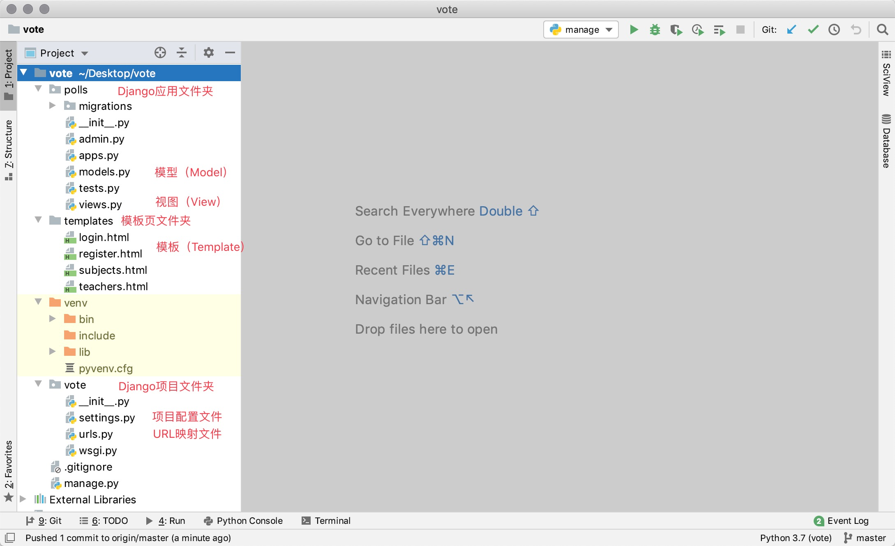
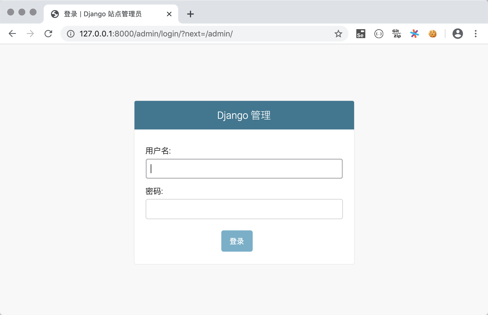
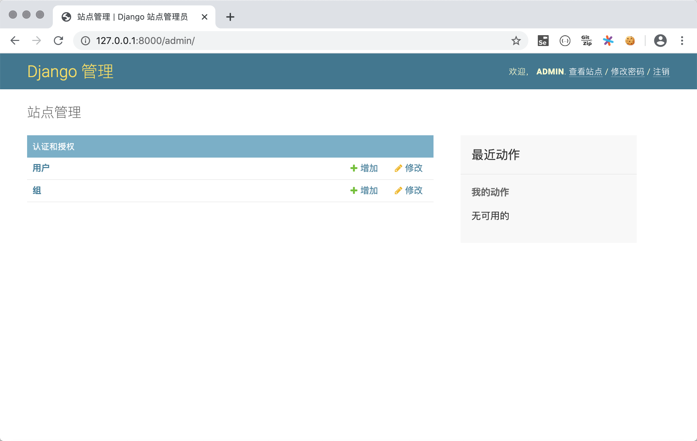
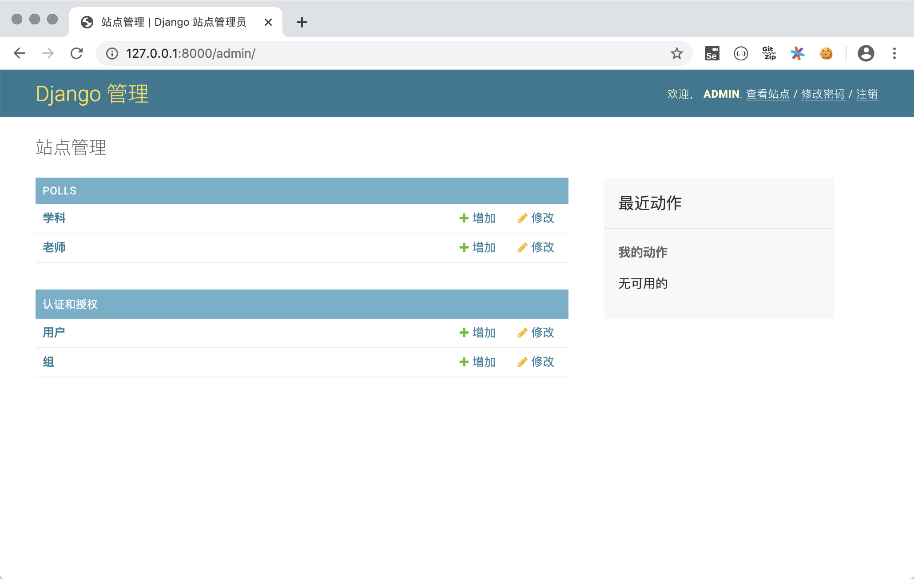
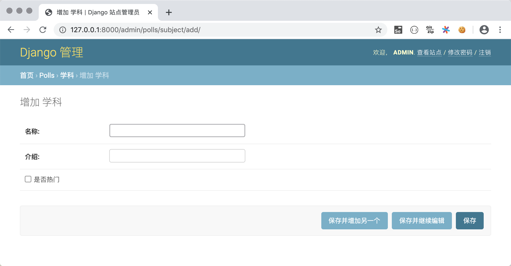
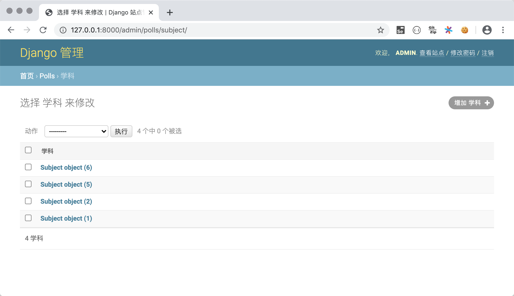
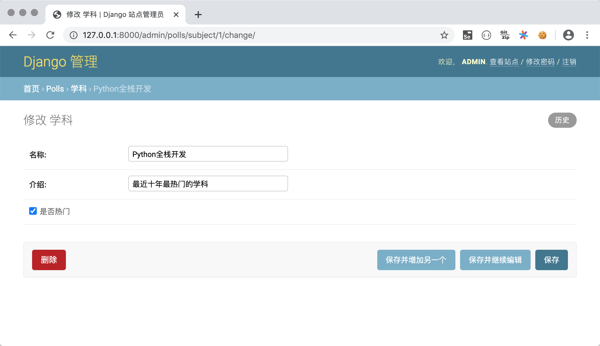
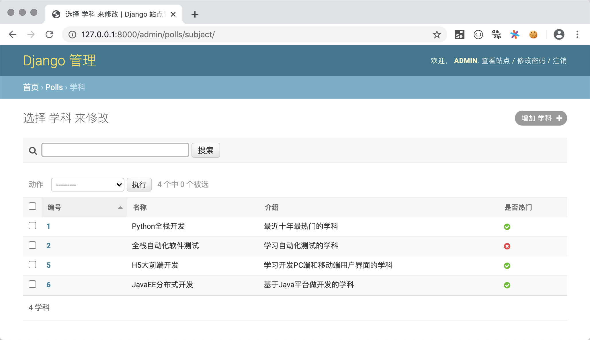
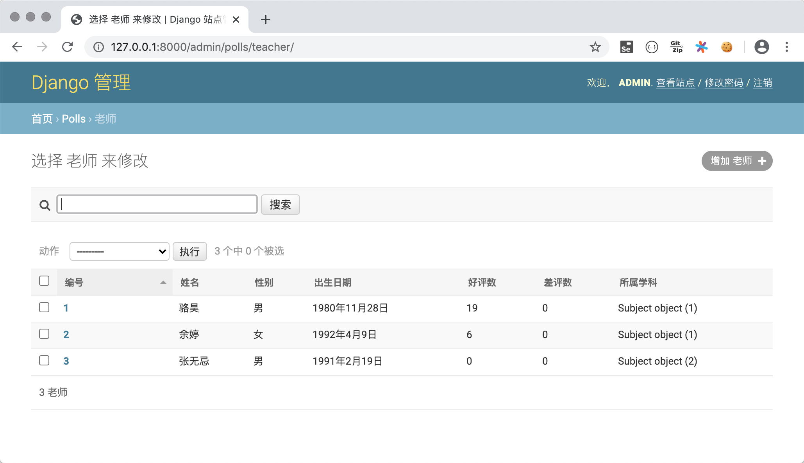

## Đi sâu vào Model

Trong chương trước, chúng ta đã đề cập rằng Django là một web framework dựa trên kiến trúc MVC, và kiến trúc MVC hướng tới sự tách biệt (decoupling) giữa "Model" và "View". Cái gọi là "Model" nói một cách trực tiếp hơn chính là (biểu diễn của) dữ liệu, vì vậy nó thường được gọi là "mô hình dữ liệu" (data model). Trong các dự án thực tế, mô hình dữ liệu thường được thực hiện thao tác lưu trữ lâu dài thông qua cơ sở dữ liệu, và cơ sở dữ liệu quan hệ luôn là lựa chọn hàng đầu cho việc lưu trữ bền vững từ trước đến nay. Dưới đây, chúng ta sẽ cùng hoàn thành một dự án bình chọn để tìm hiểu các kiến thức liên quan đến model. Trang chủ của dự án bình chọn sẽ hiển thị tất cả các môn học của một nền tảng giáo dục trực tuyến; nhấp vào môn học có thể xem danh sách giảng viên và thông tin của họ trong môn học đó; sau khi đăng nhập, người dùng có thể bình chọn cho giảng viên trên trang thông tin giảng viên, bao gồm phiếu ủng hộ (đánh giá tốt) và phiếu phản đối (đánh giá xấu); người dùng chưa đăng nhập có thể đăng nhập thông qua trang đăng nhập; người dùng chưa đăng ký có thể nhập thông tin cá nhân để đăng ký thông qua trang đăng ký. Trong dự án này, chúng ta sử dụng cơ sở dữ liệu MySQL để thực hiện lưu trữ dữ liệu bền vững.

### Tạo dự án và ứng dụng

Trước tiên, chúng ta tạo dự án Django mang tên `vote`, sau đó tạo môi trường ảo và cài đặt các thư viện phụ thuộc cho nó. Tiếp theo, tạo ứng dụng tên là `polls` trong dự án và thư mục `templates` để chứa các trang template. Cấu trúc thư mục của dự án như hình dưới đây.



Dựa theo yêu cầu dự án được mô tả ở trên, chúng ta chuẩn bị bốn trang tĩnh gồm: trang hiển thị môn học `subjects.html`, trang hiển thị giảng viên của môn học `teachers.html`, trang đăng nhập `login.html` và trang đăng ký `register.html`. Lát nữa chúng ta sẽ chỉnh sửa các trang tĩnh này thành các trang template mà dự án Django yêu cầu.

### Cấu hình cơ sở dữ liệu quan hệ MySQL

1. Tạo cơ sở dữ liệu trong MySQL, tạo người dùng và cấp quyền truy cập cơ sở dữ liệu cho người dùng đó.

   ```SQL
   create database vote default charset utf8;
   create user 'hellokitty'@'%' identified by 'Hellokitty.618';
   grant all privileges on vote.* to 'hellokitty'@'%';
   flush privileges;
   ```

2. Tạo bảng hai chiều trong MySQL để lưu thông tin môn học và giảng viên (bảng lưu thông tin người dùng sẽ xử lý sau).

   ```SQL
   use vote;
   
   -- Tạo bảng môn học
   create table `tb_subject`
   (
   	`no` integer auto_increment comment 'Mã môn học',
       `name` varchar(50) not null comment 'Tên môn học',
       `intro` varchar(1000) not null default '' comment 'Giới thiệu môn học',
       `is_hot` boolean not null default 0 comment 'Có phải môn học hot không',
       primary key (`no`)
   );
   -- Tạo bảng giảng viên
   create table `tb_teacher`
   (
       `no` integer auto_increment comment 'Mã giảng viên',
       `name` varchar(20) not null comment 'Họ tên giảng viên',
       `sex` boolean not null default 1 comment 'Giới tính giảng viên',
       `birth` date not null comment 'Ngày sinh',
       `intro` varchar(1000) not null default '' comment 'Giới thiệu giảng viên',
       `photo` varchar(255) not null default '' comment 'Ảnh giảng viên',
       `gcount` integer not null default 0 comment 'Số đánh giá tốt',
       `bcount` integer not null default 0 comment 'Số đánh giá xấu',
       `sno` integer not null comment 'Thuộc môn học nào',
       primary key (`no`),
       foreign key (`sno`) references `tb_subject` (`no`)
   );
   ```

3. Cài đặt các thư viện phụ thuộc cần thiết để kết nối cơ sở dữ liệu MySQL trong môi trường ảo.

   ```Bash
   pip install mysqlclient
   ```

   > **Giải thích**: Nếu vì lý do nào đó bạn không thể cài đặt thư viện bên thứ ba `mysqlclient`, bạn có thể sử dụng thư viện thay thế là `pymysql`. `pymysql` là thư viện Python thuần được phát triển để kết nối MySQL nên dễ cài đặt thành công hơn, nhưng bạn cần thêm đoạn mã sau vào tệp `__init__.py` của thư mục dự án Django.
   >
   > ```Python
   > import pymysql
   > 
   > pymysql.install_as_MySQLdb()
   > ```
   >
   > Nếu sử dụng Django phiên bản 2.2 trở lên, bạn còn có thể gặp vấn đề về tính tương thích giữa PyMySQL và framework Django. Vấn đề tương thích này sẽ khiến dự án không thể chạy được, bạn cần xử lý theo phương pháp được cung cấp trong phần [Issues](https://github.com/PyMySQL/PyMySQL/issues/790) của kho lưu trữ PyMySQL trên GitHub. Nhìn chung, việc sử dụng `pymysql` sẽ phiền phức hơn, vì vậy khuyến nghị mọi người ưu tiên cài đặt `mysqlclient`.

4. Sửa đổi tệp settings.py của dự án. Đầu tiên thêm ứng dụng `polls` mà chúng ta vừa tạo vào danh sách các ứng dụng đã cài đặt (`INSTALLED_APPS`), sau đó cấu hình MySQL làm giải pháp lưu trữ dữ liệu.

   ```Python
   INSTALLED_APPS = [
       'django.contrib.admin',
       'django.contrib.auth',
       'django.contrib.contenttypes',
       'django.contrib.sessions',
       'django.contrib.messages',
       'django.contrib.staticfiles',
       'polls',
   ]
   
   DATABASES = {
       'default': {
           # Cấu hình engine cơ sở dữ liệu
           'ENGINE': 'django.db.backends.mysql',
           # Tên cơ sở dữ liệu
           'NAME': 'vote',
           # Địa chỉ IP của máy chủ CSDL (máy cục bộ có thể điền localhost hoặc 127.0.0.1)
           'HOST': 'localhost',
           # Cổng dịch vụ MySQL
           'PORT': 3306,
           # Tên đăng nhập và mật khẩu cơ sở dữ liệu
           'USER': 'hellokitty',
           'PASSWORD': 'Hellokitty.618',
           # Bảng mã ký tự sử dụng cho cơ sở dữ liệu
           'CHARSET': 'utf8',
           # Cài đặt múi giờ thời gian cho cơ sở dữ liệu
           'TIME_ZONE': 'Asia/Chongqing',
       }
   }
   ```

   Khi cấu hình thuộc tính ENGINE, các giá trị tùy chọn phổ biến bao gồm:

   - `'django.db.backends.sqlite3'`: Cơ sở dữ liệu nhúng SQLite.
   - `'django.db.backends.postgresql'`: Sản phẩm cơ sở dữ liệu quan hệ mã nguồn mở phát hành theo giấy phép BSD.
   - `'django.db.backends.mysql'`: Sản phẩm cơ sở dữ liệu hiệu năng cao, tối ưu chi phí của tập đoàn Oracle.
   - `'django.db.backends.oracle'`: Sản phẩm cơ sở dữ liệu quan hệ chủ lực của tập đoàn Oracle.

   Các cấu hình khác có thể tham khảo phần [Cấu hình cơ sở dữ liệu](https://docs.djangoproject.com/zh-hans/2.0/ref/databases/#third-party-notes) trong tài liệu chính thức.

5. Framework Django cung cấp ORM để giải quyết vấn đề lưu trữ dữ liệu. ORM là viết tắt của "Object-Relational Mapping" (Ánh xạ quan hệ - đối tượng). Vì Python là một ngôn ngữ lập trình hướng đối tượng, chúng ta sử dụng mô hình đối tượng trong chương trình Python để lưu dữ liệu, trong khi cơ sở dữ liệu quan hệ sử dụng mô hình quan hệ và lưu dữ liệu bằng các bảng hai chiều. Hai mô hình này không khớp nhau. Việc sử dụng ORM là nhằm thực hiện **chuyển đổi hai chiều** giữa mô hình đối tượng và mô hình quan hệ, nhờ đó bạn không cần phải viết các câu lệnh SQL và thao tác con trỏ (cursor) trong mã nguồn Python nữa, vì những điều này đều sẽ được ORM tự động hoàn thành. Tận dụng ORM của Django, chúng ta có thể chuyển trực tiếp bảng môn học và bảng giảng viên vừa tạo thành các lớp model trong Django.

   ```Bash
   python manage.py inspectdb > polls/models.py
   ```

   Chúng ta có thể tinh chỉnh một chút các lớp model được tạo tự động, mã nguồn như sau.

   ```Python
   from django.db import models
   
   
   class Subject(models.Model):
       no = models.AutoField(primary_key=True, verbose_name='Mã số')
       name = models.CharField(max_length=50, verbose_name='Tên môn')
       intro = models.CharField(max_length=1000, verbose_name='Giới thiệu')
       is_hot = models.BooleanField(verbose_name='Có hot không')
   
       class Meta:
           managed = False
           db_table = 'tb_subject'
   
   
   class Teacher(models.Model):
       no = models.AutoField(primary_key=True, verbose_name='Mã số')
       name = models.CharField(max_length=20, verbose_name='Họ tên')
       sex = models.BooleanField(default=True, verbose_name='Giới tính')
       birth = models.DateField(verbose_name='Ngày sinh')
       intro = models.CharField(max_length=1000, verbose_name='Giới thiệu bản thân')
       photo = models.ImageField(max_length=255, verbose_name='Ảnh')
       good_count = models.IntegerField(default=0, db_column='gcount', verbose_name='Số đánh giá tốt')
       bad_count = models.IntegerField(default=0, db_column='bcount', verbose_name='Số đánh giá xấu')
       subject = models.ForeignKey(Subject, models.DO_NOTHING, db_column='sno')
   
       class Meta:
           managed = False
           db_table = 'tb_teacher'
   ```
   
   > **Giải thích**: Các lớp model đều kế thừa trực tiếp hoặc gián tiếp từ lớp `Model`. Lớp model tương ứng với bảng hai chiều trong cơ sở dữ liệu quan hệ, đối tượng model tương ứng với bản ghi trong bảng, và các thuộc tính của đối tượng model tương ứng với các trường trong bảng. Nếu bạn chưa thực sự hiểu rõ định nghĩa thuộc tính của các lớp model ở trên, có thể xem nội dung phần "Tham khảo định nghĩa model" ở cuối bài viết này.

### Sử dụng ORM hoàn thành thao tác CRUD trên model

Có ORM của framework Django, chúng ta có thể trực tiếp sử dụng phương thức hướng đối tượng để thực hiện các thao tác CRUD (thêm, đọc, sửa, xóa) trên dữ liệu. Chúng ta có thể nhập lệnh dưới đây vào terminal của PyCharm để vào môi trường tương tác của dự án Django, sau đó thử nghiệm các thao tác trên model.

```Bash
python manage.py shell
```

#### Thêm mới

```Python
from polls.models import Subject

subject1 = Subject(name='Lập trình Python Full-stack', intro='Ngành học hot nhất hiện nay', is_hot=True)
subject1.save()
subject2 = Subject(name='Kiểm thử phần mềm Full-stack', intro='Ngành học về kiểm thử tự động', is_hot=False)
subject2.save()
subject3 = Subject(name='Phát triển phân tán JavaEE', intro='Phát triển ứng dụng máy chủ dựa trên ngôn ngữ Java', is_hot=True)
```

#### Xóa

```Python
subject = Subject.objects.get(no=2)
subject.delete()
```

#### Cập nhật

```Shell
subject = Subject.objects.get(no=1)
subject.name = 'Python Full-stack + Trí tuệ nhân tạo'
subject.save()
```

#### Truy vấn

1. Truy vấn tất cả đối tượng.

```Shell
Subject.objects.all()
```

2. Lọc dữ liệu.

```Shell
# Truy vấn môn học có tên là "Python Full-stack + Trí tuệ nhân tạo"
Subject.objects.filter(name='Python Full-stack + Trí tuệ nhân tạo')

# Truy vấn môn học có tên chứa "Full-stack" (truy vấn mờ)
Subject.objects.filter(name__contains='Full-stack')
Subject.objects.filter(name__startswith='Full-stack')
Subject.objects.filter(name__endswith='Full-stack')

# Truy vấn tất cả các môn học hot
Subject.objects.filter(is_hot=True)

# Truy vấn môn học có mã số lớn hơn 3 và nhỏ hơn 10
Subject.objects.filter(no__gt=3).filter(no__lt=10)
Subject.objects.filter(no__gt=3, no__lt=10)

# Truy vấn môn học có mã số từ 3 đến 7
Subject.objects.filter(no__ge=3, no__le=7)
Subject.objects.filter(no__range=(3, 7))
```

3. Truy vấn một đối tượng đơn lẻ.

```Shell
# Truy vấn môn học có khóa chính bằng 1
Subject.objects.get(pk=1)
Subject.objects.get(no=1)
Subject.objects.filter(no=1).first()
Subject.objects.filter(no=1).last()
```

4. Sắp xếp.

```Shell
# Truy vấn tất cả môn học sắp xếp theo mã số tăng dần
Subject.objects.order_by('no')
# Truy vấn tất cả môn học sắp xếp theo mã số giảm dần
Subject.objects.order_by('-no')
```

5. Cắt lát (truy vấn phân trang).

```Shell
# Lấy 3 môn học đầu tiên sắp xếp theo mã số từ nhỏ đến lớn
Subject.objects.order_by('no')[:3]
```

6. Đếm số lượng.

```Python
# Đếm xem có tổng cộng bao nhiêu môn học
Subject.objects.count()
```

7. Truy vấn nâng cao.

```Shell
# Truy vấn giảng viên của môn học có mã số bằng 1
Teacher.objects.filter(subject__no=1)
Subject.objects.get(pk=1).teacher_set.all() 

# Truy vấn giảng viên của môn học có chứa từ "Full-stack" trong tên môn
Teacher.objects.filter(subject__name__contains='Full-stack') 
```

> **Giải thích 1**: Vì giữa giảng viên và môn học tồn tại quan hệ khóa ngoại nhiều-một, nên có thể thông qua môn học để truy vấn ngược lại các giảng viên thuộc môn học đó (truy vấn từ phía "một" sang phía "nhiều" trong quan hệ một-nhiều). Tên mặc định của thuộc tính truy vấn ngược là `tên_lớp_chữ_thường_set` (như `teacher_set` trong ví dụ trên). Tất nhiên bạn cũng có thể chỉ định tên cho thuộc tính truy vấn ngược thông qua thuộc tính `related_name` của `ForeignKey` khi tạo model. Nếu không muốn thực hiện truy vấn ngược, bạn có thể đặt thuộc tính `related_name` thành `'+'` hoặc một chuỗi bắt đầu bằng `'+'`.

> **Giải thích 2**: Khi ORM truy vấn nhiều đối tượng, nó sẽ trả về đối tượng QuerySet. QuerySet sử dụng cơ chế nạp trễ (lazy loading), tức là trong quá trình tạo đối tượng QuerySet sẽ không phát sinh bất kỳ hoạt động cơ sở dữ liệu nào, chỉ khi thực sự sử dụng đối tượng (khi QuerySet được đánh giá/evaluate) thì mới gửi câu lệnh SQL đến cơ sở dữ liệu và lấy kết quả tương ứng. Điểm này cần đặc biệt lưu ý trong phát triển thực tế!

> **Giải thích 3**: Nếu muốn cập nhật nhiều bản ghi dữ liệu, bạn không cần phải lấy từng đối tượng model rồi sửa đổi thuộc tính đối tượng, mà có thể sử dụng trực tiếp phương thức `update()` của đối tượng QuerySet để cập nhật nhiều bản ghi dữ liệu cùng một lúc.

### Quản lý model bằng trang quản trị Django

Sau khi tạo xong các lớp model, chúng ta có thể sử dụng ứng dụng quản trị có sẵn của framework Django (ứng dụng `admin`) để thực hiện quản lý model. Mặc dù trong ứng dụng thực tế, trang quản trị này có thể không đáp ứng hết nhu cầu của chúng ta, nhưng khi học framework Django, chúng ta có thể tận dụng ứng dụng `admin` để quản lý các model, đồng thời thông qua đó để hiểu một hệ thống quản trị của dự án cần những chức năng gì. Các bước sử dụng ứng dụng `admin` có sẵn của Django như sau.

1. Migrate các bảng mà ứng dụng `admin` cần vào cơ sở dữ liệu. Bản thân ứng dụng `admin` cũng cần sự hỗ trợ của cơ sở dữ liệu, và trong ứng dụng `admin` đã định nghĩa sẵn các lớp mô hình dữ liệu liên quan. Chúng ta chỉ cần thực hiện thao tác migrate model là có thể tự động tạo các bảng hai chiều cần thiết trong cơ sở dữ liệu.

   ```Bash
   python manage.py migrate
   ```
   
2. Tạo tài khoản siêu người dùng (superuser) để truy cập ứng dụng `admin`. Ở bước này, bạn cần nhập tên người dùng, email và mật khẩu.

   ```Shell
   python manage.py createsuperuser
   ```

   > **Giải thích**: Khi nhập mật khẩu sẽ không hiển thị ký tự trên màn hình và cũng không thể bấm backspace để xóa, bạn cần nhập một mạch cho xong.

3. Khởi chạy dự án, truy cập `http://127.0.0.1:8000/admin` trên trình duyệt, nhập tài khoản và mật khẩu siêu người dùng vừa tạo để đăng nhập.

   

   Sau khi đăng nhập sẽ vào giao diện quản trị viên.

   

   Lưu ý rằng chúng ta tạm thời chưa thấy các lớp model đã tạo trước đó trong ứng dụng `admin`. Để hiển thị chúng, chúng ta cần đăng ký các model cần quản lý trong tệp `admin.py` của ứng dụng `polls`.

4. Đăng ký các lớp model.

   ```Python
   from django.contrib import admin
   
   from polls.models import Subject, Teacher

   admin.site.register(Subject)
   admin.site.register(Teacher)
   ```
   
   Sau khi đăng ký các lớp model, bạn sẽ thấy chúng xuất hiện trong hệ thống quản trị admin.
   
   

5. Thực hiện các thao tác CRUD trên model.

   Bạn có thể thực hiện các thao tác C (thêm mới), R (xem), U (cập nhật), D (xóa) trên model trong trang quản trị, như hình dưới đây.

   - Thêm môn học.

       

   - Xem tất cả môn học.

       

   - Xóa và cập nhật môn học.

       

6. Đăng ký lớp ModelAdmin tùy biến.

   Có thể bạn đã nhận thấy, vừa rồi khi xem thông tin môn học ở trang quản trị, thông tin hiển thị chưa được trực quan. Vì vậy chúng ta sửa đổi tệp `admin.py`, thông qua việc đăng ký lớp ModelAdmin để quản lý model tốt hơn trong hệ thống quản trị admin.

   ```Python
   from django.contrib import admin
   
   from polls.models import Subject, Teacher
   
   
   class SubjectModelAdmin(admin.ModelAdmin):
       list_display = ('no', 'name', 'intro', 'is_hot')
       search_fields = ('name', )
       ordering = ('no', )
   
   
   class TeacherModelAdmin(admin.ModelAdmin):
       list_display = ('no', 'name', 'sex', 'birth', 'good_count', 'bad_count', 'subject')
       search_fields = ('name', )
       ordering = ('no', )
   
   
   admin.site.register(Subject, SubjectModelAdmin)
   admin.site.register(Teacher, TeacherModelAdmin)
   ```
   
   
   
   
   
   Để xem model thuận tiện hơn, chúng ta thêm phương thức đặc biệt (magic method) `__str__` vào lớp `Subject`, và trả về tên môn học trong phương thức này. Nhờ vậy, khi hiển thị môn học trực thuộc của giảng viên trên trang xem thông tin giảng viên như hình trên, nó sẽ không còn là thông tin khó hiểu như `Subject object(1)` nữa, mà là tên của môn học.

### Hiện thực hóa giao diện trang môn học và trang giảng viên

1. Chỉnh sửa tệp `polls/views.py`, viết các view function để render trang môn học và trang giảng viên.

    ```Python
    from django.shortcuts import render, redirect
    
    from polls.models import Subject, Teacher
    
    
    def show_subjects(request):
        subjects = Subject.objects.all().order_by('no')
        return render(request, 'subjects.html', {'subjects': subjects})
    
    
    def show_teachers(request):
        try:
            sno = int(request.GET.get('sno'))
            teachers = []
            if sno:
                subject = Subject.objects.only('name').get(no=sno)
                teachers = Teacher.objects.filter(subject=subject).order_by('no')
            return render(request, 'teachers.html', {
                'subject': subject,
                'teachers': teachers
            })
        except (ValueError, Subject.DoesNotExist):
            return redirect('/')
   ```

2. Chỉnh sửa các trang template `templates/subjects.html` và `templates/teachers.html`.

    `subjects.html`

     ```HTML
    <!DOCTYPE html>
    <html lang="en">
    <head>
        <meta charset="UTF-8">
        <title>Thông tin môn học</title>
        <style>
            #container {
                width: 80%;
                margin: 10px auto;
            }
            .user {
                float: right;
                margin-right: 10px;
            }
            .user>a {
                margin-right: 10px;
            }
            #main>dl>dt {
                font-size: 1.5em;
                font-weight: bold;
            }
            #main>dl>dd {
                font-size: 1.2em;
            }
            a {
                text-decoration: none;
                color: darkcyan;
            }
        </style>
    </head>
    <body>
        <div id="container">
            <div class="user">
                <a href="login.html">Đăng nhập</a>
                <a href="register.html">Đăng ký nhanh</a>
            </div>
            <h1>Tất cả môn học của Học viện Coding</h1>
            <hr>
            <div id="main">
                
                <dl>
                    <dt>
                        <a href="/teachers/?sno={{ subject.no }}">{{ subject.name }}</a>
                        
                        
                        
                    </dt>
                    <dd>{{ subject.intro }}</dd>
                </dl>
                
            </div>
        </div>
    </body>
    </html>
     ```

    `teachers.html`

    ```HTML
    <!DOCTYPE html>
    <html lang="en">
    <head>
        <meta charset="UTF-8">
        <title>Thông tin giảng viên</title>
        <style>
            #container {
                width: 80%;
                margin: 10px auto;
            }
            .teacher {
                width: 100%;
                margin: 0 auto;
                padding: 10px 0;
                border-bottom: 1px dashed gray;
                overflow: auto;
            }
            .teacher>div {
                float: left;
            }
            .photo {
                height: 140px;
                border-radius: 75px;
                overflow: hidden;
                margin-left: 20px;
            }
            .info {
                width: 75%;
                margin-left: 30px;
            }
            .info div {
                clear: both;
                margin: 5px 10px;
            }
            .info span {
                margin-right: 25px;
            }
            .info a {
                text-decoration: none;
                color: darkcyan;
            }
        </style>
    </head>
    <body>
        <div id="container">
            <h1>Thông tin giảng viên môn {{ subject.name }}</h1>
            <hr>
            
                <h2>Tạm thời chưa có thông tin giảng viên cho môn học này</h2>
            
            
            <div class="teacher">
                <div class="photo">
                    
                </div>
                <div class="info">
                    <div>
                        <span><strong>Họ tên: {{ teacher.name }}</strong></span>
                        <span>Giới tính: {{ teacher.sex | yesno:'Nam,Nữ' }}</span>
                        <span>Ngày sinh: {{ teacher.birth | date:'d/m/Y' }}</span>
                    </div>
                    <div class="intro">{{ teacher.intro }}</div>
                    <div class="comment">
                        <a href="">Đánh giá tốt</a>&nbsp;(<strong>{{ teacher.good_count }}</strong>)
                        &nbsp;&nbsp;&nbsp;&nbsp;
                        <a href="">Đánh giá xấu</a>&nbsp;<strong>{{ teacher.bad_count }}</strong>)
                    </div>
                </div>
            </div>
            
            <a href="/">Quay về trang chủ</a>
        </div>
    </body>
    </html>
    ```

3. Chỉnh sửa tệp `vote/urls.py` để ánh xạ URL.

    ```Python
    from django.contrib import admin
    from django.urls import path
    
    from polls.views import show_subjects, show_teachers
    
    urlpatterns = [
        path('admin/', admin.site.urls),
        path('', show_subjects),
        path('teachers/', show_teachers),
    ]
    ```

Đến đây, các hình ảnh cần thiết trên trang (tài nguyên tĩnh) vẫn chưa thể hiển thị bình thường. Trong chương tiếp theo, chúng tôi sẽ hướng dẫn các bạn cách xử lý các tài nguyên tĩnh cần thiết trên trang template.

### Nội dung bổ sung

#### Các thực hành tốt nhất cho Django Model

1. Đặt tên chính xác cho model và các trường quan hệ.
2. Thiết lập thuộc tính `related_name` thích hợp.
3. Dùng `OneToOneField` thay cho `ForeignKeyField(unique=True)`.
4. Thêm model thông qua thao tác migration (`migrate`).
5. Sử dụng NoSQL cho các tình huống cần giảm mức chuẩn hóa (denormalization).
6. Nếu kiểu boolean có thể mang giá trị null, hãy dùng `NullBooleanField`.
7. Đặt logic nghiệp vụ bên trong model.
8. Dùng `<ModelName>.DoesNotExist` thay cho `ObjectDoesNotExist`.
9. Không để dữ liệu không hợp lệ xuất hiện trong cơ sở dữ liệu.
10. Không gọi hàm `len()` trên `QuerySet`.
11. Dùng giá trị trả về của phương thức `exists()` trên `QuerySet` cho điều kiện `if`.
12. Dùng `DecimalField` thay vì `FloatField` để lưu trữ dữ liệu liên quan đến tiền tệ.
13. Định nghĩa phương thức `__str__`.
14. Không đặt các tệp dữ liệu trong cùng một thư mục.

> **Giải thích**: Nội dung trên được trích dẫn từ bài viết [*Best Practice working with Django models in Python*](https://steelkiwi.com/blog/best-practices-working-django-models-python/) trên trang web STEELKIWI, bạn đọc quan tâm có thể đọc bài gốc.

#### Tham khảo định nghĩa model

##### Trường (Field)

Các hạn chế về tên trường:

- Tên trường không được là từ khóa dành riêng của Python, nếu không sẽ dẫn đến lỗi cú pháp
- Tên trường không được có nhiều dấu gạch dưới liên tiếp, nếu không sẽ ảnh hưởng đến thao tác truy vấn ORM

Các lớp trường trong Django Model:

| Lớp trường | Giải thích |
| ----------------------- | ------------------------------------------------------------ |
| `AutoField` | Trường ID tự tăng |
| `BigIntegerField` | Số nguyên có dấu 64-bit |
| `BinaryField` | Trường lưu trữ dữ liệu nhị phân, tương ứng với kiểu `bytes` của Python |
| `BooleanField` | Lưu trữ `True` hoặc `False` |
| `CharField` | Chuỗi ký tự có độ dài ngắn |
| `DateField` | Lưu trữ ngày, có các thuộc tính `auto_now` và `auto_now_add` |
| `DateTimeField` | Lưu trữ ngày và giờ, hai thuộc tính bổ sung tương tự như trên |
| `DecimalField` | Lưu trữ số thập phân có độ chính xác cố định, có hai tham số bắt buộc là `max_digits` (tổng số chữ số có nghĩa) và `decimal_places` (số chữ số sau dấu phẩy) |
| `DurationField` | Lưu trữ khoảng thời gian |
| `EmailField` | Tương tự như `CharField`, có thể dùng `EmailValidator` để kiểm tra tính hợp lệ |
| `FileField` | Trường tải lên tệp tin |
| `FloatField` | Lưu trữ số thực (dấu phẩy động) |
| `ImageField` | Các thuộc tính khác tương tự `FileField`, xác thực xem tệp tải lên có phải là hình ảnh hợp lệ hay không |
| `IntegerField` | Lưu trữ số nguyên có dấu 32-bit. |
| `GenericIPAddressField` | Lưu trữ địa chỉ IPv4 hoặc IPv6 |
| `NullBooleanField` | Lưu trữ giá trị `True`, `False` hoặc `null` |
| `PositiveIntegerField` | Lưu trữ số nguyên không dấu (chỉ lưu số dương) |
| `SlugField` | Lưu trữ slug (chuỗi định danh ngắn gọn) |
| `SmallIntegerField` | Lưu trữ số nguyên có dấu 16-bit |
| `TextField` | Lưu trữ văn bản có dung lượng lớn |
| `TimeField` | Lưu trữ thời gian |
| `URLField` | `CharField` dùng để lưu trữ URL |
| `UUIDField` | Lưu trữ mã định danh duy nhất toàn cầu (UUID) |

##### Thuộc tính của trường

Thuộc tính trường dùng chung:

| Tùy chọn | Giải thích |
| ---------------- | ------------------------------------------------------------ |
| `null` | Trường tương ứng trong cơ sở dữ liệu có cho phép giá trị `NULL` hay không, mặc định là `False` |
| `blank` | Khi trang quản trị admin xác thực dữ liệu, có cho phép để trống hay không, mặc định là `False` |
| `choices` | Thiết lập các lựa chọn cho trường, phần tử đầu tiên trong mỗi tuple là giá trị lưu trong model, phần tử thứ hai là giá trị hiển thị cho người dùng đọc |
| `db_column` | Tên cột tương ứng trong bảng cơ sở dữ liệu, nếu không chỉ định thì mặc định dùng luôn tên trường |
| `db_index` | Nếu đặt là `True`, chỉ mục (index) sẽ được tạo trên trường này |
| `db_tablespace` | Thiết lập tablespace sử dụng cho trường có chỉ mục, mặc định là `DEFAULT_INDEX_TABLESPACE` |
| `default` | Giá trị mặc định của trường |
| `editable` | Trường có hiển thị trong trang quản trị admin hoặc `ModelForm` hay không, mặc định là `True` |
| `error_messages` | Dictionary chứa các thông báo lỗi mặc định khi trường đưa ra ngoại lệ, các key bao gồm `null`, `blank`, `invalid`, `invalid_choice`, `unique` và `unique_for_date` |
| `help_text` | Đoạn văn bản trợ giúp bổ sung hiển thị bên cạnh widget của form. |
| `primary_key` | Chỉ định trường này làm khóa chính của model; nếu không chỉ định, Django sẽ tự động thêm một trường `AutoField` làm khóa chính, ở chế độ chỉ đọc. |
| `unique` | Nếu đặt là `True`, giá trị của trường trong bảng phải là duy nhất |
| `verbose_name` | Tên trường hiển thị trong trang quản trị admin, nếu không chỉ định sẽ dùng tên trường |

Thuộc tính của `ForeignKey`:

1. `limit_choices_to`: Giá trị là một đối tượng Q hoặc hàm trả về đối tượng Q, dùng để giới hạn các đối tượng hiển thị trong trang quản trị.
2. `related_name`: Dùng để lấy trình quản lý quan hệ của đối tượng liên kết (truy vấn ngược), nếu không cho phép truy vấn ngược thì nên đặt thuộc tính này thành `'+'`, hoặc chuỗi kết thúc bằng `'+'`.
3. `to_field`: Chỉ định trường được liên kết tới, mặc định là trường khóa chính của đối tượng liên kết.
4. `db_constraint`: Có tạo ràng buộc khóa ngoại trong cơ sở dữ liệu hay không, giá trị mặc định là `True`.
5. `on_delete`: Hành vi tương ứng khi đối tượng được liên kết bị xóa, các giá trị có thể chọn bao gồm các hằng số được định nghĩa trong `django.db.models`:
   - `CASCADE`: Xóa theo tầng (cascade).
   - `PROTECT`: Ném ra ngoại lệ `ProtectedError`, ngăn chặn việc xóa đối tượng đang được tham chiếu.
   - `SET_NULL`: Đặt khóa ngoại thành `null`, chỉ thực hiện được khi thuộc tính `null` được đặt là `True`.
   - `SET_DEFAULT`: Đặt khóa ngoại về giá trị mặc định, chỉ thực hiện được khi đã cung cấp giá trị mặc định.

Thuộc tính của `ManyToManyField`:

1. `symmetrical`: Có thiết lập quan hệ nhiều-nhiều đối xứng hay không.
2. `through`: Chỉ định model Django của bảng trung gian duy trì mối quan hệ nhiều-nhiều.
3. `throughfields`: Khi xác định model trung gian, có thể chỉ định các trường thiết lập mối quan hệ nhiều-nhiều.
4. `db_table`: Chỉ định tên bảng của bảng trung gian duy trì quan hệ nhiều-nhiều.

##### Tùy chọn metadata của model (Meta)

| Tùy chọn | Giải thích |
| ----------------------- | ------------------------------------------------------------ |
| `abstract` | Khi đặt là True, model này là lớp cha trừu tượng |
| `app_label` | Nếu app định nghĩa model không nằm trong INSTALLED_APPS, có thể dùng thuộc tính này để chỉ định |
| `db_table` | Tên bảng dữ liệu mà model sử dụng |
| `db_tablespace` | Tablespace của cơ sở dữ liệu mà model sử dụng |
| `default_related_name` | Tên mặc định được dùng khi đối tượng liên kết truy vấn ngược về model này, mặc định là `<model_name>_set` |
| `get_latest_by` | Tên trường có thể sắp xếp trong model. |
| `managed` | Khi đặt là True, Django sẽ tạo bảng dữ liệu khi migrate và xóa bảng khi thực hiện lệnh flush |
| `order_with_respect_to` | Đánh dấu đối tượng có thể sắp xếp theo trường liên kết |
| `ordering` | Thứ tự sắp xếp mặc định của các đối tượng |
| `permissions` | Các quyền bổ sung được ghi vào bảng phân quyền khi tạo đối tượng |
| `default_permissions` | Mặc định là `('add', 'change', 'delete')` |
| `unique_together` | Thiết lập tập hợp các trường kết hợp với nhau phải là duy nhất |
| `index_together` | Thiết lập nhiều trường cùng được đánh chỉ mục |
| `verbose_name` | Đặt tên dễ đọc cho đối tượng |
| `verbose_name_plural` | Đặt tên ở dạng số nhiều cho đối tượng |

#### Tham khảo truy vấn

##### Các điều kiện có thể sử dụng khi tìm kiếm theo trường

1. `exact` / `iexact`: Khớp chính xác / khớp chính xác không phân biệt chữ hoa chữ thường
2. `contains` / `icontains` / `startswith` / `istartswith` / `endswith` / `iendswith`: Tìm kiếm mờ dựa trên `LIKE`
3. `in`: Phép toán tập hợp
4. `gt` / `gte` / `lt` / `lte`: Toán tử so sánh lớn hơn / lớn hơn hoặc bằng / nhỏ hơn / nhỏ hơn hoặc bằng
5. `range`: Truy vấn trong một khoảng xác định (`BETWEEN ... AND ...` trong SQL)
6. `year` / `month` / `day` / `week_day` / `hour` / `minute` / `second`: Truy vấn ngày tháng thời gian
7. `isnull`: Truy vấn giá trị null (True) hoặc khác null (False)
8. `search`: Tìm kiếm toàn văn dựa trên full-text index (thường ít khi sử dụng)
9. `regex` / `iregex`: Khớp mẫu mờ dựa trên biểu thức chính quy (regular expression)
