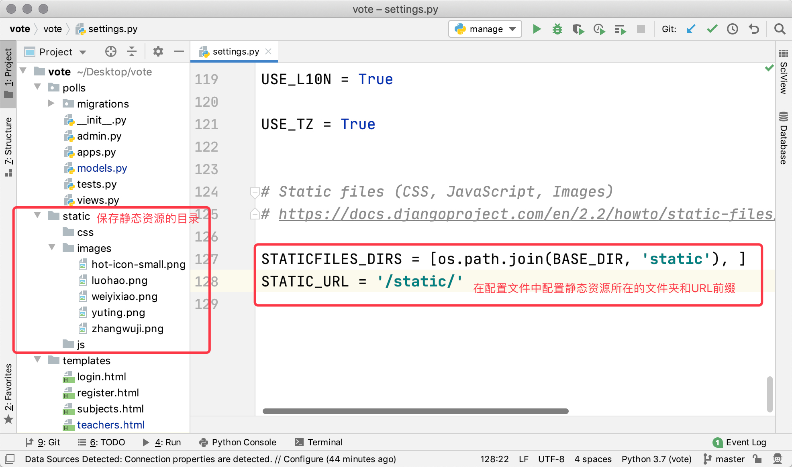
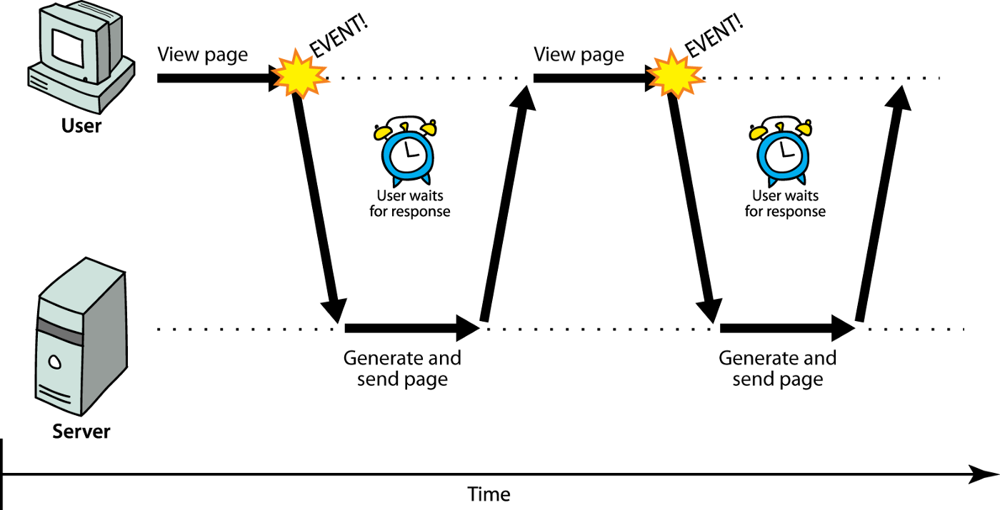
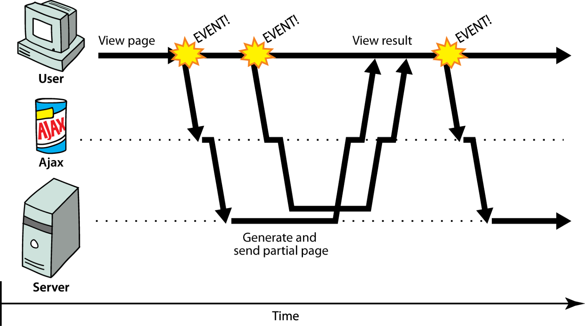

## Tài nguyên tĩnh và yêu cầu Ajax

### Tải tài nguyên tĩnh

Nếu muốn sử dụng tài nguyên tĩnh trong dự án Django, trước tiên bạn có thể tạo một thư mục để lưu trữ tài nguyên tĩnh. Trong dự án `vote`, chúng ta đặt các tài nguyên tĩnh trong thư mục có tên `static`, thư mục này bao gồm ba thư mục con: `css`, `js` và `images`, lần lượt dùng để lưu trữ các tệp CSS bên ngoài, tệp JavaScript bên ngoài và tài nguyên hình ảnh, như hình bên dưới.



Để có thể tìm thấy thư mục lưu trữ tài nguyên tĩnh, chúng ta cũng cần sửa đổi tệp cấu hình `settings.py` của dự án Django như sau:

```Python
STATICFILES_DIRS = [os.path.join(BASE_DIR, 'static'), ]
STATIC_URL = '/static/'
```

Sau khi cấu hình tài nguyên tĩnh, các bạn có thể chạy dự án và xem các hình ảnh trên các trang chúng ta đã viết trước đó có tải ra bình thường hay không. Cần lưu ý rằng, sau khi dự án được triển khai chính thức lên môi trường production, chúng ta thường giao tài nguyên tĩnh cho một máy chủ tài nguyên tĩnh chuyên dụng (chẳng hạn như Nginx, Apache) xử lý, chứ không để máy chủ chạy mã Python quản lý tài nguyên tĩnh. Do đó, cấu hình ở trên không phù hợp với môi trường production mà chỉ dùng để thử nghiệm trong giai đoạn phát triển dự án. Cách sử dụng tài nguyên tĩnh đúng chuẩn sẽ được chúng tôi giải thích trong các chương tiếp theo.

### Tổng quan về Ajax

Tiếp theo, chúng ta có thể hiện thực hóa chức năng "đánh giá tốt" và "đánh giá xấu". Rõ ràng, nếu có thể thực hiện hai chức năng này mà không cần tải lại trang thì sẽ mang lại trải nghiệm người dùng tốt hơn nhiều. Do đó, chúng ta cân nhắc sử dụng công nghệ [Ajax](https://zh.wikipedia.org/wiki/AJAX) để thực hiện chức năng "đánh giá tốt" và "đánh giá xấu". Ajax là viết tắt của Asynchronous JavaScript and XML. Nói một cách đơn giản, sử dụng công nghệ Ajax cho phép làm mới một phần trang web (cập nhật cục bộ) mà không cần tải lại toàn bộ trang.

Đối với các ứng dụng web truyền thống, mỗi khi trang cần tải nội dung mới, nó đều phải gửi yêu cầu lại đến máy chủ và tải lại toàn bộ trang. Nếu máy chủ không thể phản hồi trong thời gian ngắn hoặc điều kiện mạng không lý tưởng, điều này có thể khiến trình duyệt hiển thị màn hình trắng trong thời gian dài và bắt người dùng phải ở trong trạng thái chờ đợi, trong khoảng thời gian đó người dùng không thể làm gì cả, như hình minh họa dưới đây. Rõ ràng, ứng dụng web như vậy không thể mang lại trải nghiệm tốt cho người dùng.



Đối với các ứng dụng web sử dụng công nghệ Ajax, trình duyệt có thể gửi yêu cầu bất đồng bộ (asynchronous request) tới máy chủ để lấy dữ liệu. Yêu cầu bất đồng bộ sẽ không làm gián đoạn trải nghiệm người dùng. Khi máy chủ trả về dữ liệu mới, chúng ta có thể thực hiện các thao tác DOM thông qua mã JavaScript để làm mới một phần trang, điều này tương đương với việc cập nhật nội dung của trang mà không cần tải lại toàn bộ trang, như hiển thị trong hình bên dưới.



Khi sử dụng công nghệ Ajax, trình duyệt và máy chủ thường trao đổi dữ liệu ở định dạng XML hoặc JSON. XML là định dạng dữ liệu được sử dụng rất nhiều trước đây, nhưng những năm gần đây hầu như đã bị thay thế hoàn toàn bởi JSON. Dưới đây là sự so sánh giữa hai định dạng dữ liệu này.

Định dạng XML:

```XML
<?xml version="1.0" encoding="utf-8"?>
<message>
	<from>Alice</from>
    <to>Bob</to>
    <content>Dinner is on me!</content>
</message>
```

Định dạng JSON:

```JSON
{
    "from": "Alice",
    "to": "Bob",
    "content": "Dinner is on me!"
}
```

Thông qua so sánh ở trên, rõ ràng dữ liệu định dạng JSON gọn gàng hơn nhiều nên hiệu quả truyền tải cao hơn, ngoài ra bản thân JSON cũng là một cú pháp biểu thức đối tượng trong JavaScript, giúp việc xử lý dữ liệu định dạng JSON trong mã JavaScript thuận tiện hơn rất nhiều.

### Dùng Ajax hiện thực chức năng bình chọn

Dưới đây, chúng ta sử dụng công nghệ Ajax để hiện thực hóa chức năng bình chọn. Đầu tiên, sửa đổi tệp `urls.py` của dự án để ánh xạ các URL tương ứng cho chức năng "đánh giá tốt" và "đánh giá xấu".

```Python
from django.contrib import admin
from django.urls import path

from polls import views

urlpatterns = [
    path('', views.show_subjects),
    path('teachers/', views.show_teachers),
    path('praise/', views.praise_or_criticize),
    path('criticize/', views.praise_or_criticize),
    path('admin/', admin.site.urls),
]
```

Thiết kế view function `praise_or_criticize` để hỗ trợ chức năng "đánh giá tốt" và "đánh giá xấu". View function này sử dụng lớp JsonResponse được Django đóng gói để tuần tự hóa dictionary thành chuỗi JSON làm nội dung phản hồi trả về cho trình duyệt.

```Python
def praise_or_criticize(request):
    """Bình chọn tốt hoặc xấu"""
    try:
        tno = int(request.GET.get('tno'))
        teacher = Teacher.objects.get(no=tno)
        if request.path.startswith('/praise'):
            teacher.good_count += 1
            count = teacher.good_count
        else:
            teacher.bad_count += 1
            count = teacher.bad_count
        teacher.save()
        data = {'code': 20000, 'mesg': 'Thao tác thành công', 'count': count}
    except (ValueError, Teacher.DoseNotExist):
        data = {'code': 20001, 'mesg': 'Thao tác thất bại'}
    return JsonResponse(data)
```

Chỉnh sửa trang template hiển thị thông tin giảng viên, đưa thư viện jQuery vào để thực hiện xử lý sự kiện, yêu cầu Ajax và thao tác DOM.

```HTML
<!DOCTYPE html>
<html lang="en">
<head>
    <meta charset="UTF-8">
    <title>Thông tin giảng viên</title>
    <style>
        #container {
            width: 80%;
            margin: 10px auto;
        }
        .teacher {
            width: 100%;
            margin: 0 auto;
            padding: 10px 0;
            border-bottom: 1px dashed gray;
            overflow: auto;
        }
        .teacher>div {
            float: left;
        }
        .photo {
            height: 140px;
            border-radius: 75px;
            overflow: hidden;
            margin-left: 20px;
        }
        .info {
            width: 75%;
            margin-left: 30px;
        }
        .info div {
            clear: both;
            margin: 5px 10px;
        }
        .info span {
            margin-right: 25px;
        }
        .info a {
            text-decoration: none;
            color: darkcyan;
        }
    </style>
</head>
<body>
    <div id="container">
        <h1>Thông tin giảng viên môn {{ subject.name }}</h1>
        <hr>
        
            <h2>Tạm thời chưa có thông tin giảng viên cho môn học này</h2>
        
        
        <div class="teacher">
            <div class="photo">
                
            </div>
            <div class="info">
                <div>
                    <span><strong>Họ tên: {{ teacher.name }}</strong></span>
                    <span>Giới tính: {{ teacher.sex | yesno:'Nam,Nữ' }}</span>
                    <span>Ngày sinh: {{ teacher.birth }}</span>
                </div>
                <div class="intro">{{ teacher.intro }}</div>
                <div class="comment">
                    <a href="/praise/?tno={{ teacher.no }}">Đánh giá tốt</a>&nbsp;&nbsp;
                    (<strong>{{ teacher.good_count }}</strong>)
                    &nbsp;&nbsp;&nbsp;&nbsp;
                    <a href="/criticize/?tno={{ teacher.no }}">Đánh giá xấu</a>&nbsp;&nbsp;
                    (<strong>{{ teacher.bad_count }}</strong>)
                </div>
            </div>
        </div>
        
        <a href="/">Quay về trang chủ</a>
    </div>
    <script src="https://cdn.bootcss.com/jquery/3.4.1/jquery.min.js"></script>
    <script>
        $(() => {
            $('.comment>a').on('click', (evt) => {
                evt.preventDefault()
                let url = $(evt.target).attr('href')
                $.getJSON(url, (json) => {
                    if (json.code == 20000) {
                        $(evt.target).next().text(json.count)
                    } else {
                        alert(json.mesg)
                    }
                })
            })
        })
    </script>
</body>
</html>
```

Trong đoạn mã front-end ở trên, phương thức `getJSON` được thư viện jQuery đóng gói sẵn đã được sử dụng để gửi yêu cầu bất đồng bộ tới máy chủ. Nếu chưa quen thuộc với thư viện jQuery ở front-end, bạn có thể tham khảo [Sổ tay jQuery API](https://www.runoob.com/manual/jquery/).

### Tóm tắt

Đến đây, các chức năng cốt lõi của dự án bình chọn này đã được hoàn thành. Trong các chương tiếp theo, chúng ta sẽ yêu cầu người dùng phải đăng nhập mới có thể bình chọn, những người dùng chưa có tài khoản có thể đăng ký tài khoản thông qua chức năng đăng ký.