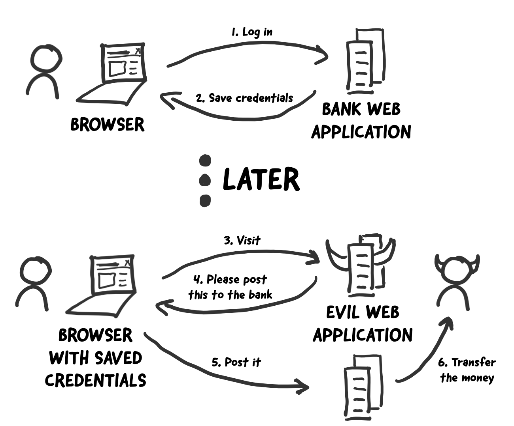
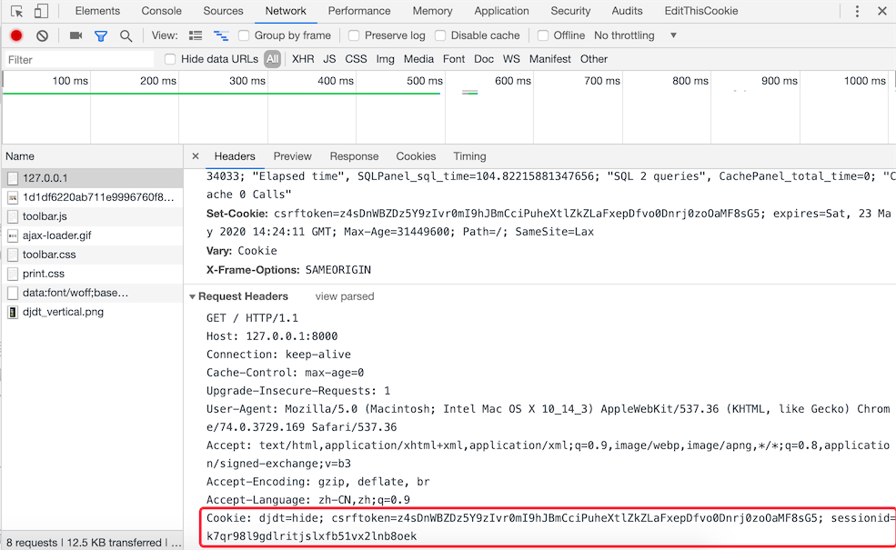
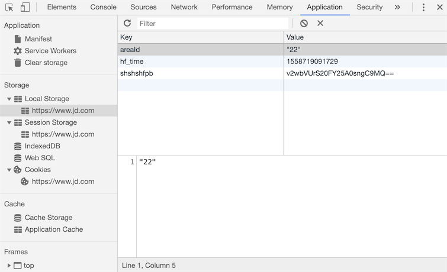

## Cookie và Session

Chúng ta tiếp tục hoàn thiện dự án trong chương trước, thực hiện chức năng "Đăng nhập người dùng" và giới hạn chỉ những người dùng đã đăng nhập mới có thể bình chọn.

### Chuẩn bị cho chức năng đăng nhập người dùng

Trước tiên, chúng ta chuẩn bị một số công việc cho việc đăng nhập người dùng.

1. Tạo model người dùng. Trước đây chúng ta đã tìm hiểu cách dùng ORM của Django để chuyển từ bảng hai chiều sang model (kỹ thuật đảo ngược - reverse engineering), lần này chúng ta sẽ thử chuyển từ model thành bảng hai chiều (kỹ thuật thuận - forward engineering).

    ```Python
    class User(models.Model):
        """Người dùng"""
        no = models.AutoField(primary_key=True, verbose_name='Mã số')
        username = models.CharField(max_length=20, unique=True, verbose_name='Tên đăng nhập')
        password = models.CharField(max_length=32, verbose_name='Mật khẩu')
        tel = models.CharField(max_length=20, verbose_name='Số điện thoại')
        reg_date = models.DateTimeField(auto_now_add=True, verbose_name='Thời gian đăng ký')
        last_visit = models.DateTimeField(null=True, verbose_name='Thời gian đăng nhập cuối')
    
        class Meta:
            db_table = 'tb_user'
            verbose_name = 'Người dùng'
            verbose_name_plural = 'Người dùng'
    ```
    
2. Sử dụng các lệnh sau để tạo file migration và thực hiện migrate, chuyển model `User` trực tiếp thành bảng hai chiều `tb_user` trong cơ sở dữ liệu quan hệ.

    ```Bash
    python manage.py makemigrations polls
    python manage.py migrate polls
    ```

3. Dùng câu lệnh SQL sau để chèn trực tiếp hai dòng dữ liệu thử nghiệm. Thông thường, không được lưu trực tiếp mật khẩu của người dùng dưới dạng văn bản thuần trong cơ sở dữ liệu, vì vậy chúng ta xử lý mật khẩu người dùng thành mã băm MD5 tương ứng. Thuật toán tóm lược thông điệp MD5 là một hàm băm mật mã (cryptographic hash function) được sử dụng rộng rãi, có thể tạo ra giá trị băm 128-bit dùng để đảm bảo tính toàn vẹn và nhất quán của việc truyền thông tin. Khi sử dụng giá trị băm, người ta thường biểu diễn nó dưới dạng chuỗi thập lục phân (hexadecimal), do đó chuỗi MD5 128-bit thường được biểu diễn bằng 32 ký tự thập lục phân.

    ```SQL
    insert into `tb_user`
        (`username`, `password`, `tel`, `reg_date`)
    values
        ('wangdachui', '1c63129ae9db9c60c3e8aa94d3e00495', '13122334455', now()),
        ('hellokitty', 'c6f8cf68e5f68b0aa4680e089ee4742c', '13890006789', now());
    ```

    > **Giải thích**: Mật khẩu của hai người dùng `wangdachui` và `hellokitty` được tạo ở trên lần lượt là `1qaz2wsx` và `Abc123!!`.

4. Chúng ta thêm một module có tên là `utils.py` vào ứng dụng để lưu trữ các hàm tiện ích cần dùng. Module `hashlib` trong thư viện chuẩn của Python đóng gói các thuật toán băm phổ biến, bao gồm: MD5, SHA1, SHA256, v.v. Dưới đây là hàm sử dụng lớp `md5` trong `hashlib` để xử lý chuỗi thành chuỗi tóm lược MD5:

    ```Python
    import hashlib
    
    
    def gen_md5_digest(content):
        return hashlib.md5(content.encode()).hexdigest()
    ```

5. Viết view function và trang template cho đăng nhập người dùng.

    Thêm view function để render trang đăng nhập:

    ```Python
    def login(request: HttpRequest) -> HttpResponse:
        hint = ''
        return render(request, 'login.html', {'hint': hint})
    ```

    Thêm trang template `login.html`:

    ```HTML
    <!DOCTYPE html>
    <html lang="en">
    <head>
        <meta charset="UTF-8">
        <title>Đăng nhập</title>
        <style>
            #container {
                width: 520px;
                margin: 10px auto;
            }
            .input {
                margin: 20px 0;
                width: 460px;
                height: 40px;
            }
            .input>label {
                display: inline-block;
                width: 140px;
                text-align: right;
            }
            .input>img {
                width: 150px;
                vertical-align: middle;
            }
            input[name=captcha] {
                vertical-align: middle;
            }
            form+div {
                margin-top: 20px;
            }
            form+div>a {
                text-decoration: none;
                color: darkcyan;
                font-size: 1.2em;
            }
            .button {
                width: 500px;
                text-align: center;
                margin-top: 20px;
            }
            .hint {
                color: red;
                font-size: 12px;
            }
        </style>
    </head>
    <body>
        <div id="container">
            <h1>Đăng nhập</h1>
            <hr>
            <p class="hint">{{ hint }}</p>
            <form action="/login/" method="post">
                
                <fieldset>
                    <legend>Thông tin người dùng</legend>
                    <div class="input">
                        <label>Tên đăng nhập:</label>
                        <input type="text" name="username">
                    </div>
                    <div class="input">
                        <label>Mật khẩu:</label>
                        <input type="password" name="password">
                    </div>
                    <div class="input">
                        <label>Mã xác thực:</label>
                        <input type="text" name="captcha">
                        
                    </div>
                </fieldset>
                <div class="button">
                    <input type="submit" value="Đăng nhập">
                    <input type="reset" value="Đặt lại">
                </div>
            </form>
            <div>
                <a href="/">Quay về trang chủ</a>
                <a href="/register/">Đăng ký người dùng mới</a>
            </div>
        </div>
    </body>
    </html>
    ```

    Lưu ý rằng trong biểu mẫu ở trên, chúng ta đã sử dụng chỉ thị template `` để thêm một trường ẩn vào form (bạn có thể xem mã nguồn trang web trong trình duyệt để thấy thẻ `input` có thuộc tính `type="hidden"` do chỉ thị này tạo ra). Tác dụng của nó là tạo ra một token ngẫu nhiên trong biểu mẫu nhằm phòng chống tấn công [Cross-Site Request Forgery](https://zh.wikipedia.org/wiki/%E8%B7%A8%E7%AB%99%E8%AF%B7%E6%B1%82%E4%BC%AA%E9%80%A0) (viết tắt là CSRF - Giả mạo yêu cầu trên nhiều trang web), đây cũng là yêu cầu bắt buộc của Django khi gửi biểu mẫu (form submit). Nếu trong biểu mẫu của chúng ta không có token như vậy, khi gửi biểu mẫu, framework Django sẽ trả về một phản hồi có mã trạng thái HTTP là `403` (Bị cấm truy cập - Forbidden), trừ khi chúng ta thiết lập miễn trừ CSRF token. Hình bên dưới là một ví dụ đơn giản và trực quan về CSRF.

    

Tiếp theo, chúng ta có thể viết các view function để cung cấp mã xác thực (captcha) và thực hiện đăng nhập cho người dùng. Trước đó, chúng ta hãy cùng tìm hiểu về các phương thức theo dõi người dùng trong ứng dụng web cũng như sự hỗ trợ của framework Django cho việc này. Đối với một ứng dụng web, sau khi người dùng đăng nhập thành công, máy chủ nhất định phải ghi nhớ được người dùng đó đã đăng nhập, như vậy máy chủ mới có thể cung cấp dịch vụ tốt hơn cho người dùng. Hơn nữa, cuộc tấn công CSRF vừa nhắc tới ở trên cũng là một thủ đoạn tấn công lợi dụng trang web lừa đảo để chiếm đoạt thông tin đăng nhập của người dùng nhằm thực hiện các thao tác độc hại; tất cả những điều này đều dựa trên nền tảng kỹ thuật theo dõi người dùng. Sau khi hiểu được bối cảnh này, chúng ta sẽ nắm rõ được những thao tác nào thực sự cần thực hiện khi người dùng đăng nhập.

### Hiện thực theo dõi người dùng

Ngày nay, nếu một trang web không thông qua cách nào đó để ghi nhớ bạn là ai và các hoạt động trước đây của bạn trên trang web, trang web đó sẽ đánh mất tính khả dụng và tiện lợi, từ đó rất dễ dẫn đến việc người dùng rời bỏ trang web. Vì vậy, việc ghi nhớ một người dùng (thuật ngữ chuyên môn gọi là **theo dõi người dùng** - user tracking) là chức năng thiết yếu đối với phần lớn các ứng dụng web.

Ở phía máy chủ, cách đơn giản nhất để chúng ta ghi nhớ một người dùng là tạo ra một đối tượng, qua đối tượng này chúng ta có thể lưu trữ toàn bộ các thông tin liên quan đến người dùng. Đối tượng này chính là thứ chúng ta thường gọi là session (đối tượng phiên làm việc của người dùng). Vậy vấn đề đặt ra là: bản thân giao thức HTTP là **không kết nối** (connectionless - trong mỗi quá trình gửi yêu cầu và phản hồi, một khi máy chủ hoàn thành việc phản hồi yêu cầu của client thì kết nối sẽ bị ngắt) và **không trạng thái** (stateless - khi client gửi yêu cầu tiếp theo đến máy chủ, máy chủ hoàn toàn không biết bất kỳ thông tin nào trước đó về client này). Cho dù máy chủ đã lưu giữ dữ liệu người dùng qua đối tượng session, máy chủ vẫn cần phải dựa vào một cách nào đó để xác định yêu cầu hiện tại có liên quan đến session nào đã được lưu trước đó. Chắc hẳn nhiều người sẽ nghĩ ngay ra rằng chúng ta có thể cấp cho mỗi đối tượng session một mã định danh duy nhất trên toàn hệ thống để nhận diện đối tượng session, tạm gọi là sessionid. Mỗi lần client gửi yêu cầu, chỉ cần mang theo sessionid này thì máy chủ sẽ có cách tìm ra đối tượng session tương ứng, từ đó ghi nhớ được thông tin của người dùng đó giữa các lần gửi yêu cầu, tức là thực hiện việc theo dõi người dùng mà chúng ta vừa nói.

Để client ghi nhớ và mang theo sessionid trong mỗi yêu cầu, có một số cách sau:

1. Ghi lại URL (URL Rewriting): Tức là đưa sessionid vào trong URL, ví dụ: `http://www.example.com/index.html?sessionid=123456`, máy chủ lấy giá trị của tham số sessionid để lấy ra đối tượng session tương ứng.

2. Trường ẩn trong form (Hidden Form Field): Khi gửi biểu mẫu, có thể gửi thêm dữ liệu đến máy chủ bằng cách thiết lập trường ẩn trong form. Ví dụ: `<input type="hidden" name="sessionid" value="123456">`.

3. Bộ nhớ cục bộ (Local Storage): Các trình duyệt hiện nay đều hỗ trợ nhiều giải pháp lưu trữ cục bộ, bao gồm: cookie, localStorage, sessionStorage, IndexedDB, v.v. Trong số các giải pháp này, cookie có lịch sử lâu đời nhất và cũng là giải pháp nhận nhiều phàn nàn nhất, đồng thời cũng là giải pháp đầu tiên mà chúng tôi sẽ giải thích cho các bạn. Nói một cách đơn giản, cookie là dữ liệu được lưu dưới dạng cặp key-value trong các tệp tạm thời của trình duyệt. Mỗi lần gửi yêu cầu, tiêu đề (request header) sẽ mang cookie của trang web hiện tại gửi tới máy chủ. Do đó, chỉ cần ghi sessionid vào cookie thì ở lần yêu cầu tiếp theo, máy chủ chỉ cần đọc cookie trong request header là có thể lấy được sessionid này, như hình dưới đây.

   

   Trong thời đại HTML5, ngoài cookie, bạn còn có thể sử dụng các API lưu trữ cục bộ mới hơn để lưu dữ liệu, đó là các công nghệ localStorage, sessionStorage, IndexedDB vừa đề cập, như hình minh họa dưới đây.

   

**Tóm lại**, để thực hiện theo dõi người dùng, phía máy chủ có thể tạo một đối tượng session cho mỗi phiên người dùng và ghi ID của đối tượng session đó vào cookie của trình duyệt; lần tiếp theo khi người dùng gửi yêu cầu tới máy chủ, trình duyệt sẽ mang thông tin cookie mà trang web đó lưu trữ trong tiêu đề HTTP request, nhờ đó máy chủ có thể tìm thấy ID của đối tượng session từ cookie và lấy ra đối tượng session đã tạo trước đó dựa trên ID này; do đối tượng session có thể lưu dữ liệu người dùng dưới dạng key-value, nên thông tin đã lưu trong session trước đó có thể được lấy ra đầy đủ, máy chủ cũng có thể dựa vào các thông tin này để xác định danh tính và nắm bắt sở thích của người dùng, từ đó cung cấp dịch vụ cá nhân hóa tốt hơn.

### Sự hỗ trợ của framework Django cho session

Khi tạo dự án Django, tệp cấu hình mặc định `settings.py` đã kích hoạt sẵn một middleware có tên là `SessionMiddleware` (kiến thức về middleware chúng ta sẽ tìm hiểu chi tiết trong các chương sau, ở đây chỉ cần biết sự tồn tại của nó). Nhờ có middleware này, chúng ta có thể thao tác trực tiếp với đối tượng session thông qua thuộc tính `session` của đối tượng request. Như chúng ta đã nói trước đó, thuộc tính `session` là một đối tượng chứa dữ liệu có thể đọc ghi như một dictionary, do đó chúng ta có thể dùng phương thức "key-value" để lưu giữ dữ liệu người dùng. Đồng thời, middleware `SessionMiddleware` còn đóng gói sẵn các thao tác với cookie, lưu sessionid vào trong cookie như chúng ta đã nhắc ở trên.

Theo mặc định, Django tuần tự hóa dữ liệu session rồi lưu trữ vào cơ sở dữ liệu quan hệ. Kể từ phiên bản Django 1.6 trở đi, phương thức tuần tự hóa dữ liệu mặc định là JSON serialization, trong khi trước đó luôn sử dụng Pickle serialization. Sự khác biệt giữa JSON serialization và Pickle serialization là JSON tuần tự hóa đối tượng thành chuỗi (dạng văn bản ký tự), còn Pickle tuần tự hóa đối tượng thành chuỗi byte (dạng nhị phân). Vì lý do bảo mật, JSON serialization đã trở thành phương thức tuần tự hóa dữ liệu mặc định hiện nay của framework Django, điều này đòi hỏi dữ liệu chúng ta lưu trong session phải có khả năng tuần tự hóa JSON được, nếu không sẽ gây ra ngoại lệ. Một điểm nữa cần lưu ý là việc sử dụng cơ sở dữ liệu quan hệ để lưu dữ liệu session trong đa số trường hợp không phải là lựa chọn tối ưu, bởi vì cơ sở dữ liệu có thể phải chịu áp lực rất lớn và trở thành nút thắt cổ chai về hiệu năng của hệ thống. Trong các chương sau, chúng tôi sẽ hướng dẫn các bạn cách lưu session vào dịch vụ bộ nhớ đệm (cache) để nâng cao hiệu năng hệ thống.

### Hiện thực xác thực đăng nhập người dùng

Trước tiên, chúng ta viết hàm tạo mã xác thực ngẫu nhiên `gen_random_code` trong tệp `polls/utils.py` vừa rồi, nội dung như sau:

```Python
import random

ALL_CHARS = '0123456789abcdefghijklmnopqrstuvwxyzABCDEFGHIJKLMNOPQRSTUVWXYZ'


def gen_random_code(length=4):
    return ''.join(random.choices(ALL_CHARS, k=length))
```

Viết lớp `Captcha` để tạo hình ảnh mã xác thực:

```Python
"""
Hình ảnh mã xác thực
"""
import os
import random
from io import BytesIO

from PIL import Image
from PIL import ImageFilter
from PIL.ImageDraw import Draw
from PIL.ImageFont import truetype


class Bezier:
    """Đường cong Bezier"""

    def __init__(self):
        self.tsequence = tuple([t / 20.0 for t in range(21)])
        self.beziers = {}

    def make_bezier(self, n):
        """Vẽ đường cong Bezier"""
        try:
            return self.beziers[n]
        except KeyError:
            combinations = pascal_row(n - 1)
            result = []
            for t in self.tsequence:
                tpowers = (t ** i for i in range(n))
                upowers = ((1 - t) ** i for i in range(n - 1, -1, -1))
                coefs = [c * a * b for c, a, b in zip(combinations,
                                                      tpowers, upowers)]
                result.append(coefs)
            self.beziers[n] = result
            return result


class Captcha:
    """Mã xác thực (Captcha)"""

    def __init__(self, width, height, fonts=None, color=None):
        self._image = None
        self._fonts = fonts if fonts else \
            [os.path.join(os.path.dirname(__file__), 'fonts', font)
             for font in ['Arial.ttf', 'Georgia.ttf', 'Action.ttf']]
        self._color = color if color else random_color(0, 200, random.randint(220, 255))
        self._width, self._height = width, height

    @classmethod
    def instance(cls, width=200, height=75):
        """Phương thức lớp dùng để lấy đối tượng Captcha"""
        prop_name = f'_instance_{width}_{height}'
        if not hasattr(cls, prop_name):
            setattr(cls, prop_name, cls(width, height))
        return getattr(cls, prop_name)

    def _background(self):
        """Vẽ nền"""
        Draw(self._image).rectangle([(0, 0), self._image.size],
                                    fill=random_color(230, 255))

    def _smooth(self):
        """Làm mịn ảnh"""
        return self._image.filter(ImageFilter.SMOOTH)

    def _curve(self, width=4, number=6, color=None):
        """Vẽ đường cong"""
        dx, height = self._image.size
        dx /= number
        path = [(dx * i, random.randint(0, height))
                for i in range(1, number)]
        bcoefs = Bezier().make_bezier(number - 1)
        points = []
        for coefs in bcoefs:
            points.append(tuple(sum([coef * p for coef, p in zip(coefs, ps)])
                                for ps in zip(*path)))
        Draw(self._image).line(points, fill=color if color else self._color, width=width)

    def _noise(self, number=50, level=2, color=None):
        """Vẽ nhiễu"""
        width, height = self._image.size
        dx, dy = width / 10, height / 10
        width, height = width - dx, height - dy
        draw = Draw(self._image)
        for i in range(number):
            x = int(random.uniform(dx, width))
            y = int(random.uniform(dy, height))
            draw.line(((x, y), (x + level, y)),
                      fill=color if color else self._color, width=level)

    def _text(self, captcha_text, fonts, font_sizes=None, drawings=None, squeeze_factor=0.75, color=None):
        """Vẽ văn bản"""
        color = color if color else self._color
        fonts = tuple([truetype(name, size)
                       for name in fonts
                       for size in font_sizes or (65, 70, 75)])
        draw = Draw(self._image)
        char_images = []
        for c in captcha_text:
            font = random.choice(fonts)
            c_width, c_height = draw.textsize(c, font=font)
            char_image = Image.new('RGB', (c_width, c_height), (0, 0, 0))
            char_draw = Draw(char_image)
            char_draw.text((0, 0), c, font=font, fill=color)
            char_image = char_image.crop(char_image.getbbox())
            for drawing in drawings:
                d = getattr(self, drawing)
                char_image = d(char_image)
            char_images.append(char_image)
        width, height = self._image.size
        offset = int((width - sum(int(i.size[0] * squeeze_factor)
                                  for i in char_images[:-1]) -
                      char_images[-1].size[0]) / 2)
        for char_image in char_images:
            c_width, c_height = char_image.size
            mask = char_image.convert('L').point(lambda i: i * 1.97)
            self._image.paste(char_image,
                              (offset, int((height - c_height) / 2)),
                              mask)
            offset += int(c_width * squeeze_factor)

    @staticmethod
    def _warp(image, dx_factor=0.3, dy_factor=0.3):
        """Làm méo hình ảnh"""
        width, height = image.size
        dx = width * dx_factor
        dy = height * dy_factor
        x1 = int(random.uniform(-dx, dx))
        y1 = int(random.uniform(-dy, dy))
        x2 = int(random.uniform(-dx, dx))
        y2 = int(random.uniform(-dy, dy))
        warp_image = Image.new(
            'RGB',
            (width + abs(x1) + abs(x2), height + abs(y1) + abs(y2)))
        warp_image.paste(image, (abs(x1), abs(y1)))
        width2, height2 = warp_image.size
        return warp_image.transform(
            (width, height),
            Image.QUAD,
            (x1, y1, -x1, height2 - y2, width2 + x2, height2 + y2, width2 - x2, -y1))

    @staticmethod
    def _offset(image, dx_factor=0.1, dy_factor=0.2):
        """Lệch hình ảnh"""
        width, height = image.size
        dx = int(random.random() * width * dx_factor)
        dy = int(random.random() * height * dy_factor)
        offset_image = Image.new('RGB', (width + dx, height + dy))
        offset_image.paste(image, (dx, dy))
        return offset_image

    @staticmethod
    def _rotate(image, angle=25):
        """Xoay hình ảnh"""
        return image.rotate(random.uniform(-angle, angle),
                            Image.BILINEAR, expand=1)

    def generate(self, captcha_text='', fmt='PNG'):
        """Tạo mã xác thực (chữ và hình ảnh)
        :param captcha_text: Chữ của mã xác thực
        :param fmt: Định dạng ảnh mã xác thực được tạo
        :return: Dữ liệu nhị phân của hình ảnh mã xác thực
        """
        self._image = Image.new('RGB', (self._width, self._height), (255, 255, 255))
        self._background()
        self._text(captcha_text, self._fonts,
                   drawings=['_warp', '_rotate', '_offset'])
        self._curve()
        self._noise()
        self._smooth()
        image_bytes = BytesIO()
        self._image.save(image_bytes, format=fmt)
        return image_bytes.getvalue()


def pascal_row(n=0):
    """Tạo tam giác Pascal (tam giác Dương Huy)"""
    result = [1]
    x, numerator = 1, n
    for denominator in range(1, n // 2 + 1):
        x *= numerator
        x /= denominator
        result.append(x)
        numerator -= 1
    if n & 1 == 0:
        result.extend(reversed(result[:-1]))
    else:
        result.extend(reversed(result))
    return result


def random_color(start=0, end=255, opacity=255):
    """Lấy màu ngẫu nhiên"""
    red = random.randint(start, end)
    green = random.randint(start, end)
    blue = random.randint(start, end)
    if opacity is None:
        return red, green, blue
    return red, green, blue, opacity
```

> **Giải thích**: Đoạn mã trên sử dụng ba tệp phông chữ nằm trong thư mục `polls/fonts`. Bạn có thể tự thêm các tệp phông chữ của riêng mình, nhưng cần lưu ý tên tệp phông chữ phải khớp với dòng 45 trong đoạn mã trên.

Tiếp theo, trước tiên chúng ta hoàn thành view function cung cấp mã xác thực.

```Python
def get_captcha(request: HttpRequest) -> HttpResponse:
    """Mã xác thực"""
    captcha_text = gen_random_code()
    request.session['captcha'] = captcha_text
    image_data = Captcha.instance().generate(captcha_text)
    return HttpResponse(image_data, content_type='image/png')
```

Chú ý dòng thứ 4 trong đoạn mã trên, chúng ta lưu chuỗi mã xác thực được sinh ngẫu nhiên vào session. Lát nữa khi người dùng đăng nhập, chúng ta sẽ so sánh chuỗi mã xác thực lưu trong session với chuỗi mã xác thực do người dùng nhập vào. Chỉ khi người dùng nhập đúng mã xác thực thì mới có thể thực hiện quy trình đăng nhập tiếp theo, mã nguồn như sau:

```Python
def login(request: HttpRequest) -> HttpResponse:
    hint = ''
    if request.method == 'POST':
        username = request.POST.get('username')
        password = request.POST.get('password')
        if username and password:
            password = gen_md5_digest(password)
            user = User.objects.filter(username=username, password=password).first()
            if user:
                request.session['userid'] = user.no
                request.session['username'] = user.username
                return redirect('/')
            else:
                hint = 'Tên đăng nhập hoặc mật khẩu không đúng'
        else:
            hint = 'Vui lòng nhập tên đăng nhập và mật khẩu hợp lệ'
    return render(request, 'login.html', {'hint': hint})
```

>**Giải thích**: Đoạn mã trên chưa thực hiện kiểm tra tính hợp lệ đối với tên đăng nhập và mật khẩu. Trong các dự án thực tế, bạn nên sử dụng biểu thức chính quy (regex) để xác thực thông tin đầu vào của người dùng, nếu không có thể chuyển dữ liệu không hợp lệ cho cơ sở dữ liệu xử lý hoặc gây ra các rủi ro bảo mật khác.

Trong đoạn mã trên, chúng ta quy định sau khi đăng nhập thành công sẽ lưu mã số người dùng (`userid`) và tên đăng nhập (`username`) vào session, đồng thời chuyển hướng trang về trang chủ. Tiếp theo, chúng ta có thể điều chỉnh một chút mã nguồn của trang chủ để hiển thị tên đăng nhập của người dùng đã đăng nhập ở góc trên bên phải trang. Chúng ta viết đoạn mã này thành một tệp HTML riêng có tên là `header.html`. Trong trang chủ, có thể thêm `` vào bên trong thẻ `<body>` để nhúng trang này vào, mã nguồn như sau:

```HTML
<div class="user">
    
    <span>{{ request.session.username }}</span>
    <a href="/logout">Đăng xuất</a>
    
    <a href="/login">Đăng nhập</a>&nbsp;&nbsp;
    
    <a href="/register">Đăng ký</a>
</div>
```

Nếu người dùng chưa đăng nhập, trang sẽ hiển thị các liên kết Đăng nhập và Đăng ký; còn sau khi người dùng đăng nhập thành công, trang sẽ hiển thị tên đăng nhập và liên kết Đăng xuất. View function tương ứng với liên kết đăng xuất như sau, việc ánh xạ URL tương tự như những gì đã học trước đây nên sẽ không nhắc lại:

```Python
def logout(request):
    """Đăng xuất"""
    request.session.flush()
    return redirect('/')
```

Đoạn mã trên sử dụng phương thức `flush` của đối tượng session để hủy session. Một mặt nó xóa dữ liệu người dùng được đối tượng session lưu trữ trên máy chủ, mặt khác nó xóa sessionid được lưu trong cookie của trình duyệt. Lát nữa chúng tôi sẽ giải thích thêm về cách đọc và ghi cookie.

Chúng ta có thể tìm thấy tất cả các session thông qua bảng có tên là `django_session` trong cơ sở dữ liệu mà dự án sử dụng, cấu trúc của bảng này như sau:

| session_key | session_data | expire_date |
| -------------------------------- | ------------------------------- | -------------------------- |
| c9g2gt5cxo0k2evykgpejhic5ae7bfpl | MmI4YzViYjJhOGMyMDJkY2M5Yzg3... | 2019-05-25 23:16:13.898522 |

Trong đó, cột thứ 1 chính là sessionid được lưu trong cookie của trình duyệt; cột thứ 2 là dữ liệu trong session sau khi được mã hóa BASE64, nếu sử dụng module `base64` của Python để giải mã, quá trình và kết quả giải mã sẽ như sau:

```Python
import base64

base64.b64decode('MmI4YzViYjJhOGMyMDJkY2M5Yzg3ZWIyZGViZmUzYmYxNzdlNDdmZjp7ImNhcHRjaGEiOiJzS3d0Iiwibm8iOjEsInVzZXJuYW1lIjoiamFja2ZydWVkIn0=')
```

Cột thứ 3 là thời gian hết hạn của session. Sau khi session hết hạn, sessionid trong cookie được lưu trên trình duyệt sẽ mất hiệu lực, tuy nhiên bản ghi tương ứng trong cơ sở dữ liệu vẫn tồn tại. Nếu muốn dọn dẹp các dữ liệu đã hết hạn, bạn có thể sử dụng lệnh sau:

```Shell
python manage.py clearsessions
```

Thời gian hết hạn session mặc định của framework Django là hai tuần (1.209.600 giây). Nếu muốn thay đổi thời gian này, bạn có thể thêm đoạn mã sau vào tệp cấu hình của dự án:

```Python
# Cấu hình thời gian timeout của phiên là 1 ngày (86400 giây)
SESSION_COOKIE_AGE = 86400
```

Có nhiều ứng dụng có yêu cầu bảo mật cao đòi hỏi phiên làm việc phải hết hạn khi đóng cửa sổ trình duyệt và không giữ lại bất kỳ thông tin nào của người dùng. Nếu bạn muốn session hết hạn ngay khi đóng cửa sổ trình duyệt (sessionid trong cookie mất hiệu lực), bạn có thể thêm cấu hình sau:

```Python
# Đặt thành True thì session sẽ hết hạn khi đóng cửa sổ trình duyệt
SESSION_EXPIRE_AT_BROWSER_CLOSE = True
```

Nếu không muốn lưu dữ liệu session trong cơ sở dữ liệu, bạn có thể đưa nó vào bộ nhớ đệm (cache), cấu hình tương ứng như sau (cách cấu hình và sử dụng cache sẽ được giải thích ở các chương sau):

```Python
# Cấu hình lưu trữ đối tượng phiên làm việc trong bộ nhớ đệm
SESSION_ENGINE = 'django.contrib.sessions.backends.cache'
# Cấu hình nhóm cache nào được sử dụng để lưu phiên
SESSION_CACHE_ALIAS = 'default'
```

Nếu muốn sửa đổi phương thức tuần tự hóa mặc định của dữ liệu session, bạn có thể đổi `JSONSerializer` mặc định thành `PickleSerializer`:

```Python
SESSION_SERIALIZER = 'django.contrib.sessions.serializers.PickleSerializer'
```

Tiếp theo, chúng ta có thể giới hạn chỉ người dùng đã đăng nhập mới có thể bình chọn cho giảng viên. Hàm `praise_or_criticize` sau khi sửa đổi như sau, chúng ta xác định người dùng đã đăng nhập hay chưa bằng cách lấy `userid` từ `request.session`:

```Python
def praise_or_criticize(request: HttpRequest) -> HttpResponse:
    if request.session.get('userid'):
        try:
            tno = int(request.GET.get('tno'))
            teacher = Teacher.objects.get(no=tno)
            if request.path.startswith('/praise/'):
                teacher.good_count += 1
                count = teacher.good_count
            else:
                teacher.bad_count += 1
                count = teacher.bad_count
            teacher.save()
            data = {'code': 20000, 'mesg': 'Bình chọn thành công', 'count': count}
        except (ValueError, Teacher.DoesNotExist):
            data = {'code': 20001, 'mesg': 'Bình chọn thất bại'}
    else:
        data = {'code': 20002, 'mesg': 'Vui lòng đăng nhập trước'}
    return JsonResponse(data)
```

Tất nhiên, sau khi sửa đổi view function, `teachers.html` cũng cần được điều chỉnh: nếu người dùng chưa đăng nhập, hãy hướng dẫn người dùng đến trang đăng nhập, sau khi đăng nhập thành công thì quay lại trang bình chọn, phần này sẽ không nhắc lại chi tiết ở đây nữa.

### Đọc và ghi cookie trong view function

Dưới đây, chúng tôi sẽ giải thích chi tiết hơn về cách sử dụng cookie để giúp các bạn vận dụng kỹ thuật này tốt hơn trong các dự án web. Hai đối tượng `HttpRequest` và `HttpResponse` do Django đóng gói lần lượt cung cấp các thao tác đọc và ghi cookie.

Các thuộc tính và phương thức được đóng gói trong `HttpRequest`:

1. Thuộc tính `COOKIES` - Thuộc tính này chứa tất cả các cookie được gửi kèm trong HTTP request.
2. Phương thức `get_signed_cookie` - Lấy cookie có chữ ký, nếu xác thực chữ ký thất bại sẽ ném ra ngoại lệ `BadSignature`.

Các phương thức được đóng gói trong `HttpResponse`:

1. Phương thức `set_cookie` - Phương thức này có thể thiết lập một cặp key-value và cuối cùng sẽ ghi nó vào trình duyệt.
2. Phương thức `set_signed_cookie` - Tương tự như phương thức trên, nhưng sẽ ký số (sign) vào cookie để chống giả mạo dữ liệu. Bởi vì nếu dữ liệu trong cookie bị giả mạo, khi kẻ tấn công không biết [khóa bí mật](https://zh.wikipedia.org/wiki/%E5%AF%86%E9%92%A5) và [muối (salt)](https://zh.wikipedia.org/wiki/%E7%9B%90_(%E5%AF%86%E7%A0%81%E5%AD%A6)), chúng sẽ không thể tạo ra chữ ký hợp lệ. Như vậy khi máy chủ đọc cookie sẽ phát hiện dữ liệu không khớp với chữ ký và đưa ra ngoại lệ `BadSignature`. Cần lưu ý rằng khóa bí mật được đề cập ở đây chính là `SECRET_KEY` được chỉ định trong tệp cấu hình dự án Django, còn muối là một chuỗi được thiết lập trong chương trình, bạn có thể đặt nó thành bất kỳ chuỗi hợp lệ nào mình muốn.

Đối với các phương thức kể trên, nếu chưa rõ cách sử dụng cụ thể, bạn có thể tự tra cứu trong [tài liệu chính thức](https://docs.djangoproject.com/en/2.1/ref/request-response/) của Django, không có tài liệu nào giải thích cách sử dụng rõ ràng hơn tài liệu chính thức.

Như chúng ta vừa nói, sau khi kích hoạt `SessionMiddleware`, mỗi đối tượng `HttpRequest` sẽ được liên kết với một thuộc tính session. Nó là một đối tượng giống dictionary, ngoài việc lưu dữ liệu người dùng, nó còn cung cấp các phương thức để kiểm tra xem trình duyệt có hỗ trợ cookie hay không, bao gồm:

1. Phương thức `set_test_cookie` - Thiết lập cookie dùng để kiểm tra (test cookie).
2. Phương thức `test_cookie_worked` - Kiểm tra xem test cookie có hoạt động hay không.
3. Phương thức `delete_test_cookie` - Xóa cookie dùng để kiểm tra.
4. Phương thức `set_expiry` - Thiết lập thời gian hết hạn của phiên làm việc.
5. Phương thức `get_expire_age` / `get_expire_date` - Lấy thời gian hết hạn của phiên làm việc.
6. Phương thức `clear_expired` - Dọn dẹp các phiên làm việc đã hết hạn.

Dưới đây là đoạn mã kiểm tra xem trình duyệt có hỗ trợ cookie hay không trước khi thực hiện đăng nhập. Thông thường, trình duyệt bật hỗ trợ cookie theo mặc định, nhưng vì lý do nào đó, người dùng có thể đã tắt tính năng cookie của trình duyệt. Trong tình huống này, chúng ta có thể cung cấp chức năng kiểm tra trong view function; nếu phát hiện trình duyệt của người dùng không hỗ trợ cookie, có thể đưa ra lời nhắc tương ứng.

```Python
def login(request):
    if request.method == 'POST':
        if request.session.test_cookie_worked():
            request.session.delete_test_cookie()
            # Thêm mã xử lý quy trình đăng nhập của bạn tại đây
        else:
            return HttpResponse("Vui lòng bật cookie và thử lại.")
    request.session.set_test_cookie()
    return render_to_response('login.html')
```

### Các giải pháp thay thế Cookie

Như chúng ta đã nói trước đó, danh tiếng của cookie từ trước đến nay không thực sự tốt. Tất nhiên, trong phát triển thực tế, chúng ta sẽ không lưu các thông tin nhạy cảm của người dùng (chẳng hạn như mật khẩu, số thẻ tín dụng, v.v.) trong cookie, và dữ liệu lưu trong cookie thông thường cũng được mã hóa và ký số cẩn thận. Đối với các trình duyệt hỗ trợ HTML5, có thể sử dụng localStorage và sessionStorage làm giải pháp thay thế cho cookie. Nhìn vào tên gọi, chắc hẳn bạn đã thấy được sự khác biệt giữa hai giải pháp này: dữ liệu được lưu trong `localStorage` có thể được giữ lại lâu dài; còn dữ liệu được lưu trong `sessionStorage` sẽ bị xóa khi đóng trình duyệt. Về cách sử dụng các giải pháp thay thế cookie này, bạn nên tham khảo thêm trên [MDN](https://developer.mozilla.org/zh-CN/docs/Web).