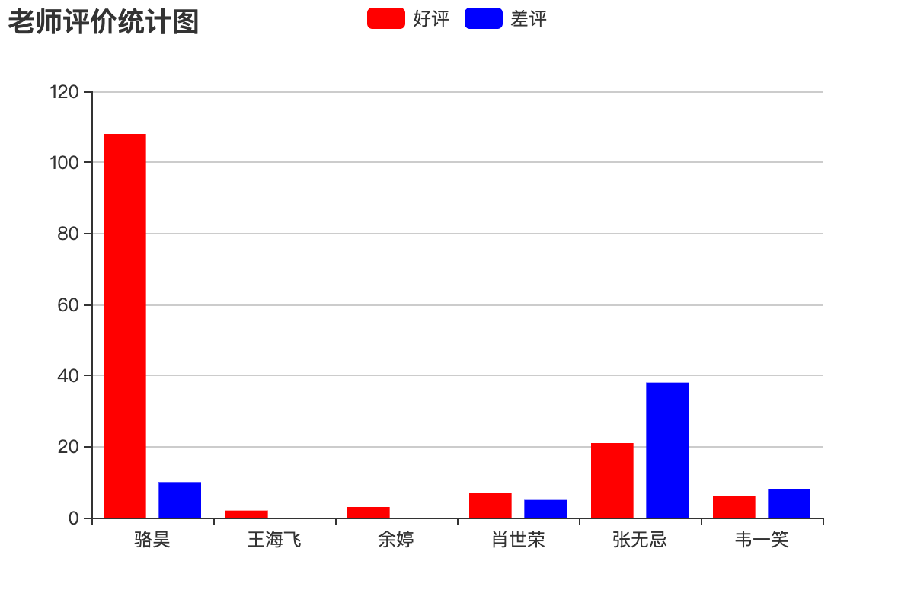

## Tạo báo cáo

### Xuất báo cáo Excel

Báo cáo là việc hiển thị dữ liệu một cách động bằng các định dạng như bảng biểu, đồ thị, v.v., vì vậy có người đã dùng công thức sau để mô tả báo cáo:

```
Báo cáo = Định dạng đa dạng + Dữ liệu động
```

Có rất nhiều thư viện bên thứ ba hỗ trợ việc ghi tệp Excel trong chương trình Python, bao gồm [`xlwt`](https://xlwt.readthedocs.io/en/latest/), [`xlwings`](https://docs.xlwings.org/en/latest/quickstart.html), [`openpyxl`](https://openpyxl.readthedocs.io/en/latest/), [`xlsxwriter`](https://xlsxwriter.readthedocs.io/), v.v. Trong số đó, mặc dù `xlwt` chỉ hỗ trợ ghi tệp Excel ở định dạng xls nhưng hiệu năng của nó khá tốt. Dưới đây chúng ta sẽ lấy `xlwt` làm ví dụ để minh họa cách xuất báo cáo Excel trong dự án Django.

Cài đặt `xlwt`.

```Bash
pip install xlwt
```

View function để xuất bảng Excel chứa thông tin của tất cả giảng viên:

```Python
def export_teachers_excel(request):
    # Tạo workbook
    wb = xlwt.Workbook()
    # Thêm worksheet
    sheet = wb.add_sheet('Bảng thông tin giảng viên')
    # Truy vấn thông tin của tất cả giảng viên
    queryset = Teacher.objects.all()
    # Ghi tiêu đề cột vào bảng Excel
    colnames = ('Họ tên', 'Giới thiệu', 'Đánh giá tốt', 'Đánh giá xấu', 'Môn học')
    for index, name in enumerate(colnames):
        sheet.write(0, index, name)
    # Ghi dữ liệu của giảng viên vào các ô tính
    props = ('name', 'detail', 'good_count', 'bad_count', 'subject')
    for row, teacher in enumerate(queryset):
        for col, prop in enumerate(props):
            value = getattr(teacher, prop, '')
            if isinstance(value, Subject):
                value = value.name
            sheet.write(row + 1, col, value)
    # Lưu Excel vào bộ đệm bộ nhớ
    buffer = BytesIO()
    wb.save(buffer)
    # Ghi dữ liệu nhị phân vào body phản hồi và thiết lập MIME type
    resp = HttpResponse(buffer.getvalue(), content_type='application/vnd.ms-excel')
    # Tên tệp có ký tự đặc biệt/tiếng Việt cần xử lý bằng percent-encoding
    filename = quote('Giang_vien.xls')
    # Báo cho trình duyệt tải tệp xuống kèm tên tệp qua response header
    resp['content-disposition'] = f'attachment; filename*=utf-8\'\'{filename}'
    return resp
```

Ánh xạ URL.

```Python
urlpatterns = [
    
    path('excel/', views.export_teachers_excel),
    
]
```

### Xuất báo cáo PDF

Trong dự án Django, nếu cần xuất báo cáo PDF, bạn có thể nhờ đến thư viện bên thứ ba `reportlab` để tạo nội dung tệp PDF, sau đó xuất dữ liệu nhị phân của tệp cho trình duyệt và chỉ định MIME type là `application/pdf`, mã nguồn cụ thể như sau:

```Python
def export_pdf(request: HttpRequest) -> HttpResponse:
    buffer = io.BytesIO()
    pdf = canvas.Canvas(buffer)
    pdf.setFont("Helvetica", 80)
    pdf.setFillColorRGB(0.2, 0.5, 0.3)
    pdf.drawString(100, 550, 'hello, world!')
    pdf.showPage()
    pdf.save()
    resp = HttpResponse(buffer.getvalue(), content_type='application/pdf')
    resp['content-disposition'] = 'inline; filename="demo.pdf"'
    return resp
```

Để biết thêm về cách dùng `reportlab` tùy biến báo cáo PDF, bạn có thể tham khảo [tài liệu chính thức](https://www.reportlab.com/docs/reportlab-userguide.pdf) của reportlab.

### Tạo biểu đồ thống kê ở front-end

Nếu dự án cần tạo biểu đồ thống kê ở phía front-end, bạn có thể sử dụng thư viện [ECharts](https://echarts.baidu.com/) của Baidu. Cách làm cụ thể là back-end cung cấp API trả về dữ liệu cần thiết cho biểu đồ thống kê, còn front-end sử dụng ECharts để kết xuất (render) biểu đồ cột, biểu đồ đường, biểu đồ tròn, biểu đồ phân tán, v.v. Ví dụ, nếu chúng ta muốn tạo một báo cáo thống kê số lượt đánh giá tốt và đánh giá xấu của tất cả giảng viên, chúng ta có thể thực hiện theo cách sau.

```Python
def get_teachers_data(request):
    queryset = Teacher.objects.all()
    names = [teacher.name for teacher in queryset]
    good_counts = [teacher.good_count for teacher in queryset]
    bad_counts = [teacher.bad_count for teacher in queryset]
    return JsonResponse({'names': names, 'good': good_counts, 'bad': bad_counts})
```

Ánh xạ URL.

```Python
urlpatterns = [
    path('teachers_data/', views.get_teachers_data),
]
```

Sử dụng ECharts để tạo biểu đồ cột.

```HTML
<!DOCTYPE html>
<html lang="en">
<head>
    <meta charset="UTF-8">
    <title>Thống kê đánh giá giảng viên</title>
</head>
<body>
    <div id="main" style="width: 600px; height: 400px"></div>
    <p>
        <a href="/">Quay về trang chủ</a>
    </p>
    <script src="https://cdn.bootcss.com/echarts/4.2.1-rc1/echarts.min.js"></script>
    <script>
        var myChart = echarts.init(document.querySelector('#main'))
        fetch('/teachers_data/')
            .then(resp => resp.json())
            .then(json => {
                var option = {
                    color: ['#f00', '#00f'],
                    title: {
                        text: 'Biểu đồ thống kê đánh giá giảng viên'
                    },
                    tooltip: {},
                    legend: {
                        data:['Đánh giá tốt', 'Đánh giá xấu']
                    },
                    xAxis: {
                        data: json.names
                    },
                    yAxis: {},
                    series: [
                        {
                            name: 'Đánh giá tốt',
                            type: 'bar',
                            data: json.good
                        },
                        {
                            name: 'Đánh giá xấu',
                            type: 'bar',
                            data: json.bad
                        }
                    ]
                }
                myChart.setOption(option)
            })
    </script>
</body>
</html>
```

Kết quả chạy như hình bên dưới.


