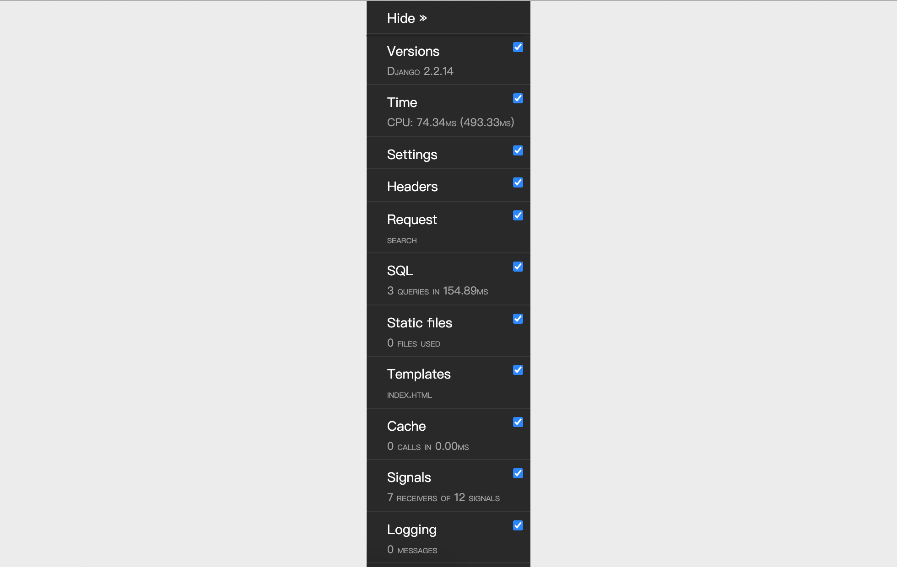

## Log và thanh công cụ Debug

### Cấu hình ghi log

Trong giai đoạn phát triển dự án, việc hiển thị đầy đủ thông tin gỡ lỗi để hỗ trợ lập trình viên debug mã nguồn là rất cần thiết; sau khi dự án được đưa lên production, việc ghi lại các cảnh báo, lỗi phát sinh khi hệ thống vận hành để các nhân sự liên quan nắm được tình trạng hoạt động và bảo trì mã nguồn cũng vô cùng quan trọng. Đồng thời, việc thu thập dữ liệu log cũng đặt nền móng cho việc vận hành số hóa của website. Thông qua việc phân tích nhật ký hoạt động của hệ thống, chúng ta có thể giám sát lưu lượng truy cập và phân bổ lưu lượng của website, đồng thời có thể khai thác thói quen sử dụng và hành vi của người dùng.

Tiếp theo, chúng ta hãy xem cách cấu hình logging thông qua tệp cấu hình của Django. Cấu hình logging của Django về cơ bản có thể tham khảo tài liệu chính thức kết hợp với nhu cầu thực tế của dự án. Những nội dung này phần lớn có thể sao chép từ tài liệu chính thức rồi tinh chỉnh cục bộ. Dưới đây là một số cấu hình tham khảo.

```Python
LOGGING = {
    'version': 1,
    # Có vô hiệu hóa các logger đã tồn tại hay không
    'disable_existing_loggers': False,
    # Bộ định dạng log (Formatter)
    'formatters': {
        'simple': {
            'format': '%(asctime)s %(module)s.%(funcName)s: %(message)s',
            'datefmt': '%Y-%m-%d %H:%M:%S',
        },
        'verbose': {
            'format': '%(asctime)s %(levelname)s [%(process)d-%(threadName)s] '
                      '%(module)s.%(funcName)s line %(lineno)d: %(message)s',
            'datefmt': '%Y-%m-%d %H:%M:%S',
        }
    },
    # Bộ lọc log (Filter)
    'filters': {
        # Chỉ có tác dụng khi giá trị DEBUG trong tệp cấu hình Django là True
        'require_debug_true': {
            '()': 'django.utils.log.RequireDebugTrue',
        },
    },
    # Trình xử lý log (Handler)
    'handlers': {
        # Xuất ra console
        'console': {
            'class': 'logging.StreamHandler',
            'level': 'DEBUG',
            'filters': ['require_debug_true'],
            'formatter': 'simple',
        },
        # Xuất ra tệp (xoay vòng mỗi tuần một lần)
        'file1': {
            'class': 'logging.handlers.TimedRotatingFileHandler',
            'filename': 'access.log',
            'when': 'W0',
            'backupCount': 12,
            'formatter': 'simple',
            'level': 'INFO',
        },
        # Xuất ra tệp (xoay vòng mỗi ngày một lần)
        'file2': {
            'class': 'logging.handlers.TimedRotatingFileHandler',
            'filename': 'error.log',
            'when': 'D',
            'backupCount': 31,
            'formatter': 'verbose',
            'level': 'WARNING',
        },
    },
    # Trình ghi log (Logger)
    'loggers': {
        'django': {
            # Các handler cần sử dụng
            'handlers': ['console', 'file1', 'file2'],
            # Có truyền lan truyền thông tin log lên trên hay không
            'propagate': True,
            # Mức log (không nhất thiết là mức log cuối cùng)
            'level': 'DEBUG',
        },
    }
}
```

Có thể bạn đã nhận thấy, `formatters` trong cấu hình log ở trên là **bộ định dạng log**, nó đại diện cho cách định dạng đầu ra của log, trong đó các ký tự giữ chỗ định dạng lần lượt biểu thị:

1. `%(name)s` - Tên của logger
2. `%(levelno)s` - Mức log dạng số
3. `%(levelname)s` - Tên văn bản của mức log
4. `%(filename)s` - Tên tệp nguồn thực hiện lệnh ghi log
5. `%(pathname)s` - Tên đường dẫn của tệp nguồn thực hiện lệnh ghi log
6. `%(funcName)s` - Tên hàm thực hiện lệnh ghi log
7. `%(module)s` - Tên module thực hiện lệnh ghi log
8. `%(lineno)s` - Số dòng thực hiện lệnh ghi log
9. `%(created)s` - Thời gian thực hiện lệnh ghi log
10. `%(asctime)s` - Ngày và giờ
11. `%(msecs)s` - Phần mili giây
12. `%(thread)d` - ID luồng (số nguyên)
13. `%(threadName)s` - Tên luồng
14. `%(process)d` - ID tiến trình (số nguyên)

Phần `handlers` trong cấu hình log dùng để chỉ định **trình xử lý log**, nói đơn giản là chỉ định việc xuất log ra console, tệp hay máy chủ trên mạng. Các handler khả dụng bao gồm:

1. `logging.StreamHandler(stream=None)` - Có thể xuất thông tin ra bất kỳ đối tượng tệp nào tương tự như `sys.stdout` hoặc `sys.stderr`
2. `logging.FileHandler(filename, mode='a', encoding=None, delay=False)` - Ghi thông điệp log vào tệp
3. `logging.handlers.DatagramHandler(host, port)` - Sử dụng giao thức UDP để gửi thông tin log tới máy chủ mạng với host và port được chỉ định
4. `logging.handlers.HTTPHandler(host, url)` - Sử dụng phương thức GET hoặc POST của HTTP để tải thông điệp log lên một máy chủ HTTP
5. `logging.handlers.RotatingFileHandler(filename, mode='a', maxBytes=0, backupCount=0, encoding=None, delay=False)` - Ghi thông điệp log vào tệp, nếu kích thước tệp vượt quá giá trị được chỉ định bởi `maxBytes`, một tệp mới sẽ được tạo lại để ghi log
6. `logging.handlers.SocketHandler(host, port)` - Sử dụng giao thức TCP để gửi thông tin log tới máy chủ mạng với host và port được chỉ định
7. `logging.handlers.SMTPHandler(mailhost, fromaddr, toaddrs, subject, credentials=None, secure=None, timeout=1.0)` - Xuất log tới địa chỉ email được chỉ định
8. `logging.MemoryHandler(capacity, flushLevel=ERROR, target=None, flushOnClose=True)` - Xuất log vào vùng đệm được chỉ định trong bộ nhớ

Mỗi trình xử lý log ở trên đều chỉ định một thuộc tính có tên là `level`, đại diện cho cấp độ của log. Các cấp độ log khác nhau phản ánh mức độ nghiêm trọng của thông tin được ghi lại trong log. Python định nghĩa sáu cấp độ log, theo thứ tự từ thấp đến cao lần lượt là: NOTSET, DEBUG, INFO, WARNING, ERROR, CRITICAL.

Cuối cùng, **trình ghi log (logger)** được cấu hình dùng để thực sự xuất ra log. Framework Django cung cấp các logger tích hợp sẵn như sau:

1. `django` - Tất cả trình ghi thông điệp trong cấu trúc phân cấp của Django
2. `django.request` - Các thông điệp log liên quan đến xử lý yêu cầu. Phản hồi 5xx được coi là thông điệp lỗi; phản hồi 4xx được coi là thông điệp cảnh báo
3. `django.server` - Các thông điệp log liên quan đến các yêu cầu được máy chủ nhận thông qua lệnh `runserver`. Phản hồi 5xx được coi là thông điệp lỗi; phản hồi 4xx được ghi lại dưới dạng thông điệp cảnh báo; mọi thứ khác được ghi là INFO
4. `django.template` - Các thông điệp log liên quan đến render template
5. `django.db.backends` - Các thông điệp log phát sinh từ tương tác với cơ sở dữ liệu. Nếu muốn hiển thị câu lệnh SQL được ORM framework thực thi, bạn có thể sử dụng logger này.

Cấp độ log được cấu hình trong logger có thể không phải là cấp độ log cuối cùng, vì nó còn phải tham chiếu đến cấp độ log được cấu hình trong log handler, lấy cấp độ cao hơn giữa hai cấp độ làm cấp độ log cuối cùng.

### Cấu hình Django-Debug-Toolbar

Nếu muốn debug dự án Django của mình, bạn nhất định không thể bỏ qua công cụ tuyệt vời mang tên Django-Debug-Toolbar. Đây là công cụ không thể thiếu để hỗ trợ gỡ lỗi và tối ưu hóa trong giai đoạn phát triển dự án. Chỉ cần cấu hình nó, bạn có thể dễ dàng xem thông tin vận hành dự án như trong bảng dưới đây, những thông tin này rất quan trọng để debug dự án và tối ưu hóa hiệu năng ứng dụng web.

| Mục | Giải thích |
| ----------- | --------------------------------- |
| Versions | Phiên bản Django |
| Time | Hiển thị thời gian tiêu tốn của view |
| Settings | Giá trị thiết lập trong tệp cấu hình |
| Headers | Thông tin HTTP request header và response header |
| Request | Các biến và thông tin liên quan đến request |
| StaticFiles | Tình trạng tải tệp tĩnh |
| Templates | Thông tin liên quan đến template |
| Cache | Tình trạng sử dụng bộ nhớ đệm (cache) |
| Signals | Thông tin signal tích hợp sẵn của Django |
| Logging | Thông tin log được ghi lại |
| SQL | Các câu lệnh SQL gửi đến cơ sở dữ liệu và thời gian thực thi của chúng |

1. Cài đặt Django-Debug-Toolbar.

   ```Shell
   pip install django-debug-toolbar
   ```

2. Cấu hình - sửa đổi settings.py.

   ```Python
   INSTALLED_APPS = [
       'debug_toolbar',
   ]
   
   MIDDLEWARE = [
       'debug_toolbar.middleware.DebugToolbarMiddleware',
   ]
   
   DEBUG_TOOLBAR_CONFIG = {
       # Nhúng thư viện jQuery
       'JQUERY_URL': 'https://cdn.bootcss.com/jquery/3.3.1/jquery.min.js',
       # Thanh công cụ có thu gọn hay không
       'SHOW_COLLAPSED': True,
       # Có hiển thị thanh công cụ hay không
       'SHOW_TOOLBAR_CALLBACK': lambda x: True,
   }
   ```

3. Cấu hình - sửa đổi urls.py.

   ```Python
   if settings.DEBUG:
   
       import debug_toolbar
   
       urlpatterns.insert(0, path('__debug__/', include(debug_toolbar.urls)))
   ```

4. Sau khi cấu hình Django-Debug-Toolbar, bạn sẽ thấy một thanh công cụ gỡ lỗi ở bên phải trang web, như hình bên dưới. Thanh công cụ này bao gồm các thông tin gỡ lỗi khác nhau như đã mô tả ở trên: thời gian thực thi, cài đặt dự án, tiêu đề yêu cầu, SQL, tài nguyên tĩnh, template, cache, signal, v.v., tra cứu vô cùng thuận tiện.

   

### Tối ưu hóa mã nguồn ORM

Sau khi cấu hình logging hoặc Django-Debug-Toolbar, chúng ta có thể kiểm tra tình hình thực thi của view function xuất dữ liệu giảng viên ra báo cáo Excel trước đó. Ở đây chúng ta quan tâm đến câu truy vấn SQL do framework ORM tạo ra trông như thế nào, tin rằng kết quả này sẽ khiến bạn có chút bất ngờ. Sau khi thực thi `Teacher.objects.all()`, chúng ta có thể nhận thấy các câu lệnh SQL nhìn thấy trên console hoặc xuất ra qua Django-Debug-Toolbar trông như sau:

```SQL
SELECT `tb_teacher`.`no`, `tb_teacher`.`name`, `tb_teacher`.`detail`, `tb_teacher`.`photo`, `tb_teacher`.`good_count`, `tb_teacher`.`bad_count`, `tb_teacher`.`sno` FROM `tb_teacher`; args=()
SELECT `tb_subject`.`no`, `tb_subject`.`name`, `tb_subject`.`intro`, `tb_subject`.`create_date`, `tb_subject`.`is_hot` FROM `tb_subject` WHERE `tb_subject`.`no` = 101; args=(101,)
SELECT `tb_subject`.`no`, `tb_subject`.`name`, `tb_subject`.`intro`, `tb_subject`.`create_date`, `tb_subject`.`is_hot` FROM `tb_subject` WHERE `tb_subject`.`no` = 101; args=(101,)
SELECT `tb_subject`.`no`, `tb_subject`.`name`, `tb_subject`.`intro`, `tb_subject`.`create_date`, `tb_subject`.`is_hot` FROM `tb_subject` WHERE `tb_subject`.`no` = 101; args=(101,)
SELECT `tb_subject`.`no`, `tb_subject`.`name`, `tb_subject`.`intro`, `tb_subject`.`create_date`, `tb_subject`.`is_hot` FROM `tb_subject` WHERE `tb_subject`.`no` = 101; args=(101,)
SELECT `tb_subject`.`no`, `tb_subject`.`name`, `tb_subject`.`intro`, `tb_subject`.`create_date`, `tb_subject`.`is_hot` FROM `tb_subject` WHERE `tb_subject`.`no` = 103; args=(103,)
SELECT `tb_subject`.`no`, `tb_subject`.`name`, `tb_subject`.`intro`, `tb_subject`.`create_date`, `tb_subject`.`is_hot` FROM `tb_subject` WHERE `tb_subject`.`no` = 103; args=(103,)
```

Vấn đề ở đây thường được gọi là "truy vấn 1+N" (ở một số nơi còn gọi là "truy vấn N+1"). Ban đầu để lấy dữ liệu giảng viên chỉ cần một câu lệnh SQL, nhưng vì giảng viên liên kết với môn học, khi truy vấn được `N` bản ghi giảng viên, ORM của Django lại gửi thêm `N` câu lệnh SQL đến cơ sở dữ liệu để truy vấn thông tin môn học của giảng viên đó. Mỗi câu lệnh SQL thực thi đều tốn chi phí lớn và gây áp lực lên máy chủ cơ sở dữ liệu. Nếu có thể hoàn thành việc truy vấn giảng viên và môn học trong một câu lệnh SQL duy nhất thì chắc chắn là giải pháp tốt hơn, và điều này rất dễ thực hiện, tin rằng mọi người đã nghĩ ra cách làm. Đúng vậy, chúng ta có thể sử dụng truy vấn kết hợp (JOIN), nhưng làm thế nào để thực hiện điều này khi sử dụng ORM của Django? Đối với quan hệ nhiều-một (chẳng hạn như giảng viên và môn học trong ứng dụng bình chọn), chúng ta có thể sử dụng phương thức `select_related()` của `QuerySet` để nạp các đối tượng liên kết; còn đối với quan hệ nhiều-nhiều (chẳng hạn như đơn hàng và sản phẩm trong trang thương mại điện tử), chúng ta có thể sử dụng phương thức `prefetch_related()` để nạp các đối tượng liên kết.

Trong view function xuất báo cáo Excel giảng viên, chúng ta có thể tối ưu hóa mã nguồn theo cách sau:

```Python
queryset = Teacher.objects.all().select_related('subject')
```

Trên thực tế, thao tác truy vấn dữ liệu đánh giá tốt và đánh giá xấu của giảng viên trong view function tạo biểu đồ thống kê front-end bằng ECharts cũng có thể được tối ưu hóa. Bởi vì trong ví dụ này, chúng ta chỉ cần lấy ba mục dữ liệu: họ tên, số đánh giá tốt và số đánh giá xấu của giảng viên, nhưng theo mặc định câu lệnh SQL được tạo ra sẽ truy vấn tất cả các trường của bảng giảng viên. Bạn có thể sử dụng phương thức `only()` của `QuerySet` để chỉ định các thuộc tính cần truy vấn, hoặc dùng phương thức `defer()` của `QuerySet` để chỉ định các thuộc tính tạm thời chưa cần truy vấn. Nhờ đó, câu lệnh SQL được sinh ra sẽ chỉ định các cột cần truy vấn thông qua phép chiếu (projection), giúp cải thiện hiệu năng truy vấn, mã nguồn như sau:

```Python
queryset = Teacher.objects.all().only('name', 'good_count', 'bad_count')
```

Tất nhiên, nếu muốn thống kê số lượng đánh giá tốt và đánh giá xấu trung bình của giảng viên theo từng môn học, bạn cũng có thể thực hiện được bằng ORM của Django, mã nguồn như sau:

```Python
queryset = Teacher.objects.values('subject').annotate(good=Avg('good_count'), bad=Avg('bad_count'))
```

Ở đây, các phần tử trong `QuerySet` thu được là các đối tượng dictionary. Mỗi dictionary có ba cặp key-value lần lượt là `subject` đại diện cho mã môn học, `good` đại diện cho số đánh giá tốt và `bad` đại diện cho số đánh giá xấu. Nếu muốn lấy tên môn học thay vì mã môn học, bạn có thể điều chỉnh mã nguồn theo cách sau:

```Python
queryset = Teacher.objects.values('subject__name').annotate(good=Avg('good_count'), bad=Avg('bad_count'))
```

Có thể thấy rằng, framework ORM của Django cho phép chúng ta thực hiện các truy vấn gom nhóm (group by) và hàm tổng hợp (aggregate) trong cơ sở dữ liệu quan hệ theo phong cách hướng đối tượng.
