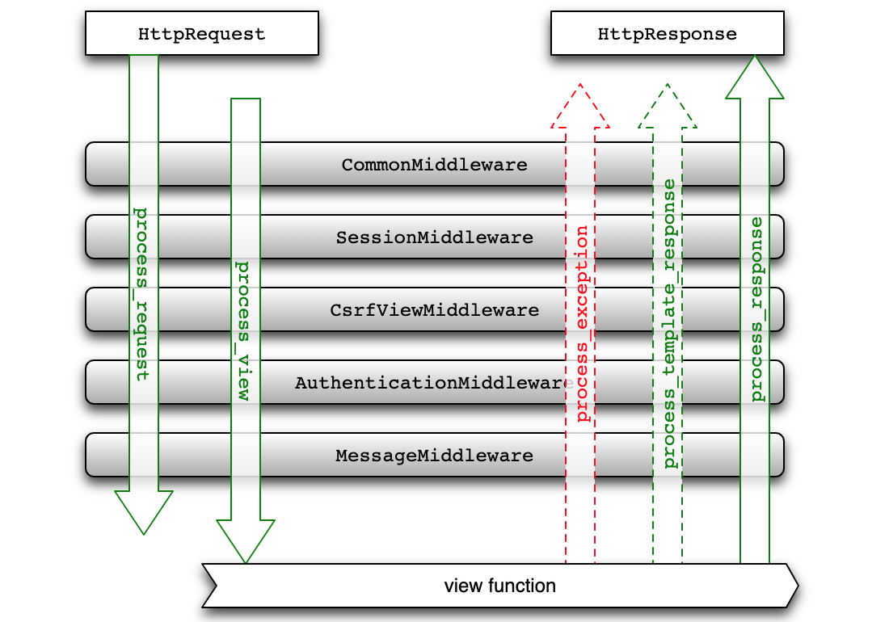

## Ứng dụng Middleware

Trước đây chúng ta đã thực hiện giới hạn yêu cầu người dùng phải đăng nhập mới có thể bình chọn, nhưng một vấn đề mới lại nảy sinh. Nếu ứng dụng của chúng ta có rất nhiều chức năng đều yêu cầu người dùng phải đăng nhập trước khi thực hiện, chẳng hạn như chức năng xuất báo cáo Excel và xem biểu đồ thống kê ở phần trước cũng đều bị giới hạn bắt buộc phải đăng nhập mới được truy cập, vậy chẳng lẽ chúng ta phải thêm đoạn mã kiểm tra xem trong session có chứa `userid` hay không vào từng view function sao? Câu trả lời chắc chắn là không. Nếu làm như vậy, các view function của chúng ta chắc chắn sẽ tràn ngập mã nguồn trùng lặp. Bậc thầy lập trình *Martin Fowler* từng nói: **Mã nguồn có nhiều loại 'mùi hôi' (bad smells), và sự trùng lặp là thứ tồi tệ nhất**. Trong chương trình Python, chúng ta có thể sử dụng decorator để cung cấp thêm khả năng cho hàm; còn trong dự án Django, chúng ta có thể đưa đoạn mã trùng lặp như xác thực người dùng đã đăng nhập hay chưa vào **middleware**.

### Tổng quan về Django Middleware

Middleware là thành phần được cài cắm vào giữa quá trình nhận yêu cầu (request) và trả về phản hồi (response) của ứng dụng web. Nó đóng vai trò như một bộ lọc chặn (intercepting filter) trong toàn bộ ứng dụng web. Thông qua middleware, bạn có thể chặn request và response, đồng thời lọc chúng (nói một cách đơn giản là thực hiện các xử lý bổ sung). Thông thường, một thành phần middleware chỉ tập trung vào việc hoàn thành một tác vụ cụ thể, ví dụ: framework Django cung cấp hỗ trợ session thông qua middleware `SessionMiddleware`, và hỗ trợ xác thực yêu cầu dựa trên session thông qua middleware `AuthenticationMiddleware`. Bằng cách kết hợp nhiều middleware lại với nhau, chúng ta có thể hoàn thành các tác vụ phức tạp hơn, và framework Django đã làm chính xác điều đó.

Tệp cấu hình của dự án Django đã bao gồm cấu hình cho middleware, mã nguồn như sau:

```Python
MIDDLEWARE = [
    'django.middleware.security.SecurityMiddleware',
    'django.contrib.sessions.middleware.SessionMiddleware',
    'django.middleware.common.CommonMiddleware',
    'django.middleware.csrf.CsrfViewMiddleware',
    'django.contrib.auth.middleware.AuthenticationMiddleware',
    'django.contrib.messages.middleware.MessageMiddleware',
    'django.middleware.clickjacking.XFrameOptionsMiddleware',
]
```

Chúng ta hãy cùng giải thích ngắn gọn về vai trò của các middleware này:

1. `CommonMiddleware` - Middleware cài đặt cơ bản, có thể xử lý một số tham số cấu hình sau:
   - DISALLOWED_USER_AGENTS - Danh sách User Agent (trình duyệt) không được phép truy cập
   - APPEND_SLASH - Có tự động nối thêm dấu gạch chéo `/` vào cuối URL hay không
   - USE_ETAG - Liên quan đến bộ nhớ đệm (cache) của trình duyệt
2. `SecurityMiddleware` - Middleware liên quan đến bảo mật, có thể xử lý các mục cấu hình liên quan đến an ninh:
   - SECURE_HSTS_SECONDS - Thời gian bắt buộc sử dụng HTTPS
   - SECURE_HSTS_INCLUDE_SUBDOMAINS - HTTPS có áp dụng cho cả tên miền con (subdomain) hay không
   - SECURE_CONTENT_TYPE_NOSNIFF - Có cho phép trình duyệt đoán kiểu nội dung (content type) hay không
   - SECURE_BROWSER_XSS_FILTER - Có bật bộ lọc tấn công XSS của trình duyệt hay không
   - SECURE_SSL_REDIRECT - Có chuyển hướng sang kết nối HTTPS hay không
   - SECURE_REDIRECT_EXEMPT - Danh sách URL được miễn chuyển hướng sang HTTPS
3. `SessionMiddleware` - Middleware quản lý phiên làm việc (session).
4. `CsrfViewMiddleware` - Middleware phòng chống tấn công CSRF thông qua việc tạo token ngẫu nhiên.
5. `XFrameOptionsMiddleware` - Middleware phòng chống tấn công Clickjacking thông qua việc thiết lập tham số trong response header.

Trong quá trình xử lý yêu cầu, các middleware ở trên sẽ được thực thi theo thứ tự từ trên xuống dưới theo đúng thứ tự khai báo, sau đó mới tới phân giải URL, và cuối cùng yêu cầu mới đến view function; còn trong quá trình trả về phản hồi, các middleware ở trên sẽ thực thi theo thứ tự từ dưới lên trên, ngược lại hoàn toàn so với thứ tự khi xử lý yêu cầu.

### Tùy biến Middleware

Middleware trong Django có hai cách hiện thực: dựa trên lớp (class-based) và dựa trên hàm (function-based), cách thứ hai tương tự với cách viết decorator hơn. Decorator thực chất là một ứng dụng của mẫu thiết kế Proxy (Proxy Pattern), đưa các mối quan tâm xuyên suốt (cross-cutting concerns - những chức năng không nhất thiết liên quan trực tiếp đến logic nghiệp vụ bình thường, chẳng hạn như: xác thực danh tính, ghi log, chuyển đổi mã hóa) vào proxy, để đối tượng proxy thực hiện hành vi của đối tượng được ủy quyền và thêm vào các chức năng bổ sung. Middleware chặn và lọc các yêu cầu và phản hồi của người dùng đồng thời bổ sung các bước xử lý phụ, ở điểm này nó hoàn toàn nhất quán với decorator, vì vậy việc viết middleware dựa trên hàm hầu như giống hệt cách viết decorator. Dưới đây, chúng ta sẽ sử dụng middleware tùy biến để thực hiện chức năng xác thực đăng nhập người dùng.

```Python
"""
middlewares.py
"""
from django.http import JsonResponse
from django.shortcuts import redirect

# Đường dẫn tài nguyên yêu cầu đăng nhập mới được truy cập
LOGIN_REQUIRED_URLS = {'/praise/', '/criticize/', '/excel/', '/teachers_data/'}


def check_login_middleware(get_resp):

    def wrapper(request, *args, **kwargs):
        # Đường dẫn tài nguyên yêu cầu nằm trong tập hợp trên
        if request.path in LOGIN_REQUIRED_URLS:
            # Trong session có userid thì coi như đã đăng nhập
            if 'userid' not in request.session:
                # Kiểm tra xem có phải yêu cầu Ajax hay không
                if request.is_ajax():
                    # Yêu cầu Ajax trả về dữ liệu JSON nhắc người dùng đăng nhập
                    return JsonResponse({'code': 10003, 'hint': 'Vui lòng đăng nhập trước'})
                else:
                    backurl = request.get_full_path()
                    # Yêu cầu không phải Ajax chuyển hướng trực tiếp đến trang đăng nhập
                    return redirect(f'/login/?backurl={backurl}')
        return get_resp(request, *args, **kwargs)

    return wrapper
```

Tất nhiên, chúng ta cũng có thể định nghĩa một lớp để đóng vai trò như một decorator. Nếu trong lớp có phương thức đặc biệt (magic method) `__call__`, đối tượng của lớp này có thể được gọi như một hàm thông thường, vì vậy đó là một cách khác để hiện thực hóa middleware, nguyên lý hoàn toàn giống với đoạn mã ở trên.

Ngoài ra còn có một cách hiện thực middleware dựa trên lớp kế thừa từ `MiddlewareMixin`. Cách này không còn được khuyến nghị trong các phiên bản Django mới hơn, nhưng trong các đoạn mã bạn tiếp xúc, bạn vẫn có thể bắt gặp cách viết này, mã nguồn đại khái như sau:

```Python
from django.utils.deprecation import MiddlewareMixin


class MyMiddleware(MiddlewareMixin):

    def process_request(self, request):
        pass

    def process_view(self, request, view_func, view_args, view_kwargs):
        pass

    def process_template_response(self, request, response):
        pass

    def process_response(self, request, response):
        pass

    def process_exception(self, request, exception):
        pass
```

Năm phương thức trong lớp trên đều là các hàm hook của middleware, lần lượt được gọi lại khi nhận được yêu cầu từ người dùng, trước khi vào view function, khi render template, khi trả về phản hồi và khi xuất hiện ngoại lệ. Tất nhiên, việc có viết các phương thức này hay không phụ thuộc vào nhu cầu của middleware, không phải tình huống nào cũng cần ghi đè cả năm phương thức. Hình ảnh dưới đây tin rằng sẽ giúp bạn hiểu được cách viết này.



Sau khi viết xong mã nguồn middleware, bạn cần sửa đổi tệp cấu hình để kích hoạt middleware nhằm làm cho nó có hiệu lực:

```Python
MIDDLEWARE = [
    'django.middleware.security.SecurityMiddleware',
    'django.contrib.sessions.middleware.SessionMiddleware',
    'django.middleware.common.CommonMiddleware',
    'django.middleware.csrf.CsrfViewMiddleware',
    'django.contrib.auth.middleware.AuthenticationMiddleware',
    'django.contrib.messages.middleware.MessageMiddleware',
    'django.middleware.clickjacking.XFrameOptionsMiddleware',
    'debug_toolbar.middleware.DebugToolbarMiddleware',
    'vote.middlewares.check_login_middleware',
]
```

Lưu ý thứ tự của các phần tử trong danh sách middleware ở trên: khi nhận được yêu cầu từ người dùng, các middleware được thực thi lần lượt theo thứ tự từ trên xuống dưới, sau khi chạy hết các middleware này thì yêu cầu mới thực sự đến được view function. Tất nhiên, trong quá trình này, yêu cầu của người dùng có thể bị chặn lại, giống như middleware tùy biến ở trên của chúng ta: nếu người dùng truy cập tài nguyên được bảo vệ mà chưa đăng nhập, middleware sẽ chuyển hướng trực tiếp yêu cầu đến trang đăng nhập, các middleware và view function phía sau sẽ không được thực thi nữa. Trong quá trình phản hồi yêu cầu của người dùng, các middleware ở trên sẽ được thực thi tuần tự từ dưới lên trên, nhờ đó chúng ta còn có thể xử lý phản hồi sâu hơn.

Thứ tự thực thi của middleware là vô cùng quan trọng. Đối với các middleware có quan hệ phụ thuộc, phải đảm bảo middleware được phụ thuộc phải nằm phía trước middleware phụ thuộc vào nó. Giống như middleware tùy biến vừa rồi của chúng ta phải được đặt sau `SessionMiddleware`, bởi vì chúng ta phải dựa vào đối tượng `session` được middleware này gắn vào request thì mới xác định được người dùng đã đăng nhập hay chưa.
