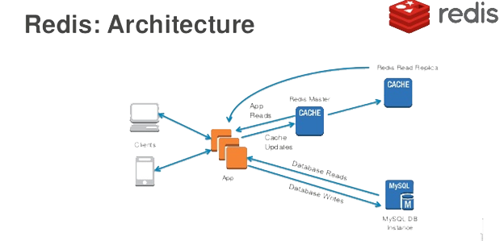

## Sử dụng cache

Thông thường, nút thắt cổ chai về mặt hiệu năng của các ứng dụng Web đều xuất hiện ở cơ sở dữ liệu quan hệ (RDBMS). Khi lượng truy cập đồng thời lớn, nếu mọi yêu cầu đều phải thực hiện thao tác lưu trữ dữ liệu bền vững (persistence) thông qua cơ sở dữ liệu quan hệ, thì cơ sở dữ liệu chắc chắn sẽ bị quá tải. Một trong những điểm quan trọng nhất để tối ưu hóa hiệu năng ứng dụng Web là sử dụng bộ nhớ đệm (cache): tải trước những dữ liệu có dung lượng không quá lớn nhưng tần suất truy cập rất cao vào máy chủ cache. Đây lại là phương pháp điển hình dùng không gian để đổi lấy thời gian. Thông thường các máy chủ cache đều đặt trực tiếp dữ liệu vào trong bộ nhớ RAM và áp dụng các chiến lược truy xuất dữ liệu cực kỳ hiệu quả (lưu trữ băm, cặp key-value,...), hiệu năng đọc ghi vượt trội hơn rất nhiều so với cơ sở dữ liệu quan hệ. Do đó, chúng ta có thể kết nối ứng dụng Web với máy chủ cache để tối ưu hóa hiệu năng, và một trong những lựa chọn tuyệt vời nhất chính là sử dụng Redis.

Kiến trúc bộ nhớ đệm của ứng dụng Web đại khái như hình dưới đây:



### Kết nối dự án Django với Redis

Trong các bài học trước, chúng ta đã giới thiệu cách cài đặt và sử dụng Redis nên ở đây sẽ không nhắc lại chi tiết. Nếu cần kết nối dự án Django với Redis, bạn có thể sử dụng thư viện bên thứ ba `django-redis`, thư viện này lại phụ thuộc vào thư viện bên thứ ba có tên là `redis`, nơi đóng gói sẵn các thao tác khác nhau với Redis.

Cài đặt `django-redis`:

```Bash
pip install django-redis
```

Chỉnh sửa cấu hình cache trong tệp cấu hình của Django:

```Python
CACHES = {
    'default': {
        # Chỉ định kết nối dịch vụ Redis thông qua django-redis
        'BACKEND': 'django_redis.cache.RedisCache',
        # URL của máy chủ Redis
        'LOCATION': ['redis://1.2.3.4:6379/0', ],
        # Tiền tố khóa trong Redis (giải quyết xung đột đặt tên)
        'KEY_PREFIX': 'vote',
        # Các tùy chọn cấu hình khác
        'OPTIONS': {
            'CLIENT_CLASS': 'django_redis.client.DefaultClient',
            # Tham số connection pool (tạo sẵn một số kết nối Redis dự phòng)
            'CONNECTION_POOL_KWARGS': {
                # Số lượng kết nối tối đa
                'max_connections': 512,
            },
            # Mật khẩu người dùng kết nối Redis
            'PASSWORD': 'foobared',
        }
    },
}
```

Đến đây, dự án Django của chúng ta đã có thể kết nối với Redis. Tiếp theo, chúng ta sửa mã nguồn dự án, sử dụng Redis để cung cấp dịch vụ cache cho API lấy dữ liệu môn học đã viết trước đó.

### Cung cấp dịch vụ cache cho View

#### Cache khai báo (Declarative Caching)

Cái gọi là cache khai báo nghĩa là không cần sửa đổi mã nguồn gốc, mà thông qua decorator trong Python để bổ sung chức năng cache cho mã nguồn sẵn có. Đối với FBV, đoạn mã như sau:

```Python
from django.views.decorators.cache import cache_page


@api_view(('GET', ))
@cache_page(timeout=86400, cache='default')
def show_subjects(request):
    """Lấy dữ liệu môn học"""
    queryset = Subject.objects.all()
    data = SubjectSerializer(queryset, many=True).data
    return Response({'code': 20000, 'subjects': data})
```

Đoạn mã trên thông qua decorator `cache_page` do Django đóng gói sẵn để lưu giá trị trả về của view function (đối tượng Response) vào cache. Mục đích ban đầu của `cache_page` là cache trang HTML do view function render, đối với view function trả về dữ liệu JSON thì tương đương với việc cache dữ liệu JSON. Khi sử dụng decorator `cache_page`, có thể truyền tham số `timeout` để chỉ định thời gian hết hạn của cache, ngoài ra còn có thể dùng tham số `cache` để chỉ định nhóm dịch vụ cache nào sẽ được dùng để lưu trữ dữ liệu. Dự án Django cho phép cấu hình nhiều nhóm dịch vụ cache trong tệp cấu hình, cấu hình `cache='default'` ở trên chỉ định việc sử dụng dịch vụ cache mặc định (vì trong cấu hình trước đó chúng ta cũng chỉ cấu hình dịch vụ cache có tên là `default`). Giá trị trả về của view function sẽ được tuần tự hóa thành chuỗi byte và lưu vào Redis (kiểu chuỗi str trong Redis có thể nhận chuỗi byte), chúng ta cũng không cần tự xử lý việc tuần tự hóa và giải tuần tự hóa dữ liệu cache, vì decorator `cache_page` sẽ gọi `RedisCache` trong thư viện `django-redis` để kết nối với Redis. Lớp này sử dụng `DefaultClient` để kết nối Redis và sử dụng [pickle để tuần tự hóa](https://python3-cookbook.readthedocs.io/zh_CN/latest/c05/p21_serializing_python_objects.html), trong đó `django_redis.serializers.pickle.PickleSerializer` là lớp tuần tự hóa mặc định.

Nếu trong cache chưa có dữ liệu môn học, khi truy cập dữ liệu môn học qua API, view function của chúng ta sẽ thực thi câu lệnh SQL gửi đến cơ sở dữ liệu thông qua `Subject.objects.all()` để lấy dữ liệu. Giá trị trả về của view function sẽ được lưu vào cache, vì vậy ở lần yêu cầu tiếp theo tới view function này, nếu cache chưa hết hạn, giá trị trả về có thể được lấy trực tiếp từ cache mà không cần truy vấn lại cơ sở dữ liệu. Nếu muốn tìm hiểu tình hình sử dụng cache, bạn có thể cấu hình log cơ sở dữ liệu hoặc sử dụng Django-Debug-Toolbar để theo dõi. Lần đầu tiên truy cập API dữ liệu môn học, bạn sẽ thấy câu lệnh SQL truy vấn dữ liệu môn học; khi truy cập lại, sẽ không còn câu lệnh SQL nào được gửi tới cơ sở dữ liệu nữa vì dữ liệu đã được lấy trực tiếp từ cache.

Đối với CBV, có thể tận dụng decorator `method_decorator` của Django để đưa decorator hàm `cache_page` áp dụng lên phương thức của lớp, hiệu quả tương tự như đoạn mã ở trên. Cần lưu ý rằng không thể đặt trực tiếp decorator `cache_page` lên lớp vì nó là decorator dùng cho hàm, do đó framework Django mới cung cấp `method_decorator` để giải quyết vấn đề này. Rõ ràng, `method_decorator` là một decorator dùng để trang trí cho lớp.

```Python
from django.utils.decorators import method_decorator
from django.views.decorators.cache import cache_page


@method_decorator(decorator=cache_page(timeout=86400, cache='default'), name='get')
class SubjectView(ListAPIView):
    """Lớp view lấy dữ liệu môn học"""
    queryset = Subject.objects.all()
    serializer_class = SubjectSerializer
```

#### Cache lập trình (Programmatic Caching)

Cái gọi là cache lập trình nghĩa là tự viết code để sử dụng dịch vụ cache. Phương thức này tuy lượng code sẽ nhiều hơn một chút, nhưng so với cache khai báo, các thao tác và việc sử dụng cache lại linh hoạt hơn nhiều, được áp dụng nhiều hơn trong quá trình phát triển thực tế. Đoạn mã dưới đây đã loại bỏ decorator `cache_page` trước đó, thông qua hàm `get_redis_connection` do `django-redis` cung cấp để lấy trực tiếp kết nối Redis và thao tác với Redis.

```Python
def show_subjects(request):
    """Lấy dữ liệu môn học"""
    redis_cli = get_redis_connection()
    # Thử lấy dữ liệu môn học từ cache trước
    data = redis_cli.get('vote:polls:subjects')
    if data:
        # Nếu lấy được dữ liệu môn học thì tiến hành giải tuần tự hóa
        data = json.loads(data)
    else:
        # Nếu trong cache không có dữ liệu môn học thì truy vấn cơ sở dữ liệu
        queryset = Subject.objects.all()
        data = SubjectSerializer(queryset, many=True).data
        # Tuần tự hóa dữ liệu môn học vừa truy vấn rồi lưu vào cache
        redis_cli.set('vote:polls:subjects', json.dumps(data), ex=86400)
    return Response({'code': 20000, 'subjects': data})
```

Cần giải thích thêm rằng framework Django cung cấp sẵn hai biến `cache` và `caches` để hỗ trợ thao tác cache: biến thứ nhất truy cập vào cache mặc định (cache có tên là `default`), biến thứ hai có thể thông qua toán tử chỉ mục để lấy dịch vụ cache chỉ định (ví dụ: `caches['default']`). Gửi các phương thức `get` và `set` tới đối tượng `cache` có thể thực hiện thao tác đọc và ghi vào cache, nhưng cách này bị giới hạn về mặt thao tác, không linh hoạt bằng cách sử dụng trong đoạn mã ở trên. Một điểm nữa đáng lưu ý: do đối tượng kết nối Redis nhận được qua hàm `get_redis_connection` có thể thực thi mọi thao tác trên Redis, bao gồm cả các lệnh nguy hiểm như `FLUSHDB`, `SHUTDOWN`, nên trong phát triển dự án thương mại thực tế, người ta thường đóng gói `django-redis` thêm một lớp nữa, chẳng hạn như đóng gói một lớp tiện ích (utility class) chỉ cung cấp các phương thức thao tác cache mà dự án thực sự cần, từ đó tránh được các rủi ro tiềm ẩn khi sử dụng trực tiếp `get_redis_connection`. Tất nhiên, việc tự đóng gói thao tác cache còn có thể sử dụng các mô hình "Read Through" và "Write Through" để cập nhật cache, điều này sẽ được giới thiệu ở phần dưới.

### Các vấn đề liên quan đến Cache

#### Cập nhật dữ liệu Cache

Khi sử dụng cache, một vấn đề bắt buộc phải làm rõ là: khi dữ liệu thay đổi thì làm thế nào để cập nhật dữ liệu trong cache? Thông thường có các mẫu thiết kế cập nhật cache như sau:

1. Cache Aside Pattern
2. Read/Write Through Pattern
3. Write Behind Caching Pattern

Cách thứ nhất cụ thể là: khi dữ liệu được cập nhật, trước tiên cập nhật cơ sở dữ liệu, sau đó xóa cache. Lưu ý, không thể áp dụng cách cập nhật cơ sở dữ liệu trước rồi cập nhật cache sau, cũng không thể dùng cách xóa cache trước rồi cập nhật cơ sở dữ liệu sau; các bạn có thể tự suy ngẫm lý do tại sao (hãy cân nhắc kịch bản có các thao tác đọc và ghi đồng thời). Tất nhiên, việc cập nhật cơ sở dữ liệu trước rồi xóa cache về mặt lý thuyết vẫn tiềm ẩn rủi ro nhỏ, nhưng xác suất xảy ra vấn đề là cực kỳ thấp, vì vậy rất nhiều dự án đều áp dụng phương thức này.

Cách thứ nhất đòi hỏi nhà phát triển viết mã nghiệp vụ phải tự chịu trách nhiệm thao tác với cả hai hệ thống lưu trữ (cache và cơ sở dữ liệu quan hệ), mã nguồn viết ra sẽ rất rườm rà. Mục đích chính của cách thứ hai là biến hệ thống lưu trữ phía sau thành một khối mã duy nhất, việc bảo trì cache được đóng gói bên trong khối mã này. Trong đó, Read Through nghĩa là cập nhật cache trong thao tác truy vấn, tức là khi cache hết hạn/không hợp lệ, dịch vụ cache sẽ tự chịu trách nhiệm nạp dữ liệu, từ đó hoàn toàn trong suốt đối với phía ứng dụng; còn Write Through nghĩa là khi cập nhật dữ liệu, nếu cache miss (không trúng cache), trực tiếp cập nhật cơ sở dữ liệu rồi trả về kết quả; nếu cache hit (trúng cache), sẽ cập nhật cache trước, sau đó dịch vụ cache sẽ tự cập nhật cơ sở dữ liệu (cập nhật đồng bộ). Vừa rồi chúng ta đã nói, nếu tự đóng gói thao tác Redis trong dự án thêm một tầng nữa thì có thể triển khai mô hình "Read Through" và "Write Through". Việc này tuy làm tăng khối lượng công việc ban đầu nhưng chắc chắn là một việc làm "lợi ích lâu dài" và mang lại giá trị bền vững cho dự án.

Cách thứ ba là khi cập nhật dữ liệu, chỉ cập nhật cache mà không cập nhật cơ sở dữ liệu ngay, dịch vụ cache phía sau sẽ **bất đồng bộ cập nhật hàng loạt (batch update)** vào cơ sở dữ liệu. Cách làm này sẽ nâng cao hiệu năng một cách vượt bậc, nhưng cái giá phải trả là hy sinh **tính nhất quán mạnh (strong consistency)** của dữ liệu. Logic triển khai của cách thứ ba tương đối phức tạp vì nó cần theo dõi xem những dữ liệu nào đã bị thay đổi, sau đó mới đồng bộ định kỳ theo lô xuống tầng lưu trữ bền vững.

#### Xuyên thủng cache (Cache Penetration)

Cache là một tầng trung gian được thêm vào nhằm giảm tải áp lực cho cơ sở dữ liệu. Nếu kẻ tấn công liên tục truy cập vào những dữ liệu vốn không hề tồn tại trong cache, thì cache sẽ mất đi ý nghĩa tồn tại của nó, áp lực của mọi yêu cầu sẽ ngay lập tức dồn toàn bộ lên cơ sở dữ liệu. Điều này sẽ khiến cơ sở dữ liệu phải chịu tải cực lớn, thậm chí dẫn đến lỗi kết nối, tương tự như một cuộc tấn công từ chối dịch vụ phân tán (DDoS). Một giải pháp để xử lý hiện tượng xuyên thủng cache là quy ước: nếu truy vấn trả về giá trị rỗng (null/None), ta cũng lưu luôn giá trị rỗng này vào cache, nhưng cần đặt thời gian hết hạn (TTL) tương đối ngắn cho giá trị rỗng đó, dù sao thì việc lưu giá trị như vậy cũng là lãng phí không gian bộ nhớ đệm. Một giải pháp khác để giải quyết xuyên thủng cache là sử dụng bộ lọc Bloom (Bloom filter), cách thực hiện cụ thể bạn đọc có thể tự tìm hiểu thêm.

#### Đánh thủng cache (Cache Breakdown)

Trong các dự án thực tế, có thể xảy ra trường hợp một key nào đó trong cache hết hạn vào một thời điểm nhất định, nhưng đúng vào thời điểm đó lại có lượng lớn các yêu cầu đồng thời đổ về truy vấn key này. Các yêu cầu này không tìm thấy dữ liệu tương ứng trong cache, nên sẽ trực tiếp lấy dữ liệu từ cơ sở dữ liệu và ghi ngược lại vào cache. Lúc này, lượng yêu cầu đồng thời khổng lồ có thể ngay lập tức đánh sập cơ sở dữ liệu, hiện tượng này được gọi là đánh thủng cache (Cache Breakdown). Cách xử lý phổ biến cho hiện tượng đánh thủng cache là sử dụng khóa loại trừ lẫn nhau (mutex lock). Nói một cách đơn giản là khi cache mất hiệu lực, không lập tức đi nạp dữ liệu từ cơ sở dữ liệu, mà trước tiên thiết lập một mutex lock (ví dụ lệnh `setnx` trong Redis). Chỉ có yêu cầu nào thiết lập mutex lock thành công mới được quyền truy vấn nạp dữ liệu từ cơ sở dữ liệu và ghi vào cache; các yêu cầu khác thiết lập khóa thất bại có thể tạm dừng (sleep) trong một khoảng thời gian ngắn rồi thử lấy lại dữ liệu từ cache. Nếu cache vẫn chưa có dữ liệu thì lặp lại thao tác thiết lập mutex lock ở trên. Mã tham khảo đại khái như sau:

```Python
data = redis_cli.get(key)
while not data:
    if redis_cli.setnx('mutex', 'x'):
        redis.expire('mutex', timeout)
        data = db.query(...)
        redis.set(key, data)
        redis.delete('mutex')
    else:
        time.sleep(0.1)
        data = redis_cli.get(key)
```

#### Tuyết lở cache (Cache Avalanche)

Tuyết lở cache (Cache Avalanche) xảy ra khi dữ liệu đưa vào cache được thiết lập cùng một mốc thời gian hết hạn, dẫn đến việc tại một thời điểm nào đó, một lượng lớn cache đồng loạt hết hạn, các yêu cầu bị chuyển tiếp toàn bộ xuống cơ sở dữ liệu khiến cơ sở dữ liệu chịu áp lực đột biến tức thời và sụp đổ. Cách giải quyết vấn đề tuyết lở cache tương đối đơn giản: có thể cộng thêm một khoảng thời gian ngẫu nhiên vào thời gian hết hạn đã định sẵn của cache, như vậy có thể tránh được phần nào việc các key khác nhau đồng loạt mất hiệu lực cùng một lúc. Một cách khác là sử dụng cache đa tầng (multi-level cache), mỗi tầng cache có thời gian hết hạn khác nhau, như vậy ngay cả khi một tầng cache nào đó đồng loạt hết hạn thì các tầng cache khác vẫn có thể cung cấp dữ liệu, tránh việc toàn bộ yêu cầu đổ dồn xuống cơ sở dữ liệu.