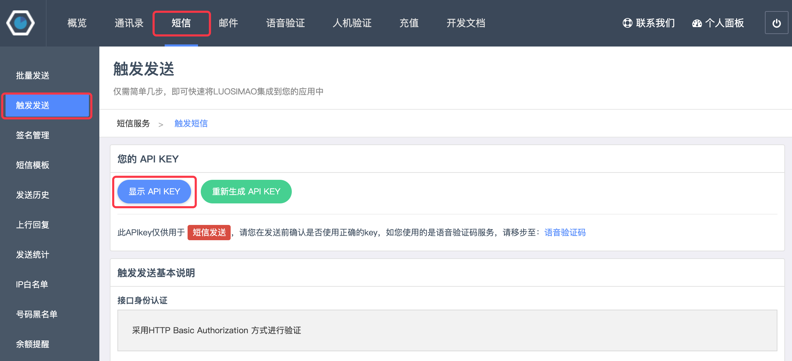
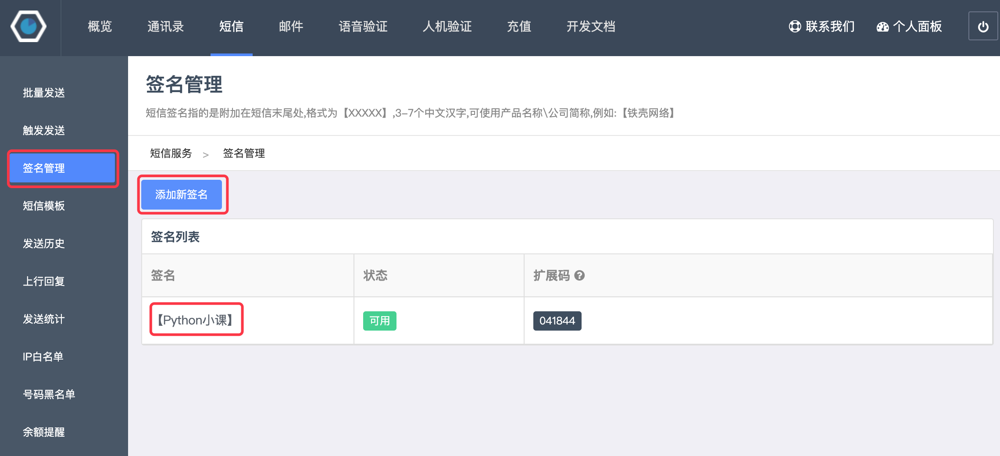
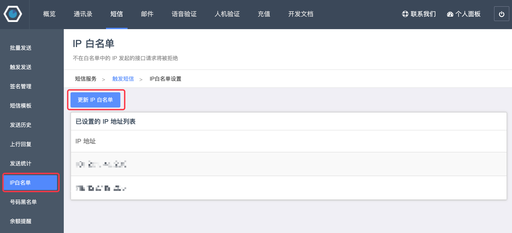
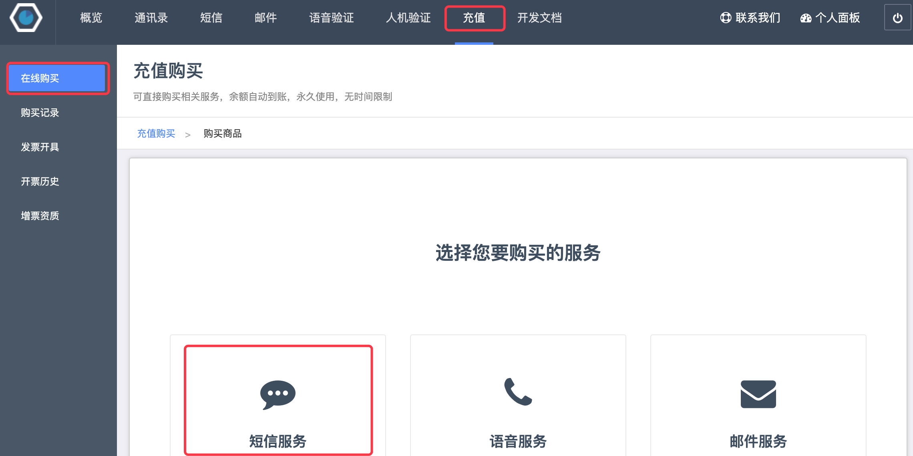
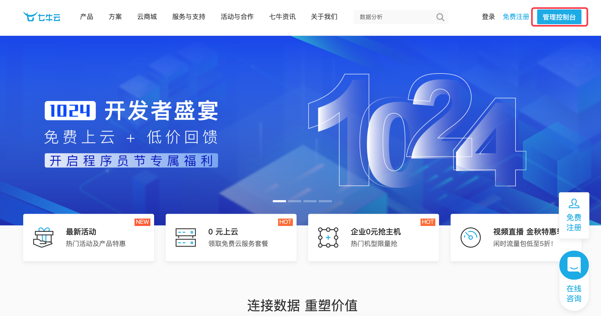
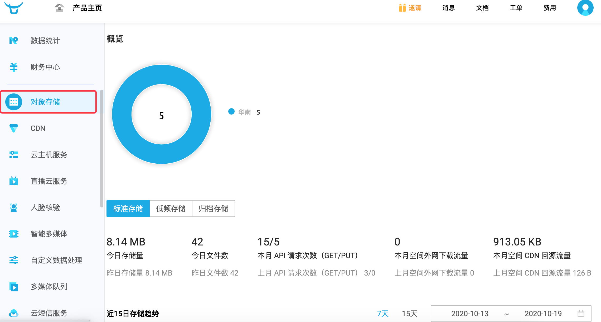
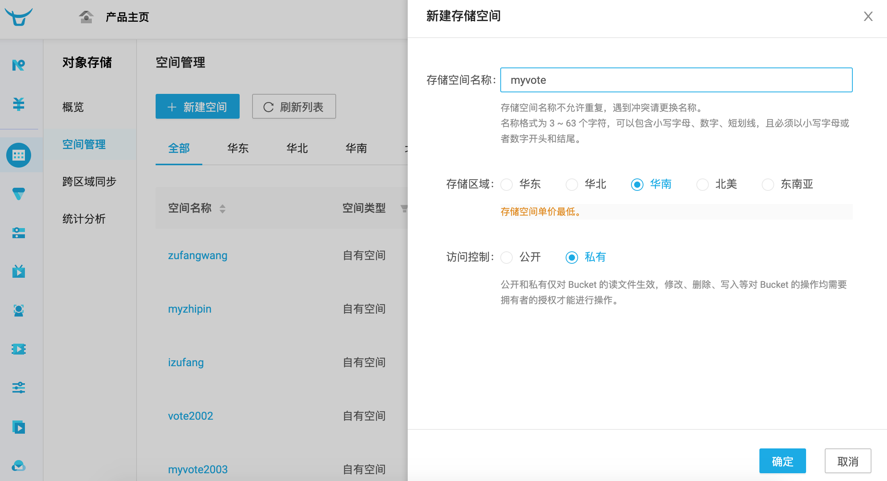
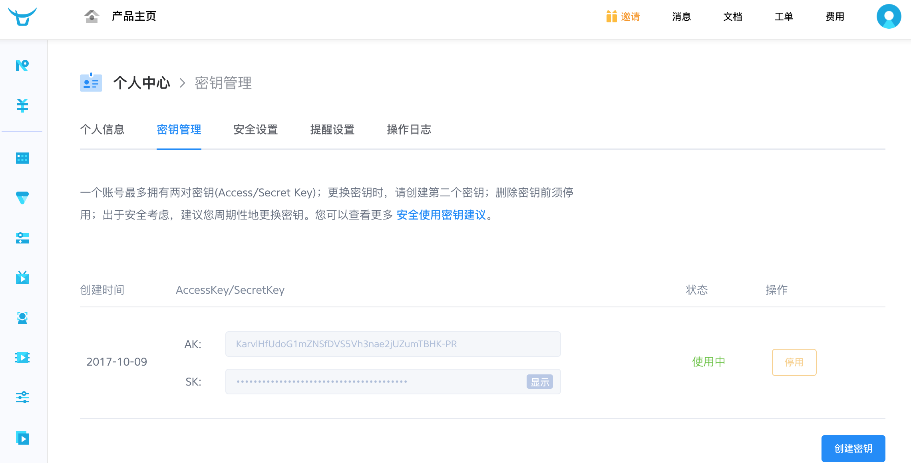
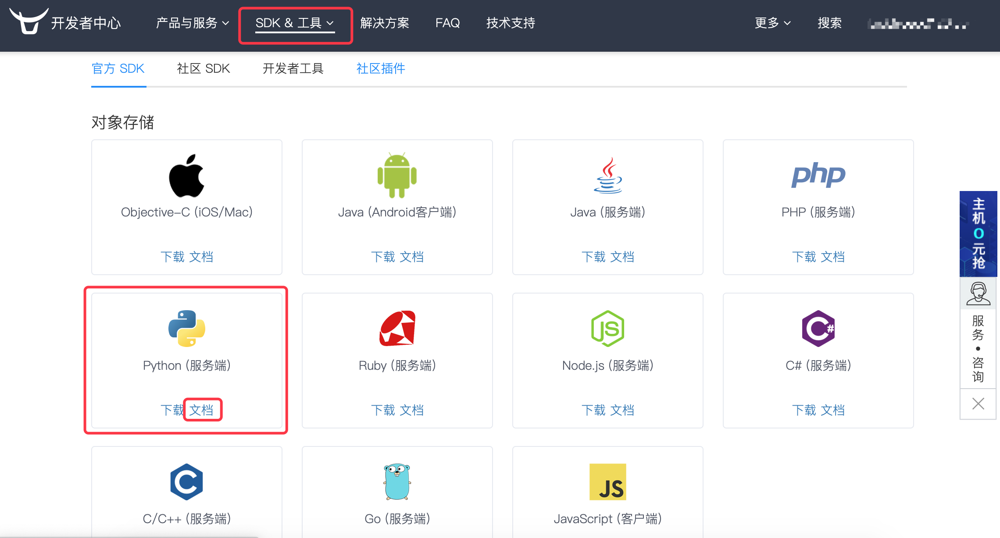
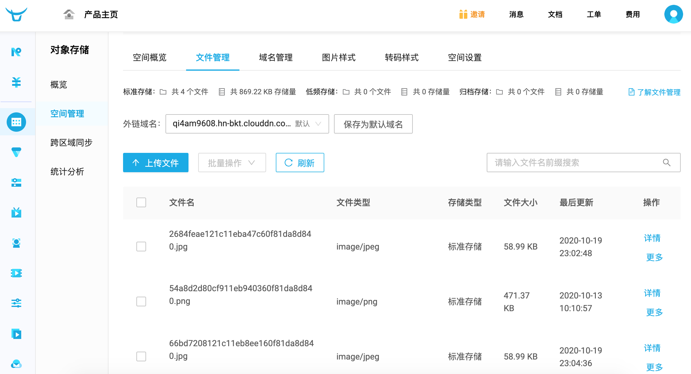

## Tích hợp nền tảng bên thứ ba

Trong quá trình phát triển ứng dụng Web, có một số tác vụ chúng ta không thể tự mình hoàn thành được. Ví dụ, dự án Web cần xác thực danh tính thực của cá nhân hoặc doanh nghiệp, rõ ràng chúng ta không có năng lực tự thẩm định tính xác thực của thông tin xác thực mà người dùng cung cấp; lúc này chúng ta cần nhờ đến dịch vụ do nền tảng bên thứ ba cung cấp để hoàn thành thao tác đó. Hay một ví dụ khác, dự án cần cung cấp chức năng thanh toán trực tuyến, loại nghiệp vụ này thông thường cũng phải nhờ đến cổng thanh toán (payment gateway) chứ không thể tự xây dựng, chúng ta chỉ cần tích hợp các nền tảng bên thứ ba như WeChat Pay, Alipay hay UnionPay.

Việc tích hợp nền tảng bên thứ ba vào dự án về cơ bản có hai phương thức: tích hợp qua API và tích hợp qua SDK.

1. Tích hợp API nghĩa là thông qua việc truy cập vào URL do bên thứ ba cung cấp để hoàn thành thao tác hoặc lấy dữ liệu. Có rất nhiều nền tảng cung cấp một lượng lớn các dịch vụ thông dụng, ví dụ [Juhe Data](https://www.juhe.cn/) cung cấp các loại API về dịch vụ đời sống, công nghệ tài chính, giao thông địa lý, nạp tiền thanh toán cước,... Chúng ta có thể dùng chương trình Python để gửi yêu cầu mạng, lấy dữ liệu thông qua truy cập URL. Các giao diện API này cũng giống hệt như các API dữ liệu do dự án của chúng ta cung cấp, chỉ khác là API trong dự án phục vụ cho nội bộ dự án sử dụng, còn API do các nền tảng bên thứ ba cung cấp là API mở (Open API). Tất nhiên, "mở" không đồng nghĩa với "miễn phí", hầu hết các API cung cấp dữ liệu có giá trị thương mại đều phải trả phí mới có thể sử dụng.
2. Tích hợp SDK nghĩa là thông qua việc cài đặt thư viện bên thứ ba và sử dụng các lớp, hàm được thư viện đó đóng gói sẵn để sử dụng dịch vụ của nền tảng bên thứ ba. Ví dụ, như vừa nói về việc tích hợp Alipay, trước tiên cần cài đặt SDK của Alipay, sau đó thông qua các lớp và phương thức do Alipay đóng gói để thực hiện lệnh gọi dịch vụ thanh toán.

Dưới đây, chúng ta sẽ thông qua các ví dụ cụ thể để tìm hiểu cách tích hợp nền tảng bên thứ ba.

### Tích hợp cổng SMS

Một dự án Web có rất nhiều nơi cần dùng đến dịch vụ tin nhắn SMS, ví dụ: đăng nhập bằng mã xác thực gửi qua điện thoại, nhắc nhở thông báo quan trọng, gửi tin nhắn tiếp thị sản phẩm,... Để triển khai chức năng gửi tin nhắn SMS, có thể tích hợp cổng SMS (SMS gateway). Một số cổng SMS nổi tiếng bao gồm: Yunpian, Netease Yunxin, Luosimao, SendCloud,... Các cổng SMS này thường cung cấp chức năng dùng thử miễn phí. Dưới đây chúng ta lấy nền tảng [Luosimao](https://luosimao.com/) làm ví dụ để hướng dẫn cách tích hợp cổng SMS vào dự án; các thao tác trên những nền tảng khác cũng tương tự.

1. Đăng ký tài khoản, người dùng mới có thể dùng thử miễn phí.

2. Đăng nhập vào trang quản trị, truy cập vào mục SMS (Tin nhắn).

3. Nhấp vào "Trigger Send" (Kích hoạt gửi) để tìm thấy API Key riêng của bạn (khóa định danh).

    

4. Nhấp vào "Quản lý chữ ký" để thêm chữ ký cho tin nhắn SMS. Tin nhắn SMS bắt buộc phải kèm chữ ký, tin nhắn dùng thử miễn phí cần thêm chữ ký "【铁壳测试】", nếu không tin nhắn sẽ không thể gửi đi.

    

5. Nhấp vào "IP Whitelist" (Danh sách IP cho phép) để điền địa chỉ máy chủ chạy dự án Django (địa chỉ IP công cộng; nếu chạy cục bộ có thể mở các trang web kiểm tra IP để xem IP công cộng của máy mình) vào danh sách cho phép, nếu không tin nhắn sẽ không thể gửi đi.

    

6. Nếu không còn số lượng tin nhắn khả dụng, có thể vào trang "Nạp tiền" chọn "Dịch vụ SMS" để nạp tiền.

    

Tiếp theo, chúng ta có thể gọi cổng SMS Luosimao để thực hiện chức năng gửi mã xác thực SMS, đoạn mã như sau:

```Python
def send_mobile_code(tel, code):
    """Gửi mã xác thực SMS"""
    resp = requests.post(
        url='http://sms-api.luosimao.com/v1/send.json',
        auth=('api', 'key-APIKey-cua-ban'),
        data={
            'mobile': tel,
            'message': f'Mã xác thực SMS của bạn là {code}, tuyệt đối không tiết lộ cho người khác nhé. 【Khóa học Python】'
        },
        verify=False
    )
    return resp.json()
```

Để chạy đoạn mã trên, trước tiên cần cài đặt thư viện bên thứ ba `requests`. Thư viện này đóng gói sẵn các chức năng liên quan đến gửi yêu cầu mạng HTTP, sử dụng cực kỳ đơn giản và chúng ta cũng đã tìm hiểu trong các bài học trước. Hàm `send_mobile_code` có hai tham số: tham số thứ nhất là số điện thoại, tham số thứ hai là nội dung mã xác thực SMS. Dòng mã thứ 5 cần cung cấp API Key của chính bạn, chính là API Key bạn tìm thấy ở bước 2 ở trên. Gửi yêu cầu đến cổng SMS của Luosimao sẽ trả về dữ liệu định dạng JSON. Đối với đoạn mã trên, nếu trả về `{'err': 0, 'msg': 'ok'}` thì có nghĩa là tin nhắn đã được gửi thành công; nếu trường `err` có giá trị khác `0` thì nghĩa là tin nhắn gửi thất bại. Bạn có thể xem ý nghĩa của các mã lỗi khác nhau trên trang [Tài liệu nhà phát triển](https://luosimao.com/docs/api/) chính thức của Luosimao, ví dụ: `-20` là số dư không đủ, `-32` là thiếu chữ ký SMS.

Có thể gọi hàm trên trong view function để hoàn thành chức năng gửi mã xác thực SMS, lát nữa chúng ta có thể kết hợp chức năng này với tính năng đăng ký người dùng.

Hàm tạo mã xác thực ngẫu nhiên và kiểm tra số điện thoại:

```Python
import random
import re

TEL_PATTERN = re.compile(r'1[3-9]\d{9}')


def check_tel(tel):
    """Kiểm tra số điện thoại"""
    return TEL_PATTERN.fullmatch(tel) is not None


def random_code(length=6):
    """Tạo mã xác thực SMS ngẫu nhiên"""
    return ''.join(random.choices('0123456789', k=length))
```

View function gửi mã xác thực SMS:

```Python
@api_view(('GET', ))
def get_mobilecode(request, tel):
    """Lấy mã xác thực SMS"""
    if check_tel(tel):
        redis_cli = get_redis_connection()
        if redis_cli.exists(f'vote:block-mobile:{tel}'):
            data = {'code': 30001, 'message': 'Vui lòng không gửi lại mã xác thực SMS trong vòng 60 giây'}
        else:
            code = random_code()
            send_mobile_code(tel, code)
            # Dùng Redis ngăn chặn gửi lặp lại mã xác thực SMS trong 60 giây
            redis_cli.set(f'vote:block-mobile:{tel}', 'x', ex=60)
            # Lưu mã xác thực trong Redis trong 10 phút (hiệu lực 10 phút)
            redis_cli.set(f'vote2:valid-mobile:{tel}', code, ex=600)
            data = {'code': 30000, 'message': 'Mã xác thực SMS đã được gửi, vui lòng kiểm tra'}
    else:
        data = {'code': 30002, 'message': 'Vui lòng nhập số điện thoại hợp lệ'}
    return Response(data)
```

> **Giải thích**: Đoạn mã trên tận dụng Redis để thực hiện hai chức năng bổ sung: một là ngăn chặn người dùng gửi lại mã xác thực SMS trong vòng 60 giây, hai là lưu mã xác thực SMS của người dùng trong 10 phút (tức là mã xác thực này chỉ có hiệu lực trong 10 phút). Chúng ta có thể yêu cầu người dùng cung cấp mã xác thực này khi đăng ký để kiểm tra tính xác thực của số điện thoại người dùng.

### Tích hợp dịch vụ lưu trữ đám mây

Khi nhắc đến thuật ngữ **lưu trữ đám mây (Cloud Storage)**, thông thường người ta ám chỉ việc lưu trữ dữ liệu trong môi trường máy chủ ảo do bên thứ ba cung cấp, nói một cách đơn giản là ủy thác lưu trữ một số dữ liệu hoặc tài nguyên nhất định cho nền tảng bên thứ ba. Thông thường, các công ty cung cấp dịch vụ lưu trữ đám mây đều vận hành các trung tâm dữ liệu quy mô lớn; các cá nhân hoặc tổ chức có nhu cầu lưu trữ đám mây sẽ mua hoặc thuê dung lượng lưu trữ của họ để đáp ứng nhu cầu lưu trữ dữ liệu. Khi phát triển ứng dụng Web, có thể đặt các tài nguyên tĩnh, đặc biệt là các tài nguyên tĩnh do người dùng tải lên, trực tiếp vào dịch vụ lưu trữ đám mây. Dịch vụ lưu trữ đám mây thường cung cấp các URL tương ứng để người dùng có thể truy cập vào tài nguyên tĩnh đó. Các dịch vụ lưu trữ đám mây nổi tiếng trong và ngoài nước (chẳng hạn như AWS S3, Alibaba Cloud OSS,...) thường có chi phí rất hợp lý và chất lượng cao. So với việc tự mình dựng máy chủ lưu trữ tài nguyên tĩnh, chi phí cho lưu trữ đám mây thấp hơn nhiều; hơn nữa các nền tảng lưu trữ đám mây thông thường đều cung cấp dịch vụ CDN để tăng tốc độ truy cập tài nguyên tĩnh. Vì vậy, dù nhìn từ góc độ nào, việc sử dụng lưu trữ đám mây để quản lý dữ liệu và tài nguyên tĩnh của ứng dụng Web đều là một lựa chọn tuyệt vời, trừ khi những tài nguyên này liên quan đến quyền riêng tư cá nhân hoặc bí mật thương mại, còn lại đều có thể ủy thác cho dịch vụ lưu trữ đám mây.

Dưới đây chúng ta lấy việc tích hợp [Qiniu Cloud](https://www.qiniu.com/) làm ví dụ để hướng dẫn cách lưu các tệp do người dùng tải lên vào dịch vụ lưu trữ đám mây Qiniu Cloud. Qiniu Cloud là nhà cung cấp dịch vụ điện toán đám mây và dữ liệu nổi tiếng tại Trung Quốc. Qiniu Cloud có các sản phẩm trong lĩnh vực lưu trữ tệp quy mô lớn, CDN, video theo yêu cầu, phát trực tiếp tương tác, cũng như phân tích và xử lý thông minh dữ liệu không đồng nhất quy mô lớn. Người dùng chưa trả phí cũng có thể tích hợp miễn phí để sử dụng các dịch vụ mà họ cung cấp. Quy trình tích hợp Qiniu Cloud như sau:

1. Đăng ký tài khoản, đăng nhập vào trang bảng điều khiển quản trị (Console).

    

2. Chọn mục Lưu trữ đối tượng (Object Storage / Kodo) ở menu bên trái.

    

3. Trong mục Quản lý không gian (Bucket), chọn Tạo không gian mới (ví dụ: `myvote`). Nếu có thông báo tên không gian đã bị trùng lặp, hãy đổi tên khác rồi thử lại. Lưu ý, sau khi tạo không gian, hệ thống sẽ nhắc nhở liên kết tên miền tùy chỉnh; nếu tạm thời chưa có tên miền riêng, bạn có thể sử dụng tên miền tạm thời do Qiniu Cloud cung cấp, tuy nhiên tên miền tạm thời sẽ bị thu hồi sau 30 ngày, vì vậy tốt nhất bạn nên chuẩn bị tên miền của riêng mình (tên miền tại Trung Quốc cần đăng ký giấy phép ICP, ai chưa rõ cách thực hiện vui lòng tra cứu thêm tài liệu liên quan).

    

4. Ở góc trên bên phải trang web, nhấp vào hình đại diện cá nhân và chọn "Quản lý khóa" (Key Management) để xem khóa bí mật của bạn. Lát nữa trong code sẽ cần sử dụng hai khóa là AK (AccessKey) và SK (SecretKey) để xác thực danh tính người dùng.

    

5. Nhấp vào mục "Tài liệu" ở menu phía trên trang web để vào [Trung tâm nhà phát triển Qiniu](https://developer.qiniu.com/), chọn menu điều hướng "SDK & Công cụ" và nhấp vào menu con "SDK chính thức", tìm Python (Server-side) và nhấp vào "Tài liệu" để xem tài liệu hướng dẫn chính thức.

    

Tiếp theo, chỉ cần làm theo ví dụ do tài liệu chính thức cung cấp là có thể tích hợp Qiniu Cloud để sử dụng dịch vụ lưu trữ đám mây và các dịch vụ khác của Qiniu. Trước tiên, có thể cài đặt thư viện bên thứ ba của Qiniu Cloud thông qua lệnh sau:

```Bash
pip install qiniu
```

Tiếp theo, có thể thông qua hai hàm `put_file` và `put_stream` trong module `qiniu` để tải tệp lên: hàm thứ nhất có thể tải tệp từ một đường dẫn chỉ định, hàm thứ hai có thể tải trực tiếp luồng dữ liệu nhị phân trong bộ nhớ lên Qiniu Cloud. Mã nguồn cụ thể như sau:

```Python
import qiniu

AUTH = qiniu.Auth('AccessKey-trong-quan-ly-khoa', 'SecretKey-trong-quan-ly-khoa')
BUCKET_NAME = 'myvote'


def upload_file_to_qiniu(key, file_path):
    """Tải tệp từ đường dẫn chỉ định lên Qiniu Cloud"""
    token = AUTH.upload_token(BUCKET_NAME, key)
    return qiniu.put_file(token, key, file_path)


def upload_stream_to_qiniu(key, stream, size):
    """Tải luồng dữ liệu nhị phân lên Qiniu Cloud"""
    token = AUTH.upload_token(BUCKET_NAME, key)
    return qiniu.put_stream(token, key, stream, None, size)
```

Dưới đây là một trang giao diện front-end đơn giản để tải tệp lên:

```HTML
<!DOCTYPE html>
<html lang="en">
<head>
    <meta charset="UTF-8">
    <title>Tải lên tệp tin</title>
</head>
<body>
    <form action="/upload/" method="post" enctype="multipart/form-data">
        <div>
            <input type="file" name="photo">
            <input type="submit" value="Tải lên">
        </div>
    </form>
</body>
</html>
```

> **Giải thích**: Nếu front-end sử dụng biểu mẫu (form) để tải tệp lên, thuộc tính `method` của thẻ form bắt buộc phải đặt là `post`, thuộc tính `enctype` cần đặt là `multipart/form-data`. Thẻ `input` có thuộc tính `type="file"` trong form chính là phần tử chọn tệp tải lên.

View function triển khai chức năng upload như sau:

```Python
from django.views.decorators.csrf import csrf_exempt


@csrf_exempt
def upload(request):
    # Nếu tệp tải lên nhỏ hơn 2.5M, kiểu của đối tượng photo là InMemoryUploadedFile, tệp nằm trong bộ nhớ
    # Nếu tệp tải lên vượt quá 2.5M, kiểu của đối tượng photo là TemporaryUploadedFile, tệp nằm trong đường dẫn tạm
    photo = request.FILES.get('photo')
    _, ext = os.path.splitext(photo.name)
    # Dùng UUID và phần mở rộng ban đầu của tệp để tạo tên tệp mới duy nhất
    filename = f'{uuid.uuid1().hex}{ext}'
    # Đối với tệp trong bộ nhớ, có thể dùng hàm upload_stream_to_qiniu đã đóng gói ở trên để tải tệp lên Qiniu Cloud
    # Nếu tệp được lưu trong đường dẫn tạm thời, có thể dùng upload_file_to_qiniu để tải tệp lên
    upload_stream_to_qiniu(filename, photo.file, photo.size)
    return redirect('/static/html/upload.html')
```

> **Lưu ý**: View function ở trên sử dụng decorator `csrf_exempt`, decorator này giúp biểu mẫu được miễn trừ yêu cầu bắt buộc phải cung cấp token CSRF. Ngoài ra, dòng mã thứ 11 sử dụng hàm `uuid1` của module `uuid` để tạo mã định danh duy nhất toàn cầu (UUID).

Chạy dự án và thử nghiệm chức năng tải tệp lên. Sau khi tệp được tải lên thành công, trong phần "Quản lý không gian" trên Qiniu Cloud, hãy nhấp vào không gian của bạn và vào giao diện "Quản lý tệp", tại đây bạn có thể thấy tệp chúng ta vừa tải lên thành công, đồng thời có thể lấy được tệp đó thông qua tên miền do Qiniu Cloud cung cấp.


