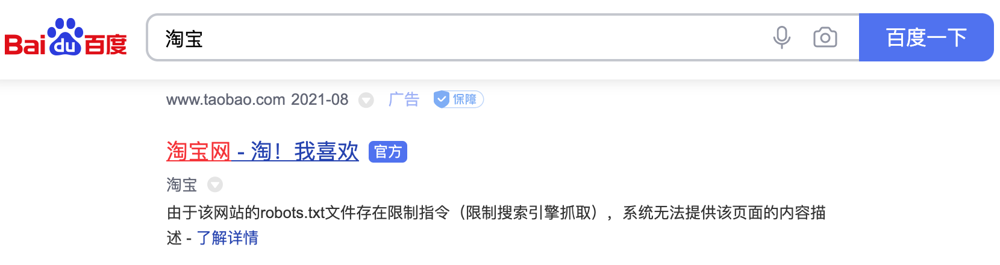
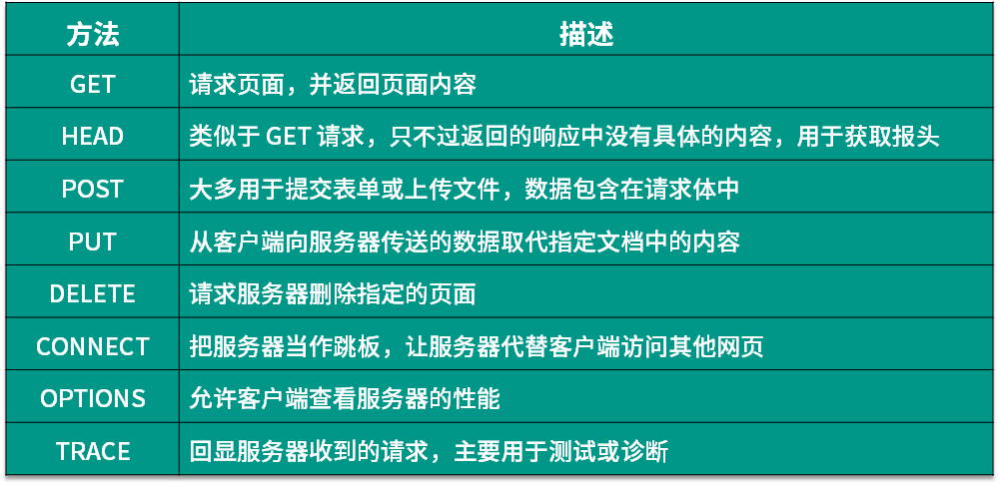
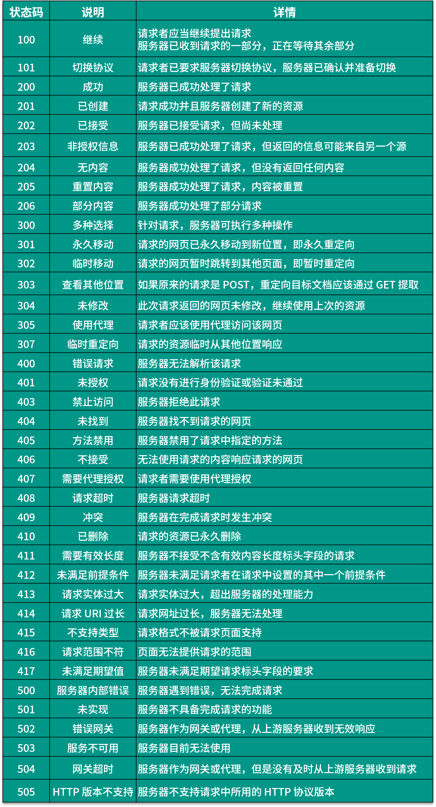
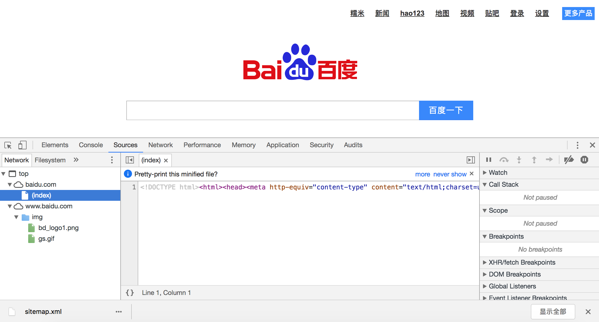
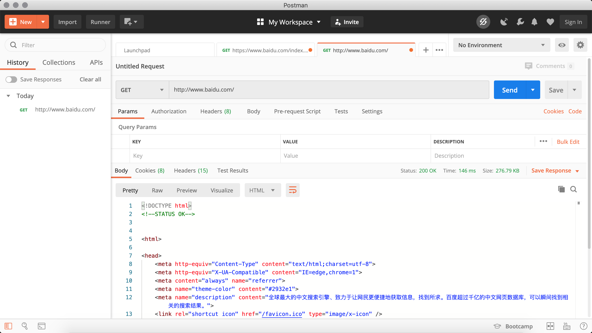
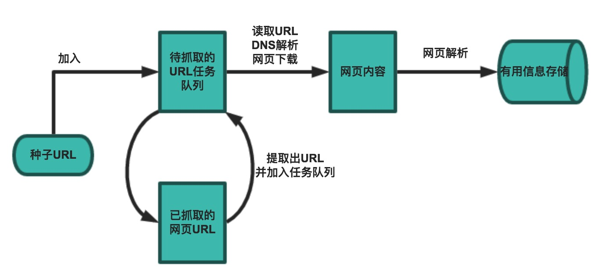

## Tổng quan thu thập dữ liệu mạng

Crawler (trình thu thập dữ liệu web) cũng thường được gọi là mạng nhện (spider), là chương trình bot (mã kịch bản tự động) tự động duyệt các trang web và lấy thông tin cần thiết theo các quy tắc nhất định, được ứng dụng rộng rãi trong các công cụ tìm kiếm trên Internet và thu thập dữ liệu. Bất kỳ ai từng sử dụng Internet và trình duyệt đều biết rằng, ngoài các thông tin văn bản để người dùng đọc, trang web còn chứa một số siêu liên kết (hyperlink). Trình thu thập dữ liệu web chính là thông qua các siêu liên kết này để liên tục lấy địa chỉ của các trang khác trên mạng, từ đó tiếp tục thu thập dữ liệu. Chính vì vậy, quá trình thu thập dữ liệu mạng giống như một con sâu hoặc con nhện bò khắp nơi trên mạng, do đó nó mới được gọi một cách hình tượng là crawler hay spider.

### Lĩnh vực ứng dụng của crawler

Trong điều kiện lý tưởng, tất cả các ICP (Internet Content Provider - nhà cung cấp nội dung Internet) đều nên cung cấp các giao diện API cho trang web của mình để chia sẻ dữ liệu mà họ cho phép các chương trình khác truy xuất. Trong trường hợp đó thì hoàn toàn không cần đến chương trình crawler. Các nền tảng thương mại điện tử nổi tiếng (như Taobao, JD,...) hay nền tảng mạng xã hội (như Weibo, WeChat,...) đều cung cấp các giao diện API của riêng mình, tuy nhiên các API này thường áp đặt giới hạn đối với dữ liệu có thể thu thập cũng như tần suất thu thập dữ liệu. Đối với phần lớn các công ty, việc kịp thời thu thập dữ liệu ngành và dữ liệu đối thủ cạnh tranh là một trong những khâu quan trọng để doanh nghiệp tồn tại, thế nhưng đối với đa số doanh nghiệp, dữ liệu lại là điểm yếu cố hữu. Trong hoàn cảnh này, việc sử dụng crawler một cách hợp lý để thu thập dữ liệu và trích xuất từ đó các thông tin có giá trị thương mại trở nên vô cùng quan trọng đối với các doanh nghiệp.

Lĩnh vực ứng dụng của crawler thực tế rất rộng rãi, dưới đây chúng tôi liệt kê một số trong đó, bạn đọc quan tâm có thể tự mình khám phá thêm:

1. Công cụ tìm kiếm
2. Tổng hợp tin tức
3. Ứng dụng mạng xã hội
4. Giám sát dư luận mạng
5. Dữ liệu ngành

### Bàn về tính hợp pháp của crawler

Trong giới lập trình thường có câu đùa: "Viết crawler cho hay, cơm tù ăn dài ngày". Vậy việc lập trình crawler có vi phạm pháp luật không? Về vấn đề này, chúng ta có thể nhìn nhận từ các góc độ sau:

1. Lĩnh vực web crawler hiện nay vẫn thuộc giai đoạn khai phá. Mặc dù thế giới Internet đã thiết lập nên các quy chuẩn đạo đức nhất định thông qua "luật chơi" của riêng mình, tức là giao thức Robots (tên đầy đủ là "Tiêu chuẩn loại trừ robot" - Robots Exclusion Protocol), nhưng các quy định pháp luật vẫn đang trong quá trình xây dựng và hoàn thiện. Nói cách khác, lĩnh vực này hiện tại vẫn là một vùng xám.
2. "Pháp luật không cấm tức là được phép", nếu crawler giống như trình duyệt chỉ thu thập dữ liệu hiển thị ở phía front-end (thông tin công khai trên trang web) chứ không phải thông tin nhạy cảm riêng tư ở hệ thống back-end của trang web, thì không cần quá lo lắng về ràng buộc pháp lý, bởi tốc độ phát triển của chuỗi ngành công nghiệp dữ liệu lớn hiện nay nhanh hơn nhiều so với tốc độ hoàn thiện của luật pháp.
3. Khi thu thập dữ liệu từ một trang web, cần giới hạn crawler tuân thủ giao thức Robots, đồng thời kiểm soát tốc độ thu thập dữ liệu của chương trình; khi sử dụng dữ liệu, bắt buộc phải tôn trọng quyền sở hữu trí tuệ của trang web (từ kỷ nguyên Web 2.0, mặc dù phần lớn dữ liệu trên Web do người dùng cung cấp, nhưng các nền tảng trang web đã phải bỏ ra chi phí vận hành, khi người dùng đăng ký và đăng tải nội dung, nền tảng thường đã có được quyền sở hữu, sử dụng và phân phối dữ liệu đó). Nếu vi phạm các quy định này, tỷ lệ thua kiện tại tòa là rất cao.
4. Việc ẩn danh danh tính của bản thân một cách thích hợp là điều cần thiết khi viết chương trình crawler, và tốt nhất là không để đối phương có bằng chứng chứng minh crawler của bạn có hành vi phá hoại tài sản (ví dụ như làm sập máy chủ) của người khác.
5. Không nên mở mã nguồn công khai (open source) hoặc phô trương mã crawler của bạn trên mạng công cộng (chẳng hạn như các nền tảng lưu trữ mã nguồn), những hành vi này thường sẽ mang lại những rắc rối không đáng có cho chính bạn.

#### Giao thức Robots

Hầu hết các trang web đều định nghĩa tệp `robots.txt`, đây là một "thỏa thuận giữa những người quân tử" (gentleman's agreement), không phải mọi crawler đều bắt buộc phải tuân theo. Dưới đây lấy tệp [`robots.txt`](http://www.taobao.com/robots.txt) của Taobao làm ví dụ để xem Taobao áp đặt những hạn chế nào đối với crawler:

```
User-agent: Baiduspider
Disallow: /

User-agent: baiduspider
Disallow: /
```

Qua tệp trên có thể thấy, Taobao cấm crawler của Baidu thu thập bất kỳ tài nguyên nào của họ, do đó khi bạn tìm kiếm "Taobao" trên Baidu, phía dưới kết quả tìm kiếm sẽ xuất hiện dòng chữ: "Do tệp `robots.txt` của trang web này có lệnh giới hạn (giới hạn công cụ tìm kiếm thu thập), hệ thống không thể cung cấp phần mô tả nội dung cho trang này". Baidu với tư cách là một công cụ tìm kiếm, ít nhất trên bề nổi đã tuân thủ giao thức `robots.txt` của Taobao, vì vậy người dùng không thể tìm thấy thông tin sản phẩm bên trong Taobao từ Baidu.

Hình 1. Kết quả tìm kiếm Taobao trên Baidu



Dưới đây là tệp [`robots.txt`](https://www.douban.com/robots.txt) của Douban, các bạn có thể tự mình phân tích xem nó đưa ra những hạn chế nào:

```
User-agent: *
Disallow: /subject_search
Disallow: /amazon_search
Disallow: /search
Disallow: /group/search
Disallow: /event/search
Disallow: /celebrities/search
Disallow: /location/drama/search
Disallow: /forum/
Disallow: /new_subject
Disallow: /service/iframe
Disallow: /j/
Disallow: /link2/
Disallow: /recommend/
Disallow: /doubanapp/card
Disallow: /update/topic/
Disallow: /share/
Allow: /ads.txt
Sitemap: https://www.douban.com/sitemap_index.xml
Sitemap: https://www.douban.com/sitemap_updated_index.xml
# Crawl-delay: 5

User-agent: Wandoujia Spider
Disallow: /

User-agent: Mediapartners-Google
Disallow: /subject_search
Disallow: /amazon_search
Disallow: /search
Disallow: /group/search
Disallow: /event/search
Disallow: /celebrities/search
Disallow: /location/drama/search
Disallow: /j/
```

### Giao thức truyền siêu văn bản (HTTP)

Trước khi bắt đầu tìm hiểu về crawler, chúng ta hãy cùng ôn lại đôi chút về Giao thức truyền siêu văn bản (HTTP), vì nội dung chúng ta thấy trên trang web thường là kết quả của việc trình duyệt thực thi HTML (Ngôn ngữ đánh dấu siêu văn bản), mà HTTP chính là giao thức truyền tải dữ liệu HTML. HTTP cũng giống như nhiều giao thức tầng ứng dụng khác, được xây dựng trên nền tảng TCP (Giao thức điều khiển truyền vận), nó tận dụng dịch vụ truyền dẫn tin cậy do TCP cung cấp để thực hiện việc trao đổi dữ liệu trong ứng dụng Web. Theo giới thiệu trên Wikipedia, mục đích ban đầu khi thiết kế HTTP là cung cấp một phương thức để phát hành và tiếp nhận các trang [HTML](https://zh.wikipedia.org/wiki/HTML), nói cách khác, giao thức này là phương tiện truyền tải dữ liệu giữa trình duyệt và máy chủ Web. Về thông tin chi tiết của HTTP cũng như tình hình phát triển hiện tại, các bạn có thể đọc các bài viết như [《Nhập môn giao thức HTTP》](http://www.ruanyifeng.com/blog/2016/08/http.html), [《Nhập môn giao thức Internet》](http://www.ruanyifeng.com/blog/2012/05/internet_protocol_suite_part_i.html), [《Minh họa giao thức HTTPS bằng hình ảnh》](http://www.ruanyifeng.com/blog/2014/09/illustration-ssl.html) để tìm hiểu thêm.

Hình dưới đây là các thông điệp yêu cầu và phản hồi HTTP (dữ liệu giao thức) khi truy cập trang chủ Baidu được tôi chụp lại bằng công cụ phân tích giao thức mã nguồn mở Ethereal (tiền thân của Wireshark) trong thời gian làm việc tại Phòng thí nghiệm trọng điểm công nghệ truyền thông mạng tỉnh Tứ Xuyên. Do Ethereal bắt gói tin đi qua card mạng nên có thể thấy rõ ràng dữ liệu giao thức từ tầng liên kết vật lý đến tầng ứng dụng.

Hình 2. HTTP Request


Một HTTP Request thông thường bao gồm bốn phần: Request line (dòng yêu cầu), Request header (tiêu đề yêu cầu), Dòng trống và Message body (thân thông điệp). Nếu không có dữ liệu gửi tới máy chủ thì thân thông điệp không bắt buộc phải có. Dòng yêu cầu chứa phương thức yêu cầu (GET, POST,... như bảng dưới đây), đường dẫn tài nguyên và phiên bản giao thức; tiêu đề yêu cầu gồm nhiều cặp key-value, chứa các thông tin như trình duyệt, cách mã hóa, ngôn ngữ ưu tiên, chính sách cache,...; sau tiêu đề yêu cầu là dòng trống và thân thông điệp.



Hình 3. HTTP Response


Một HTTP Response thông thường cũng gồm bốn phần: Response line (dòng phản hồi), Response header (tiêu đề phản hồi), Dòng trống và Message body (thân thông điệp), trong đó thân thông điệp là dữ liệu phản hồi của máy chủ, có thể là trang HTML, dữ liệu JSON hoặc dữ liệu nhị phân,... Dòng phản hồi chứa phiên bản giao thức và mã trạng thái phản hồi. Có rất nhiều mã trạng thái phản hồi, những mã phổ biến được hiển thị trong bảng dưới đây.



#### Các công cụ liên quan

Dưới đây chúng tôi giới thiệu một số công cụ bổ trợ cho việc phát triển crawler, tin rằng các công cụ này sẽ giúp bạn tăng gấp đôi hiệu suất làm việc:

1. Chrome Developer Tools: Công cụ dành cho nhà phát triển tích hợp sẵn trong trình duyệt Google Chrome. Một số module chức năng được sử dụng nhiều nhất gồm:

   - Elements (Phần tử): Dùng để xem hoặc sửa đổi thuộc tính của phần tử HTML, thuộc tính CSS, sự kiện lắng nghe,... CSS có thể sửa tức thì và hiển thị tức thì, tạo thuận tiện lớn cho lập trình viên gỡ lỗi trang web.
   - Console (Bảng điều khiển): Dùng để chạy mã lệnh tạm thời, kiểm tra các đối tượng JavaScript, xem nhật ký gỡ lỗi hoặc thông tin ngoại lệ. Console thực chất là một môi trường tương tác để thực thi mã JavaScript.
   - Sources (Nguồn): Dùng để xem mã nguồn tệp HTML, JavaScript, CSS của trang web; ngoài ra điều quan trọng nhất là có thể gỡ lỗi mã nguồn JavaScript, đặt breakpoint (điểm dừng) và thực thi từng bước (step by step).
   - Network (Mạng): Dùng để xem các HTTP request, HTTP response cũng như các thông tin liên quan đến kết nối mạng.
   - Application (Ứng dụng): Dùng để xem bộ nhớ cục bộ của trình duyệt, các tác vụ nền,... Bộ nhớ cục bộ chủ yếu bao gồm Cookie, Local Storage, Session Storage,...

   

2. Postman: Công cụ gỡ lỗi trang web và gửi yêu cầu RESTful vô cùng mạnh mẽ. Postman có thể giúp chúng ta mô phỏng các yêu cầu, tùy biến request cực kỳ thuận tiện và xem phản hồi từ máy chủ.

   

3. HTTPie: HTTP client trên dòng lệnh.

   Cài đặt:

   ```Bash
   pip install httpie
   ```

   Sử dụng:

   ```Bash
   http --header http --header https://movie.douban.com/
   
   HTTP/1.1 200 OK
   Connection: keep-alive
   Content-Encoding: gzip
   Content-Type: text/html; charset=utf-8
   Date: Tue, 24 Aug 2021 16:48:00 GMT
   Keep-Alive: timeout=30
   Server: dae
   Set-Cookie: bid=58h4BdKC9lM; Expires=Wed, 24-Aug-22 16:48:00 GMT; Domain=.douban.com; Path=/
   Strict-Transport-Security: max-age=15552000
   Transfer-Encoding: chunked
   X-Content-Type-Options: nosniff
   X-DOUBAN-NEWBID: 58h4BdKC9lM
   ```

4. Thư viện `builtwith`: Công cụ nhận diện công nghệ được trang web sử dụng.

   Cài đặt:

   ```Bash
   pip install builtwith
   ```

   Sử dụng:

   ```Python
   import ssl
   
   import builtwith
   
   ssl._create_default_https_context = ssl._create_unverified_context
   print(builtwith.parse('http://www.bootcss.com/'))
   ```

5. Thư viện `python-whois`: Công cụ tra cứu thông tin chủ sở hữu trang web.

   Cài đặt:

   ```Bash
   pip3 install python-whois
   ```

   Sử dụng:

   ```Python
   import whois
   
   print(whois.whois('https://www.bootcss.com'))
   ```

### Quy trình làm việc cơ bản của crawler

Một crawler cơ bản thường được chia thành ba phần: Thu thập dữ liệu (tải trang web về), Xử lý dữ liệu (phân tích cú pháp trang web) và Lưu trữ dữ liệu (lưu trữ bền vững các thông tin hữu ích). Tất nhiên, các crawler nâng cao hơn sẽ sử dụng kỹ thuật lập trình đồng thời hoặc phân tán trong quá trình thu thập và xử lý dữ liệu, đòi hỏi sự tham gia của bộ lập lịch (điều phối các luồng hoặc tiến trình thực thi nhiệm vụ tương ứng), chương trình quản lý nền (giám sát trạng thái hoạt động của crawler và kiểm tra kết quả thu thập dữ liệu),...



Nói chung, quy trình làm việc của một crawler bao gồm các bước sau:

1. Xác định mục tiêu thu thập (trang hạt giống / trang khởi đầu) và tải trang web về.
2. Khi máy chủ không thể truy cập, thử tải lại trang theo số lần thử lại đã định sẵn.
3. Khi cần thiết, thiết lập User-Agent hoặc ẩn IP thực, nếu không có thể không truy cập được trang web.
4. Tiến hành giải mã cần thiết đối với trang web đã lấy được, sau đó trích xuất thông tin cần thiết.
5. Trích xuất thông tin liên kết trong trang vừa lấy được bằng phương thức nào đó (chẳng hạn như biểu thức chính quy).
6. Tiếp tục xử lý các liên kết này (lấy trang web và lặp lại các thao tác ở trên).
7. Lưu trữ bền vững các thông tin hữu ích để phục vụ cho các xử lý tiếp theo.
