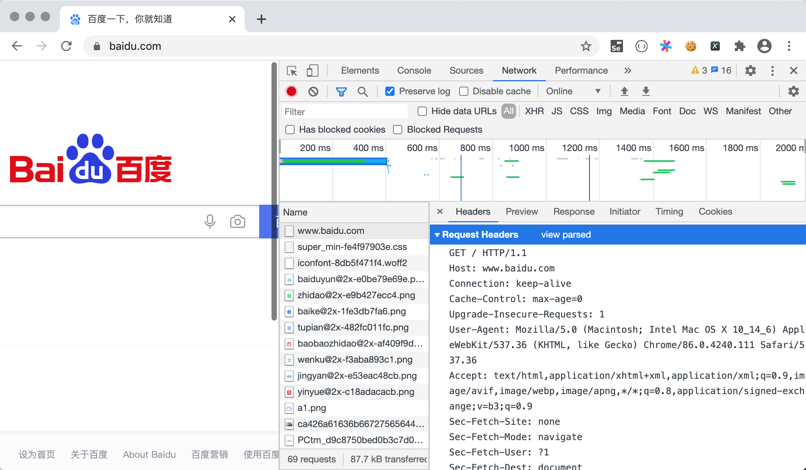
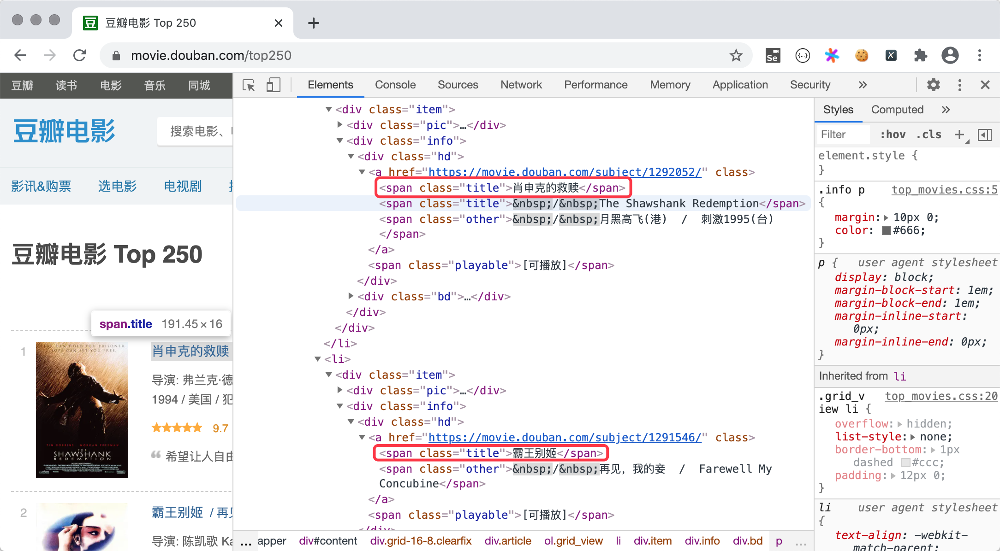
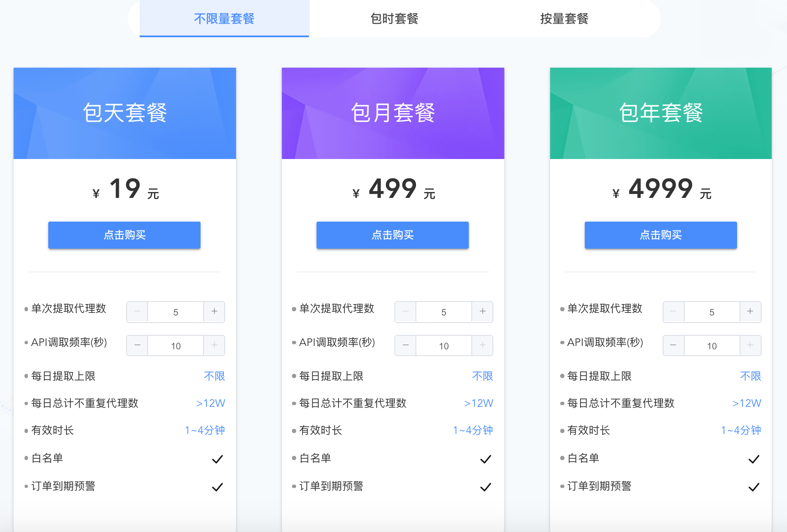

## Thu thập dữ liệu mạng với Python

Thu thập dữ liệu mạng là lĩnh vực mà ngôn ngữ Python cực kỳ xuất sắc. Trong bài học trước, chúng ta đã biết rằng các chương trình thực hiện thu thập dữ liệu mạng thường được gọi là crawler (trình thu thập dữ liệu web) hoặc spider. Ngay cả trong thời đại dữ liệu lớn, dữ liệu vẫn là điểm yếu và thiếu sót của các doanh nghiệp vừa và nhỏ. Một số dữ liệu cần được lấy thông qua các API mở hoặc trả phí, trong khi các dữ liệu ngành và dữ liệu đối thủ cạnh tranh khác buộc phải thu thập qua mạng. Bất kể sử dụng phương thức nào để lấy tài nguyên dữ liệu mạng, Python đều là một lựa chọn tuyệt vời vì cả thư viện chuẩn lẫn các thư viện bên thứ ba của Python đều hỗ trợ thu thập dữ liệu mạng rất mạnh mẽ.

### Thư viện requests

Để thu thập dữ liệu mạng bằng Python, chúng tôi khuyên bạn nên sử dụng thư viện bên thứ ba có tên là `requests`, thư viện này chúng ta thực chất đã từng dùng trong các bài học trước. Theo giải thích trên trang web chính thức, `requests` được xây dựng dựa trên việc đóng gói thư viện chuẩn của Python, giúp đơn giản hóa các thao tác truy cập tài nguyên mạng qua HTTP hoặc HTTPS. Trong bài học trước chúng ta đã đề cập rằng HTTP là một giao thức dạng request-response (yêu cầu - phản hồi). Khi chúng ta nhập đúng [URL](https://developer.mozilla.org/zh-CN/docs/Learn/Common_questions/What_is_a_URL) (thường gọi là địa chỉ mạng) trong trình duyệt và nhấn Enter, chúng ta đã gửi một HTTP request đến [máy chủ Web](https://developer.mozilla.org/zh-CN/docs/Learn/Common_questions/What_is_a_web_server) trên mạng, máy chủ sau khi nhận được yêu cầu sẽ trả về cho chúng ta một HTTP response. Mở menu trong trình duyệt Chrome, vào "Công cụ cho nhà phát triển" (Developer Tools) và chuyển sang tab "Network", bạn có thể thấy rõ ràng HTTP request và response trông như thế nào, như hình dưới đây:



Thông qua thư viện `requests`, chúng ta có thể làm cho chương trình Python giống như trình duyệt gửi yêu cầu đến máy chủ Web và nhận phản hồi do máy chủ trả về, từ phản hồi đó chúng ta có thể trích xuất dữ liệu mình mong muốn. Trang web mà trình duyệt hiển thị cho chúng ta được viết bằng [HTML](https://developer.mozilla.org/zh-CN/docs/Web/HTML). Trình duyệt tương đương với môi trường thông dịch HTML, nội dung chúng ta thấy trong trang web đều nằm trong các thẻ (tag) của HTML. Sau khi lấy được mã nguồn HTML, ta có thể trích xuất nội dung từ các thuộc tính của thẻ hoặc từ phần thân của thẻ. Ví dụ dưới đây minh họa cách lấy mã HTML của trang web: chúng ta thông qua hàm `get` của thư viện `requests` để lấy mã nguồn trang chủ của Sohu.

```Python
import requests

resp = requests.get('https://www.sohu.com/')
if resp.status_code == 200:
    print(resp.text)
```

> **Giải thích**: Biến `resp` trong đoạn mã trên là một đối tượng `Response` (kiểu dữ liệu do thư viện `requests` đóng gói). Qua thuộc tính `status_code` của đối tượng này có thể lấy được mã trạng thái phản hồi, còn thuộc tính `text` giúp chúng ta lấy mã nguồn HTML của trang web.

Do thuộc tính `text` của đối tượng `Response` là một chuỗi, nên chúng ta có thể tận dụng kiến thức về biểu thức chính quy đã học trước đó để trích xuất tiêu đề tin tức và liên kết từ mã HTML của trang web, đoạn mã như sau:

```Python
import re

import requests

pattern = re.compile(r'<a.*?href="(.*?)".*?title="(.*?)".*?>')
resp = requests.get('https://www.sohu.com/')
if resp.status_code == 200:
    all_matches = pattern.findall(resp.text)
    for href, title in all_matches:
        print(href)
        print(title)
```

Ngoài nội dung văn bản, chúng ta cũng có thể sử dụng thư viện `requests` để lấy tài nguyên nhị phân thông qua URL. Ví dụ dưới đây minh họa cách lấy Logo của Baidu và lưu vào tệp cục bộ có tên `baidu.png`. Bạn có thể nhấp chuột phải vào Logo Baidu trên trang chủ Baidu và chọn mục menu "Sao chép địa chỉ hình ảnh" để lấy URL của ảnh.

```Python
import requests

resp = requests.get('https://www.baidu.com/img/PCtm_d9c8750bed0b3c7d089fa7d55720d6cf.png')
with open('baidu.png', 'wb') as file:
    file.write(resp.content)
```

> **Giải thích**: Thuộc tính `content` của đối tượng `Response` có thể lấy được dữ liệu nhị phân mà máy chủ phản hồi.

Thư viện `requests` rất dễ sử dụng, đồng thời tính năng cũng tương đối mạnh mẽ và toàn diện. Nội dung cụ thể sẽ được chúng tôi phân tích từng bước trong quá trình sử dụng. Để tìm hiểu thêm nhiều kiến thức về thư viện `requests`, bạn có thể đọc [tài liệu chính thức](https://docs.python-requests.org/zh_CN/latest/) của nó.

### Viết mã crawler

Tiếp theo, chúng ta sẽ lấy ví dụ về "Douban Movie" để hướng dẫn bạn cách viết mã crawler. Theo phương pháp nêu trên, trước tiên chúng ta dùng `requests` để lấy mã HTML của trang web, sau đó coi toàn bộ đoạn mã đó như một chuỗi dài, như vậy chúng ta có thể dùng capturing group (nhóm bắt giữ) của biểu thức chính quy để trích xuất nội dung cần thiết từ chuỗi. Đoạn mã dưới đây minh họa cách lấy tên của 250 bộ phim đứng đầu từ [Douban Movie](https://movie.douban.com/). Cấu trúc trang và mã tương ứng của [Douban Movie Top 250](https://movie.douban.com/top250) như hình dưới đây. Có thể thấy mỗi trang hiển thị tổng cộng 25 bộ phim. Nếu muốn lấy dữ liệu Top 250, chúng ta cần truy cập tổng cộng 10 trang, địa chỉ tương ứng là <https://movie.douban.com/top250?start=xxx>, ở đây nếu `xxx` là `0` thì là trang đầu tiên, nếu giá trị của `xxx` là `100` thì chúng ta truy cập đến trang thứ năm. Để mã nguồn đơn giản, dễ đọc, chúng ta chỉ lấy tiêu đề phim và điểm đánh giá.



```Python
import random
import re
import time

import requests

for page in range(1, 11):
    resp = requests.get(
        url=f'https://movie.douban.com/top250?start={(page - 1) * 25}',
        # Nếu không thiết lập User-Agent trong HTTP request header, Douban sẽ phát hiện không phải trình duyệt và chặn yêu cầu của chúng ta.
        # Thiết lập giá trị User-Agent qua tham số headers của hàm get, giá trị cụ thể có thể xem trong công cụ cho nhà phát triển của trình duyệt.
        # Khi dùng crawler truy cập hầu hết các trang web, việc ngụy trang crawler thành yêu cầu từ trình duyệt là một bước vô cùng quan trọng.
        headers={'User-Agent': 'Mozilla/5.0 (Macintosh; Intel Mac OS X 10_14_6) AppleWebKit/537.36 (KHTML, like Gecko) Chrome/92.0.4515.159 Safari/537.36'}
    )
    # Dùng regex lấy thẻ span có class là title và nội dung không bắt đầu bằng & rồi dùng capture group trích xuất nội dung thẻ
    pattern1 = re.compile(r'<span class="title">([^&]*?)</span>')
    titles = pattern1.findall(resp.text)
    # Dùng regex lấy thẻ span có class là rating_num rồi dùng capture group trích xuất nội dung thẻ
    pattern2 = re.compile(r'<span class="rating_num".*?>(.*?)</span>')
    ranks = pattern2.findall(resp.text)
    # Dùng zip ghép hai danh sách, lặp qua tất cả tên phim và điểm đánh giá
    for title, rank in zip(titles, ranks):
        print(title, rank)
    # Ngủ ngẫu nhiên 1-5 giây để tránh thu thập trang quá thường xuyên
    time.sleep(random.random() * 4 + 1)
```

> **Giải thích**: Bằng cách phân tích giao thức robots của Douban, chúng ta thấy Douban không từ chối crawler của Baidu lấy dữ liệu của mình, do đó chúng ta cũng có thể ngụy trang crawler thành crawler của Baidu, sửa tham số `headers` của hàm `get` thành: `headers={'User-Agent': 'BaiduSpider'}`.

### Sử dụng IP Proxy

Việc làm cho chương trình crawler ẩn danh danh tính của mình là tương đối quan trọng khi viết crawler, bởi vì nhiều trang web rất e ngại crawler do crawler tiêu tốn nhiều băng thông mạng và tạo ra nhiều lưu lượng rác. Để ẩn danh tính, thông thường cần sử dụng **IP proxy thương mại** (chẳng hạn như Mogu Proxy, Zhima Proxy, Kuai Proxy,...), khiến trang web bị thu thập không thể lấy được địa chỉ IP thực của chương trình crawler, do đó không thể dễ dàng chặn crawler chỉ bằng địa chỉ IP.

Dưới đây lấy [Mogu Proxy](http://www.moguproxy.com/) làm ví dụ để hướng dẫn cách sử dụng IP proxy thương mại. Trước tiên cần đăng ký tài khoản trên trang web này, sau khi đăng ký có thể [mua](http://www.moguproxy.com/buy) gói cước tương ứng để nhận IP proxy thương mại. Đối với mục đích thương mại, khuyên bạn nên mua gói không giới hạn dung lượng để có thể lấy đủ số lượng địa chỉ IP proxy tùy theo nhu cầu thực tế; đối với mục đích học tập, có thể mua gói theo thời gian hoặc tùy theo nhu cầu của bản thân. Mogu Proxy cung cấp hai phương thức kết nối proxy: API proxy riêng tư và proxy đường hầm HTTP (HTTP Tunnel Proxy). Cách thứ nhất là thông qua việc gửi yêu cầu đến API của Mogu Proxy để lấy địa chỉ máy chủ proxy, cách thứ hai là truy cập trực tiếp thông qua một cổng kết nối thống nhất (tên miền do Mogu Proxy cung cấp).



Dưới đây, chúng tôi lấy HTTP tunnel proxy làm ví dụ để hướng dẫn cách kết nối IP proxy, bạn cũng có thể tham khảo trực tiếp mã nguồn do trang chủ Mogu Proxy cung cấp để thiết lập proxy cho crawler.

```Python
import requests

APP_KEY = 'Wnp******************************XFx'
PROXY_HOST = 'secondtransfer.moguproxy.com:9001'

for page in range(1, 11):
    resp = requests.get(
        url=f'https://movie.douban.com/top250?start={(page - 1) * 25}',
        # Cần thiết lập phương thức xác thực proxy trong HTTP request header
        headers={
            'Proxy-Authorization': f'Basic {APP_KEY}',
            'User-Agent': 'Mozilla/5.0 (Macintosh; Intel Mac OS X 10_14_6) AppleWebKit/537.36 (KHTML, like Gecko) Chrome/92.0.4515.159 Safari/537.36',
            'Accept-Language': 'zh-CN,zh;q=0.8,en-US;q=0.6,en;q=0.4'
        },
        # Thiết lập máy chủ proxy
        proxies={
            'http': f'http://{PROXY_HOST}',
            'https': f'https://{PROXY_HOST}'
        },
        verify=False
    )
    pattern1 = re.compile(r'<span class="title">([^&]*?)</span>')
    titles = pattern1.findall(resp.text)
    pattern2 = re.compile(r'<span class="rating_num".*?>(.*?)</span>')
    ranks = pattern2.findall(resp.text)
    for title, rank in zip(titles, ranks):
        print(title, rank)
```

> **Giải thích**: Đoạn mã trên cần sửa `APP_KEY` thành giá trị `Appkey` tương ứng với đơn hàng bạn đã tạo, giá trị này có thể xem trong phần đơn hàng của trung tâm người dùng. Mogu Proxy cung cấp dùng thử miễn phí API proxy và HTTP tunnel proxy, tuy nhiên tỷ lệ kết nối thành công của proxy dùng thử không được đảm bảo, khuyên bạn nên trực tiếp mua một gói dịch vụ proxy trong khả năng chi trả của mình để trải nghiệm.

### Tổng kết

Ngôn ngữ Python thực sự có thể làm được rất nhiều việc, riêng về mảng thu thập dữ liệu mạng thì Python gần như chiếm ưu thế tuyệt đối. Rất nhiều doanh nghiệp và cá nhân đang sử dụng Python để lấy dữ liệu họ cần từ Internet, đây cũng có thể là một phần trong công việc hàng ngày tương lai của bạn. Ngoài ra, việc dùng biểu thức chính quy để trích xuất nội dung từ trang web tuy khả thi nhưng việc viết được một biểu thức chính quy đáp ứng đầy đủ yêu cầu không phải là điều dễ dàng, đặc biệt là đối với người mới bắt đầu. Trong bài học tiếp theo, chúng tôi sẽ giới thiệu hai phương pháp khác để trích xuất dữ liệu từ trang web, tuy về mặt hiệu năng có thể không bằng biểu thức chính quy, nhưng lại giảm bớt sự phức tạp khi viết mã, tin rằng bạn sẽ rất thích chúng.
