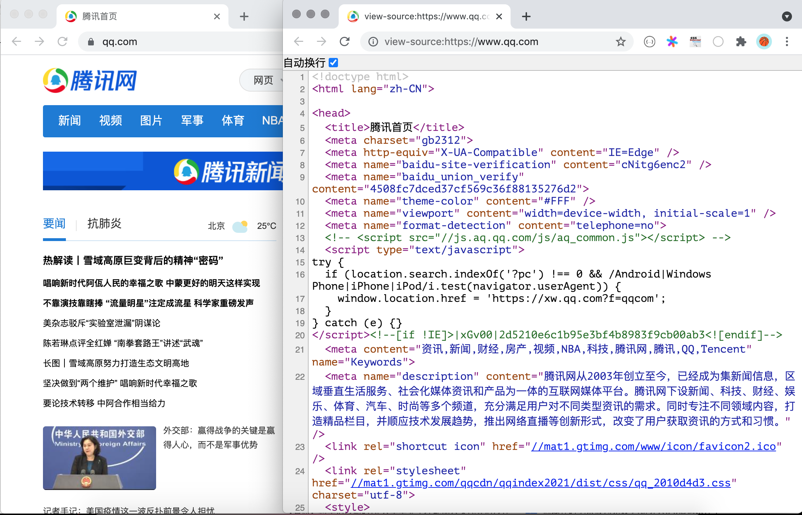
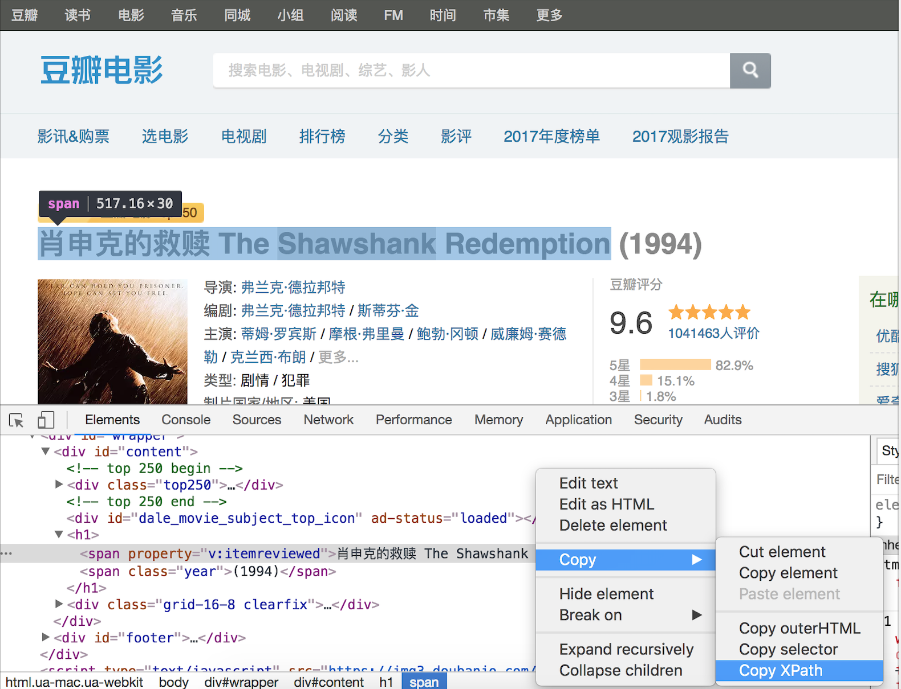

## Phân tích trang HTML với Python

Trong các bài học trước, chúng ta đã tìm hiểu về việc sử dụng thư viện bên thứ ba `requests` để lấy tài nguyên mạng, đồng thời giới thiệu một số kiến thức cơ bản về front-end. Tiếp theo, chúng ta sẽ tiếp tục khám phá cách phân tích cú pháp mã HTML để trích xuất thông tin hữu ích từ trang web. Trước đây, chúng ta đã thử dùng capturing group của biểu thức chính quy để trích xuất nội dung trang web, tuy nhiên việc viết được một biểu thức chính quy chính xác cũng là điều gây đau đầu. Để giải quyết vấn đề này, trước tiên chúng ta phải hiểu sâu về cấu trúc của trang HTML, từ đó nghiên cứu thêm các phương pháp phân tích trang web khác.

### Cấu trúc của trang HTML

Khi mở bất kỳ một trang web nào trong trình duyệt, sau đó nhấp chuột phải và chọn "Xem nguồn trang" (View Page Source), chúng ta có thể thấy mã HTML tương ứng của trang web đó.



Dòng thứ `1` của mã nguồn là phần khai báo kiểu tài liệu (doctype), thẻ `<html>` ở dòng thứ `2` là thẻ mở của thẻ gốc toàn trang, và dòng cuối cùng là thẻ đóng `</html>` của thẻ gốc. Dưới thẻ `<html>` có hai thẻ con là `<head>` và `<body>`, nội dung đặt trong thẻ `<body>` sẽ hiển thị trong cửa sổ trình duyệt, phần nội dung này là phần thân chính của trang web; nội dung đặt trong thẻ `<head>` không hiển thị trong cửa sổ trình duyệt nhưng lại chứa thông tin meta quan trọng của trang, thường được gọi là phần đầu của trang web. Cấu trúc mã đại khái của một trang HTML như sau:

```HTML
<!doctype html>
<html>
    <head>
        <!-- Thông tin meta của trang, như mã hóa ký tự, tiêu đề, từ khóa, media query,... -->
    </head>
    <body>
        <!-- Phần thân của trang, nội dung hiển thị trong cửa sổ trình duyệt -->
    </body>
</html>
```

Thẻ (tag), Cascading Style Sheets (CSS), và JavaScript là ba yếu tố cấu thành một trang HTML; trong đó các thẻ dùng để chứa nội dung hiển thị trên trang, CSS chịu trách nhiệm định dạng và kết xuất (render) giao diện, còn JavaScript dùng để điều khiển hành vi tương tác của trang web. Để phân tích cú pháp trang HTML, chúng ta có thể sử dụng cú pháp XPath. XPath vốn là một cú pháp truy vấn dành cho XML, có thể trích xuất nội dung hoặc thuộc tính của thẻ dựa trên cấu trúc phân cấp của thẻ HTML; ngoài ra, cũng có thể sử dụng bộ chọn CSS (CSS selector) để định vị các phần tử của trang, tương tự như cách dùng CSS để kết xuất các phần tử trang web.

### Phân tích cú pháp XPath

XPath là một cú pháp để tìm kiếm thông tin trong tài liệu XML (eXtensible Markup Language). Tương tự như HTML, XML cũng là một ngôn ngữ đánh dấu dùng các thẻ để chứa dữ liệu, điểm khác biệt là các thẻ trong XML có thể mở rộng, tự định nghĩa được và XML có yêu cầu ngữ pháp nghiêm ngặt hơn. XPath sử dụng các biểu thức đường dẫn để chọn các node hoặc tập hợp node trong tài liệu XML, các node ở đây bao gồm phần tử (element), thuộc tính (attribute), văn bản (text), không gian tên (namespace), lệnh xử lý (processing instruction), chú thích (comment), node gốc (root node),... Dưới đây chúng ta thông qua một ví dụ để giải thích cách sử dụng XPath để phân tích cú pháp trang web.

```XML
<?xml version="1.0" encoding="UTF-8"?>
<bookstore>
    <book>
      <title lang="eng">Harry Potter</title>
      <price>29.99</price>
    </book>
    <book>
      <title lang="zh">Learning XML</title>
      <price>39.95</price>
    </book>
</bookstore>
```

Đối với tệp XML trên, chúng ta có thể dùng cú pháp XPath như sau để lấy các node trong tài liệu:

| Biểu thức đường dẫn | Kết quả |
| --------------- | ------------------------------------------------------------ |
| `/bookstore` | Chọn phần tử gốc bookstore. **Lưu ý**: Nếu đường dẫn bắt đầu bằng dấu gạch chéo (/), thì đường dẫn này luôn đại diện cho đường dẫn tuyệt đối đến một phần tử! |
| `//book` | Chọn tất cả các phần tử con book, bất kể vị trí của chúng trong tài liệu. |
| `//@lang` | Chọn tất cả các thuộc tính có tên là lang. |
| `/bookstore/book[1]` | Chọn phần tử book đầu tiên là con của bookstore. |
| `/bookstore/book[last()]` | Chọn phần tử book cuối cùng là con của bookstore. |
| `/bookstore/book[last()-1]` | Chọn phần tử book kế cuối (áp chót) là con của bookstore. |
| `/bookstore/book[position()<3]` | Chọn hai phần tử book đầu tiên là con của phần tử bookstore. |
| `//title[@lang]` | Chọn tất cả các phần tử title có thuộc tính tên là lang. |
| `//title[@lang='eng']` | Chọn tất cả các phần tử title có thuộc tính lang mang giá trị eng. |
| `/bookstore/book[price>35.00]` | Chọn tất cả các phần tử book của phần tử bookstore có giá trị phần tử price lớn hơn 35.00. |
| `/bookstore/book[price>35.00]/title` | Chọn tất cả các phần tử title của phần tử book trong phần tử bookstore mà giá trị của phần tử price lớn hơn 35.00. |

XPath cũng hỗ trợ việc sử dụng ký tự đại diện (wildcard), như sau:

| Biểu thức đường dẫn | Kết quả |
| -------------- | --------------------------------- |
| `/bookstore/*` | Chọn tất cả phần tử con của phần tử bookstore. |
| `//*` | Chọn tất cả phần tử trong tài liệu. |
| `//title[@*]` | Chọn tất cả các phần tử title có thuộc tính bất kỳ. |

Nếu muốn chọn nhiều node, có thể sử dụng phương thức như sau:

| Biểu thức đường dẫn | Kết quả |
| ---------------------------------- | ------------------------------------------------------------ |
| `//book/title \| //book/price` | Chọn tất cả phần tử title và price của phần tử book. |
| `//title \| //price` | Chọn tất cả phần tử title và price trong tài liệu. |
| `/bookstore/book/title \| //price` | Chọn tất cả phần tử title của phần tử book thuộc phần tử bookstore, và tất cả phần tử price trong tài liệu. |

> **Giải thích**: Ví dụ trên được lấy từ [Hướng dẫn XPath](https://www.runoob.com/xpath/xpath-tutorial.html) trên trang web "Runoob", bạn đọc quan tâm có thể tự tìm đọc bài viết gốc.

Tất nhiên, nếu chưa hiểu hoặc chưa quen thuộc với cú pháp XPath, bạn có thể xem cú pháp XPath của một phần tử trong công cụ cho nhà phát triển của trình duyệt theo cách sau. Hình dưới đây chụp lại thao tác xem cú pháp XPath của tiêu đề phim trong thông tin chi tiết phim trên Douban bằng công cụ cho nhà phát triển của trình duyệt Chrome.



Để thực hiện phân tích cú pháp XPath cần sự hỗ trợ của thư viện bên thứ ba `lxml`, có thể cài đặt `lxml` bằng lệnh sau:

```Bash
pip install lxml
```

Dưới đây, chúng ta dùng phương thức phân tích XPath để viết lại đoạn mã lấy Douban Movie Top 250 trước đó, như sau:

```Python
from lxml import etree
import requests

for page in range(1, 11):
    resp = requests.get(
        url=f'https://movie.douban.com/top250?start={(page - 1) * 25}',
        headers={'User-Agent': 'BaiduSpider'}
    )
    tree = etree.HTML(resp.text)
    # Dùng cú pháp XPath trích xuất tiêu đề phim từ trang web
    title_spans = tree.xpath('//*[@id="content"]/div/div[1]/ol/li/div/div[2]/div[1]/a/span[1]')
    # Dùng cú pháp XPath trích xuất điểm đánh giá phim từ trang web
    rank_spans = tree.xpath('//*[@id="content"]/div/div[1]/ol/li[1]/div/div[2]/div[2]/div/span[2]')
    for title_span, rank_span in zip(title_spans, rank_spans):
        print(title_span.text, rank_span.text)
```

### Phân tích bằng CSS Selector

Đối với các nhà phát triển đã quen thuộc với bộ chọn CSS (CSS Selector) và JavaScript, việc lấy các phần tử của trang thông qua CSS selector có thể là lựa chọn đơn giản hơn, bởi vì bản thân JavaScript chạy trong trình duyệt đã có thể sử dụng các phương thức `querySelector()` và `querySelectorAll()` của đối tượng `document` để lấy phần tử trang dựa trên bộ chọn CSS. Trong Python, chúng ta có thể tận dụng thư viện bên thứ ba `beautifulsoup4` hoặc `pyquery` để làm điều tương tự. Beautiful Soup có thể được sử dụng để phân tích các tài liệu HTML và XML, sửa chữa các tài liệu chứa lỗi như thẻ chưa đóng, đóng gói các thao tác trích xuất dữ liệu từ trang bằng cách tạo một cấu trúc cây trong bộ nhớ cho trang cần phân tích. Có thể dùng lệnh dưới đây để cài đặt Beautiful Soup:

```Python
pip install beautifulsoup4
```

Dưới đây là mã nguồn được viết lại bằng `bs4` để lấy tên phim trong Douban Movie Top 250:

```Python
import bs4
import requests

for page in range(1, 11):
    resp = requests.get(
        url=f'https://movie.douban.com/top250?start={(page - 1) * 25}',
        headers={'User-Agent': 'BaiduSpider'}
    )
    # Tạo đối tượng BeautifulSoup
    soup = bs4.BeautifulSoup(resp.text, 'lxml')
    # Dùng CSS selector trích xuất thẻ span chứa tiêu đề phim từ trang web
    title_spans = soup.select('div.info > div.hd > a > span:nth-child(1)')
    # Dùng CSS selector trích xuất thẻ span chứa điểm đánh giá phim từ trang web
    rank_spans = soup.select('div.info > div.bd > div > span.rating_num')
    for title_span, rank_span in zip(title_spans, rank_spans):
        print(title_span.text, rank_span.text)
```

Để tìm hiểu thêm kiến thức về Beautiful Soup, bạn có thể tham khảo [tài liệu chính thức](https://www.crummy.com/software/BeautifulSoup/bs4/doc.zh/) của nó.

### Tổng kết

Dưới đây chúng ta làm một so sánh đơn giản giữa ba phương thức phân tích cú pháp:

| Phương thức phân tích | Module tương ứng | Tốc độ | Mức độ khó sử dụng |
| --------------------- | ---------------- | ------ | ------------------ |
| Biểu thức chính quy (Regex) | `re` | Nhanh | Khó |
| Phân tích cú pháp XPath | `lxml` | Nhanh | Trung bình |
| Bộ chọn CSS | `bs4` hoặc `pyquery` | Không cố định | Dễ |
