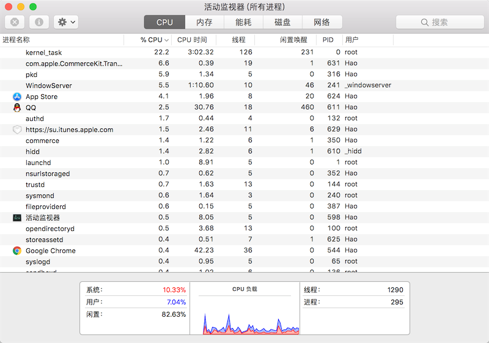

## Lập trình đồng thời trong Python - 1

Ngày nay, máy tính chúng ta sử dụng từ lâu đã là máy tính nhiều CPU hoặc đa nhân, và hệ điều hành chúng ta dùng về cơ bản đều hỗ trợ "đa nhiệm" (multitasking). Điều này giúp chúng ta có thể chạy đồng thời nhiều chương trình, hoặc chia nhỏ một chương trình thành nhiều tác vụ con tương đối độc lập, cho phép nhiều tác vụ con thực thi "song song" hoặc "đồng thời", từ đó rút ngắn thời gian thực thi của chương trình và mang lại trải nghiệm tốt hơn cho người dùng. Vì vậy hiện nay, dù phát triển bằng ngôn ngữ lập trình nào, việc triển khai lập trình "song song" (parallel) hay "đồng thời" (concurrency) đã trở thành kỹ năng tiêu chuẩn của lập trình viên. Để trình bày cách triển khai "song song" hoặc "đồng thời" trong chương trình Python, trước tiên chúng ta cần hiểu hai khái niệm quan trọng: tiến trình (process) và luồng (thread).

### Luồng và tiến trình

Khi chúng ta chạy một chương trình thông qua hệ điều hành, một hoặc nhiều tiến trình sẽ được tạo ra. Tiến trình là một hoạt động thực thi trên một tập dữ liệu nhất định của một chương trình có tính năng độc lập tương đối. Nói một cách đơn giản, tiến trình là đơn vị cơ bản được hệ điều hành phân bổ không gian lưu trữ, mỗi tiến trình đều có không gian địa chỉ, ngăn xếp dữ liệu (data stack) riêng cũng như các dữ liệu phụ trợ khác dùng để theo dõi quá trình thực thi của tiến trình; hệ điều hành quản lý việc thực thi của tất cả các tiến trình và phân bổ tài nguyên hợp lý cho chúng. Một tiến trình có thể tạo tiến trình mới thông qua fork hoặc spawn để thực hiện các tác vụ khác. Tuy nhiên, tiến trình mới cũng có không gian bộ nhớ độc lập riêng, do đó nếu hai tiến trình muốn chia sẻ dữ liệu thì phải thực hiện thông qua cơ chế giao tiếp liên tiến trình (IPC - Inter-Process Communication), các phương thức cụ thể bao gồm đường ống (pipe), tín hiệu (signal), socket, v.v.

Một tiến trình cũng có thể sở hữu nhiều tuyến thực thi, nói đơn giản là sở hữu nhiều đơn vị thực thi có thể nhận được sự điều phối của CPU, đó chính là luồng (thread). Do các luồng nằm trong cùng một tiến trình, chúng có thể chia sẻ cùng một ngữ cảnh, vì vậy so với tiến trình, việc chia sẻ thông tin và giao tiếp giữa các luồng dễ dàng hơn nhiều. Tất nhiên, trong hệ thống CPU đơn nhân, nhiều luồng không thể thực thi cùng một lúc, vì tại một thời điểm chỉ có một luồng có thể giành được CPU; nhiều luồng đạt được hiệu ứng đồng thời bằng cách chia sẻ thời gian thực thi của CPU.

Việc sử dụng kỹ thuật đa luồng trong chương trình thường mang lại những lợi ích rõ rệt, thể hiện rõ nhất ở việc nâng cao hiệu năng của chương trình và cải thiện trải nghiệm người dùng. Các phần mềm chúng ta sử dụng ngày nay hầu như đều áp dụng kỹ thuật đa luồng, điều này có thể được kiểm chứng bằng các công cụ giám sát tiến trình tích hợp sẵn của hệ thống (chẳng hạn như "Activity Monitor" trong macOS hay "Task Manager" trong Windows), như hình dưới đây.



Ở đây, chúng ta cũng cần nhấn mạnh lại với các bạn hai khái niệm: **đồng thời** (concurrency) và **song song** (parallel). **Đồng thời** thường đề cập đến việc tại một thời điểm chỉ có thể thực thi một lệnh, nhưng các lệnh tương ứng của nhiều luồng được luân phiên thực thi rất nhanh. Ví dụ: một bộ xử lý, trước tiên nó thực thi lệnh của luồng A trong một khoảng thời gian, sau đó thực thi lệnh của luồng B trong một khoảng thời gian, rồi chuyển lại thực thi luồng A trong một khoảng thời gian. Do tốc độ thực thi lệnh và tốc độ chuyển đổi của bộ xử lý cực kỳ nhanh, con người hoàn toàn không thể nhận thấy thao tác chuyển đổi ngữ cảnh thực thi giữa nhiều luồng của máy tính trong quá trình này, khiến cho ở góc độ vĩ mô có vẻ như nhiều luồng đang chạy cùng một lúc, nhưng ở góc độ vi mô thì thực chất chỉ có một luồng đang thực thi. **Song song** đề cập đến việc tại cùng một thời điểm, có nhiều lệnh được thực thi đồng thời trên nhiều bộ xử lý. Song song bắt buộc phải dựa vào nhiều bộ xử lý, dù nhìn từ góc độ vĩ mô hay vi mô, nhiều luồng đều có thể cùng thực thi tại một thời điểm. Trong nhiều trường hợp, chúng ta không cần phân biệt quá khắt khe giữa hai từ đồng thời và song song, do đó đôi khi chúng ta cũng coi đa luồng, đa tiến trình và I/O bất đồng bộ trong Python là các phương tiện để thực hiện lập trình đồng thời, nhưng trên thực tế hai phương tiện đầu cũng có thể hiện thực hóa lập trình song song. Tất nhiên ở đây còn có vấn đề về Khóa thông dịch viên toàn cục (GIL - Global Interpreter Lock), chúng ta sẽ thảo luận sau.

### Lập trình đa luồng

Lớp `Thread` trong module `threading` của thư viện chuẩn Python có thể giúp chúng ta hiện thực hóa lập trình đa luồng rất dễ dàng. Chúng ta dùng một ví dụ tải tệp từ mạng để so sánh sự khác biệt giữa việc sử dụng đa luồng và không sử dụng đa luồng, đoạn code như sau.

Tải tệp không sử dụng đa luồng.

```Python
import random
import time


def download(*, filename):
    start = time.time()
    print(f'Bắt đầu tải xuống {filename}.')
    time.sleep(random.randint(3, 6))
    print(f'{filename} đã tải xong.')
    end = time.time()
    print(f'Thời gian tải: {end - start:.3f} giây.')


def main():
    start = time.time()
    download(filename='Python từ nhập môn đến nhập viện.pdf')
    download(filename='MySQL từ xóa CSDL đến bỏ trốn.avi')
    download(filename='Linux từ tinh thông đến từ bỏ.mp4')
    end = time.time()
    print(f'Tổng thời gian: {end - start:.3f} giây.')


if __name__ == '__main__':
    main()
```

> **Giải thích**: Đoạn code trên không thực sự triển khai chức năng tải tệp qua mạng mà sử dụng `time.sleep()` để tạm dừng một khoảng thời gian nhằm mô phỏng độ trễ thời gian cần thiết khi tải tệp, khá tương đồng với tình huống tải tệp thực tế.

Chạy đoạn code trên, ta có thể nhận được kết quả chạy như sau. Có thể thấy rằng khi chương trình chỉ có một luồng làm việc, mỗi tác vụ tải xuống đều phải chờ tác vụ tải xuống trước đó thực thi xong mới có thể bắt đầu, do đó tổng thời gian thực thi của chương trình là tổng thời gian thực thi của cả ba tác vụ tải xuống riêng lẻ.

```
Bắt đầu tải xuống Python từ nhập môn đến nhập viện.pdf.
Python từ nhập môn đến nhập viện.pdf đã tải xong.
Thời gian tải: 3.005 giây.
Bắt đầu tải xuống MySQL từ xóa CSDL đến bỏ trốn.avi.
MySQL từ xóa CSDL đến bỏ trốn.avi đã tải xong.
Thời gian tải: 5.006 giây.
Bắt đầu tải xuống Linux từ tinh thông đến từ bỏ.mp4.
Linux từ tinh thông đến từ bỏ.mp4 đã tải xong.
Thời gian tải: 6.007 giây.
Tổng thời gian: 14.018 giây.
```

Trên thực tế, ba tác vụ tải xuống ở trên không có quan hệ nhân quả về mặt logic, cả ba có thể "đồng thời", tác vụ tải xuống tiếp theo không cần phải đợi tác vụ tải xuống trước đó kết thúc. Vì vậy, chúng ta có thể dùng lập trình đa luồng để viết lại đoạn code trên.

```Python
import random
import time
from threading import Thread


def download(*, filename):
    start = time.time()
    print(f'Bắt đầu tải xuống {filename}.')
    time.sleep(random.randint(3, 6))
    print(f'{filename} đã tải xong.')
    end = time.time()
    print(f'Thời gian tải: {end - start:.3f} giây.')


def main():
    threads = [
        Thread(target=download, kwargs={'filename': 'Python từ nhập môn đến nhập viện.pdf'}),
        Thread(target=download, kwargs={'filename': 'MySQL từ xóa CSDL đến bỏ trốn.avi'}),
        Thread(target=download, kwargs={'filename': 'Linux từ tinh thông đến từ bỏ.mp4'})
    ]
    start = time.time()
    # Khởi chạy 3 luồng
    for thread in threads:
        thread.start()
    # Chờ các luồng kết thúc
    for thread in threads:
        thread.join()
    end = time.time()
    print(f'Tổng thời gian: {end - start:.3f} giây.')


if __name__ == '__main__':
    main()
```

Một kết quả chạy cụ thể như sau.

```
Bắt đầu tải xuống Python từ nhập môn đến nhập viện.pdf.
Bắt đầu tải xuống MySQL từ xóa CSDL đến bỏ trốn.avi.
Bắt đầu tải xuống Linux từ tinh thông đến từ bỏ.mp4.
MySQL từ xóa CSDL đến bỏ trốn.avi đã tải xong.
Thời gian tải: 3.005 giây.
Python từ nhập môn đến nhập viện.pdf đã tải xong.
Thời gian tải: 5.006 giây.
Linux từ tinh thông đến từ bỏ.mp4 đã tải xong.
Thời gian tải: 6.003 giây.
Tổng thời gian: 6.004 giây.
```

Thông qua kết quả chạy ở trên, có thể thấy rằng thời gian thực thi của toàn bộ chương trình gần bằng thời gian thực thi của tác vụ tải xuống mất nhiều thời gian nhất. Điều này có nghĩa là ba tác vụ tải xuống được thực thi đồng thời, không có tình trạng tác vụ này phải chờ tác vụ kia, cách làm này rõ ràng đã nâng cao hiệu quả thực thi của chương trình. Nói một cách đơn giản, nếu trong chương trình có các đơn vị thực thi rất tốn thời gian, và giữa các đơn vị tốn thời gian này lại không có quan hệ nhân quả logic (nghĩa là việc thực thi của đơn vị B không phụ thuộc vào kết quả thực thi của đơn vị A), thì hai đơn vị A và B có thể được đặt vào hai luồng khác nhau để chúng thực thi đồng thời. Lợi ích của việc này ngoài việc giảm thời gian chờ đợi thực thi của chương trình, còn mang lại trải nghiệm người dùng tốt hơn, vì sự nghẽn của một đơn vị sẽ không khiến chương trình bị "treo", do trong chương trình vẫn còn các đơn vị khác có thể hoạt động.

#### Sử dụng lớp Thread để tạo đối tượng luồng

Qua đoạn code trên có thể thấy, trực tiếp sử dụng hàm khởi tạo của lớp `Thread` là có thể tạo đối tượng luồng, và phương thức `start()` của đối tượng luồng có thể khởi chạy một luồng. Sau khi luồng khởi chạy sẽ thực thi hàm được chỉ định bởi tham số `target`, tất nhiên với điều kiện là được CPU điều phối; nếu hàm mục tiêu mà luồng cần thực thi có tham số thì cần truyền qua tham số `args`, đối với tham số từ khóa thì có thể truyền qua tham số `kwargs`. Hàm khởi tạo của lớp `Thread` còn có nhiều tham số khác, chúng ta sẽ giải thích khi gặp sau, hiện tại các bạn cần nắm vững `target`, `args` và `kwargs`.

#### Kế thừa lớp Thread để tùy biến luồng

Ngoài cách tạo luồng được trình bày trong đoạn code trên, bạn cũng có thể tùy biến luồng bằng cách kế thừa lớp `Thread` và ghi đè phương thức `run()`, đoạn code cụ thể như sau.

```Python
import random
import time
from threading import Thread


class DownloadThread(Thread):

    def __init__(self, filename):
        self.filename = filename
        super().__init__()

    def run(self):
        start = time.time()
        print(f'Bắt đầu tải xuống {self.filename}.')
        time.sleep(random.randint(3, 6))
        print(f'{self.filename} đã tải xong.')
        end = time.time()
        print(f'Thời gian tải: {end - start:.3f} giây.')


def main():
    threads = [
        DownloadThread('Python từ nhập môn đến nhập viện.pdf'),
        DownloadThread('MySQL từ xóa CSDL đến bỏ trốn.avi'),
        DownloadThread('Linux từ tinh thông đến từ bỏ.mp4')
    ]
    start = time.time()
    # Khởi chạy 3 luồng
    for thread in threads:
        thread.start()
    # Chờ các luồng kết thúc
    for thread in threads:
        thread.join()
    end = time.time()
    print(f'Tổng thời gian: {end - start:.3f} giây.')


if __name__ == '__main__':
    main()
```

#### Sử dụng thread pool

Chúng ta cũng có thể đưa các tác vụ vào nhiều luồng để thực thi thông qua thread pool (hồ luồng). Việc sử dụng luồng thông qua thread pool là lựa chọn lý tưởng nhất cho lập trình đa luồng. Trên thực tế, việc tạo và giải phóng luồng đều mang lại chi phí khá lớn; việc tạo và giải phóng luồng thường xuyên thường không phải là lựa chọn tốt. Tận dụng thread pool, chúng ta có thể chuẩn bị sẵn một số luồng, trong quá trình sử dụng không cần phải tạo và giải phóng luồng bằng code tự viết nữa mà tái sử dụng trực tiếp các luồng trong thread pool. Module `concurrent.futures` tích hợp sẵn trong Python cung cấp hỗ trợ cho thread pool, đoạn code như sau.

```Python
import random
import time
from concurrent.futures import ThreadPoolExecutor
from threading import Thread


def download(*, filename):
    start = time.time()
    print(f'Bắt đầu tải xuống {filename}.')
    time.sleep(random.randint(3, 6))
    print(f'{filename} đã tải xong.')
    end = time.time()
    print(f'Thời gian tải: {end - start:.3f} giây.')


def main():
    with ThreadPoolExecutor(max_workers=4) as pool:
        filenames = ['Python từ nhập môn đến nhập viện.pdf', 'MySQL từ xóa CSDL đến bỏ trốn.avi', 'Linux từ tinh thông đến từ bỏ.mp4']
        start = time.time()
        for filename in filenames:
            pool.submit(download, filename=filename)
    end = time.time()
    print(f'Tổng thời gian: {end - start:.3f} giây.')


if __name__ == '__main__':
    main()
```

### Luồng daemon

Cái gọi là "luồng daemon" (daemon thread) là luồng thực thi không đáng để giữ lại khi luồng chính kết thúc. Việc không đáng giữ lại ở đây có nghĩa là luồng daemon sẽ bị hủy sau khi tất cả các luồng non-daemon khác chạy xong, nó bảo vệ tất cả các luồng non-daemon bên trong tiến trình hiện tại. Nói một cách đơn giản, luồng daemon sẽ bị kết thúc cùng với luồng chính, và vòng đời của luồng chính cũng chính là vòng đời của một tiến trình. Nếu chưa hiểu, chúng ta có thể xem một đoạn code đơn giản.

```Python
import time
from threading import Thread


def display(content):
    while True:
        print(content, end='', flush=True)
        time.sleep(0.1)


def main():
    Thread(target=display, args=('Ping', )).start()
    Thread(target=display, args=('Pong', )).start()


if __name__ == '__main__':
    main()
```

> **Giải thích**: Trong đoạn code trên, chúng ta đặt tham số `flush` của hàm `print` thành `True`, điều này là do nếu giá trị của tham số `flush` là `False` và `print` lại không có ký tự xuống dòng, nội dung xuất ra mỗi lần của `print` sẽ được đưa vào bộ đệm đầu ra của hệ điều hành, cho đến khi bộ đệm bị lấp đầy bởi nội dung xuất ra thì nó mới xả bộ đệm và tạo ra một lần xuất. Hiện tượng trên là thiết lập của hệ điều hành nhằm giảm số lần ngắt I/O và tăng hiệu suất sử dụng CPU. Để code tương tác trực quan, chúng ta mới đặt tham số `flush` thành `True`, buộc mỗi lần xuất đều phải làm sạch bộ đệm đầu ra.

Đoạn code trên sau khi chạy sẽ không dừng lại vì cả hai luồng con đều có vòng lặp vô tận, trừ khi bạn ngắt thực thi code bằng tay. Tuy nhiên, nếu khi tạo đối tượng luồng, bạn đặt tham số `daemon` thành `True`, hai luồng này sẽ trở thành luồng daemon. Khi đó, khi các luồng khác kết thúc, cho dù có vòng lặp vô tận, hai luồng daemon cũng sẽ bị kết thúc và không tiếp tục thực thi nữa, đoạn code như sau.

```Python
import time
from threading import Thread


def display(content):
    while True:
        print(content, end='', flush=True)
        time.sleep(0.1)


def main():
    Thread(target=display, args=('Ping', ), daemon=True).start()
    Thread(target=display, args=('Pong', ), daemon=True).start()
    time.sleep(5)


if __name__ == '__main__':
    main()
```

Trong đoạn code trên, chúng ta đã thêm một dòng `time.sleep(5)` trong luồng chính để luồng chính ngủ 5 giây. Trong quá trình này, các luồng daemon in ra `Ping` và `Pong` sẽ liên tục hoạt động cho đến khi luồng chính kết thúc sau 5 giây, hai luồng daemon này cũng bị hủy và không tiếp tục chạy nữa.

> **Suy ngẫm**: Nếu bỏ `daemon=True` ở dòng 12 trong đoạn code trên, code sẽ thực thi như thế nào? Bạn đọc quan tâm có thể thử nghiệm và xem kết quả thực thi thực tế có khớp với suy đoán của bạn hay không.

### Tranh chấp tài nguyên

Khi viết code đa luồng, việc nhiều luồng cạnh tranh cùng một tài nguyên (đối tượng) là điều không thể tránh khỏi. Trong trường hợp này, nếu không có cơ chế hợp lý để bảo vệ tài nguyên bị cạnh tranh thì có thể xuất hiện tình trạng không mong muốn. Đoạn code dưới đây tạo ra `100` luồng cùng chuyển tiền vào một tài khoản ngân hàng (số dư ban đầu là `0` đồng), mỗi luồng chuyển số tiền là `1` đồng. Trong trường hợp bình thường, số dư cuối cùng của tài khoản ngân hàng phải là `100` đồng, nhưng chạy đoạn code dưới đây chúng ta sẽ không nhận được kết quả `100` đồng.

```Python
import time

from concurrent.futures import ThreadPoolExecutor


class Account(object):
    """Tài khoản ngân hàng"""

    def __init__(self):
        self.balance = 0.0

    def deposit(self, money):
        """Gửi tiền"""
        new_balance = self.balance + money
        time.sleep(0.01)
        self.balance = new_balance


def main():
    """Hàm chính"""
    account = Account()
    with ThreadPoolExecutor(max_workers=16) as pool:
        for _ in range(100):
            pool.submit(account.deposit, 1)
    print(account.balance)


if __name__ == '__main__':
    main()
```

Lớp `Account` trong code trên đại diện cho tài khoản ngân hàng, phương thức `deposit` của nó đại diện cho hành vi gửi tiền, tham số `money` đại diện cho số tiền gửi vào, phương thức này dùng hàm `time.sleep` để mô phỏng việc xử lý gửi tiền cần một khoảng thời gian. Chúng ta dùng thread pool để khởi chạy `100` luồng chuyển tiền vào một tài khoản, nhưng đoạn code trên không thể cho ra kết quả `100` như chúng ta mong đợi. Đây chính là vấn đề dữ liệu không nhất quán có thể gặp phải khi nhiều luồng cạnh tranh một tài nguyên. Chú ý dòng `14` trong đoạn code trên, khi nhiều luồng cùng thực thi đến dòng code này, chúng sẽ thực hiện thao tác cộng thêm số tiền gửi vào trên cùng một số dư, điều này sẽ gây ra hiện tượng "mất cập nhật" (lost update), tức là kết quả sửa đổi dữ liệu trước đó bị ghi đè bởi lần sửa đổi tiếp theo, do đó mới không có được kết quả chính xác.

Để giải quyết vấn đề trên, có thể sử dụng cơ chế khóa, dùng khóa để bảo vệ đoạn code then chốt thao tác với dữ liệu. Module `threading` của thư viện chuẩn Python cung cấp lớp `Lock` và `RLock` để hỗ trợ cơ chế khóa, ở đây chúng ta không đi sâu vào sự khác biệt giữa hai lớp này, khuyên bạn nên sử dụng trực tiếp `RLock`. Tiếp theo, chúng ta thêm một đối tượng khóa vào tài khoản ngân hàng, thông qua đối tượng khóa để giải quyết vấn đề "mất cập nhật" khi gửi tiền vừa rồi, đoạn code như sau.

```Python
import time

from concurrent.futures import ThreadPoolExecutor
from threading import RLock


class Account(object):
    """Tài khoản ngân hàng"""

    def __init__(self):
        self.balance = 0.0
        self.lock = RLock()

    def deposit(self, money):
        # Lấy khóa
        self.lock.acquire()
        try:
            new_balance = self.balance + money
            time.sleep(0.01)
            self.balance = new_balance
        finally:
            # Giải phóng khóa
            self.lock.release()


def main():
    """Hàm chính"""
    account = Account()
    with ThreadPoolExecutor(max_workers=16) as pool:
        for _ in range(100):
            pool.submit(account.deposit, 1)
    print(account.balance)


if __name__ == '__main__':
    main()
```

Trong đoạn code trên, thao tác lấy khóa và giải phóng khóa cũng có thể được thực hiện thông qua cú pháp ngữ cảnh. Sử dụng cú pháp ngữ cảnh sẽ giúp code ngắn gọn và tao nhã hơn, đây cũng là cách chúng tôi khuyên bạn nên sử dụng.

```Python
import time

from concurrent.futures import ThreadPoolExecutor
from threading import RLock


class Account(object):
    """Tài khoản ngân hàng"""

    def __init__(self):
        self.balance = 0.0
        self.lock = RLock()

    def deposit(self, money):
        # Lấy khóa và giải phóng khóa thông qua cú pháp ngữ cảnh
        with self.lock:
            new_balance = self.balance + money
            time.sleep(0.01)
            self.balance = new_balance


def main():
    """Hàm chính"""
    account = Account()
    with ThreadPoolExecutor(max_workers=16) as pool:
        for _ in range(100):
            pool.submit(account.deposit, 1)
    print(account.balance)


if __name__ == '__main__':
    main()
```

> **Suy ngẫm**: Hãy sửa đổi đoạn code trên thành 5 luồng gửi tiền vào tài khoản ngân hàng và 5 luồng rút tiền từ tài khoản ngân hàng. Khi số dư trong tài khoản ngân hàng không đủ, luồng rút tiền cần dừng lại chờ luồng gửi tiền nạp tiền vào rồi mới thử rút tiền lại. Ở đây cần dùng đến kiến thức điều phối luồng, các bạn có thể tự tìm hiểu lớp `Condition` trong module `threading` để xem có thể hoàn thành nhiệm vụ này hay không.

### Vấn đề GIL

Nếu sử dụng trình thông dịch Python chính thức (thường gọi là CPython) để chạy chương trình Python, chúng ta không thể tăng mức sử dụng CPU lên gần 400% (đối với CPU 4 nhân) hoặc gần 800% (đối với CPU 8 nhân) bằng cách sử dụng đa luồng, vì CPython bị giới hạn bởi GIL (Global Interpreter Lock - Khóa thông dịch viên toàn cục) khi thực thi mã. Cụ thể, khi CPython thực thi bất kỳ đoạn mã nào, luồng tương ứng đều cần phải lấy được GIL trước, sau đó cứ mỗi khi thực thi 100 lệnh (bytecode), CPython sẽ khiến luồng đã lấy GIL chủ động giải phóng GIL, để các luồng khác mới có cơ hội thực thi. Vì sự tồn tại của GIL, bất kể CPU của bạn có bao nhiêu nhân, mã Python mà chúng ta viết cũng không có cơ hội thực sự thực thi song song.

GIL là một vấn đề lịch sử để lại trong thiết kế của trình thông dịch Python chính thức. Để giải quyết vấn đề này và cho phép đa luồng phát huy lợi thế đa nhân của CPU, cần phải triển khai lại một trình thông dịch Python không có GIL. Theo tuyên bố chính thức, vấn đề này sẽ được giải quyết khi Python phát hành phiên bản 4.0, chúng ta hãy cùng chờ xem. Hiện tại, đối với CPython, nếu muốn tận dụng tối đa lợi thế đa nhân của CPU, bạn có thể cân nhắc sử dụng đa tiến trình (multiprocessing), vì mỗi tiến trình tương ứng với một trình thông dịch Python riêng biệt, do đó mỗi tiến trình đều có GIL độc lập của riêng mình, từ đó có thể phá vỡ giới hạn của GIL. Trong chương tiếp theo, chúng tôi sẽ giới thiệu cho các bạn những kiến thức liên quan về đa tiến trình, đồng thời so sánh mã và hiệu quả thực thi giữa đa luồng và đa tiến trình.
