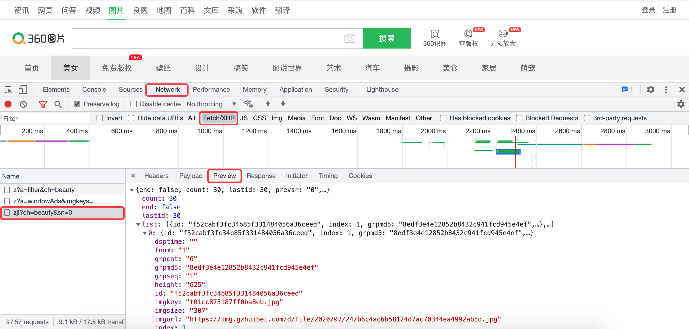

## Ứng dụng lập trình đồng thời trong crawler

Trong các bài học trước, chúng tôi đã giới thiệu cho các bạn về đa luồng, đa tiến trình và lập trình bất đồng bộ trong Python. Thông qua ba phương tiện này, chúng ta có thể thực hiện lập trình đồng thời hoặc song song; một mặt có thể tăng tốc độ thực thi mã nguồn, mặt khác cũng có thể mang lại trải nghiệm người dùng tốt hơn. Chương trình crawler là một tác vụ điển hình thiên về I/O (I/O-bound). Đối với các tác vụ thiên về I/O, cả đa luồng và I/O bất đồng bộ đều là những lựa chọn tuyệt vời, bởi vì khi một phần của chương trình bị nghẽn do thao tác I/O, các phần khác của chương trình vẫn có thể tiếp tục hoạt động, nhờ đó chúng ta không lãng phí nhiều thời gian vào việc chờ đợi và tắc nghẽn. Dưới đây, chúng ta sẽ lấy ví dụ về việc cào hình ảnh từ trang web "[360 Hình ảnh](https://image.so.com/)" và lưu về máy cục bộ để lần lượt chỉ ra sự khác biệt giữa các chương trình crawler sử dụng đơn luồng, đa luồng và lập trình I/O bất đồng bộ, đồng thời so sánh đơn giản về hiệu quả thực thi của chúng.

Trang web "360 Hình ảnh" sử dụng công nghệ [Ajax](https://developer.mozilla.org/zh-CN/docs/Web/Guide/AJAX). Đây là công nghệ tải dữ liệu bất đồng bộ và làm mới cục bộ trang web được rất nhiều trang web sử dụng. Nói một cách đơn giản, hình ảnh trên trang đều được code JavaScript lấy dữ liệu JSON bất đồng bộ và render động, hơn nữa toàn bộ trang còn sử dụng kiểu tải dạng thác nước (vừa cuộn xuống dưới vừa tải thêm ảnh). Chúng ta có thể tìm thấy giao diện dữ liệu cung cấp nội dung động trong "Công cụ dành cho nhà phát triển" (Developer Tools) của trình duyệt như hình bên dưới. Thông tin hình ảnh chúng ta cần nằm ngay trong dữ liệu JSON mà máy chủ trả về.



Ví dụ, để lấy hình ảnh của chuyên mục "Người đẹp", chúng ta có thể gửi request đến URL như bên dưới, trong đó tham số `ch` đại diện cho chuyên mục được yêu cầu, giá trị `beauty` sau dấu `=` đại diện cho chuyên mục "Người đẹp", tham số `sn` tương đương với số trang, `0` đại diện cho trang đầu tiên (gồm `30` hình ảnh), `30` đại diện cho trang thứ hai, `60` đại diện cho trang thứ ba, v.v.

```
https://image.so.com/zjl?ch=beauty&sn=0
```

### Phiên bản đơn luồng

Tải xuống tổng cộng `90` hình ảnh của chuyên mục "Người đẹp" thông qua URL ở trên.

```Python
"""
example04.py - Phiên bản crawler đơn luồng
"""
import os

import requests


def download_picture(url):
    filename = url[url.rfind('/') + 1:]
    resp = requests.get(url)
    if resp.status_code == 200:
        with open(f'images/beauty/{filename}', 'wb') as file:
            file.write(resp.content)


def main():
    if not os.path.exists('images/beauty'):
        os.makedirs('images/beauty')
    for page in range(3):
        resp = requests.get(f'https://image.so.com/zjl?ch=beauty&sn={page * 30}')
        if resp.status_code == 200:
            pic_dict_list = resp.json()['list']
            for pic_dict in pic_dict_list:
                download_picture(pic_dict['qhimg_url'])

if __name__ == '__main__':
    main()
```

Trên hệ điều hành macOS hoặc Linux, chúng ta có thể sử dụng lệnh `time` để biết thời gian thực thi của đoạn mã trên cũng như mức sử dụng CPU, như sau:

```Bash
time python3 example04.py 
```

Dưới đây là kết quả thực thi của đoạn mã crawler đơn luồng trên máy tính của tôi:

```
python3 example04.py  2.36s user 0.39s system 12% cpu 21.578 total
```

Ở đây chúng ta chỉ cần chú ý tổng thời gian thực thi của code là `21.578` giây, mức sử dụng CPU là `12%`.

### Phiên bản đa luồng

Chúng ta sử dụng kỹ thuật thread pool đã đề cập trước đó để sửa đổi đoạn code trên thành phiên bản đa luồng.

```Python
"""
example05.py - Phiên bản crawler đa luồng
"""
import os
from concurrent.futures import ThreadPoolExecutor

import requests


def download_picture(url):
    filename = url[url.rfind('/') + 1:]
    resp = requests.get(url)
    if resp.status_code == 200:
        with open(f'images/beauty/{filename}', 'wb') as file:
            file.write(resp.content)


def main():
    if not os.path.exists('images/beauty'):
        os.makedirs('images/beauty')
    with ThreadPoolExecutor(max_workers=16) as pool:
        for page in range(3):
            resp = requests.get(f'https://image.so.com/zjl?ch=beauty&sn={page * 30}')
            if resp.status_code == 200:
                pic_dict_list = resp.json()['list']
                for pic_dict in pic_dict_list:
                    pool.submit(download_picture, pic_dict['qhimg_url'])


if __name__ == '__main__':
    main()
```

Thực thi lệnh như sau:

```Bash
time python3 example05.py
```

Kết quả thực thi của đoạn mã như sau:

```
python3 example05.py  2.65s user 0.40s system 95% cpu 3.193 total
```

### Phiên bản I/O bất đồng bộ

Chúng ta sử dụng `aiohttp` để sửa đổi đoạn code trên thành phiên bản I/O bất đồng bộ. Để thực hiện việc lấy tài nguyên mạng và thao tác ghi tệp theo cách I/O bất đồng bộ, trước tiên chúng ta phải cài đặt thư viện bên thứ ba `aiohttp` và `aiofile`, các lệnh như sau:

```Bash
pip install aiohttp aiofile
```

Cách dùng `aiohttp` đã được giới thiệu ngắn gọn trong các bài học trước, hàm `async_open` trong module `aiofile` có cách dùng tương tự hàm tích hợp sẵn `open` của Python, chỉ khác là nó hỗ trợ thao tác bất đồng bộ. Dưới đây là mã crawler phiên bản I/O bất đồng bộ:

```Python
"""
example06.py - Phiên bản crawler I/O bất đồng bộ
"""
import asyncio
import json
import os

import aiofile
import aiohttp


async def download_picture(session, url):
    filename = url[url.rfind('/') + 1:]
    async with session.get(url, ssl=False) as resp:
        if resp.status == 200:
            data = await resp.read()
            async with aiofile.async_open(f'images/beauty/{filename}', 'wb') as file:
                await file.write(data)


async def fetch_json():
    async with aiohttp.ClientSession() as session:
        for page in range(3):
            async with session.get(
                url=f'https://image.so.com/zjl?ch=beauty&sn={page * 30}',
                ssl=False
            ) as resp:
                if resp.status == 200:
                    json_str = await resp.text()
                    result = json.loads(json_str)
                    for pic_dict in result['list']:
                        await download_picture(session, pic_dict['qhimg_url'])


def main():
    if not os.path.exists('images/beauty'):
        os.makedirs('images/beauty')
    loop = asyncio.get_event_loop()
    loop.run_until_complete(fetch_json())
    loop.close()


if __name__ == '__main__':
    main()
```

Thực thi lệnh như sau:

```Bash
time python3 example06.py
```

Kết quả thực thi của đoạn mã như sau:

```
python3 example06.py  0.82s user 0.21s system 27% cpu 3.782 total
```

### Tổng kết

Thông qua việc so sánh kết quả thực thi của ba đoạn mã trên, chúng ta có thể rút ra kết luận rằng việc sử dụng đa luồng và I/O bất đồng bộ đều có thể cải thiện hiệu năng của chương trình crawler, vì chúng ta không phải lãng phí thời gian vào việc chờ đợi và tắc nghẽn do các thao tác I/O gây ra. Kết quả thực thi của lệnh `time` cũng cho chúng ta thấy rằng mức sử dụng CPU của mã đơn luồng chỉ là `12%`, trong khi mức sử dụng CPU của phiên bản đa luồng lên tới `95%`; thời gian thực thi của crawler phiên bản đơn luồng khoảng `21` giây, trong khi phiên bản đa luồng và I/O bất đồng bộ chỉ thực thi trong `3` giây. Ngoài ra, trong trường hợp thời gian chạy chênh lệch không nhiều, mã đa luồng tiêu tốn nhiều tài nguyên CPU hơn so với mã I/O bất đồng bộ, điều này là do việc điều phối và chuyển đổi giữa các luồng cũng cần tiêu tốn thời gian CPU. Đến đây, ưu và nhược điểm của ba phương pháp đối với các tác vụ thiên về I/O đã rõ ràng, tất nhiên đây chỉ là kết quả chạy trên máy tính của tôi. Nếu tình trạng mạng không lý tưởng hoặc trang web đích phản hồi rất chậm, thì lợi thế của việc sử dụng đa luồng và I/O bất đồng bộ sẽ càng rõ rệt hơn, các bạn độc giả quan tâm có thể tự mình thử nghiệm.
