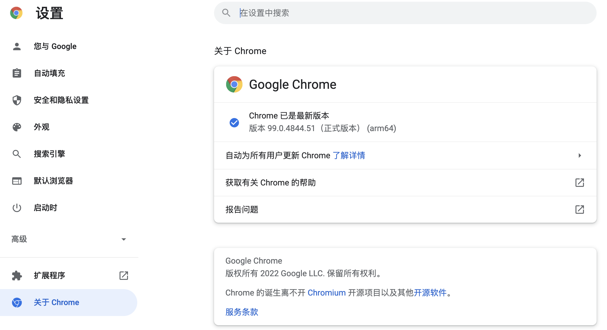
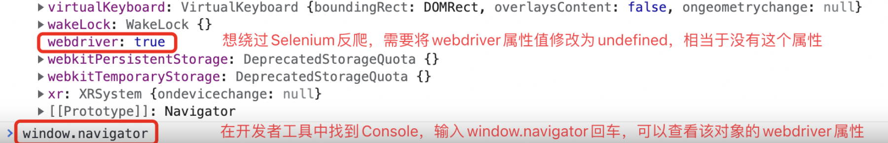

## Thu thập nội dung động của trang web với Selenium

Theo báo cáo kiểm tra khả năng tiếp cận Internet toàn cầu được công bố bởi một cơ quan có thẩm quyền, khoảng ba phần tư các trang web trên toàn cầu có nội dung hoặc một phần nội dung được tạo động thông qua JavaScript. Điều này có nghĩa là khi chọn "Xem nguồn trang" (View Page Source) trong cửa sổ trình duyệt, bạn sẽ không thể tìm thấy những nội dung này trong mã HTML, đồng nghĩa với việc phương pháp thu thập dữ liệu mà chúng ta đã sử dụng trước đây không thể hoạt động bình thường nữa. Để giải quyết vấn đề như vậy về cơ bản có hai phương án: một là tìm ra giao diện API dữ liệu cung cấp nội dung động, phương pháp này cũng áp dụng được khi cào dữ liệu từ ứng dụng di động (App); hai là thông qua công cụ kiểm thử tự động Selenium để điều khiển trình duyệt và lấy nội dung động sau khi đã được render. Đối với phương án thứ nhất, chúng ta có thể sử dụng "Công cụ dành cho nhà phát triển" (Developer Tools) của trình duyệt hoặc các công cụ bắt gói tin chuyên nghiệp hơn (như Charles, Fiddler, Wireshark, v.v.) để lấy giao diện dữ liệu, các thao tác tiếp theo tương tự như cách lấy dữ liệu từ trang web "360 Hình ảnh" đã giải thích ở chương trước nên chúng tôi sẽ không nhắc lại ở đây. Trong chương này, chúng ta sẽ tập trung vào việc sử dụng công cụ kiểm thử tự động Selenium để thu thập nội dung động của trang web.

### Giới thiệu Selenium

Selenium là một công cụ kiểm thử tự động. Nhờ nó, chúng ta có thể điều khiển trình duyệt thực hiện các hành vi cụ thể, từ đó hỗ trợ lập trình viên crawler lấy được nội dung động của trang web. Nói một cách đơn giản, miễn là nội dung chúng ta có thể nhìn thấy trong cửa sổ trình duyệt thì đều có thể dùng Selenium để lấy về; đối với những trang web sử dụng công nghệ render động bằng JavaScript, Selenium sẽ là một lựa chọn quan trọng. Dưới đây, chúng ta vẫn lấy trình duyệt Chrome làm ví dụ để giải thích cách sử dụng Selenium. Trước tiên, bạn cần cài đặt trình duyệt Chrome và tải driver tương ứng của nó. Trình điều khiển (driver) của trình duyệt Chrome có thể được tải xuống tại [trang chủ ChromeDriver](https://chromedriver.chromium.org/downloads). Phiên bản của driver phải khớp với phiên bản của trình duyệt, nếu không có phiên bản hoàn toàn trùng khớp thì hãy chọn phiên bản có mã số gần nhất.



### Sử dụng Selenium

Trước tiên, chúng ta có thể cài đặt Selenium qua `pip`, câu lệnh như sau:

```Shell
pip install selenium
```

#### Tải trang web

Tiếp theo, chúng ta điều khiển trình duyệt Chrome mở trang Baidu thông qua đoạn code dưới đây:

```Python
from selenium import webdriver

# Tạo đối tượng trình duyệt Chrome
browser = webdriver.Chrome()
# Tải trang chỉ định
browser.get('https://www.baidu.com/')
```

Nếu không muốn sử dụng trình duyệt Chrome, bạn cũng có thể sửa đổi đoạn code trên để điều khiển các trình duyệt khác, chỉ cần tạo đối tượng trình duyệt tương ứng (như Firefox, Safari, v.v.). Khi chạy chương trình trên, nếu thấy thông báo lỗi như dưới đây, điều đó cho thấy chúng ta chưa thêm driver của Chrome vào biến môi trường PATH, và cũng chưa chỉ định vị trí của ChromeDriver trong chương trình.

```Shell
selenium.common.exceptions.WebDriverException: Message: 'chromedriver' executable needs to be in PATH. Please see https://sites.google.com/a/chromium.org/chromedriver/home
```

Có ba cách để giải quyết vấn đề này:

1. Đặt ChromeDriver đã tải về vào một thư mục đã có sẵn trong biến môi trường PATH; bạn nên đặt trực tiếp vào cùng thư mục với trình thông dịch Python, bởi vì khi cài đặt Python trước đó, chúng ta đã thêm đường dẫn trình thông dịch Python vào biến môi trường PATH rồi.

2. Đặt ChromeDriver vào thư mục `bin` trong môi trường ảo của dự án (thư mục tương ứng trên hệ điều hành Windows là `Scripts`). Như vậy, ChromeDriver sẽ nằm cùng vị trí với trình thông dịch Python của môi trường ảo, chắc chắn sẽ tìm thấy.

3. Sửa đổi đoạn code trên, khi tạo đối tượng Chrome, hãy cấu hình đối tượng `Service` thông qua tham số `service` và chỉ định vị trí của ChromeDriver thông qua tham số `executable_path` của đối tượng `Service`, như sau:

    ```Python
    from selenium import webdriver
    from selenium.webdriver.chrome.service import Service
    
    browser = webdriver.Chrome(service=Service(executable_path='venv/bin/chromedriver'))
    browser.get('https://www.baidu.com/')
    ```

#### Tìm phần tử và mô phỏng hành vi người dùng

Tiếp theo, chúng ta có thể thử mô phỏng hành vi người dùng nhập từ khóa tìm kiếm vào ô văn bản trên trang chủ Baidu rồi nhấp vào nút "Baidu một cái" (nút Tìm kiếm). Sau khi trang hoàn tất việc tải, có thể sử dụng các phương thức `find_element` và `find_elements` của đối tượng `Chrome` để lấy các phần tử của trang. Selenium hỗ trợ nhiều cách lấy phần tử, bao gồm: CSS selector, XPath, tên phần tử (tên thẻ), ID phần tử, tên class, v.v. Phương thức đầu tiên có thể lấy một phần tử trang đơn lẻ (đối tượng `WebElement`), phương thức thứ hai có thể lấy một danh sách gồm nhiều phần tử trang. Sau khi có được đối tượng `WebElement`, có thể dùng `send_keys` để mô phỏng hành vi nhập liệu của người dùng, dùng `click` để mô phỏng thao tác nhấp chuột của người dùng, đoạn code như sau:

```Python
from selenium import webdriver
from selenium.webdriver.common.by import By

browser = webdriver.Chrome()
browser.get('https://www.baidu.com/')
# Lấy phần tử thông qua ID phần tử
kw_input = browser.find_element(By.ID, 'kw')
# Mô phỏng hành vi nhập dữ liệu của người dùng
kw_input.send_keys('Python')
# Lấy phần tử thông qua CSS selector
su_button = browser.find_element(By.CSS_SELECTOR, '#su')
# Mô phỏng hành vi nhấp chuột của người dùng
su_button.click()
```

Nếu muốn thực hiện một chuỗi hành động, chẳng hạn như mô phỏng thao tác kéo thả (drag and drop), bạn có thể tạo đối tượng `ActionChains`, độc giả quan tâm có thể tự tìm hiểu thêm.

#### Chờ ngầm định và chờ tường minh

Ở đây còn có một chi tiết các bạn cần biết: các phần tử trên trang web có thể được tạo động; khi chúng ta sử dụng phương thức `find_element` hoặc `find_elements` để lấy, chúng có thể vẫn chưa hoàn thành việc render, lúc này sẽ phát sinh lỗi `NoSuchElementException`. Để giải quyết vấn đề này, chúng ta có thể sử dụng cơ chế chờ ngầm định (implicit wait), thiết lập thời gian chờ để trình duyệt hoàn tất việc render các phần tử trang. Ngoài ra, chúng ta còn có thể sử dụng cơ chế chờ tường minh (explicit wait) bằng cách tạo đối tượng `WebDriverWait`, đồng thời thiết lập thời gian chờ và điều kiện chờ. Khi điều kiện chưa được thỏa mãn, chúng ta có thể chờ đợi trước rồi mới thử thực hiện các thao tác tiếp theo, đoạn code cụ thể như sau:

```Python
from selenium import webdriver
from selenium.webdriver.common.by import By
from selenium.webdriver.support import expected_conditions
from selenium.webdriver.support.wait import WebDriverWait

browser = webdriver.Chrome()
# Thiết lập kích thước cửa sổ trình duyệt
browser.set_window_size(1200, 800)
browser.get('https://www.baidu.com/')
# Thiết lập thời gian chờ ngầm định là 10 giây
browser.implicitly_wait(10)
kw_input = browser.find_element(By.ID, 'kw')
kw_input.send_keys('Python')
su_button = browser.find_element(By.CSS_SELECTOR, '#su')
su_button.click()
# Tạo đối tượng chờ tường minh
wait_obj = WebDriverWait(browser, 10)
# Thiết lập điều kiện chờ (chờ thẻ div kết quả tìm kiếm xuất hiện)
wait_obj.until(
    expected_conditions.presence_of_element_located(
        (By.CSS_SELECTOR, '#content_left')
    )
)
# Chụp ảnh màn hình
browser.get_screenshot_as_file('python_result.png')
```

Điều kiện chờ `presence_of_element_located` được thiết lập ở trên biểu thị việc chờ phần tử chỉ định xuất hiện. Bảng dưới đây liệt kê các điều kiện chờ thường dùng và ý nghĩa của chúng:

| Điều kiện chờ | Ý nghĩa cụ thể |
| ---------------------------------------- | ------------------------------------- |
| `title_is / title_contains` | Tiêu đề là nội dung chỉ định / Tiêu đề chứa nội dung chỉ định |
| `visibility_of` | Phần tử hiển thị |
| `presence_of_element_located` | Phần tử được định vị đã tải xong |
| `visibility_of_element_located` | Phần tử được định vị trở nên hiển thị |
| `invisibility_of_element_located` | Phần tử được định vị trở nên không hiển thị |
| `presence_of_all_elements_located` | Tất cả phần tử được định vị đã tải xong |
| `text_to_be_present_in_element` | Phần tử chứa nội dung chỉ định |
| `text_to_be_present_in_element_value` | Thuộc tính `value` của phần tử chứa nội dung chỉ định |
| `frame_to_be_available_and_switch_to_it` | Tải và chuyển sang frame nội bộ chỉ định |
| `element_to_be_clickable` | Phần tử có thể nhấp được |
| `element_to_be_selected` | Phần tử được chọn |
| `element_located_to_be_selected` | Phần tử được định vị được chọn |
| `alert_is_present` | Xuất hiện hộp thoại Alert |

#### Thực thi mã JavaScript

Đối với các trang web sử dụng cơ chế tải dạng thác nước, nếu muốn tải thêm nội dung trong cửa sổ trình duyệt, chúng ta có thể thực hiện thông qua phương thức `execute_script` của đối tượng trình duyệt để chạy mã JavaScript. Đối với một số thao tác cào dữ liệu nâng cao, rất có khả năng bạn cũng sẽ cần đến thao tác tương tự. Nếu mã crawler của bạn cần sự hỗ trợ của JavaScript, bạn nên tìm hiểu cơ bản về JavaScript, đặc biệt là các thao tác BOM và DOM trong JavaScript. Trong đoạn code trên, chúng ta thêm đoạn mã sau vào trước khi chụp ảnh màn hình, như vậy có thể dùng JavaScript để cuộn trang web xuống dưới cùng:

```Python
# Thực thi mã JavaScript
browser.execute_script('document.documentElement.scrollTop = document.documentElement.scrollHeight')
```

#### Vượt qua cơ chế chống crawler của Selenium

Một số trang web thiết lập các biện pháp chống crawler nhắm riêng vào Selenium, vì với trình duyệt được điều khiển bởi Selenium, bạn có thể thấy trong console giá trị thuộc tính `webdriver` là `true`. Nếu muốn vượt qua bài kiểm tra này, trước khi tải trang, bạn có thể thực thi mã JavaScript để đổi giá trị này thành `undefined`.



Mặt khác, chúng ta cũng có thể ẩn thông báo "Chrome đang chịu sự điều khiển của phần mềm kiểm thử tự động" trên cửa sổ trình duyệt, đoạn mã hoàn chỉnh như sau:

```Python
# Tạo đối tượng cấu hình Chrome
options = webdriver.ChromeOptions()
# Thêm tham số thử nghiệm
options.add_experimental_option('excludeSwitches', ['enable-automation'])
options.add_experimental_option('useAutomationExtension', False)
# Tạo đối tượng trình duyệt Chrome và truyền vào tham số
browser = webdriver.Chrome(options=options)
# Thực thi lệnh Chrome DevTools Protocol (chạy mã JavaScript chỉ định khi tải trang)
browser.execute_cdp_cmd(
    'Page.addScriptToEvaluateOnNewDocument',
    {'source': 'Object.defineProperty(navigator, "webdriver", {get: () => undefined})'}
)
browser.set_window_size(1200, 800)
browser.get('https://www.baidu.com/')
```

#### Trình duyệt không giao diện (Headless Browser)

Trong nhiều trường hợp, khi cào dữ liệu chúng ta không cần nhìn thấy cửa sổ trình duyệt, chỉ cần có trình duyệt Chrome cùng driver tương ứng là crawler của chúng ta đã có thể vận hành. Nếu không muốn nhìn thấy cửa sổ trình duyệt, chúng ta có thể thiết lập sử dụng headless browser theo cách sau:

```Python
options = webdriver.ChromeOptions()
options.add_argument('--headless')
browser = webdriver.Chrome(options=options)
```

### Tham khảo API

Kiến thức liên quan đến Selenium còn rất nhiều, chúng tôi sẽ không liệt kê chi tiết từng mục ở đây. Dưới đây là danh sách các thuộc tính và phương thức thường dùng của đối tượng trình duyệt và đối tượng `WebElement`. Để biết thêm chi tiết, bạn cũng có thể tham khảo [bản dịch tài liệu chính thức](https://selenium-python-zh.readthedocs.io/en/latest/index.html) của Selenium.

#### Đối tượng trình duyệt

Bảng 1. Thuộc tính thường dùng

| Tên thuộc tính | Mô tả |
| ----------------------- | -------------------------------- |
| `current_url` | URL của trang hiện tại |
| `current_window_handle` | Handle (tham chiếu) của cửa sổ hiện tại |
| `name` | Tên của trình duyệt |
| `orientation` | Hướng của thiết bị hiện tại (ngang, dọc) |
| `page_source` | Mã nguồn của trang hiện tại (bao gồm cả nội dung động) |
| `title` | Tiêu đề của trang hiện tại |
| `window_handles` | Handle của tất cả các cửa sổ đang mở trong trình duyệt |

Bảng 2. Phương thức thường dùng

| Tên phương thức | Mô tả |
| -------------------------------------- | ----------------------------------- |
| `back` / `forward` | Lùi lại / tiến lên trong lịch sử duyệt web |
| `close` / `quit` | Đóng cửa sổ trình duyệt hiện tại / thoát đối tượng trình duyệt |
| `get` | Tải trang của URL chỉ định vào trình duyệt |
| `maximize_window` | Phóng to tối đa cửa sổ trình duyệt |
| `refresh` | Làm mới trang hiện tại |
| `set_page_load_timeout` | Thiết lập thời gian chờ tải trang |
| `set_script_timeout` | Thiết lập thời gian chờ thực thi JavaScript |
| `implicit_wait` | Thiết lập thời gian chờ phần tử được tìm thấy hoặc lệnh hoàn tất |
| `get_cookie` / `get_cookies` | Lấy Cookie chỉ định / lấy tất cả Cookie |
| `add_cookie` | Thêm thông tin Cookie |
| `delete_cookie` / `delete_all_cookies` | Xóa Cookie chỉ định / xóa tất cả Cookie |
| `find_element` / `find_elements` | Tìm một phần tử đơn lẻ / tìm một danh sách phần tử |

#### Đối tượng WebElement

Bảng 1. Thuộc tính thường dùng của WebElement

| Tên thuộc tính | Mô tả |
| ---------- | -------------- |
| `location` | Vị trí của phần tử |
| `size` | Kích thước của phần tử |
| `text` | Nội dung văn bản của phần tử |
| `id` | ID của phần tử |
| `tag_name` | Tên thẻ của phần tử |

Bảng 2. Phương thức thường dùng

| Tên phương thức | Mô tả |
| -------------------------------- | ------------------------------------ |
| `clear` | Xóa sạch nội dung trong ô văn bản hoặc vùng nhập văn bản |
| `click` | Nhấp vào phần tử |
| `get_attribute` | Lấy giá trị thuộc tính của phần tử |
| `is_displayed` | Xác định xem phần tử có hiển thị đối với người dùng hay không |
| `is_enabled` | Xác định xem phần tử có ở trạng thái khả dụng hay không |
| `is_selected` | Xác định xem phần tử (radio button và checkbox) có được chọn hay không |
| `send_keys` | Mô phỏng hành vi nhập văn bản |
| `submit` | Gửi form |
| `value_of_css_property` | Lấy giá trị thuộc tính CSS chỉ định |
| `find_element` / `find_elements` | Lấy một phần tử con / lấy danh sách phần tử con |
| `screenshot` | Chụp ảnh chụp nhanh cho phần tử |

### Ví dụ đơn giản

Ví dụ dưới đây minh họa cách sử dụng Selenium để tìm kiếm và tải xuống hình ảnh từ trang web "360 Hình ảnh".

```Python
import os
import time
from concurrent.futures import ThreadPoolExecutor

import requests
from selenium import webdriver
from selenium.webdriver.common.by import By
from selenium.webdriver.common.keys import Keys

DOWNLOAD_PATH = 'images/'


def download_picture(picture_url: str):
    """
    Tải và lưu hình ảnh
    :param picture_url: URL của hình ảnh
    """
    filename = picture_url[picture_url.rfind('/') + 1:]
    resp = requests.get(picture_url)
    with open(os.path.join(DOWNLOAD_PATH, filename), 'wb') as file:
        file.write(resp.content)


if not os.path.exists(DOWNLOAD_PATH):
    os.makedirs(DOWNLOAD_PATH)
browser = webdriver.Chrome()
browser.get('https://image.so.com/z?ch=beauty')
browser.implicitly_wait(10)
kw_input = browser.find_element(By.CSS_SELECTOR, 'input[name=q]')
kw_input.send_keys('Sora Aoi')
kw_input.send_keys(Keys.ENTER)
for _ in range(10):
    browser.execute_script(
        'document.documentElement.scrollTop = document.documentElement.scrollHeight'
    )
    time.sleep(1)
imgs = browser.find_elements(By.CSS_SELECTOR, 'div.waterfall img')
with ThreadPoolExecutor(max_workers=32) as pool:
    for img in imgs:
        pic_url = img.get_attribute('src')
        pool.submit(download_picture, pic_url)
```

Chạy đoạn mã trên và kiểm tra xem thư mục chỉ định đã tải về các hình ảnh được tìm kiếm theo từ khóa hay chưa.
