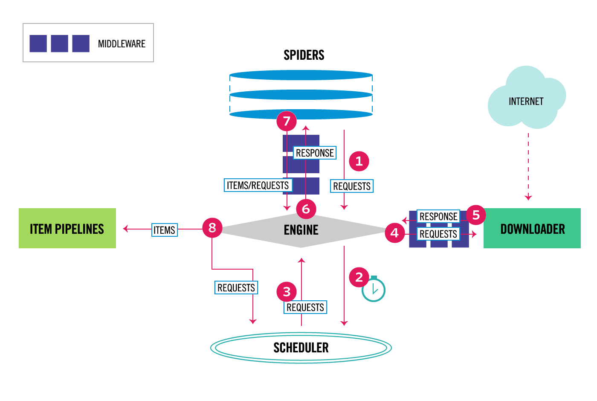

## Giới thiệu framework crawler Scrapy

Khi bạn đã viết rất nhiều chương trình crawler, bạn sẽ nhận thấy rằng mỗi lần viết một chương trình crawler mới, bạn đều phải triển khai lại từ đầu đến cuối các công việc: lấy trang web, phân tích trang web, điều phối crawler, xử lý ngoại lệ, xử lý chống thu thập dữ liệu (anti-crawler). Trong đó có rất nhiều công việc thực chất chỉ là những thao tác lặp đi lặp lại đơn giản và tẻ nhạt. Vậy có cách nào để nâng cao hiệu suất viết mã crawler của chúng ta không? Câu trả lời chắc chắn là có, đó chính là tận dụng các framework crawler. Trong tất cả các framework crawler, Scrapy có lẽ là framework phổ biến và mạnh mẽ nhất.

### Tổng quan về Scrapy

Scrapy là một framework crawler mạng rất phổ biến dựa trên Python, có thể dùng để thu thập dữ liệu các website và trích xuất dữ liệu có cấu trúc từ các trang web. Hình ảnh dưới đây minh họa kiến trúc cơ bản của Scrapy, bao gồm các thành phần chính và quy trình xử lý dữ liệu của hệ thống (các mũi tên màu đỏ có đánh số trong hình).



#### Các thành phần của Scrapy

Trước tiên, chúng ta hãy nói về các thành phần trong Scrapy.

1. **Scrapy Engine (Động cơ)**: Dùng để điều khiển quy trình xử lý dữ liệu của toàn bộ hệ thống.
2. **Scheduler (Bộ điều phối)**: Bộ điều phối nhận các yêu cầu (request) từ Engine và sắp xếp chúng vào hàng đợi, đồng thời trả chúng lại cho Engine khi Engine yêu cầu.
3. **Downloader (Bộ tải xuống)**: Nhiệm vụ chính của Downloader là tải các trang web và trả nội dung trang web về cho Spider (Spiders).
4. **Spiders (Bộ thu thập dữ liệu)**: Spider là các lớp do người dùng tùy biến nhằm phân tích cú pháp trang web và trích xuất các URL cụ thể. Mỗi Spider có thể xử lý một tên miền hoặc một nhóm tên miền, nói một cách đơn giản thì đây là module dùng để định nghĩa các quy tắc thu thập và phân tích cú pháp cho các trang web cụ thể.
5. **Item Pipeline (Đường ống dữ liệu)**: Nhiệm vụ chính của Pipeline là xử lý các mục dữ liệu (Item) được Spider trích xuất từ trang web, nhiệm vụ chính của nó là làm sạch, xác thực và lưu trữ dữ liệu. Khi trang web được Spider phân tích cú pháp xong, các mục dữ liệu sẽ được gửi đến Item Pipeline và trải qua một số bước xử lý theo thứ tự định sẵn. Mỗi thành phần Item Pipeline là một lớp Python, chúng nhận các mục dữ liệu và thực thi phương thức xử lý các mục dữ liệu đó, đồng thời cần xác định xem có tiếp tục thực hiện bước tiếp theo trong pipeline hay loại bỏ trực tiếp mà không xử lý. Các nhiệm vụ thường được Item Pipeline thực hiện bao gồm: làm sạch dữ liệu HTML, xác thực dữ liệu đã phân tích cú pháp (kiểm tra xem mục dữ liệu có chứa các trường bắt buộc hay không), kiểm tra xem có phải là dữ liệu trùng lặp hay không (nếu trùng lặp thì loại bỏ), lưu trữ dữ liệu đã phân tích cú pháp vào cơ sở dữ liệu (cơ sở dữ liệu quan hệ hoặc NoSQL).
6. **Middlewares (Phần mềm trung gian)**: Middleware là một khung cơ chế hook nằm giữa Engine và các thành phần khác, chủ yếu nhằm cung cấp mã tùy biến để mở rộng chức năng của Scrapy, bao gồm Downloader Middleware và Spider Middleware.

#### Quy trình xử lý dữ liệu

Toàn bộ quy trình xử lý dữ liệu của Scrapy được điều khiển bởi Engine, quy trình vận hành thông thường bao gồm các bước sau:

1. Engine hỏi Spider cần xử lý trang web nào và yêu cầu Spider bàn giao URL đầu tiên cần xử lý cho nó.

2. Engine yêu cầu Scheduler đưa URL cần xử lý vào hàng đợi.

3. Engine lấy trang tiếp theo cần cào từ Scheduler.

4. Scheduler trả về URL cần cào tiếp theo cho Engine, Engine chuyển nó qua Downloader Middleware đến Downloader.

5. Khi trang web được Downloader tải xong, nội dung phản hồi (response) sẽ được gửi đến Engine thông qua Downloader Middleware; nếu tải thất bại, Engine sẽ thông báo cho Scheduler ghi lại URL này để thử tải lại sau.

6. Engine nhận được response từ Downloader và chuyển nó qua Spider Middleware đến Spider để xử lý.

7. Spider xử lý response và trả về các mục dữ liệu đã thu thập được, ngoài ra còn gửi các URL mới cần theo dõi tiếp theo cho Engine.

8. Engine đưa các mục dữ liệu đã thu thập được vào Item Pipeline, đồng thời gửi các URL mới cho Scheduler để đưa vào hàng đợi.

Từ bước 2 đến bước 8 ở trên sẽ lặp lại liên tục cho đến khi trong Scheduler không còn URL nào cần yêu cầu nữa, crawler sẽ dừng hoạt động.

### Cài đặt và sử dụng Scrapy

Có thể sử dụng công cụ quản lý gói của Python là `pip` để cài đặt Scrapy:

```Shell
pip install scrapy
```

Sử dụng lệnh `scrapy` trong dòng lệnh để tạo một dự án có tên là `demo`:

```Bash
scrapy startproject demo
```

Cấu trúc thư mục của dự án như sau:

```Shell
demo
|____ demo
|________ spiders
|____________ __init__.py
|________ __init__.py
|________ items.py
|________ middlewares.py
|________ pipelines.py
|________ settings.py
|____ scrapy.cfg
```

Chuyển vào thư mục `demo` và sử dụng lệnh sau để tạo một spider có tên là `douban`:

```Bash
scrapy genspider douban movie.douban.com
```

#### Một ví dụ đơn giản

Tiếp theo, chúng ta sẽ triển khai một crawler để cào tiêu đề, điểm đánh giá và câu trích dẫn tiêu biểu của Top 250 phim trên Douban.

1. Định nghĩa các trường trong lớp `Item` của tệp `items.py`, các trường này được sử dụng để lưu trữ dữ liệu, thuận tiện cho các thao tác tiếp theo.

   ```Python
   import scrapy


   class DoubanItem(scrapy.Item):
       title = scrapy.Field()
       score = scrapy.Field()
       motto = scrapy.Field()
   ```

2. Sửa đổi tệp `douban.py` trong thư mục `spiders`, đây là cốt lõi của chương trình spider, chúng ta cần thêm mã phân tích cú pháp trang web vào đây. Tại đây, chúng ta có thể phân tích cú pháp đối tượng `Response` để lấy thông tin phim, đoạn mã như sau:

   ```Python
   import scrapy
   from scrapy import Selector, Request
   from scrapy.http import HtmlResponse

   from demo.items import MovieItem


   class DoubanSpider(scrapy.Spider):
       name = 'douban'
       allowed_domains = ['movie.douban.com']
       start_urls = ['https://movie.douban.com/top250?start=0&filter=']

       def parse(self, response: HtmlResponse):
           sel = Selector(response)
           movie_items = sel.css('#content > div > div.article > ol > li')
           for movie_sel in movie_items:
               item = MovieItem()
               item['title'] = movie_sel.css('.title::text').extract_first()
               item['score'] = movie_sel.css('.rating_num::text').extract_first()
               item['motto'] = movie_sel.css('.inq::text').extract_first()
               yield item
   ```
   Qua đoạn mã trên, không khó để nhận thấy chúng ta có thể sử dụng CSS selector để phân tích cú pháp trang web. Tất nhiên, nếu muốn, bạn cũng có thể sử dụng XPath hoặc biểu thức chính quy (regex) để phân tích trang, các phương thức tương ứng lần lượt là `xpath` và `re`.

   Nếu muốn tiếp tục tạo các yêu cầu thu thập tiếp theo, chúng ta có thể dùng `yield` để sinh ra đối tượng `Request`. Đối tượng `Request` có hai thuộc tính rất quan trọng: một là `url` đại diện cho địa chỉ cần yêu cầu; hai là `callback` đại diện cho hàm callback sẽ được thực thi sau khi nhận được phản hồi. Chúng ta có thể chỉnh sửa đoạn mã trên một chút:

   ```Python
   import scrapy
   from scrapy import Selector, Request
   from scrapy.http import HtmlResponse

   from demo.items import MovieItem


   class DoubanSpider(scrapy.Spider):
       name = 'douban'
       allowed_domains = ['movie.douban.com']
       start_urls = ['https://movie.douban.com/top250?start=0&filter=']

       def parse(self, response: HtmlResponse):
           sel = Selector(response)
           movie_items = sel.css('#content > div > div.article > ol > li')
           for movie_sel in movie_items:
               item = MovieItem()
               item['title'] = movie_sel.css('.title::text').extract_first()
               item['score'] = movie_sel.css('.rating_num::text').extract_first()
               item['motto'] = movie_sel.css('.inq::text').extract_first()
               yield item

           hrefs = sel.css('#content > div > div.article > div.paginator > a::attr("href")')
           for href in hrefs:
               full_url = response.urljoin(href.extract())
               yield Request(url=full_url)
   ```

   Đến đây, chúng ta đã có thể cho crawler chạy bằng lệnh sau:

   ```Shell
   scrapy crawl movie
   ```

   Bạn có thể xem dữ liệu thu thập được trong console. Nếu muốn lưu những dữ liệu này vào tệp, bạn có thể chỉ định tên tệp thông qua tham số `-o`, Scrapy hỗ trợ chúng ta xuất dữ liệu thu thập được thành các định dạng như JSON, CSV, XML, v.v.

   ```Shell
   scrapy crawl movie -o result.json
   ```

   Không biết mọi người có để ý thấy rằng tệp JSON thu được khi chạy crawler có `275` mục dữ liệu hay không, đó là do trang đầu tiên đã bị cào lặp lại. Để giải quyết vấn đề này, chúng ta có thể điều chỉnh mã ở trên một chút: không phân tích cú pháp để lấy URL của trang mới trong phương thức `parse` nữa, mà chuẩn bị trước URL của các trang cần cào thông qua phương thức `start_requests`. Đoạn mã sau khi điều chỉnh như sau:

   ```Python
   import scrapy
   from scrapy import Selector, Request
   from scrapy.http import HtmlResponse

   from demo.items import MovieItem


   class DoubanSpider(scrapy.Spider):
       name = 'douban'
       allowed_domains = ['movie.douban.com']

       def start_requests(self):
           for page in range(10):
               yield Request(url=f'https://movie.douban.com/top250?start={page * 25}')

       def parse(self, response: HtmlResponse):
           sel = Selector(response)
           movie_items = sel.css('#content > div > div.article > ol > li')
           for movie_sel in movie_items:
               item = MovieItem()
               item['title'] = movie_sel.css('.title::text').extract_first()
               item['score'] = movie_sel.css('.rating_num::text').extract_first()
               item['motto'] = movie_sel.css('.inq::text').extract_first()
               yield item
   ```

3. Nếu muốn lưu trữ bền vững (persist) dữ liệu crawler, chúng ta có thể xử lý các đối tượng `Item` do spider tạo ra trong Item Pipeline. Ví dụ: chúng ta có thể thao tác với tệp Excel thông qua thư viện `openpyxl` đã giới thiệu trước đó và ghi dữ liệu vào tệp Excel, đoạn mã như sau:

   ```Python
   import openpyxl

   from demo.items import MovieItem


   class MovieItemPipeline:

       def __init__(self):
           self.wb = openpyxl.Workbook()
           self.sheet = self.wb.active
           self.sheet.title = 'Top250'
           self.sheet.append(('Tên phim', 'Điểm đánh giá', 'Câu nói kinh điển'))

       def process_item(self, item: MovieItem, spider):
           self.sheet.append((item['title'], item['score'], item['motto']))
           return item

       def close_spider(self, spider):
           self.wb.save('du_lieu_phim_douban.xlsx')
   ```

   Các phương thức `process_item` và `close_spider` ở trên đều là các phương thức callback (hàm hook), nói một cách đơn giản là các phương thức mà framework Scrapy sẽ tự động gọi. Khi chương trình spider tạo ra một đối tượng `Item` và bàn giao cho Engine, Engine sẽ chuyển đối tượng `Item` đó cho Item Pipeline, lúc này phương thức `process_item` của Item Pipeline mà chúng ta đã cấu hình sẽ được thực thi, do đó chúng ta có thể lấy dữ liệu và hoàn thành thao tác lưu trữ dữ liệu tại phương thức này. Một phương thức khác là `close_spider` sẽ tự động thực thi trước khi crawler kết thúc hoạt động; trong đoạn code trên, chúng ta đã thực hiện thao tác lưu tệp Excel tại đây, tin rằng đoạn mã này rất dễ hiểu đối với mọi người.

   Tóm lại, Item Pipeline có thể giúp chúng ta thực hiện các thao tác sau:

   - Làm sạch dữ liệu HTML, xác thực dữ liệu thu thập được.
   - Loại bỏ các nội dung trùng lặp không cần thiết.
   - Thực hiện thao tác lưu trữ bền vững các kết quả đã thu thập.

4. Sửa đổi tệp `settings.py` để cấu hình dự án, chủ yếu cần sửa đổi một số cấu hình sau:

   ```Python
   # User-Agent trình duyệt của người dùng
   USER_AGENT = 'Mozilla/5.0 (Macintosh; Intel Mac OS X 10_14_6) AppleWebKit/537.36 (KHTML, like Gecko) Chrome/92.0.4515.159 Safari/537.36'

   # Số lượng yêu cầu đồng thời
   CONCURRENT_REQUESTS = 4

   # Độ trễ tải xuống
   DOWNLOAD_DELAY = 3
   # Ngẫu nhiên hóa độ trễ tải xuống
   RANDOMIZE_DOWNLOAD_DELAY = True

   # Có tuân thủ giao thức robots.txt hay không
   ROBOTSTXT_OBEY = True

   # Cấu hình Item Pipeline
   ITEM_PIPELINES = {
      'demo.pipelines.MovieItemPipeline': 300,
   }
   ```

   > **Giải thích**: Tùy chọn `ITEM_PIPELINES` trong tệp cấu hình trên là một từ điển (dict), có thể cấu hình nhiều pipeline để xử lý dữ liệu. Con số phía sau đại diện cho mức độ ưu tiên thực thi, số càng nhỏ thì thực thi càng trước.
