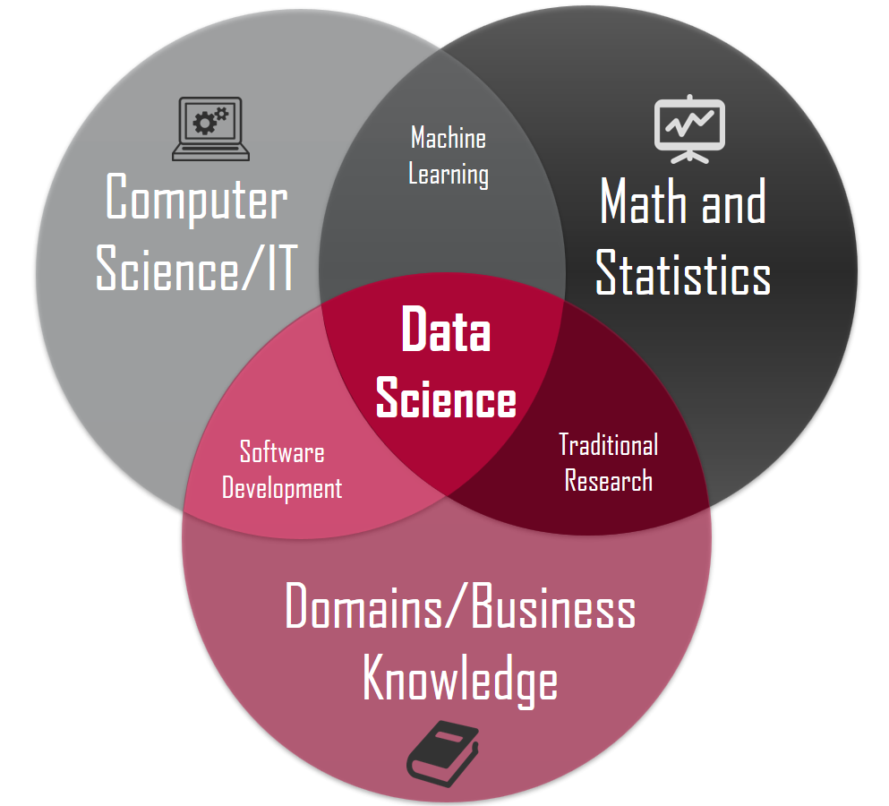
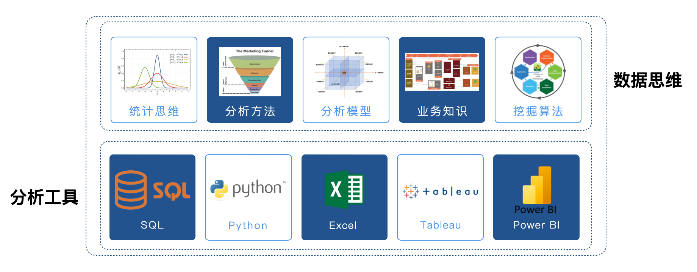

## Tổng quan về phân tích dữ liệu

Trong thế giới ngày nay, mức độ phụ thuộc của các ngành nghề vào công nghệ thông tin ngày càng sâu sắc, mỗi ngày đều có một lượng dữ liệu khổng lồ được tạo ra. Chúng ta thường cảm thấy dữ liệu ngày càng nhiều, nhưng để phát hiện ra thông tin có giá trị từ đó thì ngày càng khó khăn. Thông tin được nhắc đến ở đây có thể hiểu là kết quả sau khi xử lý tập dữ liệu, là thứ được chắt lọc từ tập dữ liệu có thể dùng để hỗ trợ và định hướng việc ra quyết định. Quá trình **trích xuất thông tin có giá trị từ dữ liệu thô** này được chúng ta gọi là **phân tích dữ liệu**, và nó là một phần cấu thành quan trọng của khoa học dữ liệu.

> **Định nghĩa 1**: Phân tích dữ liệu là một ngành khoa học thu thập, gia công, xử lý dữ liệu có chủ đích và áp dụng các kỹ thuật như thống kê, khai phá dữ liệu để khám phá, phân tích, trực quan hóa và diễn giải dữ liệu.
>
> **Định nghĩa 2**: Phân tích dữ liệu là hoạt động thông qua việc thu thập, sắp xếp và phân tích dữ liệu nhằm trích xuất thông tin có giá trị và góc nhìn sâu sắc (insight), từ đó hỗ trợ việc ra quyết định và tối ưu hóa các quy trình. (GPT-4o)
>
> **Định nghĩa 3**: Phân tích dữ liệu là quá trình thu thập, sắp xếp, xử lý, kiểm định và diễn giải dữ liệu một cách có hệ thống, từ đó trích xuất thông tin có giá trị, đưa ra kết luận và hỗ trợ việc ra quyết định. Cốt lõi của nó là sử dụng các phương pháp thống kê, thuật toán và tư duy logic để làm sáng tỏ các quy luật, xu hướng hoặc mối liên hệ tiềm ẩn đằng sau dữ liệu. (DeepSeek)

Đối với những người muốn làm công việc phân tích dữ liệu, cần phải nắm vững kỹ năng ở hai phần: một là "tư duy dữ liệu", hai là "công cụ phân tích", như hình bên dưới.

Trong hình trên, phần công cụ phân tích thực ra tương đối dễ nắm bắt. Những ngôn ngữ lập trình như SQL hoặc Python, chỉ cần trải qua quá trình học tập bài bản và luyện tập thích hợp, đa số mọi người đều có thể làm chủ được; những công cụ kinh doanh thông minh (BI) như Power BI hay Tableau thậm chí còn cho phép chúng ta hoàn thành việc trực quan hóa dữ liệu chỉ bằng các thao tác "kéo thả", từ đó đưa ra các insight kinh doanh, độ khó khi tiếp cận sẽ còn thấp hơn. Ngược lại, phần nội dung về tư duy dữ liệu đối với hầu hết người mới lại không hề dễ nắm bắt. Ví dụ như "tư duy thống kê", nhiều người khi còn đi học đều từng học qua các môn như "Xác suất và Thống kê", nhưng khi đối mặt với các tình huống nghiệp vụ thực tế thì lại rất khó liên kết những kiến thức này vào bài toán nghiệp vụ để giải quyết vấn đề thực tế. Ngoài ra, nếu không nắm vững các phương pháp phân tích cơ bản, không hiểu các mô hình phân tích phổ biến, không tích lũy kiến thức nghiệp vụ liên quan, thì ngay cả khi có trong tay bao nhiêu dữ liệu hữu ích đi chăng nữa, chúng ta cũng sẽ cảm thấy lúng túng không biết bắt đầu từ đâu, càng không nói đến việc tạo ra các insight nghiệp vụ để khám phá giá trị thương mại. Vì vậy, đối với phần tư duy dữ liệu, ngoài việc học tập bài bản các kiến thức và kỹ năng liên quan, bạn còn cần phải không ngừng tích lũy và trau dồi trong các tình huống nghiệp vụ thực tế.

### Trách nhiệm của chuyên viên phân tích dữ liệu

Khi bộ phận nhân sự (HR) đăng tuyển dụng, thông thường các vị trí như kỹ sư dữ liệu (Data Engineer), phân tích dữ liệu (Data Analyst), khai phá dữ liệu (Data Mining), v.v. đều được gọi chung là vị trí phân tích dữ liệu. Tuy nhiên tùy theo tính chất công việc, vị trí này lại có thể chia thành **hướng quản trị dữ liệu (Data Governance)** thiên về kỹ thuật công trình, **hướng phân tích kinh doanh (Business Analytics)** thiên về nghiệp vụ, **hướng khai phá dữ liệu (Data Mining)** thiên về thuật toán, **hướng phát triển dữ liệu (Data Development)** thiên về ứng dụng, và **quản lý sản phẩm dữ liệu (Data Product Manager)** thiên về sản phẩm. Chuyên viên phân tích dữ liệu mà chúng ta thường nói chủ yếu chỉ **chuyên viên phân tích dữ liệu nghiệp vụ (Business Data Analyst)**. Rất nhiều chuyên viên phân tích dữ liệu bắt đầu sự nghiệp của mình từ vị trí này, và đây cũng là vị trí có số lượng tuyển dụng nhiều nhất. Một số công ty sẽ phân bổ chuyên viên phân tích dữ liệu nghiệp vụ vào các phòng ban nghiệp vụ cụ thể (marketing, vận hành, sản phẩm, v.v.), một số công ty có phòng ban dữ liệu chuyên biệt (đội ngũ phân tích dữ liệu hoặc khoa học dữ liệu), và một số công ty có chuyên viên phân tích dữ liệu phục vụ trực tiếp cho việc ra quyết định của cấp quản lý cấp cao, thuộc bộ phận chiến lược doanh nghiệp. Chính vì vậy, khi thấy các trang web tuyển dụng gọi chuyên viên phân tích dữ liệu là **vận hành dữ liệu (Data Operations)**, **chuyên viên phân tích kinh doanh (Business Analyst)**, **kỹ sư BI (BI Engineer)** thì bạn cũng không nên ngạc nhiên. Thông thường, mô tả công việc (JD) của vị trí chuyên viên phân tích dữ liệu nghiệp vụ trên các trang tuyển dụng sẽ bao gồm:

1. Chịu trách nhiệm xuất các báo cáo liên quan.
2. Xây dựng và tối ưu hóa hệ thống chỉ số (metric/KPI).
3. Giám sát sự biến động và bất thường của dữ liệu, tìm ra vấn đề.
4. Tối ưu hóa và thúc đẩy hoạt động kinh doanh, đẩy mạnh vận hành số hóa.
5. Tìm kiếm thị trường tiềm năng và không gian tăng trưởng cho sản phẩm.

Theo mô tả ở trên, với tư cách là chuyên viên phân tích dữ liệu nghiệp vụ, công việc của chúng ta không phải là đưa ra một kết luận đơn giản, hời hợt, mà là kết hợp với hoạt động kinh doanh của công ty để hoàn thành các công việc như **giám sát dữ liệu**, **tìm ra điểm bất thường**, **tìm kiếm nguyên nhân**, **khám phá xu hướng**. Cho dù bạn dùng ngôn ngữ Python, Excel, Tableau, SPSS hay bất kỳ công cụ BI nào khác, công cụ chỉ là phương tiện để đạt được mục tiêu, **tư duy dữ liệu mới là kỹ năng cốt lõi**, và xuất phát từ các vấn đề nghiệp vụ thực tế để cuối cùng **khám phá ra giá trị thương mại trong dữ liệu** mới là mục tiêu tối hậu. Chuyên viên phân tích dữ liệu ở nhiều công ty chỉ là vị trí khởi đầu cơ bản, những chuyên viên am hiểu sâu sắc về nghiệp vụ có thể phát triển lên các vị trí quản lý như **Trưởng nhóm phân tích dữ liệu** hoặc **Giám đốc vận hành dữ liệu**; đối với những chuyên viên am hiểu thuật toán học máy, họ có thể phát triển theo hướng **Kỹ sư khai phá dữ liệu** hoặc **Chuyên gia thuật toán**. Những vị trí này ngoài việc đòi hỏi kiến thức toán học và thống kê tương ứng, còn có yêu cầu cao hơn về năng lực lập trình so với chuyên viên phân tích dữ liệu, thậm chí có thể cần kinh nghiệm lưu trữ và xử lý dữ liệu lớn (Big Data).

Ở đây cũng xin nói thêm về một số hướng khác: vị trí quản trị dữ liệu chủ yếu giúp công ty xây dựng kho dữ liệu (Data Warehouse) hoặc hồ dữ liệu (Data Lake), thực hiện chuyển giao dữ liệu từ các hệ thống nghiệp vụ, hệ thống theo dõi hành vi (tracking), hệ thống log vào kho dữ liệu hoặc hồ dữ liệu, cung cấp cơ sở hạ tầng cho việc phân tích và khai phá dữ liệu tiếp theo. Vị trí quản trị dữ liệu có yêu cầu rất cao về SQL và HiveSQL, đòi hỏi sử dụng thành thạo các công cụ ETL, ngoài ra còn cần có hiểu biết tốt về hệ sinh thái Hadoop. Đối với vai trò Data Product Manager, ngoài bộ kỹ năng của một Product Manager truyền thống, họ cũng cần có năng lực kỹ thuật vững vàng, ví dụ như cần hiểu rõ các thuật toán gợi ý phổ biến, các mô hình học máy, có khả năng cung cấp căn cứ để cải tiến thuật toán, có thể xây dựng các quy chuẩn và định nghĩa thống kê về tracking. Mặc dù không cần phải tinh thông mọi thuật toán, nhưng họ phải đứng ở góc độ sản phẩm để cân nhắc tính khả thi khi đưa mô hình dữ liệu, chỉ số, thuật toán vào áp dụng thực tế.

### Bộ kỹ năng của chuyên viên phân tích dữ liệu

Bộ kỹ năng của chuyên viên phân tích dữ liệu bao gồm cả kỹ năng cứng và kỹ năng mềm, dưới đây là cách nhìn nhận của tôi về vị trí này, chỉ mang tính chất tham khảo:

1. Khoa học máy tính (công cụ phân tích dữ liệu, ngôn ngữ lập trình, cơ sở dữ liệu)
2. Toán học và thống kê (tư duy dữ liệu, tư duy thống kê)
3. Trí tuệ nhân tạo (thuật toán học máy và học sâu)
4. Khả năng thấu hiểu nghiệp vụ (giao tiếp, diễn đạt, kinh nghiệm)
5. Khả năng tổng kết và trình bày (tổng kết, báo cáo, bài thuyết trình kinh doanh PPT)

Tất nhiên, đối với một người mới, không thể trong thời gian ngắn mà nắm vững toàn bộ nội dung của bộ kỹ năng này, nhưng khi công việc ngày càng đi sâu, ít nhiều bạn cũng sẽ tiếp xúc tới những điều kể trên. Mọi người có thể đào sâu vào một hoặc một vài kỹ năng cụ thể tùy theo nhu cầu công việc thực tế của mình.

### Quy trình phân tích dữ liệu chung

Khi nhắc đến từ phân tích dữ liệu, nhiều khi chúng ta có thể đang ám chỉ **phân tích dữ liệu theo nghĩa hẹp**. Mục tiêu chính của loại hình phân tích dữ liệu này là tạo ra các báo cáo trực quan và thông qua các báo cáo đó để nhận ra vấn đề trong kinh doanh; công việc này thường mang tính trễ (lagging). **Phân tích dữ liệu theo nghĩa rộng** còn bao gồm cả phần khai phá dữ liệu, không chỉ thông qua dữ liệu để giám sát và phân tích hoạt động kinh doanh, mà còn phải tận dụng các thuật toán học máy nhằm tìm ra tri thức tiềm ẩn đằng sau dữ liệu, và dùng tri thức đó để hỗ trợ cho các quyết định trong tương lai, mang tính dự báo đón đầu nhất định.

Công việc phân tích dữ liệu cơ bản thường bao gồm các nội dung sau, tất nhiên có thể hơi khác biệt tùy theo ngành nghề và tính chất công việc:

1. Xác định mục tiêu (Input): Hiểu nghiệp vụ, xác định định nghĩa và phương pháp tính chỉ số
2. Thu thập dữ liệu: Kho dữ liệu, bảng tính, API bên thứ ba, web crawler, tập dữ liệu mở, v.v.
3. Làm sạch dữ liệu: Xử lý giá trị còn thiếu, giá trị trùng lặp, giá trị ngoại lai và các tiền xử lý khác (định dạng, rời rạc hóa, nhị phân hóa, v.v.)
4. Xoay chuyển và tổng hợp dữ liệu: Sắp xếp, thống kê, nhóm và tổng hợp, bảng chéo, pivot table, v.v.
5. Trình bày dữ liệu (Output): Trực quan hóa dữ liệu, công bố thành quả công việc (báo cáo phân tích dữ liệu)
6. Đưa ra insight phân tích (Hậu kỳ): Giải thích sự thay đổi của dữ liệu, đề xuất phương án tương ứng

Công việc khai phá dữ liệu chuyên sâu thường bao gồm các nội dung sau, tất nhiên cũng sẽ có chút khác biệt tùy theo ngành nghề và tính chất công việc:

1. Xác định mục tiêu (Input): Hiểu nghiệp vụ, xác định rõ mục tiêu khai phá
2. Chuẩn bị dữ liệu: Thu thập dữ liệu, mô tả dữ liệu, khám phá dữ liệu, đánh giá chất lượng, v.v.
3. Gia công dữ liệu: Trích xuất dữ liệu, làm sạch dữ liệu, biến đổi dữ liệu, mã hóa đặc biệt, giảm chiều, chọn đặc trưng, v.v.
4. Xây dựng mô hình: So sánh mô hình, chọn mô hình, áp dụng thuật toán
5. Đánh giá mô hình: Kiểm định chéo (cross-validation), tinh chỉnh tham số, đánh giá kết quả
6. Triển khai mô hình (Output): Đưa mô hình vào thực tế, cải tiến nghiệp vụ, giám sát vận hành, viết báo cáo

### Các thư viện liên quan đến phân tích dữ liệu

Sử dụng Python để làm các công việc liên quan đến phân tích dữ liệu là một lựa chọn hết sức tuyệt vời. Trước hết, ngôn ngữ Python rất dễ tiếp cận, hơn nữa trong toàn bộ hệ sinh thái Python có rất nhiều gói phần mềm và thư viện công cụ hoàn thiện dành cho khoa học dữ liệu. Khác với các ngôn ngữ lập trình khoa học dữ liệu khác (như Julia, R, v.v.), Python ngoài ứng dụng trong khoa học dữ liệu còn có thể làm được rất nhiều công việc khác.

#### Bộ ba công cụ kinh điển

1. [NumPy](https://numpy.org/): Hỗ trợ các thao tác phổ biến trên mảng và ma trận, thực hiện đóng gói mảng đa chiều thông qua lớp `ndarray`, cung cấp các phương thức và hàm để thao tác trên các mảng này. Do NumPy tích hợp sẵn chức năng tính toán song song, khi sử dụng CPU đa nhân, NumPy sẽ tự động thực hiện tính toán song song.
2. [Pandas](https://pandas.pydata.org/): Cốt lõi của pandas là các cấu trúc dữ liệu đặc thù `DataFrame` và `Series`, điều này giúp pandas có thể xử lý các bảng dữ liệu và chuỗi thời gian chứa các kiểu dữ liệu khác nhau, đây là điều mà `ndarray` của NumPy không làm được. Sử dụng pandas, bạn có thể tải nhiều định dạng dữ liệu khác nhau một cách dễ dàng và mượt mà, sau đó thực hiện các thao tác cắt lát, chia khối, định hình lại, làm sạch, tổng hợp, hiển thị dữ liệu, v.v.
3. [Matplotlib](https://matplotlib.org/): matplotlib là thư viện chứa nhiều module vẽ đồ thị khác nhau, có khả năng tạo ra các biểu đồ chất lượng cao dựa trên dữ liệu chúng ta cung cấp. Ngoài ra, matplotlib còn cung cấp module pylab chứa rất nhiều thành phần vẽ đồ thị tương tự như [MATLAB](https://www.mathworks.com/products/matlab.html).

#### Các thư viện liên quan khác

1. [SciPy](https://scipy.org/): Hoàn thiện các chức năng của NumPy, đóng gói một lượng lớn các thuật toán tính toán khoa học, bao gồm đại số tuyến tính, kiểm định thống kê, ma trận thưa, xử lý tín hiệu và hình ảnh, bài toán tối ưu hóa, biến đổi Fourier nhanh (FFT), v.v.
2. [Polars](https://pola.rs/): Thư viện phân tích dữ liệu hiệu năng cao, được thiết kế nhằm cung cấp các thao tác dữ liệu nhanh hơn so với pandas. Nó hỗ trợ xử lý dữ liệu quy mô lớn và có khả năng tận dụng CPU đa nhân để tăng tốc tính toán, có thể dùng thay thế pandas khi xử lý các tập dữ liệu lớn.
3. [Seaborn](https://seaborn.pydata.org/): seaborn là công cụ trực quan hóa đồ họa dựa trên matplotlib. Mặc dù sử dụng trực tiếp matplotlib có thể tùy biến ra những biểu đồ thống kê đẹp mắt, nhưng nhìn chung vẫn chưa đủ đơn giản và tiện lợi; seaborn tương đương với một lớp bọc (wrapper) cho matplotlib, giúp người dùng tạo ra các biểu đồ thống kê hấp dẫn một cách ngắn gọn và hiệu quả hơn.
4. [Scikit-learn](https://scikit-learn.org/): scikit-learn ban đầu là một phần của SciPy, cung cấp rất nhiều công cụ có thể dùng trong học máy, bao gồm tiền xử lý dữ liệu, học có giám sát (phân loại, hồi quy), học không giám sát (phân cụm), chọn mô hình, kiểm định chéo, v.v.
5. [Statsmodels](https://www.statsmodels.org/stable/index.html): Thư viện chứa các thuật toán thống kê cổ điển và kinh tế lượng, giúp người dùng thực hiện các tác vụ như khám phá dữ liệu, phân tích hồi quy, kiểm định giả thuyết, v.v.
6. [PySpark](https://spark.apache.org/): Phiên bản Python của Apache Spark (công cụ xử lý dữ liệu lớn), dùng để xử lý dữ liệu quy mô lớn và tính toán phân tán, có khả năng làm sạch, biến đổi và phân tích dữ liệu hiệu quả cao trong môi trường phân tán.
7. [TensorFlow](https://www.tensorflow.org/): TensorFlow là framework học sâu mã nguồn mở do Google phát triển, chủ yếu hướng tới các tác vụ học sâu, thường dùng để xây dựng và huấn luyện các mô hình học máy (đặc biệt là các mô hình mạng nơ-ron phức tạp).
8. [Keras](https://keras.io/): Keras là API mạng nơ-ron bậc cao, chủ yếu dùng để xây dựng và huấn luyện mô hình học sâu. Keras rất phù hợp với người mới bắt đầu học sâu và các nhà nghiên cứu vì nó giúp việc xây dựng và huấn luyện mạng nơ-ron trở nên đơn giản hơn nhiều.
9. [PyTorch](https://pytorch.org/): PyTorch là framework học sâu mã nguồn mở do Facebook (nay là Meta) phát triển, được sử dụng rộng rãi trong môi trường nghiên cứu và sản xuất. PyTorch là framework rất được ưa chuộng trong nghiên cứu học sâu, được ứng dụng rộng rãi trong các lĩnh vực như thị giác máy tính, xử lý ngôn ngữ tự nhiên, v.v.
10. [NLTK](https://www.nltk.org/) / [SpaCy](https://spacy.io/): Các thư viện xử lý ngôn ngữ tự nhiên (NLP).
