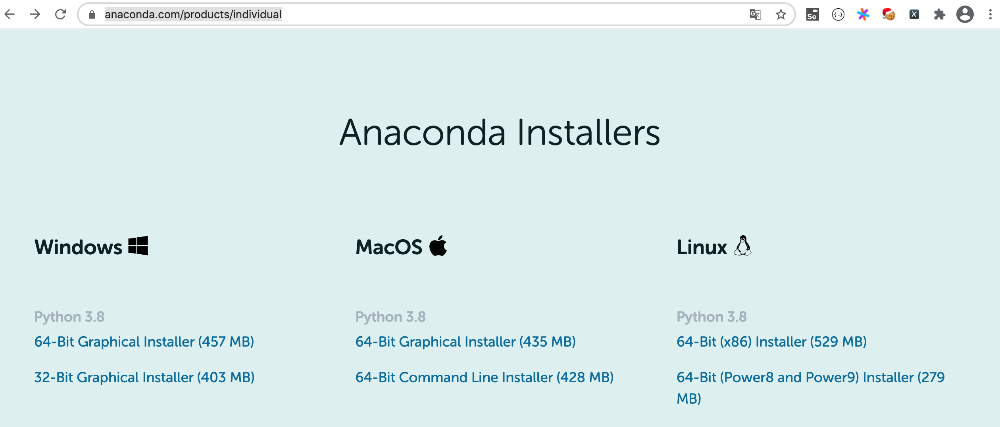
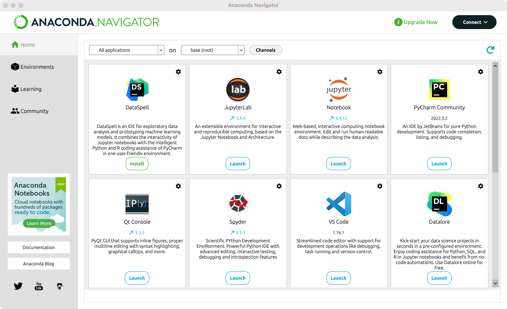
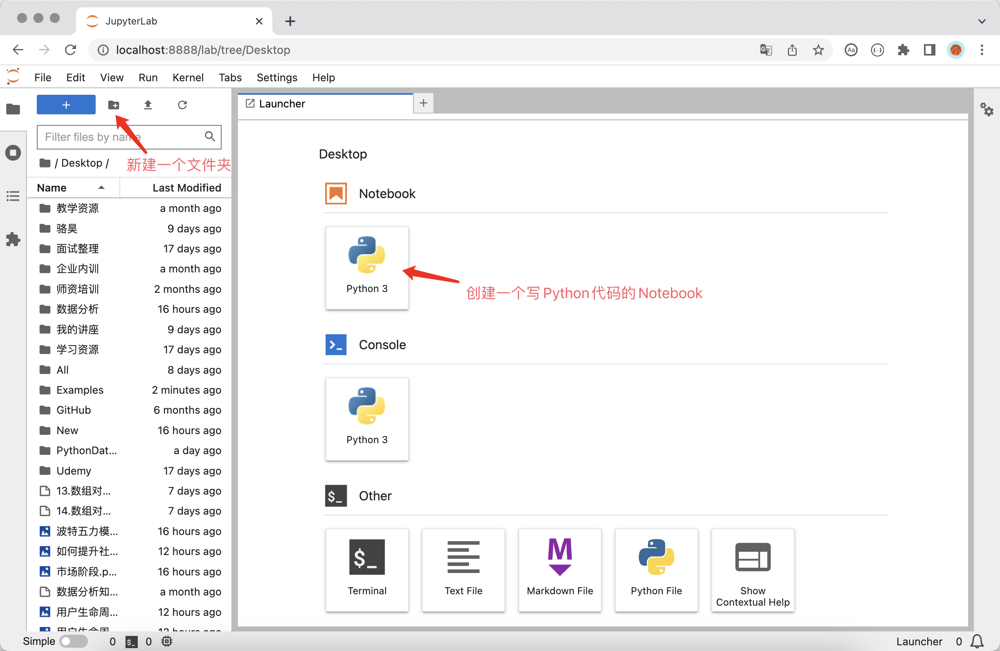
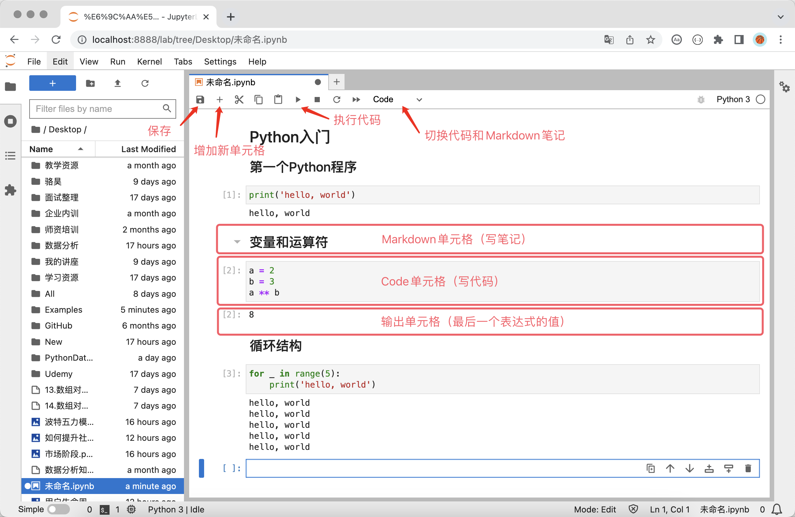
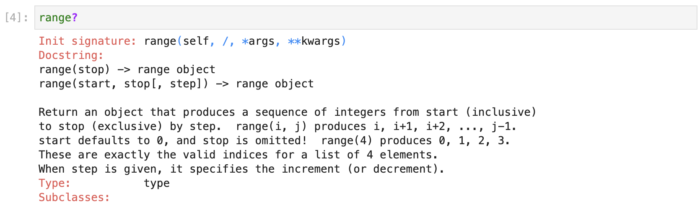
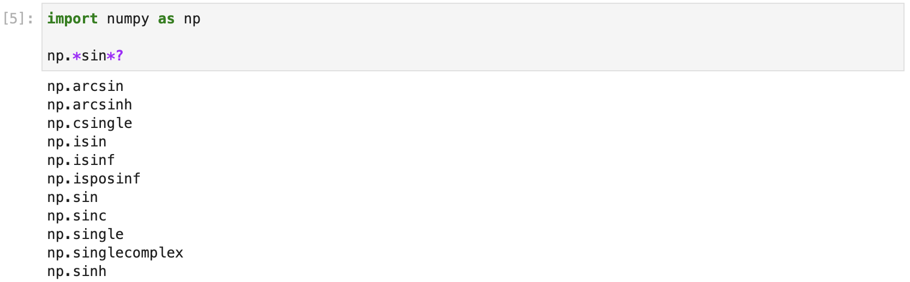
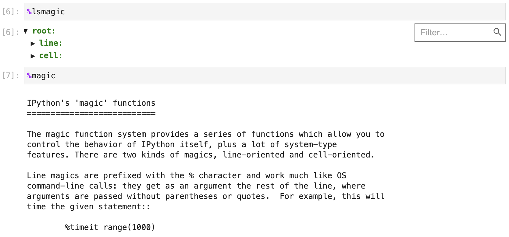

## Chuẩn bị môi trường

Nếu muốn nhanh chóng bắt đầu sử dụng Python để xử lý các công việc liên quan đến khoa học dữ liệu, bạn nên cài đặt trực tiếp Anaconda, sau đó sử dụng công cụ Notebook hoặc JupyterLab được tích hợp trong Anaconda để viết mã. Bởi vì đối với người mới bắt đầu, việc cài đặt trình thông dịch Python chính thức trước, sau đó lần lượt cài đặt từng thư viện bên thứ ba được sử dụng trong công việc sẽ tương đối rắc rối, đặc biệt là trong môi trường Windows, thường xuyên xảy ra lỗi cài đặt do thiếu công cụ xây dựng (build tools) hoặc tệp DLL, và người mới bắt đầu thường rất khó thực hiện các biện pháp giải quyết chính xác dựa trên thông báo lỗi, dễ dẫn đến cảm giác thất vọng nặng nề. Nếu trên máy tính đã có sẵn môi trường trình thông dịch Python, bạn cũng có thể sử dụng trực tiếp công cụ quản lý gói của Python là pip để cài đặt Jupyter, sau đó cài đặt các thư viện bên thứ ba theo nhu cầu công việc thực tế, cách này phù hợp với những người dùng đã có kinh nghiệm nhất định.

### Cài đặt và sử dụng Anaconda

Đối với người dùng cá nhân, bạn có thể tải trình cài đặt "Phiên bản cá nhân (Individual Edition)" từ [trang web chính thức](https://www.anaconda.com/) của Anaconda. Sau khi cài đặt hoàn tất, máy tính của bạn không chỉ có môi trường Python và Spyder (công cụ IDE tương tự như PyCharm) mà còn có gần 200 gói công cụ liên quan đến công việc khoa học dữ liệu, bao gồm cả bộ ba công cụ phân tích dữ liệu Python đã đề cập ở trên. Ngoài ra, Anaconda còn cung cấp một công cụ quản lý gói có tên là conda, qua công cụ này bạn không chỉ có thể quản lý các gói công cụ Python mà còn có thể dùng để tạo các môi trường ảo để chạy chương trình Python.



Như hình trên, bạn có thể chọn trình cài đặt phù hợp với hệ điều hành của mình thông qua liên kết tải xuống được cung cấp trên trang web chính thức của Anaconda. Khuyên bạn nên chọn trình cài đặt đồ họa (GUI), sau khi tải xuống hoàn tất hãy nhấp đúp vào trình cài đặt để bắt đầu cài đặt. Quá trình cài đặt cơ bản chỉ cần sử dụng các cài đặt mặc định là được. Sau khi cài đặt xong, người dùng macOS có thể tìm thấy ứng dụng có tên "Anaconda-Navigator" trong "Applications" hoặc "Launchpad", chạy ứng dụng này sẽ thấy giao diện như hình bên dưới, chúng ta có thể chọn thao tác cần thực hiện tại đây.



Đối với người dùng Windows, bạn nên làm theo lời nhắc của trình hướng dẫn cài đặt và các tùy chọn được đề xuất để cài đặt Anaconda (ngoài đường dẫn cài đặt thì cơ bản không có gì cần chọn lựa nhiều). Sau khi hoàn tất cài đặt, bạn có thể tìm thấy "Anaconda3" trong "Start Menu".

> **Gợi ý**: Bạn có thể chọn Miniconda để thay thế cho Anaconda, Miniconda chỉ cài đặt môi trường trình thông dịch Python và một số công cụ cần thiết, các thư viện bên thứ ba khác do người dùng tự chọn cài đặt. **Thực ra cá nhân tôi không thích Anaconda lắm, vì nó dành cho người dùng mới bắt đầu, khi đã có môi trường Python thì chúng ta hoàn toàn có thể tự cài các thư viện bên thứ ba cần thiết theo ý muốn của mình**.

#### Lệnh conda

Đối với người dùng không còn là người mới bắt đầu, nếu muốn sử dụng công cụ conda để quản lý các phụ thuộc hoặc tạo môi trường ảo cho dự án, bạn có thể sử dụng lệnh conda trong terminal hoặc dấu nhắc lệnh. Người dùng Windows có thể tìm "Anaconda3" trong "Start Menu", sau đó nhấp vào "Anaconda Prompt" hoặc "Anaconda PowerShell" để khởi chạy dấu nhắc lệnh hỗ trợ conda. Nếu người dùng mới muốn tạo môi trường ảo mới hoặc quản lý các thư viện bên thứ ba (phụ thuộc), bạn nên sử dụng trực tiếp mục "Environments" trong "Anaconda-Navigator" để quản lý môi trường ảo và phụ thuộc theo cách trực quan.

1. Thông tin phiên bản và trợ giúp:

    - Xem phiên bản: `conda -V` hoặc `conda --version`
    - Nhận trợ giúp: `conda -h` hoặc `conda --help`
    - Thông tin liên quan: `conda list`

2. Thao tác liên quan đến môi trường ảo:

    - Hiển thị tất cả môi trường ảo: `conda env list`
    - Tạo môi trường ảo: `conda create --name venv`
    - Chỉ định phiên bản Python khi tạo môi trường ảo: `conda create --name venv python=3.7`
    - Chỉ định phiên bản Python và cài đặt các phụ thuộc chỉ định khi tạo môi trường ảo: `conda create --name venv python=3.7 numpy pandas`
    - Tạo môi trường ảo bằng cách nhân bản môi trường ảo hiện có: `conda create --name venv2 --clone venv`
    - Chia sẻ môi trường ảo và chuyển hướng ra tệp chỉ định: `conda env export > environment.yml`
    - Tạo môi trường ảo thông qua tệp môi trường ảo được chia sẻ: `conda env create -f environment.yml`
    - Kích hoạt môi trường ảo: `conda activate venv`
    - Thoát môi trường ảo: `conda deactivate`
    - Xóa môi trường ảo: `conda remove --name venv --all`

    > **Giải thích**: Trong các lệnh trên, `venv` và `venv2` là tên của thư mục môi trường ảo, bạn có thể thay thế bằng tên mình thích, nhưng **khuyến nghị mạnh mẽ** nên dùng tiếng Anh và không chứa ký tự đặc biệt.

3. Quản lý gói (thư viện bên thứ ba hoặc công cụ):

    - Xem các gói đã cài đặt: `conda list`
    - Tìm kiếm gói chỉ định: `conda search matplotlib`
    - Cài đặt gói chỉ định: `conda install matplotlib`
    - Cập nhật gói chỉ định: `conda update matplotlib`
    - Gỡ bỏ gói chỉ định: `conda remove matplotlib`

    > **Giải thích**: Khi tìm kiếm, cài đặt và cập nhật các gói phần mềm, mặc định conda sẽ kết nối tới trang web chính thức để thực hiện thao tác. Nếu thấy tốc độ tải chậm, bạn có thể thay thế trang web chính thức mặc định bằng các trang mirror nội địa (tại Trung Quốc), khuyên dùng trang mirror mã nguồn mở của Đại học Thanh Hoa. Lệnh để đổi nguồn mặc định sang mirror là: `conda config --add channels https://mirrors.tuna.tsinghua.edu.cn/anaconda/pkgs/free/` và `conda config --add channels https://mirrors.tuna.tsinghua.edu.cn/anaconda/pkgs/main`. Nếu cần đổi lại nguồn mặc định, bạn có thể sử dụng lệnh `conda config --remove-key channels`.

### Cài đặt và sử dụng JupyterLab

#### Cài đặt và khởi chạy

Nếu đã cài đặt Anaconda, bạn có thể khởi chạy trực tiếp Notebook hoặc JupyterLab trong "Anaconda-Navigator" theo cách đã nêu ở trên. Theo thông báo chính thức, JupyterLab là thế hệ tiếp theo của Notebook, cung cấp giao diện thân thiện hơn và các tính năng mạnh mẽ hơn, chúng tôi cũng khuyên mọi người nên sử dụng JupyterLab. Người dùng Windows cũng có thể mở "Anaconda Prompt" hoặc "Anaconda PowerShell" trong Start Menu, do môi trường ảo mặc định của Anaconda đã được kích hoạt sẵn nên bạn chỉ cần nhập lệnh `jupyter lab` để khởi chạy JupyterLab. Hệ thống macOS sau khi cài đặt Anaconda, mỗi lần mở terminal sẽ tự động kích hoạt môi trường ảo mặc định của Anaconda, bạn cũng chỉ cần nhập lệnh `jupyter lab` là có thể khởi chạy JupyterLab.

Đối với người dùng đã cài đặt môi trường Python nhưng chưa cài đặt Anaconda, bạn có thể sử dụng công cụ quản lý gói `pip` của Python để cài đặt JupyterLab. Sau khi cài đặt thành công, hãy thực thi lệnh `jupyter lab` trong terminal hoặc dấu nhắc lệnh để khởi chạy JupyterLab như sau:

Cài đặt JupyterLab:

```Bash
pip install jupyterlab
```

Cài đặt bộ ba công cụ phân tích dữ liệu Python kinh điển:

```Bash
pip install numpy pandas matplotlib
```

Khởi chạy JupyterLab:

```Bash
jupyter lab
```

JupyterLab là một ứng dụng tính toán tương tác dựa trên nền tảng web, có thể dùng để phát triển mã nguồn, viết tài liệu, chạy mã và hiển thị kết quả. Nói một cách đơn giản, bạn có thể trực tiếp **viết mã** và **chạy mã** trên trang web, kết quả chạy mã cũng sẽ được hiển thị ngay bên dưới khối mã. Nếu trong quá trình viết mã cần viết tài liệu giải thích, bạn có thể viết bằng định dạng Markdown trên cùng một trang và có thể xem trực tiếp kết quả sau khi render. Ngoài ra, mục đích ban đầu của Notebook là cung cấp một môi trường làm việc có thể hỗ trợ nhiều ngôn ngữ lập trình, hiện tại nó có thể hỗ trợ hơn 40 ngôn ngữ lập trình, bao gồm Python, R, Julia, Scala, v.v.

Đầu tiên, chúng ta có thể tạo một Notebook để viết mã Python như hình bên dưới:



Tiếp theo, chúng ta có thể bắt đầu viết mã, soạn tài liệu và chạy chương trình như hình bên dưới:



#### Mẹo sử dụng

Nếu sử dụng Python để phát triển dự án theo hướng công nghiệp phần mềm, PyCharm chắc chắn là sự lựa chọn tốt nhất. Nó cung cấp tất cả các chức năng mà một môi trường phát triển tích hợp (IDE) cần có, đặc biệt là các chức năng như gợi ý thông minh, tự động hoàn thành mã, tự động sửa lỗi sẽ giúp lập trình viên cảm thấy vô cùng thoải mái. Nếu sử dụng Python để làm các công việc liên quan đến khoa học dữ liệu, JupyterLab không hề thua kém PyCharm, thậm chí ở khía cạnh hiển thị dữ liệu và biểu đồ thì JupyterLab còn xuất sắc hơn. Vì lý do này, công ty JetBrains còn đặc biệt phát triển một công cụ mới có tên DataSpell để cạnh tranh trực tiếp với JupyterLab, độc giả quan tâm có thể tự tìm hiểu thêm. Dưới đây, chúng tôi sẽ giới thiệu cho các bạn một số mẹo sử dụng JupyterLab nhằm giúp nâng cao hiệu suất làm việc.

1. Tự động hoàn thành: Khi sử dụng JupyterLab để viết mã, nhấn phím `Tab` sẽ nhận được tính năng gợi ý và hoàn thành mã.

2. Nhận trợ giúp: Nếu muốn tìm hiểu thông tin liên quan hoặc cách sử dụng của một đối tượng (như biến, lớp, hàm, v.v.), bạn có thể dùng dấu `?` phía sau đối tượng đó và chạy ô mã, phía dưới cửa sổ sẽ hiển thị thông tin tương ứng giúp chúng ta hiểu rõ về đối tượng đó, như sau:

    

3. Tìm kiếm theo tên: Nếu chỉ nhớ một phần tên của một lớp hoặc hàm, bạn có thể sử dụng ký tự đại diện `*` kết hợp với `?` để tìm kiếm, như sau:

    

4. Gọi lệnh hệ thống: Bạn có thể thực thi các lệnh hệ thống trong JupyterLab bằng cách thêm dấu `!` phía trước lệnh hệ thống.

5. Lệnh magic (ma thuật): Trong JupyterLab có rất nhiều lệnh magic vô cùng thú vị và hữu ích. Ví dụ: bạn có thể sử dụng `%timeit` để đo thời gian thực thi của câu lệnh, sử dụng `%pwd` để xem thư mục làm việc hiện tại, v.v. Nếu muốn xem tất cả các lệnh magic, bạn có thể sử dụng `%lsmagic`; nếu muốn tìm hiểu cách sử dụng của các lệnh magic, bạn có thể sử dụng `%magic` để xem, như hình bên dưới:

    

    Các lệnh magic thường dùng gồm có:

    | Lệnh magic | Chức năng |
    | ------------------------------------------- | ------------------------------------------ |
    | `%pwd` | Xem thư mục làm việc hiện tại |
    | `%ls` | Liệt kê nội dung trong thư mục hiện tại hoặc thư mục chỉ định |
    | `%cat` | Xem nội dung của tệp chỉ định |
    | `%hist` | Xem lịch sử các câu lệnh đã nhập |
    | `%matplotlib inline` | Thiết lập nhúng biểu đồ thống kê do matplotlib tạo ra vào trang web |
    | `%config Inlinebackend.figure_format='svg'` | Thiết lập biểu đồ thống kê sử dụng định dạng SVG (ảnh vector) |
    | `%run` | Chạy chương trình chỉ định |
    | `%load` | Tải tệp chỉ định vào ô code |
    | `%quickref` | Hiển thị tài liệu tham khảo nhanh về IPython |
    | `%timeit` | Chạy mã nhiều lần và thống kê thời gian thực thi mã |
    | `%prun` | Chạy mã bằng `cProfile.run` và hiển thị kết quả của bộ phân tích hiệu năng |
    | `%who` / `%whos` | Hiển thị các biến trong không gian tên |
    | `%xdel` | Xóa một đối tượng và dọn dẹp tất cả các tham chiếu đến nó |

6. Phím tắt: Rất nhiều thao tác trong JupyterLab có thể được thực hiện thông qua các phím tắt, sử dụng phím tắt có thể nâng cao hiệu suất làm việc. Phím tắt của JupyterLab có thể chia thành phím tắt trong chế độ lệnh (Command mode) và phím tắt trong chế độ chỉnh sửa (Edit mode). Chế độ chỉnh sửa là chế độ khi bạn đang ở trạng thái nhập mã hoặc viết tài liệu, trong chế độ chỉnh sửa nhấn `Esc` có thể quay lại chế độ lệnh, trong chế độ lệnh nhấn `Enter` có thể vào chế độ chỉnh sửa.

    Phím tắt trong chế độ lệnh:

    | Phím tắt | Chức năng |
    | ---------------------------------------- | -------------------------------------------- |
    | `Alt` + `Enter` | Chạy ô hiện tại và chèn một ô mới bên dưới |
    | `Shift` + `Enter` | Chạy ô hiện tại và chọn ô bên dưới |
    | `Ctrl` + `Enter` | Chạy ô hiện tại |
    | `j` / `k`, `Shift` + `j` / `Shift` + `k` | Chọn ô bên dưới / bên trên, chọn liên tiếp các ô bên dưới / bên trên |
    | `a` / `b` | Chèn ô mới ở phía trên / phía dưới |
    | `c` / `x` | Sao chép ô / Cắt ô |
    | `v` / `Shift` + `v` | Dán ô vào bên dưới / bên trên |
    | `dd` / `z` | Xóa ô / Hoàn tác xóa ô |
    | `Shift` + `l` | Hiển thị hoặc ẩn số dòng của ô hiện tại / tất cả các ô |
    | `Space` / `Shift` + `Space` | Cuộn trang xuống / lên |

    Phím tắt trong chế độ chỉnh sửa:

    | Phím tắt | Chức năng |
    | -------------------------- | -------------------------------------- |
    | `Shift` + `Tab` | Hiển thị gợi ý thông tin |
    | `Ctrl` + `]`/ `Ctrl` + `[` | Tăng / giảm thụt lề |
    | `Alt` + `Enter` | Chạy ô hiện tại và chèn một ô mới bên dưới |
    | `Shift` + `Enter` | Chạy ô hiện tại và chọn ô bên dưới |
    | `Ctrl` + `Enter` | Chạy ô hiện tại |
    | `Ctrl` + `Left` / `Right` | Di chuyển con trỏ về đầu dòng / cuối dòng |
    | `Ctrl` + `Up` / `Down` | Di chuyển con trỏ về đầu / cuối đoạn code |
    | `Up` / `Down` | Di chuyển con trỏ lên / xuống một dòng hoặc di chuyển đến ô phía trên / phía dưới |

    > **Giải thích**: Đối với hệ điều hành macOS, phím `Alt` có thể thay thế bằng phím `Option`, phím `Ctrl` có thể thay thế bằng phím `Command`.
