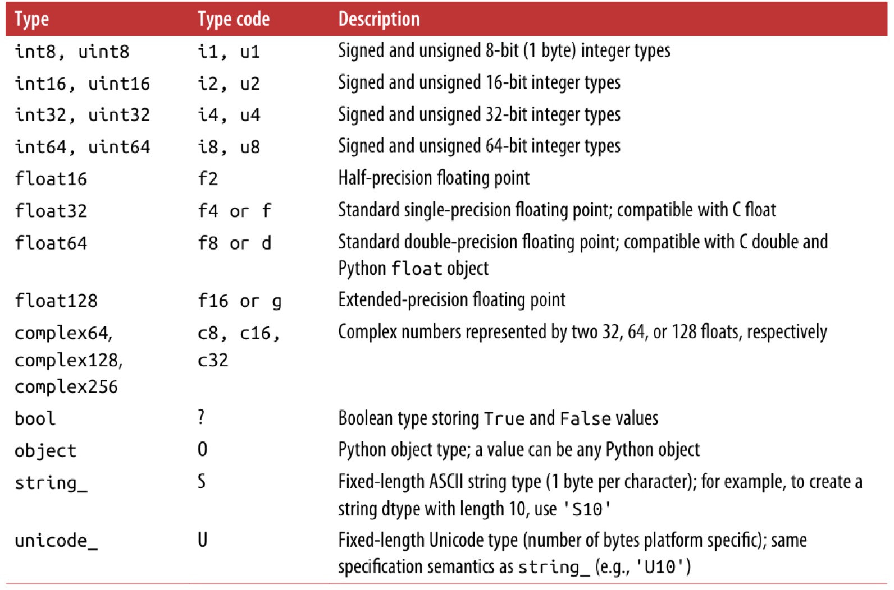
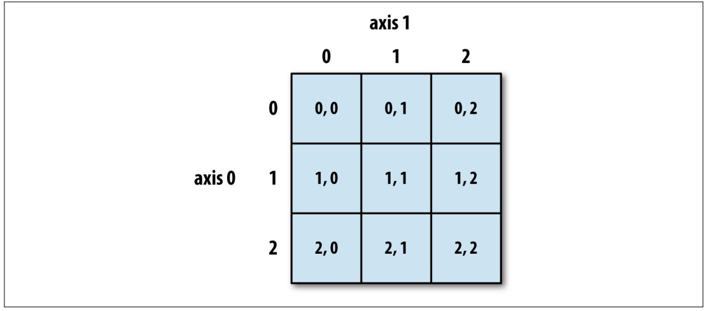
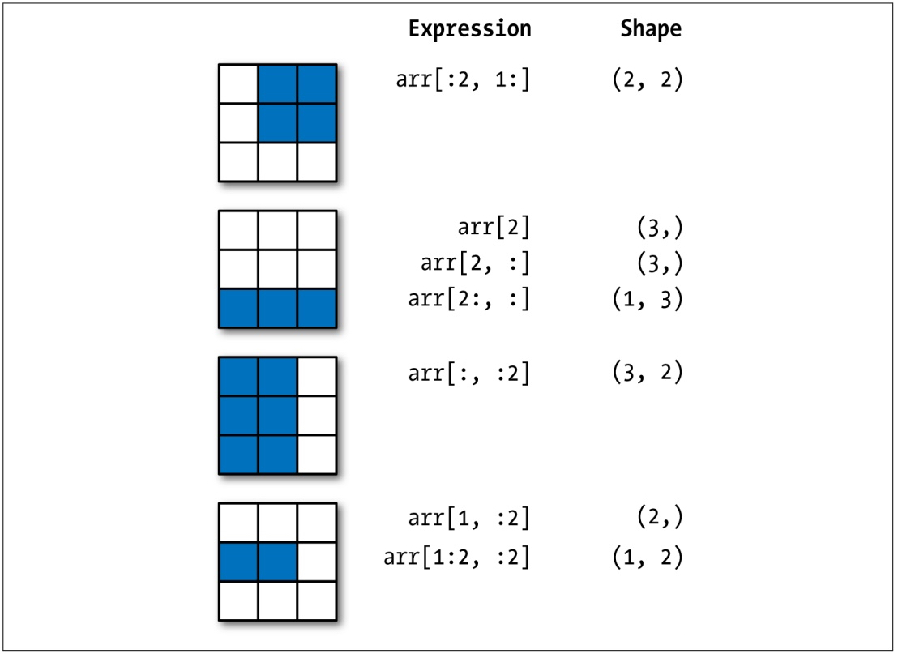
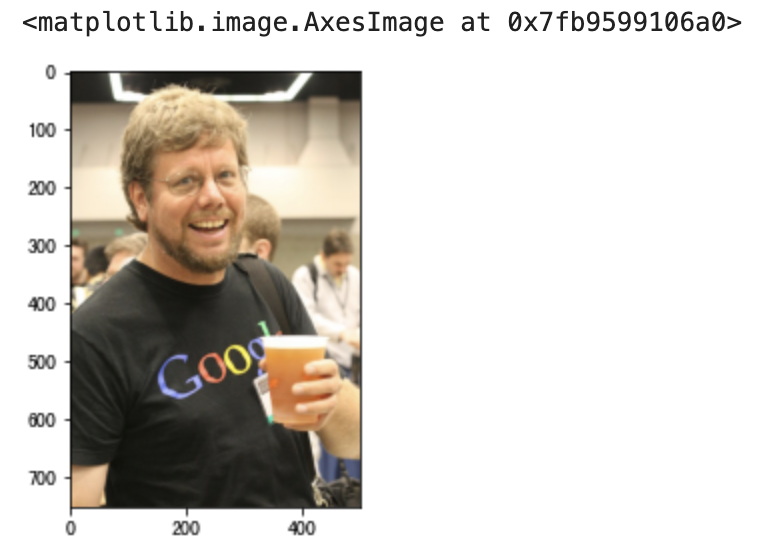
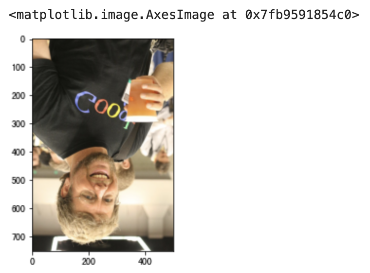
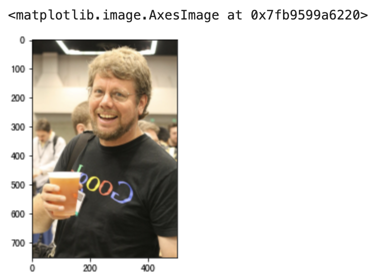
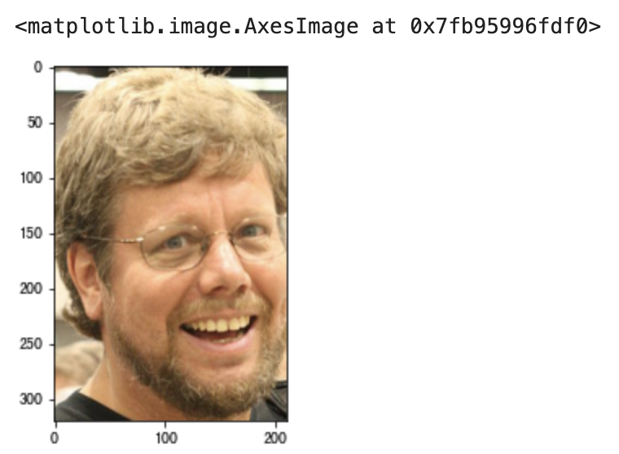
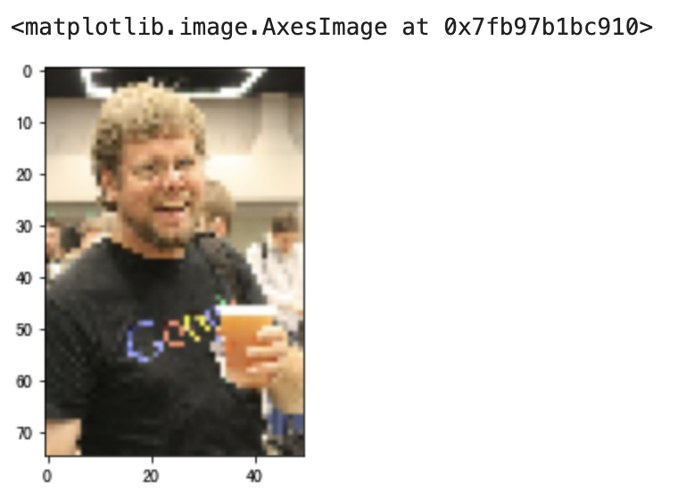

## Ứng dụng NumPy - 1

NumPy là một thư viện tính toán khoa học mã nguồn mở của Python, **được dùng để xử lý nhanh chóng các mảng với số chiều bất kỳ**. NumPy **hỗ trợ các thao tác mảng và ma trận phổ biến**. Đối với cùng một tác vụ tính toán số học, sử dụng NumPy không chỉ giúp mã nguồn ngắn gọn hơn rất nhiều mà hiệu năng của NumPy cũng vượt trội hơn hẳn so với Python thuần, chênh lệch ít nhất từ một đến hai bậc độ lớn (orders of magnitude), và lượng dữ liệu càng lớn thì ưu thế của NumPy lại càng rõ rệt.

Kiểu dữ liệu cốt lõi nhất của NumPy là `ndarray`. Sử dụng `ndarray` có thể xử lý mảng một chiều, hai chiều và đa chiều; đối tượng này tương đương với một vùng chứa dữ liệu lớn nhanh chóng và linh hoạt. Mã nguồn bên dưới của NumPy được viết bằng ngôn ngữ C, giải quyết được hạn chế của GIL. Khi `ndarray` truy xuất dữ liệu, địa chỉ giữa các phần tử dữ liệu đều liên tục, điều này đảm bảo có thể thực hiện các thao tác hàng loạt với hiệu suất cao, hiệu năng vượt trội hơn nhiều so với `list` trong Python. Mặt khác, đối tượng `ndarray` cung cấp nhiều phương thức hơn để xử lý dữ liệu, đặc biệt là các phương thức lấy đặc trưng thống kê của dữ liệu, những phương thức mà `list` nguyên bản của Python không có.

### Chuẩn bị

1. Khởi chạy JupyterLab

    ```Bash
    jupyter lab
    ```

    > **Gợi ý**: Trước khi khởi chạy JupyterLab, bạn nên cài đặt trước các phụ thuộc liên quan đến phân tích dữ liệu, bao gồm bộ ba công cụ kinh điển đã đề cập trước đó cùng các gói phụ thuộc liên quan. Nếu sử dụng Anaconda, bạn không cần cài đặt riêng lẻ mà có thể khởi chạy thông qua Navigator của Anaconda.

2. Import các thư viện

    ```Python
    import numpy as np
    import pandas as pd
    import matplotlib.pyplot as plt
    ```

    > **Giải thích**: Nếu đã khởi chạy JupyterLab nhưng chưa cài đặt các thư viện phụ thuộc liên quan, chẳng hạn như chưa cài đặt `numpy`, bạn có thể nhập `%pip install numpy` vào ô code và chạy ô đó để cài đặt NumPy. Tất nhiên, chúng ta cũng có thể nhập `%pip install numpy pandas matplotlib` vào ô code để cài đặt cả ba thư viện cốt lõi cho phân tích dữ liệu bằng Python. Lưu ý trong đoạn mã trên, chúng ta không chỉ import NumPy mà còn import cả thư viện pandas và matplotlib.

### Tạo đối tượng mảng

Có rất nhiều phương pháp để tạo đối tượng `ndarray`, dưới đây chúng tôi giới thiệu một số phương pháp thường dùng.

Phương pháp 1: Sử dụng hàm `array`, tạo đối tượng mảng thông qua `list`

Mã nguồn:

```Python
array1 = np.array([1, 2, 3, 4, 5])
array1
```

Kết quả:

```
array([1, 2, 3, 4, 5])
```

Mã nguồn:

```Python
array2 = np.array([[1, 2, 3], [4, 5, 6]])
array2
```

Kết quả:

```
array([[1, 2, 3],
       [4, 5, 6]])
```

Phương pháp 2: Sử dụng hàm `arange`, chỉ định phạm vi giá trị và bước nhảy để tạo đối tượng mảng

Mã nguồn:

```Python
array3 = np.arange(0, 20, 2)
array3
```

Kết quả:

```
array([ 0,  2,  4,  6,  8, 10, 12, 14, 16, 18])
```

Phương pháp 3: Sử dụng hàm `linspace`, tạo đối tượng mảng bằng cách chỉ định phạm vi và số lượng phần tử, tạo cấp số cộng

Mã nguồn:

```Python
array4 = np.linspace(-1, 1, 11)
array4
```

Kết quả:

```
array([-1. , -0.8, -0.6, -0.4, -0.2,  0. ,  0.2,  0.4,  0.6,  0.8,  1. ])
```

Phương pháp 4: Sử dụng hàm `logspace`, tạo cấp số nhân

Mã nguồn:

```python
array5 = np.logspace(1, 10, num=10, base=2)
array5
```

> **Lưu ý**: Giá trị bắt đầu của cấp số nhân là $\small{2^1}$, giá trị kết thúc của cấp số nhân là $\small{2^{10}}$, `num` là số lượng phần tử, `base` chính là cơ số.

Kết quả:

```
array([   2.,    4.,    8.,   16.,   32.,   64.,  128.,  256.,  512., 1024.])
```

Phương pháp 5: Trích xuất dữ liệu từ chuỗi thông qua hàm `fromstring` để tạo đối tượng mảng

Mã nguồn:

```Python
array6 = np.fromstring('1, 2, 3, 4, 5', sep=',', dtype='i8')
array6 
```

Kết quả:

```
array([1, 2, 3, 4, 5])
```

Phương pháp 6: Lấy dữ liệu từ generator (iterator) thông qua hàm `fromiter` để tạo đối tượng mảng

Mã nguồn:

```Python
def fib(how_many):
    a, b = 0, 1
    for _ in range(how_many):
        a, b = b, a + b
        yield a


gen = fib(20)
array7 = np.fromiter(gen, dtype='i8')
array7
```

Kết quả:

```
array([   1,    1,    2,    3,    5,    8,   13,   21,   34,   55,   89,
        144,  233,  377,  610,  987, 1597, 2584, 4181, 6765])
```

Phương pháp 7: Sử dụng các hàm trong module `numpy.random` tạo số ngẫu nhiên để tạo đối tượng mảng

Tạo 10 số thực ngẫu nhiên trong khoảng $\small{[0, 1)}$, mã nguồn:

```Python
array8 = np.random.rand(10)
array8
```

Kết quả:

```
array([0.45556132, 0.67871326, 0.4552213 , 0.96671509, 0.44086463,
       0.72650875, 0.79877188, 0.12153022, 0.24762739, 0.6669852 ])
```

Tạo 10 số nguyên ngẫu nhiên trong khoảng $\small{[1, 100)}$, mã nguồn:

```Python
array9 = np.random.randint(1, 100, 10)
array9
```

Kết quả:

```
array([29, 97, 87, 47, 39, 19, 71, 32, 79, 34])
```

Tạo 20 số ngẫu nhiên tuân theo phân phối chuẩn $\small{\mu=50}$, $\small{\sigma=10}$, mã nguồn:

```Python
array10 = np.random.normal(50, 10, 20)
array10
```

Kết quả:

```
array([55.04155586, 46.43510797, 20.28371158, 62.67884053, 61.23185964,
       38.22682148, 53.17126151, 43.54741592, 36.11268017, 40.94086676,
       63.27911699, 46.92688903, 37.1593374 , 67.06525656, 67.47269463,
       23.37925889, 31.45312239, 48.34532466, 55.09180924, 47.95702787])
```

Tạo mảng hai chiều gồm 3 hàng 4 cột chứa các số thực ngẫu nhiên trong khoảng $\small{[0, 1)}$, mã nguồn:

```Python
array11 = np.random.rand(3, 4)
array11
```

Kết quả:

```
array([[0.54017809, 0.46797771, 0.78291445, 0.79501326],
       [0.93973783, 0.21434806, 0.03592874, 0.88838892],
       [0.84130479, 0.3566601 , 0.99935473, 0.26353598]])
```

Tạo mảng ba chiều chứa các số nguyên ngẫu nhiên trong khoảng $\small{[1, 100)}$, mã nguồn:

```Python
array12 = np.random.randint(1, 100, (3, 4, 5))
array12
```

Kết quả:

```
array([[[94, 26, 49, 24, 43],
        [27, 27, 33, 98, 33],
        [13, 73,  6,  1, 77],
        [54, 32, 51, 86, 59]],

       [[62, 75, 62, 29, 87],
        [90, 26,  6, 79, 41],
        [31, 15, 32, 56, 64],
        [37, 84, 61, 71, 71]],

       [[45, 24, 78, 77, 41],
        [75, 37,  4, 74, 93],
        [ 1, 36, 36, 60, 43],
        [23, 84, 44, 89, 79]]])
```

Phương pháp 8: Tạo mảng toàn số 0, toàn số 1 hoặc phần tử chỉ định

Sử dụng hàm `zeros`, mã nguồn:

```Python
array13 = np.zeros((3, 4))
array13
```

Kết quả:

```
array([[0., 0., 0., 0.],
       [0., 0., 0., 0.],
       [0., 0., 0., 0.]])
```

Sử dụng hàm `ones`, mã nguồn:

```Python
array14 = np.ones((3, 4))
array14
```

Kết quả:

```
array([[1., 1., 1., 1.],
       [1., 1., 1., 1.],
       [1., 1., 1., 1.]])
```

Sử dụng hàm `full`, mã nguồn:

```Python
array15 = np.full((3, 4), 10)
array15
```

Kết quả:

```
array([[10, 10, 10, 10],
       [10, 10, 10, 10],
       [10, 10, 10, 10]])
```

Phương pháp 9: Sử dụng hàm `eye` tạo ma trận đơn vị

Mã nguồn:

```Python
np.eye(4)
```

Kết quả:

```
array([[1., 0., 0., 0.],
       [0., 1., 0., 0.],
       [0., 0., 1., 0.],
       [0., 0., 0., 1.]])
```

Phương pháp 10: Đọc hình ảnh để nhận mảng ba chiều tương ứng

Mã nguồn:

```Python
array16 = plt.imread('guido.jpg')
array16
```

Kết quả:

```
array([[[ 36,  33,  28],
        [ 36,  33,  28],
        [ 36,  33,  28],
        ...,
        [ 32,  31,  29],
        [ 32,  31,  27],
        [ 31,  32,  26]],

       [[ 37,  34,  29],
        [ 38,  35,  30],
        [ 38,  35,  30],
        ...,
        [ 31,  30,  28],
        [ 31,  30,  26],
        [ 30,  31,  25]],

       [[ 38,  35,  30],
        [ 38,  35,  30],
        [ 38,  35,  30],
        ...,
        [ 30,  29,  27],
        [ 30,  29,  25],
        [ 29,  30,  25]],

       ...,

       [[239, 178, 123],
        [237, 176, 121],
        [235, 174, 119],
        ...,
        [ 78,  68,  56],
        [ 75,  67,  54],
        [ 73,  65,  52]],

       [[238, 177, 120],
        [236, 175, 118],
        [234, 173, 116],
        ...,
        [ 82,  70,  58],
        [ 78,  68,  56],
        [ 75,  66,  51]],

       [[238, 176, 119],
        [236, 175, 118],
        [234, 173, 116],
        ...,
        [ 84,  70,  61],
        [ 81,  69,  57],
        [ 79,  67,  53]]], dtype=uint8)
```

> **Giải thích**: Đoạn mã trên đọc tệp hình ảnh có tên `guido.jpg` trong thư mục hiện tại. Hình ảnh trong hệ thống máy tính thường được tạo thành từ nhiều hàng và nhiều cột điểm ảnh (pixel), và mỗi điểm ảnh lại được tạo thành từ ba màu cơ bản đỏ, lục, lam (RGB), vừa vặn có thể dùng mảng ba chiều để biểu diễn. Thao tác đọc ảnh sử dụng hàm `imread` của thư viện `matplotlib`.

### Thuộc tính của đối tượng mảng

Thuộc tính `size`: Lấy số lượng phần tử của mảng.

Mã nguồn:

```Python
array17 = np.arange(1, 100, 2)
array18 = np.random.rand(3, 4)
print(array16.size)
print(array17.size)
print(array18.size)
```

Kết quả:

```
1125000
50
12
```

Thuộc tính `shape`: Lấy hình dạng (kích thước các chiều) của mảng.

Mã nguồn:

```Python
print(array16.shape)
print(array17.shape)
print(array18.shape)
```

Kết quả:

```
(750, 500, 3)
(50,)
(3, 4)
```

Thuộc tính `dtype`: Lấy kiểu dữ liệu của các phần tử trong mảng.

Mã nguồn:

```Python
print(array16.dtype)
print(array17.dtype)
print(array18.dtype)
```

Kết quả:

```
uint8
int64
float64
```

Kiểu dữ liệu của các phần tử trong đối tượng `ndarray` có thể tham khảo bảng dưới đây.



Thuộc tính `ndim`: Lấy số chiều của mảng.

Mã nguồn:

```Python
print(array16.ndim)
print(array17.ndim)
print(array18.ndim)
```

Kết quả:

```
3
1
2
```

Thuộc tính `itemsize`: Lấy kích thước bộ nhớ (tính theo byte) mà một phần tử đơn lẻ của mảng chiếm dụng.

Mã nguồn:

```Python
print(array16.itemsize)
print(array17.itemsize)
print(array18.itemsize)
```

Kết quả:

```
1
8
8
```

Thuộc tính `nbytes`: Lấy tổng kích thước bộ nhớ (tính theo byte) mà tất cả các phần tử của mảng chiếm dụng.

Mã nguồn:

```Python
print(array16.nbytes)
print(array17.nbytes)
print(array18.nbytes)
```

Kết quả:

```
1125000
400
96
```

### Thao tác lập chỉ mục trên mảng

Tương tự như danh sách (list) trong Python, đối tượng `ndarray` của NumPy có thể thực hiện các thao tác lập chỉ mục (indexing) và cắt lát (slicing). Thông qua chỉ mục có thể lấy hoặc sửa đổi các phần tử trong mảng; thông qua thao tác cắt lát có thể lấy ra một phần của mảng, chúng ta cũng gọi thao tác cắt lát là chỉ mục cắt lát.

#### Chỉ mục thông thường

Tương tự như phép toán lập chỉ mục của kiểu `list` trong Python.

Mã nguồn:

```Python
array19 = np.arange(1, 10)
print(array19[0], array19[array19.size - 1])
print(array19[-array20.size], array19[-1])
```

Kết quả:

```
1 9
1 9
```

Mã nguồn:

```Python
array20 = np.array([[1, 2, 3], [4, 5, 6], [7, 8, 9]])
array20[2]
```

Kết quả:

```
array([7, 8, 9])
```

Mã nguồn:

```Python
print(array20[0][0])
print(array20[-1][-1])
```

Kết quả:

```
1
9
```

Mã nguồn:

```Python
print(array20[1][1])
print(array20[1, 1])
```

Kết quả:

```
5
5
```

Mã nguồn:

```Python
array20[1][1] = 10
array20
```

Kết quả:

```
array([[ 1,  2,  3],
       [ 4, 10,  6],
       [ 7,  8,  9]])
```

Mã nguồn:

```Python
array20[1] = [10, 11, 12]
array20
```

Kết quả:

```
array([[ 1,  2,  3],
       [10, 11, 12],
       [ 7,  8,  9]])
```

#### Chỉ mục cắt lát

Chỉ mục cắt lát là cú pháp có dạng `[chỉ_mục_bắt_đầu:chỉ_mục_kết_thúc:bước_nhảy]`. Bằng cách chỉ định **chỉ mục bắt đầu** (mặc định là âm vô cùng), **chỉ mục kết thúc** (mặc định là dương vô cùng) và **bước nhảy** (mặc định là 1), chúng ta lấy ra các phần tử trong phần chỉ định của mảng và cấu thành mảng mới. Do chỉ mục bắt đầu, chỉ mục kết thúc và bước nhảy đều có giá trị mặc định nên chúng đều có thể bỏ qua; nếu không chỉ định bước nhảy thì dấu hai chấm thứ hai cũng có thể bỏ qua. Phép toán cắt lát trên mảng một chiều rất giống với cắt lát trên kiểu `list` trong Python nên ở đây không nhắc lại nữa. Cắt lát trên mảng hai chiều có thể tham khảo đoạn mã dưới đây, tin rằng rất dễ hiểu.

Mã nguồn:

```Python
array20[:2, 1:]
```

Kết quả:

```
array([[ 2,  3],
       [11, 12]])
```

Mã nguồn:

```Python
array20[2, :]
```

Kết quả:

```
array([7, 8, 9])
```

Mã nguồn:

```Python
array20[2:, :]
```

Kết quả:

```
array([[7, 8, 9]])
```

Mã nguồn:

```Python
array20[:, :2]
```

Kết quả:

```
array([[ 1,  2],
       [10, 11],
       [ 7,  8]])
```

Mã nguồn:

```Python
array20[::2, ::2]
```

Kết quả:

```
array([[1, 3],
       [7, 9]])
```

Mã nguồn:

```Python
array20[::-2, ::-2]
```

Kết quả:

```
array([[9, 7],
       [3, 1]])
```

Về thao tác lập chỉ mục và cắt lát mảng, các bạn có thể củng cố qua hai hình dưới đây. Hai hình này được trích từ cuốn sách [《Python for Data Analysis》](https://item.jd.com/12398725.html), đây là cuốn giáo trình kinh điển trong lĩnh vực phân tích dữ liệu bằng Python do Wes McKinney - tác giả của thư viện pandas - chấp bút. Bạn đọc quan tâm có thể tìm đọc sách gốc.

Hình 1: Chỉ mục thông thường của mảng hai chiều



Hình 2: Chỉ mục cắt lát của mảng hai chiều



#### Chỉ mục nâng cao (Fancy Indexing)

Chỉ mục nâng cao là việc sử dụng mảng chứa các số nguyên để làm chỉ mục cho một mảng. Mảng được đề cập ở đây có thể là `ndarray` của NumPy, cũng có thể là các kiểu dữ liệu có thể lặp (iterable) trong Python như `list`, `tuple`, v.v., và có thể sử dụng chỉ mục dương hoặc âm.

Mã nguồn:

```Python
array19[[0, 1, 1, -1, 4, -1]]
```

Kết quả:

```
array([1, 2, 2, 9, 5, 9])
```

Mã nguồn:

```Python
array20[[0, 2]]
```

Kết quả:

```
array([[1, 2, 3],
       [7, 8, 9]])
```

Mã nguồn:

```Python
array20[[0, 2], [1, 2]]
```

Kết quả:

```
array([2, 9])
```

Mã nguồn:

```Python
array20[[0, 2], 1]
```

Kết quả:

```
array([2, 8])
```

#### Chỉ mục boolean

Chỉ mục boolean là việc sử dụng một mảng chứa các giá trị boolean để làm chỉ mục cho một mảng; các phần tử có giá trị boolean là `True` sẽ được giữ lại, các phần tử có giá trị boolean là `False` sẽ không được chọn. Mảng giá trị boolean có thể được tạo thủ công hoặc sinh ra thông qua các phép so sánh quan hệ.

Mã nguồn:

```Python
array19[[True, True, False, False, True, False, False, True, True]]
```

Kết quả:

```
array([1, 2, 5, 8, 9])
```

Mã nguồn:

```Python
array19 > 5
```

Kết quả:

```
array([False, False, False, False, False,  True,  True,  True,  True])
```

Mã nguồn:

```Python
~(array19 > 5)
```

Kết quả:

```
array([ True,  True,  True,  True,  True, False, False, False, False])
```

> **Giải thích**: Toán tử `~` có thể thực hiện phủ định logic đối với các giá trị boolean trong mảng boolean, nghĩa là `True` ban đầu sẽ biến thành `False`, `False` ban đầu sẽ biến thành `True`.

Mã nguồn:

```Python
array19[array19 > 5]
```

Kết quả:

```
array([6, 7, 8, 9])
```

Mã nguồn:

```Python
array19 % 2 == 0
```

Kết quả:

```
array([False,  True, False,  True, False,  True, False,  True, False])
```

Mã nguồn:

```Python
array19[array19 % 2 == 0]
```

Kết quả:

```
array([2, 4, 6, 8])
```

Mã nguồn:

```Python
(array19 > 5) & (array19 % 2 == 0)
```

Kết quả:

```
array([False, False, False, False, False,  True, False,  True, False])
```

> **Giải thích**: Toán tử `&` có thể tác động lên hai mảng boolean. Nếu các phần tử tương ứng của cả hai mảng đều là `True` thì kết quả tính toán sẽ là `True`, ngược lại sẽ là `False`. Quy tắc của toán tử này tương tự như toán tử `and` trong Python, chỉ khác là đối tượng tác động là hai mảng boolean.

Mã nguồn:

```Python
array19[(array19 > 5) & (array19 % 2 == 0)]
```

Kết quả:

```
array([6, 8])
```

Mã nguồn:

```Python
array19[(array19 > 5) | (array19 % 2 == 0)]
```

Kết quả:

```
array([2, 4, 6, 7, 8, 9])
```

> **Giải thích**: Toán tử `|` có thể tác động lên hai mảng boolean. Nếu các phần tử tương ứng của cả hai mảng đều là `False` thì kết quả tính toán sẽ là `False`, ngược lại sẽ là `True`. Quy tắc của toán tử này tương tự như toán tử `or` trong Python, chỉ khác là đối tượng tác động là hai mảng boolean.

Mã nguồn:

```Python
array20[array21 % 2 != 0]
```

Kết quả:

```
array([1, 3, 5, 7, 9])
```

Một điều cần lưu ý về thao tác lập chỉ mục là mặc dù chỉ mục cắt lát tạo ra một đối tượng mảng mới, nhưng mảng mới và mảng gốc chia sẻ chung dữ liệu trong mảng (view). Nói một cách đơn giản, cho dù bạn sửa đổi dữ liệu qua đối tượng mảng mới hay đối tượng mảng gốc thì thực chất bạn đang sửa cùng một vùng dữ liệu trong bộ nhớ. Trong khi đó, chỉ mục nâng cao và chỉ mục boolean cũng tạo ra đối tượng mảng mới, nhưng mảng mới sẽ sao chép các phần tử của mảng gốc (copy), mảng mới và mảng gốc không chia sẻ dữ liệu với nhau. Điểm này có thể kiểm tra qua thuộc tính `base` của đối tượng mảng, bạn đọc quan tâm có thể tự mình tìm hiểu thêm.

### Ví dụ thực tế: Xử lý hình ảnh thông qua cắt lát mảng

Học các kiến thức cơ bản thường khá khô khan và ít mang lại cảm giác thành tựu, vì vậy chúng ta hãy cùng thực hiện một ví dụ thực tế để minh họa xem các thao tác lập chỉ mục và cắt lát mảng đã học ở trên thực sự có tác dụng gì. Trước đó chúng ta đã nói rằng có thể dùng mảng ba chiều để biểu diễn hình ảnh, vậy thì thông qua việc thao tác trên mảng ba chiều tương ứng của hình ảnh, chúng ta có thể thực hiện việc xử lý hình ảnh như dưới đây.

Đọc ảnh để tạo đối tượng mảng ba chiều.

```Python
guido_image = plt.imread('guido.jpg')
plt.imshow(guido_image)
```



Cắt lát ngược theo trục 0 của mảng để lật ảnh theo chiều dọc.

```Python
plt.imshow(guido_image[::-1])
```



Cắt lát ngược theo trục 1 của mảng để lật ảnh theo chiều ngang.

```Python
plt.imshow(guido_image[:,::-1])
```



Thực hiện cắt ảnh (crop) thông qua thao tác cắt lát để cắt lấy phần đầu của bác Guido.

```Python
plt.imshow(guido_image[30:350, 90:300])
```



Thực hiện giảm tần số lấy mẫu (downsampling) thông qua thao tác cắt lát.

```Python
plt.imshow(guido_image[::10, ::10])
```


