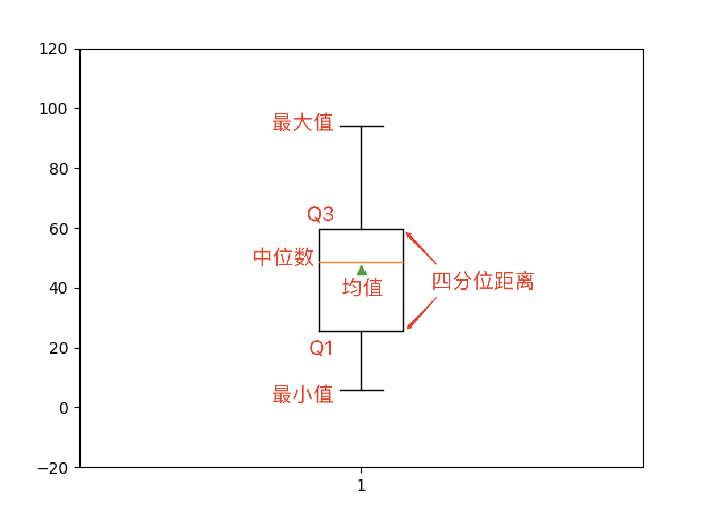
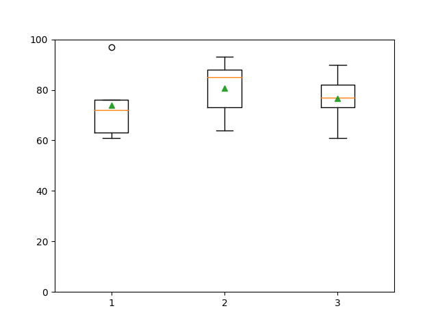

## Ứng dụng NumPy - 2

### Các phương thức của đối tượng mảng

#### Lấy thông tin thống kê mô tả

Thông tin thống kê mô tả chủ yếu bao gồm xu hướng tập trung, mức độ phân tán và phân tích tần số của dữ liệu. Trong đó, xu hướng tập trung chủ yếu dựa vào giá trị trung bình (mean) và trung vị (median); mức độ phân tán có thể dựa vào các giá trị cực trị (min, max), phương sai (variance), độ lệch chuẩn (standard deviation), v.v.

```Python
array1 = np.random.randint(1, 100, 10)
array1
```

Kết quả:

```
array([46, 51, 15, 42, 53, 71, 20, 62,  6, 94])
```

**Tính tổng, giá trị trung bình và trung vị.**

Mã nguồn:

```Python
print(array1.sum())
print(np.sum(array1))
print(array1.mean())
print(np.mean(array1))
print(np.median(array1))
print(np.quantile(array1, 0.5))
```

> **Giải thích**: `mean`, `median` và `quantile` trong đoạn mã trên lần lượt là các hàm tính giá trị trung bình số học, trung vị và phân vị trong NumPy. Trong đó tham số thứ hai của hàm `quantile` được đặt là 0.5 biểu thị việc tính phân vị 50%, tức là trung vị.

Kết quả:

```
460
460
46.0
46.0
48.5
48.5
```

**Giá trị cực trị, khoảng biến thiên (toàn cự) và khoảng tứ phân vị (IQR).**

Mã nguồn:

```Python
print(array1.max())
print(np.amax(array1))
print(array1.min())
print(np.amin(array1))
print(np.ptp(array1))
print(np.ptp(array1))
q1, q3 = np.quantile(array1, [0.25, 0.75])
print(q3 - q1)
```

Kết quả:

```
94
94
6
6
88
88
34.25
```

**Phương sai, độ lệch chuẩn và hệ số biến thiên.**

Mã nguồn:

```Python
print(array1.var())
print(np.var(array1))
print(array1.std())
print(np.std(array1))
print(array1.std() / array1.mean())
```

Kết quả:

```
651.2
651.2
25.51862065237853
25.51862065237853
0.5547526228777941
```

**Vẽ biểu đồ hộp (Boxplot).**

Biểu đồ hộp còn gọi là biểu đồ hộp và râu, là biểu đồ thống kê thể hiện độ phân tán của một tập dữ liệu, có tên gọi như vậy vì hình dạng giống như một chiếc hộp. Nó chủ yếu dùng để phản ánh các đặc trưng phân phối của dữ liệu gốc, ngoài ra còn có thể so sánh đặc trưng phân phối giữa nhiều nhóm dữ liệu.

Mã nguồn:

```Python
plt.boxplot(array1, showmeans=True)
plt.ylim([-20, 120])
plt.show()
```

Kết quả:



Đáng chú ý là đối với mảng hai chiều hoặc nhiều chiều hơn, khi lấy thông tin thống kê mô tả, bạn có thể chỉ định các phép toán như trung bình, phương sai, v.v. được thực hiện dọc theo trục nào thông qua tham số có tên là `axis`. Tham số `axis` khác nhau thì kết quả thực thi có thể rất khác biệt, như dưới đây.

Mã nguồn:

```Python
array2 = np.random.randint(60, 101, (5, 3))
array2
```

Kết quả:

```
array([[72, 64, 73],
       [61, 73, 61],
       [76, 85, 77],
       [97, 88, 90],
       [63, 93, 82]])
```

Mã nguồn:

```Python
array2.mean()
```

Kết quả:

```
77.0
```

Mã nguồn:

```Python
array2.mean(axis=0)
```

Kết quả:

```
array([73.8, 80.6, 76.6])
```

Mã nguồn:

```Python
array2.mean(axis=1)
```

Kết quả:

```
array([69.66666667, 65.        , 79.33333333, 91.66666667, 79.33333333])
```

Mã nguồn:

```Python
array2.max(axis=0)
```

Kết quả:

```
array([97, 93, 90])
```

Mã nguồn:

```Python
array2.max(axis=1)
```

Kết quả:

```
array([73, 73, 85, 97, 93])
```

Xem lại cách vẽ biểu đồ hộp, đối với mảng hai chiều, mỗi cột sẽ tạo ra một đồ thị thống kê, như sau:

Mã nguồn:

```Python
plt.boxplot(array2, showmeans=True)
plt.ylim([-20, 120])
plt.show()
```

Kết quả:



> **Giải thích**: Các hình tròn nhỏ trong biểu đồ hộp dùng để biểu thị các điểm ngoại lai (outlier), tức là các giá trị lớn hơn $\small{Q_3 + 1.5 \times IQR}$ hoặc nhỏ hơn $\small{Q_1 - 1.5 \times IQR}$. Hằng số 1.5 trong công thức có thể được sửa đổi thông qua tham số `whis` của hàm `boxplot` khi vẽ biểu đồ hộp, các giá trị thường dùng là 1.5 và 3, việc sửa thành 3 thường nhằm mục đích xác định các điểm ngoại lai cực đoan.

Cần lưu ý rằng đối tượng mảng của NumPy không cung cấp các phương thức để tính trung bình nhân, trung bình điều hòa, trung bình cắt tỉa, v.v. Nếu có nhu cầu này, bạn có thể sử dụng thư viện bên thứ ba có tên là scipy, module `stats` của nó cung cấp các hàm này. Ngoài ra, module này còn cung cấp các hàm tính yếu vị (mode), hệ số biến thiên, hệ số bất đối xứng (skewness), hệ số độ nhọn (kurtosis), đoạn mã như sau:

Mã nguồn:

```python
from scipy import stats

print(np.mean(array1))                # Trung bình số học
print(stats.gmean(array1))            # Trung bình nhân
print(stats.hmean(array1))            # Trung bình điều hòa
print(stats.tmean(array1, [10, 90]))  # Trung bình cắt tỉa
print(stats.variation(array1))        # Hệ số biến thiên
print(stats.skew(array1))             # Hệ số bất đối xứng
print(stats.kurtosis(array1))         # Hệ số độ nhọn
```

Kết quả:

```
46.0
36.22349548825599
24.497219530825497
45.0
0.5547526228777941
0.11644192634527782
-0.7106251396024126
```

#### Tổng quan về các phương thức liên quan khác

1. Phương thức `all()` / `any()`: Xác định xem tất cả các phần tử của mảng có phải là `True` hay không / xác định xem mảng có phần tử nào là `True` hay không.

2. Phương thức `astype()`: Sao chép mảng và chuyển đổi các phần tử trong mảng sang kiểu chỉ định.

3. Phương thức `reshape()`: Điều chỉnh hình dạng của đối tượng mảng.

4. Phương thức `dump()`: Lưu mảng vào tệp nhị phân, có thể tải dữ liệu để tạo mảng từ tệp đã lưu thông qua hàm `load()` trong NumPy.

    Mã nguồn:

    ```Python
    array.dump('array1-data')
    array3 = np.load('array1-data', allow_pickle=True)
    array3
    ```

    Kết quả:

    ```
    array([46, 51, 15, 42, 53, 71, 20, 62,  6, 94])
    ```

5. Phương thức `tofile()`: Ghi đối tượng mảng vào tệp.

   ```Python
   array1.tofile('array.txt', sep=',')
   ```

6. Phương thức `fill()`: Điền phần tử chỉ định vào mảng.

7. Phương thức `flatten()`: Làm phẳng mảng đa chiều thành mảng một chiều.

    Mã nguồn:

    ```Python
    array2.flatten()
    ```

    Kết quả:

    ```
    array([1, 2, 3, 4, 5, 6, 7, 8, 9])
    ```

8. Phương thức `nonzero()`: Trả về chỉ mục của các phần tử khác 0.

9. Phương thức `round()`: Làm tròn các phần tử trong mảng.

10. Phương thức `sort()`: Sắp xếp mảng tại chỗ.

    Mã nguồn:

    ```Python
    array1.sort()
    array1
    ```

    Kết quả:

    ```
    array([ 6, 15, 20, 42, 46, 51, 53, 62, 71, 94])
    ```

11. Phương thức `swapaxes()` và `transpose()`: Hoán đổi các trục chỉ định và chuyển vị mảng.

    Mã nguồn:

    ```Python
    array2.swapaxes(0, 1)
    ```

    Kết quả:

    ```
    array([[1, 4, 7],
           [2, 5, 8],
           [3, 6, 9]])
    ```

    Mã nguồn:

    ```Python
    array2.transpose()
    ```

    Kết quả:

    ```
    array([[1, 4, 7],
           [2, 5, 8],
           [3, 6, 9]])
    ```

12. Phương thức `tolist()`: Chuyển mảng thành `list` trong Python.

    Mã nguồn:

    ```Python
    print(array2.tolist())
    print(type(array2.tolist()))
    ```

    Kết quả:

    ```
    [[1, 2, 3], [4, 5, 6], [7, 8, 9]]
    <class 'list'>
    ```
