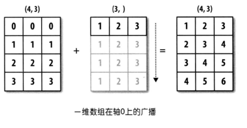
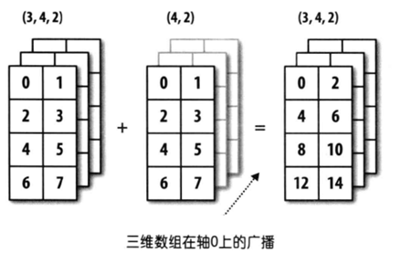
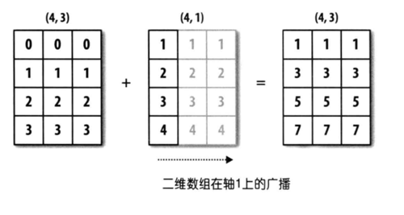

## Ứng dụng của NumPy - 3

### Phép toán trên mảng

Sử dụng NumPy thuận tiện nhất ở chỗ khi cần thực hiện phép toán trên các phần tử mảng, bạn không cần phải viết vòng lặp để duyệt qua từng phần tử, mọi phép toán đều sẽ được tự động **vector hóa (vectorization)**. Nói một cách đơn giản, các phép toán số học và hàm toán học trong NumPy sẽ tự động tác động lên từng phần tử của mảng.

#### Phép toán giữa mảng và vô hướng (scalar)

Mảng của NumPy có thể thực hiện các phép cộng, trừ, nhân, chia, lấy phần dư, lũy thừa, v.v. với một giá trị số; phép toán tương ứng sẽ tác động lên từng phần tử của mảng, như đoạn mã sau:

Mã nguồn:

```python
array1 = np.arange(1, 10)
print(array1 + 10)
print(array1 * 10)
```

Kết quả:

```
[11 12 13 14 15 16 17 18 19]
[10 20 30 40 50 60 70 80 90]
```

Ngoài các phép toán trên, các phép so sánh quan hệ cũng hoàn toàn được hỗ trợ; chúng ta đã gặp điều này khi tìm hiểu về chỉ mục boolean trước đây.

Mã nguồn:

```python
print(array1 > 5)
print(array1 % 2 == 0)
```

Kết quả:

```
[False False False False False  True  True  True  True]
[False  True False  True False  True False  True False]
```

#### Phép toán giữa mảng và mảng

Các mảng trong NumPy cũng có thể thực hiện các phép tính số học và phép so sánh quan hệ với nhau. Phép toán sẽ tác động lên các phần tử tương ứng của hai mảng, điều này đòi hỏi hai mảng phải có cùng kích thước (thuộc tính `shape`), như đoạn mã dưới đây:

Mã nguồn:

```python
array2 = np.array([1, 1, 1, 2, 2, 2, 3, 3, 3])
print(array1 + array2)
print(array1 * array2)
print(array1 ** array2)
```

Kết quả:

```
[ 2  3  4  6  7  8 10 11 12]
[ 1  2  3  8 10 12 21 24 27]
[  1   2   3  16  25  36 343 512 729]
```

Mã nguồn:

```python
print(array1 > array2)
print(array1 % array2 == 0)
```

Kết quả:

```
[False  True  True  True  True  True  True  True  True]
[ True  True  True  True False  True False False  True]
```

#### Hàm một ngôi phổ quát

Trong NumPy, tham số của hàm một ngôi phổ quát (unary ufunc) là một đối tượng mảng. Hàm sẽ xử lý trên từng phần tử của mảng (element-wise). Ví dụ: hàm `sqrt` sẽ tính căn bậc hai cho từng phần tử trong mảng, còn hàm `log2` sẽ tính logarit cơ số 2 cho từng phần tử trong mảng, như đoạn mã dưới đây:

Mã nguồn:

```python
print(np.sqrt(array1))
print(np.log2(array1))
```

Kết quả:

```
[1.         1.41421356 1.73205081 2.         2.23606798 2.44948974
 2.64575131 2.82842712 3.        ]
[0.         1.         1.5849625  2.         2.32192809 2.5849625
 2.80735492 3.         3.169925  ]
```

**Bảng 1: Các hàm một ngôi phổ quát**

| Hàm | Giải thích |
| -------------------------------- | ------------------------------------------------ |
| `abs` / `fabs` | Hàm tính giá trị tuyệt đối |
| `sqrt` | Hàm tính căn bậc hai, tương đương với `array ** 0.5 ` |
| `square` | Hàm tính bình phương, tương đương với `array ** 2` |
| `exp` | Hàm tính $\small{e^x}$, tương đương với `np.e ** array` |
| `log` / `log10` / `log2` | Hàm logarit (cơ số `e` / cơ số `10` / cơ số `2`) |
| `sign` | Hàm dấu (`1` - số dương; `0` - số không; `-1` - số âm) |
| `ceil` / `floor` | Làm tròn lên / Làm tròn xuống |
| `isnan` | Trả về mảng boolean, NaN tương ứng với `True`, không phải NaN tương ứng với `False` |
| `isfinite` / `isinf` | Hàm kiểm tra xem giá trị có phải là vô hạn hay không |
| `cos` / `cosh` / `sin` | Các hàm lượng giác |
| `sinh` / `tan` / `tanh` | Các hàm lượng giác |
| `arccos` / `arccosh` / `arcsin` | Các hàm lượng giác ngược |
| `arcsinh` / `arctan` / `arctanh` | Các hàm lượng giác ngược |
| `rint` / `round` | Hàm làm tròn số |

#### Hàm hai ngôi phổ quát

Trong NumPy, tham số của hàm hai ngôi phổ quát (binary ufunc) là hai đối tượng mảng. Hàm sẽ thực hiện phép toán trên các phần tử tương ứng của hai mảng. Ví dụ: hàm `maximum` sẽ tìm giá trị lớn nhất giữa các phần tử tương ứng của hai mảng, còn hàm `power` sẽ thực hiện phép tính lũy thừa trên các phần tử tương ứng của hai mảng, như đoạn mã dưới đây:

Mã nguồn:

```python
array3 = np.array([[4, 5, 6], [7, 8, 9]])
array4 = np.array([[1, 2, 3], [3, 2, 1]])
print(np.maximum(array3, array4))
print(np.power(array3, array4))
```

Kết quả:

```
[[4 5 6]
 [7 8 9]]
[[  4  25 216]
 [343  64   9]]
```

**Bảng 2: Các hàm hai ngôi phổ quát**

| Hàm | Giải thích |
| ---------------------------------- | ------------------------------------------------------------ |
| `add(x, y)` / `substract(x, y)` | Hàm cộng / Hàm trừ |
| `multiply(x, y)` / `divide(x, y)` | Hàm nhân / Hàm chia |
| `floor_divide(x, y)` / `mod(x, y)` | Hàm chia lấy phần nguyên / Hàm chia lấy phần dư |
| `allclose(x, y)` | Kiểm tra xem các phần tử của mảng `x` và `y` có gần như bằng nhau hay không |
| `power(x, y)` | Với phần tử $\small{x_{i}}$ của mảng `x` và phần tử $\small{y_{i}}$ của mảng `y`, tính $\small{x_{i}^{y_{i}}}$ |
| `maximum(x, y)` / `fmax(x, y)` | So sánh từng cặp phần tử để lấy giá trị lớn nhất / Lấy giá trị lớn nhất (bỏ qua NaN) |
| `minimum(x, y)` / `fmin(x, y)` | So sánh từng cặp phần tử để lấy giá trị nhỏ nhất / Lấy giá trị nhỏ nhất (bỏ qua NaN) |
| `dot(x, y)` | Tích vô hướng (dot product / scalar product, thường ký hiệu là $\small{\cdot}$, dùng trong không gian Euclid (Euclidean space)) |
| `inner(x, y)` | Tích trong (inner product, ý nghĩa của tích trong rộng hơn tích vô hướng; tích vô hướng là trường hợp đặc biệt của tích trong trong không gian Euclid $\small{\mathbb{R}^{n}}$, còn tích trong có thể mở rộng cho không gian vector định chuẩn, miễn là thỏa mãn quy tắc hình bình hành) |
| `cross(x, y) ` | Tích có hướng (cross product / vector product, thường ký hiệu là $\small{\times}$, kết quả là một vector) |
| `outer(x, y)` | Tích ngoài (outer product / tensor product, thường ký hiệu là $\small{\bigotimes}$, kết quả thường là một ma trận) |
| `intersect1d(x, y)` | Tính giao của `x` và `y`, trả về một mảng có thứ tự chứa các phần tử này |
| `union1d(x, y)` | Tính hợp của `x` và `y`, trả về một mảng có thứ tự chứa các phần tử này |
| `in1d(x, y)` | Trả về mảng boolean xác định xem từng phần tử của `x` có nằm trong `y` hay không |
| `setdiff1d(x, y)` | Tính hiệu của `x` và `y`, trả về mảng chứa các phần tử này |
| `setxor1d(x, y)` | Tính hiệu đối xứng của `x` và `y`, trả về mảng chứa các phần tử này |

> **Giải thích**: Về các phép toán trên vector và ma trận, chúng ta sẽ giải thích chi tiết hơn ở chương tiếp theo.

#### Cơ chế phát sóng (Broadcasting)

Trong các ví dụ về phép toán trên mảng ở trên, kích thước (thuộc tính `shape`) của hai mảng hoàn toàn giống nhau. Bây giờ chúng ta hãy cùng nghiên cứu xem liệu hai mảng có kích thước khác nhau có thể thực hiện trực tiếp phép toán hai ngôi hoặc sử dụng hàm hai ngôi phổ quát được hay không, hãy xem ví dụ dưới đây:

Mã nguồn:

```python
array5 = np.array([[0, 0, 0], [1, 1, 1], [2, 2, 2], [3, 3, 3]])
array6 = np.array([1, 2, 3])
array5 + array6
```

Kết quả:

```
array([[1, 2, 3],
       [2, 3, 4],
       [3, 4, 5],
       [4, 5, 6]])
```

Mã nguồn:

```python
array7 = np.array([[1], [2], [3], [4]])
array5 + array7
```

Kết quả:

```
array([[1, 1, 1],
       [3, 3, 3],
       [5, 5, 5],
       [7, 7, 7]])
```

Qua ví dụ trên, chúng ta thấy rằng các mảng có kích thước khác nhau vẫn có cơ hội thực hiện phép toán hai ngôi, nhưng điều này không có nghĩa là mảng có kích thước bất kỳ nào cũng làm được. Nói một cách đơn giản, cơ chế broadcasting chỉ được kích hoạt khi chiều sau (trailing dimensions) của hai mảng giống nhau, hoặc chiều sau khác nhau nhưng một trong hai mảng có kích thước chiều đó bằng 1. Thông qua cơ chế broadcasting, NumPy sẽ biến đổi hai mảng ban đầu vốn có kích thước khác nhau thành cùng kích thước để thực hiện phép toán hai ngôi. Cái gọi là chiều sau ám chỉ phần kích thước tương ứng khi nhìn từ sau ra trước của thuộc tính `shape` của mảng, chúng ta hãy cùng xem ví dụ minh họa:



Trong hình trên, một mảng có kích thước là `(4, 3)`, mảng còn lại có kích thước là `(3, )`. Nhìn từ sau ra trước thì phần tương ứng đều là `3`, thuộc trường hợp chiều sau giống nhau nên có thể áp dụng cơ chế broadcasting; mảng thứ hai sẽ tự broadcast theo hướng của trục còn thiếu phần tử, cuối cùng giúp kích thước của hai mảng đạt được sự thống nhất.



Trong hình trên, một mảng có kích thước là `(3, 4, 2)`, mảng còn lại có kích thước là `(4, 2)`. Nhìn từ sau ra trước thì phần tương ứng đều là `(4, 2)`, thuộc trường hợp chiều sau giống nhau nên có thể áp dụng cơ chế broadcasting; mảng thứ hai sẽ tự broadcast theo hướng của trục còn thiếu phần tử, cuối cùng giúp kích thước của hai mảng đạt được sự thống nhất.



Trong hình trên, một mảng có kích thước là `(4, 3)`, mảng còn lại có kích thước là `(4, 1)`. Đây là trường hợp chiều sau không giống nhau, nhưng phần khác biệt của mảng thứ hai so với mảng thứ nhất có giá trị là `1`; mảng thứ hai có thể tự broadcast theo trục có kích thước bằng `1` đó, cuối cùng giúp kích thước của hai mảng đạt được sự thống nhất.

> **Suy ngẫm**: Một mảng hai chiều có 3 hàng 1 cột và một mảng hai chiều có 1 hàng 3 cột có thể thực hiện phép cộng với nhau được không?

### Các hàm thông dụng khác

Ngoài các hàm đã đề cập ở trên, NumPy còn cung cấp rất nhiều hàm dùng để xử lý mảng. Rất nhiều phương thức của đối tượng `ndarray` cũng có thể được thực hiện thông qua việc gọi hàm. Bảng dưới đây liệt kê một số hàm thường dùng:

**Bảng 3: Các hàm thông dụng khác của NumPy**

| Hàm | Giải thích |
| ------------------------------ | ------------------------------------------------ |
| `unique` | Loại bỏ các phần tử trùng lặp trong mảng, trả về mảng có thứ tự gồm các phần tử duy nhất |
| `copy` | Trả về bản sao của mảng |
| `sort` | Trả về bản sao đã được sắp xếp của các phần tử trong mảng |
| `split` / `hsplit` / `vsplit` | Chia tách mảng thành nhiều mảng con |
| `stack` / `hstack` / `vstack` | Xếp chồng nhiều mảng thành một mảng mới |
| `concatenate` | Nối nhiều mảng lại với nhau dọc theo một trục chỉ định để tạo thành mảng mới |
| `append` / `insert` | Nối thêm phần tử vào cuối mảng / Chèn phần tử vào vị trí chỉ định của mảng |
| `argwhere` | Tìm vị trí của các phần tử khác 0 trong mảng |
| `extract` / `select` / `where` | Trích xuất hoặc xử lý các phần tử trong mảng theo điều kiện chỉ định |
| `flip` | Đảo ngược các phần tử trong mảng dọc theo trục chỉ định |
| `fromregex` | Tạo đối tượng mảng bằng cách đọc file và phân tích cú pháp bằng biểu thức chính quy |
| `repeat` / `tile` | Tạo mảng mới bằng cách lặp lại các phần tử |
| `roll` | Dịch chuyển các phần tử trong mảng dọc theo trục chỉ định |
| `resize` | Điều chỉnh lại kích thước của mảng |
| `place` / `put` | Thay thế các phần tử thỏa mãn điều kiện / phần tử chỉ định trong mảng bằng giá trị chỉ định |
| `partition` | Phân hoạch mảng một lần bằng phần tử đã chọn và trả về mảng sau khi phân hoạch |

**Loại bỏ trùng lặp (chỉ giữ lại một phần tử duy nhất)**.

Mã nguồn:

```python
np.unique(array5)
```

Kết quả:

```
array([0, 1, 2, 3])
```

**Xếp chồng và ghép nối**.

Mã nguồn:

```python
array8 = np.array([[1, 1, 1], [2, 2, 2], [3, 3, 3]])
array9 = np.array([[4, 4, 4], [5, 5, 5], [6, 6, 6]])
np.hstack((array8, array9))
```

Kết quả:

```
array([[1, 1, 1, 4, 4, 4],
       [2, 2, 2, 5, 5, 5],
       [3, 3, 3, 6, 6, 6]])
```

Mã nguồn:

```python
np.vstack((array8, array9))
```

Kết quả:

```
array([[1, 1, 1],
       [2, 2, 2],
       [3, 3, 3],
       [4, 4, 4],
       [5, 5, 5],
       [6, 6, 6]])
```

Mã nguồn:

```python
np.concatenate((array8, array9))
```

Kết quả:

```
array([[1, 1, 1],
       [2, 2, 2],
       [3, 3, 3],
       [4, 4, 4],
       [5, 5, 5],
       [6, 6, 6]])
```

Mã nguồn:

```python
np.concatenate((array8, array9), axis=1)
```

Kết quả:

```
array([[1, 1, 1, 4, 4, 4],
       [2, 2, 2, 5, 5, 5],
       [3, 3, 3, 6, 6, 6]])
```

**Thêm và chèn phần tử**.

Mã nguồn:

```python
np.append(array1, [10, 100])
```

Kết quả:

```
array([  1,   2,   3,   4,   5,   6,   7,   8,   9,  10, 100])
```

Mã nguồn:

```python
np.insert(array1, 1, [98, 99, 100])
```

Kết quả:

```
array([  1,  98,  99, 100,   2,   3,   4,   5,   6,   7,   8,   9])
```

**Trích xuất và xử lý phần tử**.

Mã nguồn:

```python
np.extract(array1 % 2 != 0, array1)
```

Kết quả:

```
array([1, 3, 5, 7, 9])
```

> **Giải thích**: Thao tác của hàm `extract` ở trên tương đương với chỉ mục boolean mà chúng ta đã tìm hiểu trước đó.

Mã nguồn:

```python
np.select([array1 <= 3, array1 >= 7], [array1 * 10, array1 ** 2])
```

Kết quả:

```
array([10, 20, 30,  0,  0,  0, 49, 64, 81])
```

> **Giải thích**: Tham số đầu tiên của hàm `select` ở trên thiết lập hai điều kiện: các phần tử thỏa mãn điều kiện thứ nhất được nhân với 10, các phần tử thỏa mãn điều kiện thứ hai được tính bình phương, còn các phần tử không thỏa mãn cả hai điều kiện sẽ được gán bằng 0.

Mã nguồn:

```python
np.where(array1 <= 5, array1 * 10, array1 ** 2)
```

Kết quả:

```
array([10, 20, 30, 40, 50, 36, 49, 64, 81])
```

> **Giải thích**: Tham số đầu tiên của hàm `where` ở trên đưa ra điều kiện: các phần tử thỏa mãn điều kiện được nhân với 10, còn các phần tử không thỏa mãn điều kiện được tính bình phương.

**Lặp lại các phần tử của mảng để tạo mảng mới**.

Mã nguồn:

```python
np.repeat(array1, 3)
```

Kết quả:

```
array([1, 1, 1, 2, 2, 2, 3, 3, 3, 4, 4, 4, 5, 5, 5, 6, 6, 6, 7, 7, 7, 8, 8, 8, 9, 9, 9])
```

Mã nguồn:

```python
np.tile(array1, 2)
```

Kết quả:

```
array([1, 2, 3, 4, 5, 6, 7, 8, 9, 1, 2, 3, 4, 5, 6, 7, 8, 9])
```

**Điều chỉnh kích thước mảng**.

Mã nguồn:

```python
np.resize(array1, (5, 3))
```

Kết quả:

```
array([[1, 2, 3],
       [4, 5, 6],
       [7, 8, 9],
       [1, 2, 3],
       [4, 5, 6]])
```

> **Gợi ý**: `array1` ban đầu là một mảng một chiều có 9 phần tử, thông qua hàm `resize` đã được điều chỉnh thành mảng hai chiều gồm 5 hàng 3 cột với tổng cộng 15 phần tử; các phần tử còn thiếu được bổ sung bằng cách tái sử dụng tuần hoàn các phần tử từ mảng ban đầu.

Mã nguồn:

```python
np.resize(array5, (2, 4))
```

Kết quả:

```
array([[0, 0, 0, 1],
       [1, 1, 2, 2]])
```

**Thay thế phần tử trong mảng**.

Mã nguồn:

```python
np.put(array1, [0, 1, -1, 3, 5], [100, 200])
array1
```

Kết quả:

```
array([100, 200,   3, 200,   5, 100,   7,   8, 100])
```

> **Giải thích**: Tham số thứ hai của hàm `put` ở trên cung cấp các chỉ mục của các phần tử cần được thay thế, nhưng các giá trị dùng để thay thế chỉ có `100` và `200`, nên hai giá trị này sẽ được sử dụng tuần hoàn lặp lại. Vì vậy, các phần tử tại các chỉ mục `0`, `1`, `-1`, `3`, `5` lần lượt được thay thế bằng `100`, `200`, `100`, `200`, `100`.

Mã nguồn:

```python
np.place(array1, array1 > 5, [1, 2, 3])
array1
```

Kết quả:

```
array([1, 2, 3, 3, 5, 1, 2, 3, 1])
```

> **Lưu ý**: Cả hàm `put` và hàm `place` đều không trả về đối tượng mảng mới, mà thay thế trực tiếp trên chính mảng ban đầu.
