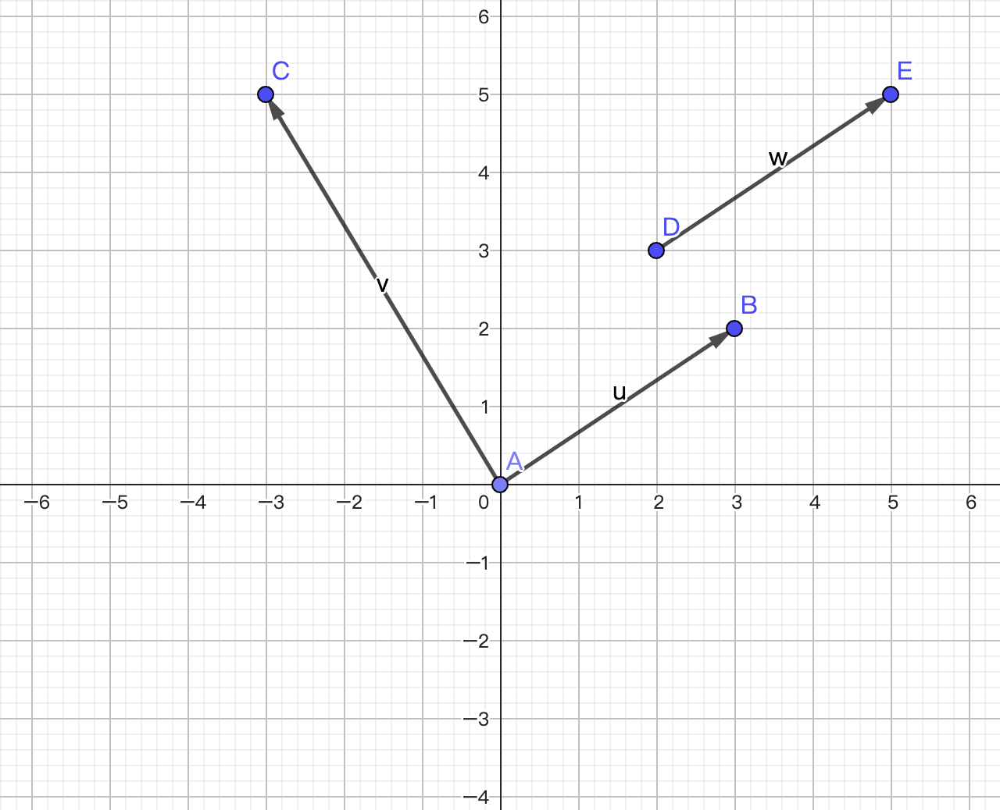
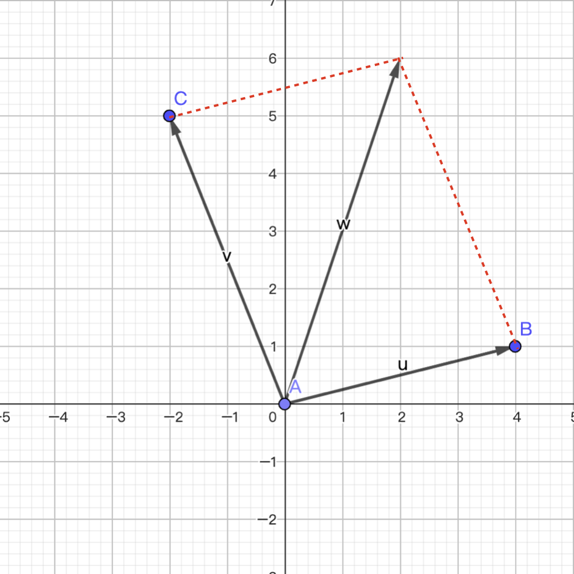
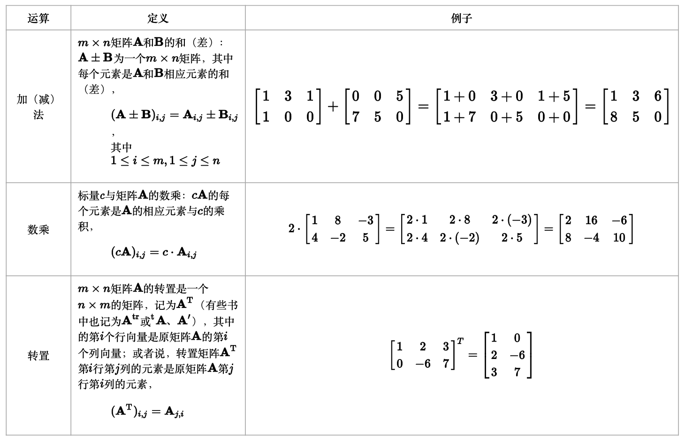
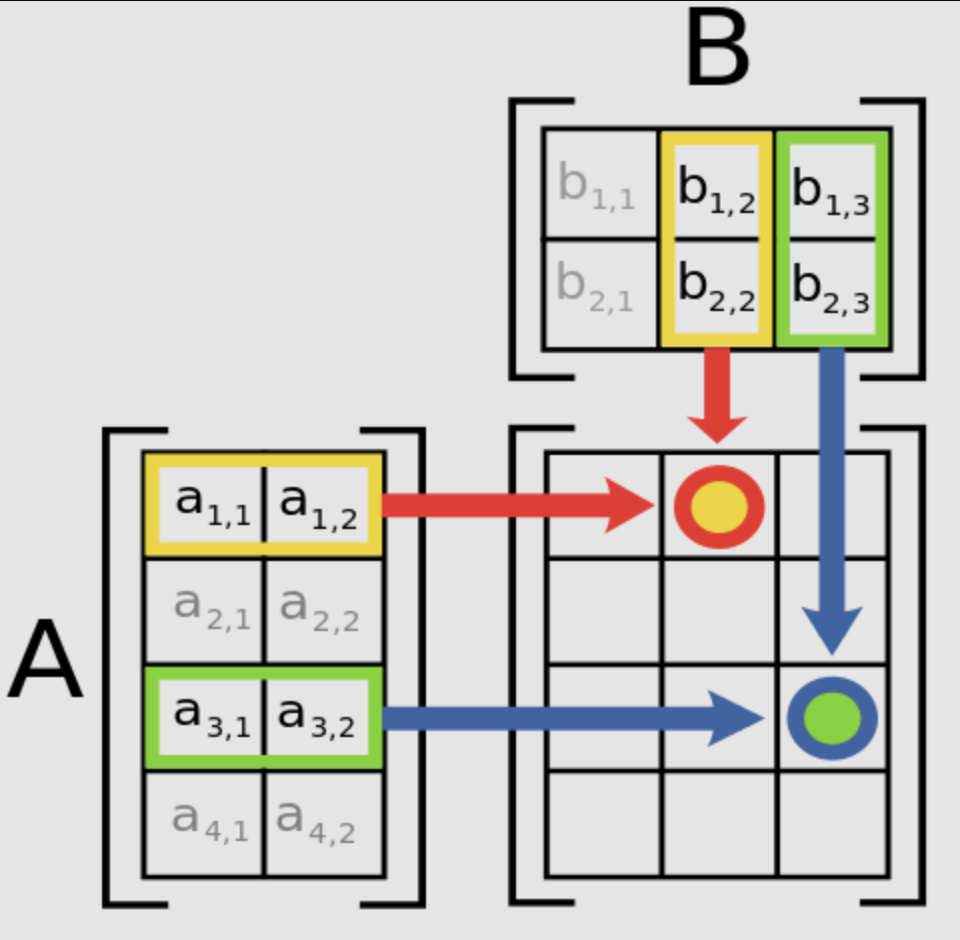
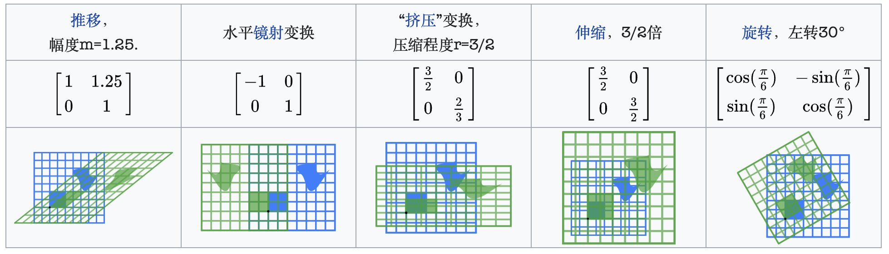
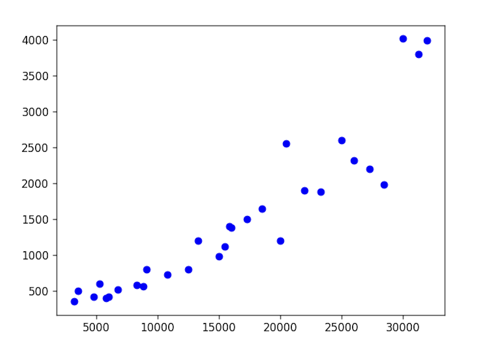
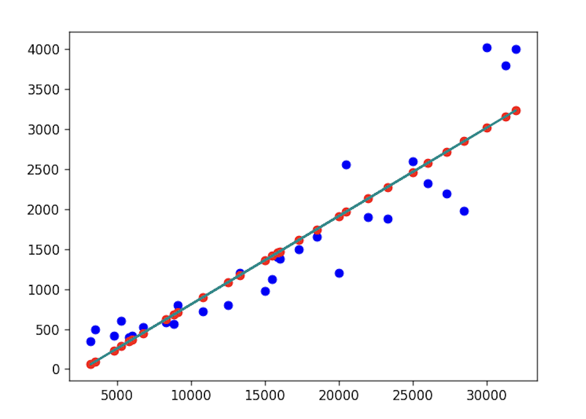

## Ứng dụng của NumPy - 4

### Vector

**Vector** (*vector*) là một đối tượng hình học vừa có độ lớn vừa có hướng, đồng thời tuân theo quy tắc hình bình hành. Khái niệm đối lập với vector là **vô hướng** (*scalar*) hay **đại lượng vô hướng**; đại lượng vô hướng chỉ có độ lớn và trong hầu hết các trường hợp thì không có hướng. Chúng ta thường dùng đoạn thẳng có mũi tên để biểu diễn vector, vector trong hệ tọa độ Descartes vuông góc được thể hiện như hình dưới đây. Cần lưu ý rằng vector là đại lượng thể hiện độ lớn và hướng, không quy định điểm gốc và điểm ngọn, do đó các vector giống nhau có thể được vẽ ở bất kỳ vị trí nào; chẳng hạn trong hình dưới đây, hai vector $\small{\boldsymbol{w}}$ và $\small{\boldsymbol{u}}$ không có sự khác biệt nào.



Vector có nhiều cách biểu diễn đại số, đối với vector trong không gian hai chiều, các cách viết dưới đây đều hợp lệ:

$$
\boldsymbol{a} = \langle a_1, a_2 \rangle = (a_1, a_2) = \begin{pmatrix} a_1 \\\\ a_2 \end{pmatrix} = \begin{bmatrix} a_1 \\\\ a_2 \end{bmatrix}
$$

Độ lớn của vector được gọi là độ dài (chuẩn hay mô-đun) của vector, nó là một đại lượng vô hướng. Đối với vector trong không gian hai chiều, độ dài có thể tính bằng công thức sau:

$$
\lvert \boldsymbol{a} \rvert = \sqrt{a_{1}^{2} + a_{2}^{2}}
$$

Lưu ý rằng $\small{\lvert \boldsymbol{a} \rvert}$ ở đây không phải là giá trị tuyệt đối, bạn có thể gọi nó là chuẩn bậc 2 (chuẩn Euclid / $L_2$ norm) của vector $\small{\boldsymbol{a}}$, đây là hiện tượng tái sử dụng ký hiệu trong toán học. Cách viết và khái niệm trên cũng có thể mở rộng cho không gian $\small{n}$ chiều. Chúng ta thường dùng $\small{\boldsymbol{R^{n}}}$ để biểu diễn không gian $\small{n}$ chiều; không gian hai chiều vừa nói có thể ký hiệu là $\small{\boldsymbol{R^{2}}}$, không gian ba chiều có thể ký hiệu là $\small{\boldsymbol{R^{3}}}$. Mặc dù sống trong không gian ba chiều, chúng ta rất khó hình dung không gian bốn chiều hay năm chiều trông như thế nào, nhưng điều này không ảnh hưởng đến việc chúng ta nghiên cứu các không gian nhiều chiều. Trong học máy, chúng ta thường gọi một mẫu huấn luyện có $\small{n}$ đặc trưng là một vector $\small{n}$ chiều.

#### Phép cộng vector

Các vector có cùng số chiều có thể cộng lại với nhau để tạo thành một vector mới. Cách tính là cộng từng thành phần tương ứng của các vector với nhau, như sau:

$$
\boldsymbol{u} = \begin{bmatrix} u_1 \\\\ u_2 \\\\ \vdots \\\\ u_n \end{bmatrix}, \quad
\boldsymbol{v} = \begin{bmatrix} v_1 \\\\ v_2 \\\\ \vdots \\\\ v_n \end{bmatrix}, \quad
\boldsymbol{u} + \boldsymbol{v} = \begin{bmatrix} u_1 + v_1 \\\\ u_2 + v_2 \\\\ \vdots \\\\ u_n + v_n \end{bmatrix}
$$

Phép cộng vector tuân theo "quy tắc hình bình hành", tức là hai vector $\small{\boldsymbol{u}}$ và $\small{\boldsymbol{v}}$ tạo thành hai cạnh kề của hình bình hành, và kết quả cộng là đường chéo của hình bình hành, như hình minh họa dưới đây:



#### Phép nhân vector với một số

Một vector $\small{\boldsymbol{v}}$ có thể nhân với một đại lượng vô hướng $\small{k}$. Cách tính là nhân từng thành phần trong vector với đại lượng vô hướng đó, như sau:

$$
\boldsymbol{v} = \begin{bmatrix} v_1 \\\\ v_2 \\\\ \vdots \\\\ v_n \end{bmatrix}, \quad
k \cdot \boldsymbol{v} = \begin{bmatrix} k \cdot v_1 \\\\ k \cdot v_2 \\\\ \vdots \\\\ k \cdot v_n \end{bmatrix}
$$

Chúng ta có thể dùng mảng NumPy để biểu diễn vector, phép cộng vector có thể thực hiện thông qua phép cộng giữa hai mảng, phép nhân vector với số vô hướng có thể thực hiện thông qua phép nhân mảng với số vô hướng, ở đây sẽ không nhắc lại chi tiết nữa.

#### Tích vô hướng của vector

Tích vô hướng (*dot product*) là một trong những phép toán quan trọng nhất giữa hai vector. Cách tính là tính tổng các tích của từng cặp thành phần tương ứng của hai vector, do đó kết quả của tích vô hướng là một đại lượng vô hướng. Ý nghĩa hình học của nó là tích độ dài của hai vector nhân với cosin của góc xen giữa chúng, như sau:

$$
\boldsymbol{u} = \begin{bmatrix} u_1 \\\\ u_2 \\\\ \vdots \\\\ u_n \end{bmatrix}, \quad
\boldsymbol{v} = \begin{bmatrix} v_1 \\\\ v_2 \\\\ \vdots \\\\ v_n \end{bmatrix} \quad
$$

$$
\boldsymbol{u} \cdot \boldsymbol{v} = \sum_{i=1}^{n}{u_iv_i} = \lvert \boldsymbol{u} \rvert \lvert \boldsymbol{v} \rvert cos\theta
$$

Giả sử chúng ta dùng một vector 3 chiều để biểu diễn sở thích của người dùng đối với ba thể loại phim: phim hài, phim tình cảm và phim hành động. Chúng ta dùng thang điểm từ 1 đến 5 để biểu thị mức độ yêu thích, trong đó 5 thể hiện rất thích, 4 là khá thích, 3 là bình thường, 2 là khá ghét, 1 là rất ghét. Như vậy, vector dưới đây biểu thị người dùng rất thích phim hài, rất ghét phim tình cảm, còn đối với phim hành động thì không thích cũng không ghét:

$$
\boldsymbol{u} = \begin{pmatrix} 5 \\\\ 1 \\\\ 3 \end{pmatrix}
$$

Hiện tại có hai bộ phim đang chiếu, một bộ thuộc thể loại hài lãng mạn, một bộ thuộc thể loại hành động hài hước. Chúng ta cũng biểu diễn hai bộ phim này dưới dạng vector 3 chiều như sau:

$$
\boldsymbol{m_1} = \begin{pmatrix} 4 \\\\ 5 \\\\ 1 \end{pmatrix}, \quad \boldsymbol{m_2} = \begin{pmatrix} 5 \\\\ 1 \\\\ 5 \end{pmatrix}
$$

Nếu bây giờ chúng ta cần gợi ý một bộ phim cho người dùng này, chúng ta nên gợi ý bộ phim nào? Chúng ta có thể lấy vector đại diện cho người dùng $\small{\boldsymbol{u}}$ tính tích vô hướng lần lượt với vector đại diện cho phim $\small{\boldsymbol{m_{1}}}$ và $\small{\boldsymbol{m_{2}}}$, sau đó chia cho tích độ dài của hai vector để thu được giá trị cosin của góc giữa hai vector. Giá trị cosin càng gần 1 chứng tỏ góc giữa hai vector càng gần 0 độ, tức là độ tương đồng giữa hai vector càng cao. Rõ ràng, chúng ta nên gợi ý cho người dùng bộ phim có độ tương đồng sở thích xem phim cao hơn.

$$
cos\theta_1 = \frac{\boldsymbol{u} \cdot \boldsymbol{m1}}{|\boldsymbol{u}||\boldsymbol{m1}|} \approx \frac{4 \times 5 + 5 \times 1 + 3 \times 1}{5.92 \times 6.48} \approx 0.73
$$

$$
cos\theta_2 = \frac{\boldsymbol{u} \cdot \boldsymbol{m2}}{|\boldsymbol{u}||\boldsymbol{m2}|} \approx \frac{5 \times 5 + 1 \times 1 + 3 \times 5}{5.92 \times 7.14} \approx 0.97
$$

Có thể bạn sẽ nói rằng, nhìn bằng mắt thường cũng thấy bộ phim do vector $\small{\boldsymbol{m_{2}}}$ đại diện phù hợp hơn với người dùng. Quả thật, đối với vector 3 chiều thì chúng ta hoàn toàn có thể dựa vào trực giác để đưa ra câu trả lời chính xác, nhưng đối với vector $\small{n}$ chiều khi giá trị $\small{n}$ rất lớn, bạn có còn tự tin dựa vào quan sát bằng mắt thường và trực giác bản năng để đưa ra câu trả lời chính xác không? Tích vô hướng của vector có thể tính bằng hàm `dot`, còn độ dài của vector có thể tính bằng hàm `norm` trong module `linalg` của NumPy, đoạn mã như sau:

```python
u = np.array([5, 1, 3])
m1 = np.array([4, 5, 1])
m2 = np.array([5, 1, 5])
print(np.dot(u, m1) / (np.linalg.norm(u) * np.linalg.norm(m1)))  # 0.7302967433402214
print(np.dot(u, m2) / (np.linalg.norm(u) * np.linalg.norm(m2)))  # 0.9704311900788593
```

#### Tích có hướng của vector

Trong không gian hai chiều, tích có hướng của hai vector được định nghĩa như sau:

$$
\boldsymbol{A} = \begin{pmatrix} a_{1} \\\\ a_{2} \end{pmatrix}, \quad \boldsymbol{B} = \begin{pmatrix} b_{1} \\\\ b_{2} \end{pmatrix}
$$

$$
\boldsymbol{A} \times \boldsymbol{B} = \begin{vmatrix} a_{1} \quad a_{2} \\\\ b_{1} \quad b_{2} \end{vmatrix} = a_{1}b_{2} - a_{2}b_{1}
$$

Đối với không gian ba chiều, kết quả tích có hướng của hai vector là một vector, như sau:

$$
\boldsymbol{A} = \begin{pmatrix} a_{1} \\\\ a_{2} \\\\ a_{3} \end{pmatrix}, \quad \boldsymbol{B} = \begin{pmatrix} b_{1} \\\\ b_{2} \\\\ b_{3} \end{pmatrix}
$$

$$
\boldsymbol{A} \times \boldsymbol{B} = \begin{vmatrix} \boldsymbol{\hat{i}} \quad \boldsymbol{\hat{j}} \quad \boldsymbol{\hat{k}} \\\\ a_{1} \quad a_{2} \quad a_{3} \\\\ b_{1} \quad b_{2} \quad b_{3} \end{vmatrix} = \langle \boldsymbol{\hat{i}}\begin{vmatrix} a_{2} \quad a_{3} \\\\ b_{2} \quad b_{3} \end{vmatrix}, -\boldsymbol{\hat{j}}\begin{vmatrix} a_{1} \quad a_{3} \\\\ b_{1} \quad b_{3} \end{vmatrix}, \boldsymbol{\hat{k}}\begin{vmatrix} a_{1} \quad a_{2} \\\\ b_{1} \quad b_{2} \end{vmatrix} \rangle
$$

Vì kết quả của tích có hướng là một vector, nên kết quả của $\small{\boldsymbol{A} \times \boldsymbol{B}}$ và $\small{\boldsymbol{B} \times \boldsymbol{A}}$ không giống nhau; trên thực tế:

$$
\boldsymbol{A} \times \boldsymbol{B} = -(\boldsymbol{B} \times \boldsymbol{A})
$$

Trong NumPy, chúng ta có thể tính tích có hướng của vector thông qua hàm `cross`, đoạn mã như sau:

```python
print(np.cross(u, m1))  # [-14   7  21]
print(np.cross(m1, u))  # [ 14  -7 -21]
```

### Định thức

**Định thức** (*determinant*) thường được ký hiệu là $\small{det(\boldsymbol{A})}$ hoặc $\small{ \lvert \boldsymbol{A} \rvert}$, trong đó $\small{\boldsymbol{A}}$ là một ma trận vuông cấp $\small{n}$. Định thức có thể xem như sự mở rộng của khái niệm diện tích hoặc thể tích có định hướng trong không gian Euclid tổng quát, hay nói cách khác định thức mô tả mức độ ảnh hưởng của một phép biến đổi tuyến tính lên "thể tích". Khái niệm định thức xuất hiện sớm nhất trong quá trình giải hệ phương trình tuyến tính. Vào cuối thế kỷ 17, trong các tác phẩm của Seki Takakazu (nhà toán học Nhật Bản thời kỳ Edo) và Leibniz đã sử dụng định thức để xác định số lượng nghiệm cũng như dạng nghiệm của hệ phương trình tuyến tính; từ thế kỷ 18, định thức bắt đầu được nghiên cứu như một khái niệm toán học độc lập; sau thế kỷ 19, lý thuyết định thức tiếp tục được phát triển và hoàn thiện.

#### Tính chất của định thức

Định thức được dẫn xuất từ vector, do đó những gì định thức giải thích thực chất chính là các tính chất của vector.

**Tính chất 1**: Nếu tất cả các phần tử trong một hàng (hoặc một cột) bất kỳ của $\small{det(\boldsymbol{A})}$ đều bằng 0 thì $\small{det(\boldsymbol{A}) = 0}$.

**Tính chất 2**: Nếu một hàng (hoặc một cột) bất kỳ của $\small{det(\boldsymbol{A})}$ có thừa số chung là $\small{k}$, ta có thể đưa $\small{k}$ ra ngoài để được định thức $\small{det(\boldsymbol{A^{'}})}$, và $\small{det(\boldsymbol{A}) = k \cdot det(\boldsymbol{A^{'}})}$.

$$
det(\boldsymbol{A})={\begin{vmatrix}a_{11}&a_{12}&\dots &a_{1n}\\\\\vdots &\vdots &\ddots &\vdots \\\\{\color {blue}k}a_{i1}&{\color {blue}k}a_{i2}&\dots &{\color {blue}k}a_{in}\\\\\vdots &\vdots &\ddots &\vdots \\\\a_{n1}&a_{n2}&\dots &a_{nn}\end{vmatrix}}={\color {blue}k}{\begin{vmatrix}a_{11}&a_{12}&\dots &a_{1n}\\\\\vdots &\vdots &\ddots &\vdots \\\\a_{i1}&a_{i2}&\dots &a_{in}\\\\\vdots &\vdots &\ddots &\vdots \\\\a_{n1}&a_{n2}&\dots &a_{nn}\end{vmatrix}}={\color {blue}k} \cdot det(\boldsymbol{A^{'}})
$$

**Tính chất 3**: Nếu mỗi phần tử trong một hàng (hoặc một cột) bất kỳ của $\small{det(\boldsymbol{A})}$ là tổng của hai số, thì định thức này có thể tách thành tổng của hai định thức, như sau:

$$
{\begin{vmatrix}a_{11}&a_{12}&\dots &a_{1n}\\\\\vdots &\vdots &\ddots &\vdots \\\\{\color {blue}a_{i1}}+{\color {OliveGreen}b_{i1}}&{\color {blue}a_{i2}}+{\color {OliveGreen}b_{i2}}&\dots &{\color {blue}a_{in}}+{\color {OliveGreen}b_{in}}\\\\\vdots &\vdots &\ddots &\vdots \\\\a_{n1}&a_{n2}&\dots &a_{nn}\end{vmatrix}}={\begin{vmatrix}a_{11}&a_{12}&\dots &a_{1n}\\\\\vdots &\vdots &\ddots &\vdots \\\\{\color {blue}a_{i1}}&{\color {blue}a_{i2}}&\dots &{\color {blue}a_{in}}\\\\\vdots &\vdots &\ddots &\vdots \\\\a_{n1}&a_{n2}&\dots &a_{nn}\end{vmatrix}}+{\begin{vmatrix}a_{11}&a_{12}&\dots &a_{1n}\\\\\vdots &\vdots &\ddots &\vdots \\\\{\color {OliveGreen}b_{i1}}&{\color {OliveGreen}b_{i2}}&\dots &{\color {OliveGreen}b_{in}}\\\\\vdots &\vdots &\ddots &\vdots \\\\a_{n1}&a_{n2}&\dots &a_{nn}\end{vmatrix}}
$$

**Tính chất 4**: Nếu hai hàng (hoặc hai cột) bất kỳ của $\small{det(\boldsymbol{A})}$ có các phần tử tương ứng tỉ lệ với nhau thì $\small{det(\boldsymbol{A}) = 0}$.

**Tính chất 5**: Nếu đổi chỗ hai hàng (hoặc hai cột) bất kỳ của $\small{det(\boldsymbol{A})}$ cho nhau để được $\small{det(\boldsymbol{A^{'}})}$ thì $\small{det(\boldsymbol{A}) = -det(\boldsymbol{A^{'}})}$.

**Tính chất 6**: Nhân $\small{k}$ lần một hàng (hoặc một cột) bất kỳ của $\small{det(\boldsymbol{A})}$ rồi cộng vào một hàng (hoặc một cột) khác thì giá trị của định thức không đổi, như sau:

$$
{\begin{vmatrix}\vdots &\vdots &\vdots &\vdots \\\\ a_{i1}&a_{i2}&\dots &a_{in} \\\\ a_{j1}&a_{j2}&\dots &a_{jn}\\\\\vdots &\vdots &\vdots &\vdots \\\\ \end{vmatrix}}={\begin{vmatrix}\vdots &\vdots &\vdots &\vdots \\\\ a_{i1}&a_{i2}&\dots &a_{in} \\\\ a_{j1}{\color {blue}+ka_{i1}}&a_{j2}{\color {blue}+ka_{i2}}&\dots &a_{jn}{\color {blue}+ka_{in}} \\\\ \vdots &\vdots &\vdots &\vdots \\\\ \end{vmatrix}}
$$

**Tính chất 7**: Đổi hàng thành cột và cột thành hàng (chuyển vị) thì giá trị của định thức không đổi, như sau:

$$
{\begin{vmatrix}a_{11}&a_{12}&\dots &a_{1n} \\\\ a_{21}&a_{22}&\dots &a_{2n} \\\\ \vdots &\vdots &\ddots &\vdots  \\\\ a_{n1}&a_{n2}&\dots &a_{nn}\end{vmatrix}}={\begin{vmatrix}a_{11}&a_{21}&\dots &a_{n1} \\\\ a_{12}&a_{22}&\dots &a_{n2} \\\\ \vdots &\vdots &\ddots &\vdots  \\\\ a_{1n}&a_{2n}&\dots &a_{nn}\end{vmatrix}}
$$

**Tính chất 8**: Định thức của tích hai ma trận vuông $\small{\boldsymbol{A}}$ và $\small{\boldsymbol{B}}$ bằng tích các định thức của chúng, tức là $\small{det(\boldsymbol{A}\boldsymbol{B}) = det(\boldsymbol{A})det(\boldsymbol{B})}$. Đặc biệt, nếu nhân mỗi hàng của ma trận với hằng số $\small{r}$ thì giá trị của định thức sẽ gấp $\small{r^{n}}$ lần ban đầu, tức là $\small{det(r\boldsymbol{A}) = det(r\boldsymbol{I_{n}} \cdot \boldsymbol{A}) = r^{n}det(\boldsymbol{A})}$, trong đó $\small{\boldsymbol{I_{n}}}$ là ma trận đơn vị cấp $\small{n}$.

**Tính chất 9**: Nếu $\small{\boldsymbol{A}}$ là ma trận khả nghịch, thì $\small{det(\boldsymbol{A}^{-1}) = (det(\boldsymbol{A}))^{-1}}$.

#### Cách tính định thức

Công thức tính định thức cấp $\small{n}$ như sau:

$$
det(\boldsymbol{A})=\sum_{n!} \pm {a_{1\alpha}a_{2\beta} \cdots a_{n\omega}}
$$

Đối với định thức cấp hai, công thức trên tương đương với:

$$
\begin{vmatrix} a_{11} \quad a_{12} \\\\ a_{21} \quad a_{22} \end{vmatrix} = a_{11}a_{22} - a_{12}a_{21}
$$

Đối với định thức cấp ba, công thức tính trên tương đương với:

$$
\begin{vmatrix} a_{11} \quad a_{12} \quad a_{13} \\\\ a_{21} \quad a_{22} \quad a_{23} \\\\ a_{31} \quad a_{32} \quad a_{33} \end{vmatrix} = a_{11}a_{22}a_{33} + a_{12}a_{23}a_{31} + a_{13}a_{21}a_{32} - a_{11}a_{23}a_{32} - a_{12}a_{21}a_{33} - a_{13}a_{22}a_{31}
$$

Định thức cấp cao có thể dùng **phần bù đại số** (*cofactor*) để khai triển thành nhiều định thức cấp thấp hơn, như sau:

$$
det(\boldsymbol{A})=a_{11}C_{11}+a_{12}C_{12}+ \cdots +a_{1n}C_{1n} = \sum_{i=1}^{n}{a_{1i}C_{1i}}
$$

Trong đó, $\small{C_{11}}$ là định thức con bù tạo bởi các phần tử còn lại sau khi bỏ đi hàng và cột chứa $\small{a_{11}}$ của định thức ban đầu (kèm dấu đại số tương ứng), và các phần tử khác cũng tương tự.

### Ma trận

**Ma trận** (*matrix*) là một mảng hình chữ nhật gồm các phần tử được sắp xếp theo hàng và cột. Các phần tử trong ma trận có thể là số, ký hiệu hoặc công thức toán học. Ma trận có thể thực hiện các phép toán như **cộng**, **trừ**, **nhân với số vô hướng**, **chuyển vị**, **nhân ma trận**, v.v., như hình minh họa dưới đây:



Đáng chú ý là phép nhân ma trận; phép toán này chỉ được xác định khi số cột của ma trận thứ nhất $\small{\boldsymbol{A}}$ bằng số hàng của ma trận thứ hai $\small{\boldsymbol{B}}$. Nếu $\small{\boldsymbol{A}}$ là một ma trận kích thước $\small{m \times n}$ và $\small{\boldsymbol{B}}$ là một ma trận kích thước $\small{n \times k}$, thì tích của chúng là một ma trận kích thước $\small{m \times k}$, như hình minh họa dưới đây:



Ví dụ:

$$
\begin{bmatrix} 1 & 0 & 2 \\\\ -1 & 3 & 1 \end{bmatrix} \times \begin{bmatrix} 3 & 1 \\\\ 2 & 1 \\\\ 1 & 0 \end{bmatrix} = \begin{bmatrix} (1 \times 3  +  0 \times 2  +  2 \times 1) & (1 \times 1   +   0 \times 1   +   2 \times 0) \\\\ (-1 \times 3  +  3 \times 2  +  1 \times 1) & (-1 \times 1   +   3 \times 1   +   1 \times 0) \end{bmatrix} = \begin{bmatrix} 5 & 1 \\\\ 4 & 2 \end{bmatrix}
$$

Phép nhân ma trận thỏa mãn tính chất kết hợp và tính chất phân phối đối với phép cộng ma trận:

Tính chất kết hợp: $\small{(\boldsymbol{AB})\boldsymbol{C} = \boldsymbol{A}(\boldsymbol{BC})}$.

Tính chất phân phối bên trái: $\small{(\boldsymbol{A} + \boldsymbol{B})\boldsymbol{C} = \boldsymbol{AC} + \boldsymbol{BC}}$.

Tính chất phân phối bên phải: $\small{\boldsymbol{C}(\boldsymbol{A} + \boldsymbol{B}) = \boldsymbol{CA} + \boldsymbol{CB}}$.

**Phép nhân ma trận không có tính chất giao hoán**. Nhìn chung, khi tích $\small{\boldsymbol{AB}}$ của hai ma trận $\small{\boldsymbol{A}}$ và $\small{\boldsymbol{B}}$ tồn tại, thì $\small{\boldsymbol{BA}}$ chưa chắc đã tồn tại; ngay cả khi $\small{\boldsymbol{BA}}$ tồn tại, thì phần lớn trường hợp $\small{\boldsymbol{AB} \neq \boldsymbol{BA}}$.

Một ứng dụng cơ bản của phép nhân ma trận là trong hệ phương trình tuyến tính. Hệ phương trình tuyến tính là một dạng hệ phương trình có dạng như sau:

$$
\begin{cases}
     a_{1,1}x_{1} + a_{1,2}x_{2} + \cdots + a_{1,n}x_{n}=  b_{1} \\\\
     a_{2,1}x_{1} + a_{2,2}x_{2} + \cdots + a_{2,n}x_{n}=  b_{2} \\\\
     \vdots \quad \quad \quad \vdots \\\\
     a_{m,1}x_{1} + a_{m,2}x_{2} + \cdots + a_{m,n}x_{n}=  b_{m}
 \end{cases}
$$

Sử dụng cách biểu diễn ma trận, ta có thể viết hệ phương trình tuyến tính thành một phương trình vector:

$$
\boldsymbol{Ax} = \boldsymbol{b}
$$

Trong đó, $\small{\boldsymbol{A}}$ là ma trận kích thước $\small{m \times n}$ gồm các hệ số của các ẩn số trong hệ phương trình, $\small{\boldsymbol{x}}$ là vector gồm $\small{n}$ phần tử, $\small{\boldsymbol{b}}$ là vector gồm $\small{m}$ phần tử.

Ma trận là một cách biểu diễn thuận tiện cho các phép biến đổi tuyến tính (hàm bảo toàn phép cộng vector và phép nhân với vô hướng). Bản chất của phép nhân ma trận được thể hiện rõ nhất khi gắn liền với các phép biến đổi tuyến tính, bởi vì phép nhân ma trận và sự hợp thành của các phép biến đổi tuyến tính có mối liên hệ như sau: mỗi ma trận $\small{\boldsymbol{A}}$ kích thước $\small{m \times n}$ đều đại diện cho một phép biến đổi tuyến tính ánh xạ từ $\small{\boldsymbol{R}^{n}}$ sang $\small{\boldsymbol{R}^{m}}$. Nếu bạn chưa hiểu rõ những nội dung trên, tôi khuyên bạn nên xem loạt video mang tên [《Bản chất của Đại số Tuyến tính》](https://www.bilibili.com/video/BV1ib411t7YR/) trên Bilibili (hoặc series "Essence of linear algebra" của 3Blue1Brown), tin rằng loạt video này sẽ giúp bạn hiểu sâu sắc hơn về đại số tuyến tính.

Hình dưới đây là một ví dụ từ Wikipedia, minh họa hiệu ứng của một số phép biến đổi tuyến tính điển hình trên mặt phẳng thực hai chiều đối với các vector (hình học) trên mặt phẳng cùng các ma trận 2 chiều tương ứng của chúng, trong đó mỗi phép biến đổi tuyến tính ánh xạ hình màu xanh lam thành hình màu xanh lá cây; gốc tọa độ $\small{(0, 0)}$ của mặt phẳng được biểu thị bằng chấm đen.



#### Đối tượng ma trận

NumPy cung cấp module chuyên dùng cho đại số tuyến tính (*linear algebra*) và kiểu dữ liệu `matrix` để biểu diễn ma trận. Tất nhiên chúng ta cũng có thể biểu diễn một ma trận thông qua mảng hai chiều. Tài liệu chính thức không khuyến khích sử dụng lớp `matrix` mà khuyên dùng mảng hai chiều, và có khả năng lớp `matrix` sẽ bị loại bỏ trong các phiên bản tương lai. Dù sao đi nữa, nhờ các lớp và hàm đã được đóng gói sẵn này, chúng ta có thể thực hiện nhiều thao tác với ma trận một cách dễ dàng và thuận tiện.

Chúng ta có thể tạo đối tượng ma trận (`matrix`) bằng đoạn mã dưới đây:

Mã nguồn:

```Python
m1 = np.matrix('1 2 3; 4 5 6')
m1
```

> **Giải thích**: Constructor của `matrix` có thể nhận vào một đối tượng dạng mảng (array-like) hoặc một chuỗi để tạo đối tượng ma trận.

Kết quả:

```
matrix([[1, 2, 3],
        [4, 5, 6]])
```

Mã nguồn:

```Python
m2 = np.asmatrix(np.array([[1, 1], [2, 2], [3, 3]]))
m2
```

> **Giải thích**: Hàm `asmatrix` cũng có thể thay thế bằng hàm `mat`, hai hàm này thực chất là một.

Kết quả:

```
matrix([[1, 1],
        [2, 2],
        [3, 3]])
```

Mã nguồn:

```Python
m1 * m2
```

Kết quả:

```
matrix([[14, 14],
        [32, 32]])
```

> **Giải thích**: Hãy chú ý sự khác biệt trong phép nhân giữa đối tượng `matrix` và đối tượng `ndarray`: toán tử `*` của đối tượng `matrix` là phép nhân ma trận. Nếu muốn thực hiện phép nhân ma trận giữa hai mảng hai chiều, bạn nên dùng toán tử `@` hoặc hàm `matmul`, chứ không phải toán tử `*`.

Bảng dưới đây liệt kê các thuộc tính của đối tượng ma trận:

| Thuộc tính | Giải thích |
| ------- | ----------------------------------------- |
| `A` | Lấy đối tượng `ndarray` tương ứng của đối tượng ma trận |
| `A1` | Lấy đối tượng `ndarray` sau khi làm phẳng (flatten) tương ứng của đối tượng ma trận |
| `I` | Ma trận nghịch đảo của ma trận khả nghịch |
| `T` | Ma trận chuyển vị |
| `H` | Ma trận chuyển vị liên hợp |
| `shape` | Kích thước của ma trận |
| `size` | Số lượng phần tử của ma trận |

Các phương thức của đối tượng ma trận cơ bản giống với các phương thức của đối tượng mảng `ndarray` đã giới thiệu trước đó, nên ở đây sẽ không nhắc lại.

#### Module đại số tuyến tính

Module `linalg` của NumPy có một tập hợp các phép toán phân rã ma trận tiêu chuẩn cũng như các hàm tính ma trận nghịch đảo, định thức, v.v. Chúng sử dụng cùng các thư viện đại số tuyến tính tiêu chuẩn công nghiệp giống như các ngôn ngữ MATLAB và R. Bảng dưới đây liệt kê một số hàm liên quan đến đại số tuyến tính thường dùng trong `numpy` và module `linalg`.

| Hàm | Giải thích |
| ------------- | ------------------------------------------------------------ |
| `diag` | Trả về các phần tử trên đường chéo chính của ma trận vuông dưới dạng mảng một chiều, hoặc chuyển mảng một chiều thành ma trận vuông (các phần tử ngoài đường chéo bằng 0) |
| `matmul` | Phép nhân ma trận |
| `trace` | Tính tổng các phần tử trên đường chéo chính (vết của ma trận) |
| `norm` | Tính chuẩn (norm) của ma trận hoặc vector |
| `det` | Tính giá trị định thức |
| `matrix_rank` | Tính hạng (rank) của ma trận |
| `eig` | Tính các giá trị riêng (*eigenvalue*) và vector riêng (*eigenvector*) của ma trận |
| `inv` | Tính ma trận nghịch đảo của ma trận không suy biến (ma trận vuông cấp $\small{n}$) |
| `pinv` | Tính ma trận nghịch đảo giả Moore-Penrose (*Moore-Penrose pseudoinverse*) của ma trận |
| `qr` | Phân rã QR (phân rã ma trận thành tích của một ma trận trực giao và một ma trận tam giác trên) |
| `svd` | Tính phân rã giá trị suy biến (*singular value decomposition*) |
| `solve` | Giải hệ phương trình tuyến tính $\small{\boldsymbol{Ax}=\boldsymbol{b}}$, trong đó $\small{\boldsymbol{A}}$ là ma trận vuông |
| `lstsq` | Tính nghiệm bình phương tối thiểu của $\small{\boldsymbol{Ax}=\boldsymbol{b}}$ |

Dưới đây chúng ta sẽ thử nghiệm nhanh các hàm trên, trước tiên hãy thử tìm ma trận nghịch đảo.

Mã nguồn:

```Python
m3 = np.array([[1., 2.], [3., 4.]])
m4 = np.linalg.inv(m3)
m4
```

Kết quả:

```
array([[-2. ,  1. ],
       [ 1.5, -0.5]])
```

Mã nguồn:

```Python
np.around(m3 @ m4)
```

> **Giải thích**: Hàm `around` làm tròn các phần tử của mảng, mặc định số chữ số sau dấu phẩy là 0.

Kết quả:

```
array([[1., 0.],
       [0., 1.]])
```

> **Giải thích**: Nhân ma trận giữa một ma trận và ma trận nghịch đảo của nó sẽ cho ra ma trận đơn vị.

Tính giá trị của định thức.

Mã nguồn:

```Python
m5 = np.array([[1, 3, 5], [2, 4, 6], [4, 7, 9]])
np.linalg.det(m5)
```

Kết quả:

```
2
```

Tính hạng của ma trận.

Mã nguồn:

```Python
np.linalg.matrix_rank(m5)
```

Kết quả:

```
3
```

Giải hệ phương trình tuyến tính:

$$
\begin{cases}
x_1 + 2x_2 + x_3 = 8 \\\\
3x_1 + 7x_2 + 2x_3 = 23 \\\\
2x_1 + 2x_2 + x_3 = 9
\end{cases}
$$

Đối với hệ phương trình tuyến tính ở trên, chúng ta có thể biểu diễn nó dưới dạng ma trận như sau:

$$
\boldsymbol{A} = \begin{bmatrix}
1 & 2 & 1 \\\\
3 & 7 & 2 \\\\
2 & 2 & 1
\end{bmatrix}, \quad
\boldsymbol{x} = \begin{bmatrix}
x_1 \\\\
x_2 \\\\
x_3
\end{bmatrix}, \quad
\boldsymbol{b} = \begin{bmatrix}
8 \\\\
23 \\\\
9
\end{bmatrix}
$$

$$
\boldsymbol{Ax} = \boldsymbol{b}
$$

Điều kiện để hệ phương trình tuyến tính có nghiệm duy nhất: Hạng của ma trận hệ số $\small{\boldsymbol{A}}$ bằng hạng của ma trận mở rộng $\small{\boldsymbol{Ab}}$, đồng thời bằng số ẩn số.

Mã nguồn:

```Python
A = np.array([[1, 2, 1], [3, 7, 2], [2, 2, 1]])
b = np.array([8, 23, 9]).reshape(-1, 1)
print(np.linalg.matrix_rank(A))
print(np.linalg.matrix_rank(np.hstack((A, b))))
```

> **Giải thích**: Khi sử dụng phương thức `reshape` của đối tượng mảng để định hình lại mảng, nếu một trong các tham số là -1, thì số lượng phần tử của chiều đó sẽ được tự động tính toán dựa trên tổng số phần tử của mảng (thuộc tính `size`) và số lượng phần tử của các chiều còn lại.

Kết quả:

```
3
3
```

Mã nguồn:

```Python
np.linalg.solve(A, b)
```

Kết quả:

```
array([[1.],
       [2.],
       [3.]])
```

> **Giải thích**: Kết quả trên cho thấy nghiệm của hệ phương trình tuyến tính là: $\small{x_1 = 1, x_2 = 2, x_3 = 3}$.

Dưới đây là một cách khác để giải hệ phương trình tuyến tính, các bạn có thể dừng lại một chút để suy nghĩ xem tại sao.

$$
\boldsymbol{x} = \boldsymbol{A}^{-1} \cdot \boldsymbol{b}
$$

Mã nguồn:

```Python
np.linalg.inv(A) @ b
```

Kết quả:

```
array([[1.],
       [2.],
       [3.]])
```

### Đa thức

Ngoài mảng, NumPy còn đóng gói kiểu dữ liệu dùng cho các phép toán **đa thức** (*polynomial*). Đa thức là tổng của các tích giữa lũy thừa nguyên của biến số với các hệ số, có dạng:

$$
f(x)=a_nx^n + a_{n-1}x^{n-1} + \cdots + a_1x^{1} + a_0x^{0}
$$

Trước phiên bản NumPy 1.4, chúng ta có thể dùng kiểu `poly1d` để biểu diễn đa thức. Hiện tại nó vẫn sử dụng được, nhưng NumPy đã cung cấp module mới là `numpy.polynomial`. Ngoài việc hỗ trợ các đa thức chuỗi lũy thừa cơ bản, module này còn hỗ trợ đa thức Chebyshev, đa thức Laguerre, v.v.

#### Tạo đối tượng đa thức

Tạo đối tượng `poly1d`, ví dụ: $\small{f(x)=3x^{2}+2x+1}$.

Mã nguồn:

```python
p1 = np.poly1d([3, 2, 1])
p2 = np.poly1d([1, 2, 3])
print(p1)
print(p2)
```

Kết quả:

```
   2
3 x + 2 x + 1
   2
1 x + 2 x + 3
```

#### Các thao tác với đa thức

**Lấy các hệ số của đa thức**

Mã nguồn:

```python
print(p1.coefficients)
print(p2.coeffs)
```

Kết quả:

```
[3 2 1]
[1 2 3]
```

**Bốn phép tính số học giữa hai đa thức**

Mã nguồn:

```python
print(p1 + p2)
print(p1 * p2)
```

Kết quả:

```
   2
4 x + 4 x + 4
   4     3      2
3 x + 8 x + 14 x + 8 x + 3
```

**Thay giá trị $\small{x}$ vào để tính giá trị của đa thức**

Mã nguồn:

```python
print(p1(3))
print(p2(3))
```

Kết quả:

```
34
18
```

**Tính đạo hàm và nguyên hàm của đa thức**

Mã nguồn:

```python
print(p1.deriv())
print(p1.integ())
```

Kết quả:

```

6 x + 2
   3     2
1 x + 1 x + 1 x
```

**Tìm nghiệm của đa thức**

Ví dụ ta có đa thức $\small{f(x)=x^2+3x+2}$, nghiệm của đa thức chính là nghiệm của phương trình bậc hai một ẩn $\small{x^2+3x+2=0}$.

Mã nguồn:

```python
p3 = np.poly1d([1, 3, 2])
print(p3.roots)
```

Kết quả:

```
[-2. -1.]
```

Nếu sử dụng lớp `Polynomial` trong module `numpy.polynomial` để biểu diễn đối tượng đa thức, thì các thao tác tương ứng như sau:

Mã nguồn:

```python
from numpy.polynomial import Polynomial

p3 = Polynomial((2, 3, 1))
print(p3)           # In đa thức
print(p3(3))        # Cho x=3, tính giá trị của đa thức
print(p3.roots())   # Tính nghiệm của đa thức
print(p3.degree())  # Lấy bậc của đa thức
print(p3.deriv())   # Tính đạo hàm
print(p3.integ())   # Tính nguyên hàm
```

Kết quả:

```
2.0 + 3.0·x + 1.0·x²
20.0
[-2. -1.]
2
3.0 + 2.0·x
0.0 + 2.0·x + 1.5·x² + 0.33333333·x³
```

#### Nghiệm bình phương tối thiểu

Lớp `Polynomial` còn có một phương thức lớp tên là `fit`, nó có thể tìm nghiệm bình phương tối thiểu cho đa thức. Cái gọi là nghiệm bình phương tối thiểu (least-squares solution) là phương pháp dùng bình phương tối thiểu để tìm các hệ số của hàm khớp nhất với dữ liệu bằng cách cực tiểu hóa tổng bình phương các sai số. Giả sử đa thức là $\small{f(x)=ax+b}$, nghiệm bình phương tối thiểu chính là tìm $\small{a}$ và $\small{b}$ sao cho tổng bình phương phần dư $\small{RSS}$ dưới đây đạt giá trị nhỏ nhất:

$$
RSS = \sum_{i=0}^{k}{(f(x_i) - y_i)^{2}}
$$

Ví dụ, chúng ta muốn sử dụng dữ liệu lịch sử đã thu thập về thu nhập hàng tháng và chi tiêu mua sắm trực tuyến để xây dựng một mô hình dự đoán, nhằm đạt được mục tiêu dự đoán số tiền chi tiêu mua sắm trực tuyến của một người dựa trên thu nhập hàng tháng của họ. Dưới đây là dữ liệu thu nhập và chi tiêu mua sắm trực tuyến mà chúng ta đã thu thập, được lưu trong hai mảng:

```python
x = np.array([
    25000, 15850, 15500, 20500, 22000, 20010, 26050, 12500, 18500, 27300,
    15000,  8300, 23320,  5250,  5800,  9100,  4800, 16000, 28500, 32000,
    31300, 10800,  6750,  6020, 13300, 30020,  3200, 17300,  8835,  3500
])
y = np.array([
    2599, 1400, 1120, 2560, 1900, 1200, 2320,  800, 1650, 2200,
     980,  580, 1885,  600,  400,  800,  420, 1380, 1980, 3999,
    3800,  725,  520,  420, 1200, 4020,  350, 1500,  560,  500
])
```

Trước tiên, chúng ta có thể vẽ biểu đồ phân tán (scatter plot) để xem hai nhóm dữ liệu có mối tương quan thuận hay tương quan nghịch hay không. Tương quan thuận có nghĩa là giá trị lớn hơn trong mảng `x` tương ứng với giá trị lớn hơn trong mảng `y`, còn tương quan nghịch có nghĩa là giá trị lớn hơn trong mảng `x` tương ứng với giá trị nhỏ hơn trong mảng `y`.

```python
import matplotlib.pyplot as plt

plt.figure(dpi=120)
plt.scatter(x, y, color='blue')
plt.show()
```

Kết quả:



Nếu cần nghiên cứu định lượng mức độ tương quan giữa hai nhóm dữ liệu, chúng ta có thể tính hiệp phương sai hoặc hệ số tương quan, các hàm tương ứng của NumPy lần lượt là `cov` và `corrcoef`.

Mã nguồn:

```python
np.corrcoef(x, y)
```

Kết quả:

```
array([[1.        , 0.92275889],
       [0.92275889, 1.        ]])
```

> **Giải thích**: Hệ số tương quan là một giá trị nằm trong khoảng từ `-1` đến `1`. Giá trị càng gần `1` chứng tỏ tương quan thuận càng mạnh, càng gần `-1` chứng tỏ tương quan nghịch càng mạnh, còn gần `0` chứng tỏ hai nhóm dữ liệu không có mối tương quan rõ ràng. Hệ số tương quan giữa thu nhập hàng tháng và chi tiêu mua sắm trực tuyến ở trên là `0.92275889`, cho thấy giữa chúng có mối tương quan thuận rất mạnh.

Qua các thao tác trên, chúng ta đã xác định được giữa thu nhập và chi tiêu mua sắm trực tuyến tồn tại mối tương quan thuận mạnh mẽ, vì vậy chúng ta sử dụng những dữ liệu này để tạo một mô hình hồi quy, tìm ra một đường thẳng có thể khớp tốt nhất với các điểm dữ liệu này. Ở đây, chúng ta có thể sử dụng phương thức `fit` đã đề cập ở trên, đoạn mã cụ thể như sau:

Mã nguồn:

```python
from numpy.polynomial import Polynomial

Polynomial.fit(x, y, deg=1).convert().coef
```

> **Giải thích**: `deg=1` giải thích rằng bậc cao nhất của mô hình hồi quy là bậc 1, mô hình hồi quy có dạng $\small{y=ax+b}$; nếu muốn tạo một mô hình tương tự như $\small{y=ax^2+bx+c}$, bạn cần thiết lập `deg=2`, và cứ thế tiếp tục.

Kết quả:

```
array([-2.94883437e+02,  1.10333716e-01])
```

Dựa vào kết quả xuất ra ở trên, phương trình hồi quy của chúng ta sẽ là $\small{y=0.110333716x-294.883437}$. Chúng ta vẽ phương trình hồi quy này lên biểu đồ phân tán vừa nãy, các điểm màu đỏ là giá trị dự đoán của chúng ta, còn các điểm màu xanh lam là dữ liệu lịch sử, tức là giá trị thực tế.

Mã nguồn:

```python
import matplotlib.pyplot as plt

plt.scatter(x, y, color='blue')
plt.scatter(x, 0.110333716 * x - 294.883437, color='red')
plt.plot(x, 0.110333716 * x - 294.883437, color='darkcyan')
plt.show()
```

Kết quả:



Nếu không sử dụng phương thức `fit` của lớp `Polynomial`, chúng ta cũng có thể hoàn thành thao tác tương tự thông qua hàm `polyfit` do NumPy cung cấp, bạn đọc quan tâm có thể tự tìm hiểu thêm.

> **Giải thích**: Một số hình ảnh trong chương này được lấy từ Wikipedia.