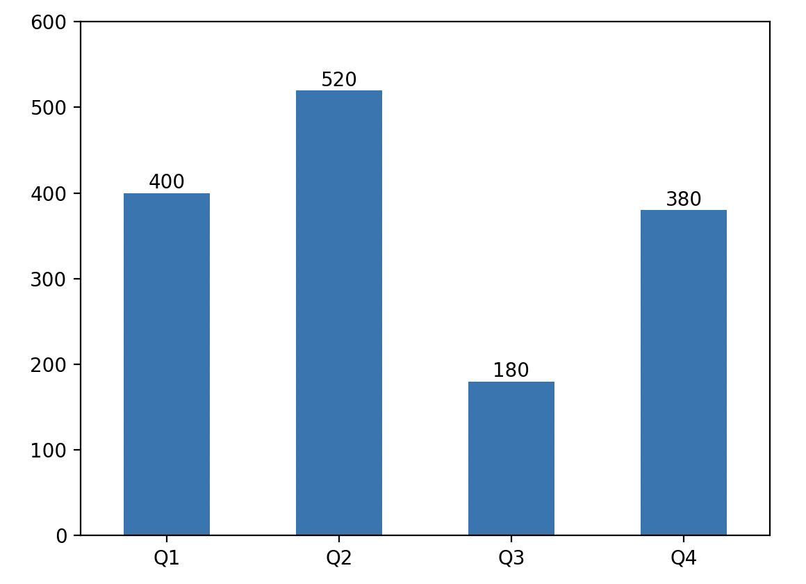
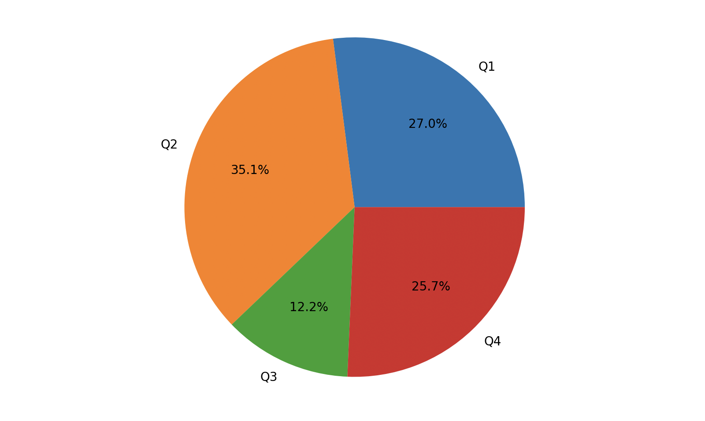

## pandas từ cơ bản đến nâng cao - 1

Pandas là một bộ công cụ mạnh mẽ dùng để **phân tích dữ liệu có cấu trúc** do Wes McKinney phát triển vào năm 2008. Pandas dựa trên nền tảng NumPy (để lưu trữ dữ liệu và tính toán), cung cấp các kiểu dữ liệu, phương thức và hàm chuyên biệt cho phân tích dữ liệu, mang lại sự hỗ trợ tuyệt vời cho phân tích và khai phá dữ liệu; đồng thời, pandas có thể tích hợp rất tốt với công cụ trực quan hóa dữ liệu matplotlib, giúp việc trình bày trực quan hóa dữ liệu trở nên vô cùng dễ dàng và thuận tiện.

Các kiểu dữ liệu cốt lõi của pandas là `Series` (chuỗi dữ liệu) và `DataFrame` (khung dữ liệu / bảng dữ liệu), lần lượt dùng để xử lý dữ liệu một chiều và hai chiều. Ngoài ra, còn có kiểu `Index` cùng các kiểu con của nó, cung cấp chức năng lập chỉ mục cho `Series` và `DataFrame`. Trong công việc hàng ngày, `DataFrame` được sử dụng phổ biến nhất vì cấu trúc dữ liệu hai chiều tương ứng hoàn hảo với các bảng có hàng và cột. Cả `Series` và `DataFrame` đều cung cấp lượng lớn phương thức xử lý dữ liệu, dựa vào đó các nhà phân tích dữ liệu có thể thực hiện nhiều thao tác khác nhau như lọc, ghép, nối, làm sạch, tiền xử lý, tổng hợp, pivot và trực quan hóa dữ liệu.

### Tạo đối tượng Series

Đối tượng `Series` trong thư viện pandas có thể dùng để biểu diễn cấu trúc dữ liệu một chiều, nhưng có thêm chỉ mục và một số tính năng bổ sung. Cấu trúc bên trong của kiểu `Series` chứa hai mảng: một mảng dùng để lưu dữ liệu và một mảng dùng để lưu chỉ mục của dữ liệu. Chúng ta có thể tạo đối tượng `Series` từ danh sách (list) hoặc mảng, đoạn mã như sau:

Mã nguồn:

```Python
import numpy as np
import pandas as pd

ser1 = pd.Series(data=[120, 380, 250, 360], index=['一季度', '二季度', '三季度', '四季度'])
ser1
```

> **Giải thích**: Tham số `data` trong constructor của `Series` biểu thị dữ liệu, tham số `index` biểu thị chỉ mục của dữ liệu, tương đương với nhãn gắn liền với dữ liệu.

Kết quả:

```
一季度    120
二季度    380
三季度    250
四季度    360
dtype: int64
```

Tạo đối tượng Series thông qua từ điển (dict):

Mã nguồn:

```Python
ser2 = pd.Series({'一季度': 320, '二季度': 180, '三季度': 300, '四季度': 405})
ser2
```

> **Giải thích**: Khi tạo đối tượng `Series` thông qua từ điển, các khóa (key) của từ điển chính là nhãn (chỉ mục) của dữ liệu, và các giá trị tương ứng của khóa chính là dữ liệu.

Kết quả:

```
一季度    320
二季度    180
三季度    300
四季度    405
dtype: int64
```

### Các phép toán trên đối tượng Series

#### Phép toán với số vô hướng

Chúng ta thử cộng thêm `10` vào mỗi quý của `ser1` vừa rồi, đoạn mã như sau:

Mã nguồn:

```python
ser1 += 10
ser1
```

Kết quả:

```
一季度    130
二季度    390
三季度    260
四季度    370
dtype: int64
```

#### Phép toán vector

Chúng ta thử cộng dữ liệu các quý tương ứng của `ser1` và `ser2` lại với nhau, đoạn mã như sau:

Mã nguồn:

```python
ser1 + ser2
```

Kết quả:

```
一季度    450
二季度    570
三季度    560
四季度    775
dtype: int64
```

#### Thao tác chỉ mục

##### Chỉ mục thông thường

Giống như mảng, đối tượng `Series` cũng có thể thực hiện các thao tác lập chỉ mục và cắt lát (slicing). Điểm khác biệt là đối tượng `Series` duy trì một mảng lưu trữ chỉ mục bên trong, vì vậy ngoài việc sử dụng chỉ mục số nguyên để truy xuất dữ liệu, bạn còn có thể lấy dữ liệu tương ứng thông qua chỉ mục (nhãn) do chính bạn thiết lập.

Sử dụng chỉ mục số nguyên:

Mã nguồn:

```Python
ser1[2]
```

Kết quả:

```
260
```

Sử dụng chỉ mục tùy chỉnh:

Mã nguồn:

```Python
ser1['三季度']
```

Kết quả:

```
260
```

Mã nguồn:

```Python
ser1['一季度'] = 380
ser1
```

Kết quả:

```
一季度    380
二季度    390
三季度    260
四季度    370
dtype: int64
```

##### Cắt lát chỉ mục

Thao tác cắt lát của đối tượng `Series` tương tự như danh sách và mảng, thông qua việc đưa ra chỉ mục bắt đầu và chỉ mục kết thúc để lấy ra hoặc sửa đổi một phần dữ liệu từ đối tượng `Series` ban đầu; ở đây bạn cũng có thể sử dụng cả chỉ mục số nguyên lẫn chỉ mục tùy chỉnh, đoạn mã như sau:

Mã nguồn:

```Python
ser2[1:3]
```

Kết quả:

```
二季度    180
三季度    300
dtype: int64
```

Mã nguồn:

```Python
ser2['二季度':'四季度']
```

Kết quả:

```
二季度    180
三季度    300
四季度    405
dtype: int64
```

> **Gợi ý**: Khi sử dụng chỉ mục tùy chỉnh để cắt lát, phần tử tương ứng với chỉ mục kết thúc cũng được bao gồm (lấy được cả điểm cuối).

Mã nguồn:

```Python
ser2[1:3] = 400, 500
ser2
```

Kết quả:

```
一季度    320
二季度    400
三季度    500
四季度    405
dtype: int64
```

##### Fancy indexing

Mã nguồn:

```Python
ser2[['二季度', '四季度']]
```

Kết quả:

```
二季度    400
四季度    405
dtype: int64
```

Mã nguồn:

```Python
ser2[['二季度', '四季度']] = 600, 520
ser2
```

Kết quả:

```
一季度    320
二季度    600
三季度    500
四季度    520
dtype: int64
```

##### Chỉ mục boolean

Mã nguồn:

```Python
ser2[ser2 >= 500]
```

Kết quả:

```
二季度    600
三季度    500
四季度    520
dtype: int64
```

### Thuộc tính và phương thức của đối tượng Series

Đối tượng `Series` có rất nhiều thuộc tính và phương thức, chúng ta hãy cùng chọn ra những cái quan trọng để tìm hiểu. Trước tiên hãy xem bảng dưới đây, nó trình bày các thuộc tính thường dùng của đối tượng `Series`:

| Thuộc tính | Giải thích |
| ------------------------- | --------------------------------------- |
| `dtype` / `dtypes` | Trả về kiểu dữ liệu của đối tượng `Series` |
| `hasnans` | Kiểm tra xem đối tượng `Series` có giá trị rỗng hay không |
| `at` / `iat` | Truy cập một giá trị đơn lẻ trong đối tượng `Series` qua chỉ mục |
| `loc` / `iloc` | Truy cập một giá trị đơn lẻ hoặc một nhóm giá trị trong đối tượng `Series` qua chỉ mục |
| `index` | Trả về chỉ mục của đối tượng `Series` (đối tượng `Index`) |
| `is_monotonic` | Kiểm tra xem dữ liệu trong đối tượng `Series` có đơn điệu hay không |
| `is_monotonic_increasing` | Kiểm tra xem dữ liệu trong đối tượng `Series` có đơn điệu tăng hay không |
| `is_monotonic_decreasing` | Kiểm tra xem dữ liệu trong đối tượng `Series` có đơn điệu giảm hay không |
| `is_unique` | Kiểm tra xem các giá trị trong đối tượng `Series` có phải là duy nhất (không trùng lặp) hay không |
| `size` | Trả về số lượng phần tử trong đối tượng `Series` |
| `values` | Trả về các giá trị trong đối tượng `Series` dưới dạng `ndarray` (đối tượng `ndarray`) |

Chúng ta có thể tìm hiểu các thuộc tính của đối tượng `Series` qua đoạn mã dưới đây:

Mã nguồn:

```python
print(ser2.dtype)                    # Kiểu dữ liệu
print(ser2.hasnans)                  # Có giá trị rỗng hay không
print(ser2.index)                    # Chỉ mục
print(ser2.values)                   # Giá trị
print(ser2.is_monotonic_increasing)  # Có đơn điệu tăng hay không
print(ser2.is_unique)                # Mỗi giá trị có phải là duy nhất không
```

Kết quả:

```
int64
False
Index(['一季度', '二季度', '三季度', '四季度'], dtype='object')
[320 600 500 520]
False
True
```

Đối tượng `Series` có rất nhiều phương thức, dưới đây chúng tôi sẽ giới thiệu các phương thức thường dùng qua một số đoạn mã.

#### Thống kê mô tả

Đối tượng `Series` hỗ trợ nhiều phương thức khác nhau để thu thập thông tin thống kê mô tả.

Mã nguồn:

```Python
print(ser2.count())   # Đếm số lượng
print(ser2.sum())     # Tính tổng
print(ser2.mean())    # Tính trung bình
print(ser2.median())  # Tìm trung vị
print(ser2.max())     # Tìm giá trị lớn nhất
print(ser2.min())     # Tìm giá trị nhỏ nhất
print(ser2.std())     # Tính độ lệch chuẩn
print(ser2.var())     # Tính phương sai
```

Kết quả:

```
4
1940
485.0
510.0
600
320
118.18065267490557
13966.666666666666
```

Đối tượng `Series` còn có một phương thức tên là `describe()`, có thể lấy toàn bộ các thông tin thống kê mô tả kể trên cùng một lúc, như dưới đây:

Mã nguồn:

```Python
ser2.describe()
```

Kết quả:

```
count      4.000000
mean     485.000000
std      118.180653
min      320.000000
25%      455.000000
50%      510.000000
75%      540.000000
max      600.000000
dtype: float64
```

> **Gợi ý**: Vì `describe()` cũng trả về một đối tượng `Series`, nên bạn cũng có thể dùng `ser2.describe()['mean']` để lấy giá trị trung bình, dùng `ser2.describe()[['max', 'min']]` để lấy giá trị lớn nhất và nhỏ nhất.

Nếu đối tượng `Series` có các giá trị trùng lặp, chúng ta có thể sử dụng phương thức `unique()` để lấy một mảng gồm các giá trị duy nhất; sử dụng phương thức `nunique()` để đếm số lượng giá trị không trùng lặp; nếu muốn đếm số lần xuất hiện của từng giá trị, bạn có thể sử dụng phương thức `value_counts()`. Phương thức này sẽ trả về một đối tượng `Series`, trong đó chỉ mục chính là các giá trị trong đối tượng `Series` ban đầu, còn dữ liệu là số lần xuất hiện của từng giá trị, mặc định được sắp xếp giảm dần theo số lần xuất hiện, như sau:

Mã nguồn:

```Python
ser3 = pd.Series(data=['apple', 'banana', 'apple', 'pitaya', 'apple', 'pitaya', 'durian'])
ser3.value_counts()
```

Kết quả:

```
apple     3
pitaya    2
durian    1
banana    1
dtype: int64
```

Mã nguồn:

```Python
ser3.nunique()
```

Kết quả:

```
4
```

Đối với `ser3`, chúng ta cũng có thể dùng phương thức `mode()` để tìm giá trị xuất hiện nhiều nhất (mode). Do mode có thể không phải là duy nhất, nên giá trị trả về của phương thức `mode()` vẫn là một đối tượng `Series`.

Mã nguồn:

```python
ser3.mode()
```

Kết quả:

```
0    apple
dtype: object
```

#### Xử lý dữ liệu

Phương thức `isna()` và `isnull()` của đối tượng `Series` có thể dùng để kiểm tra giá trị rỗng, còn phương thức `notna()` và `notnull()` có thể dùng để kiểm tra giá trị không rỗng, đoạn mã như sau:

Mã nguồn:

```Python
ser4 = pd.Series(data=[10, 20, np.nan, 30, np.nan])
ser4.isna()
```

> **Giải thích**: `np.nan` là một số thực dấu phẩy động theo chuẩn IEEE 754, chuyên dùng để biểu thị "không phải là một số" (Not a Number). Trong đoạn mã trên, chúng ta dùng nó để đại diện cho giá trị rỗng; tất nhiên, bạn cũng có thể dùng `None` trong Python để biểu thị giá trị rỗng, trong pandas `None` cũng sẽ được xử lý thành `np.nan`.

Kết quả:

```
0    False
1    False
2     True
3    False
4     True
dtype: bool
```

Mã nguồn:

```Python
ser4.notna()
```

Kết quả:

```
0     True
1     True
2    False
3     True
4    False
dtype: bool
```

Phương thức `dropna()` và `fillna()` của đối tượng `Series` lần lượt được dùng để xóa giá trị rỗng và điền giá trị rỗng, cách sử dụng cụ thể như sau:

Mã nguồn:

```Python
ser4.dropna()
```

Kết quả:

```
0    10.0
1    20.0
3    30.0
dtype: float64
```

Mã nguồn:

```Python
ser4.fillna(value=40)  # Điền giá trị rỗng bằng 40
```

Kết quả:

```
0    10.0
1    20.0
2    40.0
3    30.0
4    40.0
dtype: float64
```

Mã nguồn:

```Python
ser4.fillna(method='ffill')  # Điền bằng giá trị không rỗng đứng trước nó
```

Kết quả:

```
0    10.0
1    20.0
2    20.0
3    30.0
4    30.0
dtype: float64
```

Cần nhắc các bạn lưu ý rằng, cả hai phương thức `dropna()` và `fillna()` đều có một tham số tên là `inplace`, giá trị mặc định của nó là `False`, nghĩa là việc xóa giá trị rỗng hoặc điền giá trị rỗng sẽ không làm thay đổi đối tượng `Series` ban đầu mà trả về một đối tượng `Series` mới. Nếu thay đổi giá trị của tham số `inplace` thành `True`, thao tác xóa hoặc điền giá trị rỗng sẽ thực hiện trực tiếp tại chỗ trên đối tượng `Series` ban đầu, khi đó phương thức sẽ trả về `None`. Sau này chúng ta sẽ tiếp xúc với rất nhiều phương thức, bao gồm nhiều phương thức của đối tượng `DataFrame`, cũng có tham số này với ý nghĩa hoàn toàn tương tự.

Phương thức `mask()` và `where()` của đối tượng `Series` có thể thay thế các giá trị thỏa mãn hoặc không thỏa mãn điều kiện, như sau:

Mã nguồn:

```Python
ser5 = pd.Series(range(5))
ser5.where(ser5 > 0)
```

Kết quả:

```
0    NaN
1    1.0
2    2.0
3    3.0
4    4.0
dtype: float64
```

Mã nguồn:

```Python
ser5.where(ser5 > 1, 10)
```

Kết quả:

```
0    10
1    10
2     2
3     3
4     4
dtype: int64
```

Mã nguồn:

```Python
ser5.mask(ser5 > 1, 10)
```

Kết quả:

```
0     0
1     1
2    10
3    10
4    10
dtype: int64
```

Phương thức `duplicated()` của đối tượng `Series` có thể giúp chúng ta tìm các dữ liệu bị trùng lặp, còn phương thức `drop_duplicates()` giúp chúng ta loại bỏ các dữ liệu trùng lặp.

Mã nguồn:

```Python
ser3.duplicated()
```

Kết quả:

```
0    False
1    False
2     True
3    False
4     True
5     True
6    False
dtype: bool
```

Mã nguồn:

```Python
ser3.drop_duplicates()
```

Kết quả:

```
0     apple
1    banana
3    pitaya
6    durian
dtype: object
```

Phương thức `apply()` và `map()` của đối tượng `Series` rất quan trọng, chúng có thể xử lý dữ liệu thông qua từ điển hoặc hàm chỉ định, giúp ánh xạ hoặc biến đổi dữ liệu thành dạng mà chúng ta mong muốn. Hai phương thức này rất quan trọng trong giai đoạn chuẩn bị dữ liệu, trước tiên chúng ta hãy thử phương thức mang tên `map`:

Mã nguồn:

```Python
ser6 = pd.Series(['cat', 'dog', np.nan, 'rabbit'])
ser6
```

Kết quả:

```
0       cat
1       dog
2       NaN
3    rabbit
dtype: object
```

Mã nguồn:

```Python
ser6.map({'cat': 'kitten', 'dog': 'puppy'})
```

> **Giải thích**: Xử lý dữ liệu theo quy tắc ánh xạ được cung cấp qua từ điển.

Kết quả:

```
0    kitten
1     puppy
2       NaN
3       NaN
dtype: object
```

Mã nguồn:

```Python
ser6.map('I am a {}'.format, na_action='ignore')
```

> **Giải thích**: Áp dụng phương thức `format` của chuỗi chỉ định lên dữ liệu của Series, bỏ qua tất cả các giá trị rỗng.

Kết quả:

```
0       I am a cat
1       I am a dog
2              NaN
3    I am a rabbit
dtype: object
```

Chúng ta tạo một đối tượng `Series` mới:

```Python
ser7 = pd.Series([20, 21, 12],  index=['London', 'New York', 'Helsinki'])
ser7
```

Kết quả:

```
London      20
New York    21
Helsinki    12
dtype: int64
```

Mã nguồn:

```Python
ser7.apply(np.square)
```

> **Giải thích**: Áp dụng hàm tính bình phương lên dữ liệu của Series, bạn cũng có thể thay thế tham số `np.square` bằng `lambda x: x ** 2`.

Kết quả:

```
London      400
New York    441
Helsinki    144
dtype: int64
```

Mã nguồn:

```Python
ser7.apply(lambda x, value: x - value, args=(5, ))
```

> **Lưu ý**: Hàm `lambda` trong phương thức `apply` ở trên có hai tham số: tham số thứ nhất là dữ liệu trong Series, còn tham số thứ hai cần chúng ta truyền vào, do đó chúng ta bổ sung thêm tham số `args` cho phương thức `apply` để truyền giá trị cho tham số thứ hai của hàm `lambda`.

Kết quả:

```
London      15
New York    16
Helsinki     7
dtype: int64
```

#### Lấy các phần tử đầu và sắp xếp

Phương thức `sort_index()` và `sort_values()` của đối tượng `Series` có thể dùng để sắp xếp theo chỉ mục và theo dữ liệu. Phương thức sắp xếp có một tham số kiểu boolean tên là `ascending`, dùng để kiểm soát kết quả sắp xếp là tăng dần hay giảm dần; tham số `kind` dùng để kiểm soát thuật toán sắp xếp được sử dụng, mặc định là `quicksort`, bạn cũng có thể chọn `mergesort` hoặc `heapsort`; nếu có giá trị rỗng, bạn có thể dùng tham số `na_position` để đặt giá trị rỗng ở đầu tiên hay ở cuối cùng, mặc định là `last`, đoạn mã như sau:

Mã nguồn:

```Python
ser8 = pd.Series(
    data=[35, 96, 12, 57, 25, 89], 
    index=['grape', 'banana', 'pitaya', 'apple', 'peach', 'orange']
)
ser8.sort_values()  # Sắp xếp theo giá trị từ nhỏ đến lớn
```

Kết quả:

```
pitaya    12
peach     25
grape     35
apple     57
orange    89
banana    96
dtype: int64
```

Mã nguồn:

```Python
ser8.sort_index(ascending=False)  # Sắp xếp theo chỉ mục từ lớn đến nhỏ
```

Kết quả:

```
pitaya    12
peach     25
orange    89
grape     35
banana    96
apple     57
dtype: int64
```

Nếu muốn tìm Top-N phần tử lớn nhất hoặc nhỏ nhất từ đối tượng `Series`, chúng ta không cần phải sắp xếp toàn bộ các giá trị, mà có thể sử dụng phương thức `nlargest()` và `nsmallest()` để hoàn thành, như sau:

Mã nguồn:

```Python
ser8.nlargest(3)  # 3 phần tử có giá trị lớn nhất
```

Kết quả:

```
banana    96
orange    89
apple     57
dtype: int64
```

Mã nguồn:

```Python
ser8.nsmallest(2)  # 2 phần tử có giá trị nhỏ nhất
```

Kết quả:

```
pitaya    12
peach     25
dtype: int64
```

#### Vẽ biểu đồ

Đối tượng `Series` có một phương thức tên là `plot` có thể dùng để tạo biểu đồ. Nếu chọn tạo biểu đồ đường, biểu đồ tròn, biểu đồ cột, v.v., mặc định nó sẽ sử dụng chỉ mục của đối tượng `Series` làm trục hoành và dữ liệu của đối tượng `Series` làm trục tung. Dưới đây chúng ta tạo một đối tượng `Series` và vẽ biểu đồ cột dựa trên nó, đoạn mã như sau:

Mã nguồn:

```Python
import matplotlib.pyplot as plt

ser9 = pd.Series({'Q1': 400, 'Q2': 520, 'Q3': 180, 'Q4': 380})
# Chỉ định loại biểu đồ là biểu đồ cột thông qua tham số kind của phương thức plot
ser9.plot(kind='bar')
# Tùy chỉnh phạm vi giá trị của trục tung
plt.ylim(0, 600)
# Tùy chỉnh vạch chia trục hoành (xoay về 0 độ)
plt.xticks(rotation=0)
# Thêm nhãn dữ liệu cho các cột
for i in range(ser9.size):
    plt.text(i, ser9[i] + 5, ser9[i], ha='center')
plt.show()
```

Kết quả:



Chúng ta cũng có thể vẽ nó dưới dạng biểu đồ tròn, đoạn mã như sau:

Mã nguồn:

```Python
# Tham số kind của phương thức plot chỉ định loại biểu đồ là biểu đồ tròn
# autopct sẽ tự động tính toán và hiển thị phần trăm
# pctdistance dùng để kiểm soát khoảng cách từ phần trăm đến tâm hình tròn
ser9.plot(kind='pie', autopct='%.1f%%', pctdistance=0.65)
plt.show()
```

Kết quả:

