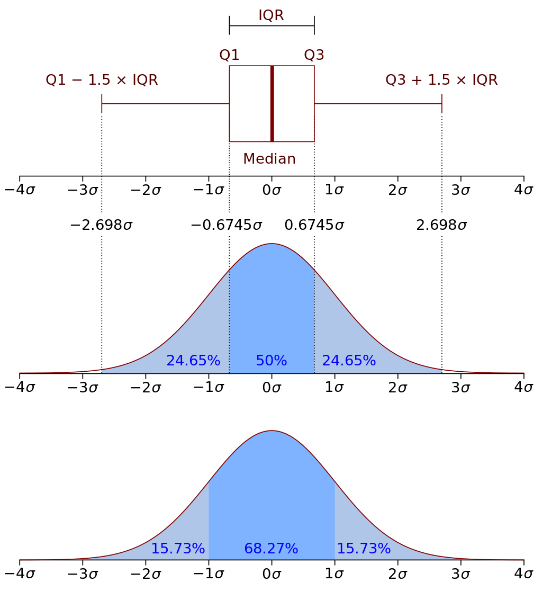

## pandas từ cơ bản đến nâng cao - 3

Sau khi hoàn thành việc tải dữ liệu, chúng ta có thể cần kết nối giữa bảng dữ kiện (fact table) và bảng chiều (dimension table), đây là nền tảng để phân tách dữ liệu theo nhiều chiều; chúng ta cũng có thể đã tải các dữ liệu có cùng cấu trúc từ nhiều nguồn khác nhau và cần ghép nối chúng lại; chúng ta gọi chung các thao tác này là định hình lại dữ liệu (data reshaping). Tất nhiên, do sự khác biệt về mức độ số hóa của doanh nghiệp cũng như trình độ xây dựng nền tảng dữ liệu (data platform), dữ liệu chúng ta nhận được chưa chắc đã có chất lượng tốt, có thể còn cần xử lý thích hợp các giá trị thiếu, giá trị trùng lặp, giá trị ngoại lai (bất thường) trong dữ liệu. Ngay cả khi dữ liệu thu thập được không có vấn đề gì về chất lượng, chúng ta vẫn có thể cần thực hiện một loạt các bước tiền xử lý để đáp ứng nhu cầu phân tích dữ liệu. Tiếp theo, chúng tôi sẽ giải thích và hệ thống hóa kiến thức về khía cạnh này cho các bạn.

### Định hình lại dữ liệu

Đôi khi, dữ liệu thô chúng ta cần cho phân tích dữ liệu có thể không đến từ cùng một nơi. Giống như ví dụ ở chương trước, chúng ta đã đọc ba bảng từ cơ sở dữ liệu quan hệ và thu được ba đối tượng `DataFrame`, nhưng công việc thực tế có thể đòi hỏi chúng ta phải tích hợp dữ liệu của chúng lại với nhau. Ví dụ: `emp_df` và `emp2_df` thực chất đều là dữ liệu nhân viên và có cấu trúc dữ liệu hoàn toàn giống nhau, chúng ta có thể sử dụng hàm `concat` do `pandas` cung cấp để thực hiện ghép nối dữ liệu của hai hoặc nhiều `DataFrame`, đoạn mã như sau:

```Python
all_emp_df = pd.concat([emp_df, emp2_df])
```

Kết quả:

```
        ename    job        mgr      sal     comm    dno
eno
1359    胡一刀    销售员	   3344.0	1800	200.0	30
2056    乔峰	    分析师	    7800.0	 5000	 1500.0	 20
3088    李莫愁	   设计师	   2056.0	3500	800.0	20
3211    张无忌	   程序员	   2056.0	3200	NaN     20
3233    丘处机	   程序员	   2056.0	3400	NaN	    20
3244    欧阳锋	   程序员	   3088.0	3200	NaN     20
3251    张翠山	   程序员	   2056.0	4000	NaN	    20
3344    黄蓉	    销售主管   7800.0	3000	800.0	30
3577    杨过	    会计	     5566.0	  2200	  NaN	  10
3588    朱九真	   会计	    5566.0	 2500	 NaN	 10
4466    苗人凤	   销售员	   3344.0	2500	NaN	    30
5234    郭靖	    出纳	     5566.0	  2000	  NaN	  10
5566    宋远桥	   会计师	   7800.0	4000	1000.0	10
7800    张三丰	   总裁	    NaN      9000	 1200.0	 20
9500	张三丰	   总裁	    NaN	     50000	 8000.0	 20
9600	Vương Đại Chùy    程序员	   9800.0	8000	600.0	20
9700	张三丰	   总裁	    NaN	     60000	 6000.0	 20
9800	jackfrued	    架构师	    7800.0	 30000	 5000.0	 20
9900	陈小刀	   分析师	   9800.0	10000	1200.0	20
```

Đoạn mã trên đã ghép hai `DataFrame` đại diện cho dữ liệu nhân viên lại với nhau. Tiếp theo, chúng ta sử dụng hàm `merge` để kết hợp dữ liệu của bảng nhân viên và bảng phòng ban vào một bảng duy nhất, đoạn mã như sau:

Trước tiên, sử dụng phương thức `reset_index` để đặt lại chỉ mục cho `all_emp_df`, như vậy `eno` sẽ không còn là chỉ mục nữa mà trở thành một cột thông thường. Tham số `inplace` của phương thức `reset_index` được đặt là `True` biểu thị thao tác đặt lại chỉ mục được thực thi trực tiếp trên `all_emp_df`, thay vì trả về một đối tượng mới đã qua sửa đổi.

```Python
all_emp_df.reset_index(inplace=True)
```

Kết hợp dữ liệu thông qua hàm `merge`; tất nhiên bạn cũng có thể gọi phương thức `merge` của đối tượng `DataFrame` để đạt được hiệu quả tương tự.

```Python
pd.merge(all_emp_df, dept_df, how='inner', on='dno')
```

Kết quả:

```
     eno	    ename	job	     mgr	 sal	 comm	 dno	dname	 dloc
0	1359	胡一刀	 销售员	3344.0	1800	200.0	30	   销售部	 重庆
1	3344	黄蓉	  销售主管	7800.0	3000	800.0	30	   销售部	 重庆
2	4466	苗人凤	 销售员	3344.0	2500	NaN	    30	   销售部	 重庆
3	2056	乔峰	  分析师	 7800.0	 5000	 1500.0	 20	    研发部	  成都
4	3088	李莫愁	 设计师	2056.0	3500	800.0	20	   研发部	 成都
5	3211	张无忌  程序员	2056.0	3200	NaN	    20	   研发部	 成都
6	3233	丘处机	 程序员	2056.0	3400	NaN	    20	   研发部	 成都
7	3244	欧阳锋	 程序员	3088.0	3200	NaN	    20	   研发部	 成都
8	3251	张翠山	 程序员	2056.0	4000	NaN	    20	   研发部	 成都
9	7800	张三丰	 总裁	     NaN	 9000	 1200.0	 20	    研发部	  成都
10	9500	张三丰	 总裁	     NaN	 50000	 8000.0	 20	    研发部	  成都
11	9600	Vương Đại Chùy	 程序员	9800.0	8000	600.0	20	   研发部	 成都
12	9700	张三丰	 总裁	     NaN	 60000	 6000.0	 20	    研发部	  成都
13	9800	jackfrued	  架构师	 7800.0	 30000	 5000.0	 20	    研发部	  成都
14	9900	陈小刀	 分析师	9800.0	10000	1200.0	20	   研发部	 成都
15	3577	杨过	  会计	  5566.0  2200	  NaN	  10	会计部	  北京
16	3588	朱九真	 会计	     5566.0	 2500	 NaN	 10	   会计部	 北京
17	5234	郭靖	  出纳	  5566.0  2000	  NaN	  10	会计部	  北京
18	5566	宋远桥	 会计师	7800.0	4000	1000.0	10	  会计部	北京
```

Tham số thứ nhất của hàm `merge` đại diện cho bảng bên trái cần hợp nhất, tham số thứ hai đại diện cho bảng bên phải cần hợp nhất; những bạn có kinh nghiệm lập trình SQL chắc hẳn sẽ cảm thấy hai từ này rất đỗi quen thuộc. Đúng như các bạn suy đoán, việc hợp nhất các đối tượng `DataFrame` rất giống với phép kết nối (JOIN) bảng trong cơ sở dữ liệu, vì vậy `how` trong đoạn mã trên đại diện cho cách thức hợp nhất hai bảng, có bốn tùy chọn: `left`, `right`, `inner`, `outer`; còn `on` đại diện cho cột dùng làm căn cứ để hợp nhất bảng, tương đương với điều kiện kết nối bảng trong SQL. Nếu các cột tương ứng của hai bảng trái và phải có tên khác nhau, bạn có thể sử dụng tham số `left_on` và `right_on` thay cho tham số `on` để chỉ định riêng biệt.

Nếu sửa đổi nhẹ đoạn mã trên bằng cách đổi tham số `how` thành `'right'`, các bạn có thể suy nghĩ xem kết quả thực thi của đoạn mã sẽ như thế nào.

```Python
pd.merge(all_emp_df, dept_df, how='right', on='dno')
```

Kết quả chạy xuất hiện thêm một dòng so với kết quả trước đó như dưới đây. Điều này là do `how='right'` đại diện cho phép kết nối ngoài bên phải (right outer join), đồng nghĩa với việc toàn bộ dữ liệu trong bảng bên phải `dept_df` sẽ được truy vấn đầy đủ, nhưng trong `all_emp_df` lại không có nhân viên nào thuộc phòng ban có mã `40`, do đó các vị trí tương ứng đều được điền giá trị rỗng.

```
19	NaN    NaN    NaN    NaN    NaN     NaN    40    运维部    深圳
```

### Làm sạch dữ liệu

Thông thường, dữ liệu chúng ta nhận được từ Excel, CSV hoặc cơ sở dữ liệu không hề hoàn hảo. Bên trong có thể vì lý do hệ thống hoặc con người mà lẫn các giá trị trùng lặp hay giá trị ngoại lai, cũng có thể tồn tại các giá trị bị thiếu ở một số trường nhất định; hơn nữa, dữ liệu trong `DataFrame` cũng có thể gặp phải nhiều vấn đề như định dạng không đồng nhất, đơn vị đo lường không đồng nhất, v.v. Vì vậy, trước khi bắt đầu phân tích dữ liệu, việc làm sạch dữ liệu trở nên đặc biệt quan trọng.

#### Giá trị thiếu

Có thể sử dụng phương thức `isnull` hoặc `isna` của đối tượng `DataFrame` để tìm các giá trị bị thiếu trong bảng dữ liệu, như sau:

```Python
emp_df.isnull()
```

hoặc

```Python
emp_df.isna()
```

Kết quả:

```
        ename   job	    mgr     sal     comm    dno
eno						
1359	False	False	False	False	False	False
2056	False	False	False	False	False	False
3088	False	False	False	False	False	False
3211	False	False	False	False	True	False
3233	False	False	False	False	True	False
3244	False	False	False	False	True	False
3251	False	False	False	False	True	False
3344	False	False	False	False	False	False
3577	False	False	False	False	True	False
3588	False	False	False	False	True	False
4466	False	False	False	False	True	False
5234	False	False	False	False	True	False
5566	False	False	False	False	False	False
7800	False	False	True	False	False	False
```

Tương ứng, các phương thức `notnull` và `notna` có thể đánh dấu các giá trị không rỗng là `True`. Nếu muốn xóa các giá trị thiếu này, bạn có thể sử dụng phương thức `dropna` của đối tượng `DataFrame`. Tham số `axis` của phương thức này có thể chỉ định xóa dọc theo trục 0 hay trục 1, nghĩa là khi gặp giá trị rỗng thì sẽ xóa toàn bộ hàng hay xóa toàn bộ cột, mặc định là xóa dọc theo trục 0, đoạn mã như sau:

```Python
emp_df.dropna()
```

Kết quả:

```
        ename   job      mgr	 sal    comm     dno
eno						
1359	胡一刀  销售员	3344.0	1800   200.0	30
2056	乔峰    架构师	 7800.0	 5000	1500.0	 20
3088	李莫愁  设计师	2056.0	3500   800.0	20
3344	黄蓉    销售主管	7800.0	3000   800.0	30
5566	宋远桥  会计师	7800.0	4000   1000.0	10
```

Nếu muốn xóa dọc theo trục 1, bạn có thể sử dụng đoạn mã sau:

```Python
emp_df.dropna(axis=1)
```

Kết quả:

```
        ename    job      sal    dno
eno				
1359	胡一刀   销售员    1800	30
2056	乔峰     架构师	  5000	 20
3088	李莫愁   设计师    3500	20
3211	张无忌   程序员    3200	20
3233	丘处机   程序员    3400	20
3244	欧阳锋   程序员    3200	20
3251	张翠山   程序员    4000	20
3344	黄蓉     销售主管  3000	30
3577	杨过     会计	   2200	  10
3588	朱九真   会计	  2500	 10
4466	苗人凤   销售员	 2500   30
5234	郭靖     出纳      2000   10
5566	宋远桥   会计师    4000   10
7800	张三丰   总裁      9000   20
```

> **Lưu ý**: Rất nhiều phương thức của đối tượng `DataFrame` có một tham số tên là `inplace`, giá trị mặc định của tham số này là `False`, biểu thị thao tác của chúng ta sẽ không làm thay đổi đối tượng `DataFrame` ban đầu, mà trả về kết quả đã xử lý thông qua một đối tượng `DataFrame` mới. Nếu đặt giá trị của tham số này thành `True`, thao tác của chúng ta sẽ sửa đổi trực tiếp trên chính `DataFrame` ban đầu, và giá trị trả về của phương thức là `None`. Nói một cách đơn giản, thao tác ở trên không hề thay đổi `emp_df`, mà đã trả về một đối tượng `DataFrame` mới.

Trong một số trường hợp cụ thể, chúng ta có thể điền giá trị cho các ô bị rỗng, phương thức tương ứng là `fillna`. Khi điền giá trị rỗng, bạn có thể dùng một giá trị chỉ định (chỉ định thông qua tham số `value`), cũng có thể dùng giá trị của ô phía trước (bằng cách thiết lập tham số `method='ffill'`) hoặc ô phía sau (bằng cách thiết lập tham số `method='bfill'`) trong bảng, đoạn mã như sau:

```Python
emp_df.fillna(value=0)
```

> **Lưu ý**: Việc lựa chọn giá trị nào để điền vào cũng là một chủ đề đáng bàn luận. Trong công việc thực tế, chúng ta có thể dùng một đại lượng thống kê nào đó (như: giá trị trung bình, yếu vị/mode, v.v.) để điền, hoặc sử dụng một phương pháp nội suy nào đó (như: nội suy ngẫu nhiên, nội suy Lagrange, v.v.) để điền, thậm chí có thể thông qua mô hình hồi quy, mô hình Bayes, v.v. để điền dữ liệu bị thiếu.

Kết quả:

```
        ename    job        mgr      sal     comm    dno
eno
1359	胡一刀    销售员	   3344.0	1800	200.0	30
2056	乔峰	    分析师	    7800.0	 5000	 1500.0	 20
3088	李莫愁	   设计师	   2056.0	3500	800.0	20
3211	张无忌	   程序员	   2056.0	3200	0.0     20
3233	丘处机	   程序员	   2056.0	3400	0.0	    20
3244	欧阳锋	   程序员	   3088.0	3200	0.0     20
3251	张翠山	   程序员	   2056.0	4000	0.0	    20
3344	黄蓉	    销售主管   7800.0	3000	800.0	30
3577	杨过	    会计	     5566.0	  2200	  0.0	  10
3588	朱九真	   会计	    5566.0	 2500	 0.0	 10
4466	苗人凤	   销售员	   3344.0	2500	0.0	    30
5234	郭靖	    出纳	     5566.0	  2000	  0.0	  10
5566	宋远桥	   会计师	   7800.0	4000	1000.0	10
7800	张三丰	   总裁	    0.0      9000	 1200.0	 20
```

#### Giá trị trùng lặp

Tiếp theo, trước tiên chúng ta thêm hai dòng dữ liệu vào bảng phòng ban trước đó, để trong bảng phòng ban có hai phòng ban tên là "Phòng R&D" (研发部) và hai phòng ban tên là "Phòng kinh doanh" (销售部).

```Python
dept_df.loc[50] = {'dname': '研发部', 'dloc': '上海'}
dept_df.loc[60] = {'dname': '销售部', 'dloc': '长沙'}
dept_df
```

Kết quả:

```
    dname  dloc
dno		
10	会计部	北京
20	研发部	成都
30	销售部	重庆
40	运维部	天津
50	研发部	上海
60	销售部	长沙
```

Bây giờ, bảng dữ liệu của chúng ta đã có dữ liệu trùng lặp. Chúng ta có thể thông qua phương thức `duplicated` của đối tượng `DataFrame` để kiểm tra xem có giá trị trùng lặp hay không. Phương thức này khi không chỉ định tham số mặc định sẽ kiểm tra xem chỉ mục hàng có bị trùng hay không, chúng ta cũng có thể chỉ định kiểm tra xem phòng ban có bị trùng lặp dựa trên tên phòng ban `dname`, đoạn mã như sau:

```Python
dept_df.duplicated('dname')
```

Kết quả:

```
dno
10    False
20    False
30    False
40    False
50     True
60     True
dtype: bool
```

Từ kết quả xuất ra ở trên có thể thấy, hai phòng ban `50` và `60` xét về tên phòng ban là bị trùng lặp. Nếu muốn xóa các giá trị trùng lặp, bạn có thể sử dụng phương thức `drop_duplicates`. Tham số `keep` của phương thức này có thể kiểm soát khi gặp giá trị trùng lặp thì giữ lại mục đầu tiên (`first`), giữ lại mục cuối cùng (`last`), hoặc không giữ lại bất kỳ mục trùng lặp nào mà xóa sạch toàn bộ.

```Python
dept_df.drop_duplicates('dname')
```

Kết quả:

```
	dname	dloc
dno		
10	会计部	北京
20	研发部	成都
30	销售部	重庆
40	运维部	天津
```

Đổi giá trị của tham số `keep` thành `last`:

```Python
dept_df.drop_duplicates('dname', keep='last')
```

Kết quả:

```
	dname	dloc
dno		
10	会计部	北京
40	运维部	天津
50	研发部	上海
60	销售部	长沙
```

Bằng cách tương tự, chúng ta cũng có thể làm sạch dữ liệu trùng lặp trong `all_emp_df`. Ví dụ, chúng ta quy định rằng hai trường "ename" và "job" hoàn toàn giống nhau thì coi là dữ liệu trùng lặp, chúng ta có thể dùng đoạn mã sau để loại bỏ dữ liệu trùng lặp:

```python
all_emp_df.drop_duplicates(['ename', 'job'], inplace=True)
```

> **Giải thích**: Phương thức `drop_duplicates` ở trên đã thêm tham số `inplace=True`, phương thức này sẽ không trả về đối tượng `DataFrame` mới mà xóa trực tiếp trên đối tượng `DataFrame` ban đầu, các bạn có thể kiểm tra `all_emp_df` để xem dữ liệu nhân viên trùng lặp đã bị xóa hay chưa.

#### Giá trị ngoại lai

Tên gọi đầy đủ của giá trị ngoại lai (bất thường) trong thống kê là giá trị nghi ngờ ngoại lai, còn gọi là điểm ngoại lai (*outlier*), và việc phân tích giá trị ngoại lai cũng gọi là phân tích điểm ngoại lai. Điểm ngoại lai là các "giá trị cực đoan" xuất hiện trong mẫu, giá trị dữ liệu có vẻ lớn bất thường hoặc nhỏ bất thường, và sự phân bố của chúng lệch rõ rệt so với phần còn lại của các giá trị quan sát. Trong công việc thực tế, một số điểm ngoại lai có thể do hệ thống hoặc con người gây ra, nhưng một số điểm ngoại lai thì không phải vậy, chúng xuất hiện lặp lại và ổn định, thuộc về các giá trị cực đoan bình thường, ví dụ dữ liệu của những người chơi top đầu trong nhiều sản phẩm game thường là những điểm cực đoan ngoại lai. Vì vậy, chúng ta vừa không thể phớt lờ sự tồn tại của điểm ngoại lai, vừa không thể đơn giản loại bỏ chúng khỏi việc phân tích dữ liệu. Chú trọng đến sự xuất hiện của điểm ngoại lai và phân tích nguyên nhân sinh ra chúng thường trở thành cơ hội để phát hiện vấn đề và cải thiện việc ra quyết định.

Việc phát hiện điểm ngoại lai có các phương pháp như Z-score, phương pháp IQR, phân cụm DBSCAN, Isolation Forest (rừng cô lập), v.v. Ở đây chúng tôi sẽ giới thiệu ngắn gọn hai phương pháp đầu tiên.



Nếu dữ liệu tuân theo phân phối chuẩn, theo quy tắc 3σ, giá trị ngoại lai được định nghĩa là giá trị có độ lệch so với giá trị trung bình vượt quá ba lần độ lệch chuẩn. Trong phân phối chuẩn, xác suất xuất hiện của các giá trị nằm ngoài khoảng cách 3σ so với giá trị trung bình là $\small{P(\lvert x - \mu \rvert \gt 3 \sigma) < 0.003}$, thuộc về biến cố có xác suất rất nhỏ. Nếu dữ liệu không tuân theo phân phối chuẩn, chúng ta có thể mô tả bằng số lần độ lệch chuẩn cách xa giá trị trung bình, và số lần ở đây chính là Z-score. Z-score lấy độ lệch chuẩn làm đơn vị để đo khoảng cách lệch của một giá trị thô so với giá trị trung bình, công thức như sau:

$$
z = \frac {X - \mu} {\sigma}
$$

$$
\lvert z \rvert > 3
$$

Z-score cần được quyết định dựa trên kinh nghiệm và tình hình thực tế, thông thường các điểm dữ liệu cách giá trị trung bình từ 3 lần độ lệch chuẩn trở lên được coi là điểm ngoại lai. Đoạn mã dưới đây hướng dẫn cách phát hiện điểm ngoại lai bằng phương pháp Z-score:

```Python
def detect_outliers_zscore(data, threshold=3):
    avg_value = np.mean(data)
    std_value = np.std(data)
    z_score = np.abs((data - avg_value) / std_value)
    return data[z_score > threshold]
```

Trong phương pháp IQR, IQR (*Inter-Quartile Range*) đại diện cho khoảng tứ phân vị, tức là hiệu số giữa tứ phân vị trên (Q3) và tứ phân vị dưới (Q1). Thông thường, có thể coi các giá trị nhỏ hơn $\small{Q1 - 1.5 \times IQR}$ hoặc lớn hơn $\small{Q3 + 1.5 \times IQR}$ là giá trị ngoại lai, và phương pháp phát hiện ngoại lai này cũng chính là phương pháp mặc định được sử dụng trong biểu đồ hộp (sẽ được giới thiệu sau). Đoạn mã dưới đây hướng dẫn cách phát hiện điểm ngoại lai bằng phương pháp IQR:

```Python
def detect_outliers_iqr(data, whis=1.5):
    q1, q3 = np.quantile(data, [0.25, 0.75])
    iqr = q3 - q1
    lower, upper = q1 - whis * iqr, q3 + whis * iqr
    return data[(data < lower) | (data > upper)]
```

Nếu muốn xóa các điểm ngoại lai, bạn có thể sử dụng phương thức `drop` của đối tượng `DataFrame`, phương thức này có thể xóa các hàng hoặc cột chỉ định dựa trên chỉ mục hàng hoặc chỉ mục cột. Ví dụ, chúng ta coi những nhân viên có lương tháng dưới `2000` hoặc trên `8000` là điểm ngoại lai trong bảng nhân viên, có thể dùng đoạn mã sau để xóa các bản ghi tương ứng:

```Python
emp_df.drop(emp_df[(emp_df.sal > 8000) | (emp_df.sal < 2000)].index)
```

Nếu muốn thay thế điểm ngoại lai, bạn có thể thực hiện bằng cách gán giá trị cho ô, hoặc dùng phương thức `replace` để thay thế các giá trị chỉ định. Ví dụ chúng ta muốn thay thế mức lương `1800` và `9000` bằng mức lương trung bình, và thay thế phụ cấp `800` bằng `1000`, đoạn mã như sau:

```Python
avg_sal = np.mean(emp_df.sal).astype(int)
emp_df.replace({'sal': [1800, 9000], 'comm': 800}, {'sal': avg_sal, 'comm': 1000})
```

#### Tiền xử lý dữ liệu

Tiền xử lý dữ liệu cũng là một chủ đề rất lớn, bao gồm các thao tác phân tách, biến đổi, quy giảm (thu gọn), rời rạc hóa dữ liệu, v.v. Trước tiên chúng ta hãy tìm hiểu về việc phân tách dữ liệu. Nếu dữ liệu trong bảng là ngày tháng thời gian, chúng ta thường cần phân tách nó theo các chiều như năm, quý, tháng, ngày, thứ trong tuần, giờ, phút, v.v. Nếu ngày tháng thời gian được biểu diễn dưới dạng chuỗi, trước tiên có thể thông qua hàm `to_datetime` của `pandas` để chuyển đổi nó thành kiểu ngày tháng thời gian.

Trong ví dụ dưới đây, trước tiên chúng ta đọc file Excel để lấy tập dữ liệu bán hàng, trong đó cột đầu tiên là ngày bán hàng, chúng ta phân tách nó thành "tháng", "quý" và "thứ trong tuần", đoạn mã như sau:

```Python
sales_df = pd.read_excel(
    'data/2020年销售数据.xlsx',
    usecols=['销售日期', '销售区域', '销售渠道', '品牌', '销售额']
)
sales_df.info()
```

> **Giải thích**: Đoạn mã trên sử dụng đường dẫn tương đối để lấy file Excel, nghĩa là file Excel nằm trong thư mục mang tên `data` dưới thư mục làm việc hiện tại. Nếu cần file Excel trong ví dụ trên, bạn có thể tải về qua liên kết Baidu Wangpan sau: <https://pan.baidu.com/s/1rQujl5RQn9R7PadB2Z5g_g>, mã trích xuất: e7b4.

Kết quả:

```
<class 'pandas.core.frame.DataFrame'>
RangeIndex: 1945 entries, 0 to 1944
Data columns (total 5 columns):
 #   Column  Non-Null Count  Dtype         
---  ------  --------------  -----         
 0   销售日期    1945 non-null   datetime64[ns]
 1   销售区域    1945 non-null   object        
 2   销售渠道    1945 non-null   object        
 3   品牌        1945 non-null   object        
 4   销售额      1945 non-null   int64         
dtypes: datetime64[ns](1), int64(1), object(3)
memory usage: 76.1+ KB
```

```Python
sales_df['月份'] = sales_df['销售日期'].dt.month
sales_df['季度'] = sales_df['销售日期'].dt.quarter
sales_df['星期'] = sales_df['销售日期'].dt.weekday
sales_df
```

Kết quả:

```
	    销售日期	 销售区域	销售渠道	品牌	  销售额	月份	季度	星期
0	    2020-01-01	上海	     拼多多	 八匹马   8217	    1	 1	   2
1	    2020-01-01	上海	     抖音	      八匹马	6351	 1	  1	    2
2	    2020-01-01	上海	     天猫	      八匹马	14365	 1	  1	    2
3	    2020-01-01	上海	     天猫       八匹马	2366	 1	  1     2
4	    2020-01-01	上海	     天猫 	  皮皮虾	15189	 1	  1     2
...     ...         ...        ...       ...      ...     ...  ...   ...
1940    2020-12-30	北京	     京东	      花花姑娘 6994     12	 4	   2
1941    2020-12-30	福建	     实体	      八匹马	7663	 12	  4	    2
1942    2020-12-31	福建	     实体	      花花姑娘 14795    12	 4	   3
1943    2020-12-31	福建	     抖音	      八匹马	3481	 12	  4	    3
1944    2020-12-31	福建	     天猫	      八匹马	2673	 12	  4	    3
```

Trong đoạn mã trên, thông qua thuộc tính `dt` của đối tượng `Series` kiểu ngày tháng thời gian, chúng ta thu được một đối tượng dùng để truy cập ngày tháng thời gian. Thông qua các thuộc tính của đối tượng này như `year`, `month`, `quarter`, `hour`, v.v., chúng ta có thể lấy được các thông tin thời gian như năm, tháng, quý, giờ, v.v. Kết quả nhận được vẫn là một đối tượng `Series` chứa một tập hợp thông tin thời gian, vì vậy chúng ta cũng thường gọi thuộc tính `dt` này là "vector ngày tháng thời gian".

Tiếp theo, chúng ta hãy nói về việc xử lý dữ liệu kiểu chuỗi. Trước tiên, chúng ta đọc dữ liệu tuyển dụng của một trang web tuyển dụng từ file CSV chỉ định:

```Python
jobs_df = pd.read_csv(
    'data/某招聘网站招聘数据.csv',
    usecols=['city', 'companyFullName', 'positionName', 'salary']
)
jobs_df.info()
```

> **Giải thích**: Đoạn mã trên sử dụng đường dẫn tương đối để lấy file CSV, nghĩa là file CSV nằm trong thư mục mang tên `data` dưới thư mục làm việc hiện tại. Nếu cần file CSV trong ví dụ trên, bạn có thể tải về qua liên kết Baidu Wangpan sau: <https://pan.baidu.com/s/1rQujl5RQn9R7PadB2Z5g_g>, mã trích xuất: e7b4.

Kết quả:

```
<class 'pandas.core.frame.DataFrame'>
RangeIndex: 3140 entries, 0 to 3139
Data columns (total 4 columns):
 #   Column           Non-Null Count  Dtype 
---  ------           --------------  ----- 
 0   city             3140 non-null   object
 1   companyFullName  3140 non-null   object
 2   positionName     3140 non-null   object
 3   salary           3140 non-null   object
dtypes: object(4)
memory usage: 98.2+ KB
```

Xem 5 dòng dữ liệu đầu tiên:

```Python
jobs_df.head()
```

Kết quả:

```
    city    companyFullName              positionName    salary
0   北京	  达疆网络科技（上海）有限公司    数据分析岗       15k-30k
1   北京	  北京音娱时光科技有限公司        数据分析        10k-18k
2   北京	  北京千喜鹤餐饮管理有限公司	     数据分析        20k-30k
3   北京	  吉林省海生电子商务有限公司	     数据分析        33k-50k
4   北京	  韦博网讯科技（北京）有限公司	数据分析        10k-15k
```

Bảng dữ liệu trên có tổng cộng `3140` dòng dữ liệu, nhưng không phải tất cả các vị trí đều là công việc "phân tích dữ liệu" (数据分析). Nếu muốn lọc ra các vị trí phân tích dữ liệu, chúng ta có thể kiểm tra xem trường `positionName` có chứa từ khóa "数据分析" hay không. Ở đây cần so khớp mờ, vậy làm thế nào để thực hiện? Trước tiên chúng ta có thể lấy cột `positionName`. Vì `dtype` của đối tượng `Series` này là chuỗi, nên chúng ta có thể thông qua thuộc tính `str` để lấy vector chuỗi tương ứng, sau đó sử dụng các phương thức xử lý chuỗi quen thuộc để thao tác với nó, đoạn mã như sau:

```Python
jobs_df = jobs_df[jobs_df.positionName.str.contains('数据分析')]
jobs_df.shape
```

Kết quả:

```
(1515, 4)
```

Có thể thấy dữ liệu sau khi lọc còn lại `1515` dòng. Tiếp theo, chúng ta cần xử lý trường `salary`. Nếu muốn thống kê mức lương trung bình của tất cả các vị trí hoặc mức lương trung bình của từng thành phố, trước tiên chúng ta cần chuyển đổi mức lương đang được biểu diễn dưới dạng khoảng thành giá trị ở giữa khoảng đó, đoạn mã như sau:

```Python
jobs_df.salary.str.extract(r'(\d+)[kK]?-(\d+)[kK]?')
```

> **Giải thích**: Đoạn mã trên sử dụng các nhóm bắt giữ của biểu thức chính quy để trích xuất hai nhóm chữ số từ chuỗi, lần lượt tương ứng với mức lương tối thiểu và mức lương tối đa. Những bạn đọc chưa quen với biểu thức chính quy có thể đọc bài viết [《Ứng dụng của biểu thức chính quy》](https://zhuanlan.zhihu.com/p/158929767) trong chuyên mục Zhihu "Học Python từ con số 0" của tác giả.

Kết quả:

```
        0     1
0	    15    30
1	    10	  18
2       20    30
3       33    50
4       10    15
...     ...   ...
3065    8     10
3069    6     10
3070    2     4
3071    6     12
3088    8     12
```

Cần nhắc các bạn lưu ý rằng hai cột dữ liệu được trích xuất ra đều là các giá trị kiểu chuỗi, chúng ta cần chuyển đổi chúng thành kiểu `int` thì mới có thể tính giá trị trung bình; phương thức tương ứng là `applymap` của đối tượng `DataFrame`. Tham số của phương thức này là một hàm, và hàm đó sẽ tác động lên từng phần tử trong `DataFrame`. Sau khi hoàn thành bước này, chúng ta có thể sử dụng phương thức `apply` để tính giá trị ở giữa của `DataFrame` trên; tham số của phương thức `apply` cũng là một hàm, có thể chỉ định tham số `axis` để nó tác động lên hàng hoặc cột của đối tượng `DataFrame`, đoạn mã như sau:

```Python
temp_df = jobs_df.salary.str.extract(r'(\d+)[kK]?-(\d+)[kK]?').applymap(int)
temp_df.apply(np.mean, axis=1)
```

Kết quả:

```
0       22.5
1       14.0
2       25.0
3       41.5
4       12.5
        ... 
3065    9.0
3069    8.0
3070    3.0
3071    9.0
3088    10.0
Length: 1515, dtype: float64
```

Tiếp theo, chúng ta có thể dùng kết quả ở trên để thay thế cột `salary` ban đầu hoặc thêm một cột mới đại diện cho mức lương tương ứng của vị trí tuyển dụng, mã nguồn hoàn chỉnh như sau:

```Python
temp_df = jobs_df.salary.str.extract(r'(\d+)[kK]?-(\d+)[kK]?').applymap(int)
jobs_df['salary'] = temp_df.apply(np.mean, axis=1)
jobs_df.head()
```

Kết quả:

```
    city    companyFullName              positionName    salary
0   北京	  达疆网络科技（上海）有限公司    数据分析岗       22.5
1   北京	  北京音娱时光科技有限公司        数据分析        14.0
2   北京	  北京千喜鹤餐饮管理有限公司	     数据分析        25.0
3   北京	  吉林省海生电子商务有限公司	     数据分析        41.5
4   北京	  韦博网讯科技（北京）有限公司	数据分析        12.5
```

Hai phương thức `applymap` và `apply` thường xuyên được sử dụng trong giai đoạn tiền xử lý dữ liệu. Đối tượng `Series` cũng có phương thức `apply`, cũng dùng cho tiền xử lý dữ liệu. Ngoài ra, đối tượng `DataFrame` còn có một phương thức tên là `transform`, cũng thông qua một hàm truyền vào để biến đổi dữ liệu, tương tự như phương thức `map` của đối tượng `Series`. Cần nhấn mạnh rằng phương thức `apply` có hiệu ứng thu gọn (aggregation / reduction), nói một cách đơn giản là nó có thể xử lý nhiều dữ liệu thành ít dữ liệu hơn hoặc thành một dữ liệu duy nhất; trong khi phương thức `transform` không có hiệu ứng thu gọn, nó chỉ biến đổi dữ liệu, ban đầu có bao nhiêu dòng dữ liệu thì sau khi xử lý vẫn có bấy nhiêu dòng dữ liệu.

Nếu muốn phân tích sâu và khai phá dữ liệu, các kiểu dữ liệu phi số như chuỗi hay ngày tháng thời gian đều cần được xử lý thành dạng số, bởi vì các kiểu phi số không thể tính toán hệ số tương quan, cũng không thể thực hiện kiểm định $\small{\chi^{2}}$ và các thao tác tương tự. Đối với kiểu chuỗi, thông thường có thể chia thành ba loại sau rồi tiến hành xử lý tương ứng:

1. Biến thứ bậc (Ordinal Variable): Dữ liệu biểu diễn bằng chuỗi có quan hệ thứ tự, khi đó có thể tiến hành mã hóa số thứ tự cho chuỗi.
2. Biến phân loại (Categorical Variable) / Biến định danh (Nominal Variable): Dữ liệu biểu diễn bằng chuỗi không có quan hệ lớn nhỏ hay phân cấp thứ bậc, khi đó có thể sử dụng mã hóa one-hot để xử lý thành ma trận biến giả (dummy variable).
3. Biến khoảng cách (Scale Variable): Bản chất chuỗi tương ứng với một dữ liệu có phân biệt cao thấp lớn nhỏ và có thể thực hiện phép cộng trừ, khi đó chỉ cần xử lý chuỗi thành giá trị số tương ứng.

Đối với loại 1 và loại 3, chúng ta có thể dùng phương thức `apply` hoặc `transform` đã đề cập ở trên để xử lý, cũng có thể sử dụng `OrdinalEncoder` trong `scikit-learn` để xử lý chuỗi loại 1, điều này chúng ta sẽ tìm hiểu trong các bài học tiếp theo. Đối với chuỗi loại 2, chúng ta có thể sử dụng hàm `get_dummies()` của `pandas` để tạo ma trận biến giả, đoạn mã như sau:

```Python
persons_df = pd.DataFrame(
    data={
        '姓名': ['关羽', '张飞', '赵云', '马超', '黄忠'],
        '职业': ['医生', '医生', '程序员', '画家', '教师'],
        '学历': ['研究生', '大专', '研究生', '高中', '本科']
    }
)
persons_df
```

Kết quả:

```
	姓名	职业	学历
0	关羽	医生	研究生
1	张飞	医生	大专
2	赵云	程序员	研究生
3	马超	画家	高中
4	黄忠	教师	本科
```

Chuyển nghề nghiệp thành ma trận biến giả:

```Python
pd.get_dummies(persons_df['职业'])
```

Kết quả:

```
    医生 教师  画家  程序员
0	1    0    0    0
1	1    0    0    0
2	0    0    0    1
3	0    0    1    0
4	0    1    0    0
```

Chuyển trình độ học vấn thành các giá trị số có độ lớn khác nhau:

```Python
def handle_education(x):
    edu_dict = {'高中': 1, '大专': 3, '本科': 5, '研究生': 10}
    return edu_dict.get(x, 0)


persons_df['学历'].apply(handle_education)
```

Kết quả:

```
0    10
1     3
2    10
3     1
4     5
Name: 学历, dtype: int64
```

Chúng ta tiếp tục nói về việc rời rạc hóa dữ liệu (discretization). Rời rạc hóa còn gọi là chia thùng (binning). Nếu biến có giá trị liên tục thì nó có vô số khả năng nhận giá trị, khi tiến hành gom nhóm dữ liệu sẽ rất bất tiện; lúc này việc rời rạc hóa biến liên tục trở nên vô cùng quan trọng. Sở dĩ gọi rời rạc hóa là chia thùng là vì chúng ta có thể thiết lập trước một số chiếc thùng, mỗi thùng đại diện cho một khoảng giá trị của dữ liệu, từ đó có thể phân bổ các giá trị liên tục vào các thùng khác nhau, đạt được mục tiêu rời rạc hóa. Ví dụ dưới đây đọc dữ liệu tích lũy điểm định cư Bắc Kinh năm 2018, chúng ta có thể phân nhóm dữ liệu dựa trên điểm định cư, cách làm cụ thể như sau:

```Python
luohu_df = pd.read_csv('data/2018年北京积分落户数据.csv', index_col='id')
luohu_df.score.describe()
```

Kết quả:

```
count    6019.000000
mean       95.654552
std         4.354445
min        90.750000
25%        92.330000
50%        94.460000
75%        97.750000
max       122.590000
Name: score, dtype: float64
```

Có thể thấy điểm định cư cao nhất là `122.59`, thấp nhất là `90.75`, vậy chúng ta có thể tạo ra 7 thùng từ `90` điểm đến `125` điểm, mỗi thùng cách nhau `5` điểm. Hàm `cut` của `pandas` có thể giúp chúng ta thực hiện việc chia thùng dữ liệu, đoạn mã như sau:

```Python
bins = np.arange(90, 126, 5)
pd.cut(luohu_df.score, bins, right=False)
```

> **Giải thích**: Tham số `right` của hàm `cut` có giá trị mặc định là `True`, biểu thị thùng nửa mở nửa đóng: mở bên trái và đóng bên phải; thay đổi thành `False` sẽ giúp biên bên phải của thùng là khoảng mở, còn biên bên trái là khoảng đóng, các bạn nhìn kết quả xuất ra dưới đây sẽ hiểu ngay.

Kết quả:

```
id
1       [120, 125)
2       [120, 125)
3       [115, 120)
4       [115, 120)
5       [115, 120)
           ...    
6015      [90, 95)
6016      [90, 95)
6017      [90, 95)
6018      [90, 95)
6019      [90, 95)
Name: score, Length: 6019, dtype: category
Categories (7, interval[int64, left]): [[90, 95) < [95, 100) < [100, 105) < [105, 110) < [110, 115) < [115, 120) < [120, 125)]
```

Chúng ta có thể dựa vào kết quả chia thùng để gom nhóm dữ liệu, sau đó sử dụng các hàm tổng hợp để thống kê từng nhóm, đây là thao tác rất thường dùng trong phân tích dữ liệu và sẽ được giới thiệu ở chương tiếp theo. Ngoài ra, `pandas` còn cung cấp một hàm tên là `qcut`, có thể chỉ định phân vị để chia thùng dữ liệu, bạn đọc quan tâm có thể tự tìm hiểu thêm.
