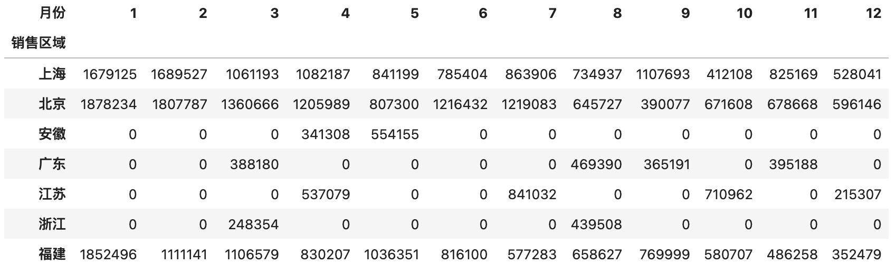
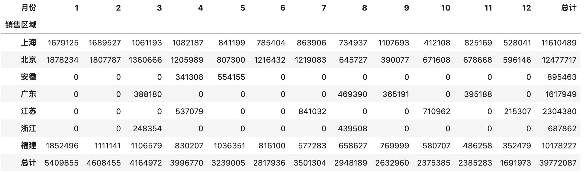
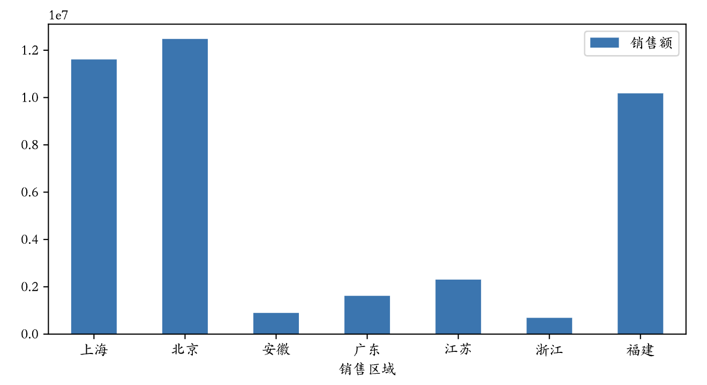
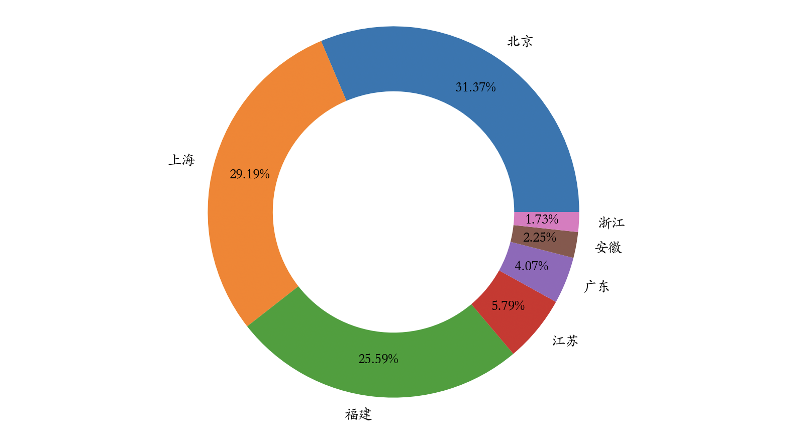

## pandas từ cơ bản đến nâng cao - 4

### Pivot dữ liệu (Data Pivoting)

Qua các bài học trước, chúng ta đã chuẩn bị sẵn sàng dữ liệu và đưa nó về đúng định dạng mong muốn. Tiếp theo là giai đoạn quan trọng nhất: pivot và tổng hợp dữ liệu. Khi có trong tay một lượng lớn dữ liệu, làm thế nào để nhanh chóng đọc ra những thông tin có giá trị, biến dữ liệu phức tạp thành các biểu đồ thống kê dễ hiểu và từ đó đưa ra những hiểu biết sâu sắc (insight) cho hoạt động kinh doanh — đó chính là vấn đề cốt lõi mà phân tích dữ liệu cần giải quyết.

#### Lấy thông tin thống kê mô tả

Đầu tiên, chúng ta có thể lấy thông tin thống kê mô tả của dữ liệu. Qua thông tin thống kê mô tả, chúng ta có thể nắm được xu hướng tập trung và xu hướng phân tán của dữ liệu.

Ví dụ, chúng ta có bảng điểm của học sinh như sau:

```Python
scores = np.random.randint(50, 101, (5, 3))
names = ('关羽', '张飞', '赵云', '马超', '黄忠')
courses = ('语文', '数学', '英语')
df = pd.DataFrame(data=scores, columns=courses, index=names)
df
```

Kết quả:

```
     语文   数学   英语
关羽  96    72    73
张飞  72    70	97
赵云  74    51	79
马超  100   54	54
黄忠  89    100	88
```

Chúng ta có thể thông qua các phương thức của đối tượng `DataFrame` như `mean`, `max`, `min`, `std`, `var`, v.v. để lần lượt lấy điểm trung bình, điểm cao nhất, điểm thấp nhất, độ lệch chuẩn, phương sai của từng học sinh hoặc từng môn học, cũng có thể gọi trực tiếp phương thức `describe` để lấy toàn bộ thông tin thống kê mô tả, như đoạn mã sau:

Tính điểm trung bình của từng môn học:

```Python
df.mean()
```

Kết quả:

```
语文    86.2
数学    69.4
英语    78.2
dtype: float64
```

Tính điểm trung bình của từng học sinh:

```Python
df.mean(axis=1)
```

Kết quả:

```
关羽    80.333333
张飞    79.666667
赵云    68.000000
马超    69.333333
黄忠    92.333333
dtype: float64
```

Tính phương sai điểm số của từng môn học:

```Python
df.var()
```

Kết quả:

```
语文    161.2
数学    379.8
英语    265.7
dtype: float64
```

> **Giải thích**: Qua phương sai có thể thấy điểm môn Toán (数学) biến động lớn nhất, mức độ phân hóa có thể nghiêm trọng hơn.

Lấy thông tin thống kê mô tả của từng môn học:

```Python
df.describe()
```

Kết quả:

```
        语文        数学         英语
count   5.000000	5.000000	5.000000
mean    86.200000	69.400000	78.200000
std     12.696456	19.488458	16.300307
min     72.000000	51.000000	54.000000
25%     74.000000	54.000000	73.000000
50%     89.000000	70.000000	79.000000
75%     96.000000	72.000000	88.000000
max     100.000000	100.000000	97.000000
```

#### Sắp xếp và lấy các giá trị đứng đầu

Nếu cần sắp xếp dữ liệu, bạn có thể sử dụng phương thức `sort_values` của đối tượng `DataFrame`. Tham số `by` của phương thức này chỉ định cột hoặc các cột dùng để sắp xếp, còn tham số `ascending` chỉ định sắp xếp tăng dần hay giảm dần. Ví dụ, đoạn mã sau minh họa cách sắp xếp bảng học sinh giảm dần theo điểm Ngữ văn (语文):

```Python
df.sort_values(by='语文', ascending=False)
```

Kết quả:

```
      语文   数学   英语
马超	100    54	  54
关羽	96     72     73
黄忠	89     100    88
赵云	74     51     79
张飞	72     70     97
```

Nếu lượng dữ liệu của `DataFrame` rất lớn, thao tác sắp xếp sẽ rất tốn thời gian. Đôi khi chúng ta chỉ cần lấy N bản ghi đứng đầu hoặc đứng cuối, lúc này thực tế không cần phải sắp xếp toàn bộ dữ liệu, mà có thể trực tiếp tận dụng cấu trúc heap để tìm ra dữ liệu Top-N. Hai phương thức `nlargest` và `nsmallest` của `DataFrame` cung cấp hỗ trợ cho các thao tác Top-N này, như đoạn mã dưới đây:

Tìm thông tin của 3 học sinh có điểm Ngữ văn (语文) cao nhất:

```Python
df.nlargest(3, '语文')
```

Kết quả:

```
      语文   数学   英语
马超	100    54	  54
关羽	96     72     73
黄忠	89     100    88
```

Tìm thông tin của 3 học sinh có điểm Toán (数学) thấp nhất:

```Python
df.nsmallest(3, '数学')
```

Kết quả:

```
      语文  数学  英语
赵云  74    51	79
马超  100   54	54
张飞  72    70	97
```

#### Nhóm và tổng hợp (Group by & Aggregation)

Trước tiên, chúng ta đọc dữ liệu bán hàng năm 2020 từ tệp Excel đã sử dụng ở các bài trước, sau đó sẽ minh họa cách thực hiện thao tác nhóm và tổng hợp.

```Python
df = pd.read_excel('data/2020年销售数据.xlsx')
df.head()
```

Kết quả:

```
    销售日期	 销售区域   销售渠道  销售订单     品牌    售价  销售数量
0   2020-01-01  上海       拼多多    182894-455  八匹马  99    83
1   2020-01-01  上海       抖音      205635-402  八匹马  219   29
2   2020-01-01  上海       天猫      205654-021  八匹马  169   85
3   2020-01-01  上海       天猫      205654-519  八匹马  169   14
4   2020-01-01  上海       天猫      377781-010  皮皮虾  249   61
```

Nếu muốn thống kê tổng doanh thu theo từng khu vực bán hàng, trước tiên chúng ta có thể tính doanh thu từ "售价" (giá bán) và "销售数量" (số lượng bán), rồi thêm một cột vào `DataFrame`, như đoạn mã sau:

```Python
df['销售额'] = df['售价'] * df['销售数量']
df.head()
```

Kết quả:

```
    销售日期	 销售区域   销售渠道  销售订单     品牌    售价  销售数量  销售额
0   2020-01-01  上海       拼多多    182894-455  八匹马  99    83        8217
1   2020-01-01  上海       抖音      205635-402  八匹马  219   29        6351
2   2020-01-01  上海       天猫      205654-021  八匹马  169   85        14365
3   2020-01-01  上海       天猫      205654-519  八匹马  169   14        2366
4   2020-01-01  上海       天猫      377781-010  皮皮虾  249   61        15189
```

Sau đó dựa theo cột "销售区域" (khu vực bán hàng) để nhóm dữ liệu, ở đây chúng ta sử dụng phương thức `groupby` của đối tượng `DataFrame`. Sau khi nhóm, chúng ta chọn cột "销售额" (doanh thu) để tính tổng bên trong mỗi nhóm, mã nguồn và kết quả như sau:

```Python
df.groupby('销售区域').销售额.sum()
```

Kết quả:

```
销售区域
上海    11610489
北京    12477717
安徽      895463
广东     1617949
江苏     2304380
浙江      687862
福建    10178227
Name: 销售额, dtype: int64
```

Nếu muốn thống kê tổng doanh thu của từng tháng, chúng ta có thể truyền "销售日期" (ngày bán) vào phương thức `groupby`, tất nhiên ở đây cần xử lý "销售日期" thành tháng trước, mã nguồn và kết quả như sau:

```Python
df.groupby(df['销售日期'].dt.month).销售额.sum()
```

Kết quả:

```
销售日期
1     5409855
2     4608455
3     4164972
4     3996770
5     3239005
6     2817936
7     3501304
8     2948189
9     2632960
10    2375385
11    2385283
12    1691973
Name: 销售额, dtype: int64
```

Tiếp theo chúng ta nâng độ khó lên một chút: thống kê tổng doanh thu của từng khu vực bán hàng theo từng tháng thì phải làm thế nào? Trên thực tế, tham số thứ nhất của phương thức `groupby` có thể là một danh sách (list), trong đó chỉ định nhiều tiêu chí nhóm khác nhau, hãy xem mã nguồn và kết quả xuất ra dưới đây để hiểu rõ hơn:

```Python
df.groupby(['销售区域', df['销售日期'].dt.month]).销售额.sum()
```

Kết quả:

```
销售区域  销售日期
上海    1       1679125
        2       1689527
        3       1061193
        4       1082187
        5        841199
        6        785404
        7        863906
        8        734937
        9       1107693
        10       412108
       11       825169
       12       528041
北京    1       1878234
        2       1807787
        3       1360666
        4       1205989
        5        807300
        6       1216432
        7       1219083
        8        645727
        9        390077
        10       671608
        11       678668
        12       596146
安徽    4        341308
        5        554155
广东    3        388180
        8        469390
        9        365191
        11       395188
江苏    4        537079
        7        841032
        10       710962
        12       215307
浙江    3        248354
        8        439508
福建    1       1852496
        2       1111141
        3       1106579
        4        830207
        5       1036351
        6        816100
        7        577283
        8        658627
        9        769999
        10       580707
        11       486258
        12       352479
Name: 销售额, dtype: int64
```

Nếu muốn thống kê tổng doanh thu của từng khu vực cũng như giá trị đơn hàng cao nhất và thấp nhất của từng khu vực, chúng ta có thể sử dụng phương thức `agg` trên đối tượng `DataFrame` hoặc `Series` và chỉ định nhiều hàm tổng hợp, mã nguồn và kết quả như sau:

```Python
df.groupby('销售区域').销售额.agg(['sum', 'max', 'min'])
```

Kết quả:

```
           sum     max   min
销售区域                        
上海    11610489  116303   948
北京    12477717  133411   690
安徽      895463   68502  1683
广东     1617949  120807   990
江苏     2304380  114312  1089
浙江      687862   90909  3927
福建    10178227   87527   897
```

Nếu muốn tùy chỉnh tên các cột sau khi tổng hợp, có thể sử dụng cách làm như sau:

```Python
df.groupby('销售区域').销售额.agg(销售总额='sum', 单笔最高='max', 单笔最低='min')
```

Kết quả:

```
          销售总额    单笔最高  单笔最低
销售区域                        
上海      11610489     116303     948
北京      12477717     133411     690
安徽        895463      68502    1683
广东       1617949     120807     990
江苏       2304380     114312    1089
浙江        687862      90909    3927
福建      10178227      87527     897
```

Nếu cần áp dụng các hàm tổng hợp khác nhau cho nhiều cột, ví dụ "thống kê tổng doanh thu cùng với giá trị thấp nhất và cao nhất của số lượng bán theo từng khu vực bán hàng", chúng ta có thể thao tác theo cách sau:

```Python
df.groupby('销售区域')[['销售额', '销售数量']].agg({
    '销售额': 'sum', '销售数量': ['max', 'min']
})
```

Kết quả:

```
           销售额  销售数量    
           sum    max min
销售区域                   
上海    11610489  100  10
北京    12477717  100  10
安徽      895463   98  16
广东     1617949   98  10
江苏     2304380  100  11
浙江      687862   95  20
福建    10178227  100  10
```

#### Bảng pivot và bảng chéo (Pivot table & Crosstab)

Trong ví dụ trên, việc "thống kê tổng doanh thu của từng khu vực bán hàng theo từng tháng" sẽ tạo ra một kết quả trông rất dài. Trong thực tế công việc, chúng ta thường gọi các bảng có rất nhiều hàng nhưng ít cột là "bảng hẹp" (narrow table). Nếu không muốn nhận một "bảng hẹp" như vậy, bạn có thể sử dụng phương thức `pivot_table` của `DataFrame` hoặc hàm `pivot_table` để tạo bảng pivot. Bản chất của bảng pivot là thực hiện thao tác nhóm và tổng hợp dữ liệu, **thống kê trên cột B dựa theo cột A**. Nếu bạn đã từng sử dụng Excel, chắc hẳn khái niệm bảng pivot không còn xa lạ. Ví dụ, chúng ta muốn "thống kê tổng doanh thu theo từng khu vực bán hàng", thì "销售区域" (khu vực bán hàng) chính là cột A, còn "销售额" (doanh thu) chính là cột B của chúng ta, trong hàm `pivot_table` tương ứng lần lượt với các tham số `index` và `values`, cả hai tham số này đều có thể là một cột đơn lẻ hoặc nhiều cột.

```Python
pd.pivot_table(df, index='销售区域', values='销售额', aggfunc='sum')
```

Kết quả:

```
           销售额
销售区域          
上海    11610489
北京    12477717
安徽      895463
广东     1617949
江苏     2304380
浙江      687862
福建    10178227
```

> **Lưu ý**: Kết quả thao tác trên có một chút khác biệt so với kết quả thu được bằng cách dùng `groupby` trước đó: sau thao tác `groupby`, nếu tổng hợp trên một cột đơn lẻ, kết quả thu được là một đối tượng `Series`, trong khi kết quả ở trên là một đối tượng `DataFrame`.

Nếu muốn thống kê tổng doanh thu của từng khu vực bán hàng theo từng tháng, bạn cũng có thể sử dụng hàm `pivot_table`, như đoạn mã sau:

```Python
df['月份'] = df['销售日期'].dt.month
pd.pivot_table(df, index=['销售区域', '月份'], values='销售额', aggfunc='sum')
```

Kết quả của thao tác trên là một `DataFrame`, nhưng cũng là một "bảng hẹp" dài. Nếu muốn biến nó thành một "bảng rộng" (wide table) có ít hàng nhưng nhiều cột hơn, bạn có thể chuyển cột trong tham số `index` sang tham số `columns`, mã nguồn như sau:

```Python
pd.pivot_table(df, index='销售区域', columns='月份', values='销售额', aggfunc='sum', fill_value=0)
```

> **Giải thích**: `fill_value=0` của hàm `pivot_table` sẽ thay thế các giá trị rỗng bằng `0`.

Kết quả:



Khi sử dụng hàm `pivot_table`, bạn còn có thể thông qua việc thêm các tham số `margins` và `margins_name` để thực hiện tính tổng/tổng kết cho kết quả nhóm và tổng hợp, thao tác cụ thể và hiệu ứng hiển thị như sau:

```Python
pd.pivot_table(df, index='销售区域', columns='月份', values='销售额', aggfunc='sum', fill_value=0, margins=True, margins_name='总计')
```

Kết quả:



Bảng chéo (crosstab) là một dạng bảng pivot đặc biệt. Nó không cần phải dựng sẵn một đối tượng `DataFrame`, mà trực tiếp thông qua mảng hoặc đối tượng `Series` chỉ định hai hoặc nhiều yếu tố để tính toán và thu về kết quả thống kê. Ví dụ, chúng ta muốn thống kê tổng doanh thu theo từng khu vực bán hàng, cũng có thể thực hiện theo cách thức như sau, trước tiên chúng ta chuẩn bị ba nhóm dữ liệu:

```Python
sales_area, sales_month, sales_amount = df['销售区域'], df['月份'], df['销售额']
```

Sử dụng hàm `crosstab` để tạo bảng chéo:

```Python
pd.crosstab(index=sales_area, columns=sales_month, values=sales_amount, aggfunc='sum').fillna(0).astype('i8')
```

> **Giải thích**: Đoạn mã trên sử dụng phương thức `fillna` của đối tượng `DataFrame` để xử lý các giá trị rỗng thành 0, sau đó dùng phương thức `astype` để chuyển kiểu dữ liệu thành số nguyên.

### Trình bày dữ liệu

Một hình ảnh đáng giá ngàn lời nói, kết quả sau khi pivot và tổng hợp dữ liệu cuối cùng cần phải được trình bày thông qua biểu đồ, bởi biểu đồ có sức biểu đạt trực quan vô cùng mạnh mẽ, giúp chúng ta nhanh chóng nhận ra các giá trị ẩn chứa bên trong dữ liệu. Tương tự như `Series`, đối tượng `DataFrame` cũng cung cấp phương thức `plot` hỗ trợ vẽ biểu đồ, bên dưới vẫn sử dụng thư viện `matplotlib` để render biểu đồ. Về nội dung chi tiết của `matplotlib`, chúng ta sẽ tìm hiểu sâu ở chương tiếp theo, ở đây chúng ta chỉ tìm hiểu sơ lược cách sử dụng phương thức `plot`.

Ví dụ, chúng ta muốn so sánh "tổng doanh thu của từng khu vực bán hàng" qua một biểu đồ cột (bar chart), có thể trực tiếp gọi phương thức `plot` trên bảng pivot để tạo biểu đồ cột. Trước tiên chúng ta import module `matplotlib.pyplot`, đồng thời điều chỉnh tham số vẽ đồ thị để hỗ trợ hiển thị tiếng Trung (nếu cần):

```Python
import matplotlib.pyplot as plt

plt.rcParams['font.sans-serif'] = 'FZJKai-Z03S'
```

> **Giải thích**: `FZJKai-Z03S` ở trên là tên của một font chữ hỗ trợ tiếng Trung đã được cài đặt trên máy tính của tôi. Tên font chữ có thể tìm thấy trong tệp `fontlist-v330.json` nằm trong thư mục `.matplotlib` ở thư mục home của người dùng, tệp này sẽ được tạo ra sau khi thực thi câu lệnh trên.

Sử dụng lệnh magic để cấu hình xuất biểu đồ dạng vector (SVG):

```Python
%config InlineBackend.figure_format = 'svg'
```

Vẽ biểu đồ cột "tổng doanh thu của từng khu vực bán hàng":

```Python
temp = pd.pivot_table(df, index='销售区域', values='销售额', aggfunc='sum')
temp.plot(figsize=(8, 4), kind='bar')
plt.xticks(rotation=0)
plt.show()
```

> **Giải thích**: Dòng mã thứ 3 ở trên sẽ xoay chữ trên vạch chia của trục hoành về 0 độ, dòng mã thứ 4 sẽ hiển thị biểu đồ.

Kết quả:



Nếu muốn vẽ biểu đồ tròn (pie chart), bạn có thể đổi tham số `kind` của phương thức `plot` thành `pie`, sau đó sử dụng các tham số tùy chỉnh biểu đồ tròn để điều chỉnh, mã nguồn như sau:

```Python
temp.sort_values(by='销售额', ascending=False).plot(
    figsize=(6, 6),
    kind='pie',
    y='销售额',
    ylabel='',
    autopct='%.2f%%',
    pctdistance=0.8,
    wedgeprops=dict(linewidth=1, width=0.35),
    legend=False
)
plt.show()
```

Kết quả:


