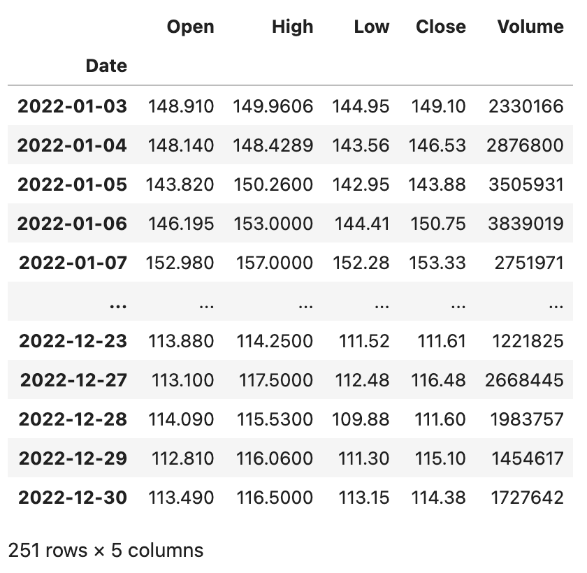
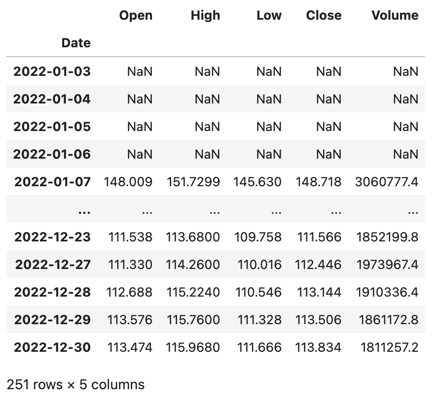
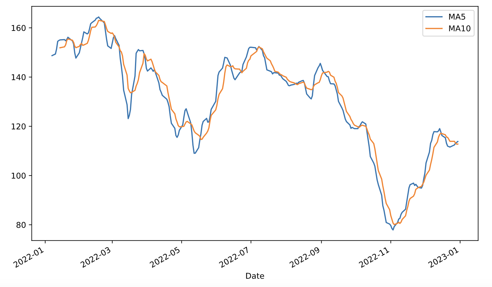
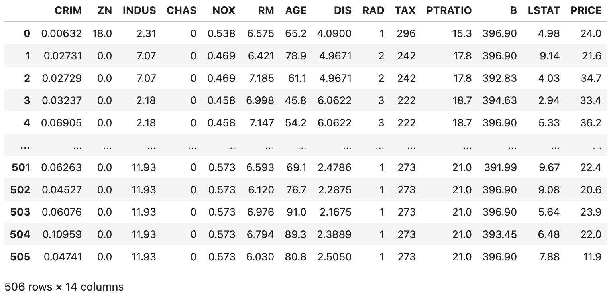
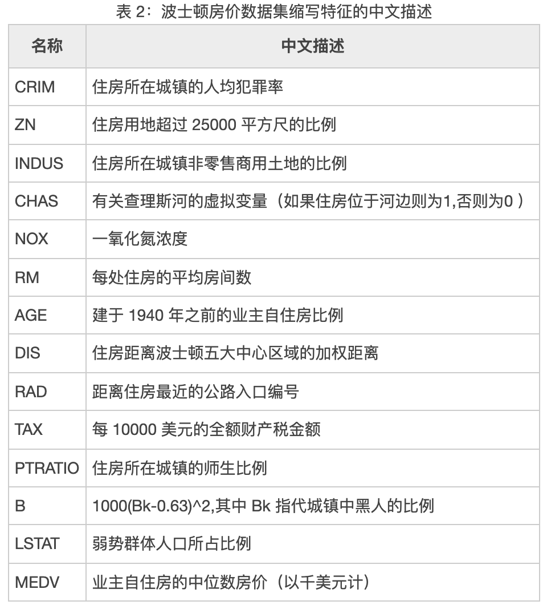
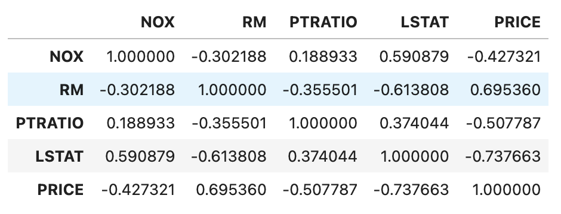
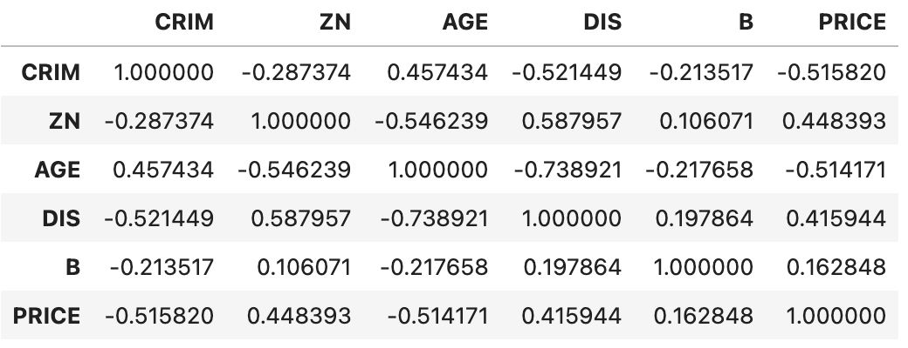

## pandas từ cơ bản đến nâng cao - 5

Chúng ta cùng bổ sung thêm một số thao tác hữu ích khi sử dụng `DataFrame` để phân tích dữ liệu, những thao tác này không chỉ phổ biến mà còn rất quan trọng.

### Tính toán so với cùng kỳ (YoY) và so với kỳ trước (MoM)

Trước đây chúng ta đã từng nói về ví dụ thống kê doanh thu theo tháng, chúng ta có thể dùng phương thức `groupby` để nhóm và tổng hợp, hoặc dùng `pivot_table` để tạo bảng pivot, như sau:

```python
sales_df = pd.read_excel('data/2020年销售数据.xlsx')
sales_df['月份'] = sales_df.销售日期.dt.month
sales_df['销售额'] = sales_df.售价 * sales_df.销售数量
result_df = sales_df.pivot_table(index='月份', values='销售额', aggfunc='sum')
result_df.rename(columns={'销售额': '本月销售额'}, inplace=True)
result_df
```

Kết quả:

```
      本月销售额
月份         
1       5409855
2       4608455
3       4164972
4       3996770
5       3239005
6       2817936
7       3501304
8       2948189
9       2632960
10      2375385
11      2385283
12      1691973
```

Sau khi có được doanh thu theo tháng, nếu chúng ta cần tính mức tăng trưởng theo tháng (MoM - Month-on-Month / liên hoàn / hoàn tỉ), ở đây có hai phương án. Phương án thứ nhất là chúng ta có thể sử dụng phương thức `shift` để dịch chuyển dữ liệu, đưa dữ liệu của tháng trước khớp hàng với tháng này, rồi tính qua công thức `(doanh thu tháng này - doanh thu tháng trước) / doanh thu tháng trước`, mã nguồn như sau:

```python
result_df['上月销售额'] = result_df.本月销售额.shift(1)
result_df
```

Kết quả:

```
      本月销售额      上月销售额
月份                    
1       5409855            NaN
2       4608455      5409855.0
3       4164972      4608455.0
4       3996770      4164972.0
5       3239005      3996770.0
6       2817936      3239005.0
7       3501304      2817936.0
8       2948189      3501304.0
9       2632960      2948189.0
10      2375385      2632960.0
11      2385283      2375385.0
12      1691973      2385283.0
```

Trong ví dụ trên, tham số của phương thức `shift` là `1` đại diện cho việc dịch chuyển dữ liệu xuống một ô, dĩ nhiên chúng ta cũng có thể dùng tham số `-1` để dịch chuyển dữ liệu lên một ô. Chắc hẳn bạn cũng đoán ra, nếu có dữ liệu của nhiều năm, chúng ta có thể đặt tham số thành `12`, khi đó sẽ tính được mức tăng trưởng so với cùng kỳ năm trước (YoY - Year-on-Year / đồng tỉ) cho từng tháng.

```python
result_df['环比'] = (result_df.本月销售额 - result_df.上月销售额) / result_df.上月销售额
result_df.style.format(
    formatter={'上月销售额': '{:.0f}', '环比': '{:.2%}'},
    na_rep='--------'
)
```

Kết quả:

```
      本月销售额      上月销售额         环比
月份                    
1       5409855       --------     -------- 
2       4608455        5409855      -14.81%     
3       4164972        4608455       -9.62%
4       3996770        4164972       -4.04%
5       3239005        3996770      -18.96%
6       2817936        3239005      -13.00%
7       3501304        2817936       24.25%
8       2948189        3501304      -15.80%
9       2632960        2948189      -10.69%
10      2375385        2632960       -9.78%
11      2385283        2375385        0.42%
12      1691973        2385283      -29.07%
```

> **Giải thích**: Khi sử dụng JupyterLab, có thể thông qua thuộc tính `style` của đối tượng `DataFrame` để định dạng hiển thị trên trang web. Đoạn mã trên sử dụng phương thức `format` của đối tượng `Styler` để định dạng tỷ lệ tăng trưởng theo tháng thành phần trăm, ngoài ra còn chỉ định thay thế giá trị rỗng bằng `--------`.

Phương án thứ hai đơn giản hơn là sử dụng trực tiếp phương thức `pct_change` để tính tỷ lệ phần trăm thay đổi. Trước tiên chúng ta xóa hai cột "上月销售额" và "环比" đã tạo trước đó đi.

```python
result_df.drop(columns=['上月销售额', '环比'], inplace=True)
```

Tiếp theo, chúng ta sử dụng phương thức `pct_change` của đối tượng `DataFrame` để tính toán tỷ lệ tăng trưởng theo tháng. Đáng chú ý là phương thức `pct_change` có một tham số tên là `periods`, giá trị mặc định của nó là `1`, tính tỷ lệ phần trăm thay đổi giữa hai mục dữ liệu liền kề, đây chẳng phải chính là tỷ lệ tăng trưởng liên hoàn mà chúng ta muốn hay sao? Nếu có dữ liệu nhiều năm, khi tính toán chỉ cần sửa giá trị tham số này thành `12`, là có thể thu được tỷ lệ tăng trưởng so với cùng kỳ năm trước cho từng tháng.

```python
result_df['环比'] = result_df.pct_change()
result_df
```

### Tính toán cửa sổ trượt (Rolling Window Calculation)

Phương thức `rolling` của đối tượng `DataFrame` cho phép chúng ta đặt dữ liệu vào một cửa sổ trượt, sau đó dùng các hàm để tính toán và xử lý dữ liệu trong cửa sổ đó. Ví dụ, chúng ta lấy được dữ liệu thời gian gần đây của một cổ phiếu, muốn tính đường trung bình động 5 ngày (MA5) và 10 ngày (MA10), thì cần phải thiết lập cửa sổ trượt trước rồi mới tính toán. Trước tiên, chúng ta dùng đoạn mã dưới đây để đọc dữ liệu cổ phiếu của Baidu năm 2022, tệp dữ liệu có thể tải về qua liên kết bên dưới.

```Python
baidu_df = pd.read_excel('data/2022年股票数据.xlsx', sheet_name='BIDU', index_col='Date')
baidu_df.sort_index(inplace=True)
baidu_df
```

Kết quả:



`DataFrame` ở trên có 5 cột gồm `Open`, `High`, `Low`, `Close`, `Volume`, lần lượt đại diện cho giá mở cửa, giá cao nhất, giá thấp nhất, giá đóng cửa và khối lượng giao dịch của cổ phiếu. Tiếp theo, chúng ta thực hiện tính toán cửa sổ trượt trên dữ liệu cổ phiếu của Baidu:

```Python
baidu_df.rolling(5).mean()
```

Kết quả:



Chúng ta cũng có thể sử dụng `rolling` trên `Series` để thiết lập cửa sổ trượt và hoàn thành tính toán bên trong cửa sổ. Ví dụ, chúng ta có thể tính đường trung bình động 5 ngày và 10 ngày cho giá đóng cửa (cột `Close`) của cổ phiếu Baidu ở trên, rồi dùng hàm `merge` để ghép chúng vào cùng một đối tượng `DataFrame` và vẽ biểu đồ đường trung bình động kép, như đoạn mã sau:

```Python
close_ma5 = baidu_df.Close.rolling(5).mean()
close_ma10 = baidu_df.Close.rolling(10).mean()
result_df = pd.merge(close_ma5, close_ma10, left_index=True, right_index=True)
result_df.rename(columns={'Close_x': 'MA5', 'Close_y': 'MA10'}, inplace=True)
result_df.plot(kind='line', figsize=(10, 6))
plt.show()
```

Kết quả:



### Xác định tương quan (Correlation)

Trong thống kê học, chúng ta thường sử dụng hiệp phương sai (covariance) để đo lường mức độ biến thiên đồng thời của hai biến ngẫu nhiên. Nếu giá trị lớn hơn của biến $\small{X}$ chủ yếu tương ứng với giá trị lớn hơn của biến $\small{Y}$, và các giá trị nhỏ hơn của cả hai cũng tương ứng với nhau, thì hai biến có xu hướng thể hiện hành vi tương tự, hiệp phương sai mang dấu dương. Nếu giá trị lớn hơn của một biến chủ yếu tương ứng với giá trị nhỏ hơn của biến kia, thì hai biến có xu hướng thể hiện hành vi trái ngược, hiệp phương sai mang dấu âm. Nói một cách đơn giản, dấu của hiệp phương sai cho thấy chiều hướng tương quan giữa hai biến. Phương sai là một trường hợp đặc biệt của hiệp phương sai, tức là hiệp phương sai của một biến với chính nó.

$$
cov(X,Y) = E((X - \mu)(Y - \upsilon)) = E(X \cdot Y) - \mu\upsilon
$$

Nếu $\small{X}$ và $\small{Y}$ độc lập thống kê với nhau, thì hiệp phương sai giữa chúng bằng 0, điều này là do trong trường hợp $\small{X}$ và $\small{Y}$ độc lập:

$$
E(X \cdot Y) = E(X) \cdot E(Y) = \mu\upsilon
$$

Độ lớn của giá trị hiệp phương sai phụ thuộc vào thang đo độ lớn của biến, thường không dễ để diễn giải trực tiếp, nhưng hiệp phương sai ở dạng chuẩn hóa có thể cho thấy độ mạnh yếu của mối quan hệ tuyến tính giữa hai biến. Trong thống kê học, hệ số tương quan tích - mômen Pearson (Pearson correlation coefficient) chính là dạng chuẩn hóa của hiệp phương sai, nó được dùng để đo lường mức độ tương quan (tương quan tuyến tính) giữa hai biến $\small{X}$ và $\small{Y}$, giá trị của nó nằm trong khoảng từ -1 đến 1.

$$
\frac {cov(X, Y)} {\sigma_{X}\sigma_{Y}}
$$

Ước lượng hiệp phương sai và độ lệch chuẩn của mẫu, ta có thể thu được hệ số Pearson mẫu, thường được ký hiệu bằng chữ cái Hy Lạp $\small{\rho}$.

$$
\rho = \frac {\sum_{i=1}^{n}(X_i - \bar{X})(Y_i - \bar{Y})} {\sqrt{\sum_{i=1}^{n}(X_i - \bar{X})^2} \sqrt{\sum_{i=1}^{n}(Y_i - \bar{Y})^2}}
$$

Khi dùng giá trị $\small{\rho}$ để phán đoán mức độ tương quan giữa các chỉ số, chúng ta tuân theo hai bước sau:

1. Xác định mối quan hệ giữa các chỉ số là tương quan thuận, tương quan nghịch hay không tương quan:
    - Khi $\small{\rho \gt 0}$, coi các biến có tương quan thuận (dương), tức là xu hướng biến thiên của cả hai cùng chiều.
    - Khi $\small{\rho \lt 0}$, coi các biến có tương quan nghịch (âm), tức là xu hướng biến thiên của cả hai ngược chiều.
    - Khi $\small{\rho \approx 0}$, coi các biến không có tương quan tuyến tính, nhưng điều này không đồng nghĩa với việc hai chỉ số độc lập thống kê với nhau.
2. Xác định mức độ tương quan giữa các chỉ số:
    - Khi giá trị tuyệt đối của $\small{\rho}$ nằm trong khoảng $\small{[0.6, 1]}$, coi các biến có tương quan mạnh.
    - Khi giá trị tuyệt đối của $\small{\rho}$ nằm trong khoảng $\small{[0.1, 0.6)}$, coi các biến có tương quan yếu.
    - Khi giá trị tuyệt đối của $\small{\rho}$ nằm trong khoảng $\small{[0, 0.1)}$, coi giữa các biến không có tương quan.

Hệ số tương quan Pearson áp dụng cho trường hợp:

1. Mối quan hệ giữa hai biến là quan hệ tuyến tính, cả hai đều là dữ liệu liên tục.
2. Tổng thể của hai biến tuân theo phân phối chuẩn, hoặc phân phối đơn đỉnh gần chuẩn.
3. Các giá trị quan sát của hai biến tạo thành từng cặp, và mỗi cặp giá trị quan sát độc lập với nhau.

Nhân đây, chúng ta cũng nói thêm, nếu hai nhóm biến không phải là các giá trị liên tục đến từ tổng thể chuẩn, thì làm thế nào để xác định mức độ tương quan? Đối với thang đo thứ bậc (thứ hạng / xếp hạng), chúng ta có thể sử dụng hệ số tương quan hạng Spearman (Spearman's rank correlation coefficient), công thức tính như sau:

$$
r_{s}=1-{\frac {6\sum d_{i}^{2}}{n(n^{2}-1)}}
$$

Trong đó, $\small{d_{i}=\operatorname {R} (X_{i})-\operatorname {R} (Y_{i})}$, tức là hiệu số giữa các thứ hạng của hai biến trong mỗi cặp quan sát, và $\small{n}$ là số lượng mẫu quan sát.

Đối với thang đo định danh (phân loại), chúng ta có thể sử dụng kiểm định Chi bình phương (Chi-square test) để xác định xem chúng có liên quan với nhau hay không. Thực ra trong nhiều trường hợp, các giá trị liên tục cũng có thể được chia nhóm (binning) thành các thứ hạng hoặc danh mục rời rạc, sau đó dùng hệ số tương quan hạng Spearman hoặc kiểm định Chi bình phương để xác định tính tương quan.

Phương thức `cov` và `corr` của đối tượng `DataFrame` lần lượt được dùng để tính hiệp phương sai và hệ số tương quan. Phương thức `corr` có một tham số mang tên `method`, giá trị mặc định của nó là `pearson`, biểu thị việc tính hệ số tương quan Pearson; ngoài ra, bạn cũng có thể chỉ định `kendall` hoặc `spearman` để tính hệ số Kendall hoặc hệ số tương quan hạng Spearman.

Chúng ta lấy tập dữ liệu giá nhà ở Boston nổi tiếng từ tệp `boston_house_price.csv` để tạo một `DataFrame`:

```python
boston_df = pd.read_csv('data/boston_house_price.csv')
boston_df
```

Kết quả:



> **Giải thích**: Đoạn mã trên sử dụng đường dẫn tương đối để truy cập tệp CSV, nghĩa là tệp CSV nằm trong thư mục mang tên `data` dưới thư mục làm việc hiện tại. Nếu cần tệp CSV trong ví dụ trên, có thể tải qua liên kết Baidu Netdisk sau: Liên kết: <https://pan.baidu.com/s/1rQujl5RQn9R7PadB2Z5g_g?pwd=e7b4>, mã trích xuất: e7b4.

Có thể thấy, tập dữ liệu này chứa nhiều đặc trưng ảnh hưởng đến giá nhà, bao gồm tỷ lệ tội phạm, nồng độ oxit nitơ, số phòng trung bình, tỷ lệ dân số thu nhập thấp, v.v., trong đó `PRICE` đại diện cho giá nhà, tình hình cụ thể như sau:



Tiếp theo, chúng ta chọn ra các giá trị liên tục có thể coi là đến từ tổng thể chuẩn, dùng phương thức `corr` để tính hệ số tương quan Pearson, xem những yếu tố nào có quan hệ tương quan thuận hoặc nghịch với giá nhà, mã nguồn như sau:

```Python
boston_df[['NOX', 'RM', 'PTRATIO', 'LSTAT', 'PRICE']].corr()
```

Kết quả:



Có thể thấy, số phòng trung bình (`RM`) có tương quan thuận khá mạnh với giá nhà, trong khi tỷ lệ dân số thu nhập thấp (`LSTAT`) lại có tương quan nghịch rõ rệt với giá nhà.

Hệ số tương quan hạng Spearman không đòi hỏi các điều kiện dữ liệu khắt khe như hệ số tương quan Pearson. Chỉ cần các giá trị quan sát của hai biến là dữ liệu thứ bậc ghép cặp, hoặc dữ liệu chuyển đổi từ biến liên tục sang thứ bậc, bất kể hình dạng phân phối tổng thể của hai biến hay kích thước mẫu thế nào, đều có thể sử dụng hệ số tương quan hạng Spearman để nghiên cứu. Chúng ta có thể tiền xử lý một số đặc trưng theo cách sau, rồi tính hệ số tương quan hạng Spearman:

```Python
boston_df['CRIM'] = boston_df.CRIM.apply(lambda x: x // 5 if x < 25 else 5).map(int)
boston_df['ZN'] = pd.qcut(boston_df.ZN, q=[0, 0.75, 0.8, 0.85, 0.9, 0.95, 1], labels=np.arange(6))
boston_df['AGE'] = (boston_df.AGE // 20).map(int)
boston_df['DIS'] = (boston_df.DIS // 2.05).map(int)
boston_df['B'] = (boston_df.B // 66).map(int)
boston_df['PRICE'] = pd.qcut(boston_df.PRICE, q=[0, 0.15, 0.3, 0.5, 0.7, 0.85, 1], labels=np.arange(6))
boston_df[['CRIM', 'ZN', 'AGE', 'DIS', 'B', 'PRICE']].corr(method='spearman')
```

Kết quả:



Có thể thấy, giữa giá nhà và tỷ lệ tội phạm (`CRIM`) cùng tuổi nhà (`AGE`) có mối tương quan nghịch tương đối rõ ràng, và có tương quan thuận nhẹ với quy mô đất thổ cư (`ZN`). Mối tương quan có thể giúp chúng ta tìm ra đòn bẩy nghiệp vụ trong thực tế công việc, tức là tìm ra các yếu tố liên quan có khả năng tác động hoặc làm thay đổi kết quả công việc.
