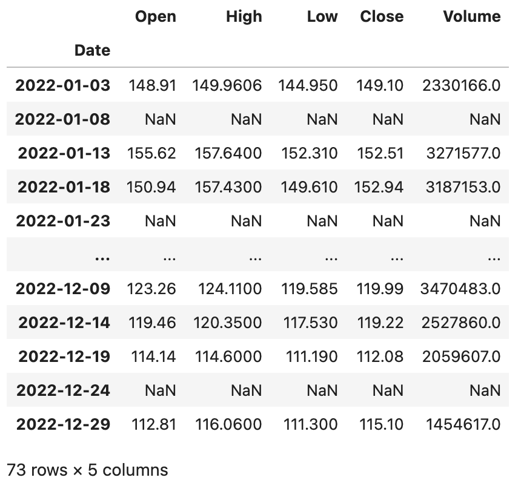
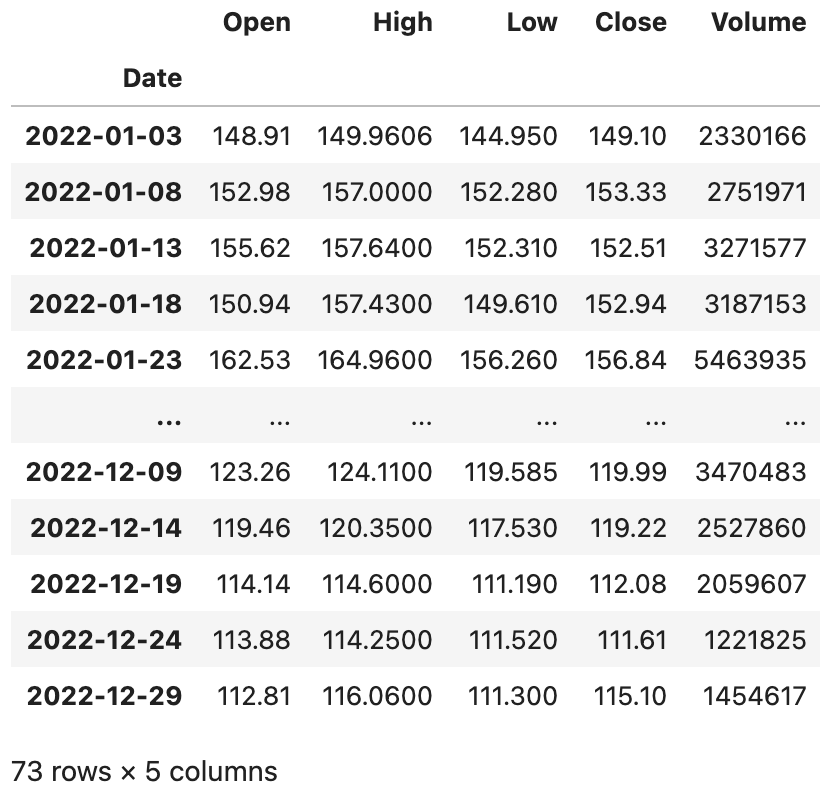
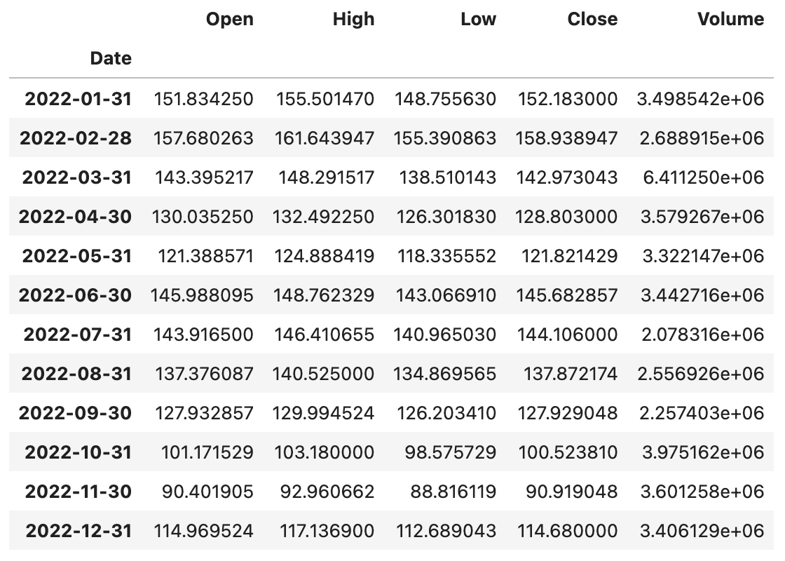
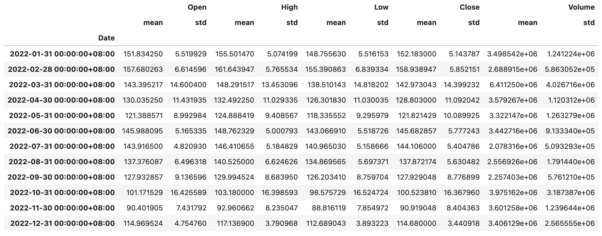
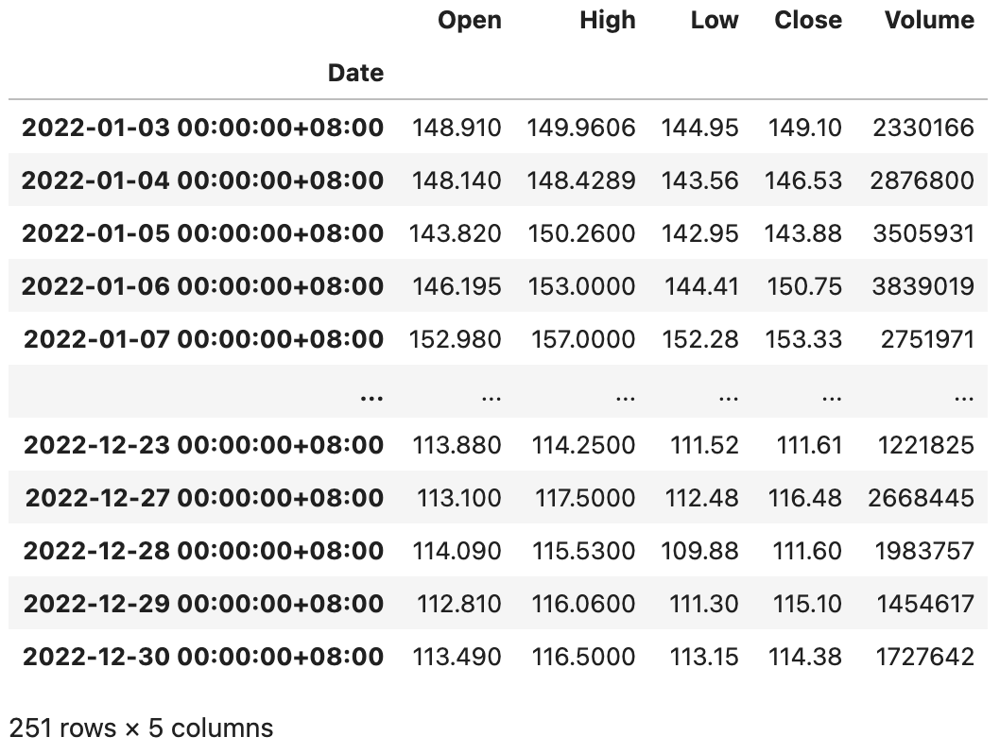
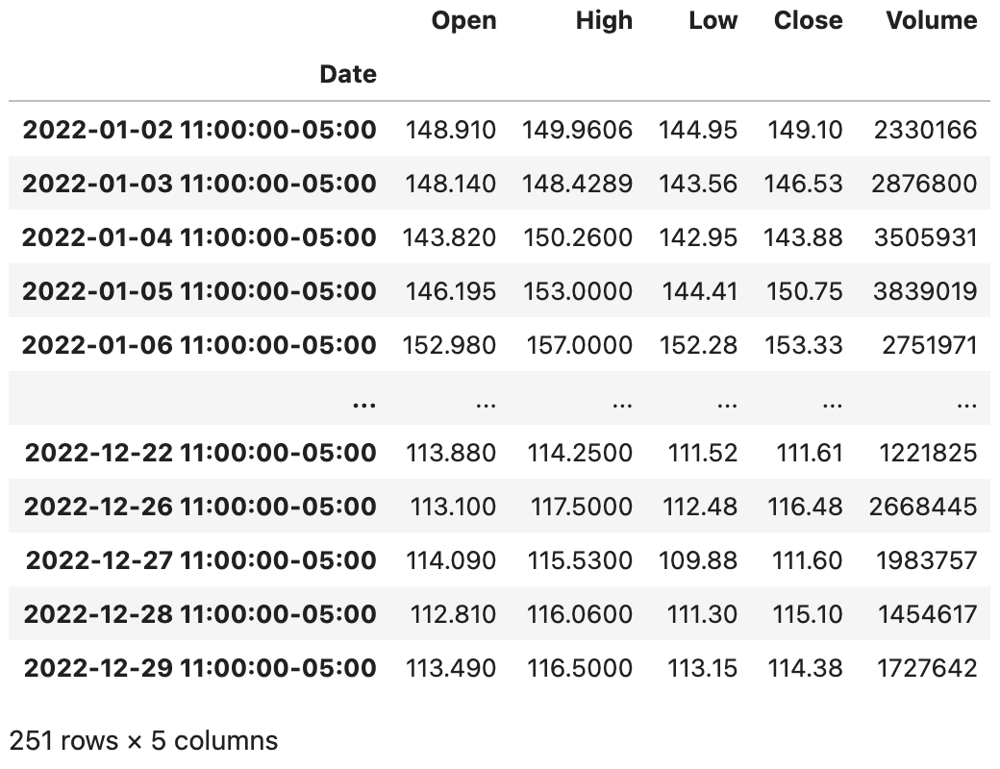

## pandas từ cơ bản đến nâng cao - 6

Chúng ta cùng tìm hiểu thêm về kiểu `Index`, nó cung cấp dịch vụ lập chỉ mục cho các đối tượng `Series` và `DataFrame`. Khi có chỉ mục, chúng ta có thể sắp xếp dữ liệu (phương thức `sort_index`), căn chỉnh dữ liệu (rất quan trọng trong việc tính toán và kết hợp dữ liệu) và thực hiện truy xuất dữ liệu nhanh chóng (toán tử lập chỉ mục). Do kiểu `DataFrame` đại diện cho dữ liệu hai chiều, nên cả hàng và cột của nó đều có chỉ mục, lần lượt là `index` và `columns`. Việc tạo đối tượng kiểu `Index` tương đối đơn giản, thông thường chỉ cần cung cấp ba tham số `data`, `dtype` và `name`, lần lượt đại diện cho dữ liệu làm chỉ mục, kiểu dữ liệu của chỉ mục và tên của chỉ mục. Bản thân `Index` cũng là dữ liệu một chiều, nên các phương thức và thuộc tính của nó rất giống với `Series`. Bạn có thể thử tạo một đối tượng `Index`, sau đó thử nghiệm xem các thuộc tính và phương thức đã học trước đây có hoạt động trên kiểu `Index` hay không. Tiếp theo, chúng ta chủ yếu tìm hiểu một số kiểu con (sub-type) của `Index`.

### Chỉ mục phạm vi (RangeIndex)

Chỉ mục phạm vi là chỉ mục được cấu thành từ các số nguyên có tính đơn điệu. Chúng ta có thể tạo chỉ mục phạm vi thông qua hàm khởi tạo `RangeIndex`, hoặc thông qua phương thức lớp `from_range` của lớp `RangeIndex`, như đoạn mã dưới đây.

Mã nguồn:

```Python
sales_data = np.random.randint(400, 1000, 12)
index = pd.RangeIndex(1, 13, name='月份')
ser = pd.Series(data=sales_data, index=index)
ser
```

Kết quả:

```
月份
1     703
2     705
3     557
4     943
5     961
6     615
7     788
8     985
9     921
10    951
11    874
12    609
dtype: int64
```

### Chỉ mục phân loại (CategoricalIndex)

Chỉ mục phân loại là chỉ mục được cấu thành từ thang đo định danh (danh mục). Nếu chúng ta cần phân nhóm dữ liệu thông qua chỉ mục rồi mới thực hiện thao tác tổng hợp, chỉ mục phân loại sẽ phát huy tác dụng. Chỉ mục phân loại còn có một phương thức tên là `reorder_categories`, cho phép chỉ định thứ tự cho chỉ mục, kết quả nhóm và tổng hợp sẽ được hiển thị theo đúng thứ tự đã chỉ định này, như đoạn mã dưới đây.

Mã nguồn:

```Python
sales_data = [6, 6, 7, 6, 8, 6]
index = pd.CategoricalIndex(
    data=['苹果', '香蕉', '苹果', '苹果', '桃子', '香蕉'],
    categories=['苹果', '香蕉', '桃子'],
    ordered=True
)
ser = pd.Series(data=sales_data, index=index)
ser
```

Kết quả:

```
苹果    6
香蕉    6
苹果    7
苹果    6
桃子    8
香蕉    6
dtype: int64
```

Nhóm dữ liệu dựa trên chỉ mục, sau đó dùng `sum` để tính tổng:

```Python
ser.groupby(level=0).sum()
```

Kết quả:

```
苹果    19
香蕉    12
桃子     8
dtype: int64
```

Chỉ định thứ tự của chỉ mục:

```python
ser.index = index.reorder_categories(['香蕉', '桃子', '苹果'])
ser.groupby(level=0).sum()
```

Kết quả:

```
香蕉    12
桃子     8
苹果    19
dtype: int64
```

### Chỉ mục đa cấp (MultiIndex)

Kiểu `MultiIndex` trong pandas được dùng để biểu thị chỉ mục phân cấp hoặc đa cấp. Có thể sử dụng các phương thức lớp của lớp `MultiIndex` như `from_arrays`, `from_product`, `from_tuples`, v.v. để tạo chỉ mục đa cấp, chúng ta cùng xem một vài ví dụ.

Mã nguồn:

```python
tuples = [(1, 'red'), (1, 'blue'), (2, 'red'), (2, 'blue')]
index = pd.MultiIndex.from_tuples(tuples, names=['no', 'color'])
index
```

Kết quả:

```
MultiIndex([(1,  'red'),
            (1, 'blue'),
            (2,  'red'),
            (2, 'blue')],
           names=['no', 'color'])
```

Mã nguồn:

```python
arrays = [[1, 1, 2, 2], ['red', 'blue', 'red', 'blue']]
index = pd.MultiIndex.from_arrays(arrays, names=['no', 'color'])
index
```

Kết quả:

```
MultiIndex([(1,  'red'),
            (1, 'blue'),
            (2,  'red'),
            (2, 'blue')],
           names=['no', 'color'])
```

Mã nguồn:

```python
sales_data = np.random.randint(1, 100, 4)
ser = pd.Series(data=sales_data, index=index)
ser
```

Kết quả:

```
no  color
1   red      43
    blue     31
2   red      55
    blue     75
dtype: int64
```

Mã nguồn:

```python
ser.groupby('no').sum()
```

Kết quả:

```
no
1     74
2    130
dtype: int64
```

Mã nguồn:

```python
ser.groupby(level=1).sum()
```

Kết quả:

```
color
blue    106
red      98
dtype: int64
```

Mã nguồn:

```Python
stu_ids = np.arange(1001, 1006)
semisters = ['期中', '期末']
index = pd.MultiIndex.from_product((stu_ids, semisters), names=['学号', '学期'])
courses = ['语文', '数学', '英语']
scores = np.random.randint(60, 101, (10, 3))
df = pd.DataFrame(data=scores, columns=courses, index=index)
df
```

Kết quả:

```
             语文 数学 英语
学号	学期			
1001  期中	93	77	60
      期末	93	98	84
1002  期中	64	78	71
      期末	70	71	97
1003  期中	72	88	97
      期末	99	100	63
1004  期中	80	71	61
      期末	91	62	72
1005  期中	82	95	67
      期末	84	78	86
```

Nhóm dữ liệu theo cấp chỉ mục đầu tiên, tính điểm từng môn cho mỗi học sinh theo tỷ lệ điểm giữa kỳ chiếm `25%` và điểm cuối kỳ chiếm `75%`:

Mã nguồn:

```Python
df.groupby(level=0).agg(lambda x: x.values[0] * 0.25 + x.values[1] * 0.75)
```

Kết quả:

```
        语文    数学    英语
学号			
1001	93.00	92.75	78.00
1002	68.50	72.75	90.50
1003	92.25	97.00	71.50
1004	88.25	64.25	69.25
1005	83.50	82.25	81.25
```

### Chỉ mục khoảng (IntervalIndex)

Đúng như tên gọi, chỉ mục khoảng sử dụng các khoảng giá trị cố định làm chỉ mục. Chúng ta thường sử dụng hàm `interval_range` để tạo chỉ mục khoảng, như đoạn mã dưới đây.

Mã nguồn:

```python
index = pd.interval_range(start=0, end=5)
index
```

Kết quả:

```
IntervalIndex([(0, 1], (1, 2], (2, 3], (3, 4], (4, 5]], dtype='interval[int64, right]')
```

`IntervalIndex` có một phương thức mang tên `contains`, có thể kiểm tra xem bên trong khoảng có chứa phần tử nào đó hay không, như sau:

Mã nguồn:

```python
index.contains(1.5)
```

Kết quả:

```
array([False,  True, False, False, False])
```

`IntervalIndex` còn có một phương thức mang tên `overlaps`, có thể kiểm tra xem một khoảng có bị chồng lấn với các khoảng khác hay không, như sau:

Mã nguồn:

```python
index.overlaps(pd.Interval(1.5, 3.5))
```

Kết quả:

```
array([False,  True,  True,  True, False])
```

Nếu muốn các khoảng ở trạng thái nửa đóng nửa mở bên trái (đóng trái mở phải), bạn có thể thiết lập `closed='left'` khi tạo chỉ mục khoảng; nếu muốn cả hai đầu đều đóng, có thể gán giá trị cho tham số `closed` là `both`, như đoạn mã sau:

Mã nguồn:

```python
index = pd.interval_range(start=0, end=5, closed='left')
index
```

Kết quả:

```
IntervalIndex([[0, 1), [1, 2), [2, 3), [3, 4), [4, 5)], dtype='interval[int64, left]')
```

Mã nguồn:

```python
index = pd.interval_range(start=pd.Timestamp('2022-01-01'), end=pd.Timestamp('2022-01-04'), closed='both')
index
```

Kết quả:

```
IntervalIndex([[2022-01-01, 2022-01-02], [2022-01-02, 2022-01-03], [2022-01-03, 2022-01-04]], dtype='interval[datetime64[ns], both]')
```

### Chỉ mục ngày giờ (DatetimeIndex)

`DatetimeIndex` có lẽ là loại chỉ mục phức tạp nhất và quan trọng nhất trong số các loại chỉ mục. Chúng ta thường sử dụng hàm `date_range()` để tạo chỉ mục ngày giờ. Hàm này có một số tham số rất quan trọng: `start`, `end`, `periods`, `freq`, `tz`, lần lượt đại diện cho ngày giờ bắt đầu, ngày giờ kết thúc, chu kỳ tạo, tần suất lấy mẫu và múi giờ. Trước tiên chúng ta xem cách tạo đối tượng `DatetimeIndex`, sau đó thảo luận về các phép toán và thao tác liên quan của nó, như đoạn mã dưới đây:

Mã nguồn:

```Python
pd.date_range('2021-1-1', '2021-6-30', periods=10)
```

Kết quả:

```
DatetimeIndex(['2021-01-01', '2021-01-21', '2021-02-10', '2021-03-02',
               '2021-03-22', '2021-04-11', '2021-05-01', '2021-05-21',
               '2021-06-10', '2021-06-30'],
              dtype='datetime64[ns]', freq=None)
```

Mã nguồn:

```Python
pd.date_range('2021-1-1', '2021-6-30', freq='W')
```

> **Giải thích**: `freq=W` biểu thị chu kỳ lấy mẫu là một tuần, mặc định coi Chủ nhật là ngày đầu tuần; nếu muốn thứ Hai là ngày đầu tuần, bạn có thể đổi thành `freq=W-MON`; bạn cũng có thể thử đổi giá trị tham số này thành `12H`, `M`, `Q`, v.v. để xem điều gì xảy ra, chắc hẳn không khó để bạn đoán được ý nghĩa của chúng.

Kết quả:

```
DatetimeIndex(['2021-01-03', '2021-01-10', '2021-01-17', '2021-01-24',
               '2021-01-31', '2021-02-07', '2021-02-14', '2021-02-21',
               '2021-02-28', '2021-03-07', '2021-03-14', '2021-03-21',
               '2021-03-28', '2021-04-04', '2021-04-11', '2021-04-18',
               '2021-04-25', '2021-05-02', '2021-05-09', '2021-05-16',
               '2021-05-23', '2021-05-30', '2021-06-06', '2021-06-13',
               '2021-06-20', '2021-06-27'],
              dtype='datetime64[ns]', freq='W-SUN')
```

`DatetimeIndex` có thể thực hiện phép toán với kiểu `DateOffset`, điều này rất dễ hiểu vì chúng ta có thể thiết lập một khoảng chênh lệch thời gian để dịch chuyển thời gian về phía trước hoặc phía sau, thao tác cụ thể như sau:

Mã nguồn:

```Python
index = pd.date_range('2021-1-1', '2021-6-30', freq='W')
index - pd.DateOffset(days=2)
```

Kết quả:

```
DatetimeIndex(['2021-01-01', '2021-01-08', '2021-01-15', '2021-01-22',
               '2021-01-29', '2021-02-05', '2021-02-12', '2021-02-19',
               '2021-02-26', '2021-03-05', '2021-03-12', '2021-03-19',
               '2021-03-26', '2021-04-02', '2021-04-09', '2021-04-16',
               '2021-04-23', '2021-04-30', '2021-05-07', '2021-05-14',
               '2021-05-21', '2021-05-28', '2021-06-04', '2021-06-11',
               '2021-06-18', '2021-06-25'],
              dtype='datetime64[ns]', freq=None)
```

Mã nguồn:

```Python
index + pd.DateOffset(hours=2, minutes=10)
```

Kết quả:

```
DatetimeIndex(['2021-01-03 02:10:00', '2021-01-10 02:10:00',
               '2021-01-17 02:10:00', '2021-01-24 02:10:00',
               '2021-01-31 02:10:00', '2021-02-07 02:10:00',
               '2021-02-14 02:10:00', '2021-02-21 02:10:00',
               '2021-02-28 02:10:00', '2021-03-07 02:10:00',
               '2021-03-14 02:10:00', '2021-03-21 02:10:00',
               '2021-03-28 02:10:00', '2021-04-04 02:10:00',
               '2021-04-11 02:10:00', '2021-04-18 02:10:00',
               '2021-04-25 02:10:00', '2021-05-02 02:10:00',
               '2021-05-09 02:10:00', '2021-05-16 02:10:00',
               '2021-05-23 02:10:00', '2021-05-30 02:10:00',
               '2021-06-06 02:10:00', '2021-06-13 02:10:00',
               '2021-06-20 02:10:00', '2021-06-27 02:10:00'],
              dtype='datetime64[ns]', freq=None)
```

Nếu đối tượng `Series` hoặc `DataFrame` sử dụng chỉ mục kiểu `DatetimeIndex`, lúc này chúng ta có thể thông qua phương thức `asfreq()` để chỉ định tần suất thời gian nhằm lấy mẫu dữ liệu. Chúng ta tiếp tục lấy ví dụ về dữ liệu cổ phiếu Baidu đã học trước đó để minh họa.

Mã nguồn:

```Python
baidu_df = pd.read_excel('data/2022年股票数据.xlsx', sheet_name='BIDU', index_col='Date')
baidu_df.sort_index(inplace=True)
baidu_df.asfreq('5D')
```

Kết quả:



Có thể bạn đã nhận thấy, việc cứ cách 5 ngày lại trích mẫu 1 ngày có thể sẽ rơi vào ngày không giao dịch, khi đó các cột tương ứng sẽ trở thành giá trị rỗng. Để giải quyết vấn đề này, khi sử dụng phương thức `asfreq`, bạn có thể chỉ định phương thức điền giá trị rỗng qua tham số `method`, cho phép điền dữ liệu của ngày giao dịch liền kề vào.

Mã nguồn:

```Python
baidu_df.asfreq('5D', method='ffill')
```

Kết quả:



Khi sử dụng chỉ mục `DatetimeIndex`, chúng ta cũng có thể dùng phương thức `resample()` để tái lấy mẫu (resample) dữ liệu dựa trên thời gian, tương đương với việc thực hiện thao tác nhóm dữ liệu theo chu kỳ thời gian. Sau khi nhóm, còn có thể thực hiện thống kê tổng hợp, như đoạn mã dưới đây:

Mã nguồn:

```Python
baidu_df.resample('1M').mean()
```

Kết quả:



Mã nguồn:

```python
baidu_df.resample('1M').agg(['mean', 'std'])
```

Kết quả:



> **Gợi ý**: Không biết bạn có để ý không, chỉ mục cột của `DataFrame` xuất ra ở trên là một đối tượng `MultiIndex`. Bạn có thể truy cập thuộc tính `columns` của đối tượng `DataFrame` ở trên để quan sát.

Nếu muốn thực hiện chuyển đổi múi giờ cho ngày giờ, trước tiên chúng ta có thể dùng phương thức `tz_localize()` để bản địa hóa ngày giờ, như đoạn mã dưới đây:

Mã nguồn:

```Python
baidu_df = baidu_df.tz_localize('Asia/Chongqing')
baidu_df
```

Kết quả:



Sau khi đã bản địa hóa thời gian, chúng ta tiếp tục sử dụng phương thức `tz_convert()` là có thể chuyển đổi múi giờ, như đoạn mã sau:

Mã nguồn:

```Python
baidu_df.tz_convert('America/New_York')
```

Kết quả:



Nếu dữ liệu của bạn sử dụng chỉ mục kiểu `DatetimeIndex`, thì rất có khả năng bạn cần thực hiện phân tích chuỗi thời gian (time series analysis) trên dữ liệu đó. Các phương pháp và mô hình phân tích chuỗi thời gian không thuộc phạm vi thảo luận của chương này, chúng ta sẽ cùng chia sẻ ở các chuyên đề khác.
