## Trực quan hóa dữ liệu - 1

Sau khi hoàn thành việc pivot và tổng hợp dữ liệu, chúng ta có thể trình bày kết quả đó thông qua phương pháp trực quan hóa. Nói một cách đơn giản, đó là biến dữ liệu thành các biểu đồ thống kê đẹp mắt, bởi vì con người nhạy cảm hơn nhiều với màu sắc và hình dạng, từ đó giải mã sâu hơn các giá trị kinh doanh ẩn chứa đằng sau dữ liệu. Trong các bài học trước, chúng ta đã từng minh họa thao tác tạo biểu đồ trực quan hóa bằng phương thức `plot` của đối tượng `Series` hoặc `DataFrame`. Trong chương này, chúng ta sẽ tìm hiểu về nền tảng cốt lõi của phương thức vẽ biểu đồ này, đó chính là thư viện nổi tiếng matplotlib.

Trước khi đi vào chi tiết matplotlib, mời các bạn xem qua hình ảnh dưới đây, nó tổng hợp các loại biểu đồ thường dùng và trường hợp ứng dụng tương ứng. Khi cần lựa chọn biểu đồ thống kê mà chưa biết nên chọn loại nào cho phù hợp nhất, hình ảnh này chắc chắn sẽ giúp ích cho bạn. Tóm lại một cách ngắn gọn: xem xu hướng dùng biểu đồ đường gấp khúc (line chart), so sánh dữ liệu dùng biểu đồ cột (bar chart), xác định mối quan hệ dùng biểu đồ phân tán (scatter plot), kiểm tra tỷ trọng dùng biểu đồ tròn (pie chart), quan sát phân phối dùng biểu đồ tần số (histogram), tìm giá trị ngoại lai dùng biểu đồ hộp (box plot).

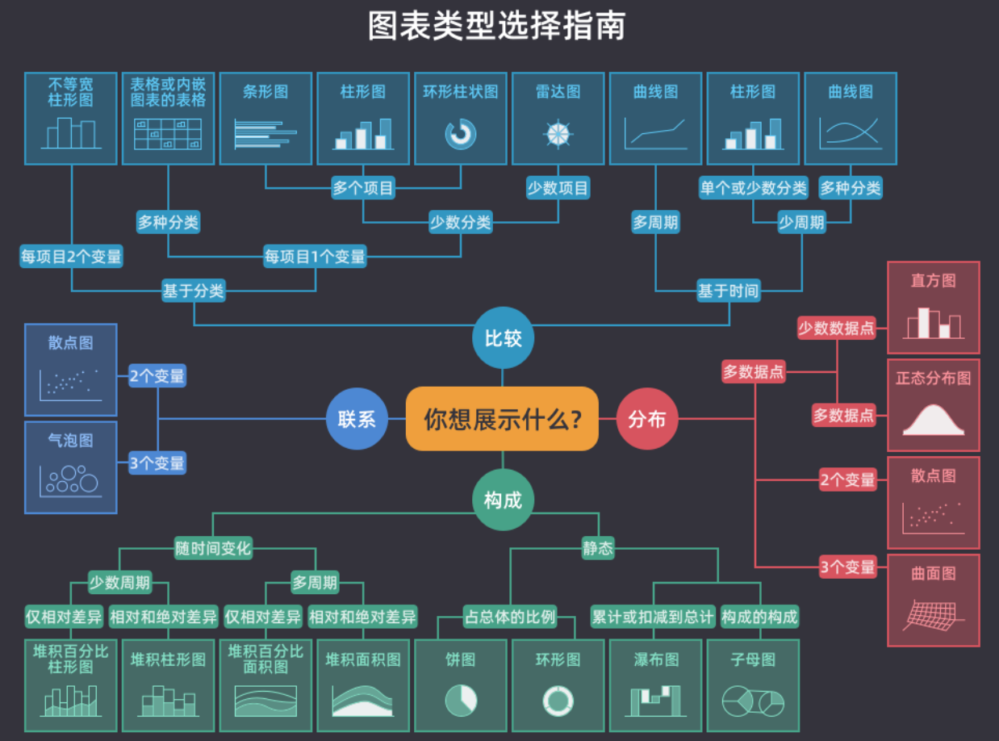

### Import và cấu hình

Trong các bài học trước, chúng ta đã tìm hiểu cách cài đặt và import thư viện matplotlib. Nếu chưa chắc chắn liệu đã cài đặt matplotlib hay chưa, bạn có thể dùng lệnh magic dưới đây để thử cài đặt hoặc nâng cấp matplotlib:

```
%pip install -U matplotlib
```

Để giải quyết vấn đề hiển thị ký tự tiếng Trung hoặc các ký tự đặc biệt trên biểu đồ matplotlib, chúng ta cần sửa đổi tham số cấu hình `rcParams` của module `pyplot`, thao tác cụ thể như sau:

```Python
import matplotlib.pyplot as plt

plt.rcParams['font.sans-serif'].insert(0, 'SimHei')
plt.rcParams['axes.unicode_minus'] = False
```

> **Giải thích**: `SimHei` trong đoạn mã trên là tên font chữ, bạn có thể tải về và cài đặt font này qua liên kết Baidu Netdisk: https://pan.baidu.com/s/1rQujl5RQn9R7PadB2Z5g_g?pwd=e7b4. Bạn cũng có thể thử cài đặt các font chữ tiếng Trung khác. Sau khi cài đặt, nếu không biết font chữ tên là gì, bạn có thể vào thư mục `.matplotlib` trong thư mục home của người dùng để tìm tệp `fontlist-v330.json`, mở ra sẽ thấy đường dẫn tệp font và tên font cùng các thông tin liên quan. Cần lưu ý rằng sau khi sử dụng font chữ tùy chỉnh, dấu âm trên trục tọa độ có thể không hiển thị được, cần đặt tham số `axes.unicode_minus` thành `False` để dấu âm trên trục tọa độ hiển thị bình thường.

Thông qua lệnh magic dưới đây, chúng ta có thể tạo ra [đồ họa vector](https://zh.wikipedia.org/wiki/%E7%9F%A2%E9%87%8F%E5%9B%BE%E5%BD%A2) (SVG - Scalable Vector Graphics) khi vẽ đồ thị. Đặc điểm của ảnh vector là không bị vỡ hình khi phóng to, thu nhỏ hoặc xoay, nhìn sẽ đẹp mắt và sắc nét hơn rất nhiều.

```Python
%config InlineBackend.figure_format='svg'
```

### Tạo khung vẽ (Figure / Canvas)

Hàm `figure` của module `pyplot` dùng để tạo khung vẽ (canvas). Khi tạo khung vẽ, có thể chỉ định kích thước thông qua tham số `figsize` (giá trị mặc định là `[6.4, 4.8]`); có thể thiết lập độ phân giải qua tham số `dpi`, vì `dpi` đại diện cho số điểm ảnh trên mỗi inch (dots per inch). Ngoài ra, còn có thể đặt màu nền cho khung vẽ qua tham số `facecolor`. Giá trị trả về của hàm `figure` là một đối tượng `Figure`, đại diện cho khung vẽ được sử dụng, từ đó chúng ta có thể tạo các hệ trục tọa độ để vẽ đồ thị.

```Python
plt.figure(figsize=(8, 4), dpi=120, facecolor='darkgray')
```

### Tạo hệ trục tọa độ (Axes / Subplot)

Có thể sử dụng trực tiếp hàm `subplot` của module `pyplot` để tạo hệ trục tọa độ, hàm này sẽ trả về một đối tượng `Axes`. Ba tham số đầu tiên của `subplot` lần lượt chỉ định toàn bộ khung vẽ được chia thành bao nhiêu hàng, bao nhiêu cột và chỉ số của hệ trục tọa độ hiện tại, giá trị mặc định của cả ba tham số này đều là `1`. Nếu không tạo hệ trục tọa độ, khi vẽ chúng ta sẽ sử dụng hệ trục tọa độ mặc định và duy nhất trên khung vẽ; nếu cần tạo nhiều hệ trục tọa độ trên cùng một khung vẽ, có thể sử dụng hàm này. Tất nhiên, chúng ta cũng có thể thông qua phương thức `add_subplot` hoặc `add_axes` của đối tượng `Figure` đã tạo ở trên để tạo hệ trục tọa độ, phương thức trước có tác dụng tương tự hàm `subplot`, phương thức sau sẽ tạo ra hệ trục tọa độ lồng nhau.

```Python
plt.subplot(2, 2, 1)
```

### Vẽ các biểu đồ

#### Biểu đồ đường (Line chart)

Khi vẽ đồ thị, nếu không gọi hàm `figure` và hàm `subplot` trước, matplotlib sẽ sử dụng khung vẽ và hệ trục tọa độ mặc định. Nếu muốn vẽ biểu đồ đường gấp khúc, có thể sử dụng hàm `plot` của module `pyplot` và chỉ định dữ liệu trục hoành cùng trục tung. Biểu đồ đường thích hợp nhất để quan sát xu hướng của dữ liệu, đặc biệt là khi trục hoành đại diện cho thời gian. Chúng ta có thể dùng tham số `color` của hàm `plot` để tùy chỉnh màu sắc đường vẽ, dùng tham số `marker` để tùy chỉnh ký hiệu điểm dữ liệu (ví dụ: `*` là hình sao năm cánh, `^` là hình tam giác, `o` là hình tròn nhỏ, v.v.), dùng tham số `linestyle` để tùy chỉnh kiểu đường vẽ (ví dụ: `-` là nét liền, `--` là nét đứt, `:` là nét chấm, v.v.), dùng tham số `linewidth` để tùy chỉnh độ dày của đường nét. Đoạn mã dưới đây vẽ một đường cong sin, trong đó `marker='*'` đặt ký hiệu điểm dữ liệu thành hình ngôi sao, còn `color='red'` vẽ đường cong màu đỏ.

Mã nguồn:

```Python
import numpy as np

x = np.linspace(-2 * np.pi, 2 * np.pi, 120)
y = np.sin(x)

# Tạo khung vẽ
plt.figure(figsize=(8, 4), dpi=120)
# Vẽ biểu đồ đường
plt.plot(x, y, linewidth=2, marker='*', color='red')
# Hiển thị biểu đồ
plt.show()
```

Kết quả:

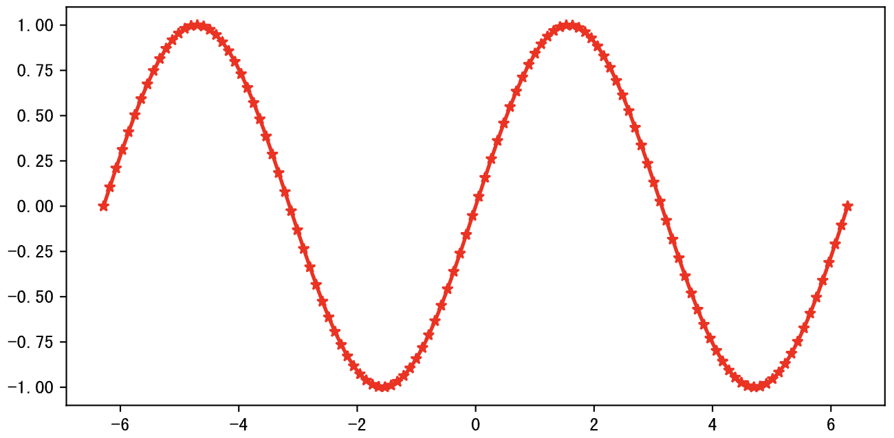

Nếu muốn vẽ đồng thời cả đường sin và cos trên cùng một hệ trục tọa độ, có thể chỉnh sửa nhẹ đoạn mã trên:

Mã nguồn:

```Python
x = np.linspace(-2 * np.pi, 2 * np.pi, 120)
y1, y2 = np.sin(x), np.cos(x)

plt.figure(figsize=(8, 4), dpi=120)
plt.plot(x, y1, linewidth=2, marker='*', color='red')
plt.plot(x, y2, linewidth=2, marker='^', color='blue')
# Tùy chỉnh chú thích trên biểu đồ (nếu chưa hiểu tham số của hàm annotate thì có thể bỏ qua trước)
plt.annotate('sin(x)', xytext=(0.5, -0.75), xy=(0, -0.25), fontsize=12, arrowprops={
    'arrowstyle': '->', 'color': 'darkgreen', 'connectionstyle': 'angle3, angleA=90, angleB=0'
})
plt.annotate('cos(x)', xytext=(-3, 0.75), xy=(-1.25, 0.5), fontsize=12, arrowprops={
    'arrowstyle': '->', 'color': 'darkgreen', 'connectionstyle': 'arc3, rad=0.35'
})
plt.show()
```

Kết quả:

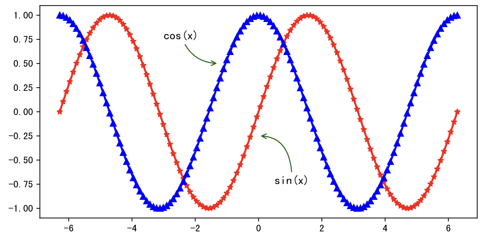

Nếu muốn sử dụng hai hệ trục tọa độ riêng biệt để lần lượt vẽ sin và cos, có thể dùng hàm `subplot` đã đề cập ở trên để tạo hệ trục tọa độ rồi vẽ:

Mã nguồn:

```Python
plt.figure(figsize=(8, 4), dpi=120)
# Tạo hệ trục tọa độ (hình thứ 1)
plt.subplot(2, 1, 1)
plt.plot(x, y1, linewidth=2, marker='*', color='red')
# Tạo hệ trục tọa độ (hình thứ 2)
plt.subplot(2, 1, 2)
plt.plot(x, y2, linewidth=2, marker='^', color='blue')
plt.show()
```

Kết quả:

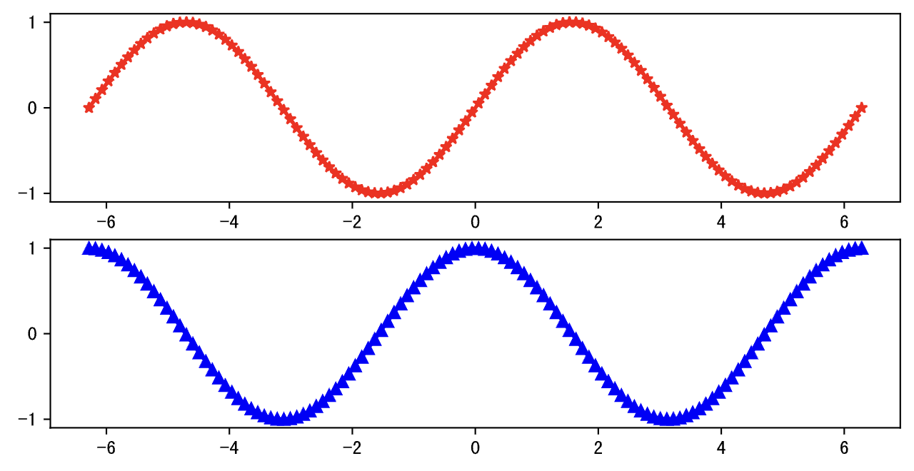

Tất nhiên cũng có thể làm như sau, bạn có thể chạy thử mã để xem sự khác biệt so với hình ở trên:

```Python
plt.figure(figsize=(8, 4), dpi=120)
plt.subplot(1, 2, 1)
plt.plot(x, y1, linewidth=2, marker='*', color='red')
plt.subplot(1, 2, 2)
plt.plot(x, y2, linewidth=2, marker='^', color='blue')
plt.show()
```

Sau đó, hãy thử tiếp đoạn mã dưới đây xem hiệu ứng hiển thị ra sao:

```Python
fig = plt.figure(figsize=(10, 4), dpi=120)
plt.plot(x, y1, linewidth=2, marker='*', color='red')
# Dùng phương thức add_axes của đối tượng Figure để lồng một hệ trục tọa độ mới vào hệ trục hiện tại.
# Tham số của phương thức này là một tuple 4 phần tử đại diện cho vị trí của hệ trục mới trong hệ trục ban đầu,
# hai giá trị đầu là vị trí góc dưới bên trái, hai giá trị sau là chiều rộng và chiều cao của hệ trục tọa độ
ax = fig.add_axes((0.595, 0.6, 0.3, 0.25))
ax.plot(x, y2, marker='^', color='blue')
ax = fig.add_axes((0.155, 0.2, 0.3, 0.25))
ax.plot(x, y2, marker='^', color='green')
plt.show()
```

#### Biểu đồ phân tán (Scatter plot)

Biểu đồ phân tán giúp chúng ta tìm hiểu mối quan hệ giữa hai biến, nếu cần xem xét mối quan hệ giữa ba biến, có thể nâng cấp biểu đồ phân tán thành biểu đồ bong bóng (bubble chart). Trong đoạn mã dưới đây, hai mảng `x` và `y` lần lượt biểu thị thu nhập hàng tháng và chi tiêu mua sắm online hàng tháng. Nếu muốn biết giữa `x` và `y` có tồn tại mối quan hệ tương quan hay không, chúng ta có thể vẽ biểu đồ phân tán như sau:

Mã nguồn:

```Python
x = np.array([5550, 7500, 10500, 15000, 20000, 25000, 30000, 40000])
y = np.array([800, 1800, 1250, 2000, 1800, 2100, 2500, 3500])

plt.figure(figsize=(6, 4), dpi=120)
plt.scatter(x, y)
plt.show()
```

Kết quả:

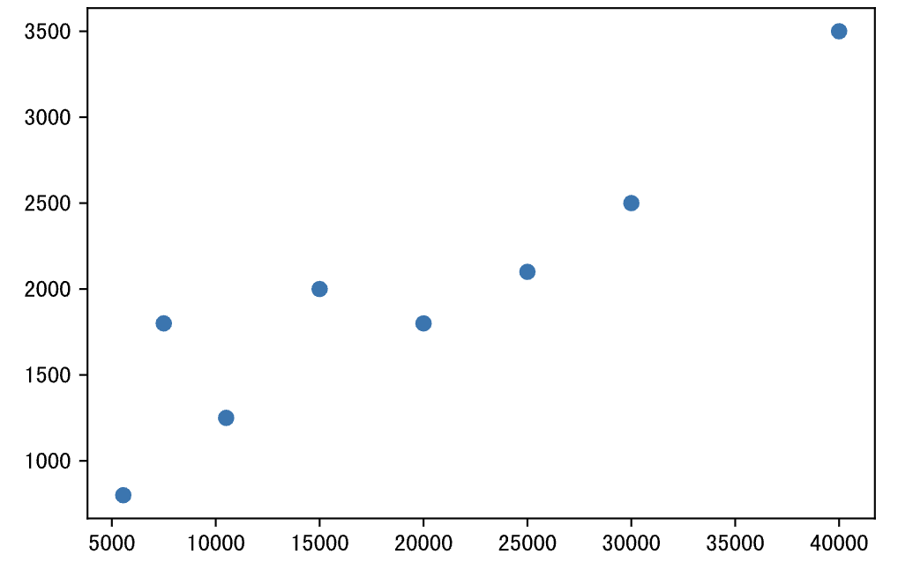

#### Biểu đồ cột (Bar chart)

Khi so sánh sự khác biệt giữa các dữ liệu, biểu đồ cột là một lựa chọn tuyệt vời. Chúng ta có thể dùng hàm `bar` của module `pyplot` để tạo biểu đồ cột dọc, hoặc dùng hàm `barh` để tạo biểu đồ thanh ngang (horizontal bar chart). Trước tiên chúng ta chuẩn bị một số dữ liệu cho biểu đồ cột:

```Python
x = np.arange(4)
y1 = np.random.randint(20, 50, 4)
y2 = np.random.randint(10, 60, 4)
```

Đoạn mã vẽ biểu đồ cột:

Mã nguồn:

```Python
plt.figure(figsize=(6, 4), dpi=120)
# Thông qua độ lệch tọa độ hoành, làm cho hai cột tương ứng với hai nhóm dữ liệu tách rời nhau,
# tham số width kiểm soát độ rộng của cột, tham số label thêm nhãn chú giải cho cột
plt.bar(x - 0.1, y1, width=0.2, label='销售A组')
plt.bar(x + 0.1, y2, width=0.2, label='销售B组')
# Tùy chỉnh vạch chia trục hoành
plt.xticks(x, labels=['Q1', 'Q2', 'Q3', 'Q4'])
# Tùy chỉnh hiển thị chú giải (legend)
plt.legend()
plt.show()
```

Kết quả:

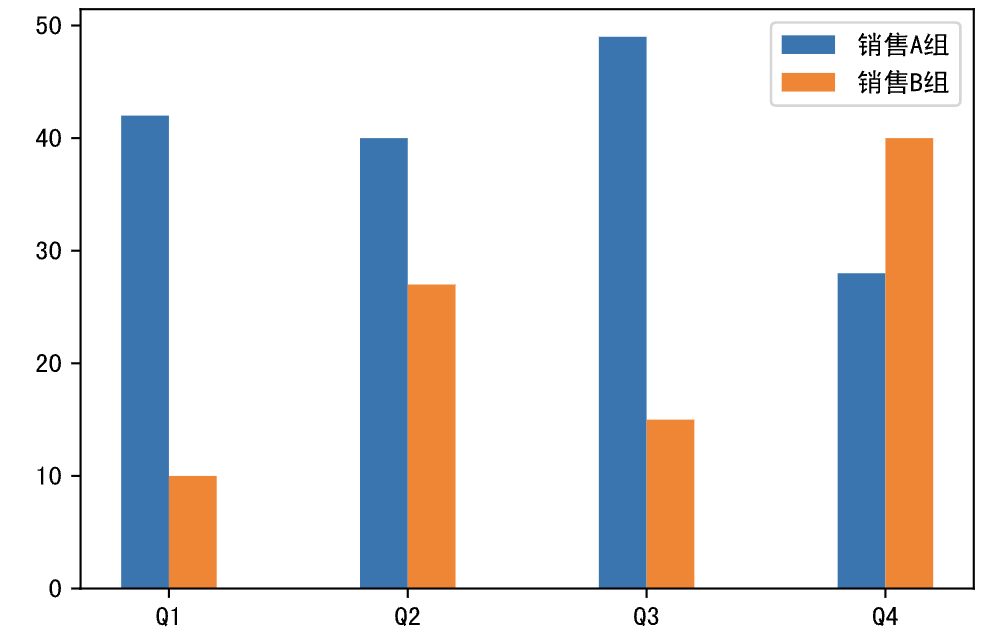

Nếu muốn vẽ biểu đồ cột chồng (stacked bar chart), có thể chỉnh sửa nhẹ đoạn mã trên như sau:

Mã nguồn:

```Python
labels = ['Q1', 'Q2', 'Q3', 'Q4']
plt.figure(figsize=(6, 4), dpi=120)
plt.bar(labels, y1, width=0.4, label='销售A组')
# Lưu ý: Điểm mấu chốt của biểu đồ cột chồng là lấy cột trước làm đáy của cột mới,
# có thể chỉ định dữ liệu đáy qua tham số bottom, cột mới sẽ được vẽ bên trên dữ liệu đáy đó
plt.bar(labels, y2, width=0.4, bottom=y1, label='销售B组')
plt.legend(loc='lower right')
plt.show()
```

Kết quả:

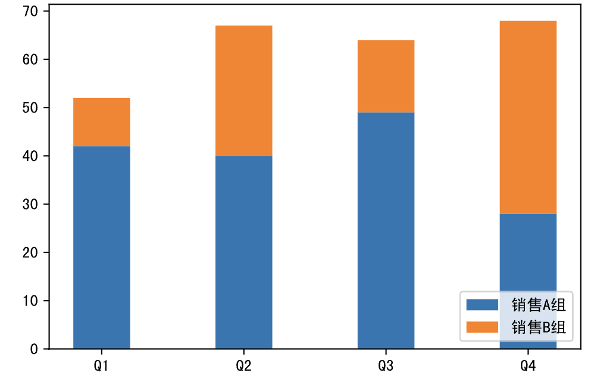

#### Biểu đồ tròn (Pie chart)

Biểu đồ hình quạt thường được gọi tắt là biểu đồ tròn (pie chart), là biểu đồ thống kê chia dữ liệu thành các khu vực hình cánh quạt, chủ yếu dùng để mô tả mối quan hệ tỷ lệ tương đối giữa số lượng, tần suất, v.v. Trong biểu đồ tròn, kích thước của mỗi cánh quạt chính là tỷ lệ của đại lượng mà nó đại diện, các cánh quạt gộp lại với nhau vừa đúng thành một hình tròn hoàn chỉnh. Trong các tình huống cần thể hiện cơ cấu thành phần của dữ liệu, biểu đồ tròn, biểu đồ cây (treemap) và biểu đồ thác nước (waterfall chart) là những lựa chọn tốt. Chúng ta có thể dùng hàm `pie` của module `pyplot` để vẽ biểu đồ tròn, như đoạn mã sau:

Mã nguồn:

```Python
data = np.random.randint(100, 500, 7)
labels = ['苹果', '香蕉', '桃子', '荔枝', '石榴', '山竹', '榴莲']

plt.figure(figsize=(5, 5), dpi=120)
plt.pie(
    data,
    # Tự động hiển thị phần trăm
    autopct='%.1f%%',
    # Bán kính biểu đồ tròn
    radius=1,
    # Khoảng cách từ nhãn phần trăm đến tâm hình tròn
    pctdistance=0.8,
    # Màu sắc (sinh ngẫu nhiên)
    colors=np.random.rand(7, 3),
    # Khoảng cách tách rời cánh quạt
    # explode=[0.05, 0, 0.1, 0, 0, 0, 0],
    # Hiệu ứng đổ bóng
    # shadow=True,
    # Thuộc tính văn bản
    textprops=dict(fontsize=8, color='black'),
    # Thuộc tính nêm quạt (yếu tố then chốt tạo biểu đồ tròn dạng vành khuyên / donut)
    wedgeprops=dict(linewidth=1, width=0.35),
    # Nhãn dữ liệu
    labels=labels
)
# Tùy chỉnh tiêu đề biểu đồ
plt.title('水果销售额占比')
plt.show()
```

Kết quả:

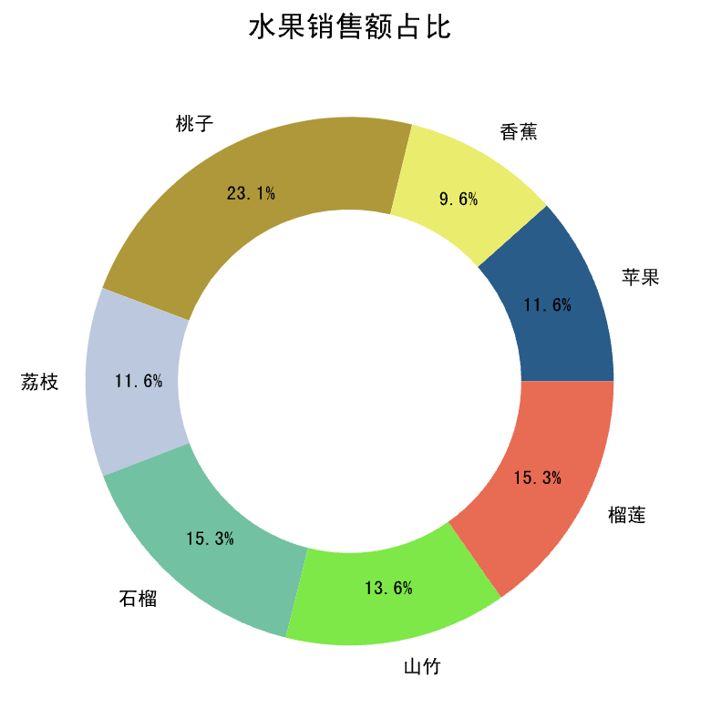

> **Giải thích**: Các bạn có thể thử mở lại các đoạn mã bị chú thích ở trên để xem hiệu ứng hiển thị ra sao.

#### Biểu đồ tần số (Histogram)

Trong thống kê học, biểu đồ tần số (histogram) là dạng đồ thị thể hiện sự phân phối của dữ liệu, là một biểu đồ thống kê hai chiều có hai trục lần lượt là mẫu thống kê và độ đo của một thuộc tính tương ứng với mẫu đó. Dữ liệu dưới đây là chiều cao của 100 nam sinh tại một trường học. Nếu muốn biết phân phối của dữ liệu, chúng ta có thể sử dụng biểu đồ tần số.

```Python
heights = np.array([
    170, 163, 174, 164, 159, 168, 165, 171, 171, 167, 
    165, 161, 175, 170, 174, 170, 174, 170, 173, 173, 
    167, 169, 173, 153, 165, 169, 158, 166, 164, 173, 
    162, 171, 173, 171, 165, 152, 163, 170, 171, 163, 
    165, 166, 155, 155, 171, 161, 167, 172, 164, 155, 
    168, 171, 173, 169, 165, 162, 168, 177, 174, 178, 
    161, 180, 155, 155, 166, 175, 159, 169, 165, 174, 
    175, 160, 152, 168, 164, 175, 168, 183, 166, 166, 
    182, 174, 167, 168, 176, 170, 169, 173, 177, 168, 
    172, 159, 173, 185, 161, 170, 170, 184, 171, 172
])
```

Có thể dùng hàm `hist` của module `pyplot` để vẽ biểu đồ tần số, trong đó tham số `bins` đại diện cho cách phân nhóm (binning) mà chúng ta sử dụng (chiều cao từ 150 cm đến 190 cm, mỗi khoảng cách nhau 5 cm), như đoạn mã sau:

Mã nguồn:

```Python
plt.figure(figsize=(6, 4), dpi=120)
# Vẽ biểu đồ tần số
plt.hist(heights, bins=np.arange(145, 196, 5), color='darkcyan')
# Tùy chỉnh nhãn trục hoành
plt.xlabel('身高')
# Tùy chỉnh nhãn trục tung
plt.ylabel('概率密度')
plt.show()
```

Kết quả:

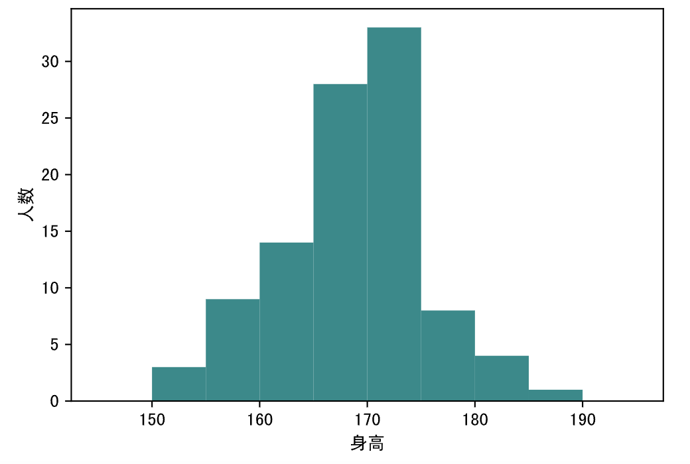

Khi vẽ biểu đồ tần số, nếu đổi tham số `density` của hàm `hist` thành `True` đồng thời đổi cả tham số `cumulative` thành `True`, thì một mặt trục tung sẽ hiển thị mật độ xác suất, mặt khác biểu đồ sẽ vẽ phân phối tích lũy của xác suất, như sau:

Mã nguồn:

```python
plt.figure(figsize=(6, 4), dpi=120)
# Vẽ biểu đồ tần số
plt.hist(heights, bins=np.arange(145, 196, 5), color='darkcyan', density=True, cumulative=True)
# Tùy chỉnh nhãn trục hoành
plt.xlabel('身高')
# Tùy chỉnh nhãn trục tung
plt.ylabel('概率')
plt.show()
```

Kết quả:

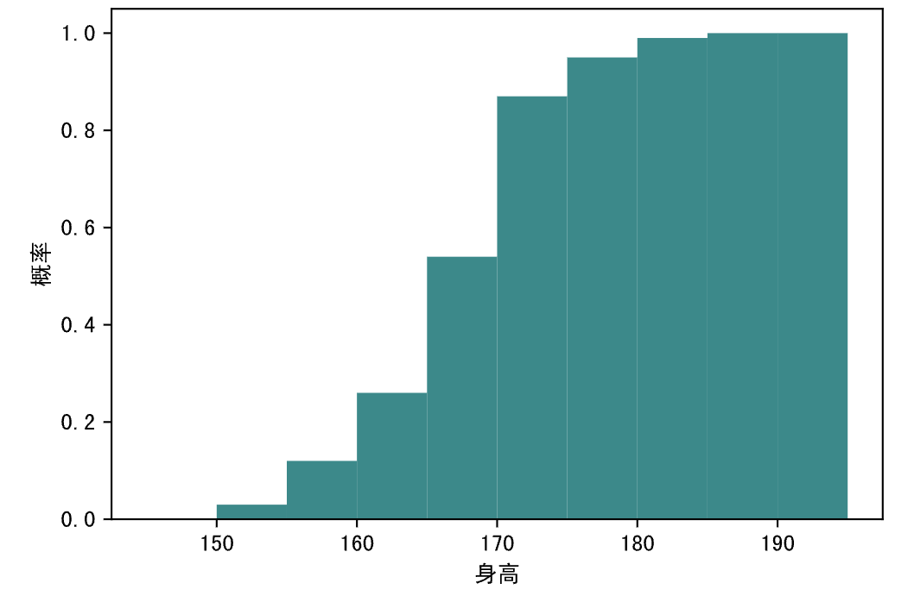

#### Biểu đồ hộp (Box plot)

Biểu đồ hộp (box plot) hay còn gọi là biểu đồ hình hộp hoặc biểu đồ hộp - râu (box-and-whisker plot), là một loại biểu đồ thống kê dùng để thể hiện độ phân tán của một tập dữ liệu, như hình bên dưới. Nó có tên như vậy vì hình dạng giống như chiếc hộp, đồng thời bên ngoài tứ phân vị trên và dưới có các đường kẻ kéo dài ra trông như những sợi râu. Trong biểu đồ hộp, cạnh trên của hộp là vị trí tứ phân vị trên ($\small{Q_{3}}$), cạnh dưới của hộp là vị trí tứ phân vị dưới ($\small{Q_{1}}$), đường kẻ ở giữa hộp là vị trí trung vị ($\small{Q_{2}}$), còn chiều dài của hộp chính là khoảng cách giữa các tứ phân vị (IQR). Ngoài ra, biên của đường kẻ phía trên hộp là giá trị lớn nhất, biên của đường kẻ phía dưới hộp là giá trị nhỏ nhất, các điểm nằm ngoài hai đường này là giá trị ngoại lai (outlier). Giá trị ngoại lai được định nghĩa là các giá trị nhỏ hơn $\small{Q_{1} - 1.5 \times IQR}$ hoặc lớn hơn $\small{Q_{3} + 1.5 \times IQR}$. Số `1.5` trong công thức cũng có thể thay thế bằng `3` để phát hiện giá trị ngoại lai cực trị (extreme outlier), còn các giá trị ngoại lai nằm giữa `1.5` và `3` thường được gọi là giá trị ngoại lai vừa phải (mild outlier).

Có thể dùng hàm `boxplot` của module `pyplot` để vẽ biểu đồ hộp, như đoạn mã sau:

Mã nguồn:

```Python
# Mảng chứa 47 số ngẫu nhiên trong khoảng [0, 100)
data = np.random.randint(0, 100, 47)
# Thêm ba điểm dữ liệu có thể là giá trị ngoại lai vào mảng
data = np.append(data, 160)
data = np.append(data, 200)
data = np.append(data, -50)

plt.figure(figsize=(6, 4), dpi=120)
# Tham số whis có giá trị mặc định là 1.5, đặt thành 3 có thể phát hiện giá trị ngoại lai cực trị, showmeans=True biểu thị đánh dấu vị trí giá trị trung bình trên hình
plt.boxplot(data, whis=1.5, showmeans=True, notch=True)
# Tùy chỉnh phạm vi giá trị trục tung
plt.ylim([-100, 250])
# Tùy chỉnh vạch chia trục hoành
plt.xticks([1], labels=['data'])
plt.show()
```

Kết quả:

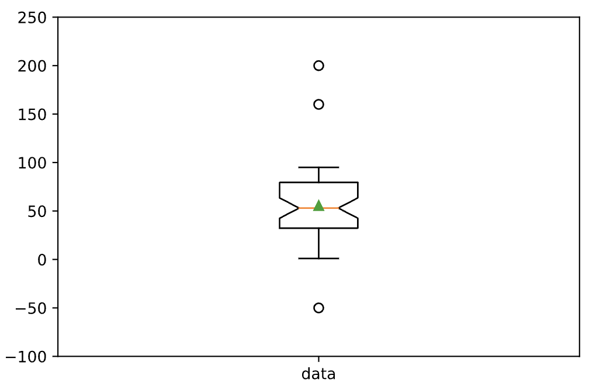

> **Giải thích**: Do dữ liệu được tạo ngẫu nhiên, biểu đồ được sinh ra khi bạn chạy đoạn mã trên có thể không hoàn toàn giống ở đây, hãy lấy kết quả chạy thực tế làm chuẩn.

### Hiển thị và lưu biểu đồ

Có thể dùng hàm `show` của module `pyplot` để hiển thị biểu đồ đã vẽ, chúng ta đã dùng hàm này trong các đoạn mã ở trên. Nếu muốn lưu biểu đồ, có thể dùng hàm `savefig`. Cần lưu ý rằng nếu muốn vừa hiển thị vừa lưu biểu đồ, nên thực thi hàm `savefig` trước rồi mới thực thi hàm `show`, vì khi gọi hàm `show`, đối tượng biểu đồ đã được giải phóng, hàm `savefig` nằm sau `show` sẽ chỉ lưu lại một vùng trắng trống rỗng.

```Python
plt.savefig('chart.png')
plt.show()
```

### Các biểu đồ khác

Sử dụng matplotlib, chúng ta còn có thể vẽ nhiều loại biểu đồ thống kê khác (như: biểu đồ radar, biểu đồ hoa hồng Nightingale, biểu đồ nhiệt heat map, v.v.), nhưng trong thực tế công việc, các loại biểu đồ có tần suất sử dụng cao nhất đều đã được chúng ta trình bày đầy đủ ở trên. Ngoài ra, matplotlib còn có rất nhiều chi tiết để tùy biến biểu đồ thống kê, chẳng hạn như tùy chỉnh trục tọa độ, tùy biến văn bản và nhãn trên biểu đồ. Nếu muốn tìm hiểu cách vẽ và tùy biến nhiều biểu đồ hơn với matplotlib, bạn có thể tham khảo trực tiếp [tài liệu hướng dẫn](https://matplotlib.org/stable/tutorials/index.html) và [bộ sưu tập ví dụ mẫu](https://matplotlib.org/stable/gallery/index.html) trên trang web chính thức của matplotlib, trong chương tiếp theo chúng tôi cũng sẽ giới thiệu sơ lược đến các bạn.
