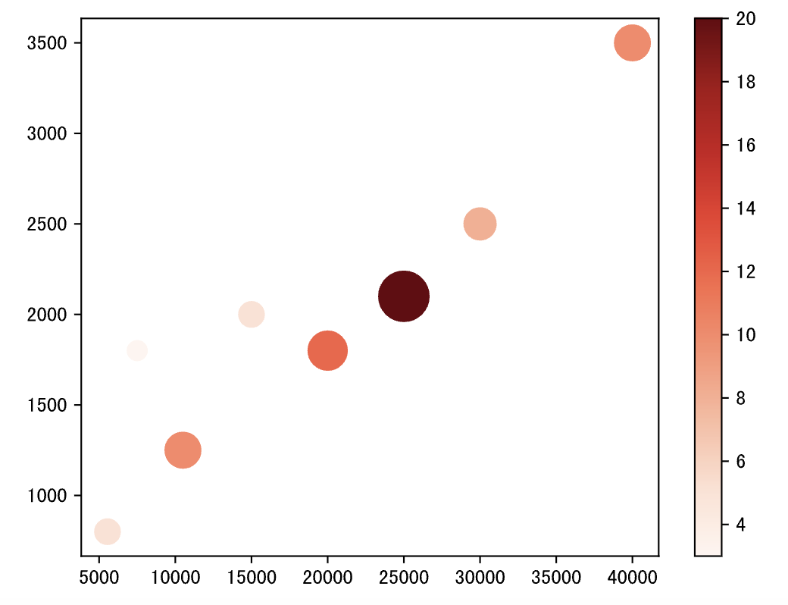
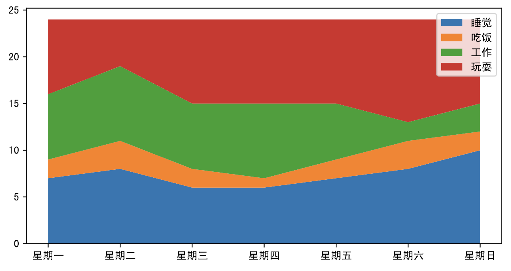
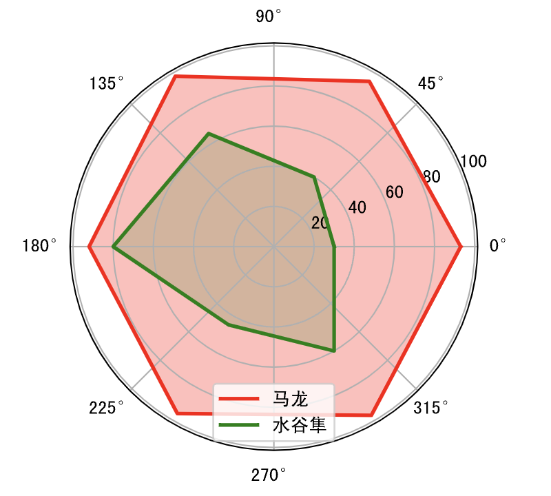
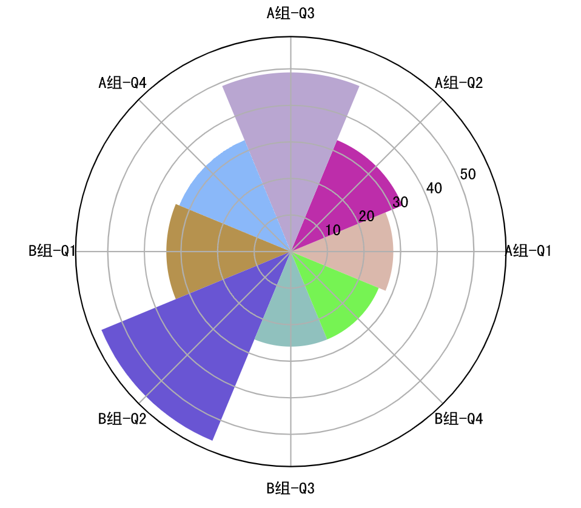
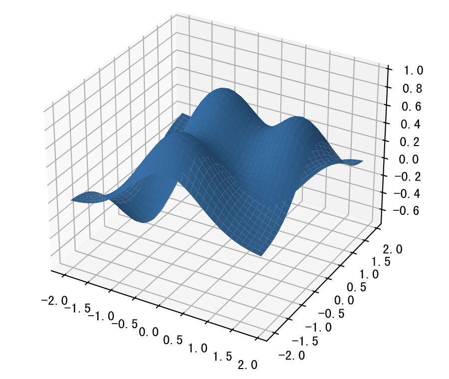
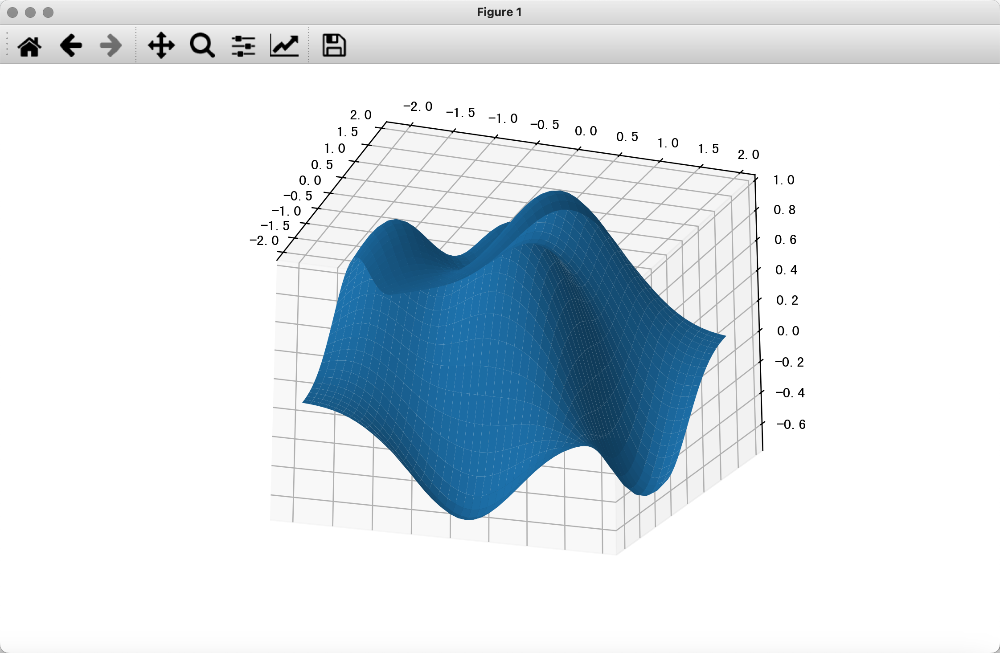

## Trực quan hóa dữ liệu - 2

Trong chương này, chúng ta sẽ thử dùng matplotlib để vẽ một số biểu đồ thống kê nâng cao. Như đã nói ở trước, các bạn có thể học cách sử dụng matplotlib và vẽ các biểu đồ thống kê nâng cao hơn thông qua [tài liệu hướng dẫn](https://matplotlib.org/stable/tutorials/index.html) và [bộ sưu tập ví dụ](https://matplotlib.org/stable/gallery/index.html) trên trang web chính thức của matplotlib; đặc biệt là khi tùy biến các biểu đồ tương đối phức tạp, chúng tôi khuyên bạn nên tìm thẳng các ví dụ trên trang chính thức, sau đó chỉ cần thực hiện những chỉnh sửa tương ứng là có thể vẽ được biểu đồ mình mong muốn. Cách làm "sao chép + chỉnh sửa" này sẽ nâng cao đáng kể hiệu suất công việc của bạn, bởi vì phần lớn thời gian, đoạn mã của bạn so với mã trên trang chính thức chỉ khác nhau ở phần dữ liệu mà thôi, không cần thiết phải làm lại những việc tẻ nhạt lặp đi lặp lại.

### Biểu đồ bong bóng (Bubble chart)

Biểu đồ bong bóng có thể dùng để tìm hiểu mối quan hệ giữa ba biến, thông qua việc so sánh vị trí và kích thước của các bong bóng để phân tích tính tương quan giữa các chiều dữ liệu. Ví dụ, trong biểu đồ phân tán về thu nhập hàng tháng và chi tiêu mua sắm trực tuyến mà chúng ta đã vẽ trước đây, chúng ta đã phát hiện ra mối tương quan thuận giữa cả hai. Nếu đưa thêm biến thứ ba là số lần mua sắm trực tuyến vào, chúng ta sẽ cần sử dụng biểu đồ bong bóng để hiển thị.

Mã nguồn:

```python
income = np.array([5550, 7500, 10500, 15000, 20000, 25000, 30000, 40000])
outcome = np.array([800, 1800, 1250, 2000, 1800, 2100, 2500, 3500])
nums = np.array([5, 3, 10, 5, 12, 20, 8, 10])

# Kiểm soát diện tích và màu sắc lần lượt thông qua tham số s và c của hàm scatter
plt.scatter(income, outcome, s=nums * 30, c=nums, cmap='Reds')
# Hiển thị thanh màu (colorbar)
plt.colorbar()
# Hiển thị biểu đồ
plt.show()
```

Kết quả:



### Biểu đồ diện tích (Area chart)

Biểu đồ diện tích còn được gọi là biểu đồ đường gấp khúc xếp chồng (stacked line chart), được xây dựng trên cơ sở biểu đồ đường, bằng cách tô màu (thể hiện diện tích) cho vùng bên dưới đường gấp khúc, dùng để biểu diễn các giá trị trên một khoảng liên tục hoặc khoảng thời gian. Biểu đồ này thường dùng để hiển thị xu hướng và so sánh các giá trị, việc tô các màu sắc khác nhau giúp làm nổi bật rõ nét hơn sự so sánh và xu hướng giữa các mảng diện tích. Trong ví dụ dưới đây, chúng ta dùng biểu đồ diện tích để thể hiện thời gian dành cho việc ngủ, ăn, làm việc và giải trí từ thứ Hai đến Chủ nhật.

Mã nguồn:

```python
plt.figure(figsize=(8, 4))
days = np.arange(7)
sleeping = [7, 8, 6, 6, 7, 8, 10]
eating = [2, 3, 2, 1, 2, 3, 2]
working = [7, 8, 7, 8, 6, 2, 3]
playing = [8, 5, 9, 9, 9, 11, 9]
# Vẽ biểu đồ đường gấp khúc xếp chồng
plt.stackplot(days, sleeping, eating, working, playing)
# Tùy chỉnh vạch chia trục hoành
plt.xticks(days, labels=[f'星期{x}' for x in '一二三四五六日'])
# Tùy chỉnh chú giải
plt.legend(['睡觉', '吃饭', '工作', '玩耍'], fontsize=10)
# Hiển thị biểu đồ
plt.show()
```

Kết quả:



### Biểu đồ radar (Radar chart)

Biểu đồ radar thường được dùng để so sánh nhiều dữ liệu định lượng, nhằm xem xét những biến nào có giá trị tương đồng. Biểu đồ radar cũng có thể dùng để xem trong tập dữ liệu biến nào có giá trị tương đối thấp, biến nào có giá trị tương đối cao, là lựa chọn lý tưởng để thể hiện hiệu năng hoặc phong độ thi đấu. Những độc giả thường xuyên xem các trận đấu bóng rổ hay bóng đá chắc hẳn rất quen thuộc với biểu đồ radar, chẳng hạn như trong các chương trình phát sóng giải NBA người ta rất hay dùng biểu đồ radar để thể hiện các chỉ số của cầu thủ. Bản chất của biểu đồ radar là biểu đồ đường, chỉ khác là biểu đồ đường được ánh xạ lên hệ tọa độ cực. Khi vẽ biểu đồ radar, cần làm cho đường gấp khúc khép kín, nói một cách đơn giản là nối điểm đầu với điểm cuối. Dưới đây là mã nguồn vẽ biểu đồ radar:

Mã nguồn:

```python
labels = np.array(['速度', '力量', '经验', '防守', '发球', '技术'])
# Dữ liệu của Mã Long (Ma Long) và Mizutani Jun
malong_values = np.array([93, 95, 98, 92, 96, 97])
shuigu_values = np.array([30, 40, 65, 80, 45, 60])
angles = np.linspace(0, 2 * np.pi, labels.size, endpoint=False)
# Thêm một điểm dữ liệu để đường bao hình vẽ khép kín
malong_values = np.append(malong_values, malong_values[0])
shuigu_values = np.append(shuigu_values, shuigu_values[0])
angles = np.append(angles, angles[0])
# Tạo khung vẽ
plt.figure(figsize=(4, 4), dpi=120)
# Tạo hệ trục tọa độ
ax = plt.subplot(projection='polar')
# Vẽ đường và tô màu diện tích
plt.plot(angles, malong_values, color='r', linewidth=2, label='马龙')
plt.fill(angles, malong_values, color='r', alpha=0.3)
plt.plot(angles, shuigu_values, color='g', linewidth=2, label='水谷隼')
plt.fill(angles, shuigu_values, color='g', alpha=0.2)
# Hiển thị chú giải
ax.legend()
# Hiển thị biểu đồ
plt.show()
```

Kết quả:



### Biểu đồ hoa hồng Nightingale (Rose chart)

Biểu đồ hoa hồng là biểu đồ cột được ánh xạ trong hệ tọa độ cực, do Florence Nightingale phát minh. Ban đầu biểu đồ này được Nightingale sử dụng để thể hiện tỷ lệ tử vong theo mùa tại các bệnh viện dã chiến chiến tranh. Do diện tích có mối quan hệ bình phương với bán kính, biểu đồ hoa hồng Nightingale sẽ phóng đại tỷ lệ độ lớn của dữ liệu, đặc biệt thích hợp để so sánh các giá trị có độ lớn xấp xỉ nhau; đồng thời do hình tròn có tính chất chu kỳ, nên biểu đồ hoa hồng Nightingale cũng rất thích hợp để thể hiện các khái niệm thời gian trong một chu kỳ, chẳng hạn như các ngày trong tuần hay các tháng trong năm.

Mã nguồn:

```python
group1 = np.random.randint(20, 50, 4)
group2 = np.random.randint(10, 60, 4)
x = np.array([f'A组-Q{i}' for i in range(1, 5)] + [f'B组-Q{i}' for i in range(1, 5)])
y = np.array(group1.tolist() + group2.tolist())
# Góc và độ rộng cánh hoa hồng
theta = np.linspace(0, 2 * np.pi, x.size, endpoint=False)
width = 2 * np.pi / x.size
# Tạo 8 màu ngẫu nhiên
colors = np.random.rand(8, 3)
# Chiếu biểu đồ cột lên tọa độ cực
ax = plt.subplot(projection='polar')
# Vẽ biểu đồ cột
plt.bar(theta, y, width=width, color=colors, bottom=0)
# Thiết lập lưới tọa độ
ax.set_thetagrids(theta * 180 / np.pi, x, fontsize=10)
# Hiển thị biểu đồ
plt.show()
```

Kết quả:



### Biểu đồ 3D

matplotlib cũng có thể dùng để vẽ biểu đồ 3D, nội dung chi tiết các bạn có thể tham khảo tài liệu chính thức. Dưới đây chúng ta dùng một đoạn mã đơn giản để minh họa cách vẽ biểu đồ 3D.

Mã nguồn:

```python
from mpl_toolkits.mplot3d import Axes3D

fig = plt.figure(figsize=(8, 4), dpi=120)
# Tạo hệ tọa độ 3D và thêm vào khung vẽ
ax = Axes3D(fig, auto_add_to_figure=False)
fig.add_axes(ax)
x = np.arange(-2, 2, 0.1)
y = np.arange(-2, 2, 0.1)
x, y = np.meshgrid(x, y)
z = (1 - y ** 5 + x ** 5) * np.exp(-x ** 2 - y ** 2)
# Vẽ mặt cong 3D
ax.plot_surface(x, y, z)
# Hiển thị biểu đồ
plt.show()
```

Kết quả:



Cần chỉ ra rằng, biểu đồ 3D được render trong JupyterLab không phải là biểu đồ 3D thực sự, bởi vì bạn không có cách nào điều chỉnh góc nhìn của người quan sát, cũng không thể xoay hay thu phóng được. Nếu muốn thấy hiệu ứng 3D thực sự, cần phải render biểu đồ vào một cửa sổ Qt, do đó chúng ta có thể cài đặt thư viện bên thứ ba mang tên PyQt6 trước, như sau:

```
%pip install PyQt6
```

Sau đó, chúng ta dùng lệnh magic để yêu cầu JupyterLab render biểu đồ vào cửa sổ Qt:

```
%matplotlib qt
```

Sau khi hoàn thành các thao tác trên, chúng ta có thể chạy lại đoạn mã vẽ biểu đồ 3D lúc nãy để thấy cửa sổ như hình dưới đây. Trong cửa sổ này, chúng ta có thể dùng chuột để xoay, thu phóng đồ thị 3D, thậm chí có thể chọn một phần dữ liệu trên biểu đồ để quan sát, trông vô cùng ấn tượng.


