## Trực quan hóa dữ liệu - 3

Qua các bài học trước, chúng ta đã có nhận thức ban đầu về công cụ trực quan hóa dữ liệu matplotlib. Có thể các bạn cũng đã nhận thấy rằng, các hàm mà matplotlib cung cấp mặc dù rất mạnh mẽ, nhưng lại có quá nhiều tham số. Muốn tùy biến biểu đồ một cách chuyên sâu thì cần phải chỉnh sửa hàng loạt tham số, điều này không thực sự thân thiện với người mới bắt đầu. Mặt khác, các biểu đồ thống kê được tùy biến bằng matplotlib là các biểu đồ tĩnh, có thể không phù hợp trong một số ngữ cảnh đòi hỏi hiệu ứng tương tác. Để giải quyết hai vấn đề này, chúng tôi xin giới thiệu đến các bạn hai công cụ trực quan hóa mới: một là seaborn, hai là pyecharts.

### Seaborn

Seaborn là công cụ trực quan hóa dữ liệu được xây dựng dựa trên matplotlib, nó tương đương với một lớp đóng gói cấp cao hơn cho matplotlib. Hơn nữa, seaborn có thể tích hợp liền mạch với pandas, cho phép chúng ta xây dựng các biểu đồ thống kê đẹp mắt hơn với ít dòng code hơn, hỗ trợ đắc lực cho việc khám phá và thấu hiểu dữ liệu. Seaborn bao gồm nhưng không giới hạn ở các tính năng sau:

1. API hướng đến tập dữ liệu, dùng để kiểm tra mối quan hệ giữa nhiều biến.
1. Hỗ trợ sử dụng biến phân loại để hiển thị kết quả quan sát hoặc dữ liệu thống kê tổng hợp.
1. Khả năng trực quan hóa phân phối đơn biến hoặc song biến, cùng các tùy chọn so sánh giữa các tập dữ liệu con.
1. Tự động ước lượng và vẽ đồ thị cho các mô hình hồi quy tuyến tính của nhiều loại biến phụ thuộc khác nhau.
1. Tích hợp sẵn các bảng màu (palette) và chủ đề (theme), dễ dàng tùy biến hiệu ứng thị giác của biểu đồ thống kê.

Có thể sử dụng công cụ quản lý gói pip của Python để cài đặt seaborn:

```Bash
pip install seaborn
```

Trong Jupyter, có thể sử dụng trực tiếp lệnh magic để cài đặt như sau:

```Bash
%pip install seaborn
```

Dưới đây, chúng ta lấy tập dữ liệu có sẵn của seaborn làm ví dụ để minh họa đơn giản cách sử dụng và sức mạnh của seaborn. Những độc giả muốn nghiên cứu sâu về seaborn có thể tự đọc [tài liệu hướng dẫn](https://seaborn.pydata.org/tutorial.html) chính thức và xem các [ví dụ mẫu](https://seaborn.pydata.org/examples/index.html) trong bộ sưu tập chính thức. Viết code dựa theo các ví dụ mẫu chính thức là một lựa chọn rất tốt, nói một cách đơn giản là giữ nguyên khung code của tác giả và thay dữ liệu bằng dữ liệu của chính mình. Hình ảnh dưới đây minh họa các hàm vẽ biểu đồ của seaborn, có thể thấy các hàm này chủ yếu hỗ trợ chúng ta khám phá mối quan hệ (relational), phân phối (distribution) và phân loại (categorical) của dữ liệu thông qua việc vẽ biểu đồ.

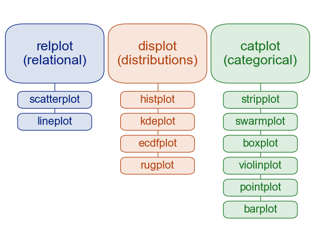

Để sử dụng seaborn, trước tiên cần import thư viện này và thiết lập chủ đề (theme), như đoạn mã sau:

```Python
import seaborn as sns

sns.set_theme()
```

Nếu cần hiển thị tiếng Trung trên biểu đồ, vẫn cần dùng cách đã nói ở bài trước để chỉnh sửa tham số cấu hình của matplotlib, như đoạn mã sau:

```Python
import matplotlib.pyplot as plt

plt.rcParams['font.sans-serif'].insert(0, 'SimHei')
plt.rcParams['axes.unicode_minus'] = False
```

> **Lưu ý**: Đoạn mã trên bắt buộc phải đặt sau khi gọi hàm `set_theme`, nếu không khi gọi hàm `set_theme` nó sẽ thiết lập lại cấu hình font chữ trong các tham số cấu hình của matplotlib.

Tải tập dữ liệu Tips chính thức (dữ liệu tiền tip khi ăn uống):

```Python
tips_df = sns.load_dataset('tips')
tips_df.info()
```

Kết quả chạy như sau, trong đó `total_bill` biểu thị tổng số tiền hóa đơn, `tip` biểu thị số tiền tip, `sex` là giới tính của khách hàng, `smoker` biểu thị khách hàng có hút thuốc hay không, `day` đại diện cho các ngày trong tuần, `time` đại diện cho bữa trưa hay bữa tối, `size` là số người cùng ăn.

```
<class 'pandas.core.frame.DataFrame'>
RangeIndex: 244 entries, 0 to 243
Data columns (total 7 columns):
 #   Column      Non-Null Count  Dtype   
---  ------      --------------  -----   
 0   total_bill  244 non-null    float64 
 1   tip         244 non-null    float64 
 2   sex         244 non-null    category
 3   smoker      244 non-null    category
 4   day         244 non-null    category
 5   time        244 non-null    category
 6   size        244 non-null    int64   
dtypes: category(4), float64(2), int64(1)
memory usage: 7.4 KB
```

Do tập dữ liệu được tải qua mạng internet, đoạn mã trên có thể không lấy được dữ liệu vì lỗi SSL. Bạn có thể thử chạy đoạn mã dưới đây trước rồi mới tải tập dữ liệu:

```Python
import ssl

ssl._create_default_https_context = ssl._create_unverified_context
```

Nếu muốn tìm hiểu phân phối số tiền hóa đơn, chúng ta có thể sử dụng đoạn mã dưới đây để vẽ biểu đồ phân phối:

```Python
sns.histplot(data=tips_df, x='total_bill', kde=True)
```

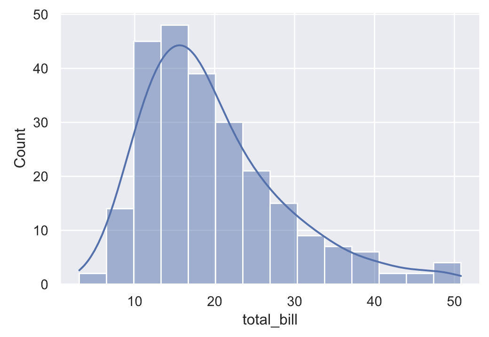

Nếu muốn tìm hiểu mối quan hệ từng cặp giữa các biến, chúng ta có thể vẽ biểu đồ ma trận cặp (pair plot), mã nguồn và kết quả như sau:

```Python
sns.pairplot(data=tips_df, hue='sex')
```

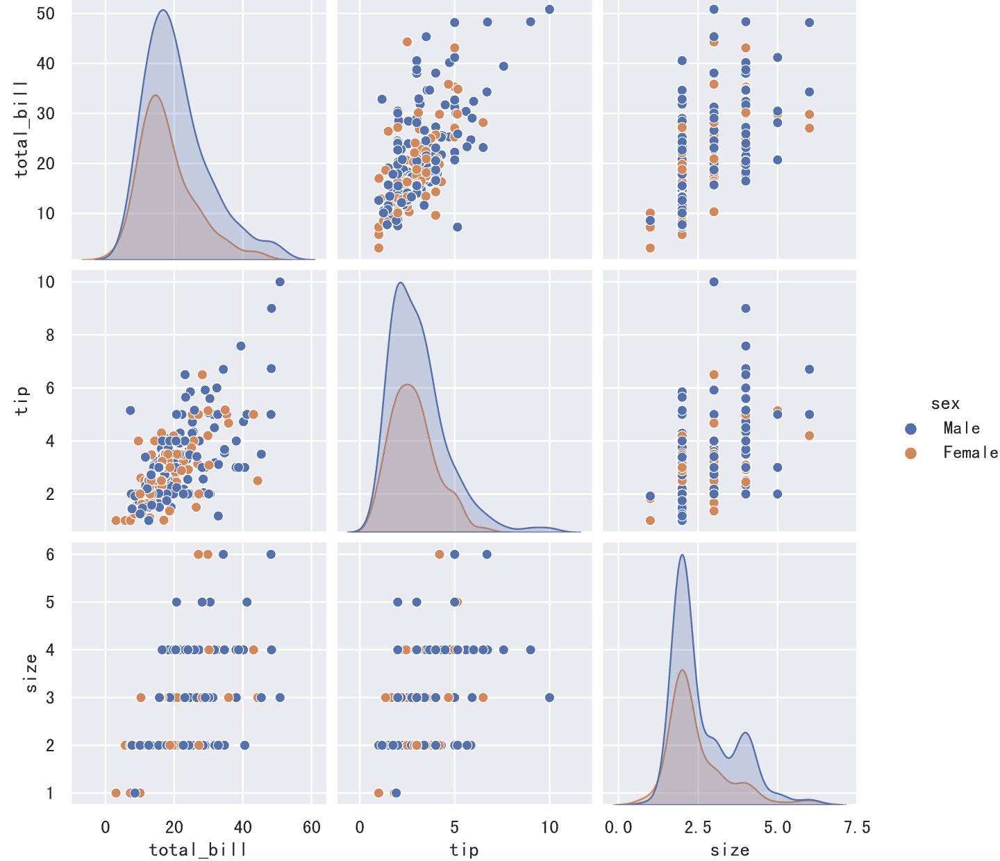

Nếu chưa hài lòng với màu sắc của biểu đồ trên, bạn có thể thông qua tham số `palette` để chọn các bảng màu có sẵn của seaborn nhằm thay đổi màu sắc. Cách làm này thuận tiện và đáng tin cậy hơn nhiều so với việc tự chỉ định màu hoặc dùng màu ngẫu nhiên. Hình ảnh dưới đây minh họa một số bảng màu có sẵn của seaborn.

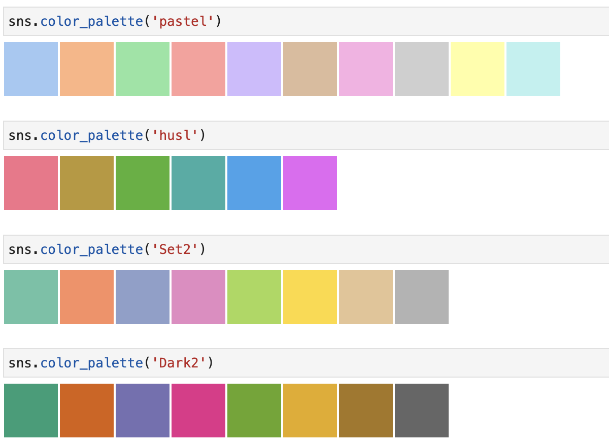

Chúng ta có thể chỉnh sửa nhẹ đoạn mã trên để xem kết quả chạy có gì khác biệt:

```Python
sns.pairplot(data=tips_df, hue='sex', palette='Dark2')
```

Tiếp theo, chúng ta vẽ biểu đồ phân phối kết hợp (joint plot) cho hai nhóm dữ liệu `total_bill` và `tip`, mã nguồn như sau:

```Python
sns.jointplot(data=tips_df, x='total_bill', y='tip', hue='sex')
```

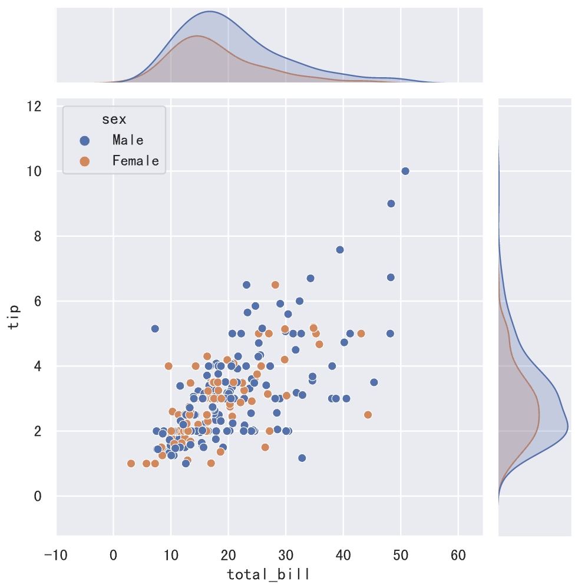

Hình trên thể hiện rất rõ ràng rằng giữa `total_bill` và `tip` tồn tại mối tương quan thuận, điều này chúng ta cũng có thể xác minh thông qua phương thức `corr` của đối tượng DataFrame. Tiếp theo, chúng ta có thể xây dựng mô hình hồi quy để khớp với các điểm dữ liệu này, và biểu đồ mô hình hồi quy tuyến tính của seaborn đã giúp chúng ta hiện thực hóa chức năng này, mã nguồn như sau:

```Python
sns.lmplot(data=tips_df, x='total_bill', y='tip', hue='sex')
```

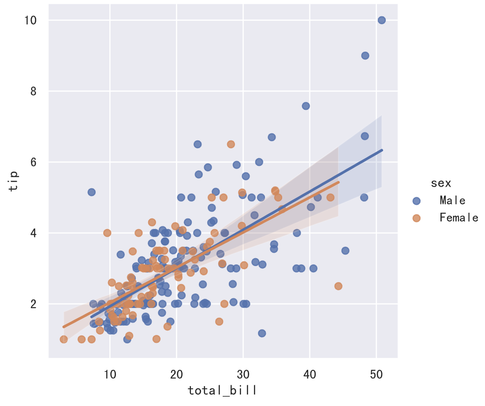

Nếu muốn tìm hiểu xu hướng tập trung và phân tán của số tiền hóa đơn, chúng ta có thể vẽ biểu đồ hộp (box plot) hoặc biểu đồ vĩ cầm (violin plot), mã nguồn như bên dưới. Chúng ta lần lượt hiển thị dữ liệu theo thứ Năm, thứ Sáu, thứ Bảy và Chủ nhật:

```Python
sns.boxplot(data=tips_df, x='day', y='total_bill')
```

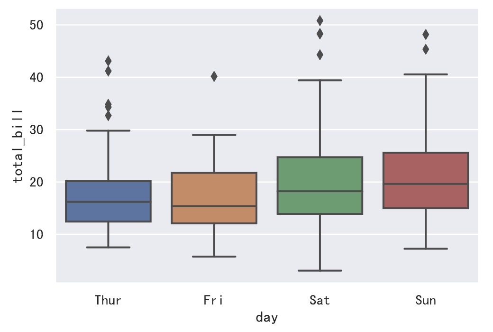

```Python
sns.violinplot(data=tips_df, x='day', y='total_bill')
```

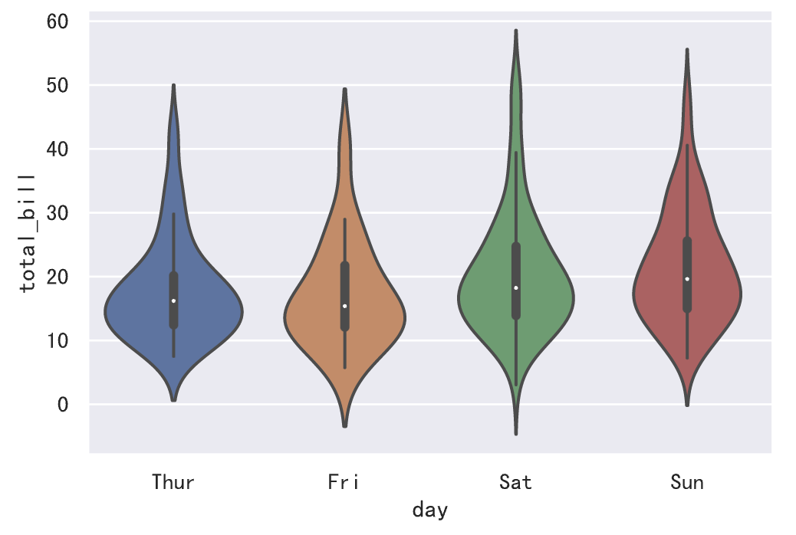

> **Giải thích**: So với biểu đồ hộp, biểu đồ vĩ cầm không đánh dấu các điểm ngoại lai mà hiển thị toàn bộ phạm vi dữ liệu; mặt khác, biểu đồ vĩ cầm thể hiện rất tốt đường bao mật độ phân phối của dữ liệu.

### Pyecharts

Echarts ban đầu là một thư viện biểu đồ front-end do Baidu phát triển. Ngày 16 tháng 1 năm 2018, ECharts chính thức gia nhập Apache Incubator để ươm tạo, và hiện nay đã trở thành dự án hàng đầu (top-level project) của Apache Software Foundation. Nhờ khả năng tương tác tuyệt vời cùng thiết kế biểu đồ tinh tế, ECharts đã nhận được sự công nhận của đông đảo lập trình viên, và pyecharts chính là lớp thư viện bao bọc ECharts dựa trên ngôn ngữ Python, giúp các lập trình viên Python cũng có thể sử dụng ECharts để vẽ các biểu đồ thống kê đẹp mắt và có tính tương tác mạnh mẽ.

Có thể sử dụng công cụ quản lý gói pip của Python để cài đặt pyecharts:

```Bash
pip install pyecharts
```

Trong JupyterLab, có thể trực tiếp sử dụng lệnh magic để cài đặt như sau:

```Bash
%pip install pyecharts
```

Nếu muốn vẽ biểu đồ bằng pyecharts trong JupyterLab, chúng ta cần làm thêm một số bước chuẩn bị, chủ yếu là sửa đổi cấu hình của pyecharts, như đoạn mã sau:

```python
from pyecharts.globals import CurrentConfig, NotebookType

CurrentConfig.NOTEBOOK_TYPE = NotebookType.JUPYTER_LAB
```

Tiếp theo, chúng ta cùng làm quen với pyecharts thông qua một ví dụ trong phần hướng dẫn dành cho người mới bắt đầu trên trang web chính thức của pyecharts. Tất nhiên, chúng ta sẽ điều chỉnh một chút ví dụ từ trang web chính thức, mã nguồn như sau:

```Python
from pyecharts.charts import Bar
from pyecharts import options as opts

# Tạo đối tượng biểu đồ cột và thiết lập các tham số khởi tạo (chiều rộng, chiều cao)
bar_chart = Bar(init_opts=opts.InitOpts(width='600px', height='450px'))
# Thiết lập dữ liệu trục hoành
bar_chart.add_xaxis(["衬衫", "羊毛衫", "雪纺衫", "裤子", "高跟鞋", "袜子"])
# Thiết lập dữ liệu trục tung (nhóm thứ nhất)
bar_chart.add_yaxis("商家A", [25, 20, 36, 10, 75, 90])
# Thiết lập dữ liệu trục tung (nhóm thứ hai)
bar_chart.add_yaxis("商家B", [15, 12, 30, 20, 45, 60])
# Thiết lập dữ liệu trục tung (nhóm thứ ba)
bar_chart.add_yaxis("商家C", [12, 32, 40, 52, 35, 26])
# Thêm các tham số cấu hình toàn cục
bar_chart.set_global_opts(
    # Các tham số liên quan đến trục hoành
    xaxis_opts=opts.AxisOpts(
        axislabel_opts=opts.LabelOpts(color='navy')
    ),
    # Các tham số liên quan đến trục tung (nhãn, giá trị nhỏ nhất, giá trị lớn nhất, khoảng cách)
    yaxis_opts=opts.AxisOpts(
        axislabel_opts=opts.LabelOpts(color='navy'),
        min_=0,
        max_=100,
        interval=10
    ),
    # Các tham số liên quan đến tiêu đề (nội dung, liên kết, vị trí, kiểu văn bản)
    title_opts=opts.TitleOpts(
        title='2022年销售数据展示',
        pos_left='2%',
        title_textstyle_opts=opts.TextStyleOpts(
            color='navy',
            font_size=16,
            font_family='苹方-简',
            font_weight='bold'
        )
    ),
    # Các tham số liên quan đến hộp công cụ (toolbox)
    toolbox_opts=opts.ToolboxOpts(
        orient='vertical',
        pos_left='right'
    )
)
# Tải tệp JavaScript cần thiết để vẽ đồ thị
bar_chart.load_javascript()
```

Sau khi thực thi đoạn mã trên, chúng ta có thể gọi phương thức của đối tượng `bar` để hoàn tất việc render biểu đồ. Nếu sử dụng trực tiếp phương thức `render`, biểu đồ thống kê đã vẽ sẽ được lưu vào một tệp HTML, mở tệp đó ra cũng có thể xem biểu đồ; còn phương thức `render_notebook` sẽ render biểu đồ ngay bên trong cửa sổ trình duyệt.

```python
bar_chart.render_notebook()
```

Hiệu ứng chạy của đoạn mã trên như hình dưới đây. Đáng chú ý là tiêu đề, chú giải và hộp công cụ ở bên phải trong hình dưới đây đều có thể nhấp chuột vào được. Các bạn có thể bấm thử vào chúng để xem hiệu ứng ra sao. Sự quyến rũ của ECharts nằm chính ở hiệu ứng tương tác này, các bạn nhất định nên thử nghiệm.

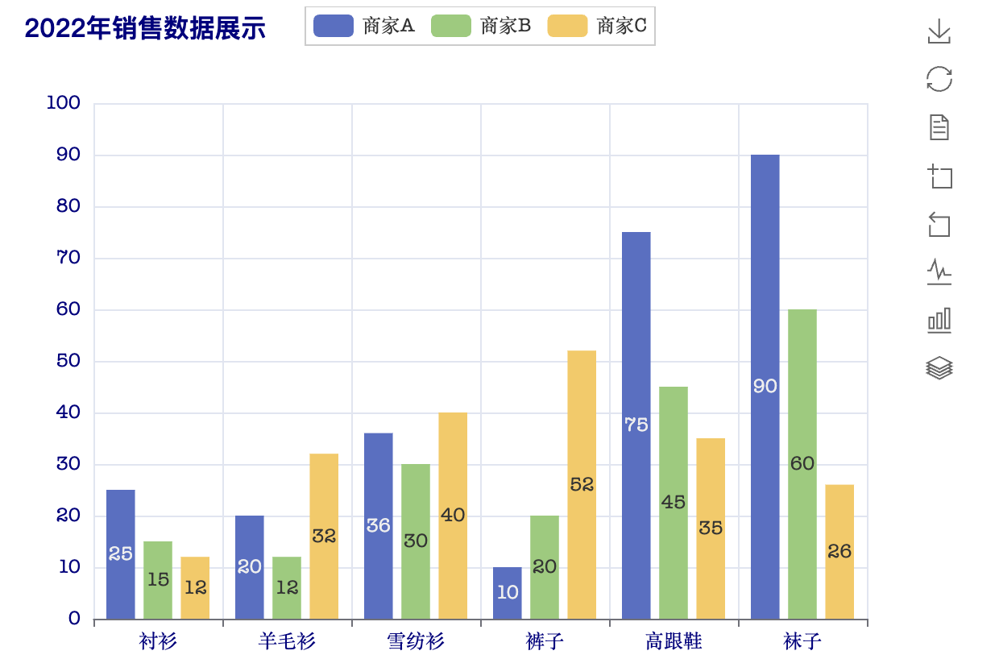

Tiếp theo, chúng ta cũng thông qua một ví dụ chính thức để xem cách vẽ biểu đồ tròn:

```Python
import pyecharts.options as opts
from pyecharts.charts import Pie

# Chuẩn bị dữ liệu cần thiết cho biểu đồ tròn
x_data = ["直接访问", "邮件营销", "联盟广告", "视频广告", "搜索引擎"]
y_data = [335, 310, 234, 135, 1548]
data = [(x, y) for x, y in zip(x_data, y_data)]

# Tạo đối tượng biểu đồ tròn và thiết lập các tham số khởi tạo
pie_chart = Pie(init_opts=opts.InitOpts(width="800px", height="400px"))
# Thêm dữ liệu vào biểu đồ tròn
pie_chart.add(
    '', 
    data_pair=data,
    radius=["50%", "75%"],
    label_opts=opts.LabelOpts(is_show=False),
)
# Thiết lập các mục cấu hình toàn cục
pie_chart.set_global_opts(
    # Cấu hình các tham số liên quan đến chú giải
    legend_opts=opts.LegendOpts(
        pos_left="legft",
        orient="vertical"
    )
)
# Thiết lập tham số cấu hình chuỗi dữ liệu (series)
pie_chart.set_series_opts(
    # Thiết lập không hiển thị tooltip
    tooltip_opts=opts.TooltipOpts(is_show=False),
    # Thiết lập kiểu nhãn cho biểu đồ tròn
    label_opts=opts.LabelOpts(formatter="{b}({c}): {d}%")
)
pie_chart.load_javascript()
```

```python
pie_chart.render_notebook()
```

Chạy đoạn mã trên, hiệu ứng hiển thị như hình dưới đây:

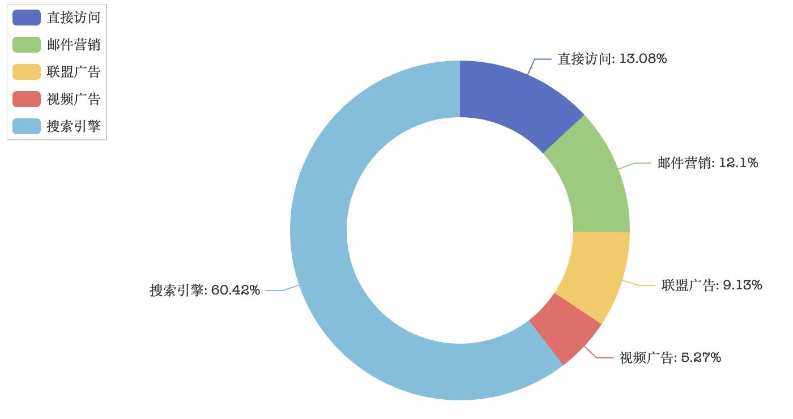

Cần lưu ý với các bạn rằng, pyecharts không thể trực tiếp sử dụng ndarray của NumPy hay Series, DataFrame của Pandas để cung cấp dữ liệu, nó yêu cầu các kiểu dữ liệu nguyên bản của Python. Có thể bạn cũng đã nhận thấy, trong đoạn mã trên chúng ta đều sử dụng các kiểu dữ liệu như danh sách (list) và tuple.

Cuối cùng, chúng ta cùng xem cách vẽ bản đồ. Để vẽ bản đồ, trước tiên cần cài đặt các thư viện phụ thuộc bổ sung để lấy thông tin bản đồ liên quan, các câu lệnh như sau:

```Bash
pip install echarts-countries-pypkg echarts-china-provinces-pypkg echarts-china-cities-pypkg echarts-china-counties-pypkg
```

Trong Jupyter, có thể dùng trực tiếp lệnh magic để cài đặt như sau:

```Bash
%pip install echarts-countries-pypkg
%pip install echarts-china-provinces-pypkg
%pip install echarts-china-cities-pypkg
%pip install echarts-china-counties-pypkg
```

> **Giải thích**: Bốn thư viện trên lần lượt chứa dữ liệu của các quốc gia trên thế giới, các đơn vị hành chính cấp tỉnh của Trung Quốc, các đơn vị hành chính cấp thành phố của Trung Quốc và các đơn vị hành chính cấp quận/huyện của Trung Quốc.

Sau đó, chúng ta đặt dữ liệu của các tỉnh trên cả nước vào trong một danh sách, như đoạn mã sau:

```Python
data = [
    ('广东', 594), ('浙江', 438), ('四川', 316), ('北京', 269), ('山东', 248),
    ('江苏', 234), ('湖南', 196), ('福建', 166), ('河南', 153), ('辽宁', 152),
    ('上海', 138), ('河北', 86), ('安徽', 79), ('湖北', 75), ('黑龙江', 70), 
    ('陕西', 63), ('吉林', 59), ('江西', 56), ('重庆', 46), ('贵州', 39),
    ('山西', 37), ('云南', 33), ('广西', 24), ('天津', 22), ('新疆', 21),
    ('海南', 18), ('内蒙古', 14), ('台湾', 11), ('甘肃', 7), ('广西壮族自治区', 4),
    ('香港', 4), ('青海', 3), ('新疆维吾尔自治区', 3), ('内蒙古自治区', 3), ('宁夏', 1)
]
```

Tiếp theo, chúng ta sử dụng pyecharts để đánh dấu số lượng KOL Douyin (TikTok Trung Quốc) tại từng tỉnh trên bản đồ:

```Python
import pyecharts.options as opts
from pyecharts.charts import Map

map_chart = Map(init_opts=opts.InitOpts(width='1000px', height='1000px'))
map_chart.add('', data, 'china', is_roam=False)
map_chart.load_javascript()
```

```python
map_chart.render_notebook()
```

Hiệu ứng chạy mã như hình dưới đây, khi rê chuột lên bản đồ sẽ làm nổi bật tỉnh tương ứng và hiển thị các thông tin liên quan.

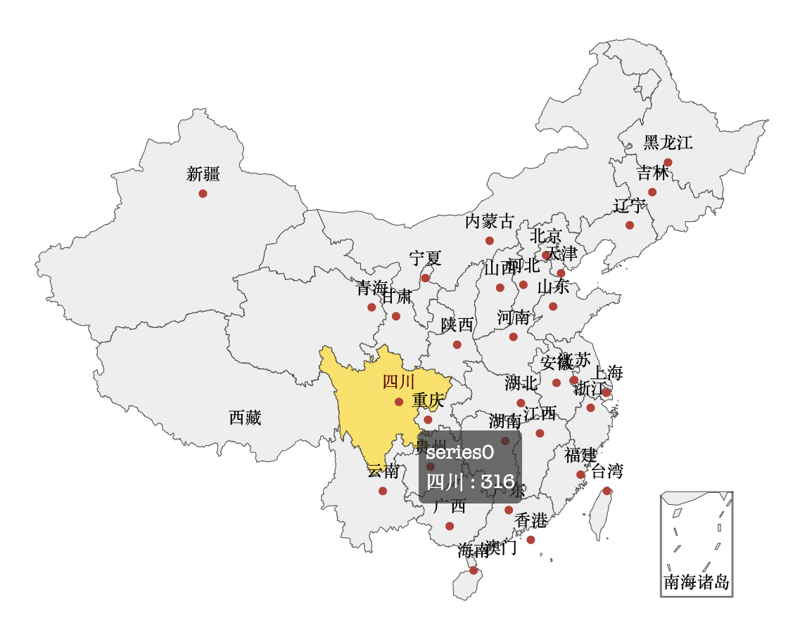

Cũng giống như seaborn, chúng tôi khuyên các bạn nên tham khảo các ví dụ mẫu trên trang chính thức khi sử dụng pyecharts. Chúng ta có thể tìm thấy mục "图表类型" (Loại biểu đồ) ở thanh điều hướng bên trái của [trang web chính thức pyecharts](https://pyecharts.org/#/zh-cn/), bên dưới mỗi loại biểu đồ đều có các ví dụ mẫu chính thức tương ứng, rất nhiều đoạn mã có thể sử dụng trực tiếp, việc chúng ta cần làm chỉ là thay dữ liệu thành dữ liệu của chính mình.