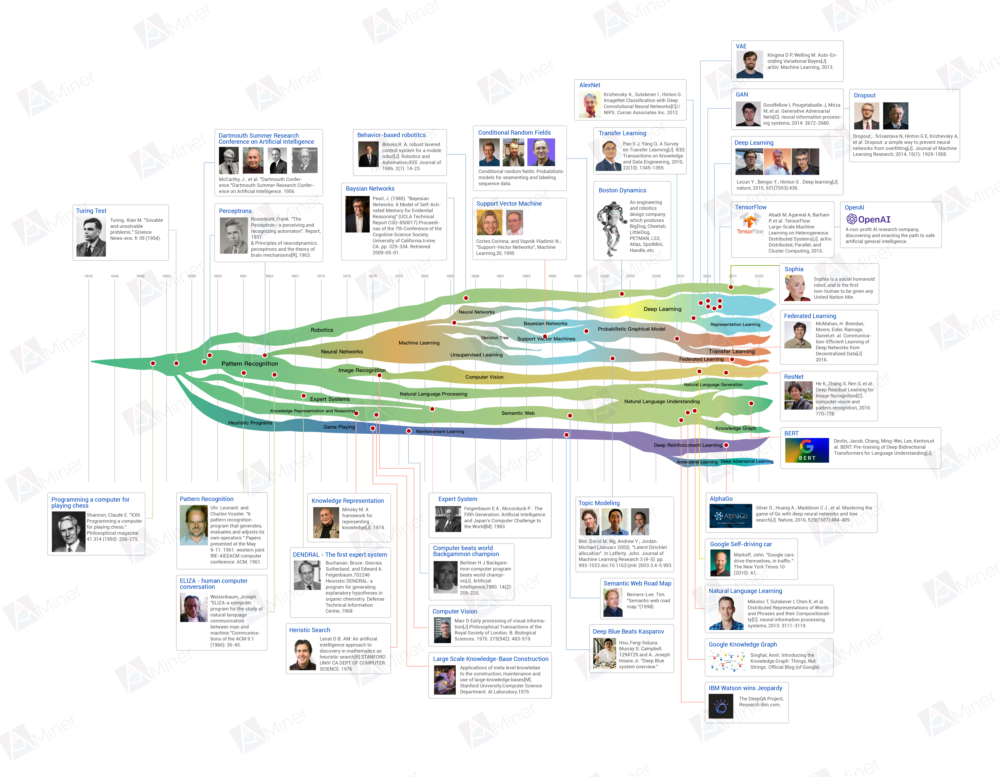
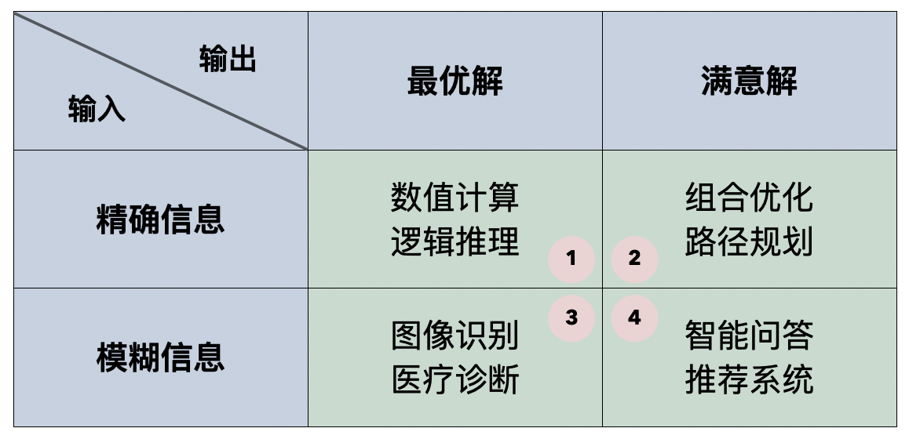
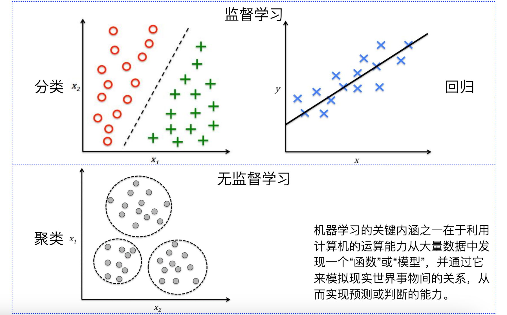
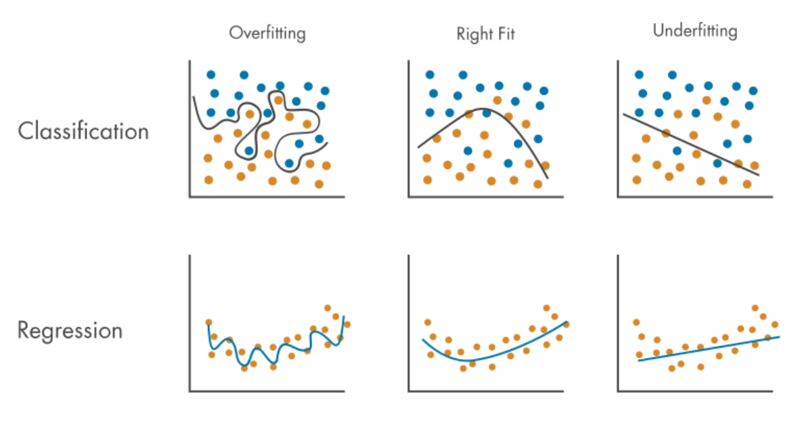
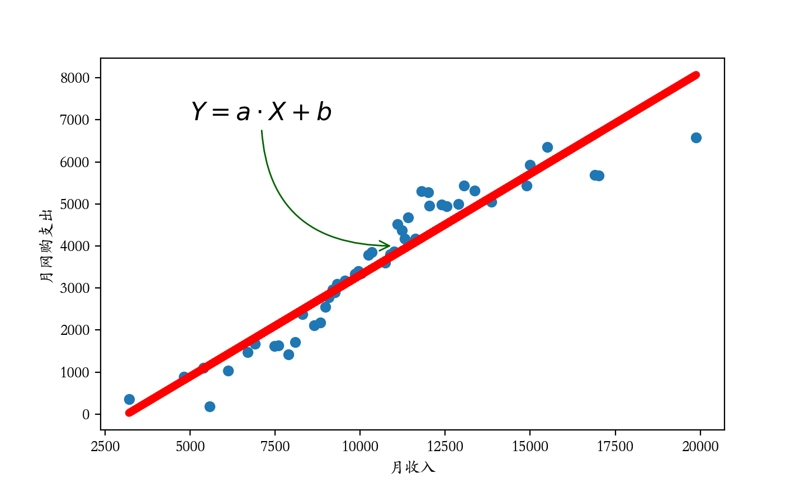

## Bàn về học máy

Trí tuệ nhân tạo (AI) chắc chắn là một từ khóa vô cùng nóng trong những năm gần đây. Từ sự kiện chương trình cờ vây AlphaGo do nhóm DeepMind của Google phát triển đánh bại các kỳ thủ hàng đầu của nhân loại vào năm 2016, đến việc công bố mô hình xử lý ngôn ngữ tự nhiên (NLP) dựa trên kiến trúc Transformer vào năm 2017, rồi OpenAI ra mắt ChatGPT dựa trên GPT-4 vào năm 2023, cùng với sự ứng dụng sâu rộng của trí tuệ nhân tạo trong y tế, xe tự hành và nhiều lĩnh vực khác; làn sóng trí tuệ nhân tạo đã đạt tới đỉnh cao chưa từng có kể từ Hội nghị Dartmouth năm 1956. Có thể nói rằng hầu như cuộc sống của mỗi người đều ít nhiều chịu ảnh hưởng của trí tuệ nhân tạo. Trí tuệ nhân tạo là một nhánh quan trọng của khoa học máy tính, liên quan đến khả năng máy tính mô phỏng hành vi thông minh cũng như khả năng máy móc bắt chước các hành vi thông minh của con người. Mục tiêu chính của việc nghiên cứu trí tuệ nhân tạo là phát triển các hệ thống có khả năng đưa ra quyết định độc lập, qua đó giúp con người làm việc hiệu quả hơn trong nhiều lĩnh vực như y tế, kỹ thuật, tài chính, giáo dục, nghiên cứu khoa học, dịch vụ công cộng, v.v. Tên tiếng Anh của trí tuệ nhân tạo là "*artificial intelligence*", vì vậy thường được viết tắt là *AI*. Trí tuệ nhân tạo bao gồm rất nhiều nội dung; những lĩnh vực mà chúng ta thường nhắc đến như học máy, học sâu, xử lý ngôn ngữ tự nhiên, thị giác máy tính, học tăng cường, khai phá dữ liệu, hệ chuyên gia, robot công nghiệp, lái xe tự hành, v.v. đều thuộc phạm trù của trí tuệ nhân tạo. AI theo nghĩa hẹp (Narrow AI) thường chỉ có thể thực hiện các nhiệm vụ cụ thể: AI biết trò chuyện thường không biết lái xe, AI biết lái xe thường không biết chơi cờ; AI theo nghĩa rộng (General AI / AGI) cần có trí thông minh tổng quát, có khả năng thực hiện bất kỳ nhiệm vụ nào mà trí tuệ con người có thể thực hiện; và xa hơn nữa, AI có thể vượt qua trí tuệ con người được chúng ta gọi là siêu trí tuệ nhân tạo (Super AI / ASI).

Trong khóa học này, chúng ta chủ yếu tìm hiểu về học máy (Machine Learning) trong trí tuệ nhân tạo. Học máy là một lĩnh vực con của trí tuệ nhân tạo, tập trung vào cách thức thông qua dữ liệu và thuật toán để giúp hệ thống máy tính học hỏi từ kinh nghiệm và đưa ra dự đoán hoặc quyết định. Nói một cách đơn giản, học máy là một phương pháp để hiện thực hóa trí tuệ nhân tạo, và rất nhiều hệ thống AI được phát triển thông qua công nghệ học máy. Trong một số ngữ cảnh cụ thể, người ta cũng dùng thuật ngữ khai phá dữ liệu (Data Mining) để chỉ học máy. Cái gọi là khai phá dữ liệu chính là trích xuất thông tin và tri thức hữu ích từ dữ liệu, phân tích và diễn giải các quy luật, xu hướng trong dữ liệu, cuối cùng đạt được mục tiêu dự đoán xu hướng và hành vi trong tương lai. Tất nhiên, khi nhắc đến hai thuật ngữ này, trọng tâm diễn đạt vẫn có sự khác biệt: khai phá dữ liệu chủ yếu tập trung vào việc khám phá tri thức, trong khi học máy tập trung vào việc xây dựng và tối ưu hóa các mô hình dự đoán. Hiện nay, còn có một khái niệm và lĩnh vực nghiên cứu vô cùng nóng hổi là học sâu (Deep Learning), một phân nhánh của học máy đặc biệt chú trọng vào việc sử dụng mạng nơ-ron nhiều tầng (mạng nơ-ron sâu) để xử lý dữ liệu và học tập. Học sâu thể hiện xuất sắc khi xử lý các dữ liệu phức tạp như hình ảnh, giọng nói và ngôn ngữ tự nhiên, có khả năng tự động học các đặc trưng phân tầng của dữ liệu, từ đó giảm thiểu nhu cầu can thiệp thủ công. Dĩ nhiên, các mô hình học sâu thường phức tạp hơn các mô hình học máy truyền thống và đòi hỏi nhiều dữ liệu cùng tài nguyên tính toán hơn.

### Lịch sử phát triển của trí tuệ nhân tạo

Học thuật thì trước hết phải hiểu về lịch sử, chúng ta hãy điểm lại ngắn gọn các sự kiện cột mốc trong lịch sử phát triển của trí tuệ nhân tạo. Đối với giai đoạn lịch sử xa xưa, chúng ta chỉ nhắc ngắn gọn một số mốc thời gian quan trọng, và sẽ đặt trọng tâm vào các sự kiện lớn trong những năm gần đây.



> **Giải thích**: Hình trên lấy từ [trang web AMiner](https://www.aminer.cn/ai-history). Theo yêu cầu của trang web này, khi trích dẫn hình trên cần trích dẫn bài báo khoa học dưới đây. Nếu cần hình gốc độ phân giải cao, bạn cũng có thể lấy trên trang web đó.
>
> Jie Tang, Jing Zhang, Limin Yao, Juanzi Li, Li Zhang, and Zhong Su. [ArnetMiner: Extraction and Mining of Academic Social Networks.](https://www.aminer.cn/pub/53e9a5afb7602d9702edacce/arnetminer-extraction-and-mining-of-academic-social-networks) In Proceedings of the Fourteenth ACM SIGKDD International Conference on Knowledge Discovery and Data Mining (SIGKDD'2008). pp.990-998.

1. Năm 1950, Alan Turing xuất bản một bài báo mang tính thời đại, trong đó dự đoán khả năng tạo ra cỗ máy có trí thông minh và đề xuất phép thử Turing (Turing test) nổi tiếng. Phép thử Turing nhằm mục đích thông qua cuộc đối thoại giữa máy tính và con người, nếu máy tính có thể khiến con người không phân biệt được người trả lời câu hỏi là máy móc hay con người, thì máy tính đó được coi là có trí thông minh.
2. Năm 1956, Hội nghị Dartmouth được tổ chức, hội nghị này được coi là dấu mốc ra đời của trí tuệ nhân tạo. Tại hội nghị, John McCarthy, Marvin Minsky, Claude Shannon và những người khác đã đề xuất chương trình nghiên cứu về trí tuệ nhân tạo. Những người tham gia chính của Hội nghị Dartmouth sau này được người đời ca ngợi là "Thất hiệp AI" (Founding Fathers of AI), bao gồm John McCarthy, Marvin Minsky, Allen Newell, Herbert Simon, Claude Shannon, Oliver Selfridge và Nathaniel Rochester; họ đã đặt nền móng cho sự phát triển của trí tuệ nhân tạo, trong đó có 5 người đã đạt giải thưởng Turing.
3. Năm 1957, Frank Rosenblatt đề xuất mô hình Perceptron, đây là một trong những mô hình mạng nơ-ron sớm nhất, được dùng để giải quyết bài toán phân loại nhị phân.
4. Năm 1958, John McCarthy phát triển ngôn ngữ lập trình LISP, ngôn ngữ này đặc biệt phù hợp cho xử lý ký hiệu và trở thành ngôn ngữ lập trình chính cho nghiên cứu AI thời kỳ đầu.
5. Năm 1980, Đại học Carnegie Mellon đã thiết kế một hệ chuyên gia có tên là XCON cho công ty DEC, giúp công ty tiết kiệm khoảng 40 triệu USD chi phí mỗi năm. Nhờ thành công vang dội của hệ chuyên gia tại công ty DEC, nhiều công ty trên toàn thế giới bắt đầu nghiên cứu phát triển và ứng dụng hệ chuyên gia.
6. Năm 1982, nhà vật lý John Hopfield đã chứng minh một loại mạng nơ-ron mới (sau này gọi là "mạng Hopfield") có thể học và xử lý thông tin theo một cách hoàn toàn mới.
7. Năm 1986, Geoffrey Hinton cùng nhóm của mình đề xuất thuật toán lan truyền ngược (backpropagation), giải quyết bài toán khó trong việc huấn luyện mạng nơ-ron sâu, khiến các phương pháp luận liên quan đến mạng nơ-ron một lần nữa nhận được sự quan tâm. Đột phá này giúp mạng nơ-ron thể hiện xuất sắc trong nhiều nhiệm vụ, trở thành công cụ quan trọng của học máy.
8. Năm 1997, chương trình cờ vua Deep Blue do IBM phát triển đã đánh bại đại kiện tướng cờ vua vô địch thế giới Garry Kasparov.
9. Năm 2011, hệ thống trí tuệ nhân tạo do IBM phát triển có khả năng sử dụng ngôn ngữ tự nhiên để trả lời câu hỏi đã đánh bại người giành tiền thưởng cao nhất Brad Rutter và người giữ kỷ lục thắng liên tiếp Ken Jennings trong chương trình gameshow "Jeopardy!", giành giải thưởng 1 triệu USD.
10. Năm 2012, Geoffrey Hinton và các học trò của mình đã giành thắng lợi lớn trong cuộc thi ImageNet bằng cách sử dụng mạng nơ-ron tích chập sâu (CNN), đánh dấu sự trỗi dậy của học sâu. Sau đó, học sâu đã đạt được những bước tiến vượt bậc trong các lĩnh vực nhận dạng hình ảnh, nhận dạng giọng nói, xử lý ngôn ngữ tự nhiên, v.v.
11. Năm 2016, AlphaGo do DeepMind của Google phát triển đã đánh bại nhà vô địch cờ vây thế giới Lee Sedol, thể hiện sức mạnh vượt trội của kỹ thuật học sâu và tìm kiếm cây Monte Carlo (MCTS).
12. Năm 2017, các nhà nghiên cứu của Google đề xuất mô hình Transformer, làm thay đổi hoàn toàn lĩnh vực xử lý ngôn ngữ tự nhiên. Mô hình Transformer dựa trên cơ chế tự chú ý (self-attention), nâng cao đáng kể hiệu quả và hiệu quả mô hình hóa chuỗi. Các mô hình BERT, GPT sau này đều dựa trên kiến trúc Transformer.
13. Năm 2018, hệ thống AI OpenAI Five do OpenAI phát triển đã đánh bại các đội tuyển game thủ bán chuyên và chuyên nghiệp trong trò chơi đấu trường trực tuyến nhiều người chơi "Dota 2".
14. Năm 2019, OpenAI phát hành GPT-2, một mô hình ngôn ngữ với 1,5 tỷ tham số, chứng minh khả năng tạo ra văn bản ngôn ngữ tự nhiên chất lượng cao. Cùng năm, AlphaStar do DeepMind phát triển đã đánh bại các tuyển thủ hàng đầu nhân loại trong trò chơi chiến thuật thời gian thực "StarCraft II".
15. Năm 2020, OpenAI phát hành GPT-3, một mô hình ngôn ngữ với 175 tỷ tham số, là mô hình ngôn ngữ lớn nhất vào thời điểm đó. GPT-3 thể hiện xuất sắc trong các nhiệm vụ tạo văn bản ngôn ngữ tự nhiên, dịch thuật, viết code, v.v., thúc đẩy hơn nữa sự phát triển của xử lý ngôn ngữ tự nhiên và các mô hình sinh (generative models). Cùng năm, AlphaFold 2 của DeepMind đã đạt được kết quả đột phá trong cuộc thi dự đoán cấu trúc protein CASP, với độ chính xác dự đoán đạt cấp độ thực nghiệm; thành tựu này được coi là bước đột phá lớn trong lĩnh vực sinh học, hứa hẹn thúc đẩy nghiên cứu phát triển thuốc và sinh học tiến bộ vượt bậc.
16. Năm 2021, OpenAI phát hành DALL-E, mô hình có thể tạo ra hình ảnh dựa trên mô tả văn bản, cho thấy tiềm năng của mô hình sinh trong việc học đa phương thức (multimodal learning) và tạo ảnh. Cùng năm, OpenAI phát hành Codex, một mô hình ngôn ngữ có thể hiểu và sinh mã nguồn, là công nghệ cốt lõi của Copilot.
17. Năm 2023, OpenAI ra mắt ChatGPT dựa trên GPT-4, có thể thực hiện các cuộc trò chuyện tự nhiên và trôi chảy hơn. Sau đó, các gã khổng lồ công nghệ trong và ngoài nước ồ ạt tham gia vào đường đua mô hình lớn (LLM), các ứng dụng mô hình lớn đủ loại nở rộ khắp nơi.
18. Năm 2024, OpenAI ra mắt Sora dựa trên nền tảng của DALL-E, một mô hình trí tuệ nhân tạo có thể tạo video thông qua mô tả văn bản. Vài ngày sau, một công ty khởi nghiệp có tên Cognition AI đã cho ra mắt kỹ sư phần mềm AI đầu tiên tên là Devin.

Trí tuệ nhân tạo kể từ phép thử Turing và Hội nghị Dartmouth đến nay đã trải qua nhiều thăng trầm với các đợt cao trào và thoái trào. Hiện tại, nhờ vào sự phát triển nhảy vọt của năng lực tính toán và lưu trữ máy tính, nhiều công nghệ trước đây khó có thể thực hiện nay đã trở thành hiện thực, và trí tuệ nhân tạo một lần nữa được đẩy lên đỉnh ngọn sóng. Từ các hệ chuyên gia thời kỳ đầu đến các mô hình lớn ngày nay, công nghệ AI vẫn không ngừng tiến hóa và đột phá. Cho dù là AlphaGo chinh phục đỉnh cao trí tuệ cuối cùng của con người, hay công nghệ xe tự hành dần trở nên phổ biến, hoặc sự ứng dụng rộng rãi của nội dung do AI tạo ra (AIGC), bạn đều có thể cảm nhận rõ ràng rằng trí tuệ nhân tạo đang làm thay đổi cuộc sống của chúng ta.

### Học máy là gì

Con người học tập thông qua hai cách: ghi nhớ và quy nạp. Thông qua ghi nhớ có thể tích lũy các sự kiện riêng lẻ, còn sử dụng quy nạp có thể suy ra các sự kiện mới từ các sự kiện cũ. Học máy là việc trao cho máy tính khả năng học hỏi tri thức từ dữ liệu, quá trình này không cần con người giúp đỡ (đưa ra các quy tắc rõ ràng); nói cách khác, học máy quan tâm đến việc học một quy luật/mô hình (pattern) từ dữ liệu, ngay cả khi bản thân dữ liệu có vấn đề (nhiễu). Đây cũng là điểm khác biệt căn bản nhất giữa thuật toán học máy và thuật toán truyền thống. Thuật toán truyền thống đòi hỏi máy tính phải được hướng dẫn cách tìm ra câu trả lời từ một hệ thống phức tạp, thuật toán tận dụng năng lực tính toán của máy tính để tìm kiếm kết quả tối ưu. Nhược điểm lớn nhất của thuật toán truyền thống là con người trước hết phải biết giải pháp tối ưu là gì; trong khi thuật toán học máy không cần con người nói cho mô hình biết giải pháp tối ưu là gì, thay vào đó, chúng ta cung cấp dữ liệu mẫu liên quan đến bài toán.

Chúng ta có thể chia các bài toán cần máy tính giải quyết thành bốn loại, căn cứ phân loại một mặt dựa vào việc đầu vào là chính xác hay mờ (xấp xỉ), mặt khác dựa vào việc đầu ra là tối ưu hay thỏa mãn; chúng ta có thể lập bảng như hình dưới đây. Có thể thấy, các thuật toán truyền thống chỉ giỏi giải quyết loại bài toán thứ nhất, trong khi học máy giỏi hơn trong việc giải quyết loại bài toán thứ ba và thứ tư; loại bài toán thứ hai về cơ bản thuộc về bài toán NP (bài toán thời gian đa thức không đơn định), bao gồm bài toán người bán hàng (TSP), bài toán tô màu đồ thị, bài toán phủ tập hợp, v.v., chúng ta thường áp dụng các thuật toán heuristic (như thuật toán tôi thép mô phỏng, thuật toán di truyền, v.v.) hoặc thuật toán xấp xỉ để giải quyết các bài toán loại này, và dĩ nhiên các thuật toán học máy cũng có thể cung cấp nghiệm thỏa mãn cho loại bài toán này.



Dĩ nhiên, thuật toán học máy không phải hoàn hảo đến mức không có nhược điểm. Khi huấn luyện mô hình thông qua dữ liệu, chúng ta cần sử dụng dữ liệu đã qua tiền xử lý và làm sạch; nếu bản thân chất lượng dữ liệu rất tệ, chúng ta cũng khó có thể huấn luyện ra một mô hình tốt, đó chính là điều chúng ta thường nói: GIGO (Garbage In Garbage Out - Rác vào thì Rác ra). Nếu muốn sử dụng học máy, chúng ta còn phải xác định xem giữa các biến có tồn tại mối quan hệ nào đó hay không; học máy không thể xử lý dữ liệu không có bất kỳ mối quan hệ nào. Hầu hết thời gian, mô hình học máy đưa ra một chuỗi các con số và chỉ số, đòi hỏi con người phải diễn giải những con số và chỉ số này để đưa ra quyết định, đánh giá mô hình tốt hay xấu và quyết định cách triển khai mô hình trong nghiệp vụ thực tế. Thông thường, dữ liệu chúng ta dùng để huấn luyện mô hình sẽ có dữ liệu nhiễu (noisy data), nhiều mô hình học máy rất nhạy cảm với nhiễu; nếu không thể xử lý tốt những dữ liệu nhiễu này, chúng ta sẽ rất khó có được một mô hình tốt.

### Các lĩnh vực ứng dụng của học máy

Ngay cả khi bạn chưa quá quen thuộc với khái niệm học máy, các thành quả của học máy đã thâm nhập sâu rộng vào mọi lĩnh vực của sản xuất và đời sống. Những tình huống dưới đây chắc chắn không hề xa lạ với bạn:

**Tình huống 1**: Công cụ tìm kiếm sẽ dựa vào thói quen tìm kiếm và sử dụng để tối ưu hóa kết quả tìm kiếm lần tiếp theo.

**Tình huống 2**: Trang web thương mại điện tử sẽ dựa vào lịch sử truy cập của bạn để tự động gợi ý các sản phẩm mà bạn có thể quan tâm.

**Tình huống 3**: Sản phẩm tài chính sẽ thông qua thông tin hoạt động tài chính gần đây của bạn để đánh giá toàn diện hồ sơ xin vay vốn.

**Tình huống 4**: Nền tảng video và phát trực tiếp sẽ tự động nhận diện xem trong hình ảnh và video có nội dung không phù hợp hay không.

**Tình huống 5**: Thiết bị gia dụng thông minh và xe hơi thông minh sẽ thực hiện các hành động tương ứng dựa theo khẩu lệnh giọng nói của bạn.

Tóm tắt ngắn gọn, học máy có thể ứng dụng vào nhưng không giới hạn ở các lĩnh vực sau:

#### 1. **Nhận dạng hình ảnh và thị giác máy tính**

Thị giác máy tính (Computer Vision) là một lĩnh vực ứng dụng quan trọng của học máy, liên quan đến việc giúp máy móc có thể hiểu và xử lý dữ liệu hình ảnh cũng như video.

- **Nhận diện khuôn mặt**: Nhận diện khuôn mặt trong ảnh thông qua các mô hình học sâu, chẳng hạn như giám sát an ninh, mở khóa điện thoại, v.v.
- **Xe tự hành**: Xe tự hành sử dụng thị giác máy tính để nhận diện biển báo giao thông, người đi bộ, các phương tiện khác, đèn tín hiệu giao thông, v.v., từ đó thực hiện điều hướng tự chủ.
- **Phân tích hình ảnh y tế**: Học máy được ứng dụng trong việc phân tích ảnh chụp X-quang, chụp cộng hưởng từ (MRI) và ảnh chụp cắt lớp vi tính (CT), giúp bác sĩ phát hiện bệnh lý (như ung thư, đột quỵ, v.v.).
- **Phân loại và gắn nhãn hình ảnh**: Tự động gắn nhãn cho hình ảnh, chẳng hạn tự động nhận diện đồ vật và khung cảnh trong ảnh trên các nền tảng mạng xã hội.

#### 2. **Xử lý ngôn ngữ tự nhiên (NLP)**

Xử lý ngôn ngữ tự nhiên là ứng dụng của học máy trên dữ liệu văn bản và giọng nói, nhằm giúp máy tính có thể hiểu và sinh ra ngôn ngữ tự nhiên.

- **Nhận dạng giọng nói**: Chẳng hạn các trợ lý thông minh (Siri, Google Assistant) sử dụng công nghệ nhận dạng giọng nói để chuyển đổi giọng nói thành văn bản.
- **Dịch máy**: Các ứng dụng như Google Dịch, Baidu Dịch sử dụng công nghệ học máy để dịch tự động giữa các ngôn ngữ.
- **Phân tích cảm xúc**: Phân tích khuynh hướng cảm xúc (tích cực, tiêu cực, trung tính) của dữ liệu văn bản như bài đăng trên mạng xã hội, bình luận.
- **Sinh văn bản**: Tự động tạo bài viết hoặc tin tức (như dòng mô hình GPT), cung cấp cho người dùng các chức năng như tự động viết bài, chăm sóc khách hàng thông minh.
- **Chatbot**: Chẳng hạn như bot chăm sóc khách hàng, trò chuyện với người dùng thông qua công nghệ xử lý ngôn ngữ tự nhiên.

#### 3. **Hệ thống gợi ý**

Hệ thống gợi ý tận dụng dữ liệu hành vi của người dùng để dự đoán các mặt hàng hoặc dịch vụ mà người dùng có thể quan tâm.

- **Thương mại điện tử**: Chẳng hạn các nền tảng như Amazon, Taobao gợi ý sản phẩm dựa trên lịch sử duyệt web và mua hàng của người dùng.
- **Gợi ý phim ảnh, video**: Chẳng hạn như Netflix, YouTube gợi ý phim, video và chương trình dựa trên lịch sử xem của người dùng.
- **Gợi ý trên mạng xã hội**: Chẳng hạn, Facebook và Twitter gợi ý bạn bè, bài viết hoặc quảng cáo dựa trên sở thích của người dùng.

#### 4. **Lĩnh vực tài chính**

Ứng dụng của học máy trong lĩnh vực tài chính chủ yếu thể hiện ở quản trị rủi ro, dự đoán và giao dịch tự động.

- **Chấm điểm tín dụng**: Các ngân hàng và tổ chức tài chính sử dụng mô hình học máy để đánh giá rủi ro tín dụng của người vay.
- **Phát hiện gian lận**: Bằng cách phân tích các mẫu giao dịch, mô hình học máy có thể phát hiện các hành vi gian lận tiềm ẩn (như gian lận thẻ tín dụng, rửa tiền).
- **Giao dịch thuật toán**: Sử dụng thuật toán học máy để tự động giao dịch cổ phiếu và các tài sản tài chính khác, đưa ra quyết định theo thời gian thực dựa trên dữ liệu thị trường.
- **Quản lý danh mục đầu tư**: Sử dụng mô hình học máy để phân bổ tài sản và tối ưu hóa danh mục đầu tư.

#### 5. **Y tế và sức khỏe**

Học máy được ứng dụng rộng rãi trong ngành y tế, đặc biệt là trong dự đoán bệnh tật, điều trị cá nhân hóa và phân tích hình ảnh y tế.

- **Dự đoán bệnh tật**: Sử dụng thuật toán học máy để dự đoán xác suất mắc bệnh, chẳng hạn như bệnh tiểu đường, bệnh tim mạch, v.v.
- **Y học cá nhân hóa**: Dựa trên dữ liệu sức khỏe lịch sử, dữ liệu gen của bệnh nhân, học máy có thể giúp đưa ra các phác đồ điều trị cá nhân hóa.
- **Phát hiện thuốc mới**: Thông qua phân tích dữ liệu lớn, học máy có thể đẩy nhanh quá trình phát hiện thuốc mới, chẳng hạn sàng lọc các loại thuốc tiềm năng bằng cách dự đoán hiệu quả dược lý của các hợp chất.
- **Theo dõi sức khỏe**: Tận dụng dữ liệu thu thập từ các thiết bị đeo (như đồng hồ thông minh, vòng theo dõi sức khỏe), học máy có thể theo dõi tình trạng sức khỏe và dự đoán nguy cơ bệnh tật.

#### 6. **Giao thông thông minh và xe tự hành**

Cả công nghệ xe tự hành và hệ thống giao thông thông minh đều dựa vào công nghệ học máy.

- **Xe tự hành**: Lái xe tự hành phụ thuộc vào học máy để nhận diện môi trường xung quanh (như người đi bộ, tín hiệu giao thông, các phương tiện khác, v.v.) và đưa ra quyết định.
- **Dự báo giao thông**: Dựa trên các yếu tố như lưu lượng giao thông, thời tiết, ngày lễ, học máy có thể dự báo tình trạng đường xá, tình trạng tắc nghẽn giao thông và tối ưu hóa quy hoạch lộ trình.
- **Mạng lưới phương tiện kết nối vạn vật (V2X)**: Hệ thống thông tin liên lạc giữa xe với xe, giữa xe với cơ sở hạ tầng, tận dụng học máy để phân tích dữ liệu và ra quyết định.

#### 7. **Nhà thông minh và Internet vạn vật (IoT)**

Các thiết bị Internet vạn vật (IoT) có thể đạt được các thao tác tự động hóa và thông minh thông qua học máy.

- **Nhà thông minh**: Chẳng hạn như loa thông minh (Amazon Echo, Google Home) và thiết bị gia dụng thông minh (điều hòa thông minh, tủ lạnh thông minh, v.v.), tự động điều chỉnh cài đặt thiết bị thông qua giọng nói và dữ liệu cảm biến.
- **Giám sát môi trường**: Phân tích dữ liệu cảm biến dựa trên học máy có thể giám sát chất lượng không khí trong nhà, nhiệt độ và các thông số khác, đồng thời tự động điều chỉnh điều kiện môi trường.
- **An ninh thông minh**: Camera an ninh sử dụng công nghệ nhận diện khuôn mặt và nhận diện hành vi để xác định các mối đe dọa an ninh tiềm ẩn.

#### 8. **Phân tích thể thao**

Học máy cũng được ứng dụng trong lĩnh vực thể thao, đặc biệt là phân tích dữ liệu và tối ưu hóa chiến thuật thi đấu.

- **Phân tích hiệu suất vận động viên**: Bằng cách phân tích dữ liệu tập luyện, dữ liệu thi đấu của vận động viên, học máy có thể giúp huấn luyện viên xây dựng kế hoạch tập luyện cá nhân hóa.
- **Dự đoán kết quả trận đấu**: Thông qua dữ liệu lịch sử và dữ liệu thời gian thực, học máy có thể dự đoán kết quả trận đấu, phong độ đội bóng, v.v.
- **Huấn luyện viên thể thao ảo**: Tận dụng công nghệ học máy để cung cấp cho vận động viên những lời khuyên và phản hồi tập luyện dựa trên dữ liệu.

#### 9. **Sản xuất và tự động hóa công nghiệp**

Học máy trong lĩnh vực công nghiệp và sản xuất chủ yếu được sử dụng để tối ưu hóa quy trình sản xuất, nâng cao hiệu suất và giảm thiểu sự cố.

- **Bảo trì dự đoán**: Mô hình học máy phân tích dữ liệu lịch sử của thiết bị để dự đoán thời điểm thiết bị có thể xảy ra sự cố, từ đó tiến hành bảo trì trước.
- **Kiểm soát chất lượng**: Bằng cách phân tích dữ liệu sản xuất, học máy có thể tự động nhận diện các vấn đề chất lượng phát sinh trong quá trình sản xuất.
- **Sản xuất tự động**: Học máy có thể giúp robot tự động điều chỉnh quy trình sản xuất theo môi trường và nhiệm vụ, nâng cao hiệu quả và chất lượng sản xuất.

### Phân loại học máy

Các mô hình học máy có thể được phân loại theo nhiều tiêu chuẩn khác nhau, chủ yếu bao gồm các loại sau:

#### Phân loại theo phương thức học



1. Học có giám sát (Supervised Learning)
   - Hồi quy (Regression): Mô hình dùng để dự đoán các giá trị liên tục, ví dụ như hồi quy tuyến tính, hồi quy Ridge, hồi quy Lasso, v.v.
   - Phân loại (Classification): Mô hình dùng để dự đoán các lớp rời rạc, ví dụ như hồi quy logistic, máy vector hỗ trợ (SVM), cây quyết định, rừng ngẫu nhiên, k láng giềng gần nhất (kNN), Naive Bayes, v.v.

2. Học không giám sát (Unsupervised Learning)
   - Phân cụm (Clustering): Mô hình dùng để gom nhóm dữ liệu, ví dụ như phân cụm K-Means, phân cụm phân cấp (Hierarchical Clustering), DBSCAN, v.v.
   - Giảm chiều dữ liệu (Dimensionality Reduction): Mô hình dùng để giảm bớt số lượng đặc trưng, ví dụ như phân tích thành phần chính (PCA), phân tích phân biệt tuyến tính (LDA), t-SNE, v.v.
   - Học luật kết hợp (Association Rule Learning): Mô hình dùng để phát hiện mối quan hệ giữa các mục trong tập dữ liệu, ví dụ như thuật toán Apriori, thuật toán Eclat, v.v.

3. Học bán giám sát (Semi-Supervised Learning)
   - Kết hợp các phương pháp của học có giám sát và học không giám sát, sử dụng một lượng lớn dữ liệu chưa gán nhãn cùng một lượng nhỏ dữ liệu đã gán nhãn để xây dựng mô hình.

4. Học tăng cường (Reinforcement Learning)
   - Phương pháp học dựa trên cơ chế phần thưởng/phạt, ví dụ như Q-Learning, mạng Q sâu (DQN), các phương pháp Policy Gradient, v.v.

#### Phân loại theo độ phức tạp của mô hình

1. Mô hình tuyến tính (Linear Models): Chẳng hạn như hồi quy tuyến tính, hồi quy logistic.
2. Mô hình phi tuyến (Non-linear Models): Chẳng hạn như máy vector hỗ trợ dùng hàm nhân (SVM with Kernel), mạng nơ-ron.

#### Phân loại theo cấu trúc của mô hình

1. Mô hình sinh (Generative Models): Có thể sinh ra các điểm dữ liệu mới, chẳng hạn như Naive Bayes, mô hình Markov ẩn (HMM).
2. Mô hình phân biệt (Discriminative Models): Chỉ dùng để phân loại hoặc hồi quy, chẳng hạn như hồi quy logistic, máy vector hỗ trợ.

Nếu chưa hiểu rõ các phân loại trên cũng không sao, trong các bài học tiếp theo chúng ta sẽ bao quát rất nhiều thuật toán đã nêu ở trên. Chúng ta sẽ giải thích nguyên lý thuật toán, ngữ cảnh áp dụng, ưu nhược điểm và cài đặt mã nguồn để giúp bạn nắm vững các thuật toán này và áp dụng chúng vào giải quyết các bài toán thực tế.

### Các bước thực hiện học máy

Quy trình thực hiện học máy thường được chia thành nhiều giai đoạn, từ định nghĩa bài toán, chuẩn bị dữ liệu cho đến triển khai và bảo trì mô hình; mỗi bước đều vô cùng quan trọng, cụ thể như sau:

1. **Định nghĩa bài toán**. Trước tiên chúng ta cần thấu hiểu nghiệp vụ, làm rõ bản chất và loại bài toán; điều này sẽ ảnh hưởng trực tiếp đến việc thu thập dữ liệu tiếp theo, kỹ nghệ đặc trưng (feature engineering), lựa chọn thuật toán cũng như xác định các chỉ số đánh giá.

2. **Thu thập dữ liệu**. Việc huấn luyện mô hình học máy đòi hỏi lượng dữ liệu lớn. Những dữ liệu này có thể bao gồm dữ liệu có cấu trúc (cơ sở dữ liệu, bảng tính Excel, v.v.), dữ liệu phi cấu trúc (văn bản, hình ảnh, âm thanh, video, v.v.) và các loại tập dữ liệu khác.

3. **Làm sạch dữ liệu**. Làm sạch dữ liệu nhằm đảm bảo chất lượng dữ liệu cao và phù hợp để huấn luyện mô hình, cụ thể bao gồm: xử lý giá trị thiếu (missing values) và giá trị ngoại lai (outliers), chuẩn hóa dữ liệu (standardization và normalization), mã hóa đặc biệt, kỹ nghệ đặc trưng, v.v.

4. **Phân chia dữ liệu**. Để đánh giá khả năng khái quát hóa (generalization) của mô hình học máy, cần chia dữ liệu thành tập huấn luyện (training set) và tập kiểm tra (test set). Ngoài ra, cũng có thể sử dụng phương pháp kiểm định chéo (cross-validation) để chia dữ liệu thành nhiều tập con, mỗi tập con luân phiên đóng vai trò làm tập xác thực (validation set), qua đó tinh chỉnh các siêu tham số (hyperparameters) của mô hình.

5. **Lựa chọn mô hình**. Đối với bài toán phân loại, bài toán hồi quy, bài toán phân cụm hay học sâu, thuật toán hoặc mô hình học máy mà chúng ta lựa chọn sẽ khác nhau.

6. **Huấn luyện mô hình**. Sử dụng tập huấn luyện để huấn luyện mô hình, giúp mô hình học được mối quan hệ giữa các đặc trưng đầu vào và mục tiêu. Ngoài ra, mỗi thuật toán học máy đều có các siêu tham số, những tham số này cần được tinh chỉnh dựa theo dữ liệu và nhiệm vụ.

7. **Đánh giá mô hình**. Mục tiêu chính của đánh giá mô hình là xác định hiệu suất của mô hình trên dữ liệu mới (tập kiểm tra), đảm bảo mô hình không xuất hiện hiện tượng quá khớp (overfitting) hoặc chưa khớp (underfitting), như hình dưới đây. Chưa khớp sẽ dẫn đến hiệu quả dự đoán của mô hình rất kém, trong khi quá khớp sẽ khiến mô hình thiếu khả năng khái quát hóa, tức là thể hiện kém trên tập kiểm tra và dữ liệu mới. Tất nhiên, để nâng cao hiệu suất hoặc khả năng thích ứng của mô hình, có thể cần tinh chỉnh thông qua điều chuẩn (regularization), học kết hợp (ensemble learning), điều chỉnh thuật toán, v.v.

    

8. **Triển khai mô hình**. Khi bạn cảm thấy hài lòng với hiệu suất của mô hình, bạn có thể triển khai mô hình lên môi trường production để tiến hành dự đoán theo thời gian thực hoặc dự đoán hàng loạt. Chúng ta giám sát hiệu suất của mô hình trong ứng dụng thực tế để đảm bảo mô hình liên tục duy trì hiệu quả dự đoán tốt. Nếu hiệu suất mô hình suy giảm, có thể cần huấn luyện lại hoặc điều chỉnh.

9. **Bảo trì mô hình**. Mô hình học máy không phải là bất biến, theo thời gian trôi qua, mô hình có thể cần duy trì hiệu suất thông qua huấn luyện lại, học tăng dần (incremental learning), v.v.

> **Giải thích**: Nếu chưa hiểu rõ các khái niệm xuất hiện ở trên, bạn có thể tạm bỏ qua, chúng ta sẽ giải thích chi tiết khi gặp lại các vấn đề này.

### Lần đầu học máy

Dưới đây, chúng ta sẽ dùng một ví dụ hết sức đơn giản để bắt đầu chuyến hành trình học máy đầu tiên. Tất nhiên, với tư cách là bài học thực hành đầu tiên của khóa này, chúng ta chưa thực hiện nghiêm ngặt các bước triển khai học máy đã nêu ở trên; chúng ta chỉ muốn thông qua ví dụ này để có được nhận thức trực quan về học máy, xóa tan "sự bí ẩn" của học máy trong lòng nhiều người. Để nghiên cứu mối quan hệ giữa thu nhập hàng tháng và chi tiêu mua sắm trực tuyến hàng tháng của một nhóm người tiêu dùng ở một thành phố nào đó, chúng ta đã thu thập được 50 mẫu dữ liệu (sau này chúng ta gọi chung là dữ liệu lịch sử), được lưu lần lượt trong hai danh sách như sau:

```python
# Thu nhập hàng tháng
x = [9558, 8835, 9313, 14990, 5564, 11227, 11806, 10242, 11999, 11630,
     6906, 13850, 7483, 8090, 9465, 9938, 11414, 3200, 10731, 19880,
     15500, 10343, 11100, 10020, 7587, 6120, 5386, 12038, 13360, 10885,
     17010, 9247, 13050, 6691, 7890, 9070, 16899, 8975, 8650, 9100,
     10990, 9184, 4811, 14890, 11313, 12547, 8300, 12400, 9853, 12890]
# Chi tiêu mua sắm trực tuyến hàng tháng
y = [3171, 2183, 3091, 5928, 182, 4373, 5297, 3788, 5282, 4166,
     1674, 5045, 1617, 1707, 3096, 3407, 4674, 361, 3599, 6584,
     6356, 3859, 4519, 3352, 1634, 1032, 1106, 4951, 5309, 3800,
     5672, 2901, 5439, 1478, 1424, 2777, 5682, 2554, 2117, 2845,
     3867, 2962,  882, 5435, 4174, 4948, 2376, 4987, 3329, 5002]
```

Chúng ta giả định thu nhập hàng tháng và chi tiêu mua sắm trực tuyến hàng tháng đều đến từ một tổng thể phân phối chuẩn. Tiếp theo chúng ta có thể tính hệ số tương quan Pearson để xác định xem hai nhóm dữ liệu có tồn tại mối tương quan hay không, mã nguồn như sau. Nếu chưa hiểu về tính tương quan và hệ số tương quan, bạn có thể tham khảo chuyên mục [Tư duy dữ liệu và tư duy thống kê](https://www.zhihu.com/column/c_1620074540456964096) của tôi.

```python
import numpy as np

np.corrcoef(x, y)
```

Đầu ra:

```
array([[1.        , 0.94862936],
       [0.94862936, 1.        ]])
```

Có thể thấy giữa thu nhập hàng tháng và chi tiêu mua sắm trực tuyến hàng tháng của nhóm người này tại thành phố đó tồn tại mối tương quan thuận mạnh mẽ (hệ số tương quan là `0.94862936`). Dĩ nhiên, để tính hệ số tương quan Pearson cũng có thể sử dụng hàm `stats.pearsonr` trong scipy. Hàm này vừa tính hệ số tương quan, vừa đưa ra giá trị P (p-value) của kiểm định thống kê, chúng ta có thể căn cứ vào giá trị P để xác định xem mối tương quan có ý nghĩa thống kê hay không, mã nguồn như sau:

```python 
from scipy import stats

stats.pearsonr(x, y)
```

Đầu ra:

```
PearsonRResult(statistic=0.9486293572644154, pvalue=1.2349851929268588e-25)
```

Ở trên, chúng ta đã xác nhận giữa thu nhập hàng tháng và chi tiêu mua sắm trực tuyến hàng tháng có mối tương quan mạnh mẽ, vậy một ý tưởng rất tự nhiên là thông qua thu nhập hàng tháng của một người để dự đoán chi tiêu mua sắm trực tuyến hàng tháng của người đó, và ngược lại dĩ nhiên cũng được. Để làm được điều này, có thể tận dụng triệt để dữ liệu lịch sử mà chúng ta đã thu thập, để máy tính thông qua việc "học" từ dữ liệu mà có được tri thức tương ứng, từ đó thực hiện dự đoán cho những tình huống chưa biết. Chúng ta có thể gọi $\small{X}$ trong dữ liệu trên là biến độc lập hoặc đặc trưng (*feature*), gọi $\small{y}$ là biến phụ thuộc hoặc giá trị mục tiêu (*target*). **Mấu chốt của học máy chính là thông qua dữ liệu lịch sử để nắm bắt cách thực hiện ánh xạ từ đặc trưng sang giá trị mục tiêu**.

#### Thuật toán kNN

Để dự đoán chi tiêu mua sắm trực tuyến hàng tháng thông qua thu nhập hàng tháng, một ý tưởng mộc mạc nhất là biến dữ liệu lịch sử thành một từ điển, thu nhập hàng tháng làm khóa (key) trong từ điển, chi tiêu mua sắm trực tuyến hàng tháng làm giá trị (value) tương ứng; như vậy có thể tra cứu chi tiêu thông qua thu nhập theo cách tra từ điển như sau:

```python
sample_data = {key: value for key, value in zip(x, y)}
```

Tuy nhiên, thu nhập hàng tháng nhập vào chưa chắc đã có khóa tương ứng trong từ điển; không có khóa thì không thể lấy được giá trị tương ứng. Lúc này chúng ta có thể tìm ra k khóa gần nhất với thu nhập hàng tháng nhập vào, tính trung bình các giá trị tương ứng với k khóa này, và dùng giá trị trung bình này làm dự đoán cho chi tiêu mua sắm trực tuyến hàng tháng. Phương pháp ở đây chính là thuật toán k láng giềng gần nhất (kNN) đơn giản nhất trong học máy, nó là một phương pháp thống kê phi tham số dùng cho phân loại và hồi quy. Dưới đây chúng ta sử dụng mã Python thuần để cài đặt thuật toán kNN, tạm thời chưa dùng các thư viện bên thứ ba như NumPy, SciPy, Scikit-Learn, chủ yếu giúp bạn hiểu nguyên lý của thuật toán.

```python
import heapq
import statistics


def predict_by_knn(history_data, param_in, k=5):
    """Dùng thuật toán kNN để dự đoán
    :param history_data: Dữ liệu lịch sử
    :param param_in: Đầu vào của mô hình
    :param k: Số lượng láng giềng (mặc định là 5)
    :return: Đầu ra của mô hình (giá trị dự đoán)
    """
    neighbors = heapq.nsmallest(k, history_data, key=lambda x: (x - param_in) ** 2)
    return statistics.mean([history_data[neighbor] for neighbor in neighbors])
```

Trong đoạn mã trên, chúng ta sử dụng `nsmallest` của module `heapq` trong Python để tìm k phần tử nhỏ nhất trong dữ liệu lịch sử. Thông qua tham số `key` của hàm này, chúng ta định nghĩa "nhỏ nhất" có nghĩa là sai số nhỏ nhất so với tham số đầu vào `param_in`. Do sai số có số dương và số âm, nên thường cần bình phương hoặc lấy giá trị tuyệt đối. Đối với việc tính giá trị trung bình cộng, chúng ta sử dụng hàm `mean` của module `statistics` trong Python. Những ai chưa quen thuộc với module `heapq` và `statistics` có thể xem tài liệu chính thức của Python, ở đây không nhắc lại nữa. Tiếp theo, chúng ta dùng hàm trên để dự đoán chi tiêu mua sắm trực tuyến hàng tháng, mã nguồn như sau:

```python
incomes = [1800, 3500, 5200, 6600, 13400, 17800, 20000, 30000]
for income in incomes:
    print(f'Thu nhập hàng tháng: {income:>5d} tệ, Chi tiêu mua sắm trực tuyến: {predict_by_knn(sample_data, income):>6.1f} tệ')
```

Đầu ra:

```
Thu nhập hàng tháng:  1800 tệ, Chi tiêu mua sắm trực tuyến:  712.6 tệ
Thu nhập hàng tháng:  3500 tệ, Chi tiêu mua sắm trực tuyến:  712.6 tệ
Thu nhập hàng tháng:  5200 tệ, Chi tiêu mua sắm trực tuyến:  936.0 tệ
Thu nhập hàng tháng:  6600 tệ, Chi tiêu mua sắm trực tuyến: 1487.0 tệ
Thu nhập hàng tháng: 13400 tệ, Chi tiêu mua sắm trực tuyến: 5148.6 tệ
Thu nhập hàng tháng: 17800 tệ, Chi tiêu mua sắm trực tuyến: 6044.4 tệ
Thu nhập hàng tháng: 20000 tệ, Chi tiêu mua sắm trực tuyến: 6044.4 tệ
Thu nhập hàng tháng: 30000 tệ, Chi tiêu mua sắm trực tuyến: 6044.4 tệ
```

Thông qua kết quả đầu ra ở trên, chúng ta có thể thấy một nhược điểm của thuật toán kNN: tình trạng thiếu dữ liệu mẫu hoặc mất cân bằng mẫu sẽ dẫn đến kết quả dự đoán rất tệ. Ở trên, các mức thu nhập hàng tháng `17800` tệ, `20000` tệ, `30000` tệ đều có giá trị dự đoán chi tiêu mua sắm trực tuyến là `6044.4` tệ, đó là vì giá trị lớn nhất của thu nhập hàng tháng trong dữ liệu lịch sử là `19880`, do đó k láng giềng gần nhất với chúng là hoàn toàn giống nhau, khiến chi tiêu mua sắm trực tuyến dự đoán từ dữ liệu lịch sử cũng giống hệt nhau; tương tự, thu nhập hàng tháng `1800` tệ và thu nhập hàng tháng `3500` tệ có giá trị dự đoán chi tiêu mua sắm trực tuyến giống nhau, vì k láng giềng gần nhất với `1800` tệ và k láng giềng gần nhất với `3500` tệ cũng hoàn toàn trùng khớp. Dĩ nhiên, cách cài đặt thuật toán kNN mà chúng ta đưa ra ở trên còn có vấn đề khác: chắc hẳn bạn không khó để nhận ra rằng trong hàm `predict_by_knn`, mỗi lần tìm kiếm k láng giềng gần nhất, chúng ta đều phải duyệt qua toàn bộ dữ liệu lịch sử một lần; nếu kích thước tập dữ liệu cực kỳ lớn, chỗ này sẽ tạo ra chi phí tính toán rất lớn.

#### Mô hình hồi quy

Chúng ta đổi một hướng tư duy khác để dự đoán chi tiêu mua sắm trực tuyến: lấy thu nhập hàng tháng và chi tiêu mua sắm trực tuyến hàng tháng lần lượt làm trục hoành và trục tung để vẽ biểu đồ phân tán (scatter plot). Vì chi tiêu mua sắm trực tuyến và thu nhập hàng tháng có mối tương quan thuận mạnh mẽ, điều này có nghĩa là có thể tìm một đường thẳng để khớp (fit) các điểm dữ liệu lịch sử này; chúng ta gọi phương trình của đường thẳng này $\small{y = aX + b}$ là phương trình hồi quy hoặc mô hình hồi quy, như hình dưới đây:



Bây giờ, bài toán của chúng ta chuyển thành làm thế nào để tận dụng dữ liệu lịch sử đã thu thập để tính ra độ dốc (hệ số góc) $\small{a}$ và hệ số chặn $\small{b}$ của mô hình hồi quy. Để đánh giá mô hình hồi quy tốt hay xấu, tức là độ dốc và hệ số chặn mà chúng ta tính ra có lý tưởng hay không, trước tiên chúng ta có thể định nghĩa tiêu chuẩn đánh giá. Một tiêu chuẩn đánh giá đơn giản và trực quan là chúng ta đưa thu nhập hàng tháng $\small{X}$ vào mô hình hồi quy để tính giá trị dự đoán của chi tiêu mua sắm trực tuyến hàng tháng $\small{\hat{y}}$; sai số giữa giá trị dự đoán $\small{\hat{y}}$ và giá trị thực tế $\small{y}$ càng nhỏ thì chứng tỏ mô hình hồi quy của chúng ta càng lý tưởng. Như trước đó chúng ta đã đề cập, nơi tính sai số thường cần lấy giá trị tuyệt đối hoặc bình phương; chúng ta có thể dùng giá trị trung bình của bình phương sai số làm tiêu chuẩn đánh giá, thường được gọi là sai số toàn phương trung bình (MSE - Mean Squared Error), như sau:

$$
MSE = \frac{1}{n}{\sum_{i=1}^{n}(y_{i} - \hat{y_{i}})^{2}}
$$

Dựa vào công thức trên, chúng ta có thể viết hàm tính sai số toàn phương trung bình, thường được gọi là hàm mất mát (loss function):

```python
import statistics


def get_loss(X_, y_, a_, b_):
    """Hàm mất mát
    :param X_: Biến độc lập của mô hình hồi quy
    :param y_: Biến phụ thuộc của mô hình hồi quy
    :param a_: Độ dốc của mô hình hồi quy
    :param b_: Hệ số chặn của mô hình hồi quy
    :return: MSE (sai số toàn phương trung bình)
    """
    y_hat = [a_ * x + b_ for x in X_]
    return statistics.mean([(v1 - v2) ** 2 for v1, v2 in zip(y_, y_hat)])
```

Giá trị $\small{a}$ và $\small{b}$ có thể làm cho MSE đạt giá trị nhỏ nhất được gọi là nghiệm bình phương tối thiểu (least squares solution) của phương trình hồi quy, công việc tiếp theo là phải tìm ra nghiệm bình phương tối thiểu này. Nói một cách đơn giản, chúng ta cần đưa các giá trị $\small{a}$ và $\small{b}$ khả dĩ vào hàm mất mát để xem $\small{a}$ và $\small{b}$ như thế nào có thể làm cho hàm mất mát đạt giá trị nhỏ nhất. Nếu hoàn toàn không biết gì về khoảng giá trị của $\small{a}$ và $\small{b}$, chúng ta có thể thông qua việc liên tục sinh các số ngẫu nhiên để tìm kiếm $\small{a}$ và $\small{b}$; phương pháp này được gọi là mô phỏng Monte Carlo, nói nôm na là đoán mò ngẫu nhiên, mã nguồn như sau:

```python
import random

# Đầu tiên định nghĩa tổn thất nhỏ nhất là một giá trị rất lớn
min_loss, a, b = 1e12, 0, 0

for _ in range(100000):
    # Lấy độ dốc và hệ số chặn bằng cách sinh số ngẫu nhiên
    _a, _b = random.random(), random.uniform(-2000, 2000)
    # Đưa vào hàm mất mát để tính MSE của mô hình hồi quy
    curr_loss = get_loss(x, y, _a, _b)
    if curr_loss < min_loss:
        # Tìm thấy MSE nhỏ hơn thì ghi nhận là tổn thất nhỏ nhất
        min_loss = curr_loss
        # Ghi lại a và b tương ứng với tổn thất nhỏ nhất hiện tại
        a, b = _a, _b

print(f'MSE = {min_loss}')
print(f'{a = }, {b = }')
```

Đoạn mã trên đã tiến hành mô phỏng `100000` lần, giá trị của $\small{a}$ được chọn ngẫu nhiên trong khoảng $\small[0, 1)$, giá trị của $\small{b}$ được chọn ngẫu nhiên trong khoảng $\small{[-2000, 2000)}$. Dưới đây là kết quả chạy trên máy tính của tôi. Các bạn có thể chia sẻ kết quả mô phỏng Monte Carlo của mình dưới phần bình luận xem ai may mắn hơn, tìm được $\small{a}$ và $\small{b}$ giúp sai số nhỏ hơn.

```
MSE = 270690.1419424315
a = 0.4824040159203802, b = -1515.0162977046068
```

Đối với những bạn có kiến thức toán học phong phú hơn, chúng ta có thể đưa mô hình hồi quy vào hàm mất mát; vì $\small{X}$ và $\small{y}$ là dữ liệu lịch sử đã biết, nên hàm mất mát thực chất là một hàm hai biến đối với $\small{a}$ và $\small{b}$, như sau:

$$
MSE = f(a, b) = \frac{1}{n}{\sum_{i=1}^{n}(y_{i} - (ax_{i} + b))^{2}}
$$

Theo định lý cực trị trong giải tích, chúng ta có thể tính đạo hàm riêng của $\small{f(a, b)}$ theo từng biến và cho bằng 0; như vậy chúng ta có thể tính được $\small{a}$ và $\small{b}$ lần lượt là bao nhiêu để $\small{f(a, b)}$ đạt giá trị nhỏ nhất, tức là:

$$
\frac{\partial{f(a, b)}}{\partial{a}} = -\frac{2}{n}\sum_{i=1}^{n}x_{i}(y_{i} - x_{i}a - b) = 0
$$

$$
\frac{\partial{f(a, b)}}{\partial{b}} = -\frac{2}{n}\sum_{i=1}^{n}(y_i - x_{i}a - b) = 0
$$

Giải hệ phương trình trên có thể thu được:

$$
a = \frac{\sum(x_{i} - \bar{x})(y_{i} - \bar{y})}{\sum(x_{i} - \bar{x})^{2}}
$$

$$
b = \bar{y} - a\bar{x}
$$

Cần giải thích rằng, nếu bản thân mô hình hồi quy tương đối phức tạp, không đơn giản như mô hình tuyến tính $\small{y = aX + b}$, thì có thể không có cách nào giải phương trình trực tiếp như trên, mà phải thông qua các phương thức khác để tìm kiếm điểm cực trị; điều này chúng ta sẽ giải thích trong các nội dung tiếp theo. Trở lại bài toán ban đầu, chúng ta có thể thông qua công thức trên để tính ra giá trị của $\small{a}$ và $\small{b}$. Để thuận tiện cho việc tính toán, dưới đây trực tiếp sử dụng các hàm trong NumPy, vì các phép tính trong NumPy đều được vector hóa, thông thường không cần chúng ta tự viết cấu trúc vòng lặp. Những bạn chưa quen thuộc với NumPy có thể tham khảo chuyên mục [Phân tích dữ liệu với Python](https://www.zhihu.com/column/c_1217746527315496960) của tôi.

```python
import numpy as np

x_bar, y_bar = np.mean(x), np.mean(y)
a = np.dot((x - x_bar), (y - y_bar)) / np.sum((x - x_bar) ** 2)
b = y_bar - a * x_bar
print(f'{a = }, {b = }')
```

Đầu ra:

```
a = 0.482084452824066, b = -1515.2028590756745
```

Trên thực tế, trong thư viện NumPy còn có các hàm đóng gói sẵn giúp chúng ta hoàn thành việc khớp tham số. Bạn có thể sử dụng hàm `lstsq` của module `linalg` để tính nghiệm bình phương tối thiểu, hoặc sử dụng hàm `polyfit` hay phương thức `fit` của kiểu `Polynomial` để thu được nghiệm bình phương tối thiểu, mã nguồn như sau. Mời các bạn xem thử kết quả có giống với kết quả thu được khi tính đạo hàm riêng tìm điểm cực trị ở trên hay không.

```python
a, b = np.polyfit(x, y, deg=1)
print(f'{a = }, {b = }')
```

hoặc

```python
from numpy.polynomial import Polynomial

b, a = Polynomial.fit(x, y, deg=1).convert().coef
print(f'{a = }, {b = }')
```

> **Giải thích**: Tham số `deg` trong đoạn mã trên đại diện cho bậc cao nhất của đa thức; `deg=1` giải thích rằng chúng ta đang sử dụng mô hình hồi quy tuyến tính.

### Tóm tắt

Trước hết, hy vọng nội dung bài này có thể giúp ích phần nào cho các bạn trong việc tìm hiểu về học máy; thứ hai, hy vọng thông qua bài này có thể truyền tải đến các bạn một thông điệp: tự tay viết mã nguồn (tự code tay) các thuật toán học máy thực ra thú vị hơn nhiều so với việc chỉ gọi trực tiếp các thư viện bên thứ ba để cho ra kết quả; nó sẽ giúp bạn có nhận thức sâu sắc hơn về nguyên lý thuật toán, ngữ cảnh ứng dụng, ưu nhược điểm, v.v.
